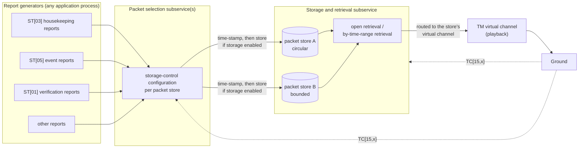
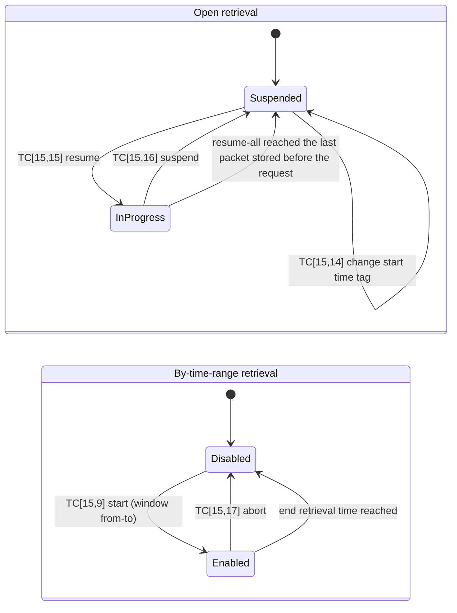
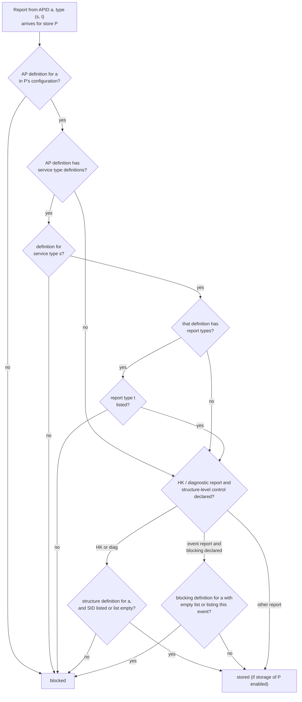
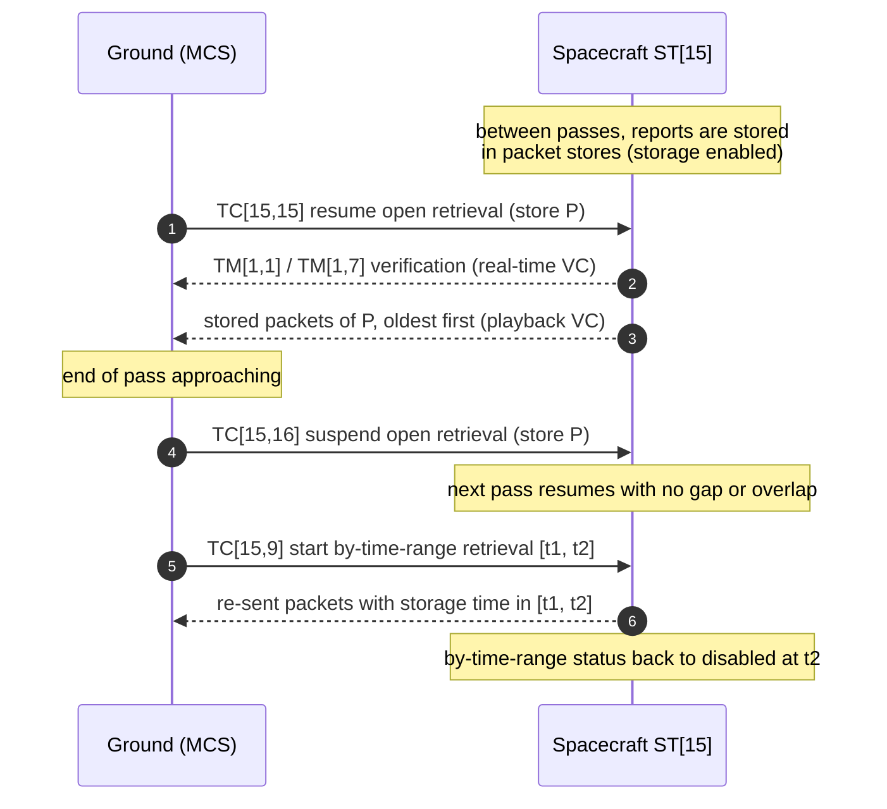

# ST[15] On-board storage and retrieval

A spacecraft is out of contact with the ground for most of its life, yet the operators want to
see everything it did while nobody was listening. Service type 15 of the
[Packet Utilization Standard](index.md) provides that memory. It selects reports generated by
the other on-board services, writes them into named **packet stores** in on-board memory, and
lets the ground manage those stores and ask for their contents to be sent down later.[^c-1511]
The retrieved data are called **playback** (also "deferred" telemetry, or a packet store "dump"),
as opposed to the real-time telemetry generated during a pass.[^c-vc2][^e-522][^e-531gg] This page covers the ECSS-E-ST-70-41C
("PUS-C", 2016) service completely - both subservices, the three status variables of a packet
store and the rules that link them, the packet selection logic, and all 37 message types with
their data fields - then compares it with the very different ECSS-E-70-41A ("PUS-A", 2003)
service and the 2024 Rev.1 draft. It ends with the ground view: virtual channels, how
SCOS-2000 handles playback, and the two real implementations described in the public
[Solar Orbiter MIB](../../missions/solar-orbiter/mib.md).

!!! info "Where this page sits"
    The reports that end up in packet stores come from services such as
    [ST[01] request verification](st01-request-verification.md),
    [ST[03] housekeeping](st03-housekeeping.md) and [ST[05] event reporting](st05-event-reporting.md).
    The sister service that controls which reports go *directly* to the ground is
    [ST[14] real-time forwarding control](st14-real-time-forwarding-control.md); its
    filtering model is the same as the packet selection subservice described here. Retrieved
    packets leave the spacecraft on a [TM virtual channel](../../ccsds/tm-sdlp.md). File-based
    storage is handled by [ST[23] file management](st23-file-management.md) and
    [CFDP](../../ccsds/cfdp.md).

## 1. At a glance

| Item | Value |
|---|---|
| Service type | 15 (every message of the service is of service type 15)[^c-p1] |
| PUS-C name | ST[15] on-board storage and retrieval[^c-1511] |
| PUS-A name | On-board storage and retrieval service (clause 18)[^a-181] |
| Subservice types | storage and retrieval (exactly one per service); packet selection (one or more)[^c-152] |
| System object | the packet store, identified by a packet store identifier[^c-sysobj][^c-1531] |
| Store types | circular (oldest packets overwritten) and bounded (storage stops when full)[^c-1512] |
| Retrieval modes | open retrieval (everything newer than the last packet sent) and by-time-range retrieval (between two dates)[^c-1512] |
| PUS-C message types | 30 requests and 7 reports, subtypes 1-6, 9 and 11-40[^c-annex] |
| PUS-C minimum capability | TC[15,1], TC[15,2], TC[15,14], TC[15,15] (and so TC[15,16]), TC[15,3], TC[15,4][^c-annex] |
| PUS-A minimum capability | (15,1), (15,2) and one downlink option, (15,7) and/or (15,9) into a dedicated VC or via (15,8)[^a-184] |

## 2. Why spacecraft store telemetry

PUS-C gives two reasons for storing telemetry packets on board and dumping them on request.
The first is **intermittent coverage or limited real-time bandwidth**: the store is sized to
hold every packet generated for spacecraft monitoring and control for at least the longest gap
between ground station passes plus a mission-dependent margin, and the packets are retrieved
in later passes in an order based on their operational significance. The second is
**recovery of lost packets** on missions with continuous coverage: the spacecraft keeps the
most recent set of packets, whose size is a mission configuration parameter, so that the
ground can fetch again what the space link lost.[^c-1511]

PUS-A said the same and named the two sizing constants: `<PKT_STORAGE_TIME>`, the margin added
to the longest non-coverage period, and `<PKTS_NUM_STORED>`, the number of recent one-shot
packets kept for loss recovery, "typically the last 100". It gives the classic example of
selective retrieval - anomaly reports are needed on the ground sooner than routine status
packets - and adds a rule that the 2025 operability standard repeats: storage must not be
interrupted when the ground asks for a retrieval or a deletion.[^a-411][^e-588]

The 2025 space segment operability standard [ECSS-E-ST-70-11C](../e-st-70-11c.md) turns this
into design requirements. The storage function must be able to store any packetised data
generated on board, be sized to hold all engineering telemetry for the specified autonomy
period, be able to put the same packet in more than one store, keep stored data retrievable
through the standard services after a reconfiguration or cold restart of the managing
application process, offer priorities for parallel retrievals from different stores, keep
storing while a retrieval or reset is in progress, and manage separate storage devices (for
example engineering and science mass memories) independently.[^e-588] Storage configuration
and contents must survive safe mode and a reconfiguration of the storage unit, and stay
accessible through the standard storage and retrieval subservices afterwards, without ground
intervention.[^e-531gg]

Mission requirements documents read the same way. The Herschel/Planck operations interface
requirements ask for a single centralised storage function in the data management computer,
storage of all packets independent of whether they are also sent to the ground, packet stores
selectable by APID and packet type, 48 hours of capacity, and retrieval by store, APID and
packet time - with the note that the obvious use is to dump the event and telecommand
verification packets first at the start of each visibility period.[^hp-obsr]

## 3. Architecture: two subservices



PUS-C splits the service into a **storage and retrieval subservice**, which stores telemetry
packets in packet stores and retrieves them later on ground request, and a **packet selection
subservice**, which decides which reports of which application process may enter which store.
A service contains exactly one storage and retrieval subservice and at least one packet
selection subservice; how they talk to each other is left out of the standard.[^c-1511][^c-152]
Each [application process](../../ccsds/space-packet.md) hosts at most one provider of each
subservice.[^c-152] The packet selection subservice can live in the application process that
generates the reports, in a process that routes them, or in the process that hosts the storage
and retrieval subservice.[^c-1513] PUS-A described the same choice as a decentralised design,
where each generating process selects its own packets, or a centralised one in which one
process that sees all telemetry does selection, storage and retrieval.[^a-1821][^o-a14] The
diagram above is this wiki's summary of that structure.

## 4. Packet stores

The packet store is one of the system objects of PUS-C: an object defined and maintained
within the scope of a service.[^c-sysobj] Within a storage and retrieval subservice each store
has a unique **packet store identifier**; its meaning and internal structure are outside the
standard, and the standard suggests the name of an object in memory as an example.[^c-1531] On
the wire the identifier is a fixed character-string in every PUS-C message.[^c-p1] PUS-A
called it the "Store ID", a character string that may for example point to a physical
recorder or a file.[^a-1831]

### 4.1 What a mission must declare

PUS-C does not fix any of the numbers; it lists what each mission must declare when it
specifies its storage and retrieval subservice (requirement letters of clause 6.15.3.1):[^c-1531]

| Req. | Declaration | Why it matters |
|---|---|---|
| a | Maximum number of packet stores maintained at the same time | bounds TC[15,20] create packet stores |
| b | List of pre-defined packet stores | stores that exist without being created |
| c | (rule) each store is managed by exactly one storage and retrieval subservice | one owner per store |
| d, e | Whether circular stores and whether bounded stores are supported | decides whether a store type field is needed |
| f | Type (circular or bounded) of each store | per-store property |
| g | Virtual channels usable by the subservice | limits TC[15,28] and TC[15,20] |
| h | Virtual channel used to transmit packets retrieved from each store | routing of playback |
| i, j | Whether concurrent retrievals are supported, and how many | the maximum covers open and by-time-range retrievals together; per store at most one of each runs at a time |
| k, l | Whether pending retrieval requests are queued, and the queuing policy | |
| m, n | Whether retrievals are prioritised, and the priority policy | adds a retrieval priority field to TC[15,9] and TC[15,15] |

### 4.2 Circular and bounded stores

A **circular** store overwrites its oldest packets when it is full, so it always holds the most
recent packets; a **bounded** store stops storing (new packets are discarded) when it is
full.[^c-1512][^c-1531] In packet fields the type is an enumerated value with raw value 0 for
"circular type" and 1 for "bounded type".[^c-p-enum] PUS-A added operational detail that PUS-C
dropped: a store used for lost-packet recovery must be circular; a bounded store must be
explicitly emptied (at least its oldest part) before it can store again; when a circular store
is being downlinked and new packets arrive faster than they can be sent, the downlink wins and
"the overwriting pointer shall always stay behind the retrieval pointer"; and the service need
not record gaps caused by packets it could not store, because the ground can detect them
afterwards.[^a-1822]

### 4.3 Time-stamping

Every packet is time-stamped when it is stored, and retrieval works on these **storage time
tags**. Each subservice declares its time-stamping method; PUS-C gives two examples:
**storage based** (the time the packet was stored) and **packet based** (the on-board time
already in the packet's secondary header).[^c-1532][^c-15331] PUS-A made storage time-stamping
optional and only then allowed retrieval by time.[^a-1821]

!!! warning "Inference"
    With packet-based time-stamping, "retrieve from 10:00 to 11:00" means "packets generated
    between 10:00 and 11:00"; with storage-based time-stamping it means "packets that arrived in
    the store in that hour". The two differ for packets that waited in an on-board queue, for
    example reports relayed from an instrument. The standard only names the two methods and
    leaves the consequence to the mission.

## 5. The three status variables

The storage and retrieval subservice keeps three statuses for every packet store. They are the
key to the whole service, because almost every request is accepted or rejected according to
them.

| Status (PUS-C name) | Values (raw) | Changed by |
|---|---|---|
| packet store storage status | "enabled" / "disabled" (raw values not stated in the available sources) | TC[15,1], TC[15,2][^c-15331] |
| packet store open retrieval status | "suspended" (0) / "in progress" (1) | TC[15,15], TC[15,16], end of a resume-all retrieval[^c-15341][^c-p-enum] |
| packet store by-time-range retrieval status | "disabled" (0) / "enabled" (1) | TC[15,9], TC[15,17], reaching the end time[^c-15351][^c-p-enum] |

A store created by TC[15,20] starts with storage disabled, by-time-range retrieval disabled and
open retrieval suspended.[^c-15381] The two retrieval statuses behave as follows (diagram drawn by
this wiki from clauses 6.15.3.4 and 6.15.3.5):[^c-15343][^c-15344][^c-15352][^c-15353]



Most management requests require the store to be idle. The table collects the conditions that
cause an instruction (or, where noted, the whole request) to be rejected:

| Request | Storage must be disabled | Open retrieval must be suspended | By-time-range retrieval must be disabled | Other rejection conditions |
|---|---|---|---|---|
| TC[15,14] change open retrieval start time tag | - | yes | - | start time tag in the future (whole request)[^c-15342] |
| TC[15,15] resume open retrieval | - | - | only if concurrent retrievals are not supported | unknown store[^c-15343] |
| TC[15,9] start by-time-range retrieval | - | only if concurrent retrievals are not supported | yes | start later than end; window fully in the past with no packet in it[^c-15352] |
| TC[15,11] delete content up to a time | - | yes | yes | unknown store[^c-1537] |
| TC[15,21] delete packet stores | yes | yes | yes | unknown store; "delete all" silently skips busy stores[^c-15382] |
| TC[15,25] resize | yes | yes | yes | size incompatible with memory availability[^c-15391] |
| TC[15,26] / TC[15,27] change type | yes | yes | yes | (whole request)[^c-15392] |
| TC[15,28] change virtual channel | - | yes | yes | invalid VC (whole request)[^c-15394] |

The pattern is consistent: storage may continue while a store is being read, but nothing may
change a store's shape (size, type) or its contents while a retrieval is running.

## 6. The storage and retrieval subservice, request by request

Most PUS-C requests carry a list of **instructions**, one per packet store. Unless the standard
says the whole request is rejected, each faulty instruction gets its own failed start of
execution notification while the valid ones are still executed.[^c-15332] Those notifications
become [ST[01]](st01-request-verification.md) failed start of execution reports. The usual
encoding is a count `N` followed by `N` store identifiers; `N` = 0 means "all packet
stores".[^c-p1]

### 6.1 Controlling storage: TC[15,1] and TC[15,2]

For every packet it receives, the subservice time-stamps it and writes it into every
**enabled** store whose storage selection criteria it matches.[^c-15331] TC[15,1] "enable the
storage function of packet stores" and TC[15,2] "disable the storage function of packet
stores" set the storage status of the listed stores, or of all stores; an instruction naming a
store that does not exist is rejected.[^c-15332]

| Field | Type | Meaning |
|---|---|---|
| N | unsigned integer | number of stores that follow; 0 = all stores |
| packet store ID (repeated N times) | fixed character-string | store to enable (TC[15,1]) or disable (TC[15,2]) |

[^c-p1]

### 6.2 Open retrieval: TC[15,14], TC[15,15] and TC[15,16]

**Open retrieval** is the routine "send me what I have not seen yet" mode. While a store's open
retrieval status is "in progress", the subservice reads its packets in storage time-tag order,
starting from the store's **open retrieval start time tag**, and routes them to the store's
virtual channel (in priority order if priorities are supported). Suspending and resuming must
not create a gap or an overlap in the retrieved sequence.[^c-15341]

* **TC[15,14] change the open retrieval start time tag of packet stores** moves the start
  point. The request carries one
  time tag and a list of stores (N = 0: all). A time tag in the future rejects the whole
  request; an instruction for an unknown store or for a store whose open retrieval is in
  progress is rejected; the "all stores" form changes only the stores that are
  suspended.[^c-15342]
* **TC[15,15] resume the open retrieval of packet stores** sets the status to "in progress"
  and, if priorities are supported, sets the retrieval priority. If the subservice does not
  support concurrent retrievals, it rejects a resume for a store whose by-time-range retrieval
  is enabled. For the "all stores" form the standard adds that each store returns to
  "suspended" once the last packet stored before the request started executing has been
  retrieved.[^c-15343]
* **TC[15,16] suspend the open retrieval of packet stores** sets the status back to
  "suspended".[^c-15344]

| Message | Fields (in order) |
|---|---|
| TC[15,14] | open retrieval start time tag (absolute time); N (unsigned integer, 0 = all); packet store ID (fixed character-string) x N |
| TC[15,15] | N (0 = all); then N x {packet store ID; retrieval priority (enumerated, optional)} |
| TC[15,16] | N (0 = all); packet store ID x N |

[^c-p11]

!!! warning "Inference"
    The no-gap, no-overlap rule is what lets operators split a long dump over several passes
    (suspend before loss of signal, resume at the next acquisition), and TC[15,14] lets them
    move the start point back to fetch data again. These uses are this wiki's illustration;
    the standard states only the mechanisms.

    PUS-C states the "suspend at the end" rule only for the resume-all form of TC[15,15]; for
    an individual resume it does not say when an open retrieval stops by itself. The 2024
    Rev.1 draft resolves this with an explicit per-store **open retrieval policy** ("suspend"
    or "stay open", see [section 10](#10-the-2024-rev1-draft)), which suggests that the
    2016 text was found incomplete on this point.

### 6.3 By-time-range retrieval: TC[15,9] and TC[15,17]

The **by-time-range** mode is meant to recover packets lost in the downlink: the ground names a
window and the spacecraft re-sends the packets whose storage time tags fall inside it, then
switches the by-time-range status back to "disabled" by itself when it reaches the end
time.[^c-1512][^c-15351] Support for this mode is optional and declared per
subservice.[^c-15351]

TC[15,9] "start the by-time-range retrieval of packet stores" carries one or more
instructions, each with a store, an optional retrieval priority and the window. An instruction
is rejected if the store does not exist; if concurrent retrievals are unsupported and the
store's open retrieval is in progress; if the start time is later than the end time; if the
window is entirely in the past and the store holds no packet in it; or if a by-time-range
retrieval of that store is already enabled.[^c-15352] TC[15,17] "abort the by-time-range
retrieval of packet stores" disables it for the listed stores or for all stores.[^c-15353]

<div class="bitfield" data-title="TC[15,9] application data, one instruction (illustrative field widths)" data-width="32"
     data-fields='[{"n":"N","b":8,"d":"Unsigned integer; number of instructions (mission-defined PFC; 8 bits assumed here)"},{"n":"Packet store ID","b":32,"g":"repeated N times","d":"Fixed character-string; 4 characters assumed here"},{"n":"Retrieval priority","b":8,"g":"repeated N times","d":"Enumerated; present only if retrieval prioritisation is supported"},{"n":"From time","b":48,"g":"repeated N times","d":"Absolute time; a 6-octet CUC is assumed here"},{"n":"To time","b":48,"g":"repeated N times","d":"Absolute time"}]'></div>

The field order and types are those of Figure 8-165; the widths are illustrative because
PUS-C leaves the integer, character-string and time formats to the mission (see
[PUS parameter types](parameter-types.md)).[^c-p7] The real Solar Orbiter layouts are in
[section 12](#12-solar-orbiter-two-implementations-of-service-15).

### 6.4 Reporting the status: TC[15,18] and TM[15,19]

TC[15,18] "report the status of each packet store" has no application data. The response,
TM[15,19] "packet store status report", lists for every store its identifier, storage status,
open retrieval status and - if by-time-range retrieval is supported - its by-time-range
status.[^c-1536][^c-p15]

| Field | Type |
|---|---|
| N | unsigned integer |
| packet store ID | fixed character-string (repeated N times) |
| packet store storage status | enumerated |
| packet store open retrieval status | enumerated |
| packet store by-time-range retrieval status | enumerated, optional |

### 6.5 Deleting contents: TC[15,11]

TC[15,11] "delete the content of packet stores up to the specified time" carries a storage
time followed by N store identifiers (N = 0: all stores). For each store it deletes everything
from the oldest packet up to and including the last packet time-stamped at or before that
time. It refuses stores that are being retrieved by either mode.[^c-1537][^c-p8] PUS-A
explains why such a request is needed: a full bounded store must be explicitly emptied, at
least its oldest part, before it can store new packets again.[^a-1822]

### 6.6 Creating, deleting, reporting and copying stores: TC[15,20] to TC[15,24]

PUS-C standardises what PUS-A left to the missions: the life cycle of the stores
themselves.

* **TC[15,20] create packet stores** (optional capability) carries one instruction per new
  store: identifier, size in bytes, type (only if both types are supported) and virtual channel
  (only if more than one VC is supported). The whole request is rejected if one instruction
  names an existing store or if two instructions name the same store; an individual
  instruction is rejected if the maximum number of stores is reached, if memory is
  insufficient (the criteria are not specified) or if the VC is invalid. A new store starts
  idle: storage disabled, by-time-range retrieval disabled, open retrieval
  suspended.[^c-15381]
* **TC[15,21] delete packet stores** is mandatory when creation is provided. Only idle stores
  can be deleted (storage disabled, no retrieval running); the "delete all" form simply deletes
  every store that is idle.[^c-15382]
* **TC[15,22] report the configuration of each packet store** (no application data) returns
  **TM[15,23] packet store configuration report** with, for each store, identifier, size in
  bytes, type and VC (the last two only when they can vary).[^c-15383]
* **TC[15,24] copy the packets contained in a packet store selected by time window** copies,
  from a source store to an empty destination store, the packets selected by one of three
  filters: from time tag to time tag (inclusive), at and after a time tag, or at and before a
  time tag. The request is rejected if either store is unknown, if the window is invalid or if
  the destination is not empty.[^c-15384]

| Message | Fields (in order) |
|---|---|
| TC[15,20] | N; then N x {packet store ID (fixed character-string); packet store size (unsigned integer); packet store type (enumerated, optional); packet store virtual channel (enumerated, optional)} |
| TC[15,21] | N (0 = all); packet store ID x N |
| TM[15,23] | same structure as TC[15,20] |
| TC[15,24] | time window type (enumerated); time tag 1 (absolute time, deduced presence); time tag 2 (absolute time, deduced presence); from packet store ID; to packet store ID |

[^c-p17][^c-p21]

The enumeration values of the time window type are not listed in clause 8.15.3, which only
defines the store type and the two retrieval statuses.[^c-p-enum]

### 6.7 Changing store properties: TC[15,25] to TC[15,28]

**TC[15,25] resize packet stores** gives a new size in bytes per store; the time and conditions
for the change to take effect are implementation dependent. When resizing is provided, the
subservice must also offer **TC[15,26] change a packet store type to circular**,
**TC[15,27] change a packet store type to bounded** and **TC[15,28] change the virtual channel
used by a packet store**. The two type changes carry one store identifier each; the standard
says explicitly that it does not define what happens to the stored packets when the type
changes. TC[15,28] carries a store identifier and the new VC (enumerated).[^c-15391][^c-15392][^c-15394][^c-p22]

### 6.8 Summarising the contents: TC[15,12] and TM[15,13]

TC[15,12] "summary-report the content of packet stores" (N store IDs, N = 0 for each store)
returns **TM[15,13] packet store content summary report**. For each store it gives the storage
time tags of the oldest and of the newest packet, the current open retrieval start time tag,
the percentage of the store that is filled, and the percentage filled by packets between the
open retrieval start time tag and the newest packet - which, the standard notes, is the amount
of data still to transfer to the ground.[^c-15310]

<div class="bitfield" data-title="TM[15,13] one store entry (illustrative field widths)" data-width="32"
     data-fields='[{"n":"Packet store ID","b":32,"d":"Fixed character-string; 4 characters assumed"},{"n":"Oldest stored packet time","b":48,"d":"Absolute time; 6-octet CUC assumed"},{"n":"Newest stored packet time","b":48,"d":"Absolute time"},{"n":"Current open retrieval start time tag","b":48,"d":"Absolute time"},{"n":"Percentage filled","b":8,"d":"Unsigned integer; 8 bits assumed"},{"n":"From open retrieval start time tag percentage filled","b":8,"d":"Unsigned integer; the data still to send"}]'></div>

The report starts with N (unsigned integer) and repeats this entry N times (Figure
8-168).[^c-p8]

### 6.9 Observables

PUS-C requires the following values to be observable for each store: open retrieval status, by-time-range retrieval status (if supported), current
open retrieval start time tag, filling percentage, time stamp of the last packet stored, and the
filling percentage between the open retrieval start time tag and the newest packet.[^c-15311]

## 7. The packet selection subservice

The packet selection subservice decides, per packet store, which reports may be stored. It
always controls the reports of the application process that hosts it, can be declared to
control others, must be able to handle all reports of the processes it controls, and must
always have access to the stores of its storage and retrieval subservice.[^c-1541]

### 7.1 The storage-control configuration

For each store the subservice keeps an **application process storage-control configuration**:
a set of definitions, one per controlled application process, each holding zero or more
**service type storage-control definitions**, each holding zero or more **report type
storage-control definitions** (a message subtype).[^c-15422] An empty level means "everything
below": an application process definition with no service types stores every report of that
process; a service type definition with no report types stores every report of that service.
An empty configuration - no definition at all - blocks every report from that
store.[^c-15422][^c-1513] The subservice knows the application processes it controls but not
which service and report types they can generate, so it may accept definitions that mean
nothing; keeping them consistent is left to the ground.[^c-15422] The mission declares the
maximum numbers of service type definitions per process and of report type definitions per
service type.[^c-15422]

Three optional, finer controls can be declared on top of this:[^c-15421]

| Configuration | Granularity | Empty configuration means | Extra |
|---|---|---|---|
| housekeeping parameter report storage-control | HK report structure ID per application process | no HK report is stored | optional subsampling rate per structure |
| diagnostic parameter report storage-control | diagnostic report structure ID per application process | no diagnostic report is stored | optional subsampling rate per structure |
| event report blocking storage-control | event definition ID per application process | every event report is stored (it is a *blocking* list) | - |

[^c-15423][^c-15424][^c-15425]

The meaning and unit of the subsampling rate are not stated in the available sources; the same
optional field appears in ST[14] forwarding control.[^c-15421]

### 7.2 Processing logic

Clause 6.15.4.3 spells out when a report is blocked from a store. The flowchart is this wiki's
drawing of those requirements.[^c-1543]



### 7.3 Managing the application process configuration: TC[15,3] to TC[15,6]

**TC[15,3] add report types to the application process storage-control configuration** and
**TC[15,4] delete report types from the application process storage-control configuration**
share one nested layout (Figures 8-161 and 8-162):[^c-p3]

<div class="bitfield" data-title="TC[15,3] / TC[15,4] / TM[15,6] nesting (illustrative widths, one entry per level)" data-width="32"
     data-fields='[{"n":"Packet store ID","b":32,"d":"Fixed character-string"},{"n":"N1","b":8,"d":"Number of application processes"},{"n":"Application process ID","b":16,"g":"x N1","d":"Enumerated; present only if more than one process is controlled"},{"n":"N2","b":8,"g":"x N1","d":"Number of service types; 0 = all report types of the process"},{"n":"Service type","b":8,"g":"x N2","d":"Enumerated"},{"n":"N3","b":8,"g":"x N2","d":"Number of subtypes; 0 = all report types of the service type"},{"n":"Message subtype","b":8,"g":"x N3","d":"Enumerated"}]'></div>

* In TC[15,3], N2 = 0 adds all report types of the process and N3 = 0 adds all report types of
  the service type. Adding at a coarse level deletes the finer definitions beneath it (adding a
  whole service type removes its report type list). An instruction is rejected if the process
  is not controlled, if a maximum is reached, or if it tries to add a report type under a
  service type (or a service type under a process) that is already stored in full - the
  standard calls such an addition "meaningless".[^c-15441][^c-p3]
* In TC[15,4], N1 = 0 empties the whole configuration, N2 = 0 deletes a process and N3 = 0
  deletes a service type. Deleting the last report type of a service type deletes the service
  type definition, and deleting the last service type deletes the process definition, so the
  hierarchy never keeps empty levels that would silently mean "everything".[^c-15442][^c-p3]
* **TC[15,5] report the content of the application process storage-control configuration**
  (one packet store ID) returns **TM[15,6] application process storage-control configuration
  content report** with the same nested layout.[^c-15443][^c-p3]

!!! warning "Inference: why the cascade matters"
    Because an empty service type definition means "all report types", a naive delete that
    left an empty definition behind would turn "stop storing TM[3,25]" into "store every
    service 3 report". The cascading deletion in requirement 6.15.4.4.2o avoids exactly that.

### 7.4 Housekeeping, diagnostic and event controls: TC[15,29] to TC[15,40]

| Message | Purpose | Layout (Figure) |
|---|---|---|
| TC[15,29] | add structure IDs to the housekeeping parameter report storage-control configuration | store ID; N1 x {APID (optional); N2; N2 x {HK structure ID; subsampling rate (optional)}}; N2 = 0 adds all structures (8-182) |
| TC[15,30] | delete structure IDs from that configuration | store ID; N1 x {APID (optional); N2; N2 x HK structure ID}; N1 = 0 empties it, N2 = 0 deletes a process (8-183) |
| TC[15,35] / TM[15,36] | report that configuration | store ID / same layout as TC[15,29] (8-188, 8-189) |
| TC[15,31] | add structure IDs to the diagnostic parameter report storage-control configuration | as TC[15,29] with diagnostic structure IDs (8-184) |
| TC[15,32] | delete structure IDs from that configuration | as TC[15,30] (8-185) |
| TC[15,37] / TM[15,38] | report that configuration | (8-190, 8-191) |
| TC[15,34] | **add** event definition IDs to the event report blocking storage-control configuration | store ID; N1 x {APID (optional); N2; N2 x event definition ID}; N2 = 0 blocks all events of the process (8-187) |
| TC[15,33] | **delete** event definition IDs from that configuration | same layout; N1 = 0 empties it, N2 = 0 deletes a process (8-186) |
| TC[15,39] / TM[15,40] | report that configuration | (8-192, 8-193) |

[^c-1545][^c-1546][^c-1547][^c-p26][^c-p30][^c-p32]

Note the reversed numbering in the event group: subtype 33 deletes and 34 adds, whereas
for the housekeeping and diagnostic groups the lower subtype adds.[^c-p30] The packet
selection subservice has no observables of its own.[^c-1548]

### 7.5 Worked example (illustrative)

Suppose a mission has one store `"EVTS"` for operationally important reports, and the
application process with APID 100 must put there all its ST[05] reports and its TM[1,2] and
TM[1,8] failure reports, but not its routine events with event definition ID 7. With the
service of this page the ground would send (field lists, not bytes; the values are invented
for the explanation):

1. TC[15,3]: store `"EVTS"`, N1 = 1, APID 100, N2 = 2, {service type 5, N3 = 0}, {service type
   1, N3 = 2, subtypes 2 and 8}.
2. TC[15,34]: store `"EVTS"`, N1 = 1, APID 100, N2 = 1, event definition ID 7 (only if
   event-level blocking is declared).
3. TC[15,1]: N = 1, store `"EVTS"`.
4. Later, TC[15,5] for `"EVTS"` to check the result in TM[15,6].

## 8. Message type catalogue

All 37 PUS-C message types of the service, with the system clause, the packet clause and the
applicability given in Annex C ("minimum" = always present; "declaration" = present if the
mission declares the capability; "implied"/"requires" = tied to another capability):[^c-annex]

| Type | Name | Subservice | Clauses | Applicability |
|---|---|---|---|---|
| TC[15,1] | enable the storage function of packet stores | S&R | 6.15.3.3.2 / 8.15.2.1 | minimum |
| TC[15,2] | disable the storage function of packet stores | S&R | 6.15.3.3.3 / 8.15.2.2 | minimum |
| TC[15,3] | add report types to the application process storage-control configuration | PS | 6.15.4.4.1 / 8.15.2.3 | minimum |
| TC[15,4] | delete report types from the application process storage-control configuration | PS | 6.15.4.4.2 / 8.15.2.4 | minimum |
| TC[15,5] | report the content of the application process storage-control configuration | PS | 6.15.4.4.3 / 8.15.2.5 | requires TC[15,3] |
| TM[15,6] | application process storage-control configuration content report | PS | 6.15.4.4.3 / 8.15.2.6 | response to TC[15,5] |
| TC[15,9] | start the by-time-range retrieval of packet stores | S&R | 6.15.3.5.2 / 8.15.2.7 | implied by 6.15.3.5.1a |
| TC[15,11] | delete the content of packet stores up to the specified time | S&R | 6.15.3.7.1 / 8.15.2.8 | declaration |
| TC[15,12] | summary-report the content of packet stores | S&R | 6.15.3.10.1 / 8.15.2.9 | declaration |
| TM[15,13] | packet store content summary report | S&R | 6.15.3.10.1 / 8.15.2.10 | response to TC[15,12] |
| TC[15,14] | change the open retrieval start time tag of packet stores | S&R | 6.15.3.4.2 / 8.15.2.11 | minimum |
| TC[15,15] | resume the open retrieval of packet stores | S&R | 6.15.3.4.3 / 8.15.2.12 | minimum |
| TC[15,16] | suspend the open retrieval of packet stores | S&R | 6.15.3.4.4 / 8.15.2.13 | implied by TC[15,15] |
| TC[15,17] | abort the by-time-range retrieval of packet stores | S&R | 6.15.3.5.3 / 8.15.2.14 | implied by 6.15.3.5.1a |
| TC[15,18] | report the status of each packet store | S&R | 6.15.3.6 / 8.15.2.15 | declaration |
| TM[15,19] | packet store status report | S&R | 6.15.3.6 / 8.15.2.16 | response to TC[15,18] |
| TC[15,20] | create packet stores | S&R | 6.15.3.8.1 / 8.15.2.17 | declaration |
| TC[15,21] | delete packet stores | S&R | 6.15.3.8.2 / 8.15.2.18 | implied by TC[15,20] |
| TC[15,22] | report the configuration of each packet store | S&R | 6.15.3.8.3 / 8.15.2.19 | requires TC[15,20] |
| TM[15,23] | packet store configuration report | S&R | 6.15.3.8.3 / 8.15.2.20 | response to TC[15,22] |
| TC[15,24] | copy the packets contained in a packet store selected by time window | S&R | 6.15.3.8.4 / 8.15.2.21 | requires TC[15,20] |
| TC[15,25] | resize packet stores | S&R | 6.15.3.9.1 / 8.15.2.22 | declaration |
| TC[15,26] | change a packet store type to circular | S&R | 6.15.3.9.2 / 8.15.2.23 | implied by TC[15,25] |
| TC[15,27] | change a packet store type to bounded | S&R | 6.15.3.9.3 / 8.15.2.24 | implied by TC[15,25] |
| TC[15,28] | change the virtual channel used by a packet store | S&R | 6.15.3.9.4 / 8.15.2.25 | implied by TC[15,25] |
| TC[15,29] | add structure identifiers to the housekeeping parameter report storage-control configuration | PS | 6.15.4.5.1 / 8.15.2.26 | implied by 6.15.4.2.1a |
| TC[15,30] | delete structure identifiers from the housekeeping parameter report storage-control configuration | PS | 6.15.4.5.2 / 8.15.2.27 | implied by 6.15.4.2.1a |
| TC[15,31] | add structure identifiers to the diagnostic parameter report storage-control configuration | PS | 6.15.4.6.1 / 8.15.2.28 | implied by 6.15.4.2.1b |
| TC[15,32] | delete structure identifiers from the diagnostic parameter report storage-control configuration | PS | 6.15.4.6.2 / 8.15.2.29 | implied by 6.15.4.2.1b |
| TC[15,33] | delete event definition identifiers from the event report blocking storage-control configuration | PS | 6.15.4.7.2 / 8.15.2.30 | implied by 6.15.4.2.1c |
| TC[15,34] | add event definition identifiers to the event report blocking storage-control configuration | PS | 6.15.4.7.1 / 8.15.2.31 | implied by 6.15.4.2.1c |
| TC[15,35] | report the content of the housekeeping parameter report storage-control configuration | PS | 6.15.4.5.3 / 8.15.2.32 | requires TC[15,29] |
| TM[15,36] | housekeeping parameter report storage-control configuration content report | PS | 6.15.4.5.3 / 8.15.2.33 | response |
| TC[15,37] | report the content of the diagnostic parameter report storage-control configuration | PS | 6.15.4.6.3 / 8.15.2.34 | requires TC[15,31] |
| TM[15,38] | diagnostic parameter report storage-control configuration content report | PS | 6.15.4.6.3 / 8.15.2.35 | response to TC[15,37] |
| TC[15,39] | report the content of the event report blocking storage-control configuration | PS | 6.15.4.7.3 / 8.15.2.36 | requires TC[15,33] |
| TM[15,40] | event report blocking storage-control configuration content report | PS | 6.15.4.7.3 / 8.15.2.37 | response to TC[15,39] |

S&R = storage and retrieval subservice; PS = packet selection subservice. Subtypes 7, 8 and 10
are not used by PUS-C; they belonged to PUS-A. The service is listed with all others in the
[PUS message type catalogue](message-types.md). ESA's 2015 status presentation, which counts
per clause and service type the discrepancy reports (DRRs) processed after the 2014 public
review, gives
ST[15] 36 DRRs, the seventh-highest count among the service types.[^v-drr]

## 9. PUS-A (2003): a different service under the same number

PUS-A's service 15 shares the subtypes 1 to 6 and the storage-selection idea with PUS-C, but
the retrieval part is built differently.[^a-1831][^a-1832][^a-1833]

* **Downlink options.** Retrieved packets could be sent either in the same virtual channel as
  real-time data, wrapped in a "real-time" envelope of service 15 (the report (15,8)), or in a
  virtual channel dedicated to retrieval, "exactly as originally received by the packet
  store". A given service implements only one of the two.[^a-1821] When wrapped, the service
  could use the large data transfer service ([ST[13]](st13-large-packet-transfer.md)) to send
  a long (15,8).[^a-1821]
* **Ordering.** Packets are ordered by their time of arrival at the store; downlink can cover
  the whole store or a subset, for example a packet range.[^a-1821]
* **Store management** - creation, deletion and attributes - was outside the
  standard.[^a-1832]

| PUS-A subtype | Name | Application/source data |
|---|---|---|
| (15,1) / (15,2) | Enable / Disable Storage in Packet Stores | N; Store ID x N (N = 0: all stores; N omitted if only one store) |
| (15,3) / (15,4) | Add / Remove Packets to/from Storage Selection Definition | Store ID; N1 x {APID; N2 x {Type; N3 x Subtype}} |
| (15,5) / (15,6) | Report Storage Selection Definition / Storage Selection Definition Report | Store ID / same layout as (15,3) |
| (15,7) | Downlink Packet Store Contents for Packet Range | Store ID; Packet Set (0 All, 1 Between, 2 Before, 3 After); APID 1, Source Sequence Count 1; APID 2, Source Sequence Count 2 |
| (15,8) | Packet Store Contents Report | N; N x any TM packet (the retrieved packets in storage order) |
| (15,9) | Downlink Packet Store Contents for Time Period | Store ID; Time Span (0 All, 1 Between, 2 Before, 3 After); Storage Time 1; Storage Time 2 |
| (15,10) | Delete Packet Stores Contents up to Specified Packets | Deletion Set (0 All, 1 Before); N; N x {Store ID; APID; Source Sequence Count} |
| (15,11) | Delete Packet Stores Contents up to Specified Storage Time | End Time; N; Store ID x N |
| (15,12) / (15,13) | Report Catalogues for Selected Packet Stores / Packet Store Catalogue Report | N; Store ID x N / see below |

[^a-1831][^a-1832][^a-1833][^a-1834][^a-1835][^a-1836][^a-1837][^a-1838]

Some rules worth knowing:

* In (15,7), the boundaries are packets identified by APID and source sequence count, matched
  against the stored packets. If a lower boundary packet is missing, retrieval starts with the
  last earlier packet of the same APID (or the oldest packet); if an upper boundary is missing,
  it ends with the first later packet of that APID (or the end of the store). Whatever the
  criterion, retrieval ends at the latest with the last packet stored when the request
  arrived.[^a-1834]
* (15,9) uses storage times: between (inclusive), at or before Storage Time 1, at or after
  Storage Time 1. Their format is fixed per destination application process.[^a-1835]
* (15,10) and (15,11) delete up to a packet or up to a storage time; while deletion is running,
  new packets may already be written into the freed space.[^a-1836][^a-1837]
* The (15,13) catalogue gives, per store, the header fields (APID, source sequence count,
  service type and subtype, packet sub-counter) and storage time of the oldest and of the
  newest packet, the percentage filled and the percentage downlinked, the number of packets
  stored and the number downlinked.[^a-1838]

The capability sets: packet selection minimum = (15,1) and (15,2); storage and retrieval
minimum = one downlink option (a dedicated VC or the (15,8) report) with (15,7) and/or (15,9);
additional capabilities = (15,3)-(15,6), circular and bounded stores, time-stamping, (15,7),
(15,9), (15,10), (15,11), (15,12)-(15,13).[^a-184] [ECSS-E-ST-70-31C](../e-st-70-31c.md)
models the same service as a decision tree of tailoring choices, for example whether packets go
down "in the same VC as real-time packets" (which enables (15,8)).[^o-a14][^o-a14t]

| Topic | PUS-A (2003) | PUS-C (2016) |
|---|---|---|
| Retrieval requests | (15,7) by packet range, (15,9) by time period, each a one-shot downlink | open retrieval (TC[15,14]-[15,16]) plus by-time-range retrieval (TC[15,9], TC[15,17]) |
| Wrapped downlink (15,8) | optional design | removed; packets are routed to the store's virtual channel |
| Delete by packet (15,10) | yes | removed (only by time, TC[15,11]) |
| Catalogue (15,12)/(15,13) | oldest/newest packet headers, packet counts | summary report TC[15,12]/TM[15,13] with time tags and fill percentages |
| Store creation, resize, type, VC | out of scope | TC[15,20]-TC[15,28] |
| Selection granularity | APID, type, subtype | adds HK and diagnostic structure IDs (with subsampling) and event blocking |
| Store ID | fixed character string, omitted if only one store | fixed character-string, always present |

The general differences between the two issues are on [PUS-A vs PUS-C](pus-a-vs-pus-c.md).

## 10. The 2024 Rev.1 draft

The December 2024 draft ECSS-E-ST-70-41C Rev.1 DIR1 keeps the architecture but tightens the
storage and retrieval subservice. It is a draft for review, not an approved standard.

* A new clause on configuration asks each mission to declare the policy applied when the
  subservice starts or restarts, and requires storage, routing configuration and retrieval
  pointers to survive spacecraft mode transitions, such as safe mode or a processor
  reboot.[^r-1531]
* Queuing of pending retrieval requests becomes mandatory, with a declared maximum queue
  length; if priorities are supported, each store gets a **default retrieval priority**, and
  the subservice may not limit how many retrievals share one priority level.[^r-1532]
* Each store gets an **open retrieval policy** that says whether an open retrieval stays open
  after the last packet stored before the request has been sent, or suspends.[^r-1532] Its
  raw values are 0 "suspend" and 1 "stay open"; TC[15,15] gains an open retrieval policy field,
  and a retrieval priority of 0 selects the store's default priority.[^r-enum][^r-15-15]
* New requests: TC[15,10] "abort all requests to copy the packets contained in a packet store
  selected by time window" (no application data) and TC[15,41] "change the default retrieval
  priority of a packet store" (store ID, default retrieval priority).[^r-15-10][^r-15-41]
* Storage control per diagnostic parameter report structure is gone: the draft's packet
  selection subservice defines only the application process, housekeeping and event-blocking
  configurations, and TC[15,31], TC[15,32], TC[15,37] and TM[15,38] do not appear in its list
  of service 15 messages.[^r-1542][^r-msgs]

## 11. Playback telemetry and virtual channels

PUS-C has no separate playback packet: a retrieved packet is the original packet, routed to
the virtual channel associated with its store.[^c-15341][^c-1531] Virtual channels are system
objects declared in the space-to-ground interface specification,[^c-vc] and PUS-C names
"separating real-time data from playback data" as one of their uses.[^c-vc2] The operability
standard adds the rules that make this work on the ground: the assignment of VCs to data
classes (real-time TM, playback, high-priority TM, critical event log) is agreed with the
operator and not changed during the mission; real-time and deferred telemetry must be
transmittable at the same time;[^e-522] packets of one APID arrive in generation order within
a VC, except across separate retrievals from storage, where the original order is not always
kept;[^e-531w] the ground must be able to verify completeness whatever the route; and idle data
must not be interleaved while there is real data to send, "e.g. during packet store
dumps".[^e-531gg]



The sequence is an illustration composed by this wiki from the PUS-C rules quoted above, not a
procedure taken from a mission document.

On the ground, the SCOS-2000 database import ICD says that SCOS-2000 has no specific
processing for service 15 and no ground model of the on-board storage status or
configuration. It cannot unpack packets encapsulated in (15,8) reports, but needs nothing
special when stored packets arrive as they were stored.[^i-c313] Its command verifier can use
playback telemetry too, for example for delayed verification of time-tagged commands, as long
as playback data arrive in chronological order.[^i-c311] In the binary delivery format of the
EGOS Data Dissemination System ([EDDS](../../scos2000/edds.md)) each TM packet record carries a
virtual channel field, and each TC
record holds separate acceptance and execution verification states for the real-time (VC0)
and playback (VC1) streams.[^u-gdds] Solar Orbiter's data delivery ICD maps SCOS-2000 stream
IDs to virtual channels: 1000 = VC0 real-time non-science, 1001 = VC1 playback non-science,
1002 = VC2 science and 1003 = VC3 file transfer, with 2000-2003 for the offline
streams.[^d-stream]

## 12. Solar Orbiter: two implementations of service 15

Solar Orbiter's TM/TC and packet structure ICD (SOL.S.ASTR.TN.00079, issue 7) tailors PUS-A.
Service 15 is implemented twice: in the central software (CSW) of the on-board computer, which
manages the OBC mass memory (OMM), and in the software of the solid state mass memory (SSMM).
The two implementations differ, and the ICD documents the CSW structures in detail while
referring to an SSMM document for most SSMM structures. Both have packet selection, downlink
("playback") and storage maintenance functions; the CSW selects packets by process ID, type
and subtype, the SSMM by APID.[^s-516]

### 12.1 Who is who

Solar Orbiter splits the 11-bit APID into a 7-bit process ID (PID) and a 4-bit packet
category.[^s-apid] The service 15 traffic in the 2025 MIB uses:[^mib-15][^s-annex8]

| APID | PID / category | Role |
|---|---|---|
| [172](../../explorer/index.md#/solo/apid/172) | 10 (OBC CSW, data management) / 12 (telecommand) | CSW service 15 commands |
| [163](../../explorer/index.md#/solo/apid/163) | 10 / 3 (table generation) | CSW service 15 reports |
| [161](../../explorer/index.md#/solo/apid/161) | 10 / 1 (TC verification) | CSW failure reports TM[1,8] |
| [167](../../explorer/index.md#/solo/apid/167) | 10 / 7 (event generation) | CSW events about stores and downlinks |
| [162](../../explorer/index.md#/solo/apid/162), [164](../../explorer/index.md#/solo/apid/164) | 10 / 2 (high priority TM) and 4 (routine HK) | "DMS OMM Packet Stores" housekeeping |
| [492](../../explorer/index.md#/solo/apid/492) | 30 (operational SSMM memory controller) / 12 | SSMM service 15 commands |
| [483](../../explorer/index.md#/solo/apid/483), [484](../../explorer/index.md#/solo/apid/484) | 30 / 3 and 4 | SSMM reports and "SSMM PS Status TM" |

The CSW stores are an enumerated 1-byte identifier, not a character string. The textual
calibration [`CCDT0021TX`](../../explorer/index.md#/solo/calib/txt/CCDT0021TX) names nine:
1 `PS_HK`, 2 `PS_ACK`, 3 `PS_EVENT`, 4 `PS_DIAG`, 5 `PS_DUMP`, 6 `PS_REPORTS`, 7 `PS_PASS_HK`,
8 `PS_PASS_ACK` and 9 `PS_PASS_EVT`.[^mib-15] The SSMM stores are numbered 0-63.[^s-5165][^mib-15]

### 12.2 The commands and reports in the MIB

The 2025 release defines 47 service 15 commands (17 for the CSW, 30 for the SSMM) and 7 service
15 report packets; the April 2020 release has the same subtypes and counts.[^mib-15]

| Subtype | CSW (APID 172) | SSMM (APID 492) |
|---|---|---|
| 1 / 2 | [ZCD00F01](../../explorer/index.md#/solo/command/ZCD00F01) / [ZCD00F02](../../explorer/index.md#/solo/command/ZCD00F02) enable / disable storage | ZSM00145 / ZSM00150 |
| 3 / 4 | [ZCD00F03](../../explorer/index.md#/solo/command/ZCD00F03) / ZCD00F04 add / remove packets to/from storage selection | ZSM00155 / ZSM00160 |
| 5 / TM 6 | - | ZSM00165 report storage selection definition; TM(15,6) SPID 80019 |
| 9 | [ZCD00F09](../../explorer/index.md#/solo/command/ZCD00F09) downlink packet store contents for time period | [ZSM00170](../../explorer/index.md#/solo/command/ZSM00170) |
| 10 | ZCD00F0A delete packet store contents (complete) | ZSM00175 delete up to specified packet |
| 11 | ZCD00F0B delete up to specified time | ZSM00180 |
| 12 / TM 13 | - | ZSM00185 report catalogues; TM(15,13) SPID 80020 |
| 128 | [ZCD00F80](../../explorer/index.md#/solo/command/ZCD00F80) stop playback | - |
| 129 | [ZCD00F81](../../explorer/index.md#/solo/command/ZCD00F81) start playback of packet store contents | ZSM00190 create file (packet store) |
| 130-133, TM 134 | - | resize, delete, rename, list files; TM(15,134) SPID 80021 |
| 135-139 | - | stop downlink, set cyclic / non-cyclic, change default VC, change default priority |
| 140 | ZCD00F8C add SIDs to storage selection | ZSM00240 / ZSM00241 find packet in PS (by time / by APID); TM(15,141) SPID 80022 |
| 142 | ZCD00F8E report SID storage selection | ZSM00245-ZSM00247 copy file, modes 0-2 |
| 143 / 144 | - | abort copy; reset copy TC queue |
| 145 | ZCD00F91 report storage routing definition table | ZSM00256 unbounded downlink |
| 146 | - | ZSM00257 delete content of non-cyclic PS |
| 147 | ZCD00F8D remove SIDs from storage selection | ZSM00258 "Move Packet Store RP Position" |
| 148 | - | ZSM00259 "Resynchronise Packet Store RP Position" |
| 150 / 151 | ZCD00F96 format PS memory on OMM / ZCD00F97 get format | - |
| 153 / 154 | ZCD00F99 set PS playback pointer / ZCD00F9A change PS attributes | - |
| TM 152, 155, 156 | Packet Store Format Report (SPID 14354), SID Storage Selection Definition Report (14180), Storage Routing Definition Table Report (14179), all on APID 163 | - |

[^mib-15][^s-tab]

The CSW playback model uses **two playback pointers per store**: TC(15,129) "start playback"
names a store and a pointer (0 = pointer 1, 1 = pointer 2) and downlinks from that pointer
until stopped or until all data are read; TC(15,128) stops the current TC(15,129) or TC(15,9)
and keeps the pointers for the next playback; TC(15,153) moves a pointer to a packet found by
coarse time, APID and source sequence count.[^s-51612][^s-51634] Why two pointers exist is not
stated in the available sources. TC(15,150) re-partitions the OMM in flight; the old contents
are lost, packets routed to the memory during the operation are discarded, and newly created
stores start disabled.[^s-51634]

The SSMM implementation has several features that PUS-C also standardises: stores created as "files" with a size in 1 MB
sectors, a default virtual channel (0 = OBC VC3, 1 = OBC VC2) and a default downlink priority
0-15; read operations identified by a read ID; bounded and unbounded downlinks; copies between
stores with a copy queue.[^s-51612][^s-51614][^s-51624][^mib-15]

!!! warning "Inference: TN issue 7 and the 2025 MIB disagree on a few subtypes"
    The ICD is not consistent about the subtypes of the two CSW configuration reports. The
    request sections announce TM(15,143) (SID storage selection) and TM(15,146) (storage
    routing table), and the TC(15,5)/TM(15,6) section also points to TC(15,145)/TM(15,146);
    the report sections and Table 5.1-1 call them TM(15,148) "SID Storage Selection Definition
    Report" and TM(15,149) "Storage Routing Definition Table Report"; both MIB releases define
    them as TM(15,155) and TM(15,156).[^s-5165][^s-51624][^s-tab][^mib-15] Likewise, "remove
    SIDs from storage selection" is TC(15,147) in its section title but subtype 141 in its
    structure and in Table 5.1-1; the MIB uses 147.[^s-51624][^s-tab][^mib-15] Finally, the
    ICD's general notes say that, unlike the SSMM, the CSW has no per-store virtual
    channel,[^s-516] while its CSW TC(15,154) and TM(15,152) structures list a VC field (value
    "VC1");[^s-51634] the MIB definitions of these two (`ZCD00F9A` and SPID 14354) have no VC
    field, which matches the general note.[^mib-15] The MIB is the database actually used for
    operations, so this wiki treats it as authoritative where they differ.

### 12.3 Real layouts from the MIB

The CSW TC(15,9) [ZCD00F09](../../explorer/index.md#/solo/command/ZCD00F09) has a counter
"Nb Packet Stores" (range 0-9) whose repeated group has four elements, so the time window is
given **per store**:[^mib-15][^i-cdf]

<div class="bitfield" data-title="Solar Orbiter CSW TC(15,9) ZCD00F09 application data, one store (from the MIB)" data-width="8"
     data-fields='[{"n":"Nb Packet Stores (PCD0F091)","b":8,"d":"PTC 3 PFC 4; range VCD00165 = 0..9; group size 4"},{"n":"Packet Store Identifier (PCD0F012)","b":8,"g":"repeated","d":"PTC 2 PFC 8; textual calibration CCDT0021TX (PS_HK..PS_PASS_EVT)"},{"n":"Time Span (PCD0B061)","b":8,"g":"repeated","d":"PTC 2 PFC 8; CCDT0022TC: 0 COMPLETE, 1 BETWEEN_TTAGS, 2 BEFORE_TTAG_1, 3 AFTER_TTAG_1"},{"n":"Time Tag 1 (PCD0B062)","b":48,"g":"repeated","d":"PTC 9 PFC 17: CUC 4 octets coarse + 2 octets fine"},{"n":"Time Tag 2 (PCD0B063)","b":48,"g":"repeated","d":"PTC 9 PFC 17"}]'></div>

This is the PUS-A (15,9) with the PUS-A "Time Span" codes, extended to several stores at
once. In SCOS-2000 terms PTC 9 PFC 17 is a 6-octet CUC time (4 octets coarse, 2 octets fine)
and PTC 9 PFC 15 a 4-octet coarse-only CUC time.[^i-ptc] The ICD adds that the storage times
are coarse seconds with the sub-second field set to zero.[^s-5167]

The SSMM TC(15,9) [ZSM00170](../../explorer/index.md#/solo/command/ZSM00170) is a different
structure that carries two ideas PUS-C also has - a virtual channel and a priority per
retrieval:[^mib-15][^s-5167]

<div class="bitfield" data-title="Solar Orbiter SSMM TC(15,9) ZSM00170 application data (from the MIB)" data-width="16"
     data-fields='[{"n":"Read ID (PSM00245)","b":8,"d":"Read operation identifier"},{"n":"PS ID (PSM00230)","b":8,"d":"0..63"},{"n":"VC flag","b":4,"d":"0 = do not use the VC field"},{"n":"VC (PSM00251)","b":4,"d":"CSMT0104TC: 0 SM VCA OBC VC3, 1 SM VCB OBC VC2"},{"n":"Priority flag","b":4,"d":"0 = do not use the priority field"},{"n":"Priority","b":4,"d":"Downlink priority"},{"n":"Spare","b":8,"v":"00000000"},{"n":"Mode (PSM00254)","b":8,"d":"CSMT0105TC: 0 from time, 1 last ret range (since end of last retrieval), 2 start end"},{"n":"Range start time (PSM00255)","b":32,"d":"PTC 9 PFC 15: CUC coarse seconds"},{"n":"Range end time (PSM00256)","b":32,"d":"0xFFFFFFFF with mode 1 gives an unbounded read"}]'></div>

Mode 1 "retrieve all packets since end of the last retrieval" is, in effect, an open
retrieval, and the ICD notes that an unbounded read is mode 1 with the end time set to
`0xFFFFFFFF`.[^s-5167]

### 12.4 Which virtual channel carries the playback

The ICD allocates a fixed virtual channel (VC) to each class of downlink data and fixes the order
in which the telemetry encoder serves them: VC4 real-time high-priority TM first, then VC5
critical event log (playback), VC0 real-time TM, VC1 playback from the OBC mass memory, VC2 and
VC3 playback from the SSMM, and VC7 idle frames; VC2 and VC3 may carry compressed packets, VC0,
VC1, VC4 and VC5 never do.[^s-vc] The service 15 definitions follow this split:

* The CSW stores, which live in the OBC mass memory, are played back on VC1:[^s-vc] the ICD's
  TC(15,154) and TM(15,152) give "VC1" as the only VC value,[^s-51634] and the MIB versions of both carry no VC field at all.[^mib-15]
* The SSMM chooses between its two downlink channels per store (default VC in TC(15,129)
  "create file" and TC(15,138)) and per retrieval (TC(15,9)): 0 = VC3, 1 = VC2, calibrated in
  the MIB as `CSMT0104TC` "SM VCA OBC VC3" / "SM VCB OBC VC2".[^s-5167][^s-51612][^s-51614][^mib-15]
* On the ground, the SCOS-2000 stream IDs of the mission keep the channels apart: 1000 = VC0
  real-time non-science, 1001 = VC1 playback non-science, 1002 = VC2 science, 1003 = VC3 file
  transfer.[^d-stream]

!!! warning "Inference"
    Read together, these sources suggest that VC1 carries the platform playback from the nine
    CSW stores (housekeeping, acknowledgements, events, diagnostics, dumps and reports), while
    VC2 and VC3 carry what the SSMM stores. No single source states this end-to-end mapping.

### 12.5 Monitoring the stores

All service 15 reports of both implementations except the SSMM TM(15,141) are **variable
packets** (they have a [`vpd`](../../mib/tables/vpd.md) definition). SCOS-2000 cannot use values extracted from
variable packets in full telemetry processing (validity, limit checks, synthetic parameters),
so such packets should carry special reports rather than regular housekeeping.[^i-c2] Solar
Orbiter accordingly monitors its stores through fixed housekeeping packets:[^mib-15]

* "DMS OMM Packet Stores" - SPID [19565](../../explorer/index.md#/solo/packet/19565)
  (TM(3,25) SID 9 on APID 162) and SPID 19549 (SID 85 on APID 164) - with one enable/disable
  bit per CSW store and, for each of the nine stores, its ID, type (circular, bounded, undef),
  available space and size in bytes, start address, both playback pointer addresses, write
  pointer, first and last valid packet pointers, last downlinked packet pointer, two fields
  named `ARPS1`/`ARPS2` and an on-board time named `nextDwlTmPktObt`.
* "SSMM PS Status TM" - SPID [80246](../../explorer/index.md#/solo/packet/80246) (TM(3,25) SID
  4 on APID 484) - with the number of created and active stores and, for each of 64 stores,
  flags named "PS Created", "S15 Bounded Active", "S15 Unbounded Act", "S13 Active" and "ST
  Enabled", the fill level (for example
  [`NSM00808`](../../explorer/index.md#/solo/param/NSM00808) "PS0 Filled"), accumulated data and
  the bounded and unbounded read IDs.

Events and failure reports complete the picture: TM(5,1) EIDs 960 "Packet_Store_Down-link_Started"
and 961 "Packet_store_Down-link_Ended"; TM(5,3) EIDs 33730-33732 for a full bounded store, an
unknown store and a failed mass-memory write; TM(5,2) EID 17344 for an invalid checksum read
from the downlink partition; and on APID 161 a block of TM(1,8) failure codes 3841-3900 such as
3842 "Selected store ID does not exist", 3871 "A downlink transfer is already in progress",
3879 "Playback pointer packet not found" and 3900 "packet store is enabled".[^mib-15]

!!! warning "Inference"
    The 38xx failure codes appear to be the CSW's service 15 error space: every description in
    that range concerns stores, storage control or downlinks. The ICD refers to a separate
    document ([RD8]) for the failure cases, which is not in this wiki's library.[^s-5161]
    The MIB also defines 40 packets on APID 1985 that repeat CSW events with an extra
    identifier - for example EID 960 with the store ID as second key ("PS_HK Down-link
    Started" ... "PS_REPORTS Down-link Started"). APID 1985 (process ID 124, packet category 1)
    lies in the process-ID range 112-127 that the ICD reserves for EGSE, and category 1 is the
    one reserved for service 1 reports, not the event category 7,[^s-annex8] so these look like
    ground-side specialisations for display, not spacecraft packets.

??? example "SQL used (Solar Orbiter service 15)"
    ```sql
    -- solo-2025-09-16.sqlite (MIB__20250916M25925PFMS001_SOL); same queries on solo-2020-04-16.sqlite
    SELECT CCF_TYPE, CCF_APID, COUNT(*) FROM ccf WHERE CCF_TYPE = '15' GROUP BY 1, 2;
    SELECT CCF_CNAME, CCF_DESCR, CCF_STYPE, CCF_APID, CCF_NPARS FROM ccf
     WHERE CCF_TYPE = '15' ORDER BY CAST(CCF_STYPE AS INT), CCF_APID;
    SELECT PID_TYPE, PID_STYPE, PID_APID, PID_SPID, PID_DESCR, PID_TPSD FROM pid WHERE PID_TYPE = '15';
    -- command layouts
    SELECT c.CDF_CNAME, c.CDF_BIT, c.CDF_ELTYPE, c.CDF_ELLEN, c.CDF_GRPSIZE, c.CDF_PNAME,
           p.CPC_DESCR, p.CPC_PTC, p.CPC_PFC, p.CPC_PRFREF, p.CPC_PAFREF
      FROM cdf c LEFT JOIN cpc p ON p.CPC_NAME = c.CDF_PNAME
     WHERE c.CDF_CNAME IN ('ZCD00F09', 'ZSM00170', 'ZCD00F81') ORDER BY 1, CAST(c.CDF_BIT AS INT);
    SELECT * FROM pas WHERE PAS_NUMBR IN ('CCDT0021TX', 'CCDT0022TC', 'CCDT0100TC', 'CSMT0104TC', 'CSMT0105TC');
    SELECT * FROM prv WHERE PRV_NUMBR IN ('VCD00165', 'VSM00011');
    -- housekeeping, events and failure codes
    SELECT PID_SPID, PID_TYPE, PID_STYPE, PID_APID, PID_PI1_VAL, PID_DESCR FROM pid
     WHERE PID_DESCR LIKE '%store%' OR PID_DESCR LIKE '%playback%' OR PID_DESCR LIKE '%Down-link%';
    SELECT l.PLF_NAME, l.PLF_OFFBY, l.PLF_OFFBI, p.PCF_DESCR, p.PCF_PTC, p.PCF_PFC, p.PCF_CURTX
      FROM plf l JOIN pcf p ON p.PCF_NAME = l.PLF_NAME WHERE l.PLF_SPID IN ('19565', '80246');
    SELECT PID_PI1_VAL, PID_DESCR FROM pid WHERE PID_TYPE = '1' AND PID_STYPE = '8'
       AND PID_APID = '161' AND CAST(PID_PI1_VAL AS INT) BETWEEN 3840 AND 3910;
    SELECT PID_APID, COUNT(*) FROM pid WHERE PID_APID = '1985';
    ```

## Related pages

* [PUS: the Packet Utilization Standard](index.md) and the [message type catalogue](message-types.md)
* [ST[14] Real-time forwarding control](st14-real-time-forwarding-control.md) - the same filtering model for the real-time path
* [ST[13] Large packet transfer](st13-large-packet-transfer.md) - used by PUS-A for long (15,8) reports
* [ST[23] File management](st23-file-management.md) and [CFDP](../../ccsds/cfdp.md) - file-based storage
* [TM Space Data Link Protocol](../../ccsds/tm-sdlp.md) - virtual channels
* [How Solar Orbiter uses PUS](../../missions/solar-orbiter/pus-usage.md) and [the Solar Orbiter MIB](../../missions/solar-orbiter/mib.md)
* [Monitoring in the MIB](../../mib/monitoring.md) and [Commanding in the MIB](../../mib/commanding.md)
* [EDDS](../../scos2000/edds.md) and [Mission archives](../../scos2000/archives.md) - where playback telemetry ends up on the ground
* [Downlink: from on-board parameter to operator display](../../overview/downlink.md)

[^c-1511]: [ECSS-E-ST-70-41C](../../library/ecss-e-st-70-41c-15april2016.md), §6.15.1.1, PDF p. 265.
[^c-1512]: [ECSS-E-ST-70-41C](../../library/ecss-e-st-70-41c-15april2016.md), §6.15.1.2, PDF pp. 265-266.
[^c-1513]: [ECSS-E-ST-70-41C](../../library/ecss-e-st-70-41c-15april2016.md), §6.15.1.3, PDF p. 266.
[^c-152]: [ECSS-E-ST-70-41C](../../library/ecss-e-st-70-41c-15april2016.md), §6.15.2.1-6.15.2.2, PDF p. 267.
[^c-sysobj]: [ECSS-E-ST-70-41C](../../library/ecss-e-st-70-41c-15april2016.md), §5.4.3.1, list of system objects, PDF p. 41.
[^c-1531]: [ECSS-E-ST-70-41C](../../library/ecss-e-st-70-41c-15april2016.md), §6.15.3.1a-n, PDF pp. 267-268.
[^c-1532]: [ECSS-E-ST-70-41C](../../library/ecss-e-st-70-41c-15april2016.md), §6.15.3.2, PDF p. 269.
[^c-15331]: [ECSS-E-ST-70-41C](../../library/ecss-e-st-70-41c-15april2016.md), §6.15.3.3.1, PDF p. 269.
[^c-15332]: [ECSS-E-ST-70-41C](../../library/ecss-e-st-70-41c-15april2016.md), §6.15.3.3.2-6.15.3.3.3, PDF pp. 269-271.
[^c-15341]: [ECSS-E-ST-70-41C](../../library/ecss-e-st-70-41c-15april2016.md), §6.15.3.4.1, PDF p. 271.
[^c-15342]: [ECSS-E-ST-70-41C](../../library/ecss-e-st-70-41c-15april2016.md), §6.15.3.4.2, PDF pp. 271-272.
[^c-15343]: [ECSS-E-ST-70-41C](../../library/ecss-e-st-70-41c-15april2016.md), §6.15.3.4.3, PDF pp. 272-274.
[^c-15344]: [ECSS-E-ST-70-41C](../../library/ecss-e-st-70-41c-15april2016.md), §6.15.3.4.4, PDF p. 274.
[^c-15351]: [ECSS-E-ST-70-41C](../../library/ecss-e-st-70-41c-15april2016.md), §6.15.3.5.1, PDF pp. 274-275.
[^c-15352]: [ECSS-E-ST-70-41C](../../library/ecss-e-st-70-41c-15april2016.md), §6.15.3.5.2, PDF pp. 275-276.
[^c-15353]: [ECSS-E-ST-70-41C](../../library/ecss-e-st-70-41c-15april2016.md), §6.15.3.5.3, PDF pp. 276-277.
[^c-1536]: [ECSS-E-ST-70-41C](../../library/ecss-e-st-70-41c-15april2016.md), §6.15.3.6, PDF pp. 277-278.
[^c-1537]: [ECSS-E-ST-70-41C](../../library/ecss-e-st-70-41c-15april2016.md), §6.15.3.7.1, PDF pp. 278-279.
[^c-15381]: [ECSS-E-ST-70-41C](../../library/ecss-e-st-70-41c-15april2016.md), §6.15.3.8.1, PDF pp. 279-280.
[^c-15382]: [ECSS-E-ST-70-41C](../../library/ecss-e-st-70-41c-15april2016.md), §6.15.3.8.2, PDF pp. 280-281.
[^c-15383]: [ECSS-E-ST-70-41C](../../library/ecss-e-st-70-41c-15april2016.md), §6.15.3.8.3, PDF pp. 281-282.
[^c-15384]: [ECSS-E-ST-70-41C](../../library/ecss-e-st-70-41c-15april2016.md), §6.15.3.8.4, PDF pp. 282-283.
[^c-15391]: [ECSS-E-ST-70-41C](../../library/ecss-e-st-70-41c-15april2016.md), §6.15.3.9.1, PDF pp. 283-284.
[^c-15392]: [ECSS-E-ST-70-41C](../../library/ecss-e-st-70-41c-15april2016.md), §6.15.3.9.2-6.15.3.9.3, PDF pp. 284-285.
[^c-15394]: [ECSS-E-ST-70-41C](../../library/ecss-e-st-70-41c-15april2016.md), §6.15.3.9.4, PDF pp. 285-286.
[^c-15310]: [ECSS-E-ST-70-41C](../../library/ecss-e-st-70-41c-15april2016.md), §6.15.3.10.1, PDF pp. 286-287.
[^c-15311]: [ECSS-E-ST-70-41C](../../library/ecss-e-st-70-41c-15april2016.md), §6.15.3.11, PDF p. 287.
[^c-1541]: [ECSS-E-ST-70-41C](../../library/ecss-e-st-70-41c-15april2016.md), §6.15.4.1, PDF p. 288.
[^c-15421]: [ECSS-E-ST-70-41C](../../library/ecss-e-st-70-41c-15april2016.md), §6.15.4.2.1, PDF pp. 288-289; the ST[14] counterpart is §6.14.3.2.1d, PDF p. 239.
[^c-15422]: [ECSS-E-ST-70-41C](../../library/ecss-e-st-70-41c-15april2016.md), §6.15.4.2.2, PDF pp. 289-290.
[^c-15423]: [ECSS-E-ST-70-41C](../../library/ecss-e-st-70-41c-15april2016.md), §6.15.4.2.3, PDF pp. 290-291.
[^c-15424]: [ECSS-E-ST-70-41C](../../library/ecss-e-st-70-41c-15april2016.md), §6.15.4.2.4, PDF pp. 291-292.
[^c-15425]: [ECSS-E-ST-70-41C](../../library/ecss-e-st-70-41c-15april2016.md), §6.15.4.2.5, PDF pp. 292-293.
[^c-1543]: [ECSS-E-ST-70-41C](../../library/ecss-e-st-70-41c-15april2016.md), §6.15.4.3a-i, PDF pp. 293-295.
[^c-15441]: [ECSS-E-ST-70-41C](../../library/ecss-e-st-70-41c-15april2016.md), §6.15.4.4.1, PDF pp. 295-298.
[^c-15442]: [ECSS-E-ST-70-41C](../../library/ecss-e-st-70-41c-15april2016.md), §6.15.4.4.2, PDF pp. 298-300.
[^c-15443]: [ECSS-E-ST-70-41C](../../library/ecss-e-st-70-41c-15april2016.md), §6.15.4.4.3, PDF p. 301.
[^c-1545]: [ECSS-E-ST-70-41C](../../library/ecss-e-st-70-41c-15april2016.md), §6.15.4.5, PDF pp. 302-307.
[^c-1546]: [ECSS-E-ST-70-41C](../../library/ecss-e-st-70-41c-15april2016.md), §6.15.4.6, PDF pp. 307-311.
[^c-1547]: [ECSS-E-ST-70-41C](../../library/ecss-e-st-70-41c-15april2016.md), §6.15.4.7, PDF pp. 312-316.
[^c-1548]: [ECSS-E-ST-70-41C](../../library/ecss-e-st-70-41c-15april2016.md), §6.15.4.8, PDF p. 316.
[^c-p1]: [ECSS-E-ST-70-41C](../../library/ecss-e-st-70-41c-15april2016.md), §8.15.1 and §8.15.2.1-8.15.2.2, Figures 8-159 and 8-160, PDF p. 538.
[^c-p3]: [ECSS-E-ST-70-41C](../../library/ecss-e-st-70-41c-15april2016.md), §8.15.2.3-8.15.2.6, Figures 8-161 to 8-164, PDF pp. 539-541.
[^c-p7]: [ECSS-E-ST-70-41C](../../library/ecss-e-st-70-41c-15april2016.md), §8.15.2.7, Figure 8-165, PDF p. 541.
[^c-p8]: [ECSS-E-ST-70-41C](../../library/ecss-e-st-70-41c-15april2016.md), §8.15.2.8-8.15.2.10, Figures 8-166 to 8-168, PDF pp. 542-543.
[^c-p11]: [ECSS-E-ST-70-41C](../../library/ecss-e-st-70-41c-15april2016.md), §8.15.2.11-8.15.2.14, Figures 8-169 to 8-172, PDF pp. 543-545.
[^c-p15]: [ECSS-E-ST-70-41C](../../library/ecss-e-st-70-41c-15april2016.md), §8.15.2.15-8.15.2.16, Figure 8-173, PDF p. 545.
[^c-p17]: [ECSS-E-ST-70-41C](../../library/ecss-e-st-70-41c-15april2016.md), §8.15.2.17-8.15.2.20, Figures 8-174 to 8-176, PDF pp. 545-547.
[^c-p21]: [ECSS-E-ST-70-41C](../../library/ecss-e-st-70-41c-15april2016.md), §8.15.2.21, Figure 8-177, PDF p. 547.
[^c-p22]: [ECSS-E-ST-70-41C](../../library/ecss-e-st-70-41c-15april2016.md), §8.15.2.22-8.15.2.25, Figures 8-178 to 8-181, PDF pp. 547-549.
[^c-p26]: [ECSS-E-ST-70-41C](../../library/ecss-e-st-70-41c-15april2016.md), §8.15.2.26-8.15.2.29, Figures 8-182 to 8-185, PDF pp. 549-551.
[^c-p30]: [ECSS-E-ST-70-41C](../../library/ecss-e-st-70-41c-15april2016.md), §8.15.2.30-8.15.2.31, Figures 8-186 and 8-187, PDF pp. 551-552.
[^c-p32]: [ECSS-E-ST-70-41C](../../library/ecss-e-st-70-41c-15april2016.md), §8.15.2.32-8.15.2.37, Figures 8-188 to 8-193, PDF pp. 553-555.
[^c-p-enum]: [ECSS-E-ST-70-41C](../../library/ecss-e-st-70-41c-15april2016.md), §8.15.3, Tables 8-14 to 8-16, PDF p. 556.
[^c-annex]: [ECSS-E-ST-70-41C](../../library/ecss-e-st-70-41c-15april2016.md), Annex C.2.15, Tables C-23 and C-24, PDF pp. 643-645.
[^c-vc]: [ECSS-E-ST-70-41C](../../library/ecss-e-st-70-41c-15april2016.md), §5.4.3.4, PDF p. 44.
[^c-vc2]: [ECSS-E-ST-70-41C](../../library/ecss-e-st-70-41c-15april2016.md), §7.1.2.2, PDF p. 426.
[^a-411]: [ECSS-E-70-41A](../../library/ecss-e-70-41a-30jan2003-pus.md), §4.11, PDF pp. 34-35.
[^a-181]: [ECSS-E-70-41A](../../library/ecss-e-70-41a-30jan2003-pus.md), §18.1, PDF p. 153.
[^a-1821]: [ECSS-E-70-41A](../../library/ecss-e-70-41a-30jan2003-pus.md), §18.2.1, PDF pp. 153-155.
[^a-1822]: [ECSS-E-70-41A](../../library/ecss-e-70-41a-30jan2003-pus.md), §18.2.2, PDF pp. 155-156.
[^a-1831]: [ECSS-E-70-41A](../../library/ecss-e-70-41a-30jan2003-pus.md), §18.3.1, PDF pp. 156-157.
[^a-1832]: [ECSS-E-70-41A](../../library/ecss-e-70-41a-30jan2003-pus.md), §18.3.2, PDF pp. 157-158.
[^a-1833]: [ECSS-E-70-41A](../../library/ecss-e-70-41a-30jan2003-pus.md), §18.3.3, PDF pp. 158-159.
[^a-1834]: [ECSS-E-70-41A](../../library/ecss-e-70-41a-30jan2003-pus.md), §18.3.4, PDF pp. 159-160.
[^a-1835]: [ECSS-E-70-41A](../../library/ecss-e-70-41a-30jan2003-pus.md), §18.3.5, PDF pp. 160-161.
[^a-1836]: [ECSS-E-70-41A](../../library/ecss-e-70-41a-30jan2003-pus.md), §18.3.6, PDF pp. 161-162.
[^a-1837]: [ECSS-E-70-41A](../../library/ecss-e-70-41a-30jan2003-pus.md), §18.3.7, PDF p. 162.
[^a-1838]: [ECSS-E-70-41A](../../library/ecss-e-70-41a-30jan2003-pus.md), §18.3.8, PDF pp. 162-164.
[^a-184]: [ECSS-E-70-41A](../../library/ecss-e-70-41a-30jan2003-pus.md), §18.4, Tables 34-37, PDF pp. 164-165.
[^r-1531]: [ECSS-E-ST-70-41C Rev.1 DIR1](../../library/ecss-e-st-70-41c-rev1-dir1.md), §6.15.3.1, PDF p. 252.
[^r-1532]: [ECSS-E-ST-70-41C Rev.1 DIR1](../../library/ecss-e-st-70-41c-rev1-dir1.md), §6.15.3.2k-q, PDF pp. 253-254.
[^r-15-10]: [ECSS-E-ST-70-41C Rev.1 DIR1](../../library/ecss-e-st-70-41c-rev1-dir1.md), §8.15.2.8, PDF p. 589.
[^r-15-15]: [ECSS-E-ST-70-41C Rev.1 DIR1](../../library/ecss-e-st-70-41c-rev1-dir1.md), §8.15.2.13, Figure 8.15-12, PDF p. 591.
[^r-15-41]: [ECSS-E-ST-70-41C Rev.1 DIR1](../../library/ecss-e-st-70-41c-rev1-dir1.md), §8.15.2.35, PDF p. 601.
[^r-enum]: [ECSS-E-ST-70-41C Rev.1 DIR1](../../library/ecss-e-st-70-41c-rev1-dir1.md), §8.15.3d, Table 8.15-4, PDF p. 602.
[^r-msgs]: [ECSS-E-ST-70-41C Rev.1 DIR1](../../library/ecss-e-st-70-41c-rev1-dir1.md), §8.15.2.1-8.15.2.35, PDF pp. 585-601.
[^o-a14]: [ECSS-E-ST-70-31C](../../library/ecss-e-st-70-31c.md), Annex A.14.1, PDF pp. 191-192.
[^o-a14t]: [ECSS-E-ST-70-31C](../../library/ecss-e-st-70-31c.md), Annex A.14.2, Figure A-14 (views 1-3), PDF pp. 193-195.
[^e-588]: [ECSS-E-ST-70-11C Rev.1](../../library/ecss-e-st-70-11c-rev-1-15october2025.md), §5.8.8a-g, PDF p. 64.
[^e-522]: [ECSS-E-ST-70-11C Rev.1](../../library/ecss-e-st-70-11c-rev-1-15october2025.md), §5.2.2a-d, PDF p. 25.
[^e-531w]: [ECSS-E-ST-70-11C Rev.1](../../library/ecss-e-st-70-11c-rev-1-15october2025.md), §5.3.1w, PDF p. 28.
[^e-531gg]: [ECSS-E-ST-70-11C Rev.1](../../library/ecss-e-st-70-11c-rev-1-15october2025.md), §5.3.1ee-ii, PDF p. 30.
[^hp-obsr]: [Herschel/Planck Operations Interface Requirements Document, SCI-PT-RS-07360 issue 2.2](../../library/cosmos-operations-interface-requirements.md), §3.12, OBSR-1 to OBSR-10, PDF pp. 34-35.
[^v-drr]: [S. Valera, ECSS-E-ST-70-41C status, ADCSS 2015](../../library/valera-2015-adcss-ecss-e-st-70-41c-status.md), slide 15, PDF p. 15.
[^s-516]: [SOL.S.ASTR.TN.00079 Issue 7, Solar Orbiter TM-TC and packet structure ICD](../../library/sol-s-astr-tn-00079-07.md), §5.16 (objective, description, notes), PDF pp. 163-164.
[^s-5161]: [SOL.S.ASTR.TN.00079 Issue 7](../../library/sol-s-astr-tn-00079-07.md), §5.16.1-5.16.2, TC verification, PDF pp. 164-165.
[^s-5165]: [SOL.S.ASTR.TN.00079 Issue 7](../../library/sol-s-astr-tn-00079-07.md), §5.16.5-5.16.6, PDF pp. 168-169.
[^s-5167]: [SOL.S.ASTR.TN.00079 Issue 7](../../library/sol-s-astr-tn-00079-07.md), §5.16.7.1-5.16.7.2, PDF pp. 169-171.
[^s-51612]: [SOL.S.ASTR.TN.00079 Issue 7](../../library/sol-s-astr-tn-00079-07.md), §5.16.12-5.16.13, PDF pp. 175-177.
[^s-51614]: [SOL.S.ASTR.TN.00079 Issue 7](../../library/sol-s-astr-tn-00079-07.md), §5.16.14-5.16.23, PDF pp. 177-183.
[^s-51624]: [SOL.S.ASTR.TN.00079 Issue 7](../../library/sol-s-astr-tn-00079-07.md), §5.16.24-5.16.33, PDF pp. 183-191.
[^s-51634]: [SOL.S.ASTR.TN.00079 Issue 7](../../library/sol-s-astr-tn-00079-07.md), §5.16.34-5.16.38, PDF pp. 191-195.
[^s-tab]: [SOL.S.ASTR.TN.00079 Issue 7](../../library/sol-s-astr-tn-00079-07.md), §5.1, Table 5.1-1, PDF pp. 31 and 35-36.
[^s-apid]: [SOL.S.ASTR.TN.00079 Issue 7](../../library/sol-s-astr-tn-00079-07.md), §4.2.1.1 (PUS-188), PDF p. 24.
[^s-annex8]: [SOL.S.ASTR.TN.00079 Issue 7](../../library/sol-s-astr-tn-00079-07.md), §13.1 (Annex 8), Figures 13.1-1 and 13.1-2, PDF pp. 272-274.
[^d-stream]: [Solar Orbiter Data Delivery ICD, SOL-ESC-IF-05011 issue 1 rev. 2](../../library/solo-ddid-i1r2.md), §7.1.1, Stream ID field, PDF p. 21.
[^i-c313]: [SCOS-2000 Database Import ICD 7.0](../../library/icd-7-0-final.md), Appendix C, §3.13, PDF p. 242.
[^i-c311]: [SCOS-2000 Database Import ICD 7.0](../../library/icd-7-0-final.md), Appendix C, §3.9, PDF p. 241.
[^i-c2]: [SCOS-2000 Database Import ICD 7.0](../../library/icd-7-0-final.md), Appendix C, §2, PDF p. 236.
[^i-cdf]: [SCOS-2000 Database Import ICD 7.0](../../library/icd-7-0-final.md), §3.3.3.2.3 (cdf, repeated groups), PDF pp. 151-152.
[^i-ptc]: [SCOS-2000 Database Import ICD 7.0](../../library/icd-7-0-final.md), Appendix A, PTC 9 table, PDF p. 221.
[^s-vc]: [SOL.S.ASTR.TN.00079 Issue 7](../../library/sol-s-astr-tn-00079-07.md), §4.3 (PUS-248, PUS-262 to PUS-264), PDF p. 28.
[^r-1542]: [ECSS-E-ST-70-41C Rev.1 DIR1](../../library/ecss-e-st-70-41c-rev1-dir1.md), §6.15.4.2, PDF pp. 277-281.
[^u-gdds]: [EDDS External User ICD, EGOS-GEN-EDDS-ICD-1001 version 24.0 (2025)](../../library/euicd-v25.md), §6.1.3.1-6.1.3.2 (GDDS binary TM and TC examples), PDF pp. 46-48.
[^mib-15]: [Solar Orbiter MIB release MIB__20250916M25925PFMS001_SOL](../../library/mib-20250916m25925pfms001-sol.md), tables ccf, cdf, cpc, pas, prv, pid, plf, pcf, txp and vpd, queried by this wiki; counts compared with [MIB__20200416M10720PFMS001_SOL](../../library/mib-20200416m10720pfms001-sol.md).
