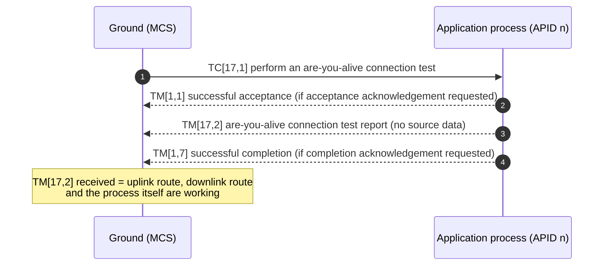
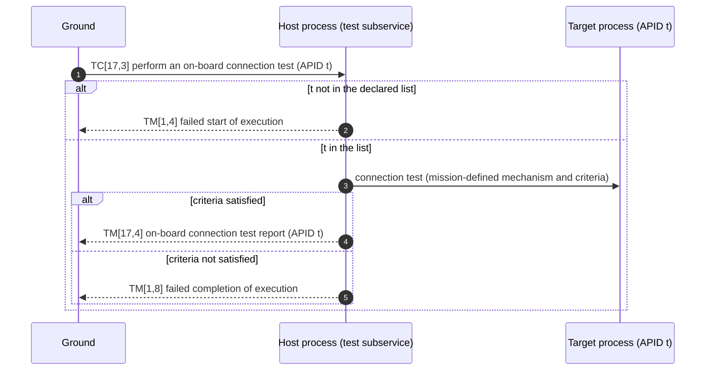

# ST[17] Test

The simplest question an operator can ask a spacecraft is "are you there?". Service type 17 of
the [Packet Utilization Standard](index.md) answers it. Its core is the **are-you-alive
connection test**: the ground sends TC[17,1] to an application process, and if the process is
alive and both the uplink and downlink routes to it work, a TM[17,2] report comes back. PUS-C
adds an **on-board connection test**, in which one on-board process checks that another one
responds, and the 2024 draft adds a variable-size version of the are-you-alive test for
checking long telecommands.[^c-1711][^c-173][^c-1742][^r-175] The service type is meant to hold
the test functions of a mission, most of which are mission specific.[^a-192] This page covers
every message of the service in ECSS-E-ST-70-41C ("PUS-C", 2016), compares it with
ECSS-E-70-41A ("PUS-A", 2003) and the Rev.1 draft, and shows how the real Solar Orbiter
[MIB](../../missions/solar-orbiter/mib.md) defines connection tests for its central software,
mass memory, star trackers and ten science instruments.

!!! info "Where this page sits"
    The test reports travel like any other telemetry, and the test commands are verified like
    any other telecommand: see [ST[01] request verification](st01-request-verification.md) and
    [PUS packet structures](packets.md). On the ground, the expected reports are configured as
    verification stages, described in [Command verification in the MIB](../../mib/command-verification.md).

## 1. At a glance

| Item | Value |
|---|---|
| Service type | 17[^c-p171] |
| PUS-C name | ST[17] test[^c-1711] |
| PUS-A name | Test service (clause 19)[^a-191] |
| Subservice type | test (at least one per service; at most one provider per application process)[^c-172] |
| PUS-C message types | TC[17,1], TM[17,2], TC[17,3], TM[17,4][^c-annex17] |
| PUS-C minimum capability (Annex C) | TC[17,1] and TC[17,3], each with its response TM[17,2] / TM[17,4][^c-annex17] |
| PUS-A message types | (17,1) Perform Connection Test, (17,2) report; both minimum, no additional capabilities[^a-193][^a-194] |
| Rev.1 draft additions | TC[17,5] / TM[17,6] variable size are-you-alive connection test[^r-175][^r-p175] |
| Observables | none[^c-175] |

## 2. Why a test service

PUS-A placed the service under the concept of **off-line testing**: for troubleshooting or
validation before use, an on-board unit or process can be run "off-line", outside any active
control loop but with its normal outputs in telemetry, and each application process should
offer a set of mission-specific end-to-end test functions under ground control. As a minimum,
a standard "are you alive" function tests the end-to-end connection between the ground and an
application process.[^a-415] [ECSS-E-ST-70-31C](../e-st-70-31c.md) describes the generic test
in the same terms: a ground request makes the on-board test service generate a standard
report, which confirms that the uplink and downlink routes work and that the process can do
basic work, including telecommand processing and telemetry packet generation.[^o-a15]

The 2025 operability standard [ECSS-E-ST-70-11C](../e-st-70-11c.md) makes the capability a
requirement under **testability**: the space segment must provide end-to-end tests of any
on-board application process, exercisable under ground control, with an "are you alive"
function as the example. The same clause asks for off-line operation of redundant equipment
for testing, health checks of unused units before use, and test modes that neither disable
fault management nor trigger it with off-line data.[^e-47]

Mission requirements say the same. The Herschel/Planck operations interface requirements ask
for an "are you alive" function between the ground and the data management system or any other
on-board intelligent user, implemented as an "I am alive" response; the test between the data
management system and an intelligent user is performed by the data management system itself,
and the ground can ask it to start one.[^hp-fts] That last requirement resembles what PUS-C
standardises as the on-board connection test TC[17,3] (section 4).

## 3. The are-you-alive connection test: TC[17,1] and TM[17,2]

Every test subservice provides it. A request TC[17,1] "perform an are-you-alive connection
test" contains exactly one instruction, with no argument; the subservice answers with exactly
one TM[17,2] "are-you-alive connection test report", which says only that the hosting
application process is alive and has received the request.[^c-173] Both packets have an empty
data field: the TC has no application data and the TM no source data.[^c-p171]

What the report proves is spelled out in two notes. The end-to-end connection is achieved
"when the application process is alive and the communication to the application process is
active"; and its reception on the ground confirms that the uplink and downlink routes between
the ground and the process work and that the process performs a minimum set of
functions.[^c-173]



The verification reports in this diagram come from [ST[01]](st01-request-verification.md) and
depend on the acknowledgement flags of the TC; PUS-C does not prescribe their order relative
to TM[17,2], so the order shown is this wiki's illustration.

!!! warning "Inference: what a connection test does not prove"
    A TM[17,2] shows that a TC reached the process, was decoded and dispatched to the test
    subservice, and that the process could build and send a report. It says nothing about the
    process's other functions, and since the report has no data it cannot carry a test pattern.
    The variable-size test of the 2024 draft (section 6) fills that gap for the uplink path.

## 4. The on-board connection test: TC[17,3] and TM[17,4]

The second PUS-C test is between two **on-board** application processes: the one that hosts the
test subservice and executes the request, and the one named in the request.[^c-1742] The
mission declares which application processes can be tested this way (the host itself is not
in that list) and, for each of them, what counts as a successful test.[^c-1741]

* TC[17,3] "perform an on-board connection test" carries exactly one instruction holding the
  identifier of the application process to test.[^c-1742]
* A request naming a process outside the declared list is rejected with a failed start of
  execution notification.[^c-1742]
* Otherwise the subservice tests the connection. If the declared criteria are met, it generates
  one notification carrying the tested process's identifier, sent as one TM[17,4] "on-board
  connection test report"; if not, it generates a **failed completion of execution**
  verification report instead.[^c-1742]

| Message | Data field | Type |
|---|---|---|
| TC[17,3] | application process ID | enumerated |
| TM[17,4] | application process ID | enumerated |

[^c-p171]

<div class="bitfield" data-title="TC[17,3] / TM[17,4] data field (illustrative width)" data-width="16"
     data-fields='[{"n":"Application process ID","b":16,"d":"Enumerated; PUS-C leaves the PFC to the mission (16 bits assumed here; an APID itself is 11 bits)"}]'></div>



How the host actually tests the target is left to the mission: PUS-C only asks for the list and
the success criteria to be declared.[^c-1741] The diagram's mapping of the notifications to
TM[1,4] and TM[1,8] follows the PUS-C report types of [ST[01]](st01-request-verification.md).

!!! warning "A discrepancy in PUS-C"
    Clause 6.17.4.2a says the capability to perform an on-board connection test "shall be
    declared", i.e. it is optional, while Annex C, Table C-25, marks TC[17,3] as
    "minimum".[^c-1742][^c-annex17] A mission tailoring PUS-C has to decide which reading
    applies. The 2024 Rev.1 draft aligns the annex with the clause: its Table C-25 marks
    TC[17,3] "by declaration".[^r-annex17]

## 5. Message type catalogue

| Type | Name (PUS-C) | Clauses | Data field | Applicability (Annex C) |
|---|---|---|---|---|
| TC[17,1] | perform an are-you-alive connection test | 6.17.3 / 8.17.2.1 | omitted | minimum |
| TM[17,2] | are-you-alive connection test report | 6.17.3 / 8.17.2.2 | omitted | response to TC[17,1] |
| TC[17,3] | perform an on-board connection test | 6.17.4.2 / 8.17.2.3 | application process ID (enumerated) | minimum |
| TM[17,4] | on-board connection test report | 6.17.4.2 / 8.17.2.4 | application process ID (enumerated) | response to TC[17,3] |

[^c-annex17][^c-p171]

The standard defines no observables for the test subservice.[^c-175] ESA's 2015 status
presentation, which counts per clause and service type the discrepancy reports (DRRs) processed
after the 2014 public review of the draft, gives ST[17] 2 DRRs, the fewest of any service
type.[^v-drr] The
service is listed with all others in the [PUS message type catalogue](message-types.md).

## 6. PUS-A and the 2024 Rev.1 draft

PUS-A defined only the end-to-end connection test: (17,1) "Perform Connection Test" with no
application data, and (17,2) "Link Connection Report" with no source data; its capability table
calls the report "Connection Test Report". Both are the minimum capability set, and no
additional capability was defined.[^a-193][^a-194] PUS-A requires the report to be a one-shot
report generated by the application process, and its reception to confirm that the routes work
and that the process performs a minimum set of functions, which includes telecommand
processing.[^a-192] ECSS-E-ST-70-31C lists no tailoring choices for this service.[^o-a15]

| Topic | PUS-A (2003) | PUS-C (2016) | Rev.1 draft (2024) |
|---|---|---|---|
| Ground-to-process test | (17,1) / (17,2) | TC[17,1] / TM[17,2] (renamed "are-you-alive") | unchanged |
| Process-to-process test | - | TC[17,3] / TM[17,4] | unchanged |
| Variable-size test | - | - | TC[17,5] / TM[17,6] |
| Failure path | not defined | TC[17,3]: failed start (unknown APID) or failed completion (criteria not met) | unchanged |

The draft's **variable size are-you-alive connection test** (clause 6.17.5) is a declared
capability. TC[17,5] carries an arbitrary connection test data string of variable length, up
to the maximum telecommand length; the subservice returns the same string in TM[17,6]. The
draft notes that this allows a test command of arbitrary length, in particular of the maximum
telecommand length.[^r-175] Both data fields are a variable octet-string ("test
data").[^r-p175]

<div class="bitfield" data-title="Rev.1 draft TC[17,5] / TM[17,6] data field (illustrative widths)" data-width="16"
     data-fields='[{"n":"Test data length","b":16,"g":"variable octet-string","d":"Unsigned integer; its PFC is mission-declared (16 bits assumed)"},{"n":"Test data","b":32,"g":"variable octet-string","d":"Arbitrary octets, echoed unchanged in TM[17,6] (4 shown)"}]'></div>

The structure of a variable-length octet-string - a length field followed by that many octets,
with the length PFC declared per application process - is defined in PUS-C clause
7.3.8.[^c-738] The draft is not an approved standard; Solar Orbiter solved the same problem with
a private subtype (section 8.4).

## 7. Ground support in SCOS-2000

The SCOS-2000 database import ICD says there is no specific processing of service 17 packets in
SCOS-2000 and no specific limitation.[^i-c314] In practice a connection test is an ordinary
command whose expected TM[17,2] is not modelled by the service: the ground configures the
acknowledgement flags and verification stages of the command like any other (see
[Command verification in the MIB](../../mib/command-verification.md)), and the TM[17,2] report
is an ordinary packet definition in [`pid`](../../mib/tables/pid.md).[^i-cvs]

## 8. Solar Orbiter

### 8.1 The tailoring

Solar Orbiter's TM/TC and packet structure ICD (SOL.S.ASTR.TN.00079, issue 7) tailors PUS-A and
calls service 17 "Connection Test". Its objective and description repeat the PUS-A text. The
service is mandatory for all users: (17,1) and (17,2) are marked as implemented by the central
software (CSW), the solid state mass memory (SSMM) software and the star tracker (STR)
software, and as mandatory for payload software.[^s-tab17][^s-518] It defines four
subtypes:[^s-518]

| Subtype | Name (ICD) | Data | Notes |
|---|---|---|---|
| TC(17,1) | Perform Connection Test | none | test between the ground and an on-board application process; result in TM(17,2) and the TM(1,x) reports; a TM(1,8) only applies to the CSW, not the SSMM |
| TM(17,2) | Connection Test Report | none | sent when the test succeeds |
| TC(17,3) | Request Connection Test | PID (enumerated, 1 octet); time-out (unsigned, 1 octet, seconds, > 0) | asks the CSW to perform a connection test by TC(17,1) to the given process ID, with a time-out |
| TC(17,128) | Test Command of Maximum Length | filler (TBD in the ICD) | on reception a TM(17,2) is generated; filler parameters build a maximum-size packet; described as SSMM only |

TC(17,3), which Table 5.1-1 marks for the CSW only, is Solar Orbiter's private counterpart of
the PUS-C on-board connection test: the CSW tests another process by sending it a real
TC(17,1).[^s-tab17][^s-518] Solar Orbiter's packet category table reserves
category 7, "event generation", for service 5 events and TM(17,2), which is why every Solar
Orbiter TM(17,2) has an APID ending in category 7.[^s-annex8]

### 8.2 What the MIB contains

The 2025 MIB defines 27 service 17 commands and 17 TM(17,2) packets; the April 2020 release has
the same counts.[^mib-17] Solar Orbiter splits each APID into a 7-bit process ID (PID) and a
4-bit packet category, 12 for telecommands.[^s-apid] The connection tests line up as
follows:[^mib-17][^s-annex8]

| Unit (process ID) | TC(17,1) command | TC APID | TM(17,2) SPID - name | TM APID (PID) | Verification stages: CVS_INTERVAL (s) acceptance / completion |
|---|---|---|---|---|---|
| OBC CSW (10) | [ZCD01101](../../explorer/index.md#/solo/command/ZCD01101) Perform Connection Test | 172 | [14178](../../explorer/index.md#/solo/packet/14178) Connection Test Response Report | 167 (10) | [14001](../../explorer/index.md#/solo/verif/14001) / 14007: 20 / 20 |
| SSMM operational (30) | ZSM00260 SSMM Perform Connection Test | 492 | 80023 SSMM Connection Test Report | 487 (30) | 10001 / 10007: 20 / 20 |
| SSMM controller A, debug (31) | ZSM00261 | 508 | 80024 SSMA Connection Test Report | 503 (31) | 20 / 20 |
| SSMM controller B, debug (32) | ZSM00262 | 524 | 80025 SSMB Connection Test Report | 519 (32) | 20 / 20 |
| Star tracker A (40) | ZST17001 STR1 Connection Test | 652 | 91172 STR1 Connection Test | 647 (40) | 20 / 20 |
| Star tracker B (41) | ZST27001 STR2 Connection Test | 668 | 92172 STR2 Connection Test | 663 (41) | 20 / 20 |
| EPD (50) | ZID52505 TC 17,1 connection test | 812 | 52006 TM 17,2 Connect test resp | 807 (50) | 60 / 60 |
| EPD (54) | ZID52307 17,1 SIS_PUS_CON_TST | 876 | 52855 17,2 Connection Test Report | 871 (54) | 60 / 60 |
| EUI (57) | ZIU51001 EUI_TestCommand | 924 | 51100 EUI_TstReport | 919 (57) | 4 / 4 |
| MAG (63) | ZIM01701 MAG Perform Connection Test | 1020 | 50172 MAG Connection Test Report | 1031 (64) | 60 / 60 |
| METIS (67) | ZIT01701 Connection Test | 1084 | 59450 TM(17,2) - Connection Test Report | 1079 (67) | 16 / 32 |
| PHI (72) | ZIP11010 performConnectionTest | 1164 | 53072 PHI_connectionTestReport | 1159 (72) | 10 / 60 |
| RPW (75) | ZIW00012 DPU_TEST_CONNECTION | 1212 | 55058 "Contains a connection test report." | 1207 (75) | 20 / 20 |
| SoloHI (82) | ZIHWTEST SWCONNTEST | 1324 | 56335 OBC SoloHI Test Report Pkt | 1335 (83) | 60 / 180 |
| SPICE (85) | ZIC0C000 CONNECTION_TEST | 1372 | 57300 SPICE Connection Test Report | 1383 (86) | 60 / 60 |
| STIX (90) | [ZIX17001](../../explorer/index.md#/solo/command/ZIX17001) STIX Perform Connection Test | 1452 | 54330 STIX Connection Test Report | 1447 (90) | 20 / 60 |
| SWA (95) | [ZIA58001](../../explorer/index.md#/solo/command/ZIA58001) SWA_TC_CONN_TEST | 1532 | [58061](../../explorer/index.md#/solo/packet/58061) SWA_TM_CT_REP | 1591 (99) | 20 / 20 |
| EGSE range (121) | ZYP66999 PSS Test TC | 1948 | - | - | 20 / 20 |

All verification stages open at release (CVS_START 0) and are report-based (CVS_SOURCE `R`);
every service 17 command has `CCF_ACK` 9, i.e. acceptance and completion reports
requested.[^mib-17][^i-cvs] The SWA instrument's own database contains the same pair,
`ZIA58001` and `SWA_TM_CT_REP` (see the
[SWA explorer](../../explorer/index.md#/swa/command/ZIA58001)).[^swa]

Observations from the table:

* For MAG, SoloHI, SPICE and SWA the TM(17,2) comes from a different process ID than the one the
  TC(17,1) was sent to (for example SWA: TC to PID 95, report from PID 99). The ICD allocates
  several process IDs to each instrument, so both are the same instrument.[^s-annex8]
* Only one TM(17,2) has any content: EPD's SPID 52006 defines a 16-bit parameter `NID00048`
  "CRC" at byte offset 16, right after the 16-octet headers; all other TM(17,2) definitions are
  header-only.[^mib-17]
* `ZYP66999` "PSS Test TC" targets APID 1948, process ID 121, inside the 112-127 range that the
  ICD reserves for EGSE; the meaning of "PSS" is not stated in the available sources.[^s-annex8][^mib-17]

!!! warning "Inference"
    The differences in verification intervals (4 s for EUI, up to 180 s for SoloHI completion)
    presumably reflect how long each instrument's software needs to answer through the OBC, but
    the MIB records only the values, not the reasons.

### 8.3 TC(17,3) "Request Connection Test"

The CSW command [ZCD01103](../../explorer/index.md#/solo/command/ZCD01103) has two
parameters:[^mib-17][^s-518]

<div class="bitfield" data-title="Solar Orbiter TC(17,3) ZCD01103 application data (from the MIB)" data-width="16"
     data-fields='[{"n":"Process IDentifier (PCD11031)","b":8,"d":"PTC 2 PFC 8; textual calibration CCDT0126TX with 60 values, OP_SSMM = 30 ... SPICE_8 = 104"},{"n":"Test connection Timeout (PCD11032)","b":8,"d":"PTC 3 PFC 4; range VCD00176 = 1..255 seconds"}]'></div>

The calibration `CCDT0126TX` "Process IDentifier reach" lists exactly the process IDs the CSW can
reach for this test: the three SSMM processes (30-32), the two star trackers (40, 41) and the
payload process IDs 50-104 - but not the CSW itself, matching the PUS-C rule that the host
process is not in the list of testable processes.[^mib-17][^c-1741] The MIB also defines a TM(5,2)
event, EID 17472 "TM_Timed_Out_Connection_Request_Received_(TM_17-2)", on APID 167.[^mib-17]
Its exact trigger is not stated in the available sources.

### 8.4 TC(17,128) "Test Command of Maximum Length"

The SSMM variants `ZSM00265`, `ZSM00266` and `ZSM00267` consist of 59 fixed 32-bit areas, all
`0xDEADDEAD`: 1 888 bits, or 236 octets of application data.[^mib-17] That is exactly the
largest Solar Orbiter application data field: a TC packet data field holds at most 242 octets,
made of the 4-octet data field header, 236 octets of application data and the 2-octet packet
error control.[^s-tc] With the 6-octet primary header the packet is 248 octets long, the
maximum uplink length the ICD mentions elsewhere.[^s-248] The PSS variant `ZYP66998` has the
same length filled with `0xAAAAAAAA`; the star tracker variants (`ZST17128`, `ZSTX7128`,
`ZST27128`, `ZSTX7228`) are 14 elements, 416 bits (52 octets), with the values `0x5A`,
`0xFFFFFFFF` and `0xFFFFFF`.[^mib-17] Although the ICD text describes TC(17,128) as SSMM-only,
its service table marks the subtype "X" (implemented) for the SSMM and STR software and "O"
(optional) for payload software, with no mark for the CSW, and the MIB defines both SSMM and
STR variants.[^s-518][^s-tab17][^mib-17]

### 8.5 Worked example: a TC(17,1) to the CSW, byte by byte

The bytes below are **illustrative**: the APID, service type, subtype, acknowledgement flags and
header layout are real (from the MIB and the ICD), while the sequence count (0) and the source ID
(120, the ICD's "direct commands" ground source) were chosen for the example. The CRC was
computed by this wiki with the PUS CRC (polynomial $x^{16}+x^{12}+x^5+1$, register preset to
all ones).[^c-crc][^s-src][^mib-17]

<div class="bitfield" data-title="TC(17,1) to APID 172, complete packet (illustrative values)" data-width="16"
     data-fields='[{"n":"Version","b":3,"v":"000","g":"Primary header"},{"n":"Type","b":1,"v":"1","g":"Primary header"},{"n":"Sec. hdr","b":1,"v":"1","g":"Primary header"},{"n":"APID = 172","b":11,"v":"00010101100","g":"Primary header","d":"PID 10 (OBC CSW), category 12 (telecommand)"},{"n":"Seq. flags","b":2,"v":"11","g":"Primary header"},{"n":"Sequence count = 0","b":14,"g":"Primary header","d":"chosen for the example"},{"n":"Packet length = 5","b":16,"g":"Primary header","d":"data field = 4 + 0 + 2 = 6 octets, minus one"},{"n":"CCSDS sec. hdr flag","b":1,"v":"0","g":"Data field header"},{"n":"PUS version","b":3,"v":"001","g":"Data field header"},{"n":"Ack","b":4,"v":"1001","g":"Data field header","d":"CCF_ACK 9: acceptance and completion reports"},{"n":"Service type = 17","b":8,"v":"00010001","g":"Data field header"},{"n":"Subtype = 1","b":8,"v":"00000001","g":"Data field header"},{"n":"Source ID = 120","b":8,"v":"01111000","g":"Data field header","d":"ICD ground source: direct commands (chosen for the example)"},{"n":"Packet error control (CRC)","b":16,"v":"1110101010010001","d":"0xEA91, computed by this wiki"}]'></div>

| Octets | Hex | Meaning |
|---|---|---|
| 0-1 | `18 AC` | version 0, TC, secondary header present, APID 172 |
| 2-3 | `C0 00` | stand-alone packet, sequence count 0 |
| 4-5 | `00 05` | packet data field of 6 octets |
| 6 | `19` | PUS version 1, ack `1001` |
| 7-8 | `11 01` | service 17, subtype 1 |
| 9 | `78` | source ID 120 |
| 10-11 | `EA 91` | CRC over octets 0-9 |

The whole packet is 12 octets, the minimum for a Solar Orbiter PUS telecommand, because it has
no application data. For comparison, the same packet sent to the SSMM (APID 492)
would be `19 EC C0 00 00 05 19 11 01 78 DA 0D`, and a TC(17,3) asking the CSW to test process 30
(`OP_SSMM`) with a 10-second time-out, sequence count 1, would be
`18 AC C0 01 00 07 19 11 03 78 1E 0A 8B 7F` (all illustrative, CRCs computed by this
wiki).[^mib-17] The header fields are explained on [PUS packet structures](packets.md) and a
complete real command is built step by step in the
[TC worked example](../../overview/worked-example-tc.md).

??? example "SQL used (Solar Orbiter service 17)"
    ```sql
    -- solo-2025-09-16.sqlite (MIB__20250916M25925PFMS001_SOL); counts also on solo-2020-04-16.sqlite
    SELECT CCF_CNAME, CCF_DESCR, CCF_STYPE, CCF_APID, CCF_NPARS, CCF_ACK FROM ccf
     WHERE CCF_TYPE = '17' ORDER BY CAST(CCF_STYPE AS INT), CAST(CCF_APID AS INT);
    SELECT PID_SPID, PID_APID, PID_DESCR, PID_DFHSIZE FROM pid WHERE PID_TYPE = '17'
     ORDER BY CAST(PID_APID AS INT);
    SELECT l.*, p.PCF_DESCR FROM plf l LEFT JOIN pcf p ON p.PCF_NAME = l.PLF_NAME
     WHERE l.PLF_SPID IN (SELECT PID_SPID FROM pid WHERE PID_TYPE = '17');
    -- verification stages per command (cvp/cvs use generic COLn names: cvp COL1 = task, COL3 = stage;
    -- cvs COL1 = CVS_ID, COL2 = type, COL3 = source, COL4 = start, COL5 = interval)
    SELECT c.CCF_CNAME, s.COL2, s.COL1, s.COL4, s.COL5 FROM ccf c
      JOIN cvp v ON v.COL1 = c.CCF_CNAME JOIN cvs s ON s.COL1 = v.COL3 WHERE c.CCF_TYPE = '17';
    SELECT c.CDF_CNAME, c.CDF_BIT, c.CDF_ELLEN, c.CDF_PNAME, p.CPC_PTC, p.CPC_PFC, p.CPC_PRFREF, p.CPC_PAFREF
      FROM cdf c LEFT JOIN cpc p ON p.CPC_NAME = c.CDF_PNAME WHERE c.CDF_CNAME = 'ZCD01103';
    SELECT * FROM pas WHERE PAS_NUMBR = 'CCDT0126TX' ORDER BY CAST(PAS_ALVAL AS INT);
    SELECT CDF_CNAME, COUNT(*), SUM(CDF_ELLEN), GROUP_CONCAT(DISTINCT CDF_VALUE) FROM cdf
     WHERE CDF_CNAME IN (SELECT CCF_CNAME FROM ccf WHERE CCF_TYPE = '17' AND CCF_STYPE = '128') GROUP BY 1;
    SELECT PID_TYPE, PID_STYPE, PID_APID, PID_PI1_VAL, PID_DESCR FROM pid WHERE PID_PI1_VAL = '17472';
    -- swa-idb.sqlite
    SELECT CCF_CNAME, CCF_DESCR, CCF_APID FROM ccf WHERE CCF_TYPE = '17';
    ```

## Related pages

* [PUS: the Packet Utilization Standard](index.md) and the [message type catalogue](message-types.md)
* [ST[01] Request verification](st01-request-verification.md) - the verification reports around every test
* [PUS packet structures](packets.md) - the headers that make up the whole of a TC[17,1]
* [Command verification in the MIB](../../mib/command-verification.md)
* [How Solar Orbiter uses PUS](../../missions/solar-orbiter/pus-usage.md), [the Solar Orbiter MIB](../../missions/solar-orbiter/mib.md) and [the SWA instrument database](../../missions/solar-orbiter/swa.md)
* [Uplink: from operator command to on-board execution](../../overview/uplink.md)

[^c-1711]: [ECSS-E-ST-70-41C](../../library/ecss-e-st-70-41c-15april2016.md), §6.17.1.1-6.17.1.2, PDF p. 318.
[^c-172]: [ECSS-E-ST-70-41C](../../library/ecss-e-st-70-41c-15april2016.md), §6.17.2, PDF p. 318.
[^c-173]: [ECSS-E-ST-70-41C](../../library/ecss-e-st-70-41c-15april2016.md), §6.17.3, PDF pp. 318-319.
[^c-1741]: [ECSS-E-ST-70-41C](../../library/ecss-e-st-70-41c-15april2016.md), §6.17.4.1, PDF p. 319.
[^c-1742]: [ECSS-E-ST-70-41C](../../library/ecss-e-st-70-41c-15april2016.md), §6.17.4.2, PDF pp. 319-320.
[^c-175]: [ECSS-E-ST-70-41C](../../library/ecss-e-st-70-41c-15april2016.md), §6.17.5, PDF p. 320.
[^c-p171]: [ECSS-E-ST-70-41C](../../library/ecss-e-st-70-41c-15april2016.md), §8.17.1-8.17.2.4, Figures 8-194 and 8-195, PDF pp. 558-559.
[^c-annex17]: [ECSS-E-ST-70-41C](../../library/ecss-e-st-70-41c-15april2016.md), Annex C.2.17, Table C-25, PDF p. 646.
[^c-738]: [ECSS-E-ST-70-41C](../../library/ecss-e-st-70-41c-15april2016.md), §7.3.8c-d, Figure 7-4, PDF p. 433.
[^c-crc]: [ECSS-E-ST-70-41C](../../library/ecss-e-st-70-41c-15april2016.md), Annex B.1.1, PDF p. 615.
[^a-191]: [ECSS-E-70-41A](../../library/ecss-e-70-41a-30jan2003-pus.md), §19.1, PDF p. 167.
[^a-192]: [ECSS-E-70-41A](../../library/ecss-e-70-41a-30jan2003-pus.md), §19.2, PDF p. 167.
[^a-193]: [ECSS-E-70-41A](../../library/ecss-e-70-41a-30jan2003-pus.md), §19.3, PDF p. 167.
[^a-194]: [ECSS-E-70-41A](../../library/ecss-e-70-41a-30jan2003-pus.md), §19.4, Table 38, PDF p. 168.
[^a-415]: [ECSS-E-70-41A](../../library/ecss-e-70-41a-30jan2003-pus.md), §4.15, PDF p. 37.
[^r-175]: [ECSS-E-ST-70-41C Rev.1 DIR1](../../library/ecss-e-st-70-41c-rev1-dir1.md), §6.17.5, PDF pp. 301-302.
[^r-p175]: [ECSS-E-ST-70-41C Rev.1 DIR1](../../library/ecss-e-st-70-41c-rev1-dir1.md), §8.17.2.5-8.17.2.6, Figures 8.17-3 and 8.17-4, PDF p. 605.
[^r-annex17]: [ECSS-E-ST-70-41C Rev.1 DIR1](../../library/ecss-e-st-70-41c-rev1-dir1.md), Annex C.2.17, Table C-25, PDF p. 718.
[^o-a15]: [ECSS-E-ST-70-31C](../../library/ecss-e-st-70-31c.md), Annex A.15.1-A.15.3, PDF pp. 199-200.
[^e-47]: [ECSS-E-ST-70-11C Rev.1](../../library/ecss-e-st-70-11c-rev-1-15october2025.md), §4.7a-f, PDF p. 22.
[^hp-fts]: [Herschel/Planck Operations Interface Requirements Document, SCI-PT-RS-07360 issue 2.2](../../library/cosmos-operations-interface-requirements.md), §3.14, FTS-1 to FTS-3, PDF p. 36.
[^v-drr]: [S. Valera, ECSS-E-ST-70-41C status, ADCSS 2015](../../library/valera-2015-adcss-ecss-e-st-70-41c-status.md), slide 15, PDF p. 15.
[^i-c314]: [SCOS-2000 Database Import ICD 7.0](../../library/icd-7-0-final.md), Appendix C, §3.14, PDF pp. 242-243.
[^i-cvs]: [SCOS-2000 Database Import ICD 7.0](../../library/icd-7-0-final.md), §3.3.3.4.1 (cvs), PDF pp. 192-193.
[^s-518]: [SOL.S.ASTR.TN.00079 Issue 7, Solar Orbiter TM-TC and packet structure ICD](../../library/sol-s-astr-tn-00079-07.md), §5.18-5.18.4, PDF pp. 200-202.
[^s-tab17]: [SOL.S.ASTR.TN.00079 Issue 7](../../library/sol-s-astr-tn-00079-07.md), §5.1, Table 5.1-1 and its mnemonics, PDF pp. 31 and 36.
[^s-annex8]: [SOL.S.ASTR.TN.00079 Issue 7](../../library/sol-s-astr-tn-00079-07.md), §13.1 (Annex 8), Figures 13.1-1 and 13.1-2, PDF pp. 272-274.
[^s-apid]: [SOL.S.ASTR.TN.00079 Issue 7](../../library/sol-s-astr-tn-00079-07.md), §3.2.1.1 and §4.2.1.1 (PUS-188), PDF pp. 15 and 24.
[^s-tc]: [SOL.S.ASTR.TN.00079 Issue 7](../../library/sol-s-astr-tn-00079-07.md), §3.2.1.3 (PUS-43), PDF p. 16.
[^s-248]: [SOL.S.ASTR.TN.00079 Issue 7](../../library/sol-s-astr-tn-00079-07.md), §5.12.4, TC(11,4), PDF p. 103.
[^s-src]: [SOL.S.ASTR.TN.00079 Issue 7](../../library/sol-s-astr-tn-00079-07.md), §3.2.2.3 and §13.2, PDF pp. 17 and 275-276.
[^swa]: [Solar Orbiter SWA instrument database (ASCII export)](../../library/swa-idb-ascii.md), table ccf and pid, queried by this wiki.
[^mib-17]: [Solar Orbiter MIB release MIB__20250916M25925PFMS001_SOL](../../library/mib-20250916m25925pfms001-sol.md), tables ccf, cdf, cpc, pas, prv, pid, plf, pcf, cvp and cvs, queried by this wiki; counts compared with [MIB__20200416M10720PFMS001_SOL](../../library/mib-20200416m10720pfms001-sol.md).
