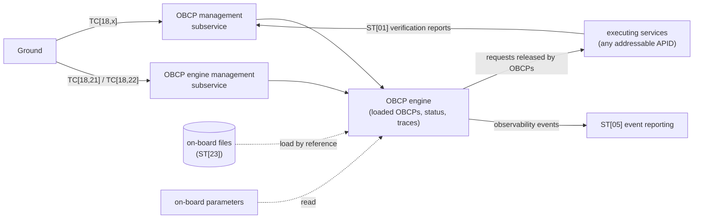
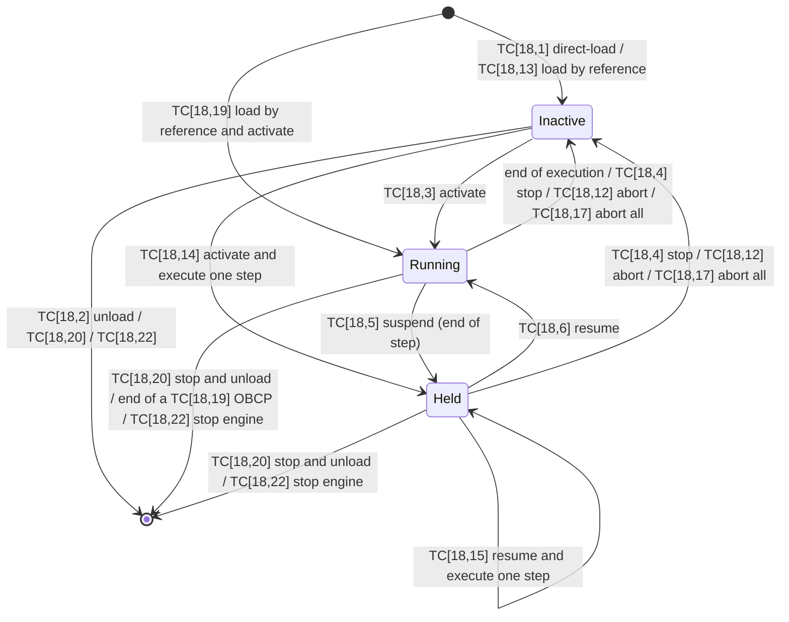
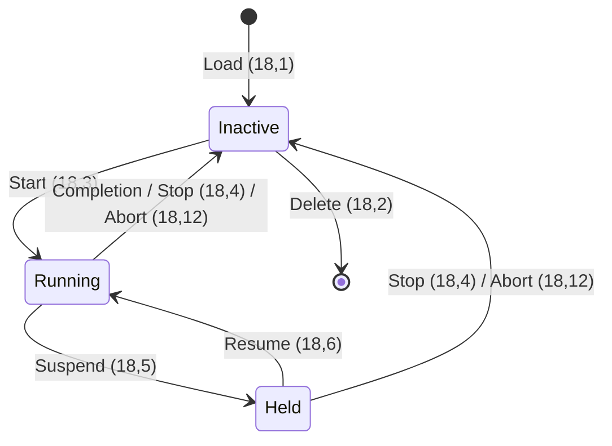

# ST[18] On-board operations procedure

An **on-board control procedure (OBCP)** is a small program that runs on the spacecraft
itself: it sends telecommands, reads telemetry parameters, waits, tests and branches, much as a
ground operator's procedure would, but without waiting for the ground. Service type 18 of the
[Packet Utilization Standard](index.md) is the ground's handle on these programs. It loads
them into an interpreter called the **OBCP engine**, starts and stops them, holds and resumes
them step by step, passes them values while they run, and reports their state.[^c-1811][^c-1812]
ECSS-E-70-41A ("PUS-A", 2003) called it the on-board operations procedure service;
ECSS-E-ST-70-41C ("PUS-C", 2016) calls it "on-board control procedure" in clause 6.18 and
"on-board operations procedure" in its Annex C.[^a-201][^c-annex18] This page covers the PUS-C
service completely - both subservices, the execution state machine, the observability levels,
every message type and its data fields, the rejection rules - then the PUS-A service, the 2024
Rev.1 draft, SCOS-2000 support, and the OBCP commands and reports of the real
[Solar Orbiter MIB](../../missions/solar-orbiter/mib.md).

!!! info "Where this page sits"
    OBCPs are one of several on-board automation tools. Commands released at a given time come
    from [ST[11] time-based scheduling](st11-time-based-scheduling.md), commands triggered by an
    event from [ST[19] event-action](st19-event-action.md) (which can itself start an OBCP), and
    fixed command lists from [ST[21] request sequencing](st21-request-sequencing.md). OBCP files
    can be uploaded with [ST[23] file management](st23-file-management.md) or, on PUS-A
    missions, [ST[13] large packet transfer](st13-large-packet-transfer.md). Every request an
    OBCP releases is verified through [ST[01]](st01-request-verification.md).

## 1. At a glance

| Item | Value |
|---|---|
| Service type | 18[^c-p181] |
| PUS-C name | ST[18] on-board control procedure (Annex C: on-board operations procedure)[^c-1811][^c-annex18] |
| PUS-A name | On-board operations procedure service (clause 20)[^a-201] |
| Companion standard | ECSS-E-ST-70-01, spacecraft on-board control procedures (not in this wiki's library)[^c-1811] |
| Subservice types | OBCP management (exactly one); OBCP engine management (at most one)[^c-182] |
| OBCP execution status | inactive (0), active and running (1), active and held (2)[^c-1843][^c-p18e] |
| Observability levels | no-observability (0), at-procedure-level (1), at-step-level (2), at-detailed-level (3)[^c-p18e] |
| PUS-C message types | 18 requests and 2 reports, subtypes 1-9 and 12-22[^c-annex18] |
| PUS-C minimum capability | one load request (TC[18,1], TC[18,13] or TC[18,19]), TC[18,3], TC[18,4], TC[18,12], TC[18,8]/TM[18,9], TC[18,21], TC[18,22][^c-annex18] |
| PUS-A minimum capability | (18,1) to (18,6) and (18,12)[^a-204] |

## 2. Why OBCPs exist

PUS-A explains the idea: besides standard services, a mission may have a set of procedures,
loaded from the ground, that resemble the stepwise procedures executed on the ground. They can
in principle also be started autonomously on board, for example when an event is detected. The
language they are written in is out of scope, but each procedure must be built from logical
steps so that it can be suspended and resumed at step level, and it can receive run-time
parameters when started or while running.[^a-49] An event-action definition can start a
procedure, which is how OBCPs become part of on-board fault management.[^a-410]

The 2025 operability standard [ECSS-E-ST-70-11C](../e-st-70-11c.md) defines an on-board
operations procedure as a monitoring and control procedure stored on board whose activation is
under ground control.[^e-def] It requires that the spacecraft can execute ground-loaded and
ground-controlled OBCPs, more than one at a time; that an OBCP can send any command available
to the ground and read any engineering telemetry parameter available to the ground; and that
OBCP execution can be prioritised, for example to favour fault management procedures when
they conflict.[^e-589]

Mission documents show what this buys in practice. For Herschel/Planck a "principle mode of
operation" was the execution of pre-defined OBCPs started from the mission timeline, written in
a Spacecraft Control Language and able to send commands, test parameters and branch; the
document's example powers on an instrument, checks its current, waits for its boot, checks its
housekeeping, sends it a time update and logs success with an event.[^hp-15] The same document
requires load, start, stop, suspend, resume, delete and dump of OBCPs, passing parameters
without first suspending, inspecting OBCP data at any time, listing the stored OBCPs and
managing multiple triggering of the same OBCP.[^hp-cpm]

## 3. The PUS-C model

### 3.1 Subservices, engine and host

PUS-C defines two subservice types. The **OBCP management subservice** is the interface to
the engine and lets the ground control the on-board execution of OBCPs; the **OBCP engine
management subservice** starts and stops the engine itself.[^c-1812][^c-1813] A service has
exactly one of the first and at most one of the second; if both are present they live in the
same application process, and an application process hosts at most one provider of
each.[^c-182] Each service is tied to exactly one OBCP engine and keeps an **OBCP engine
status** ("running" or not), which exists even when there is no engine management subservice
to change it.[^c-182]



The diagram is this wiki's summary of clauses 6.18.1-6.18.4. The mission declares which
application processes the service may address; the host process is always among them, and all
requests of the addressable processes may be used. When an OBCP releases a request, the service
type and APID in the request decide who executes it; that executing service generates the
verification reports, and sends them to the process hosting the OBCP service.[^c-1831] The
service must be able to read every on-board parameter accessible to the addressable
processes.[^c-1832]

### 3.2 Code, arguments, parameters and steps

The **OBCP code** is the form of a procedure that the engine can load and execute. An OBCP can
declare **arguments**, values it expects when its execution starts, and **parameters**, values
it expects to receive while executing; PUS-C refers to ECSS-E-ST-70-31 (see
[ECSS-E-ST-70-31C](../e-st-70-31c.md)) for both. The OBCP itself, not the management subservice, checks
that the values it receives are valid.[^c-1812] Following ECSS-E-ST-70-01, a procedure can
contain **steps** - sequences of source statements that are its smallest operational units -
and each step is represented in the OBCP code by exactly one step identifier.[^c-1812]

### 3.3 What a mission must declare

| Declaration | Clause |
|---|---|
| Maximum number of OBCPs the subservice can process at the same time | 6.18.4.1.1a[^c-1841] |
| Total resources available to the engine for storing OBCPs | 6.18.4.1.1b[^c-1841] |
| Whether the OBCP code checksum is verified at load time (algorithm per clause 5.4.4) | 6.18.4.1.2a[^c-1841][^c-544] |
| Which load capabilities exist (direct load, load by reference, load by reference and activate) and whether the ECSS-E-ST-70-01 loading policy is supported | 6.18.4.4.1[^c-18441] |
| Which observability levels are supported, or the fixed level if it cannot be configured | 6.18.4.2.1a-b[^c-1842] |
| The event reporting subservice that issues observability events | 6.18.4.2.2a[^c-1842] |
| The OBCP engine initialisation procedure | 6.18.5.1.1f[^c-1851] |
| Addressable application processes | 6.18.3.1a[^c-1831] |

Each OBCP has a unique **OBCP identifier**; when an OBCP is loaded from a file, the identifier
can drive the loading policy.[^c-1841] PUS-C's general checksum clause 5.4.4 uses
OBCPs as its example: a mission declares which subservice providers use each checksum
algorithm, so that an OBCP file checksummed both by the OBCP service and by a memory service
is checksummed the same way by both.[^c-544]

## 4. Execution status and its state machine

For every OBCP loaded in the engine, the management subservice keeps an execution status:
**inactive**, **active and running** or **active and held**. "Held" means suspended; an OBCP
that is waiting for an event is still "running"; "active" covers both running and
held.[^c-1843] Raw values are 0, 1 and 2.[^c-p18e] The diagram, drawn by this wiki from the
requirements of clause 6.18.4, shows which request moves an OBCP between states:



* An OBCP activated by TC[18,3] stays loaded (inactive) after it ends; one started by
  TC[18,19] is removed from the engine when it ends.[^c-18445][^c-18446]
* "Execute one step" runs the OBCP until the next step identifier is raised and then freezes
  it in "active and held".[^c-18463]
* Stop and suspend act **at the end of a step** - the current one, or a named one - while abort
  freezes execution immediately.[^c-18447][^c-18449][^c-18461]
* Stopping the engine aborts every OBCP, unloads all of them and sets the engine status to
  "not running".[^c-1851]

## 5. Observability levels

How much the ground sees of a running OBCP is set by its **execution observability level**.
Each mission declares which of the four levels it supports:[^c-1842]

| Level (raw) | Events raised |
|---|---|
| no-observability (0) | none |
| at-procedure-level (1) | one event each time the status changes to running (activation, resume), to held (suspend, completion of execution of a step) or to inactive (successful or failed completion, abort, stop) |
| at-step-level (2) | the procedure-level events plus one event for every step reached |
| at-detailed-level (3) | the step-level events plus mission-declared events, for example the start of an activity, a branch (an IF or a loop) or a statement |

[^c-1842][^c-p18e]

The events are issued as [ST[05]](st05-event-reporting.md) event reports by a declared event
reporting subservice; their auxiliary data include the OBCP identifier and the condition that
caused the event. PUS-C notes that ground-initiated activations, suspensions, resumptions,
stops and aborts can also be seen in the verification reports of the requests, and that
procedure-level observability is especially useful for OBCPs started autonomously from within
an OBCP.[^c-1842] The level is chosen in the activation
request (if selectable) and can be changed for active OBCPs with TC[18,16] "set the
observability level of OBCPs", which takes effect immediately: the events of the new level are
enabled and those of the old level disabled.[^c-18445][^c-1848] Its application data are N
followed by N pairs of OBCP ID (fixed character-string) and observability level
(enumerated).[^c-p1814]

## 6. The requests in detail

Almost every ST[18] request contains exactly one instruction, and a
faulty request is rejected as a whole with a failed start of execution notification (reported
through [ST[01]](st01-request-verification.md)). The exception is TC[18,16], which can carry
several instructions that are checked one by one.[^c-18442][^c-1848] Nearly every request is
rejected if the engine is not running.[^c-18442][^c-1851]

| Request | Engine running | OBCP loaded | OBCP state required | Other rejection causes |
|---|---|---|---|---|
| TC[18,1] direct-load | yes | must **not** be loaded | - | checksum fails; no resources[^c-18442] |
| TC[18,13] load by reference | yes | must not be loaded | - | file missing, not an OBCP file, policy file missing, checksum fails, no resources[^c-18443] |
| TC[18,19] load by reference and activate | yes | must not be loaded | - | as TC[18,13]; invalid observability level; resources to load *and* activate[^c-18446] |
| TC[18,2] unload | yes | yes | inactive | -[^c-18444] |
| TC[18,3] activate | yes | yes | inactive | invalid observability level; no resources[^c-18445] |
| TC[18,14] activate and execute one step | yes | yes | inactive | invalid observability level[^c-18463] |
| TC[18,4] stop / TC[18,20] stop and unload | yes | yes | any | -[^c-18447][^c-18448] |
| TC[18,12] abort | yes | yes | any | -[^c-18449] |
| TC[18,17] abort all and report | yes | - | - | -[^c-184410] |
| TC[18,5] suspend | yes | yes | active | -[^c-18461] |
| TC[18,6] resume | yes | yes | active | -[^c-18462] |
| TC[18,15] resume and execute one step | yes | yes | held | -[^c-18463] |
| TC[18,7] communicate parameters | yes | yes | active | -[^c-1847] |
| TC[18,16] set observability level | yes (whole request) | yes (per instruction) | active | invalid level (per instruction)[^c-1848] |
| TC[18,8] report execution status | yes | - | - | -[^c-1845] |
| TC[18,21] start engine | must **not** be running | - | - | -[^c-1851] |
| TC[18,22] stop engine | yes | - | - | -[^c-1851] |

### 6.1 Loading: TC[18,1], TC[18,13] and TC[18,19]

The service must offer at least one way to load an OBCP into the engine: **direct load**, where
the request carries the code, or **load by reference**, where the code is already in an
on-board file and the request names that file (or lets the ECSS-E-ST-70-01 loading policy pick
the file).[^c-18441]

* **TC[18,1] direct-load an OBCP** carries the OBCP identifier, the code and - if checksums are
  verified - the checksum, which the subservice checks before loading. The OBCP is then
  inactive, and the engine stores its identifier and checksum.[^c-18442]
* **TC[18,13] load an OBCP by reference** carries the identifier and, unless the loading policy
  is used, the file path (repository path and file name). If checksums are verified, the code
  in the file is checksummed before loading (the checksum is in the file or a file
  attribute).[^c-18443][^c-1841]
* **TC[18,19] load by reference and activate an OBCP** combines loading with activation; the
  OBCP is removed from the engine and its identifier freed when it ends.[^c-18446]

<div class="bitfield" data-title="TC[18,1] direct-load an OBCP (illustrative widths for ID and length)" data-width="32"
     data-fields='[{"n":"OBCP ID","b":32,"d":"Fixed character-string; 4 characters assumed here"},{"n":"OBCP code length","b":16,"g":"variable octet-string","d":"Unsigned integer; its PFC is declared per application process (requirement 7.3.8d); 16 bits assumed"},{"n":"OBCP code data","b":64,"g":"variable octet-string","d":"length octets of code (8 shown)"},{"n":"Checksum","b":16,"d":"Bit-string (16 bits); present only if checksums are verified"}]'></div>

The field order and the 16-bit checksum are from Figure 8-196; the PFC of the length field is
declared per application process, as for every variable-length octet-string.[^c-p181][^c-738]

| Message | Fields (in order) |
|---|---|
| TC[18,1] direct-load an OBCP | OBCP ID (fixed character-string); OBCP code (variable octet-string); checksum (bit-string, 16 bits, optional) |
| TC[18,13] load an OBCP by reference | OBCP ID (fixed character-string); file path = repository path (variable character-string) + file name (variable character-string), optional |
| TC[18,19] load by reference and activate an OBCP | OBCP ID; file path (optional); observability level (enumerated, optional); argument values (deduced, deduced presence) |
| TC[18,2] unload an OBCP | OBCP ID |

[^c-p181][^c-p1811][^c-p1817]

### 6.2 Unloading: TC[18,2]

TC[18,2] "unload an OBCP" is mandatory whenever direct load or load by reference exists. It
removes an **inactive** OBCP from the engine and cleans all information about it, so that its
identifier can be reused.[^c-18444]

### 6.3 Activating: TC[18,3]

TC[18,3] "activate an OBCP" carries the identifier, the observability level (if selectable) and
the argument values (if the OBCP has arguments). The subservice removes the execution trace of
any previous run, enables the observability events of the chosen level, sets the status to
"active and running" and starts the OBCP with its arguments.[^c-18445]

<div class="bitfield" data-title="TC[18,3] activate an OBCP (illustrative widths)" data-width="32"
     data-fields='[{"n":"OBCP ID","b":32,"d":"Fixed character-string; 4 characters assumed"},{"n":"Observability level","b":8,"d":"Enumerated, optional: 0 no-observability, 1 at-procedure-level, 2 at-step-level, 3 at-detailed-level"},{"n":"Argument values","b":24,"d":"Deduced: presence and structure follow from the OBCP definition"}]'></div>

The presence and structure of the argument values follow from the definition of the OBCP named
by the identifier - a "deduced" field in PUS terms.[^c-p183] See
[PUS parameter types](parameter-types.md) for deduced fields.

### 6.4 Stopping and aborting: TC[18,4], TC[18,20], TC[18,12] and TC[18,17]

* **TC[18,4] stop an OBCP** carries the identifier and a step ID; step ID 0 means "at the end of
  the current step". If the OBCP is running, the subservice waits until it finishes that step
  (or reaches the named step), freezes the remaining statements, clears pending "stop at step"
  settings and sets it inactive. When several stop requests are pending, the OBCP stops at the
  first of the steps reached.[^c-18447][^c-p183]
* **TC[18,20] stop and unload an OBCP** does the same and then unloads the OBCP and cleans the
  engine.[^c-18448][^c-p1817]
* **TC[18,12] abort an OBCP** freezes the remaining statements immediately and sets the OBCP
  inactive.[^c-18449]
* **TC[18,17] abort all OBCPs and report** freezes every OBCP, sets every active one inactive
  and answers with **TM[18,18] aborted OBCP report**: N followed by the N identifiers of the
  aborted OBCPs.[^c-184410][^c-p1814]

### 6.5 Suspending and resuming: TC[18,5], TC[18,6], TC[18,14] and TC[18,15]

**TC[18,5] suspend an OBCP** (identifier and step ID, 0 = end of current step) waits for the end
of the step, freezes execution and sets "active and held"; several pending suspends act at the
first step reached. **TC[18,6] resume an OBCP** (identifier only) unfreezes a held OBCP where it
was frozen and sets it running; it must exist whenever suspend exists.[^c-18461][^c-18462][^c-p183][^c-p186]

**TC[18,14] activate and execute one OBCP step** activates an inactive OBCP exactly like
TC[18,3] (same fields) but freezes it again as soon as the first step identifier event is
raised. **TC[18,15] resume and execute one OBCP step** then advances a held OBCP to the next
step identifier event and freezes it again.[^c-18463][^c-p1811] Together they let the ground
run an OBCP one step at a time.

| Message | Fields |
|---|---|
| TC[18,4] stop / TC[18,5] suspend / TC[18,20] stop and unload | OBCP ID (fixed character-string); step ID (enumerated; 0 = end of current step) |
| TC[18,6] resume / TC[18,12] abort / TC[18,15] resume and execute one step | OBCP ID |
| TC[18,14] activate and execute one step | OBCP ID; observability level (optional); argument values (deduced) |

[^c-p183][^c-p186][^c-p188][^c-p1811][^c-p1817]

### 6.6 Passing parameters: TC[18,7]

TC[18,7] "communicate parameters to an OBCP" passes parameter values to an **active** OBCP: an
identifier followed by the values, whose structure is driven by the OBCP's
definition.[^c-1847][^c-p186] This is the PUS-C form of the PUS-A ability to change a running
procedure's parameters.

### 6.7 Reporting: TC[18,8] and TM[18,9]

TC[18,8] "report the execution status of each OBCP" has no application data. TM[18,9] "OBCP
execution status report" lists, for each loaded OBCP, its identifier, its checksum (if
checksums are verified) and its execution status.[^c-1845][^c-p188]

<div class="bitfield" data-title="TM[18,9] OBCP execution status report, one entry (illustrative widths)" data-width="32"
     data-fields='[{"n":"N","b":8,"d":"Unsigned integer; number of entries (8 bits assumed)"},{"n":"OBCP ID","b":32,"g":"repeated N times","d":"Fixed character-string; 4 characters assumed"},{"n":"OBCP checksum","b":16,"g":"repeated N times","d":"Bit-string (16 bits), optional"},{"n":"OBCP execution status","b":8,"g":"repeated N times","d":"Enumerated: 0 inactive, 1 active and running, 2 active and held"}]'></div>

The required observables are the engine running status and, for each loaded OBCP, its
identifier, its execution status and - when it is running or suspended - its current step.[^c-1849]

### 6.8 The engine: TC[18,21] and TC[18,22]

TC[18,21] "start the OBCP engine" and TC[18,22] "stop the OBCP engine" have no application
data. Starting runs the declared engine initialisation procedure and is refused if the engine
is already running; stopping aborts all OBCPs, unloads them all and sets the status to "not
running".[^c-1851][^c-p1817] The engine management subservice has no observables.[^c-1851]

## 7. Message type catalogue

| Type | Name (PUS-C) | Subservice | Clauses | Applicability (Annex C) |
|---|---|---|---|---|
| TC[18,1] | direct-load an OBCP | OBCP management | 6.18.4.4.2 / 8.18.2.1 | declaration (one load type is minimum) |
| TC[18,2] | unload an OBCP | OBCP management | 6.18.4.4.4 / 8.18.2.2 | implied by TC[18,1] or TC[18,13] |
| TC[18,3] | activate an OBCP | OBCP management | 6.18.4.4.5 / 8.18.2.3 | minimum |
| TC[18,4] | stop an OBCP | OBCP management | 6.18.4.4.7 / 8.18.2.4 | minimum |
| TC[18,5] | suspend an OBCP | OBCP management | 6.18.4.6.1 / 8.18.2.5 | declaration |
| TC[18,6] | resume an OBCP | OBCP management | 6.18.4.6.2 / 8.18.2.6 | implied by TC[18,5] |
| TC[18,7] | communicate parameters to an OBCP | OBCP management | 6.18.4.7.1 / 8.18.2.7 | declaration |
| TC[18,8] | report the execution status of each OBCP | OBCP management | 6.18.4.5.1 / 8.18.2.8 | minimum |
| TM[18,9] | OBCP execution status report | OBCP management | 6.18.4.5.1 / 8.18.2.9 | response to TC[18,8] |
| TC[18,12] | abort an OBCP | OBCP management | 6.18.4.4.9 / 8.18.2.10 | minimum |
| TC[18,13] | load an OBCP by reference | OBCP management | 6.18.4.4.3 / 8.18.2.11 | declaration |
| TC[18,14] | activate and execute one OBCP step | OBCP management | 6.18.4.6.3 / 8.18.2.12 | declaration |
| TC[18,15] | resume and execute one OBCP step | OBCP management | 6.18.4.6.4 / 8.18.2.13 | implied by TC[18,14] |
| TC[18,16] | set the observability level of OBCPs | OBCP management | 6.18.4.8.1 / 8.18.2.14 | declaration |
| TC[18,17] | abort all OBCPs and report | OBCP management | 6.18.4.4.10 / 8.18.2.15 | declaration |
| TM[18,18] | aborted OBCP report | OBCP management | 6.18.4.4.10 / 8.18.2.16 | response to TC[18,17] |
| TC[18,19] | load by reference and activate an OBCP | OBCP management | 6.18.4.4.6 / 8.18.2.17 | declaration |
| TC[18,20] | stop and unload an OBCP | OBCP management | 6.18.4.4.8 / 8.18.2.18 | declaration |
| TC[18,21] | start the OBCP engine | OBCP engine management | 6.18.5.1.1 / 8.18.2.19 | minimum |
| TC[18,22] | stop the OBCP engine | OBCP engine management | 6.18.5.1.2 / 8.18.2.20 | minimum |

[^c-annex18]

Subtypes 10 and 11 are not used in PUS-C (they were the PUS-A "active procedures" list).[^a-2039]
Clause 6.18.4.5.1a makes TC[18,8] a declared capability, whereas Annex C lists it as minimum;
the 2024 Rev.1 draft keeps both readings.[^c-1845][^c-annex18][^r-1845][^r-annex18] The engine
requests are "minimum" in Table C-27, which applies only to a service that includes the
optional engine management subservice.[^c-annex18][^c-182] The
[PUS message type catalogue](message-types.md) lists the service with all others. ESA's 2015
status presentation, which counts per clause and service type the discrepancy reports (DRRs)
processed after the 2014 public review, gives ST[18] 41 DRRs, the fourth-highest count of any service
type,[^v-drr] and the 2014 status presentation lists "load an OBCP by reference" among the
standard requests that operate with files, next to ST[23] file management.[^v14-files]

## 8. PUS-A (2003)

PUS-A identifies a procedure by a **Procedure ID** (a character string of mission-defined
length) and its steps by **Step IDs**. Its statuses are "inactive", "running" and "held", the
last two together being "active". The service keeps lists of the loaded and of the active
procedures; progress can be reported with telecommand verification reports or with event
reports.[^a-202]



This diagram redraws the states and transitions of PUS-A Figure 9.[^a-202]

| Subtype | PUS-A request or report | Data | Behaviour |
|---|---|---|---|
| (18,1) | Load Procedure | Procedure ID; Length; Procedure Code (variable octet string) | replaces a loaded procedure with the same ID, unless that one is active (then ignored); new status inactive[^a-2031] |
| (18,2) | Delete Procedure | Procedure ID | removes it and clears its code area; ignored if running or held[^a-2032] |
| (18,3) | Start Procedure | Procedure ID; N; N x {Parameter#; Value (deduced)}, or Procedure ID + full parameter structure | status running; ignored if already running or held[^a-2032] |
| (18,4) | Stop Procedure | Procedure ID; Step ID (optional) | stops at the end of the named step, or of the current step; status inactive[^a-2034] |
| (18,5) | Suspend Procedure | Procedure ID; Step ID (optional) | holds at the end of the named step, or at the end of the currently executing **instruction**[^a-2034] |
| (18,6) | Resume Procedure | Procedure ID; Step ID (optional) | resumes from the start of the named step, or from the step after the suspension point[^a-2036] |
| (18,12) | Abort Procedure | Procedure ID | aborted immediately; status inactive[^a-2036] |
| (18,7) | Communicate Parameters to a Procedure | as (18,3) | status unchanged; ignored if inactive or held[^a-2036] |
| (18,8) / (18,9) | Report List of On-board Operations Procedures / List Report | none / NPROC; Procedure ID x NPROC | loaded procedures[^a-2039] |
| (18,10) / (18,11) | Report List of Active Procedures / Active List Report | none / NPROC x {Procedure ID; Status (0 running, 1 held); Step ID} | active procedures and current (or suspension) step[^a-2039] |

The parameters of (18,3) and (18,7) can be passed in one of two ways chosen per service: a
subset as (Parameter#, Value) pairs, the others keeping their current values, or the full
parameter set as an implicitly known structure.[^a-2032] The minimum capability set is (18,1)
to (18,6) and (18,12); (18,7) and the two list request/report pairs are
optional.[^a-204] [ECSS-E-ST-70-31C](../e-st-70-31c.md) expresses these options as tailoring
flags such as "S18 ST7 Provider" and "S18 Parameter Subset".[^o-a16][^o-a163]

| Topic | PUS-A (2003) | PUS-C (2016) |
|---|---|---|
| Invalid request (e.g. delete a running procedure) | silently ignored | rejected, failed start of execution report |
| Load | (18,1) code in the TC | TC[18,1] with optional checksum, plus TC[18,13] and TC[18,19] from files |
| Delete | (18,2) | TC[18,2] "unload", TC[18,20] stop and unload |
| Start | (18,3) with parameters | TC[18,3] "activate" with observability level and arguments |
| Stop / suspend step | Step ID optional | step ID mandatory, 0 = end of current step |
| Resume | from a named step or the next one | from the freeze point only (TC[18,6]); single-step TC[18,14]/[18,15] |
| Reports | lists of loaded (18,9) and active (18,11) procedures | one status report TM[18,9] (ID, checksum, status) and TM[18,18] |
| Engine | not modelled | OBCP engine with start/stop (TC[18,21]/[18,22]) |
| Observability | via verification or event reports | four standard levels, TC[18,16] |

The general differences between the two issues are on [PUS-A vs PUS-C](pus-a-vs-pus-c.md).

## 9. The 2024 Rev.1 draft

The December 2024 draft keeps the same subtypes, 18 requests and 2 reports,[^r-msgs] but
changes several of them:

* It adds that the service starts the OBCP engine automatically at initialisation; that the
  mission declares the list of event reporting subservices whose event reports the OBCP service
  can catch; and that it declares the configuration policy applied when the engine management
  subservice starts or restarts.[^r-1823][^r-1831][^r-1851]
* TC[18,2] becomes "unload OBCPs": N followed by N OBCP IDs, with N = 0 unloading all OBCPs.
  The whole request is rejected if any instruction names an OBCP that is not loaded or is
  active, and the instructions are executed in order.[^r-18444][^r-p182]
* TM[18,9] gains a step ID per OBCP: the step being executed for a running OBCP, the next step
  to execute for a held one. The subservice observables are redefined the same
  way.[^r-1845][^r-p189][^r-1849]
* TC[18,16] is now rejected as a whole if any of its instructions is faulty, and its
  instructions are executed in order.[^r-1848]
* The engine management subservice gets observables, to be declared by the mission.[^r-1853]

It is a draft for review, not an approved standard.

## 10. Ground support in SCOS-2000

The SCOS-2000 database import ICD states that SCOS-2000 has no specific processing of service
18 packets and no specific limitation for them.[^i-c315] The generic PUS support covers what the
service needs: variable-length octet strings (the OBCP code of a direct load) can be encoded in
telecommands, although they are not decoded natively in telemetry; and deduced parameter
fields - argument and parameter values - are supported, while a deduced data structure is
not.[^i-c1][^i-c2] A command parameter of category `P` ("Parameter ID") lets an operator give an
on-board parameter by its telemetry name, which SCOS-2000 encodes as the parameter's on-board
identifier `PCF_PID`.[^i-cpc][^i-pcfpid]

## 11. Solar Orbiter

### 11.1 The tailoring

Solar Orbiter's TM/TC and packet structure ICD tailors PUS-A. An OBCP there is "an interpretable
program" compiled on the ground with a dedicated compiler and uploaded with service 13 into one
of the file partitions; the ground controls OBCPs mainly through service 18, but they can also
start autonomously, for example on an event. Each OBCP has an "OBCP ID", an execution status
inactive, running or held, and optional "Step ID" markers placed by the designer to report
progress. OBCPs run in the OBCP interpreter in a dedicated RAM area: an OBCP is copied from its
storage area (for example the OBC mass memory) into one of a limited number of **execution
slots**, which is why the service offers an "auto-delete" option at the end of execution. An
OBCP runs with "normal" or "emergency" priority, and only one emergency OBCP can run at a
time.[^s-519]

The service is implemented in the central software only (CSW, APID 172). It keeps the PUS-A
subtypes 5-9 and replaces load, start, stop and delete by private subtypes (the last column is
this wiki's mapping to PUS-C):[^s-tab18][^mib-18]

| Subtype | Name (ICD) | Commands in the 2025 MIB | Closest PUS-C equivalent |
|---|---|---|---|
| TC(18,5) | Suspend OBCP | [ZCD01205](../../explorer/index.md#/solo/command/ZCD01205) | TC[18,5] |
| TC(18,6) | Resume OBCP | [ZCD01206](../../explorer/index.md#/solo/command/ZCD01206) | TC[18,6] |
| TC(18,7) | Communicate parameters to OBCP | ZCD2Z00F, ZCD2Z00G, ZCD2Z00H (1-, 2- and 4-byte values) | TC[18,7] |
| TC(18,8) / TM(18,9) | Report List of OBCP / OBCP List Report | [ZCD01208](../../explorer/index.md#/solo/command/ZCD01208) / SPID [14405](../../explorer/index.md#/solo/packet/14405) on APID 163 | TC[18,8] / TM[18,9] |
| TC(18,140) | Load and Start an OBCP | 38 commands: 3 generic (ZCD2Z00R/S/T) and 35 for named OBCPs | TC[18,19] |
| TC(18,141) | Stop and Delete an OBCP | [ZCD0128D](../../explorer/index.md#/solo/command/ZCD0128D) | TC[18,20] |
| TC(18,142) / TM(18,144) | Set OBCP HKTM / OBCP TM | [ZCD0128E](../../explorer/index.md#/solo/command/ZCD0128E) / SPID [14406](../../explorer/index.md#/solo/packet/14406) on APID 165 | none |

In the 2025 release there are 46 service 18 commands, against 32 in April 2020: the 14 new ones
(`ZCPX0001` to `ZCPX0015`, no `ZCPX0013`) are all TC(18,140) variants for specific
OBCPs.[^mib-18] For commands generated on board, the ICD reserves the TC source ID 15 for
"OBCP" (set by the CSW).[^s-src]

### 11.2 Real layouts

The generic [ZCD2Z00R](../../explorer/index.md#/solo/command/ZCD2Z00R) "Load and start OBCP
(1-byte parameters)" shows the TC(18,140) structure as the MIB encodes it:[^mib-18][^s-5196]

<div class="bitfield" data-title="Solar Orbiter TC(18,140) ZCD2Z00R, one load and one start parameter (from the MIB)" data-width="16"
     data-fields='[{"n":"OBCP ID (PCD12011)","b":32,"d":"PTC 3 PFC 14 (32-bit unsigned); range 1..2147483647"},{"n":"Emergency","b":1,"d":"PCD12032; 0 no, 1 emergency"},{"n":"Auto-delete","b":1,"d":"PCD12033; 1 = delete from RAM when it ends"},{"n":"Spare","b":6,"v":"000000"},{"n":"Nb load parameters (NL)","b":16,"d":"PCD12012; group size 1; range 0..227"},{"n":"Load parameter","b":8,"g":"x NL","d":"PCD12013; byte 1 = loading protocol (0 none, 1 retry), byte 2 = number of retries"},{"n":"Nb start parameters (NS)","b":16,"d":"PCD12035; group size 2; range 0..45"},{"n":"Parameter ID","b":32,"g":"x NS","d":"PCD12036; identifier of a variable in the OBCP source"},{"n":"Value","b":8,"g":"x NS","d":"PCD2Z007; 1 byte in this variant (2 or 4 bytes in ZCD2Z00S/T)"}]'></div>

The named variants fix all or most of these fields. For example
[ZCD2Z01E](../../explorer/index.md#/solo/command/ZCD2Z01E) "Load and start OBCP (SWA1)" is
built only from fixed areas (CDF_VALUE in hexadecimal):[^mib-18][^i-cdfval]

| Bits | Element | Fixed value | Meaning (from the ICD field definitions) |
|---|---|---|---|
| 0-31 | OBCP ID | `61940010` | OBCP 0x61940010 |
| 32 | Emergency | `0` | normal priority |
| 33 | Auto-delete | `1` | delete from RAM when it ends |
| 34-39 | spare | `0` | |
| 40-55 | NL | `0002` | two load-parameter bytes follow |
| 56-63 | load parameter 1 | `01` | retry protocol |
| 64-71 | load parameter 2 | `02` | two retries |
| 72-87 | NS | `0000` | no start parameters |

The application data are therefore the 11 octets `61 94 00 10 40 00 02 01 02 00 00` (real
values from the MIB, assembled by this wiki).[^mib-18][^s-5196] Per the ICD, with the retry
protocol a load failure is reported only after the load has failed "number of retry + 1"
times; and because auto-delete is set, the OBCP is deleted from RAM both when the start fails
and when it completes.[^s-5196]

!!! warning "Inference: structured OBCP identifiers"
    The 35 named load-and-start commands use OBCP IDs whose upper 16 bits match the owner named
    in the command: `0x6022` DMS, `0x6032`/`0x6034` SSMM, `0x6042` STR, `0x6081` TTC,
    `0x6114` EUI, `0x6124` MAG, `0x6132`/`0x6134` METIS, `0x6142`/`0x6144` PHI, `0x6154` RPW,
    `0x6164` SOL(OHI), `0x6174` SPICE, `0x6184` STI(X) and `0x6192`/`0x6194` SWA, with the low
    bits numbering the procedures (for example SWA1, SWA2, SWA3, SWA5, SWA6 and SWA7 =
    `0x61940010`, `0x61940020`, `0x61940030`, `0x61940050`, `0x61940060` and `0x61940070`).
    The ICD does not document an OBCP ID numbering scheme; this pattern is deduced from the
    MIB values.[^mib-18]

Some named OBCPs take start parameters. `ZCPX0003` "Load and start OBCP (TTC2)" has 44
elements (8 fixed areas, 18 fixed and 18 editable parameters). Its fixed parameters of category
`P` (the ICD's "Parameter ID" type; MIB description "Datapool parameter ID") hold telemetry
parameter names such as `NCPTT000`
"TTC2_HPTM_RATE", which SCOS-2000 encodes as the parameter's on-board ID `PCF_PID`; each is
followed by an editable value.[^mib-18][^i-cpc][^i-pcfpid]

The other Solar Orbiter service 18 layouts are short:[^mib-18][^s-5191][^s-5197][^s-5198]

| Command | Elements (bits) |
|---|---|
| TC(18,5) suspend, ZCD01205 / TC(18,141) stop and delete, ZCD0128D | OBCP ID (32); Step ID (16, PTC 4 signed, range -1..32767: -1 immediate, 0 end of current step, other values OBCP-specific) |
| TC(18,6) resume, ZCD01206 | OBCP ID (32) |
| TC(18,7) communicate parameters, ZCD2Z00H | OBCP ID (32); N (16, range 0..45, group of 2); N x {Parameter ID (32); value (32)} |
| TC(18,142) set OBCP HKTM, ZCD0128E | OBCP ID (32); TM status (1: 0 disabled, 1 enabled); TM period (15, number of 8 Hz cycles between two TM(18,144)) |

Note that Solar Orbiter's step ID -1 ("immediate") has no PUS-C counterpart in TC[18,4]/[18,5],
where immediate termination is the separate abort request. The ICD adds that a suspend or stop
is acknowledged when the target step is set, followed by an event report when it actually takes
effect, and that "immediate" may wait for a running library call to end cleanly.[^s-5191][^s-5197]

### 11.3 Reports and monitoring

TM(18,9) "OBCP List Report" (SPID 14405) is a variable packet repeating, for N OBCPs (16 bits),
the OBCP ID (32), checksum (16), state (8), instruction pointer (16) and current step ID
(16).[^mib-18][^s-5194] The state calibration
[`CCDT0124TM`](../../explorer/index.md#/solo/calib/txt/CCDT0124TM) reads 0 `FREE`, 1 `LOADING`,
2 `INACTIVE`, 3 `RUNNING`, 4 `HELD`; the ICD lists only values 1-4.[^mib-18][^s-5194]
TM(18,144) "OBCP telemetry" (SPID 14406), produced cyclically when enabled by TC(18,142),
carries the OBCP ID, checksum, N and N pairs of OBCP parameter ID (32 bits) and current value,
the value being a **deduced** parameter (PTC 11) whose type follows from the parameter
ID.[^mib-18][^s-5198] The housekeeping packets "DMS OBCP Details" (TM(3,25) SID 10 on APID 162,
SPID [19566](../../explorer/index.md#/solo/packet/19566), and SID 86 on APID 164) show, among
847 parameter positions, the emergency queue entries with their OBCP ID and "IsStart&Load",
"IsAutoDelete" and "IsUsed" flags.[^mib-18]

Events and failures (APIDs 167 and 161):[^mib-18]

| Packet | Key | Name in the MIB |
|---|---|---|
| TM(5,1) | EID 1156 / 1158 / 1160 | LOAD_OBCP_TC_Successful / START_OBCP_TC_Successful / LOAD_AND_START_OBCP_TC_Successful |
| TM(5,1) | EID 1152 / 1153 | OBCP_Stopped_(OBCP_STOP) / OBCP_Suspended_(Suspend_Requested) |
| TM(5,1) | EID 1162 | Request_To_Start_Emergency_OBCP_Is_Queued_in_Emergency_List |
| TM(5,3) | EID 33925 / 33929 | LOAD_OBCP_TC_failure / LOAD_AND_START_OBCP_TC_failure |
| TM(5,4) | EID 50306 / 50311 | OBCP_Stopped_(OBCP_ERROR) / START_OBCP_TC_failure |
| TM(1,8) | failure codes 4609-4646 | e.g. 4611 checksum not coherent with OBCP file, 4612 OBCP ID invalid, 4614 no more free space in OBCP list, 4616 no more free space in OBCP storage area, 4622 no more free space in emergency queue, 4629 OBCP stop already set, 4646 OBCP load wrong protocol |

The emergency queue explains a remark in the ICD: when an emergency load-and-start is queued
because the emergency slot is busy, the execution acknowledgement is only sent when the start
takes effect, and an event announces the delay (EID 1162).[^s-5196][^mib-18] The TC(18,140)
commands are verified on acceptance and completion, all with stages that open at release and
have a 20-second interval: stages 14001 and 14007 for the 24 commands that already existed in
April 2020, stages 11 and 17 for the 14 `ZCPX` commands added since.[^mib-18][^i-cvs] The MIB further defines events
on APID 1985 that duplicate EIDs 1152 and 1160 with the OBCP ID as a second key (for example
"OBCP SWA6 Started", key `0x61940060`), and eight events on APID 183 (process ID 11, AOCS)
whose names start with `OBCP_STR1:`.[^mib-18]

!!! warning "Inference"
    APID 1985 belongs to process ID 124, which the ICD reserves for EGSE, and has packet
    category 1 (reserved for service 1 reports) rather than the event category 7, so the per-OBCP
    "Started/Ended" packets look like ground-side display specialisations of the generic CSW
    events, not separate spacecraft packets.[^s-annex8] The MIB does not say so explicitly.

??? example "SQL used (Solar Orbiter service 18)"
    ```sql
    -- solo-2025-09-16.sqlite (MIB__20250916M25925PFMS001_SOL); counts also on solo-2020-04-16.sqlite
    SELECT CCF_CNAME, CCF_DESCR, CCF_STYPE, CCF_APID, CCF_NPARS FROM ccf
     WHERE CCF_TYPE = '18' ORDER BY CAST(CCF_STYPE AS INT), CCF_CNAME;
    SELECT c.CDF_CNAME, c.CDF_BIT, c.CDF_ELTYPE, c.CDF_ELLEN, c.CDF_GRPSIZE, c.CDF_VALUE, c.CDF_PNAME,
           p.CPC_DESCR, p.CPC_PTC, p.CPC_PFC, p.CPC_CATEG, p.CPC_PRFREF, p.CPC_PAFREF
      FROM cdf c LEFT JOIN cpc p ON p.CPC_NAME = c.CDF_PNAME
     WHERE c.CDF_CNAME IN ('ZCD2Z00R', 'ZCD2Z01E', 'ZCD0128D', 'ZCD0128E', 'ZCD01205', 'ZCD2Z00H', 'ZCPX0003')
     ORDER BY 1, CAST(c.CDF_BIT AS INT);
    -- OBCP IDs of the named load-and-start commands
    SELECT c.CCF_CNAME, c.CCF_DESCR, d.CDF_VALUE FROM ccf c JOIN cdf d
        ON d.CDF_CNAME = c.CCF_CNAME AND d.CDF_BIT = '0'
     WHERE c.CCF_TYPE = '18' AND c.CCF_STYPE = '140' ORDER BY d.CDF_VALUE;
    SELECT * FROM prv WHERE PRV_NUMBR IN ('VCD00173', 'VCD00251', 'VCD00159', 'VCD00238');
    SELECT * FROM txp WHERE TXP_NUMBR = 'CCDT0124TM';
    SELECT v.*, p.PCF_PTC, p.PCF_PFC FROM vpd v JOIN pcf p ON p.PCF_NAME = v.VPD_NAME
     WHERE v.VPD_TPSD IN ('14405', '14406') ORDER BY 1, CAST(v.VPD_POS AS INT);
    SELECT PID_TYPE, PID_STYPE, PID_APID, PID_PI1_VAL, PID_PI2_VAL, PID_DESCR FROM pid
     WHERE PID_DESCR LIKE '%OBCP%' ORDER BY 1, 2, CAST(PID_PI1_VAL AS INT);
    SELECT * FROM cvp WHERE COL1 = 'ZCD2Z00R';   -- then cvs rows 14001 and 14007
    ```

## Related pages

* [PUS: the Packet Utilization Standard](index.md) and the [message type catalogue](message-types.md)
* [ST[19] Event-action](st19-event-action.md), [ST[11] Time-based scheduling](st11-time-based-scheduling.md) and [ST[21] Request sequencing](st21-request-sequencing.md) - the other on-board automation services
* [ST[23] File management](st23-file-management.md) - where load-by-reference OBCPs live
* [ST[05] Event reporting](st05-event-reporting.md) - carrier of the observability events
* [ECSS-E-ST-70-31C](../e-st-70-31c.md) and [ECSS-E-ST-70-11C](../e-st-70-11c.md)
* [Commanding in the MIB](../../mib/commanding.md) and [Command verification in the MIB](../../mib/command-verification.md)
* [How Solar Orbiter uses PUS](../../missions/solar-orbiter/pus-usage.md) and [Herschel and Planck](../../missions/herschel-planck.md)

[^c-1811]: [ECSS-E-ST-70-41C](../../library/ecss-e-st-70-41c-15april2016.md), §6.18.1.1, PDF p. 321.
[^c-1812]: [ECSS-E-ST-70-41C](../../library/ecss-e-st-70-41c-15april2016.md), §6.18.1.2, PDF p. 321.
[^c-1813]: [ECSS-E-ST-70-41C](../../library/ecss-e-st-70-41c-15april2016.md), §6.18.1.3, PDF p. 321.
[^c-182]: [ECSS-E-ST-70-41C](../../library/ecss-e-st-70-41c-15april2016.md), §6.18.2.1-6.18.2.3, PDF p. 322.
[^c-1831]: [ECSS-E-ST-70-41C](../../library/ecss-e-st-70-41c-15april2016.md), §6.18.3.1, PDF pp. 322-323.
[^c-1832]: [ECSS-E-ST-70-41C](../../library/ecss-e-st-70-41c-15april2016.md), §6.18.3.2, PDF p. 323.
[^c-1841]: [ECSS-E-ST-70-41C](../../library/ecss-e-st-70-41c-15april2016.md), §6.18.4.1.1-6.18.4.1.3, PDF p. 323.
[^c-1842]: [ECSS-E-ST-70-41C](../../library/ecss-e-st-70-41c-15april2016.md), §6.18.4.2.1-6.18.4.2.2, PDF pp. 324-325.
[^c-1843]: [ECSS-E-ST-70-41C](../../library/ecss-e-st-70-41c-15april2016.md), §6.18.4.3, PDF p. 325.
[^c-18441]: [ECSS-E-ST-70-41C](../../library/ecss-e-st-70-41c-15april2016.md), §6.18.4.4.1, PDF p. 326.
[^c-18442]: [ECSS-E-ST-70-41C](../../library/ecss-e-st-70-41c-15april2016.md), §6.18.4.4.2, PDF pp. 326-327.
[^c-18443]: [ECSS-E-ST-70-41C](../../library/ecss-e-st-70-41c-15april2016.md), §6.18.4.4.3, PDF pp. 327-328.
[^c-18444]: [ECSS-E-ST-70-41C](../../library/ecss-e-st-70-41c-15april2016.md), §6.18.4.4.4, PDF pp. 328-329.
[^c-18445]: [ECSS-E-ST-70-41C](../../library/ecss-e-st-70-41c-15april2016.md), §6.18.4.4.5, PDF p. 329.
[^c-18446]: [ECSS-E-ST-70-41C](../../library/ecss-e-st-70-41c-15april2016.md), §6.18.4.4.6, PDF pp. 330-331.
[^c-18447]: [ECSS-E-ST-70-41C](../../library/ecss-e-st-70-41c-15april2016.md), §6.18.4.4.7, PDF pp. 331-332.
[^c-18448]: [ECSS-E-ST-70-41C](../../library/ecss-e-st-70-41c-15april2016.md), §6.18.4.4.8, PDF pp. 332-333.
[^c-18449]: [ECSS-E-ST-70-41C](../../library/ecss-e-st-70-41c-15april2016.md), §6.18.4.4.9, PDF p. 333.
[^c-184410]: [ECSS-E-ST-70-41C](../../library/ecss-e-st-70-41c-15april2016.md), §6.18.4.4.10, PDF p. 334.
[^c-1845]: [ECSS-E-ST-70-41C](../../library/ecss-e-st-70-41c-15april2016.md), §6.18.4.5.1, PDF pp. 334-335.
[^c-18461]: [ECSS-E-ST-70-41C](../../library/ecss-e-st-70-41c-15april2016.md), §6.18.4.6.1, PDF pp. 335-336.
[^c-18462]: [ECSS-E-ST-70-41C](../../library/ecss-e-st-70-41c-15april2016.md), §6.18.4.6.2, PDF p. 336.
[^c-18463]: [ECSS-E-ST-70-41C](../../library/ecss-e-st-70-41c-15april2016.md), §6.18.4.6.3-6.18.4.6.4, PDF pp. 337-338.
[^c-1847]: [ECSS-E-ST-70-41C](../../library/ecss-e-st-70-41c-15april2016.md), §6.18.4.7.1, PDF pp. 338-339.
[^c-1848]: [ECSS-E-ST-70-41C](../../library/ecss-e-st-70-41c-15april2016.md), §6.18.4.8.1, PDF pp. 339-340.
[^c-1849]: [ECSS-E-ST-70-41C](../../library/ecss-e-st-70-41c-15april2016.md), §6.18.4.9, PDF p. 340.
[^c-1851]: [ECSS-E-ST-70-41C](../../library/ecss-e-st-70-41c-15april2016.md), §6.18.5.1.1-6.18.5.2, PDF pp. 340-341.
[^c-544]: [ECSS-E-ST-70-41C](../../library/ecss-e-st-70-41c-15april2016.md), §5.4.4, PDF p. 44.
[^c-738]: [ECSS-E-ST-70-41C](../../library/ecss-e-st-70-41c-15april2016.md), §7.3.8c-d, Figure 7-4, PDF p. 433.
[^c-p181]: [ECSS-E-ST-70-41C](../../library/ecss-e-st-70-41c-15april2016.md), §8.18.1 and §8.18.2.1-8.18.2.2, Figures 8-196 and 8-197, PDF p. 560.
[^c-p183]: [ECSS-E-ST-70-41C](../../library/ecss-e-st-70-41c-15april2016.md), §8.18.2.3-8.18.2.5, Figures 8-198 to 8-200, PDF pp. 561-562.
[^c-p186]: [ECSS-E-ST-70-41C](../../library/ecss-e-st-70-41c-15april2016.md), §8.18.2.6-8.18.2.7, Figures 8-201 and 8-202, PDF p. 562.
[^c-p188]: [ECSS-E-ST-70-41C](../../library/ecss-e-st-70-41c-15april2016.md), §8.18.2.8-8.18.2.10, Figures 8-203 and 8-204, PDF p. 563.
[^c-p1811]: [ECSS-E-ST-70-41C](../../library/ecss-e-st-70-41c-15april2016.md), §8.18.2.11-8.18.2.13, Figures 8-205 to 8-207, PDF pp. 564-565.
[^c-p1814]: [ECSS-E-ST-70-41C](../../library/ecss-e-st-70-41c-15april2016.md), §8.18.2.14-8.18.2.16, Figures 8-208 and 8-209, PDF pp. 565-566.
[^c-p1817]: [ECSS-E-ST-70-41C](../../library/ecss-e-st-70-41c-15april2016.md), §8.18.2.17-8.18.2.20, Figures 8-210 and 8-211, PDF pp. 566-567.
[^c-p18e]: [ECSS-E-ST-70-41C](../../library/ecss-e-st-70-41c-15april2016.md), §8.18.3.1, Tables 8-17 and 8-18, PDF p. 567.
[^c-annex18]: [ECSS-E-ST-70-41C](../../library/ecss-e-st-70-41c-15april2016.md), Annex C.2.18, Tables C-26 and C-27, PDF pp. 646-647.
[^a-49]: [ECSS-E-70-41A](../../library/ecss-e-70-41a-30jan2003-pus.md), §4.9, PDF p. 34.
[^a-410]: [ECSS-E-70-41A](../../library/ecss-e-70-41a-30jan2003-pus.md), §4.10, PDF p. 34.
[^a-201]: [ECSS-E-70-41A](../../library/ecss-e-70-41a-30jan2003-pus.md), §20.1, PDF p. 169.
[^a-202]: [ECSS-E-70-41A](../../library/ecss-e-70-41a-30jan2003-pus.md), §20.2, Figure 9, PDF pp. 169-170.
[^a-2031]: [ECSS-E-70-41A](../../library/ecss-e-70-41a-30jan2003-pus.md), §20.3.1, PDF p. 170.
[^a-2032]: [ECSS-E-70-41A](../../library/ecss-e-70-41a-30jan2003-pus.md), §20.3.2-20.3.3, PDF pp. 171-172.
[^a-2034]: [ECSS-E-70-41A](../../library/ecss-e-70-41a-30jan2003-pus.md), §20.3.4-20.3.5, PDF p. 172.
[^a-2036]: [ECSS-E-70-41A](../../library/ecss-e-70-41a-30jan2003-pus.md), §20.3.6-20.3.8, PDF pp. 173-174.
[^a-2039]: [ECSS-E-70-41A](../../library/ecss-e-70-41a-30jan2003-pus.md), §20.3.9-20.3.10, PDF p. 174.
[^a-204]: [ECSS-E-70-41A](../../library/ecss-e-70-41a-30jan2003-pus.md), §20.4, Tables 39 and 40, PDF p. 175.
[^o-a16]: [ECSS-E-ST-70-31C](../../library/ecss-e-st-70-31c.md), Annex A.16.1-A.16.2, Figure A-15, PDF pp. 200-201.
[^o-a163]: [ECSS-E-ST-70-31C](../../library/ecss-e-st-70-31c.md), Annex A.16.3, PDF pp. 201-203.
[^e-def]: [ECSS-E-ST-70-11C Rev.1](../../library/ecss-e-st-70-11c-rev-1-15october2025.md), §3.2.3.23, PDF p. 13.
[^e-589]: [ECSS-E-ST-70-11C Rev.1](../../library/ecss-e-st-70-11c-rev-1-15october2025.md), §5.8.9a-e, PDF p. 65.
[^hp-15]: [Herschel/Planck Operations Interface Requirements Document, SCI-PT-RS-07360 issue 2.2](../../library/cosmos-operations-interface-requirements.md), §1.5.6, PDF p. 13.
[^hp-cpm]: [Herschel/Planck Operations Interface Requirements Document](../../library/cosmos-operations-interface-requirements.md), §3.15, CPM-1 to CPM-5, PDF pp. 36-37.
[^v-drr]: [S. Valera, ECSS-E-ST-70-41C status, ADCSS 2015](../../library/valera-2015-adcss-ecss-e-st-70-41c-status.md), slide 15, PDF p. 15.
[^v14-files]: [S. Valera, ECSS-E-ST-70-41C status, 2014](../../library/valera-2014-ecss-e-st-70-41c-status.md), slide 21, PDF p. 21.
[^r-msgs]: [ECSS-E-ST-70-41C Rev.1 DIR1](../../library/ecss-e-st-70-41c-rev1-dir1.md), §8.18.2.1-8.18.2.20, PDF pp. 606-613.
[^r-1823]: [ECSS-E-ST-70-41C Rev.1 DIR1](../../library/ecss-e-st-70-41c-rev1-dir1.md), §6.18.2.3c, PDF p. 304.
[^r-1831]: [ECSS-E-ST-70-41C Rev.1 DIR1](../../library/ecss-e-st-70-41c-rev1-dir1.md), §6.18.3.1, PDF p. 304.
[^r-1851]: [ECSS-E-ST-70-41C Rev.1 DIR1](../../library/ecss-e-st-70-41c-rev1-dir1.md), §6.18.5.1, PDF p. 323.
[^r-18444]: [ECSS-E-ST-70-41C Rev.1 DIR1](../../library/ecss-e-st-70-41c-rev1-dir1.md), §6.18.4.4.4, PDF pp. 310-311.
[^r-p182]: [ECSS-E-ST-70-41C Rev.1 DIR1](../../library/ecss-e-st-70-41c-rev1-dir1.md), §8.18.2.2, Figure 8.18-2, PDF p. 606.
[^r-1845]: [ECSS-E-ST-70-41C Rev.1 DIR1](../../library/ecss-e-st-70-41c-rev1-dir1.md), §6.18.4.5.1, PDF p. 317.
[^r-p189]: [ECSS-E-ST-70-41C Rev.1 DIR1](../../library/ecss-e-st-70-41c-rev1-dir1.md), §8.18.2.9, Figure 8.18-8, PDF p. 609.
[^r-1848]: [ECSS-E-ST-70-41C Rev.1 DIR1](../../library/ecss-e-st-70-41c-rev1-dir1.md), §6.18.4.8.1b-f, PDF pp. 321-322.
[^r-1849]: [ECSS-E-ST-70-41C Rev.1 DIR1](../../library/ecss-e-st-70-41c-rev1-dir1.md), §6.18.4.9, PDF p. 322.
[^r-1853]: [ECSS-E-ST-70-41C Rev.1 DIR1](../../library/ecss-e-st-70-41c-rev1-dir1.md), §6.18.5.3, PDF p. 324.
[^r-annex18]: [ECSS-E-ST-70-41C Rev.1 DIR1](../../library/ecss-e-st-70-41c-rev1-dir1.md), Annex C.2.18, Table C-26, PDF p. 719.
[^i-c315]: [SCOS-2000 Database Import ICD 7.0](../../library/icd-7-0-final.md), Appendix C, §3.15, PDF p. 243.
[^i-c1]: [SCOS-2000 Database Import ICD 7.0](../../library/icd-7-0-final.md), Appendix C, §1, PDF p. 235.
[^i-c2]: [SCOS-2000 Database Import ICD 7.0](../../library/icd-7-0-final.md), Appendix C, §2, PDF p. 236.
[^i-cpc]: [SCOS-2000 Database Import ICD 7.0](../../library/icd-7-0-final.md), §3.3.3.2.2 (cpc), CPC_CATEG, PDF p. 146.
[^i-pcfpid]: [SCOS-2000 Database Import ICD 7.0](../../library/icd-7-0-final.md), §3.3.2.1.1 (pcf), PCF_PID, PDF p. 42.
[^i-cdfval]: [SCOS-2000 Database Import ICD 7.0](../../library/icd-7-0-final.md), §3.3.3.2.3 (cdf), CDF_VALUE, PDF p. 157.
[^i-cvs]: [SCOS-2000 Database Import ICD 7.0](../../library/icd-7-0-final.md), §3.3.3.4.1 (cvs), PDF pp. 192-193.
[^s-519]: [SOL.S.ASTR.TN.00079 Issue 7, Solar Orbiter TM-TC and packet structure ICD](../../library/sol-s-astr-tn-00079-07.md), §5.19 (objective, description), PDF pp. 202-203.
[^s-5191]: [SOL.S.ASTR.TN.00079 Issue 7](../../library/sol-s-astr-tn-00079-07.md), §5.19.1-5.19.3, PDF pp. 203-205.
[^s-5194]: [SOL.S.ASTR.TN.00079 Issue 7](../../library/sol-s-astr-tn-00079-07.md), §5.19.4-5.19.5, PDF pp. 205-206.
[^s-5196]: [SOL.S.ASTR.TN.00079 Issue 7](../../library/sol-s-astr-tn-00079-07.md), §5.19.6, PDF pp. 206-207.
[^s-5197]: [SOL.S.ASTR.TN.00079 Issue 7](../../library/sol-s-astr-tn-00079-07.md), §5.19.7, PDF p. 208.
[^s-5198]: [SOL.S.ASTR.TN.00079 Issue 7](../../library/sol-s-astr-tn-00079-07.md), §5.19.8-5.19.9, PDF pp. 209-210.
[^s-tab18]: [SOL.S.ASTR.TN.00079 Issue 7](../../library/sol-s-astr-tn-00079-07.md), §5.1, Table 5.1-1, PDF pp. 31 and 36-37.
[^s-src]: [SOL.S.ASTR.TN.00079 Issue 7](../../library/sol-s-astr-tn-00079-07.md), §13.2, PDF pp. 275-276.
[^s-annex8]: [SOL.S.ASTR.TN.00079 Issue 7](../../library/sol-s-astr-tn-00079-07.md), §13.1 (Annex 8), Figures 13.1-1 and 13.1-2, PDF pp. 272-274.
[^mib-18]: [Solar Orbiter MIB release MIB__20250916M25925PFMS001_SOL](../../library/mib-20250916m25925pfms001-sol.md), tables ccf, cdf, cpc, prv, pid, vpd, plf, pcf, txp, cvp and cvs, queried by this wiki; counts compared with [MIB__20200416M10720PFMS001_SOL](../../library/mib-20200416m10720pfms001-sol.md).
