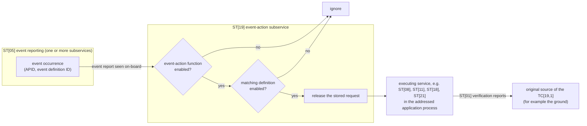
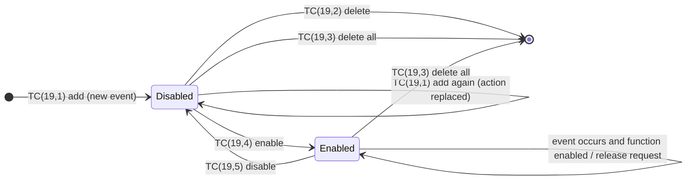
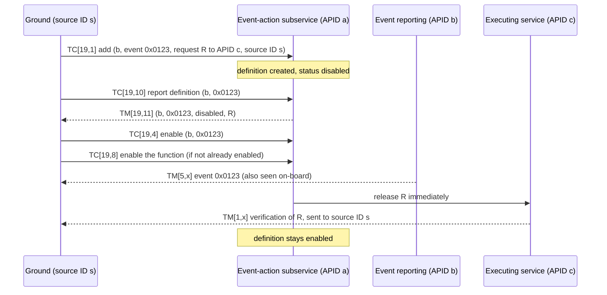
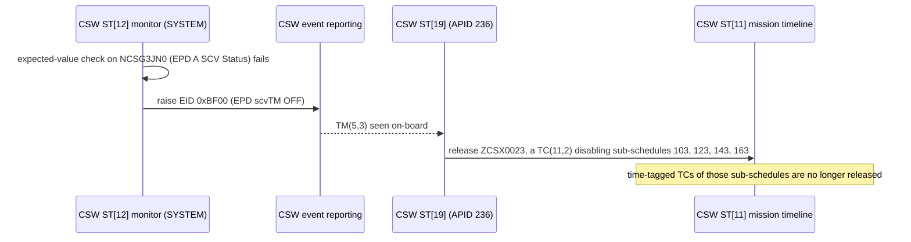

# ST[19] Event-action

The **event-action service** (service type 19) lets the ground attach an action to an on-board
event. The ground loads a list of *event-action definitions*, each pairing an event with a
telecommand request. When an associated [event reporting](st05-event-reporting.md) subservice
raises that event and the definition is enabled, the event-action subservice releases the stored
request at once. The request can, for example, reconfigure hardware directly, start an
[on-board control procedure](st18-onboard-operations-procedure.md) or start a
[request sequence](st21-request-sequencing.md).[^c-6191] PUS-C calls the subservice "an
extension of the ground monitoring and control".[^c-6191] Together with
[on-board monitoring](st12-onboard-monitoring.md), whose events "can be sent to ground and caught
on-board, e.g. by an event-action subservice", it is the standard building block of on-board
failure detection, isolation and recovery (FDIR).[^c-6121]

This page covers the ECSS-E-ST-70-41C ("PUS-C", 2016) service clause by clause, compares it with
ECSS-E-70-41A ("PUS-A", 2003) and the 2024 Rev.1 public-review draft, explains how the SCOS-2000
[MIB](../../mib/index.md) models the embedded telecommand, and documents the real event-action
definitions in the Solar Orbiter database.

!!! info "Where this page sits"
    The packet headers that carry these messages are on [PUS packet structures](packets.md). The
    field types (enumerated, unsigned integer, TC packet) are on
    [PUS parameter types](parameter-types.md). Event definitions themselves belong to
    [ST[05] Event reporting](st05-event-reporting.md). Version differences across the whole standard
    are summarised on [PUS-A vs PUS-C](pus-a-vs-pus-c.md), and all message types on the
    [message type catalogue](message-types.md).

## 1. The service at a glance

PUS-C defines a single subservice type for ST[19], the event-action subservice.[^c-6191] Annex C
lists its eleven message types and their capability class: *minimum* (always present),
*by declaration* (present if the mission declares it), *implied by* or *requires* another
capability, or *response* to a request.[^c-annexc19]

| Message type | Name | Capability | System clause / interface clause |
|---|---|---|---|
| TC[19,1] | add event-action definitions | minimum | 6.19.8.1 / 8.19.2.1 |
| TC[19,2] | delete event-action definitions | by declaration | 6.19.8.3 / 8.19.2.2 |
| TC[19,3] | delete all event-action definitions | by declaration | 6.19.8.4 / 8.19.2.3 |
| TC[19,4] | enable event-action definitions | minimum | 6.19.7.1 / 8.19.2.4 |
| TC[19,5] | disable event-action definitions | minimum | 6.19.7.2 / 8.19.2.5 |
| TC[19,6] | report the status of each event-action definition | by declaration | 6.19.8.5 / 8.19.2.6 |
| TM[19,7] | event-action status report | response to TC[19,6] | 6.19.8.5 / 8.19.2.7 |
| TC[19,8] | enable the event-action function | minimum | 6.19.6.1 / 8.19.2.8 |
| TC[19,9] | disable the event-action function | minimum | 6.19.6.2 / 8.19.2.9 |
| TC[19,10] | report event-action definitions | requires TC[19,1] | 6.19.8.6 / 8.19.2.10 |
| TM[19,11] | event-action definition report | response to TC[19,10] | 6.19.8.6 / 8.19.2.11 |

In addition, clause 6.19.8.2a requires at least one of TC[19,2] and TC[19,3], and Annex C marks
this rule as "implied by" TC[19,1].[^c-annexc19][^c-61982]



The diagram summarises clauses 6.19.1.2, 6.19.3 and 6.19.5.2.[^c-6191][^c-6193][^c-61952]

## 2. Service model

### 2.1 Layout and accessibility

Each event-action service contains at least one event-action subservice, and an application
process hosts at most one event-action subservice provider.[^c-6192] The specification of a
subservice must declare two lists:[^c-6193]

* **The event reporting subservices it listens to.** There is at least one, and the event-action
  subservice must be able to detect and react to *every* event report that they generate. PUS-C
  also states, as a deployment rule, that the on-board monitoring and the event-action services
  both require the presence of an event reporting service.[^c-424]
* **The application processes it may address when releasing requests.** The hosting application
  process is always in that list, and PUS-C assumes that all requests of an addressable application
  process may be used as actions.[^c-6193]

The released request is processed by the executing service named by its service type and
application process identifier, and that service produces the execution verification reports.
The request is regarded as generated not by the event-action subservice but by the source that
sent the add request, the *original source*.[^c-6193] The verification reports therefore go to the
source identifier written inside the stored request.[^c-6191]

!!! warning "Inference"
    Because the stored request keeps the source identifier that the ground wrote into it, the
    ground can tell an autonomous recovery command from a normal one by its source identifier
    alone. Solar Orbiter reserves source ID 112 for "Recovery Action commands (Service 19 Event
    Action List)" (see [section 8.2](#82-the-solar-orbiter-tailoring)). PUS-C does not mandate
    such a convention.

### 2.2 The event-action definition

The maximum number of definitions that a subservice can evaluate at the same time is a mission
declaration. Each **event-action definition** contains two things:[^c-6194]

1. The **event definition system identifier**. If the subservice listens to more than one event
   reporting subservice, this is the identifier of the application process that hosts the event
   reporting subservice, plus the **event definition identifier**. Otherwise it is the event
   definition identifier alone.
2. The **action**: the request to release when the event report is detected.

The term comes from ST[05]. An event definition is unique within the application process that
reports it, so the pair (application process ID, event definition ID) is unique across the
spacecraft. PUS-C calls this pair the "event definition system identifier".[^c-653] The definition
identifier is therefore the event, not a separate key. A subservice holds at most one definition
per event, and adding a definition for an event that already has one replaces its action (see
TC[19,1] below).[^c-61981]

### 2.3 Statuses and action initiation

The subservice maintains two kinds of status, both with the values "disabled" (raw 0) and
"enabled" (raw 1):[^c-61951][^c-8193]

* the **event-action function status**, one for the whole subservice;
* the **event-action status**, one per definition.

The processing logic is short. If the function is disabled, no action is triggered at all. If the
function is enabled and an event used by an enabled definition occurs, the subservice "shall
immediately trigger the related action", that is, release the request. Triggering does not change
the definition's status: it stays enabled and fires again on the next occurrence of the same
event.[^c-61952]



The state machine above is drawn from clauses 6.19.5 to 6.19.8. Adding a definition creates it
disabled. Adding or deleting is rejected while the definition is enabled. Delete-all removes every
definition whatever its status.[^c-61952][^c-61981][^c-61983][^c-61984] The function status has a
separate, two-state machine: TC[19,8] sets it to enabled, and TC[19,9] and TC[19,3] set it to
disabled. TC[19,8] and TC[19,9] leave the per-definition statuses unchanged, while TC[19,3] also
deletes every definition.[^c-6196][^c-61984]

!!! warning "Inference"
    Two rules work together. Definitions are always created disabled, and an enabled definition
    can be neither modified nor deleted. The result is a two-step "arm" procedure: load and verify
    the definition (for example with TC[19,10]), then enable it explicitly. A stored action can
    also never change under a live trigger. The standard states the rules but not this rationale.

### 2.4 Observables

PUS-C requires two observables for the subservice: the event-action function status and the
number of event-action definitions.[^c-6199] In PUS-C terms, observables are on-board parameters
provided by the subservice, so the ground can sample them like any other parameter, for example in
[housekeeping](st03-housekeeping.md).[^c-obs]

## 3. Requests and reports

All requests of the service follow the PUS instruction model. A request contains one or more
*instructions*. For example, TC[19,4] carries either a single "enable all" instruction or one or
more "enable an event-action definition" instructions. PUS-C itself uses this case as its example
of a request with several instruction slots.[^c-54112] For every multi-instruction request of
ST[19], PUS-C 2016 rejects faulty instructions one by one, with a *failed start of execution
notification* per instruction (reported as [TM[1,4]](st01-request-verification.md)), and still
processes the valid ones.[^c-61971][^c-tm14]

The packet field structures below use the PUS-C structure-diagram conventions. A field marked
optional is present or absent for the whole mission, application process or service instance, not
packet by packet. *N* gives the number of repetitions of the group that follows.[^c-721] The PFC,
and so the width, of each enumerated or unsigned-integer field is a mission choice, declared when
the application process is specified.[^c-731] The "TC packet" type is PTC 12 PFC 1: a complete
PUS-C telecommand packet, primary header included.[^c-7313]

### 3.1 TC[19,1] add event-action definitions

Each request carries one or more instructions. Each instruction gives an event definition system
identifier and the action to release.[^c-61981] The packet layout is:[^c-82191]

| Field | Type | Presence | Meaning |
|---|---|---|---|
| N | unsigned integer | always | number of instructions that follow |
| application process ID | enumerated | optional (repeated) | APID hosting the event reporting subservice; present when the event-action subservice listens to more than one |
| event definition ID | enumerated | repeated | the event to react to |
| request | TC packet | repeated | the complete telecommand to release |

The mission declares the list of verification checks to run on the embedded request. An instruction
is rejected if:[^c-61981]

1. it refers to an event-action definition that is **enabled**;
2. the maximum number of definitions that can be evaluated at the same time is already reached;
3. the embedded request fails any of the declared verification checks.

For a valid instruction there are two cases. If no definition exists for the event, a new one is
created with status "disabled". If one exists, its action is replaced by the new one.[^c-61981]

A hypothetical byte layout helps to see the nesting. Assume a mission with 8-bit N, a 16-bit
APID field and a 16-bit event definition ID:

<div class="bitfield" data-title="TC[19,1] application data, one instruction (illustrative widths, not a real mission)" data-width="32"
     data-fields='[{"n":"N","b":8,"d":"Number of instructions (illustrative 8-bit unsigned integer)"},{"n":"APID of event source","b":16,"d":"Optional; enumerated; width is mission-specific (illustrative 16 bits)"},{"n":"Event def. ID (hi)","b":8,"g":"event definition ID","d":"Enumerated; width is mission-specific (illustrative 16 bits)"},{"n":"Event def. ID (lo)","b":8,"g":"event definition ID"},{"n":"Embedded TC primary header (first 24 bits shown)","b":24,"g":"request (TC packet, PTC 12 PFC 1)","d":"A complete PUS-C telecommand packet follows: primary header, secondary header, application data and packet error control"}]'></div>

!!! warning "Inference"
    PUS-C gives no separate length field for the request. A parser can find the end of the
    embedded packet only from the packet data length field of its own primary header. This is this
    wiki's reading of how a "TC packet" field is delimited, not a statement of the standard.

### 3.2 TC[19,2] delete event-action definitions

This capability exists only if declared.[^c-61983] Each instruction gives an event definition system
identifier, and the layout is the same as TC[19,1] without the request field: N, then for each
instruction an optional APID and an event definition ID.[^c-82192] An instruction is rejected if the
definition is **enabled** or **unknown**. A valid instruction deletes the definition.[^c-61983]

### 3.3 TC[19,3] delete all event-action definitions

This request also exists only if declared, and has no application data.[^c-61984][^c-82193] It
first sets the **event-action function status to "disabled"** and then deletes every definition,
"without regard to" its enabled or disabled status.[^c-61984] Since TC[19,2] rejects enabled
definitions, TC[19,3] is the only request that removes a definition while it is enabled.

### 3.4 TC[19,4] / TC[19,5] enable and disable event-action definitions

Both requests are minimum capabilities. Each carries either one or more instructions naming a
definition, or exactly one "all" instruction without argument.[^c-61971][^c-61972] The packet layout
is N followed by N groups of an optional APID and an event definition ID.[^c-82194][^c-82195] An
instruction naming an **unknown** definition is rejected. A valid instruction sets that definition's
status to enabled (TC[19,4]) or disabled (TC[19,5]). A valid "all" instruction does the same for
every definition.[^c-61971][^c-61972]

!!! note "How is 'all' encoded?"
    PUS-C 2016 gives the packet layout of TC[19,4] and TC[19,5] but does not say how the "enable
    all" or "disable all" instruction appears in it.[^c-82194] For TC[19,10] it says explicitly that
    N = 0 means "report all".[^c-821910] The 2024 Rev.1 draft adds the same N = 0 rule to TC[19,4]
    and TC[19,5].[^r-8192]

Two editorial slips in the 2016 text: in 6.19.7.1, NOTE 2 points to clause 6.19.6.2 (disable the
*function*) where the disable-*definitions* clause is 6.19.7.2.[^c-61971] In 8.19.2.11a, the
subtype 11 packet is called an "event-action status report", although clause 6.19.8.6 calls it an
event-action definition report.[^c-821911]

### 3.5 TC[19,6] and TM[19,7]: status of each definition

TC[19,6] exists only if declared and has no application data.[^c-61985][^c-82196] The response is a
single **TM[19,7] event-action status report**, with one notification per definition: the event
definition system identifier and the event-action status.[^c-61985]

| Field | Type | Presence | Meaning |
|---|---|---|---|
| N | unsigned integer | always | number of definitions reported |
| application process ID | enumerated | optional (repeated) | part of the event definition system ID |
| event definition ID | enumerated | repeated | part of the event definition system ID |
| event-action status | enumerated | repeated | 0 = disabled, 1 = enabled |

Source: Figure 8-216 and Table 8-20.[^c-82197][^c-8193]

### 3.6 TC[19,8] / TC[19,9]: enable and disable the function

Both requests are minimum capabilities and have no application data. Each carries exactly one
instruction without argument.[^c-6196][^c-82198][^c-82199] TC[19,8] sets the function status to
"enabled" and TC[19,9] sets it to "disabled". Neither changes the status of any
definition.[^c-6196] With the function disabled the service "does not react to any event
reports".[^c-61952]

### 3.7 TC[19,10] and TM[19,11]: report the definitions

This capability exists only if declared, and it requires TC[19,1].[^c-61986] The request carries one
or more instructions naming definitions, or one "report all" instruction, which is N = 0 in the
packet.[^c-821910] Unknown definitions are rejected one by one. The single **TM[19,11]** report
contains, for each reported definition, its system identifier, its status and its action, that is
the full stored request:[^c-61986][^c-821911]

| Field | Type | Presence | Meaning |
|---|---|---|---|
| N | unsigned integer | always | number of definitions reported |
| application process ID | enumerated | optional (repeated) | part of the event definition system ID |
| event definition ID | enumerated | repeated | part of the event definition system ID |
| event-action status | enumerated | repeated | 0 = disabled, 1 = enabled |
| request | TC packet | repeated | the stored action |

Within ST[19], TM[19,11] is the only report that returns the stored action itself.[^c-61986]

!!! warning "Inference"
    A ground system can compare the returned request byte for byte with the TC[19,1] it sent. This
    catches a definition that was silently replaced, since TC[19,1] overwrites the action of an
    existing disabled definition. This is this wiki's suggestion of use. The standard only defines
    the report.

### 3.8 Enumerations

| Enumeration | Engineering value | Raw value | Source |
|---|---|---|---|
| event-action function status | "disabled" / "enabled" | 0 / 1 | Table 8-19[^c-8193] |
| event-action status | "disabled" / "enabled" | 0 / 1 | Table 8-20[^c-8193] |

## 4. Worked example: arming an action

The sequence below shows the life of one definition, using the standard message types. The
application process numbers are illustrative.



The message flow follows clauses 6.19.3, 6.19.5.2, 6.19.7.1 and 6.19.8.[^c-6193][^c-61952][^c-61971][^c-61981]
The event number 0x0123 is illustrative.

## 5. PUS-A (2003) compared

PUS-A specifies the same service type 19 in its clause 21. The concept is the same: actions are
attached to events that also give rise to an event report, and the action can be any standard or
mission-specific telecommand.[^a-211][^a-410] PUS-A sees the action as directly reconfiguring
hardware, starting an on-board operations procedure, or starting a command sub-schedule "which can
contain a predefined command sequence". There was no request sequencing service yet.[^a-410]

PUS-A maintains an **event detection list** whose entries hold an optional application process ID,
an event report ID (RID), the action (a telecommand packet) and an optional enabled/disabled action
status.[^a-212] The requests are:[^a-213]

| Subtype | PUS-A name | PUS-A behaviour | PUS-C counterpart |
|---|---|---|---|
| (19,1) | Add Events to the Detection List | New entries are disabled. An existing entry's action is replaced only if it is disabled, otherwise the request to replace it "shall be ignored". | TC[19,1], with rejection (failed start of execution) instead of silent ignore |
| (19,2) | Delete Events from the Detection List | Deletion is ignored for an enabled entry. An unknown entry is flagged as an error, and the rest of the request is still processed. | TC[19,2] |
| (19,3) | Clear the Event Detection List | Clears all entries. | TC[19,3], which also disables the function |
| (19,4) / (19,5) | Enable Actions / Disable Actions | Enables or disables the listed actions. Unknown events are flagged. | TC[19,4] / TC[19,5] |
| (19,6) / (19,7) | Report the Event Detection List / Event Detection List Report | Reports APID, RID and action status, not the telecommand. | TC[19,6] / TM[19,7] |
| - | - | - | TC[19,8] / TC[19,9] function enable and disable (new) |
| - | - | - | TC[19,10] / TM[19,11] definition report including the request (new) |

In PUS-A, N and the APID are "systematically omitted" when the service can handle only one event
per request or listens to only one application process.[^a-213] The PUS-A minimum capability set is
(19,1), (19,4) and (19,5), plus one of (19,2) or (19,3). Subtypes (19,6) and (19,7) are additional
capabilities that require each other.[^a-214] PUS-C keeps the subtype numbers 1 to 7, adds the
function-level control as a new minimum capability, adds observables, and formalises the
"original source" of released requests.[^c-annexc19][^c-6193][^c-6199]

## 6. The 2024 Rev.1 draft

The ECSS-E-ST-70-41C Rev.1 draft (DIR1, public review December 2024 to February 2025) keeps all
eleven message types and their layouts. This wiki compared the clause texts word by word and found
these changes:[^r-6195]

* **Start-up configuration.** The configuration policy applied when the subservice starts or
  restarts must be declared, covering the function status and each definition status. At start the
  function status is set to "enabled".[^r-6195]
* **Timing.** The maximum action generation time, the time from detecting the event to generating
  the action, must be declared.[^r-61952]
* **All-or-nothing requests.** A request that contains an invalid instruction is now rejected as a
  whole, with one failed start of execution notification. A request with only valid instructions is
  executed in the order of its instructions.[^r-61972][^r-61981]
* **N = 0 for enable/disable all** in TC[19,4] and TC[19,5].[^r-8192]
* **Three more observables**: the number of actions triggered by event detections, and the numbers
  of enabled and of disabled definitions.[^r-6199]

## 7. Modelling ST[19] in SCOS-2000

The hard part of TC[19,1] for a ground system is the embedded telecommand. The
[SCOS-2000 Database Import ICD](../../library/icd-7-0-final.md) handles it with a special
command parameter type. A parameter of type **Command ID** (`CPC_CATEG = 'A'` in
[`cpc`](../../mib/tables/cpc.md), which must be PTC 7 PFC 0, a variable-length octet string) takes
the name of another command as its value. SCOS-2000 then encodes it as the raw packet of that
command, "with configurable values for the main packet header fields".[^i70-cmdid][^i70-categ]
Appendix C of the ICD gives TC(19,1) as its example of a telecommand containing TC data that this
type simplifies. It also warns that the embedded TC is encoded with fixed values for header fields
such as the sequence counter. Apart from this, SCOS-2000 does no specific processing of Service 19
packets.[^i70-c19]
More on command parameter types is on [Commanding in the MIB](../../mib/commanding.md).

!!! warning "Inference"
    With a fixed sequence counter, every autonomous release of the same action carries the same
    packet sequence count. Its verification reports cannot be told apart by sequence count from
    those of an earlier release. The time of the report, or the event that triggered it, has to do
    that. The ICD gives the caveat. This consequence is this wiki's reading.

## 8. Solar Orbiter

### 8.1 Which PUS?

Solar Orbiter's packet structure ICD (SOL.S.ASTR.TN.00079, issue 7) has ECSS-E-70-41A as
applicable document AD1. It forbids non-standard use of the standard services and puts mission
extensions in private services or private subtypes.[^solo-ad1][^solo-scope] Its service 19 therefore
follows PUS-A, with the event detection list terminology, plus one private pair of subtypes.
Table 5.1-1 marks Service 19 as optional for payload instruments. An instrument that implements it
must provide (19,1), (19,4) and (19,5), and the others are optional. The central software (CSW) of
the on-board computer implements all nine message types.[^solo-tab]

!!! note "Reading Table 5.1-1"
    The extracted text of Table 5.1-1 does not keep its column layout. This wiki checked the
    rendered PDF page 37: every "X" of the service 19 rows is in the CSW column, and every "M" or
    "O" is in the payload (P/L SW) column. The legend on PDF page 31 defines these marks.[^solo-tab]

### 8.2 The Solar Orbiter tailoring

The CSW service keeps, for each event, the process ID that generates the event report, the event
report ID, the action telecommand packet and the action status. It reacts to event reports
TM(5,1) to TM(5,4) from one or more application processes.[^solo-520] Solar Orbiter identifies an
application process by a 7-bit process ID (PID) and a packet category. Event-action entries name
the PID, preceded by a one-bit filler that completes the octet.[^solo-annex8][^solo-5201]

<div class="bitfield" data-title="Solar Orbiter TC(19,1) Add an Event to the Detection List: application data (fixed part)" data-width="24"
     data-fields='[{"n":"Filler","b":1,"v":"0"},{"n":"PID","b":7,"d":"Process ID of the event report source (Annex 8), enumerated"},{"n":"EID","b":16,"d":"Event identifier, unsigned integer; must be a valid EID for that PID (Annex 9)"}]'></div>

The fixed part above is followed by **TC**, "a complete stand alone TC packet" whose length the ICD
gives as TBD. A newly created entry is disabled. Errors give TM(1,2) acceptance failure or TM(1,8)
completion failure reports.[^solo-5201] TC(19,2) carries the same filler, PID and EID without the
packet.[^solo-5202] TC(19,3) has no application data and clears the list.[^solo-5203]

Enable and disable use one layout with a repetition count:

<div class="bitfield" data-title="Solar Orbiter TC(19,4) Enable Action / TC(19,5) Disable Action: N and one repeated entry" data-width="32"
     data-fields='[{"n":"N","b":8,"d":"Number of parameter sets; 0 = change the status at service level"},{"n":"Filler","b":1,"v":"0","g":"repeated N times"},{"n":"PID","b":7,"g":"repeated N times"},{"n":"EID","b":16,"g":"repeated N times"}]'></div>

Solar Orbiter gives N = 0 a particular meaning. With N = 0 "the Event/Action status shall be
changed on Service level", and the individual entries are left unchanged.[^solo-5204] Read this way,
TC(19,4) and TC(19,5) with N = 0 act as a service-level switch, the role of PUS-C's TC[19,8] and
TC[19,9], while TC(19,4) with N > 0 corresponds to PUS-C's TC[19,4]. The ICD does not use the PUS-C
terms "event-action function" or "function status".

!!! warning "Inference"
    PUS-C 2016 does not say how "enable all definitions" is encoded, and Rev.1 later chose N = 0 for
    it (section 6). The same packet, TC(19,4) with N = 0, therefore means "enable the function" on
    Solar Orbiter but "enable all definitions" in Rev.1. Ground software that serves both
    conventions must keep them apart.

The list report TM(19,7) returns, for each entry, a copy of the PID, the EID, the action status and
the first ten octets of the stored telecommand (packet header plus data field header). The full
packet is not returned.[^solo-5207]

<div class="bitfield" data-title="Solar Orbiter TM(19,7) Event Detection List Report: one repeated entry (after an 8-bit N)" data-width="32"
     data-fields='[{"n":"Filler","b":1,"v":"0"},{"n":"PID","b":7},{"n":"EID","b":16},{"n":"Action status","b":8,"d":"0 = DISABLED, 1 = ENABLED"},{"n":"TC packet ID","b":16,"g":"TC header (10 octets)","d":"Copy of the stored telecommand primary header"},{"n":"TC packet sequence control","b":16,"g":"TC header (10 octets)"},{"n":"TC packet length","b":16,"g":"TC header (10 octets)"},{"n":"CCSDS sec. header flag","b":1,"g":"TC header (10 octets)"},{"n":"PUS version","b":3,"g":"TC header (10 octets)"},{"n":"Ack flags","b":4,"g":"TC header (10 octets)"},{"n":"Service type","b":8,"g":"TC header (10 octets)"},{"n":"Service subtype","b":8,"g":"TC header (10 octets)"},{"n":"Source ID","b":8,"g":"TC header (10 octets)"}]'></div>

The split of the 10-octet TC header into sub-fields comes from the MIB definition of the report
(SPID 10001, below). The ICD gives only "TC Header, 10 bytes".[^solo-5207][^solo]
Solar Orbiter adds a private pair. TC(19,130) requests the entry for one PID and EID, and
TM(19,131) returns that entry's action status and complete TC packet. These play the role of
PUS-C's TC[19,10] and TM[19,11] for a single definition.[^solo-5208]

Two further conventions matter for event-action:

* **Source ID 112**, set by the ground, marks "Recovery Action commands (Service 19 Event Action
  List)". Other reserved ground sources are 110 (mission timeline), 111 (TC sequences), 113 (back-up
  mission timeline) and 120 (direct commands).[^solo-srcid]
* **Event ID ranges.** Every severity (TM(5,1) to TM(5,4)) has a block of EIDs reserved for ESOC:
  0x3F00-0x3FFE, 0x7F00-0x7FFE, 0xBF00-0xBFFE and 0xFF00-0xFFFE.[^solo-eid]

### 8.3 Event-action definitions in the Solar Orbiter MIB

The 2025 MIB release has 48 service 19 commands and 2 service 19 report definitions.[^solo] The
CSW commands are addressed to APID 236 (PID 14 "System Control", category 12). The two reports
come from APID 227 (PID 14, category 3, "table generation").[^solo][^solo-annex8]

| Command | Subtype | Description (MIB) | Parameters |
|---|---|---|---|
| [`ZCS01301`](../../explorer/index.md#/solo/command/ZCS01301) | 1 | Add Event to the Detection List | `PCD0E012` Process ID (8 bits), `PCS13012` EID (16 bits), `PCD13013` "TC to send upon event" (Command ID) |
| [`ZCS01302`](../../explorer/index.md#/solo/command/ZCS01302) | 2 | Delete an Event from the Detection List | Process ID, EID |
| [`ZCS01303`](../../explorer/index.md#/solo/command/ZCS01303) | 3 | Clear the Event Detection List | none |
| [`ZCS01304`](../../explorer/index.md#/solo/command/ZCS01304) | 4 | Enable Actions | `PCD13041` "Nb Actions to process" (8 bits) repeating 2 elements |
| [`ZCS01305`](../../explorer/index.md#/solo/command/ZCS01305) | 5 | Disable Actions | as subtype 4 |
| [`ZCS01306`](../../explorer/index.md#/solo/command/ZCS01306) | 6 | Report the Event Detection List | none |
| [`ZCS01382`](../../explorer/index.md#/solo/command/ZCS01382) | 130 | Report Single Event Detection Entry | Process ID, EID |

The MIB merges the filler and the 7-bit PID into one 8-bit enumerated parameter (PTC 2 PFC 8). Its
command textual calibration `CCDT0018TX` (tables `paf`/`pas`) maps 70 values, the same as the
monitoring textual calibration of the same name
([`CCDT0018TX`](../../explorer/index.md#/solo/calib/txt/CCDT0018TX), tables `txf`/`txp`), from 0 "TIME", 10 "DMS", 11 "AOCS", 13 "PLATFORM" and 14 "SYSTEM" to the instrument process
IDs such as 50 "EPD_0" and 99 "SWA_4".[^solo] `PCD13013` is the Command ID parameter of
section 7: CPC_CATEG `A`, PTC 7, PFC 0.[^solo][^i70-categ]

On the telemetry side, [SPID 10001](../../explorer/index.md#/solo/packet/10001) (TM(19,7)) is a
variable packet. Its counter `NCD13071` repeats a group of 16 parameters per entry: PID, EID, status,
TC packet ID, sequence control and length, a 32-bit data field header, and the same 32 bits decoded
again (`VPD_OFFSET = -32`) as secondary header flag, PUS version, four ack flags, type, subtype and
source ID.[^solo] [SPID 10000](../../explorer/index.md#/solo/packet/10000) (TM(19,131)) decodes PID,
EID, status and header fields, then a data byte `NCD0B0A9` repeated by the value of the packet length
field `NCD0B0A8`, then one final byte `NCD0B0AA`.[^solo]

!!! warning "Inference"
    The TM(19,131) definition is a neat trick. A CCSDS packet data length field holds "number of
    octets minus one", so repeating one byte *length* times and then reading one more byte consumes
    exactly the embedded packet's data field. The MIB does not explain this. It is deduced from the
    structure.

**Predefined definitions.** Of the 25 TC(19,1) commands in the 2025 MIB, four are editable (the
generic `ZCS01301`, the test command `ZCSXN001` "Add S19 Entry RAW NOTFLIGHT", and the EPD and METIS
commands described below). The other 21 have every value fixed (`CDF_ELTYPE = 'F'`). The table pairs
each one's trigger event with its action command. The EID column also gives the event name from the
EID calibration (`CCDT0004TX`) or the event packet description.[^solo]

| Definition command | Event source PID | Trigger EID | Action command | Action |
|---|---|---|---|---|
| `ZCSX0031`-`ZCSX0040` (10 commands) | SYSTEM | "EPD scvTM OFF" 48896 (0xBF00) ... "SWA scvTM OFF" 48905 (0xBF09) | `ZCSX0021`-`ZCSX0030` (one per instrument, for example `ZCSX0023` for EPD) | TC(11,2) "P_OFF_*instrument* SSID" |
| [`ZCSX0042`](../../explorer/index.md#/solo/command/ZCSX0042) | SYSTEM | "MAG scvTM OFF" 48898 | `ZCPX0009` | TC(18,140) "Load and start OBCP (MAG2)" |
| `ZCSX0047`-`ZCSX0054` (8 commands) | SWA_4 | SWA events such as "Eas1OffEvent" 43655, "PasDetOffNmOFF" 43652 | `ZCSX0043`-`ZCSX0046` | TC(11,2) "P_OFF_SWA EAS1/EAS2/PAS/HIS SSID" |
| [`ZCSX1301`](../../explorer/index.md#/solo/command/ZCSX1301) "Define Loss-of-UL FDIR Event-Action" | PLATFORM | 48912 (0xBF10, "Unexp_loss_UL" in `CCDT0004TX`), the TM(5,3) of APID 215 "REC_DST_E1 Unexpected Loss Of UL" | [`ZCDX8605`](../../explorer/index.md#/solo/command/ZCDX8605) | TC(134,5) "Execute Loss-of-UL FDIR TC File" |
| [`ZCSX1302`](../../explorer/index.md#/solo/command/ZCSX1302) "Define SNAFU FDIR Event-Action" | AOCS | 3201 (0x0C81, "STR_AC_START" in `CCDT0004TX`), the only event with this EID in `pid`: a TM(5,1) of APID 183 described as "STR_Activate_Function_Started_(Pre-Power_On_Of_SCV_Units)" | [`ZCDX8606`](../../explorer/index.md#/solo/command/ZCDX8606) | TC(134,5) "Execute SNAFU FDIR TC File" |

The P_OFF actions are TC(11,2) "Disable Release of TCs" commands built as fixed areas. For example,
`ZCSX0023` "P_OFF_EPD SSID" holds the hexadecimal octets 04, 67, 00, 7B, 00, 8F, 00, A3, 00.[^solo]
Under the Solar Orbiter TC(11,1)/(11,2) layout (N1 sub-schedule IDs, each followed by a count N2 of
process IDs) this reads as four sub-schedules, 103, 123, 143 and 163, each with no process ID.[^solo-111]
The FDIR actions start on-board TC files through private service 134 (see
[ST[21] Request sequencing](st21-request-sequencing.md#7-solar-orbiter)).[^solo]

The whole P_OFF mechanism is installed by one ground sequence,
[`ADMF730A`](../../explorer/index.md#/solo/sequence/ADMF730A) "Define P_OFF S12 S19 v04"
(procedure DM-FCP-730, issue 4, 07/11/2024). It has 44 elements:[^solo]

1. report the current ST[12] monitoring list and the ST[19] event detection list;
2. twenty TC(12,5) commands `ZCSX0001`-`ZCSX0020`, "Define EPD_A_OFF S12" to "Define SWA_B_OFF S12",
   which add on-board parameter monitors. `ZCSX0001`, for example, applies an expected-value check
   (mask 12, expected value 8) to the parameter `NCSG3JN0` "EPD A SCV Status" and raises EID "EPD
   scvTM OFF";
3. eighteen TC(19,1) definitions: the P_OFF entries of the table above, except that for MAG the
   sequence loads `ZCSX0042` (start OBCP MAG2) and not `ZCSX0033` (the TC(11,2) action), so
   `ZCSX0033` is defined in the MIB but not used by this sequence;
4. two TC(19,4) commands that enable the ten SYSTEM entries (EIDs 48896-48905) and the eight SWA_4
   entries;
5. the two reports again.



The flow is drawn from the MIB definitions above and the Solar Orbiter definitions of services 11,
12 and 19.[^solo][^solo-520][^solo-111]

!!! warning "Inference"
    The trigger EIDs 0xBF00-0xBF10 lie in the "ESOC" block of the TM(5,3) range, so these
    monitors and event-actions are most likely defined by the mission control centre rather than
    by the CSW supplier. The same block also holds OBCP-generated events in the MIB, for example
    48917 "OBCP_STR1: STR Recovered" at APID 183. The SNAFU trigger 3201 is not in an ESOC block:
    it falls in the TM(5,1) range 0x0420-0x141F of "Specific Application SW Events".[^solo-eid] The reading of the P_OFF chain is also an inference from names and
    structures. When an instrument's secondary-voltage telemetry unexpectedly reports OFF, the
    timeline sub-schedules that command that instrument are disabled, so that queued commands are
    not sent to a switched-off unit. Neither purpose is stated in the available sources. The meaning
    of "SNAFU" is not stated either.

**Instrument implementations.** Two instruments define their own service 19 in the MIB:[^solo]

* **EPD** (APID 812): `ZID52514` "TC 19,1 Add Action" carries a 16-bit RID, a 2-bit "Action
  SensorID", a 6-bit "Action Code" and an 8-bit parameter instead of an embedded telecommand. Its
  delete, enable and disable commands carry one RID.
* **METIS** (APID 1084): `ZIT01901` "Add Event" follows the ICD layout (1-bit filler, 7-bit
  PID fixed to 67, 16-bit EVENT_ID, raw packet as an octet string). The MIB provides canned
  enable/disable commands for 1, 2, 3, 5 and 9 actions, plus
  [`ZIT019A4`](../../explorer/index.md#/solo/command/ZIT019A4) "Enable EVENT ACTION SRV", which is
  TC(19,4) with N fixed to 0, the service-level switch.

**Growth.** The April 2020 release had 14 TC(19,1) commands, and the September 2025 release has 25.
The additions are the two FDIR definitions `ZCSX1301` and `ZCSX1302`, the MAG2 OBCP variant `ZCSX0042`
and the eight SWA sub-unit definitions `ZCSX0047`-`ZCSX0054`.[^solo][^solo2020]

??? example "SQL used"
    ```sql
    -- service 19 commands and packets (solo-2025-09-16.sqlite)
    SELECT CCF_STYPE, count(*) FROM ccf WHERE CCF_TYPE='19' GROUP BY 1;        -- 1:25 2:2 3:1 4:9 5:9 6:1 130:1
    SELECT PID_STYPE, PID_APID, PID_SPID, PID_DESCR FROM pid WHERE PID_TYPE='19';
    -- parameter layout of the CSW commands
    SELECT c.CDF_CNAME, c.CDF_BIT, c.CDF_ELLEN, c.CDF_GRPSIZE, c.CDF_PNAME, p.CPC_DESCR, p.CPC_PTC, p.CPC_PFC, p.CPC_CATEG
      FROM cdf c LEFT JOIN cpc p ON p.CPC_NAME=c.CDF_PNAME
     WHERE c.CDF_CNAME IN ('ZCS01301','ZCS01304','ZCS01382') ORDER BY 1, CAST(c.CDF_BIT AS INT);
    -- predefined definitions: trigger and action
    SELECT f.CCF_CNAME,
           (SELECT CDF_VALUE FROM cdf WHERE CDF_CNAME=f.CCF_CNAME AND CDF_BIT='0')  AS pid,
           (SELECT CDF_VALUE FROM cdf WHERE CDF_CNAME=f.CCF_CNAME AND CDF_BIT='8')  AS eid,
           (SELECT CDF_VALUE FROM cdf WHERE CDF_CNAME=f.CCF_CNAME AND CDF_BIT='24') AS action
      FROM ccf f WHERE f.CCF_TYPE='19' AND f.CCF_STYPE='1' AND f.CCF_APID='236';
    SELECT PAS_ALTXT, PAS_ALVAL FROM pas WHERE PAS_NUMBR='CCDT0004TX' AND PAS_ALTXT LIKE '%scvTM%';
    SELECT PID_TYPE, PID_STYPE, PID_APID, PID_PI1_VAL, PID_DESCR FROM pid
     WHERE PID_TYPE='5' AND PID_PI1_VAL IN ('48896','48905','48912','3201');
    -- the report layouts
    SELECT VPD_TPSD, VPD_POS, VPD_NAME, VPD_GRPSIZE, VPD_OFFSET FROM vpd WHERE VPD_TPSD IN ('10000','10001');
    -- the ground sequence that installs the P_OFF chain
    SELECT CSS_ENTRY, CSS_ELEMID FROM css WHERE CSS_SQNAME='ADMF730A' ORDER BY CAST(CSS_ENTRY AS INT);
    SELECT SDF_ENTRY, SDF_POS, SDF_PNAME, SDF_VALUE FROM sdf WHERE SDF_SQNAME='ADMF730A' AND SDF_ENTRY IN ('41','42');
    -- 2020 release for comparison (solo-2020-04-16.sqlite)
    SELECT count(*) FROM ccf WHERE CCF_TYPE='19' AND CCF_STYPE='1';           -- 14
    ```

### 8.4 Heritage

The ESA Operations Interface Requirements Document of Herschel/Planck (2003) already states the
service as requirements on the CDMS, the spacecraft command and data management system. EVNT-1 to
EVNT-4 ask it to respond
to an event packet by issuing a telecommand, conditioned on the source APID and the event report
identifier, and to maintain an action list that can be added to, deleted from, enabled, disabled, cleared and
reported. Herschel/Planck marks the service "Not Applicable" for instruments.[^hp-oird]

## Related pages

* [ST[05] Event reporting](st05-event-reporting.md), which supplies the events.
* [ST[12] On-board monitoring](st12-onboard-monitoring.md), the usual source of FDIR events.
* [ST[18] On-board operations procedure](st18-onboard-operations-procedure.md),
  [ST[21] Request sequencing](st21-request-sequencing.md),
  [ST[11] Time-based scheduling](st11-time-based-scheduling.md) and
  [ST[08] Function management](st08-function-management.md), common action targets.
* [ST[01] Request verification](st01-request-verification.md), for the reports on released requests.
* [How Solar Orbiter uses PUS](../../missions/solar-orbiter/pus-usage.md) and
  [The Solar Orbiter MIB](../../missions/solar-orbiter/mib.md).
* [Commanding in the MIB](../../mib/commanding.md) and
  [Command sequences in the MIB](../../mib/sequences.md).
* Terms: [glossary](../../glossary.md).

[^c-6191]: [ECSS-E-ST-70-41C](../../library/ecss-e-st-70-41c-15april2016.md), §6.19.1.1 and §6.19.1.2, PDF p. 342.
[^c-6121]: [ECSS-E-ST-70-41C](../../library/ecss-e-st-70-41c-15april2016.md), §6.12.1.1, PDF p. 198.
[^c-annexc19]: [ECSS-E-ST-70-41C](../../library/ecss-e-st-70-41c-15april2016.md), Annex C.2.19, Table C-28, PDF p. 648.
[^c-61982]: [ECSS-E-ST-70-41C](../../library/ecss-e-st-70-41c-15april2016.md), §6.19.8.2, PDF p. 348.
[^c-6193]: [ECSS-E-ST-70-41C](../../library/ecss-e-st-70-41c-15april2016.md), §6.19.3.1 and §6.19.3.2, PDF p. 343.
[^c-61952]: [ECSS-E-ST-70-41C](../../library/ecss-e-st-70-41c-15april2016.md), §6.19.5.2, PDF p. 344.
[^c-6192]: [ECSS-E-ST-70-41C](../../library/ecss-e-st-70-41c-15april2016.md), §6.19.2, PDF p. 342.
[^c-424]: [ECSS-E-ST-70-41C](../../library/ecss-e-st-70-41c-15april2016.md), §4.2.4, PDF p. 24.
[^c-6194]: [ECSS-E-ST-70-41C](../../library/ecss-e-st-70-41c-15april2016.md), §6.19.4, PDF pp. 343-344.
[^c-653]: [ECSS-E-ST-70-41C](../../library/ecss-e-st-70-41c-15april2016.md), §6.5.1.2 and §6.5.3c, PDF pp. 121-122.
[^c-61981]: [ECSS-E-ST-70-41C](../../library/ecss-e-st-70-41c-15april2016.md), §6.19.8.1, PDF pp. 347-348.
[^c-61951]: [ECSS-E-ST-70-41C](../../library/ecss-e-st-70-41c-15april2016.md), §6.19.5.1, PDF p. 344.
[^c-8193]: [ECSS-E-ST-70-41C](../../library/ecss-e-st-70-41c-15april2016.md), §8.19.3, Tables 8-19 and 8-20, PDF p. 572.
[^c-61983]: [ECSS-E-ST-70-41C](../../library/ecss-e-st-70-41c-15april2016.md), §6.19.8.3, PDF pp. 348-349.
[^c-61984]: [ECSS-E-ST-70-41C](../../library/ecss-e-st-70-41c-15april2016.md), §6.19.8.4, PDF p. 349.
[^c-6196]: [ECSS-E-ST-70-41C](../../library/ecss-e-st-70-41c-15april2016.md), §6.19.6.1 and §6.19.6.2, PDF pp. 344-345.
[^c-6199]: [ECSS-E-ST-70-41C](../../library/ecss-e-st-70-41c-15april2016.md), §6.19.9, PDF p. 351.
[^c-obs]: [ECSS-E-ST-70-41C](../../library/ecss-e-st-70-41c-15april2016.md), §5.3.2f and its NOTE, PDF p. 27.
[^c-54112]: [ECSS-E-ST-70-41C](../../library/ecss-e-st-70-41c-15april2016.md), §5.4.11.2.1e-f, PDF p. 49.
[^c-61971]: [ECSS-E-ST-70-41C](../../library/ecss-e-st-70-41c-15april2016.md), §6.19.7.1, PDF pp. 345-346.
[^c-61972]: [ECSS-E-ST-70-41C](../../library/ecss-e-st-70-41c-15april2016.md), §6.19.7.2, PDF pp. 346-347.
[^c-tm14]: [ECSS-E-ST-70-41C](../../library/ecss-e-st-70-41c-15april2016.md), §8.1.2.4, TM[1,4] failed start of execution verification report, PDF p. 447.
[^c-721]: [ECSS-E-ST-70-41C](../../library/ecss-e-st-70-41c-15april2016.md), §7.2.1, PDF pp. 427-428.
[^c-731]: [ECSS-E-ST-70-41C](../../library/ecss-e-st-70-41c-15april2016.md), §7.3.1, PDF p. 428.
[^c-7313]: [ECSS-E-ST-70-41C](../../library/ecss-e-st-70-41c-15april2016.md), §7.3.13, Table 7-12, PDF p. 437.
[^c-82191]: [ECSS-E-ST-70-41C](../../library/ecss-e-st-70-41c-15april2016.md), §8.19.2.1, Figure 8-212, PDF p. 568.
[^c-82192]: [ECSS-E-ST-70-41C](../../library/ecss-e-st-70-41c-15april2016.md), §8.19.2.2, Figure 8-213, PDF pp. 568-569.
[^c-82193]: [ECSS-E-ST-70-41C](../../library/ecss-e-st-70-41c-15april2016.md), §8.19.2.3, PDF p. 569.
[^c-82194]: [ECSS-E-ST-70-41C](../../library/ecss-e-st-70-41c-15april2016.md), §8.19.2.4, Figure 8-214, PDF p. 569.
[^c-82195]: [ECSS-E-ST-70-41C](../../library/ecss-e-st-70-41c-15april2016.md), §8.19.2.5, Figure 8-215, PDF pp. 569-570.
[^c-821910]: [ECSS-E-ST-70-41C](../../library/ecss-e-st-70-41c-15april2016.md), §8.19.2.10, Figure 8-217 and requirement c, PDF p. 571.
[^c-821911]: [ECSS-E-ST-70-41C](../../library/ecss-e-st-70-41c-15april2016.md), §8.19.2.11, Figure 8-218, PDF pp. 571-572.
[^c-61985]: [ECSS-E-ST-70-41C](../../library/ecss-e-st-70-41c-15april2016.md), §6.19.8.5, PDF pp. 349-350.
[^c-82196]: [ECSS-E-ST-70-41C](../../library/ecss-e-st-70-41c-15april2016.md), §8.19.2.6, PDF p. 570.
[^c-82197]: [ECSS-E-ST-70-41C](../../library/ecss-e-st-70-41c-15april2016.md), §8.19.2.7, Figure 8-216, PDF p. 570.
[^c-82198]: [ECSS-E-ST-70-41C](../../library/ecss-e-st-70-41c-15april2016.md), §8.19.2.8, PDF p. 571.
[^c-82199]: [ECSS-E-ST-70-41C](../../library/ecss-e-st-70-41c-15april2016.md), §8.19.2.9, PDF p. 571.
[^c-61986]: [ECSS-E-ST-70-41C](../../library/ecss-e-st-70-41c-15april2016.md), §6.19.8.6, PDF pp. 350-351.
[^a-211]: [ECSS-E-70-41A](../../library/ecss-e-70-41a-30jan2003-pus.md), §21.1, PDF p. 177.
[^a-410]: [ECSS-E-70-41A](../../library/ecss-e-70-41a-30jan2003-pus.md), §4.10, PDF p. 34.
[^a-212]: [ECSS-E-70-41A](../../library/ecss-e-70-41a-30jan2003-pus.md), §21.2, PDF p. 177.
[^a-213]: [ECSS-E-70-41A](../../library/ecss-e-70-41a-30jan2003-pus.md), §21.3.1-§21.3.5, PDF pp. 178-180.
[^a-214]: [ECSS-E-70-41A](../../library/ecss-e-70-41a-30jan2003-pus.md), §21.4, Tables 41 and 42, PDF pp. 180-181.
[^r-6195]: [ECSS-E-ST-70-41C Rev.1 DIR1](../../library/ecss-e-st-70-41c-rev1-dir1.md), §6.19.5.1c-d, PDF p. 327; the word-by-word comparison of §6.19 (PDF pp. 325-334) and §8.19 (PDF pp. 614-618) with the 2016 text is this wiki's own.
[^r-61952]: [ECSS-E-ST-70-41C Rev.1 DIR1](../../library/ecss-e-st-70-41c-rev1-dir1.md), §6.19.5.2c, PDF p. 327.
[^r-61972]: [ECSS-E-ST-70-41C Rev.1 DIR1](../../library/ecss-e-st-70-41c-rev1-dir1.md), §6.19.7.2d-f, PDF p. 330.
[^r-61981]: [ECSS-E-ST-70-41C Rev.1 DIR1](../../library/ecss-e-st-70-41c-rev1-dir1.md), §6.19.8.1b-g, PDF pp. 330-331.
[^r-8192]: [ECSS-E-ST-70-41C Rev.1 DIR1](../../library/ecss-e-st-70-41c-rev1-dir1.md), §8.19.2.4c and §8.19.2.5c, PDF p. 615.
[^r-6199]: [ECSS-E-ST-70-41C Rev.1 DIR1](../../library/ecss-e-st-70-41c-rev1-dir1.md), §6.19.9, PDF p. 334.
[^i70-cmdid]: [SCOS-2000 Database Import ICD 7.0](../../library/icd-7-0-final.md), "Special PUS Command Parameter Types", PDF p. 143.
[^i70-categ]: [SCOS-2000 Database Import ICD 7.0](../../library/icd-7-0-final.md), `cpc` field 8 CPC_CATEG, PDF p. 146.
[^i70-c19]: [SCOS-2000 Database Import ICD 7.0](../../library/icd-7-0-final.md), Appendix C, §1 (PDF p. 235) and §3.16 "Service 19: Event-action service" (PDF p. 243).
[^solo-ad1]: [SOL.S.ASTR.TN.00079 issue 7, Solar Orbiter TM-TC and Packet Structure ICD](../../library/sol-s-astr-tn-00079-07.md), §2.1 AD1, PDF p. 13.
[^solo-scope]: [SOL.S.ASTR.TN.00079 issue 7](../../library/sol-s-astr-tn-00079-07.md), §1.1, PDF p. 11.
[^solo-tab]: [SOL.S.ASTR.TN.00079 issue 7](../../library/sol-s-astr-tn-00079-07.md), §5.1 legend (PDF p. 31) and Table 5.1-1 (PDF p. 37; column positions checked by this wiki on the rendered PDF page).
[^solo-520]: [SOL.S.ASTR.TN.00079 issue 7](../../library/sol-s-astr-tn-00079-07.md), §5.20 "Service 19: Event-Action", PDF p. 210.
[^solo-annex8]: [SOL.S.ASTR.TN.00079 issue 7](../../library/sol-s-astr-tn-00079-07.md), Annex 8 §13.1, PDF pp. 272-274.
[^solo-5201]: [SOL.S.ASTR.TN.00079 issue 7](../../library/sol-s-astr-tn-00079-07.md), §5.20.1 TC (19,1), PDF pp. 210-211.
[^solo-5202]: [SOL.S.ASTR.TN.00079 issue 7](../../library/sol-s-astr-tn-00079-07.md), §5.20.2 TC (19,2), PDF pp. 211-212.
[^solo-5203]: [SOL.S.ASTR.TN.00079 issue 7](../../library/sol-s-astr-tn-00079-07.md), §5.20.3 TC (19,3), PDF p. 212.
[^solo-5204]: [SOL.S.ASTR.TN.00079 issue 7](../../library/sol-s-astr-tn-00079-07.md), §5.20.4-§5.20.5 TC (19,4) and TC (19,5), PDF pp. 212-213.
[^solo-5207]: [SOL.S.ASTR.TN.00079 issue 7](../../library/sol-s-astr-tn-00079-07.md), §5.20.6-§5.20.7 TC (19,6) and TM (19,7), PDF pp. 214-215.
[^solo-5208]: [SOL.S.ASTR.TN.00079 issue 7](../../library/sol-s-astr-tn-00079-07.md), §5.20.8-§5.20.9 TC (19,130) and TM (19,131), PDF pp. 215-216.
[^solo-srcid]: [SOL.S.ASTR.TN.00079 issue 7](../../library/sol-s-astr-tn-00079-07.md), Annex 8 §13.2 "Source ID", PDF pp. 275-276.
[^solo-eid]: [SOL.S.ASTR.TN.00079 issue 7](../../library/sol-s-astr-tn-00079-07.md), Annex 9 §14.2, Figure 14.2-1, PDF p. 279.
[^solo-111]: [SOL.S.ASTR.TN.00079 issue 7](../../library/sol-s-astr-tn-00079-07.md), §5.12.1-§5.12.2 TC (11,1) and TC (11,2), PDF pp. 101-102.
[^solo]: [Solar Orbiter MIB release MIB__20250916M25925PFMS001_SOL](../../library/mib-20250916m25925pfms001-sol.md), tables `ccf`, `cdf`, `cpc`, `paf`, `pas`, `txf`, `txp`, `pid`, `vpd`, `pcf`, `css`, `csf` and `sdf`, queried by this wiki on 2026-11-12.
[^solo2020]: [Solar Orbiter MIB release MIB__20200416M10720PFMS001_SOL](../../library/mib-20200416m10720pfms001-sol.md), table `ccf`, queried by this wiki on 2026-11-12.
[^hp-oird]: [Herschel/Planck Operations Interface Requirements Document SCI-PT-RS-07360 issue 2.2](../../library/cosmos-operations-interface-requirements.md), §3 table (PDF p. 24) and §3.16 (PDF p. 37).
