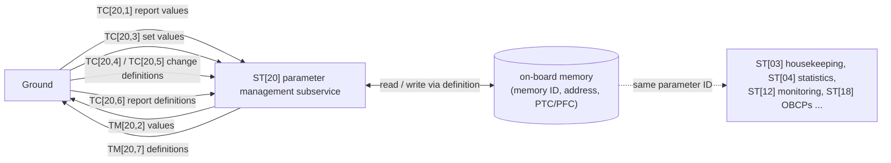
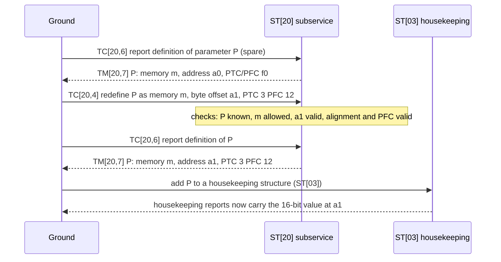

# ST[20] On-board parameter management

The **parameter management service** (service type 20) gives the ground direct access to
**on-board parameters**: it can read their current values, set new values and, optionally,
redefine where a parameter lives in memory and how it is encoded.[^c-62011] Each parameter
definition binds a spacecraft-wide parameter identifier to a memory location and a
[packet field code](parameter-types.md) (PTC and PFC). A predefined identifier can be pointed at a
new memory location or field code, for example to make a parameter for an
[OBCP](st18-onboard-operations-procedure.md), or to export an internal software variable as a
parameter for [housekeeping](st03-housekeeping.md) or [monitoring](st12-onboard-monitoring.md).[^c-62012]
ST[20] is new in PUS-C (ECSS-E-ST-70-41C, 2016): the PUS-A list of standard services stops at
service 19.[^c-table41][^a-tab2][^v14-st20]

The service is small, with seven message types and no observables, but it touches the foundations
of the standard: the on-board parameter, the on-board memory and the packet field code. This page
covers each clause, then the 2024 Rev.1 draft. It then turns to Solar Orbiter, whose PUS-A based
design uses the number 20 for something else entirely and puts its parameter management in private
service 139.

!!! note "Two names"
    Clause 6.20 and Table 4-1 call the service "parameter management", and clause 8.20 calls it
    "on-board parameter management".[^c-62011][^c-8201][^c-table41] This wiki uses the planned page
    title "On-board parameter management" and treats both names as the same service.

## 1. The service at a glance

| Message type | Name | Capability (Annex C) | System / interface clause |
|---|---|---|---|
| TC[20,1] | report parameter values | minimum | 6.20.4.1 / 8.20.2.1 |
| TM[20,2] | parameter value report | response to TC[20,1] | 6.20.4.1 / 8.20.2.2 |
| TC[20,3] | set parameter values | by declaration | 6.20.4.2 / 8.20.2.3 |
| TC[20,4] | change raw memory parameter definitions | by declaration | 6.20.5.2 / 8.20.2.4 |
| TC[20,5] | change object memory parameter definitions | by declaration | 6.20.5.3 / 8.20.2.5 |
| TC[20,6] | report parameter definitions | requires TC[20,4] or TC[20,5] | 6.20.5.4 / 8.20.2.6 |
| TM[20,7] | parameter definition report | response to TC[20,6] | 6.20.5.4 / 8.20.2.7 |

Source: Annex C.2.20, Table C-29.[^c-annexc20] The only mandatory capability is reading values.
Writing values, redefining parameters and reading definitions back are each declared per mission.



The diagram combines clauses 6.20.1 to 6.20.5. The dashed link reflects NOTE 2 of 6.20.5.1:
changing a parameter definition "affects any service that makes use of that parameter".[^c-62011][^c-62051]

## 2. Foundations: parameters, memories, definitions

### 2.1 On-board parameters

PUS-C defines the **on-board parameter** as a system object in its generic service model. Each
parameter has exactly one identifier, unique across the whole spacecraft. It can be a sensor
measurement or a software variable held in memory, and services read it as part of their routine
work, for example to monitor it or to compute another value.[^c-5432] The baseline parameter set
comes from the spacecraft design. The standard foresees defining new parameters in orbit, changing
an existing definition, or setting a value through ST[20]. NOTE 3 of 5.4.3.2 adds that this is
naturally limited to software parameters in memory, and that the on-board software may protect
essential parameters against being overwritten.[^c-5432]

Every parameter is also associated with one **minimum sampling interval**. The interval is the unit
in which services such as housekeeping and monitoring express their time intervals, and all
parameters accessed by one application process share it. The standard's example is 125 ms for the
platform and 500 ms for a payload.[^c-5432]

### 2.2 On-board memories and addressing

A parameter definition points into an **on-board memory**, a *logical* memory identified by a
memory ID. For each memory the mission declares its access alignment constraint, its size in bytes,
the allowed operations ("read only", "read and write" or "write only"), and whether scrubbing and
write protection are supported.[^c-5433] Two addressing schemes can be exposed in the space-ground
interface:[^c-54332]

* **Absolute addressing**: addresses and offsets are in bytes from the start of the memory.
* **Base plus offset**: a byte offset from a base reference. The base can be an absolute address or
  a symbolic one, "e.g. the name of a table, a parameter set or a file", whose address is known on
  board.

The base-plus-offset scheme is what makes TC[20,5] useful. Offsets count from the first byte of the
referenced object "independently of the actual physical storage", so a parameter can be defined
inside a table or a file without the ground knowing where the object physically sits.[^c-54332] The
2014 ECSS status presentation says the same of ST[6]: the base-plus-offset concept "has been
extended to access memory objects such as files", and it lists for ST[20] the "dynamic creation (!)
of new parameters based on raw or structured data memory access".[^v14-st20]

### 2.3 The parameter definition

The mission declares the parameter identifiers whose definitions the subservice manages. Each
**parameter definition** consists of:[^c-6203]

1. the on-board parameter identifier, unique in the spacecraft;
2. a memory ID, if the subservice manages more than one memory;
3. an address: base plus offset for a base-plus-offset memory, or a byte offset from the start for
   an absolute-addressed memory;
4. the packet field code (PTC and PFC) of the memory field used to read or write the value.

The packet field code tells the software how to read or write the value at the address. The value
fields of TM[20,2] and TC[20,3] are "deduced" from the parameter ID, so in this wiki's reading the
same code also fixes how the value appears in those messages.[^c-82022] See
[PUS parameter types](parameter-types.md) for the PTC/PFC table and
[MIB parameter types](../../mib/parameter-types.md) for its SCOS-2000 form.

### 2.4 Layout and accessibility

Each parameter management service contains at least one parameter management subservice. An
application process hosts at most one provider.[^c-6202] For the definition-changing capabilities,
the mission declares two lists:[^c-62051]

* the parameters whose definitions may be changed;
* the memories that may be used for parameter definitions, which, the note says, "allows restricting
  the memories on which new parameters can be mapped".

PUS-C defines no observables for this subservice.[^c-6206]

## 3. Requests and reports

All ST[20] requests are multi-instruction requests. In PUS-C 2016, an invalid instruction gets its
own failed start of execution notification (reported as
[TM[1,4]](st01-request-verification.md)), and the valid instructions of the same request are still
processed.[^c-62041][^c-tm14] The field types follow the PUS-C conventions. "Enumerated" and
"unsigned integer" widths are mission choices. "Deduced" (PTC 11 PFC 0) means that the structure and
format follow from preceding fields or mission constants, here from the parameter ID.[^c-731][^c-7312]

### 3.1 TC[20,1] report parameter values / TM[20,2] parameter value report

This is the only mandatory capability. Each instruction names one parameter. An unknown parameter
is rejected. Each valid instruction yields one *parameter value notification* (identifier and value),
and the request yields one TM[20,2] with all of them.[^c-62041]

| Message | Field | Type | Meaning |
|---|---|---|---|
| TC[20,1] | N | unsigned integer | number of parameters |
| | parameter ID | enumerated | repeated N times |
| TM[20,2] | N | unsigned integer | number of values reported |
| | parameter ID | enumerated | repeated |
| | value | deduced | format specific to that parameter ID |

Source: Figures 8-219 and 8-220.[^c-82021][^c-82022]

### 3.2 TC[20,3] set parameter values

This capability exists if declared. Each instruction gives a parameter ID and its new value, with
the same layout as TM[20,2]: N, then N pairs of parameter ID and deduced value. An unknown parameter
is rejected. Otherwise the parameter is set to the new value.[^c-62042][^c-82023]

!!! warning "Inference"
    The only rejection criterion that PUS-C 2016 lists for TC[20,3] is "unknown parameter". It names
    no range check, read-only check or memory-protection check. The protections that NOTE 3 of
    5.4.3.2 mentions would therefore be implementation checks beyond the standard, or go into the
    list of parameters that the mission declares as manageable. The standard does not say which.

### 3.3 TC[20,4] change raw memory parameter definitions

This capability exists if declared. Each instruction gives the definition to change (by its
parameter identifier), the memory ID if there is more than one memory, the **start address as a byte
offset**, and the new PTC and PFC.[^c-62052]

| Field | Type | Presence | Meaning |
|---|---|---|---|
| N | unsigned integer | always | number of instructions |
| parameter ID | enumerated | repeated | the definition to change |
| memory ID | enumerated | optional (repeated) | when more than one memory is managed |
| absolute address | unsigned integer | repeated | byte offset of the new location |
| PTC | enumerated | repeated | new packet field type code |
| PFC | enumerated | repeated | new packet field format code |

Source: Figure 8-222.[^c-82024] An instruction is rejected if:[^c-62052]

1. the parameter definition identifier is unknown;
2. the memory ID is not allowed for parameter definitions;
3. the memory address is invalid;
4. the packet field code is not compatible with the memory alignment constraint;
5. the packet field code is invalid.

A valid instruction installs the new definition.

### 3.4 TC[20,5] change object memory parameter definitions

This capability exists if declared. It is the same as TC[20,4], except that the address is a
**base plus an offset** inside an object memory, and the base field is "deduced". Its form depends on
the memory and can be an address or a symbolic reference.[^c-62053][^c-82025] The five rejection
conditions are those of TC[20,4].[^c-62053]

| Field | Type | Presence |
|---|---|---|
| N | unsigned integer | always |
| parameter ID | enumerated | repeated |
| memory ID | enumerated | optional (repeated) |
| base | deduced | repeated |
| offset | unsigned integer | repeated |
| PTC, PFC | enumerated, enumerated | repeated |

Source: Figure 8-223. Clause 8.20.2.5b cites "Figure 8-222", but the figure printed under it is
Figure 8-223, so this is an editorial slip in the 2016 text.[^c-82025] The Rev.1 draft keeps the
slip: its 8.20.2.5b cites Figure 8.20-4 (raw memory) above Figure 8.20-5.[^r-cmp]

### 3.5 TC[20,6] report parameter definitions / TM[20,7] parameter definition report

This capability exists if declared, and only if at least one of TC[20,4] and TC[20,5] is
provided.[^c-62054] Each instruction names a parameter. Unknown parameters are rejected. Each valid
instruction yields a *parameter definition notification* containing the parameter ID, the memory ID
(if several memories), the addressing scheme (if any memory uses base plus offset), the absolute or
base-plus-offset address, and the PTC/PFC.[^c-62054]

| Field | Type | Presence | Meaning |
|---|---|---|---|
| N | unsigned integer | always | number of definitions |
| parameter ID | enumerated | repeated | |
| memory ID | enumerated | optional | when several memories are managed |
| addressing scheme | enumerated | optional | 0 = absolute, 1 = base plus offset |
| addressing scheme dependent address | see below | repeated | absolute: one unsigned integer; base plus offset: deduced base and unsigned offset |
| PTC, PFC | enumerated | repeated | |

Source: Figures 8-224 to 8-227 and Table 8-21.[^c-82026][^c-82027][^c-8203]

### 3.6 Enumeration

| Addressing scheme (Table 8-21) | Raw value |
|---|---|
| "absolute addressing scheme" | 0 |
| "base plus offset addressing scheme" | 1 |

Source: §8.20.3.[^c-8203]

### 3.7 A redefinition, step by step

The next diagram shows how the ground could turn a spare identifier into a new housekeeping
parameter. The parameter number and the subsequent ST[03] step are illustrative.



The rules come from clauses 6.20.5.2 and 6.20.5.4.[^c-62052][^c-62054] PTC 3 PFC 12 is a 16-bit
unsigned integer.[^c-734]

## 4. The 2024 Rev.1 draft

A word-by-word comparison of clauses 6.20 and 8.20 of the Rev.1 public-review draft with the 2016
text, made by this wiki, finds a single substantive change. A request that contains an invalid
instruction is now **rejected as a whole**, with one failed start of execution notification. A
request with only valid instructions is executed in instruction order. This is the same change Rev.1
makes across the standard.[^r-62042] The message types and packet layouts are unchanged.[^r-cmp]

## 5. Relations to other services

* **ST[06] memory management** loads and dumps memory areas. ST[20] works one level higher, on
  named, typed parameters. The base-plus-offset addressing is shared.[^c-54332][^v14-st20]
* **ST[03], ST[04], ST[12]** sample parameters by identifier. Redefining a parameter changes what
  they all see.[^c-62051]
* **ST[18] OBCPs** are the standard's own example of a user of new parameters.[^c-62012]
* **ST[23] file management**: a base-plus-offset base may be a file, so a parameter can live
  inside an on-board file.[^c-54332]

## 6. Solar Orbiter

### 6.1 Service type 20 is "information distribution"

Solar Orbiter's packet structure ICD follows ECSS-E-70-41A and lists the mission's Operations
Interface Requirements Document (OIRD, SO-ESC-RS-05001) as a reference document.[^solo-ad1] The same
mission-level numbering appears earlier in ESA's Herschel/Planck OIRD (2003), which lists service 20
as "Information Distribution CDMS - User", 21 as "Science Data Transfer" and 22 as "Context Saving".
Services 20 and 22 are marked "Not used" there, and only 21 is mandatory for
instruments.[^hp-oird] PUS-C later gave these three numbers to new standard services. On Solar
Orbiter, **service 20 is Information Distribution**. Its packets go from
the OBC to the payload instruments, both as an OBC heartbeat (so that instruments can switch down in
a controlled way if the spacecraft enters Survival Mode) and to distribute inter-instrument
communication data.[^solo-521] It has nothing to do with PUS-C's ST[20].

| Message | Direction | Content |
|---|---|---|
| TC(20,1) Start Information Distribution for User | ground to CSW | instrument ID (1 octet), period (2 octets: 0 = one shot, otherwise a number of 125 ms software cycles) |
| TC(20,2) Stop Information Distribution for User | ground to CSW | instrument ID (1 octet) |
| TC(20,128) Inter-Instruments Communication | CSW to all instruments | 236 octets: 36 octets of platform data and 200 octets of instrument data |

Source: §5.21.[^solo-5211][^solo-5213] Table 5.1-1 makes the service optional for payloads. The CSW
implements TC(20,1) and TC(20,2), and TC(20,128) is optional for the payload.[^solo-tab]

<div class="bitfield" data-title="Solar Orbiter TC(20,1) Start Information Distribution for User: application data" data-width="24"
     data-fields='[{"n":"Instrument ID","b":8,"d":"Destination instrument; in the MIB a SpaceWire address calibration, e.g. EPD_SPW_ADDR = 72"},{"n":"Period","b":16,"d":"0 = one-shot distribution; any other value n = every n software cycles of 125 ms"}]'></div>

The ICD fixes the TC(20,128) packet itself. APID 796 is process ID 49 ("Payload broadcast") with
category 12. The sequence count increments at 8 Hz and wraps every 2048 s. The acknowledgement flags
are 0, so payloads generate no TM(1,1)/TM(1,7) for it, and the source ID is 14 (System Control). The
CSW fills it from the system data pool. Each instrument's share comes from a dedicated TM(3,25),
extracted by the TM extraction service. An instrument served at less than 8 Hz sees gaps in the
sequence count.[^solo-5213]

<div class="bitfield" data-title="Solar Orbiter TC(20,128): first 7 octets of the platform section" data-width="32"
     data-fields='[{"n":"Thruster firing","b":1,"g":"platform flags (2 octets)","d":"1 = thruster firing expected within 5 s"},{"n":"Spare","b":1,"g":"platform flags (2 octets)"},{"n":"Solar array steering","b":1,"g":"platform flags (2 octets)","d":"1 = solar array movement"},{"n":"Commandable flags","b":13,"g":"platform flags (2 octets)","d":"Content TBC in the source"},{"n":"AOCS mode","b":32,"d":"Current AOCS mode, 4 octets"},{"n":"AOCS convergence flag","b":8,"d":"1 = NCM-F performance met"}]'></div>

The layout above is that of SOL-SGS-TN-0007 issue 2.0, §6.3.[^sgs-63] The issue 7 ICD flags differ:
bit 1 is a "science data outage" flag and bits 2 to 15 are commandable flags whose content is TBC,
with no solar array steering flag.[^solo-5213] The rest of the platform section holds roll rate and roll angle (4-octet floats),
four reaction wheel speeds (4-octet floats, rad/s), four validity flags and a spare.[^sgs-63][^sgs-4]
The SGS note (2016) records how the Science Operations Working Group split the 200 instrument octets.
Each instrument opens its block with a 4-octet heartbeat copied from the on-board time coarse field.
Spare octets were allocated in advance, including all 14 of SPICE's, because SPICE did not then plan
to take part.[^sgs-34][^sgs-61]

| Block | Octets (SGS TN §6.2) | EPD `ZID52530` | STIX `ZIXX0128` "Aligned" | STIX `ZIX20128` | PHI `ZIP14800` |
|---|---|---|---|---|---|
| Spacecraft | 1-36 | 36 | 36 | 36 | 36 |
| EPD | 37-66 | 30 | 30 | 30 | 20 |
| EUI | 67-89 | 23 | 23 | 23 | 20 |
| MAG | 90-109 | 20 | 20 | 20 | 20 |
| METIS | 110-129 | 20 | 20 | 20 | 20 |
| PHI | 130-143 | 14 | 14 | 14 | 20 |
| RPW | 144-176 | 33 | 33 | 33 | 20 |
| SOLOHI | 177-190 | 14 | 14 | 14 | 20 |
| STIX | 191-206 | 16 (bit 1520) | 16 (bit 1520) | 16 (bit 1632) | 20 (bit 1568) |
| SWA | 207-222 | 16 (bit 1648) | 16 (bit 1648) | 16 (bit 1760) | 20 (bit 1728) |
| SPICE | 223-236 | 14 (bit 1776, last) | 14 (bit 1776, last) | 14 (bit 1520, before STIX) | 20 (bit 1408, before STIX) |

The 2025 MIB contains five TC(20,128) definitions at APID 796, all from instrument databases: EPD's
`ZID52530`, MAG's `ZIM02028` (one undivided 1888-bit, that is 236-octet, block), PHI's `ZIP14800`,
and two from STIX, `ZIX20128` and `ZIXX0128` "STIX Information Distribution Aligned". The
`CCF_DESCR2` text of `ZIXX0128` is cut off after "Duplicated from ZIX201". `ZIXX0128` is new in
2025, and the 2020 release has the other four.[^solo][^solo2020] EPD's `ZID52530` and STIX's `ZIXX0128` follow the SGS
note's sizes and order.[^sgs-62] STIX's older `ZIX20128` has the SGS sizes but puts SPICE before
STIX and SWA. PHI's `ZIP14800` uses an even 20 octets per instrument, in the same order as `ZIX20128`. That is the
layout of the issue 7 ICD, which lists the instruments alphabetically (EPD, EUI, MAG, METIS, PHI, RPW,
SoloHI, SPICE, STIX, SWA) at 20 octets each, with a remark that deviations must be agreed between
the PIs and ESA.[^solo-5213]

!!! warning "Inference"
    The orders cannot all describe the same on-board packet. The "Aligned" STIX copy reads as a
    later correction of `ZIX20128` to the SGS allocation. `ZIX20128` and `ZIP14800` then look like
    definitions left over from the ICD's even split. Which definition matches the flight CSW is not
    stated in the available sources.

The agreed cadences are 1 Hz generation for most instruments' TM(3,25) (MAG 8 Hz, SWA 0.25 Hz,
SPICE none) and 1 Hz distribution of TC(20,128) (SWA 8 Hz). Delays are at most 250 ms in each
direction, so 500 ms in total.[^sgs-23][^sgs-31] In the 2025 MIB, eleven TC(20,1) commands
(`ZCD01401` plus one canned command per instrument, `ZCD2Z010`-`ZCD2Z019`) and one TC(20,2) are
addressed to APID 172 (process ID 10, DMS). Ground sequences use them 90 and 58 times
respectively.[^solo] The instrument reactions to service 20 data are still "To be written" in the SGS
note.[^sgs-7]

### 6.2 The real counterpart: private service 139

Solar Orbiter's equivalent of ST[20] is **service 139**. The service clause heads it "Parameter
Management service" and Table 5.1-1 lists it as "Datapool Management Service", reserved for the
CSW.[^solo-529][^solo-tab] It "allows the ground to manage on board data", software variables or
equipment acquisitions, by reading or changing values. There are two kinds of data:[^solo-529]

* **Variables**, used by housekeeping (service 3) and monitoring (service 12);
* **Updatable constants**, "system level tuneable parameters" used in algorithms such as the AOCS,
  for which service 139 is a more convenient interface than memory management (service 6).

Parameters are addressed by a 32-bit **Parameter ID** defined in the SRDB (the ICD uses the
acronym without expanding it). The ID is made of a process ID, a read-only/read-write flag and a
local ID. The SRDB and the CSW map each ID to a start address, a length and a parameter type. The set is "frozen for a given CSW
release", but new parameters can be defined with TC(139,4).[^solo-529]

| Solar Orbiter | Purpose | PUS-C ST[20] analogue |
|---|---|---|
| TC(139,1) Change Value of onboard Parameters | NPAR (1 octet), then NPAR pairs of parameter ID (4 octets) and value (deduced). Not usable for "Byte Array" parameters. | TC[20,3] |
| TC(139,2) Get Value of On-board Parameters | NPAR (1 octet), NPAR parameter IDs (4 octets) | TC[20,1] |
| TM(139,3) On-board Parameters Value Report | NPAR, then ID and value pairs | TM[20,2] |
| TC(139,4) Define Onboard Parameters | NPAR (1-18), then ID (4), RAM address (4), length (1), type (4). Maps a predefined "spare" ID to a RAM location. | TC[20,4] |
| - | no definition report | TC[20,6] / TM[20,7] |

Source: §5.29.1 to §5.29.4.[^solo-5291][^solo-5294]

<div class="bitfield" data-title="Solar Orbiter TC(139,4) Define Onboard Parameters: NPAR and one repeated definition" data-width="32"
     data-fields='[{"n":"NPAR","b":8,"d":"Number of parameters to define, 1..18"},{"n":"Parameter ID","b":32,"g":"repeated NPAR times","d":"Logical identifier (unique) of the parameter in the datapool; a predefined spare ID"},{"n":"RAM address","b":32,"g":"repeated NPAR times","d":"Physical RAM address of the data"},{"n":"Parameter length","b":8,"g":"repeated NPAR times","d":"Length in bytes; must be consistent with the type"},{"n":"Parameter type","b":32,"g":"repeated NPAR times","d":"Type code, e.g. 0x0003000E = UINT32"}]'></div>

The ICD lists the type codes: 0x00020008/10/20 for 8-, 16- and 32-bit enumerations, 0x00030004,
0x0003000C and 0x0003000E for UINT8, UINT16 and UINT32, 0x00040004, 0x0004000C and 0x0004000E for
INT8, INT16 and INT32, and 0x00050001, 0x00050002 and 0x00050003 for single, double and
"double read as single" floats.[^solo-5294] The MIB calibration `CCDT0017TC` holds the same values in
decimal, plus `BYTE_ARRAY` = 0.[^solo]

!!! warning "Inference"
    Eleven of the twelve listed codes read as a PUS PTC in the upper 16 bits and the matching PFC
    in the lower 16 bits: 0x0003000E is PTC 3 PFC 14 (4-octet unsigned), 0x00020010 is PTC 2 PFC 16
    (16-bit enumerated), 0x00050002 is PTC 5 PFC 2 (IEEE double precision).[^c-734][^c-736] The
    exception is 0x00050003, "Float Double Precision read as Float Single Precision", whereas
    PTC 5 PFC 3 is the 4-octet MIL-STD simple precision format.[^c-736] Solar Orbiter's TC(139,4)
    therefore carries in effect a packet field code, as PUS-C's TC[20,4] does, with one
    mission-specific value. The ICD does not state this encoding rule. It is deduced from the values.

**The parameter ID.** Annex 11 of the ICD defines the common 32-bit structure for system data pool
parameters: a 1-bit filler (0), the 7-bit process ID of Annex 8, a read/write flag (0 = read and
write, 1 = read only, "not modifiable via service 132") and a 23-bit local ID. The local ID is a
3-bit filler (0b010), an 8-bit unit ID (for example CSW or IMU) and a 12-bit counter, a free-running
number whose last 4 bits give the functional type for CSW parameters.[^solo-a11] The bit widths are
in a figure that the text extraction misses. This wiki read them from the rendered PDF page.

<div class="bitfield" data-title="Solar Orbiter system data pool Parameter ID (ICD Annex 11)" data-width="32"
     data-fields='[{"n":"Filler","b":1,"v":"0"},{"n":"Process ID","b":7,"d":"As defined in Annex 8, e.g. 11 = AOCS"},{"n":"R/W","b":1,"d":"0 = read and write, 1 = read only"},{"n":"Filler","b":3,"v":"010","g":"local ID (23 bits)"},{"n":"Unit ID","b":8,"g":"local ID (23 bits)","d":"Unit for which the parameter is relevant, e.g. CSW or IMU"},{"n":"Counter, first part","b":8,"g":"local ID (23 bits)","d":"Free-running number"},{"n":"Functional part","b":4,"g":"local ID (23 bits)","d":"For CSW parameters, the functional type (e.g. TM status or delay)"}]'></div>

In the MIB, all but one of the 19,803 on-board parameter IDs (`PCF_PID`) have a most significant
octet between 10 and 17: 12,178 with 17, 3,140 with 11 (AOCS), 1,176 with 14 (SYSTEM), 1,138 with 13
(PLATFORM), 1,000 with 16 (THERMAL), 598 with 10 (DMS), 529 with 12 (PAYLOAD) and 43 with 15 (OBCP).
The exception is `DUMMYVAL` "ALWAYS_VALID" with ID 0. Process IDs 10 to 16 are the OBC software
processes of Annex 8. Annex 8 lists 17 as a spare, but the MIB's process ID calibration
`CCDT0018TX` names it "OBDB".[^solo][^solo-annex8] The read/write bit is 0 in all 19,803 IDs. The
3-bit filler is 0b000 in 15,433 IDs, 0b001 in 1,778 and 0b010 in only 2,592, so the MIB does not
follow the Annex's fixed filler value.[^solo]

!!! warning "Inference"
    The text's reference to service 132 (SGM management in the same ICD) may be meant for service
    139, since service 139 is the one that changes data pool values. The meaning of process ID 17
    "OBDB" and of the varying filler bits is not stated in the available sources.

### 6.3 Service 139 in the MIB

The 2025 MIB has 217 TC(139,1), 10 TC(139,2) and 7 TC(139,4) definitions, none of them flagged
critical, and 26 TM(139,3) packet definitions.[^solo]

| APID | Process | TC(139,1) | TC(139,2) | TC(139,4) |
|---:|---|---:|---:|---:|
| 172 | 10 DMS | 8 | 2 | 1 |
| 188 | 11 AOCS | 29 | 2 | 2 |
| 204 | 12 PAYLOAD | 3 | 1 | 1 |
| 220 | 13 PLATFORM | 8 | 3 | 1 |
| 236 | 14 SYSTEM | 161 | 1 | 1 |
| 268 | 16 THERMAL | 8 | 1 | 1 |

Most TC(139,1) commands are canned settings with fixed parameter IDs, for example "Set DST RX A SCV
Health", "Set TWTA SCV Presel = A", "Set GFE Gyro Biases" and "Update SC Mass CSWv3_0". The
generic forms are `ZCD2Z004`/`5`/`6` "Set value of (1/2/4-byte integer) parameters".[^solo] Ground
sequences use TC(139,1) 358 times (in 270 sequences), TC(139,2) 64 times and TC(139,4) 9
times.[^solo]

In the generic commands, and in all TC(139,2) and TC(139,4) definitions, the parameter ID fields
are of the SCOS-2000 type **Parameter ID** (`CPC_CATEG = 'P'`, PTC 3 PFC 14). The operator gives a
telemetry parameter name and SCOS-2000 encodes its on-board identifier
`PCF_PID`.[^i70-cmdid][^solo] The same command parameter, `PCD03014` "Datapool parameter ID"
(unsigned, 32 bits), appears in 49 service 139 commands, 114 service 12 commands, 24 service 3
commands and 2 service 130 commands.[^solo] Most canned TC(139,1) commands do it differently: 173 of
the 217 have no Parameter ID field at all, and 163 of these carry the identifier as a 32-bit fixed
area. "Set DST RX A SCV Health" (`ZCS2Z03T`), for example, holds the fixed areas 0x01 (NPAR) and
0x0E0C83B0, which is the `PCF_PID` of `NCST3H20` "DST-RX A SCV Health", followed by an editable
8-bit value.[^solo]

**Reading values back.** The generic TM(139,3), for example
[SPID 10114](../../explorer/index.md#/solo/packet/10114) from APID 227, is a variable packet. A count
`NCD8B031` repeats a pair made of `NCD0C095` "Monitored Par ID" (32 bits, with `VPD_PIDREF = 'Y'`) and
`NCD8B033`, a value of PTC 11, *deduced*.[^solo] In SCOS-2000, `VPD_PIDREF = 'Y'` means that the value
is an on-board parameter ID, which is compared with the `PCF_PID` values to find the telemetry
parameter.[^i70-vpd] The deduced value then takes that parameter's type: `NCD8B033` has
`PCF_RELATED = NCD0C095`, the field that names the parameter whose value supplies the on-board
parameter ID for a deduced parameter.[^i70-related][^solo] This is the ground half of PUS-C's
"deduced" value field. Twenty more TM(139,3) definitions at APID 1953 decode particular
reports with fixed layouts, keyed on the first parameter ID (`pic`: offset 17, width 32), for example
SPID 65908 "TC Link Mon Params Report".[^solo]

!!! warning "Inference"
    APID 1953 falls in the EGSE process ID range (process ID 122).[^solo-annex8] In the
    mission-specific `dup` file, three of the generic TM(139,3) SPIDs are paired with APID 1953:
    14177 (APID 163, DMS), 20131 (APID 179, AOCS) and 27108 (APID 211, PLATFORM). The first
    parameter IDs that key the twenty fixed-layout definitions all have 10, 11 or 13 in their top
    octet, which are exactly these three processes. This suggests that the MOC maps the real reports
    onto this APID to apply the fixed-layout definitions. This is not documented in the ICD or the TN.

### 6.4 Worked example: a real redefinition

[`ZCAX8B04`](../../explorer/index.md#/solo/command/ZCAX8B04) "Define SPARE RWAB THR 3.1.2" is a
TC(139,4) to the AOCS application (APID 188) with every value fixed in the MIB:[^solo]

| # | Parameter (name, `PCF_PID`) | RAM address (raw `CDF_VALUE`) | Length | Type |
|---|---|---|---|---|
| 1 | [`NCAT2PB0`](../../explorer/index.md#/solo/param/NCAT2PB0) "RW1_GgHtr_MON__GgHtr_MMH", 185118745 = 0x0B08B019 | 40077920 | 4 | UINT32 (0x0003000E) |
| 2 | `NCAT2PC0` "RW2_WDE_2_URP__GgHtr_MMH", 0x0B08B01A | 40077940 | 4 | UINT32 |
| 3 | `NCAT2PD0` "RW3_GgHtr_MON__WDE_3_URP", 0x0B08B01B | 40077960 | 4 | UINT32 |

The three IDs are consecutive AOCS spares (top octet 0x0B = 11). Their entries in the mission file
`ASW_sw_para.dat` (next section) are `HKA_SPARE_PARAM26`-`28`, "Reserved parameter 26 [27, 28] in the
AOCS application".[^solo] TC(139,4) gives these spare identifiers a memory location and a type.
The MIB parameter descriptions, such as "RW1_GgHtr_MON__GgHtr_MMH", give them their new meaning,
which from the names relates to the reaction wheels. This is the PUS-C TC[20,4] use case, "exporting an existing internal variable as a
parameter for housekeeping or monitoring".[^c-62012]

The RAM addresses are given as printed. Their command parameter has `CPC_RADIX = 'D'`.[^solo] Read
as decimal, 40077920, 40077940 and 40077960 are 0x02638A60, 0x02638A74 and 0x02638A88, 20 bytes
apart. All three fall inside the OBC "Processor RAM" range 0x0200 0000 to 0x027F FFFF of the ICD's
memory ID allocation (Figure 5.7-1).[^solo-mem] Read as hexadecimal, 0x40077920 would fall in none of
the listed RAM ranges. The two other fixed RAM addresses found in the MIB's ground sequences, 40111920
and 40116648 (sequences `AACF612A` and `AACF613A`), also fall in that range when read as
decimal.[^solo]

!!! warning "Inference"
    The memory map therefore supports the declared decimal radix, and the encoded RAM address field
    of the first definition would be 02 63 8A 60. The ICD does not say which memory a TC(139,4)
    address refers to beyond "PM-RAM", so this remains a consistency check, not a statement of the
    sources.

A request that needs no such interpretation is a TC(139,2) reading the first parameter back. This
octet string is **illustrative**: it is built from the real MIB layout of
[`ZCA08B02`](../../explorer/index.md#/solo/command/ZCA08B02) and the real `PCF_PID`, but it was not
captured from the spacecraft:[^solo]

```text
TC(139,2) application data: 01 0B 08 B0 19
  01           NPAR = 1
  0B 08 B0 19  Parameter ID = PCF_PID of NCAT2PB0 (185118745)
```

### 6.5 The ASW_sw_para table and its possible relation to ST[20]

The 2025 release contains a file that the ICD does not define, `ASW_sw_para.dat`, loaded into this
wiki's database as table `asw_sw_para` with three columns. The first column holds MIB names and the
second on-board software symbol names. The third holds a description, empty in 15,662 of the 105,222
rows.[^solo] The [MIB overview](../../mib/index.md#mission-specific-files) lists it among the
mission-specific files and gives first statistics.

| First column matches | Rows | Example (column 1, column 2) |
|---|---:|---|
| `pcf.PCF_NAME` (monitoring parameters, prefix N) | 77,565 | `NCAP0001`, `OBDB_ACCSETPARAMS_ACCUNITA_ACCAXIS1_COEFPOLYTACCBIAS_0` |
| ... of which have an on-board ID `PCF_PID` | 19,397 | `NCAT2PB0`, `HKA_SPARE_PARAM26` |
| `cpc.CPC_NAME` (command parameters, prefix P) | 3,676 | `PCA8B021`, `PTC_GET_N_PARAM` |
| `ccf.CCF_CNAME` (commands, prefix Z) | 2,221 | `ZAHG0001` |
| `tpcf.TPCF_NAME` (telemetry packet names, prefix Y) | 7,665 | `YCA00101`, `TMA_TCACK_ACC_SUCCESS` |
| calibration tables `txf`, `caf`, `paf`, `cca`, `mcf`, `lgf` (prefix C) | 260 | `CCDT0001TX`, `AOCS_PROFILE_ID` |
| `prf.PRF_NUMBR` (value range sets, prefix V) | 77 | `VCD00147`, `Z_IDINT0TO1` |
| no MIB table (prefix B) | 13,727 | `BCAY0000`, `SSEA_SEGMENTS_END_TIME_C` |

Source: this wiki's queries.[^solo] Of the 19,803 `pcf` entries with an on-board ID, all but 406
appear in `asw_sw_para`. The 2020 release has 85,430 rows.[^solo][^solo2020]

!!! warning "Inference"
    `ASW_sw_para` looks like an export of the on-board software's view of the database. Each MIB item
    (parameter, packet, command, command parameter, calibration, value range, and B-prefixed items
    that match no MIB table) is paired with the symbol of the application software (ASW) that
    implements it. The relation to ST[20]-style parameter management is that the 19,397 parameters
    with an on-board ID are the data pool parameters that service 139 (and services 3 and 12)
    address by Parameter ID. `ASW_sw_para` then tells which software variable each identifier is
    bound to, including the "spare" variables that TC(139,4) can map. This matches the ICD's
    statement that the parameter definitions come from the SRDB and are frozen per CSW
    release.[^solo-529] The file's purpose and origin, and the nature of the B-prefixed items, are not
    stated in the available sources.

??? example "SQL used"
    ```sql
    -- solo-2025-09-16.sqlite
    SELECT CCF_APID, CCF_STYPE, count(*) FROM ccf WHERE CCF_TYPE='139' GROUP BY 1,2;
    SELECT CCF_STYPE, count(*) FROM ccf WHERE CCF_TYPE='20' GROUP BY 1;              -- 1:11 2:1 128:5
    SELECT c.CDF_CNAME, c.CDF_BIT, c.CDF_ELLEN, c.CDF_PNAME, p.CPC_DESCR, p.CPC_CATEG, c.CDF_VALUE
      FROM cdf c LEFT JOIN cpc p ON p.CPC_NAME=c.CDF_PNAME
     WHERE c.CDF_CNAME IN ('ZCD08B02','ZCD08B04','ZCAX8B04','ZID52530','ZIX20128','ZIXX0128','ZIP14800','ZIM02028','ZCS2Z03T')
     ORDER BY 1, CAST(c.CDF_BIT AS INT);
    SELECT CCF_CNAME, CCF_DESCR, CCF_DESCR2 FROM ccf WHERE CCF_TYPE='20' AND CCF_STYPE='128';
    -- TC(139,x) with / without a Parameter ID (CPC_CATEG='P') field
    SELECT CCF_STYPE, count(*), sum(EXISTS (SELECT 1 FROM cdf c JOIN cpc p ON p.CPC_NAME=c.CDF_PNAME
           WHERE c.CDF_CNAME=f.CCF_CNAME AND p.CPC_CATEG='P')) FROM ccf f WHERE CCF_TYPE='139' GROUP BY 1;  -- 1:217/44 2:10/10 4:7/7
    -- Parameter ID bit fields
    SELECT (CAST(PCF_PID AS INT)>>23)&1 AS rw, (CAST(PCF_PID AS INT)>>20)&7 AS filler, count(*)
      FROM pcf WHERE PCF_PID<>'' GROUP BY 1,2;                                           -- 0|0:15433 0|1:1778 0|2:2592
    -- RAM addresses used in sequences
    SELECT s.SDF_SQNAME, s.SDF_VALUE FROM sdf s JOIN cpc p ON p.CPC_NAME=s.SDF_PNAME WHERE p.CPC_DESCR='RAM address';
    SELECT PAS_ALTXT, PAS_ALVAL FROM pas WHERE PAS_NUMBR='CCDT0017TC';                -- parameter types
    SELECT PAS_ALTXT, PAS_ALVAL FROM pas WHERE PAS_NUMBR='CCDT0209TC';                -- instrument IDs
    SELECT PCF_NAME, PCF_DESCR, PCF_PID FROM pcf WHERE PCF_NAME IN ('NCAT2PB0','NCAT2PC0','NCAT2PD0');
    SELECT f.CCF_TYPE, count(DISTINCT f.CCF_CNAME) FROM cdf c JOIN ccf f ON f.CCF_CNAME=c.CDF_CNAME
     WHERE c.CDF_PNAME='PCD03014' GROUP BY 1;                                          -- 3:24 12:114 130:2 139:49
    SELECT (CAST(PCF_PID AS INT) >> 24) AS top_octet, count(*) FROM pcf WHERE PCF_PID<>'' GROUP BY 1;
    SELECT VPD_POS, VPD_NAME, VPD_GRPSIZE, VPD_PIDREF FROM vpd WHERE VPD_TPSD='10114';
    SELECT * FROM pic WHERE PIC_TYPE='139';
    SELECT d.COL1, d.COL2 FROM dup d JOIN pid p ON p.PID_SPID=d.COL1 WHERE p.PID_TYPE='139';
    -- asw_sw_para (an indexed in-memory copy was used for speed)
    SELECT count(*), sum(COL3='') FROM asw_sw_para;
    SELECT count(*) FROM asw_sw_para a JOIN pcf p ON p.PCF_NAME=a.COL1;                -- 77565
    SELECT count(*) FROM asw_sw_para a JOIN pcf p ON p.PCF_NAME=a.COL1 WHERE p.PCF_PID<>'';  -- 19397
    SELECT count(*) FROM pcf WHERE PCF_PID<>'' AND PCF_NAME NOT IN (SELECT COL1 FROM asw_sw_para); -- 406
    SELECT substr(COL1,1,1), count(*) FROM asw_sw_para GROUP BY 1;
    SELECT count(*) FROM asw_sw_para WHERE COL1 IN (SELECT TPCF_NAME FROM tpcf);        -- 7665
    SELECT count(*) FROM asw_sw_para WHERE COL1 IN (SELECT PRF_NUMBR FROM prf);         -- 77
    SELECT * FROM asw_sw_para WHERE COL1 IN ('NCAT2PB0','NCAT2PC0','NCAT2PD0');
    -- sequence usage
    SELECT c.CCF_TYPE, c.CCF_STYPE, count(*), count(DISTINCT s.CSS_SQNAME)
      FROM css s JOIN ccf c ON c.CCF_CNAME=s.CSS_ELEMID
     WHERE s.CSS_TYPE='C' AND c.CCF_TYPE IN ('20','139') GROUP BY 1,2;
    -- solo-2020-04-16.sqlite
    SELECT count(*) FROM asw_sw_para;                                                 -- 85430
    ```

## Related pages

* [PUS parameter types (PTC/PFC)](parameter-types.md) and
  [MIB parameter types](../../mib/parameter-types.md).
* [ST[06] Memory management](st06-memory-management.md),
  [ST[03] Housekeeping](st03-housekeeping.md), [ST[12] On-board monitoring](st12-onboard-monitoring.md)
  and [ST[18] On-board operations procedure](st18-onboard-operations-procedure.md).
* [Monitoring in the MIB](../../mib/monitoring.md), where `PCF_PID` is defined, and
  [Commanding in the MIB](../../mib/commanding.md) for the Parameter ID command parameter type.
* [How Solar Orbiter uses PUS](../../missions/solar-orbiter/pus-usage.md) and
  [The Solar Orbiter MIB](../../missions/solar-orbiter/mib.md).
* [PUS-A vs PUS-C](pus-a-vs-pus-c.md) for the service-number collisions.
* [Solar Orbiter instrument interfaces](../../missions/solar-orbiter/instrument-interfaces.md#asynchronous-reports-events-and-the-s20-contribution), with SWA's contribution to the inter-instrument data distributed by service 20.
* Terms: [glossary](../../glossary.md).

[^c-62011]: [ECSS-E-ST-70-41C](../../library/ecss-e-st-70-41c-15april2016.md), §6.20.1.1, PDF p. 352.
[^c-62012]: [ECSS-E-ST-70-41C](../../library/ecss-e-st-70-41c-15april2016.md), §6.20.1.2, PDF p. 352.
[^c-table41]: [ECSS-E-ST-70-41C](../../library/ecss-e-st-70-41c-15april2016.md), §4.2.3.2, Table 4-1, PDF p. 23.
[^a-tab2]: [ECSS-E-70-41A](../../library/ecss-e-70-41a-30jan2003-pus.md), §5.5, Table 2, PDF p. 50.
[^c-8201]: [ECSS-E-ST-70-41C](../../library/ecss-e-st-70-41c-15april2016.md), §8.20 heading and §8.20.1, PDF p. 573.
[^c-annexc20]: [ECSS-E-ST-70-41C](../../library/ecss-e-st-70-41c-15april2016.md), Annex C.2.20, Table C-29, PDF p. 649.
[^c-62051]: [ECSS-E-ST-70-41C](../../library/ecss-e-st-70-41c-15april2016.md), §6.20.5.1, PDF p. 354.
[^c-5432]: [ECSS-E-ST-70-41C](../../library/ecss-e-st-70-41c-15april2016.md), §5.4.3.2, PDF pp. 41-42.
[^c-5433]: [ECSS-E-ST-70-41C](../../library/ecss-e-st-70-41c-15april2016.md), §5.4.3.3.1, PDF pp. 42-43.
[^c-54332]: [ECSS-E-ST-70-41C](../../library/ecss-e-st-70-41c-15april2016.md), §5.4.3.3.2, PDF pp. 43-44.
[^c-6203]: [ECSS-E-ST-70-41C](../../library/ecss-e-st-70-41c-15april2016.md), §6.20.3, PDF pp. 352-353.
[^c-6202]: [ECSS-E-ST-70-41C](../../library/ecss-e-st-70-41c-15april2016.md), §6.20.2, PDF p. 352.
[^c-6206]: [ECSS-E-ST-70-41C](../../library/ecss-e-st-70-41c-15april2016.md), §6.20.6, PDF p. 357.
[^c-62041]: [ECSS-E-ST-70-41C](../../library/ecss-e-st-70-41c-15april2016.md), §6.20.4.1, PDF p. 353.
[^c-tm14]: [ECSS-E-ST-70-41C](../../library/ecss-e-st-70-41c-15april2016.md), §8.1.2.4, TM[1,4] failed start of execution verification report, PDF p. 447.
[^c-731]: [ECSS-E-ST-70-41C](../../library/ecss-e-st-70-41c-15april2016.md), §7.3.1 and Table 7-1, PDF pp. 428-429; the PFC widths of unsigned integers are tabulated on [PUS parameter types](parameter-types.md).
[^c-734]: [ECSS-E-ST-70-41C](../../library/ecss-e-st-70-41c-15april2016.md), §7.3.3 Table 7-3 (enumerated) and §7.3.4 Table 7-4 (unsigned integer), PDF p. 430.
[^c-736]: [ECSS-E-ST-70-41C](../../library/ecss-e-st-70-41c-15april2016.md), §7.3.5 Table 7-5 (signed integer) and §7.3.6 Table 7-6 (real), PDF p. 431.
[^c-7312]: [ECSS-E-ST-70-41C](../../library/ecss-e-st-70-41c-15april2016.md), §7.3.12, PDF p. 437.
[^c-82021]: [ECSS-E-ST-70-41C](../../library/ecss-e-st-70-41c-15april2016.md), §8.20.2.1, Figure 8-219, PDF p. 573.
[^c-82022]: [ECSS-E-ST-70-41C](../../library/ecss-e-st-70-41c-15april2016.md), §8.20.2.2, Figure 8-220, PDF p. 573.
[^c-62042]: [ECSS-E-ST-70-41C](../../library/ecss-e-st-70-41c-15april2016.md), §6.20.4.2, PDF p. 354.
[^c-82023]: [ECSS-E-ST-70-41C](../../library/ecss-e-st-70-41c-15april2016.md), §8.20.2.3, Figure 8-221, PDF p. 574.
[^c-62052]: [ECSS-E-ST-70-41C](../../library/ecss-e-st-70-41c-15april2016.md), §6.20.5.2, PDF p. 355.
[^c-82024]: [ECSS-E-ST-70-41C](../../library/ecss-e-st-70-41c-15april2016.md), §8.20.2.4, Figure 8-222, PDF p. 574.
[^c-62053]: [ECSS-E-ST-70-41C](../../library/ecss-e-st-70-41c-15april2016.md), §6.20.5.3, PDF p. 356.
[^c-82025]: [ECSS-E-ST-70-41C](../../library/ecss-e-st-70-41c-15april2016.md), §8.20.2.5, Figure 8-223, PDF pp. 574-575.
[^c-62054]: [ECSS-E-ST-70-41C](../../library/ecss-e-st-70-41c-15april2016.md), §6.20.5.4, PDF p. 357.
[^c-82026]: [ECSS-E-ST-70-41C](../../library/ecss-e-st-70-41c-15april2016.md), §8.20.2.6, Figure 8-224, PDF p. 575.
[^c-82027]: [ECSS-E-ST-70-41C](../../library/ecss-e-st-70-41c-15april2016.md), §8.20.2.7, Figures 8-225 to 8-227, PDF pp. 575-576.
[^c-8203]: [ECSS-E-ST-70-41C](../../library/ecss-e-st-70-41c-15april2016.md), §8.20.3, Table 8-21, PDF p. 576.
[^r-62042]: [ECSS-E-ST-70-41C Rev.1 DIR1](../../library/ecss-e-st-70-41c-rev1-dir1.md), §6.20.4.2d-f, PDF p. 337 (the same wording recurs in §6.20.4.1 and §6.20.5.2 to §6.20.5.4, PDF pp. 336-341).
[^r-cmp]: [ECSS-E-ST-70-41C Rev.1 DIR1](../../library/ecss-e-st-70-41c-rev1-dir1.md), §6.20 (PDF pp. 335-341) and §8.20 (PDF pp. 619-622), compared word by word with the 2016 text by this wiki.
[^v14-st20]: [S. Valera, ECSS-E-ST-70-41C status, SAVOIR Mass Memory Day 2014](../../library/valera-2014-ecss-e-st-70-41c-status.md), slide 12 (ST 20 listed under "new service types") and slide 21, PDF pp. 12 and 21; see also [S. Valera, ADCSS 2015](../../library/valera-2015-adcss-ecss-e-st-70-41c-status.md), slide 11, PDF p. 11.
[^solo-ad1]: [SOL.S.ASTR.TN.00079 issue 7, Solar Orbiter TM-TC and Packet Structure ICD](../../library/sol-s-astr-tn-00079-07.md), §1.1 (PDF p. 11) and §2.1-§2.2, AD1 and RD3 (PDF p. 13).
[^hp-oird]: [Herschel/Planck Operations Interface Requirements Document SCI-PT-RS-07360 issue 2.2](../../library/cosmos-operations-interface-requirements.md), §3 table (PDF p. 24) and §3.17-§3.19 (PDF p. 37).
[^solo-521]: [SOL.S.ASTR.TN.00079 issue 7](../../library/sol-s-astr-tn-00079-07.md), §5.21 "Service 20: Information Distribution", PDF p. 216.
[^solo-5211]: [SOL.S.ASTR.TN.00079 issue 7](../../library/sol-s-astr-tn-00079-07.md), §5.21.1-§5.21.2 TC (20,1) and TC (20,2), PDF pp. 216-218.
[^solo-5213]: [SOL.S.ASTR.TN.00079 issue 7](../../library/sol-s-astr-tn-00079-07.md), §5.21.3 TC (20,128), PDF pp. 218-220.
[^solo-tab]: [SOL.S.ASTR.TN.00079 issue 7](../../library/sol-s-astr-tn-00079-07.md), §5.1 legend (PDF p. 31) and Table 5.1-1 (PDF pp. 37-38).
[^sgs-63]: [SOL-SGS-TN-0007 issue 2.0, Solar Orbiter on-board inter-instrument communication via services 3 and 20](../../library/sol-sgs-tn-0007-s20-2-0.md), §6.3, PDF p. 26.
[^sgs-4]: [SOL-SGS-TN-0007 issue 2.0](../../library/sol-sgs-tn-0007-s20-2-0.md), §4, PDF pp. 10-11.
[^sgs-34]: [SOL-SGS-TN-0007 issue 2.0](../../library/sol-sgs-tn-0007-s20-2-0.md), §3.3-§3.4, PDF p. 9.
[^sgs-61]: [SOL-SGS-TN-0007 issue 2.0](../../library/sol-sgs-tn-0007-s20-2-0.md), §6.1, PDF p. 25.
[^sgs-62]: [SOL-SGS-TN-0007 issue 2.0](../../library/sol-sgs-tn-0007-s20-2-0.md), §6.2, PDF p. 25.
[^sgs-23]: [SOL-SGS-TN-0007 issue 2.0](../../library/sol-sgs-tn-0007-s20-2-0.md), §2-§2.3, PDF pp. 6-7.
[^sgs-31]: [SOL-SGS-TN-0007 issue 2.0](../../library/sol-sgs-tn-0007-s20-2-0.md), §3.1-§3.2, PDF p. 8.
[^sgs-7]: [SOL-SGS-TN-0007 issue 2.0](../../library/sol-sgs-tn-0007-s20-2-0.md), §7, PDF p. 32.
[^solo-529]: [SOL.S.ASTR.TN.00079 issue 7](../../library/sol-s-astr-tn-00079-07.md), §5.29 "Service 139: Parameter Management service", PDF pp. 245-246.
[^solo-5291]: [SOL.S.ASTR.TN.00079 issue 7](../../library/sol-s-astr-tn-00079-07.md), §5.29.1-§5.29.3, PDF pp. 246-248.
[^solo-5294]: [SOL.S.ASTR.TN.00079 issue 7](../../library/sol-s-astr-tn-00079-07.md), §5.29.4 TC (139,4), PDF pp. 248-249.
[^solo-a11]: [SOL.S.ASTR.TN.00079 issue 7](../../library/sol-s-astr-tn-00079-07.md), Annex 11 "Common Structure of Parameter ID", PDF p. 282 (bit widths read by this wiki from the figure on the rendered PDF page).
[^solo-annex8]: [SOL.S.ASTR.TN.00079 issue 7](../../library/sol-s-astr-tn-00079-07.md), Annex 8 §13.1, Figure 13.1-2 "Process ID Allocation", PDF pp. 272-274.
[^solo-mem]: [SOL.S.ASTR.TN.00079 issue 7](../../library/sol-s-astr-tn-00079-07.md), §5.7 "Service 6: Memory Management", Figure 5.7-1 Memory ID allocation (table on PDF pp. 78-80, OBC-PM "Processor RAM" row on PDF p. 78).
[^i70-cmdid]: [SCOS-2000 Database Import ICD 7.0](../../library/icd-7-0-final.md), "Special PUS Command Parameter Types" (PDF p. 143) and `cpc` field CPC_CATEG (PDF p. 146).
[^i70-vpd]: [SCOS-2000 Database Import ICD 7.0](../../library/icd-7-0-final.md), `vpd` field 7 VPD_PIDREF, PDF p. 102.
[^i70-related]: [SCOS-2000 Database Import ICD 7.0](../../library/icd-7-0-final.md), `pcf` field 9 PCF_RELATED, PDF p. 46.
[^solo]: [Solar Orbiter MIB release MIB__20250916M25925PFMS001_SOL](../../library/mib-20250916m25925pfms001-sol.md), tables `ccf`, `cdf`, `cpc`, `pas`, `pcf`, `pid`, `pic`, `vpd`, `tpcf`, `prf`, `txf`, `css`, `sdf`, `dup` and `asw_sw_para`, queried by this wiki on 2026-11-12.
[^solo2020]: [Solar Orbiter MIB release MIB__20200416M10720PFMS001_SOL](../../library/mib-20200416m10720pfms001-sol.md), tables `ccf` and `asw_sw_para`, queried by this wiki on 2026-11-12.
