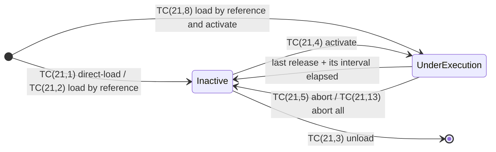

# ST[21] Request sequencing

The **request sequencing service** (service type 21) stores on board an ordered list of
telecommand requests and releases them one by one, with a specified delay between one release and
the next. Several such **request sequences** can run in parallel. A sequence can be loaded directly
from the ground, with the requests inside the load request, or from a file already stored on
board.[^c-6211] PUS-C presents it, like [event-action](st19-event-action.md), as an extension of
ground monitoring and control. The executing application process sends the
[verification reports](st01-request-verification.md) of each released request to the source named in
that request. Releases do not depend on whether earlier requests of the sequence succeeded.[^c-6211]

Request sequencing is new in ECSS-E-ST-70-41C (2016). It is one of three services into which the
PUS-A on-board operations scheduling service was split, together with
[time-based scheduling](st11-time-based-scheduling.md) and
[position-based scheduling](st22-position-based-scheduling.md).[^v15-st11] This page covers the
service clause by clause, compares it with its neighbours and with the 2024 Rev.1 draft, and shows
how Solar Orbiter, designed to PUS-A, does the same job with a private "TC Sequencer" service 134,
while its own service type 21 carries science data.

!!! info "Where this page sits"
    Packet headers are on [PUS packet structures](packets.md), field types on
    [PUS parameter types](parameter-types.md). On-board files belong to
    [ST[23] File management](st23-file-management.md). Ground-side command sequences, which
    SCOS-2000 expands into individual commands before uplink, are a different thing, described on
    [Command sequences in the MIB](../../mib/sequences.md).

## 1. The service at a glance

| Message type | Name | Capability (Annex C) | System / interface clause |
|---|---|---|---|
| TC[21,1] | direct-load a request sequence | by declaration | 6.21.5.2 / 8.21.2.1 |
| TC[21,2] | load a request sequence by reference | by declaration | 6.21.5.3 / 8.21.2.2 |
| TC[21,3] | unload a request sequence | implied by TC[21,1] or TC[21,2] | 6.21.5.4 / 8.21.2.3 |
| TC[21,4] | activate a request sequence | minimum | 6.21.5.5 / 8.21.2.4 |
| TC[21,5] | abort a request sequence | minimum | 6.21.5.7 / 8.21.2.5 |
| TC[21,6] | report the execution status of each request sequence | by declaration | 6.21.6 / 8.21.2.6 |
| TM[21,7] | request sequence execution status report | response to TC[21,6] | 6.21.6 / 8.21.2.7 |
| TC[21,8] | load by reference and activate a request sequence | by declaration | 6.21.5.6 / 8.21.2.8 |
| TC[21,9] | checksum a request sequence | by declaration | 6.21.7 / 8.21.2.9 |
| TM[21,10] | request sequence checksum report | response to TC[21,9] | 6.21.7 / 8.21.2.10 |
| TC[21,11] | report the content of a request sequence | by declaration | 6.21.8 / 8.21.2.11 |
| TM[21,12] | request sequence content report | response to TC[21,11] | 6.21.8 / 8.21.2.12 |
| TC[21,13] | abort all request sequences and report | by declaration | 6.21.5.8 / 8.21.2.13 |
| TM[21,14] | aborted request sequence report | response to TC[21,13] | 6.21.5.8 / 8.21.2.14 |

Source: Annex C.2.21, Table C-30. Clause 6.21.5.1a adds a minimum rule: at least one of TC[21,1],
TC[21,2] and TC[21,8] must be provided.[^c-annexc21]

## 2. Origins

PUS-A (2003) had no request sequencing service. In its concept clause, a telecommand attached to an
on-board event could start a command sub-schedule of the scheduling service, and such a sub-schedule
"can contain a predefined command sequence".[^a-410] During the preparation
of PUS-C, the PUS-A scheduling service was "completely re-assessed resulting in 3 proposed new
service types": ST[11] time-based scheduling, ST[21] then called "telecommand sequencing", and
ST[22] orbit-based scheduling.[^v15-st11] The 2015 status presentation describes ST[21] in terms
close to the final text: it releases "one by one" the telecommands of an on-board sequence, with
specified delays, several sequences running in parallel, loaded from an on-board file or from
the ground.[^v15-st21] The 2014 presentation lists "load a request sequence by reference" among the
standard requests that operate on files.[^v14-files] The published standard uses the more general
word "request".[^c-table41]

## 3. Service model

### 3.1 Layout and accessibility

Each request sequencing service contains at least one request sequencing subservice. An application
process hosts at most one provider.[^c-6212] The mission declares the application processes that the
subservice may address. The hosting process is always one of them, and all their requests are assumed
usable.[^c-6213] As with ST[19], a released request is executed by the service that its service type
and APID designate. The request counts as generated by the original source, the subservice that sent
the load request, and not by the sequencer.[^c-6213]

### 3.2 The request sequence

For each subservice the mission declares:[^c-6214]

* the maximum number of request sequences that can be processed at the same time;
* the total resources available for storing request sequences;
* the verification checks applied to the requests contained in sequences.

Each **request sequence** has a **request sequence identifier**, unique within the service. If the
sequence is loaded from a file, the identifier "can be used by the loading policy". The sequence
contains an ordered list of **request entries**, and PUS-C sets no maximum on their number. Each entry
contains:[^c-6214]

1. a single request;
2. a **time interval**: the delay between the release of this request and the release of the next.
   For the last entry, it is the delay between the last release and the *completion* of the
   sequence.

For each loaded sequence the subservice keeps a **request sequence execution status**, "inactive" (raw
value 0) or "under execution" (raw value 1).[^c-6214][^c-8213]



The state machine is drawn from clauses 6.21.5.2 to 6.21.5.8.[^c-62152][^c-62153][^c-62154][^c-62155][^c-62156][^c-62157][^c-62158]
"UnderExecution" stands for "under execution". Sequences are **persistent**. They stay loaded after
completion, and to remove one automatically "the last request in the sequence can be the request to
unload the request sequence".[^c-62155]

### 3.3 Timing: a worked example

The interval semantics are easiest to see with numbers. The sequence below is **illustrative**:
three entries with intervals of 10 s, 0 s and 5 s, activated at t0.

| Entry | Request | Interval | Released at | Note |
|---|---|---|---|---|
| 1 | R1 | 10 s | t0 | released on activation |
| 2 | R2 | 0 s | t0 + 10 s | 10 s after R1 |
| 3 | R3 | 5 s | t0 + 10 s | together with R2 (interval 0) |
| - | - | - | t0 + 15 s | status returns to "inactive" |

The rules applied are 6.21.4g and 6.21.5.5f.[^c-6214][^c-62155] Each interval runs from a *release*,
not from the completion of execution. R2 is released 10 s after R1 whether R1 succeeded, failed or is
still executing.[^c-6211]

### 3.4 Loading capabilities

A subservice must offer at least one of three ways to get a sequence on board:[^c-62151]

* **direct load** (TC[21,1]): the request itself contains the requests of the sequence;
* **load by reference** (TC[21,2]): the sequence already exists on board in a file, and the request
  names that file;
* **load by reference and activate** (TC[21,8]).

If load by reference is offered, the mission declares whether a **loading policy** is supported.
With a policy, the policy, rather than an explicit file path, determines which file holds the
sequence.[^c-62151][^c-62153] ST[21] does not define the policy itself. The equivalent ST[18] clause
for OBCPs refers to ECSS-E-ST-70-01, clauses 5.4.4.4a to c.[^c-61844]

## 4. Requests and reports

Every ST[21] request carries **exactly one instruction**, so a rule violation rejects the whole
request with one failed start of execution notification ([TM[1,4]](st01-request-verification.md)).
This differs from the per-instruction rejection of ST[19] and ST[20] in the 2016
text.[^c-62152][^c-tm14] The field types are the PUS-C types:[^c-7339][^c-73711][^c-7313]

* the **request sequence ID** is a *fixed character-string* (PTC 8, PFC n > 0: n visible ASCII
  characters, one octet each);
* **file path** parts are *variable character-strings* (PTC 8 PFC 0: a length field followed by that
  many characters; the PFC of the length field is declared per application process);
* **request** is a *TC packet* (PTC 12 PFC 1), a complete PUS-C telecommand;
* **delay** is a *relative time* (PTC 10), a CUC or CDS offset whose PFC is chosen by the mission.

### 4.1 TC[21,1] direct-load a request sequence

The instruction carries the sequence identifier and its ordered list of entries.[^c-62152]

| Field | Type | Meaning |
|---|---|---|
| request sequence ID | fixed character-string | identifier of the new sequence |
| N | unsigned integer | number of entries |
| request | TC packet | repeated N times: the request to release |
| delay | relative time | repeated N times: the interval after that request |

Source: Figure 8-228.[^c-82211] The request is rejected if the identifier is already loaded, if
resources are insufficient, or if any contained request fails the declared verification
checks. Otherwise the sequence is loaded with status "inactive".[^c-62152]

The delay field width depends on the mission's choice of PFC. As an **illustration**, PFC 17 in the
relative time table is CUC with (17 + 1) div 4 = 4 octets of coarse time and (17 + 1) mod 4 = 2 octets of fine
time:[^c-73711]

<div class="bitfield" data-title="Illustrative delay field: relative time PTC 10 PFC 17 (CUC 4+2), as one mission might choose" data-width="16"
     data-fields='[{"n":"C1","b":8,"g":"coarse time (seconds)","d":"C1 is in the range 0 to 127 for a positive offset; negative offsets are two-complement"},{"n":"C2","b":8,"g":"coarse time (seconds)"},{"n":"C3","b":8,"g":"coarse time (seconds)"},{"n":"C4","b":8,"g":"coarse time (seconds)"},{"n":"F1","b":8,"g":"fine time (1/256 s, 1/65536 s)"},{"n":"F2","b":8,"g":"fine time (1/256 s, 1/65536 s)"}]'></div>

A 10 s delay in this format is `00 00 00 0A 00 00`, an illustrative encoding computed from the
formula of Table 7-11.[^c-73711]

### 4.2 TC[21,2] load a request sequence by reference

The instruction carries the identifier and, unless the loading policy is used, the file path of the
on-board file.[^c-62153]

| Field | Type | Presence |
|---|---|---|
| request sequence ID | fixed character-string | always |
| repository path | variable character-string | optional (absent when the loading policy applies) |
| file name | variable character-string | optional |

Source: Figure 8-229.[^c-82212] A file path is the combination of a repository path and an object
name, as for any on-board file system.[^c-545] Besides the TC[21,1] conditions, the request is
rejected if the file does not exist or is not recognised as a request sequence file. A valid request
loads the sequence with status "inactive".[^c-62153] PUS-C names the request sequencing subservice as
an example of a service that accesses the file system without going through
[ST[23]](st23-file-management.md).[^c-6232]

### 4.3 TC[21,3] unload a request sequence

This request is provided if either load capability is. It carries the sequence ID (Figure 8-230). It
is rejected if the sequence is not loaded or is "under execution". Otherwise the sequence is
unloaded.[^c-62154][^c-82213]

### 4.4 TC[21,4] activate a request sequence

This is a minimum capability, and it carries the sequence ID (Figure 8-231). It is rejected if the
sequence is not loaded, if resources are insufficient, or if the sequence is already under execution.
A valid request sets the status to "under execution" and starts releasing. After the last release and
the elapse of its interval, the status returns to "inactive".[^c-62155][^c-82214] Re-activating a
running sequence is therefore an error, not a restart.

### 4.5 TC[21,8] load by reference and activate a request sequence

This capability exists if declared. It has the same fields as TC[21,2] (Figure 8-234) and combines
the load and the activation in one request.[^c-62156][^c-82218] The rejection list is that of TC[21,2]
plus activation. In the 2016 text, the lack of resources appears twice, as items 2 and
5.[^c-62156] The loaded sequence remains loaded (persistent) after completion.[^c-62156]

### 4.6 TC[21,5] abort a request sequence

This is a minimum capability, and it carries the sequence ID (Figure 8-232). It is rejected if the
sequence is not loaded or is "inactive". A valid request sets it to "inactive" and stops releasing.[^c-62157][^c-82215]

### 4.7 TC[21,13] / TM[21,14] abort all request sequences and report

This capability exists if declared. TC[21,13] has no application data.[^c-62158][^c-822113] For each
sequence under execution, releasing stops and the status becomes "inactive". One TM[21,14] lists the
aborted identifiers: N (unsigned integer), then N request sequence IDs (fixed
character-strings).[^c-62158][^c-822114]

### 4.8 TC[21,6] / TM[21,7] execution status of each sequence

This capability exists if declared. TC[21,6] has no application data. TM[21,7] contains one entry for
each loaded sequence:[^c-6216][^c-82216][^c-82217]

| Field | Type | Meaning |
|---|---|---|
| N | unsigned integer | number of loaded sequences |
| request sequence ID | fixed character-string | repeated |
| execution status | enumerated | 0 = inactive, 1 = under execution |

### 4.9 TC[21,9] / TM[21,10] checksum a request sequence

This capability exists if declared. TC[21,9] carries one sequence ID and is rejected if the sequence
is not loaded. TM[21,10] returns the ID and the calculated checksum, a **16-bit bit-string**, the
only field of the service whose size the standard fixes.[^c-6217][^c-82219][^c-822110] The
algorithm is one of the spacecraft's declared checksum algorithms. PUS-C asks the mission to declare,
for each checksum algorithm, the subservice providers that use it, so that all providers that
checksum the same data object use the same algorithm. The algorithm also fixes the checksum type
(ISO or CRC) and size.[^c-544]

<div class="bitfield" data-title="TM[21,10] request sequence checksum report (illustrative 8-character sequence ID)" data-width="32"
     data-fields='[{"n":"Request sequence ID, characters 1-4","b":32,"g":"fixed character-string (illustrative PFC 8)","d":"Width is mission-specific; 8 characters assumed here"},{"n":"Request sequence ID, characters 5-8","b":32,"g":"fixed character-string (illustrative PFC 8)"},{"n":"Calculated checksum value","b":16,"d":"Bit-string of 16 bits, fixed by Figure 8-236"}]'></div>

### 4.10 TC[21,11] / TM[21,12] report the content of a sequence

This capability exists if declared. TC[21,11] carries one ID and is rejected if the sequence is not
loaded. TM[21,12] returns the ID and the ordered entries in the same layout as TC[21,1]: N, then N
pairs of request and delay.[^c-6218][^c-822111][^c-822112] Figure 8-238 carries a note pointing to
the execution status enumeration, although the report has no status field. This looks like a
copy-over from Figure 8-233.[^c-822112]

### 4.11 Observables and enumeration

The subservice must expose the list of loaded sequence identifiers and their execution status, as an
array sized for the maximum number of sequences that can be loaded at once.[^c-6219] The status
enumeration (Table 8-22) is "inactive" = 0 and "under execution" = 1.[^c-8213]

## 5. ST[21] among its neighbours

| Service | What triggers a release | What is stored on board |
|---|---|---|
| ST[21] request sequencing | activation, then the delay of each entry; not conditional on earlier results[^c-6211] | ordered lists of (request, delay), loaded directly or from a file[^c-62151] |
| [ST[11] time-based scheduling](st11-time-based-scheduling.md) | the due on-board time[^v15-st11] | activities inserted by TC[11,4][^c-6114] |
| [ST[22] position-based scheduling](st22-position-based-scheduling.md) | the spacecraft reaching an orbit position | position-tagged requests, with sub-schedules and groups[^v15-st22] |
| [ST[18] OBCP](st18-onboard-operations-procedure.md) | the procedure's own logic | OBCP code, loaded directly (TC[18,1]) or by reference (TC[18,13])[^c-61844][^c-61843] |
| [ST[19] event-action](st19-event-action.md) | an event occurrence | one request per event definition[^c-st19] |

The relation to ST[19] is explicit in the standard: an event-action can "start a request
sequence".[^c-st19]

!!! warning "Inference"
    The design rationale is this wiki's reading. ST[21] is the light-weight option: it needs no
    procedure engine and no time-tag arithmetic, and a single TC[21,8] stored as the action of an
    event-action definition can fire a recovery of any length. The standard does not discuss these
    trade-offs.

## 6. The 2024 Rev.1 draft

The Rev.1 public-review draft (DIR1, December 2024) changes ST[21] more than ST[19] or ST[20]. This
wiki's word-by-word comparison found:

* **Directories.** A new clause 6.21.5 "Usage of directories" lets the mission declare the maximum
  number of request sequence directories. Each directory has two attributes: **immediate execution
  of request sequence files after creation**, and **immediate deletion of request sequence files
  after execution**. A file is "created" in a directory when it is uploaded there or moved or copied
  into it.[^r-6215]
* **Three new message types**: TC[21,15] change request sequence directory attributes,
  TC[21,16] report the attributes of a request sequence directory, and TM[21,17] request sequence
  directory attributes report. TC[21,15] and TM[21,17] carry a directory path (variable
  character-string) and two Booleans, and TC[21,16] carries the path only.[^r-62110][^r-82115]
* **Identifier type.** The request sequence ID changes from a fixed character-string to an
  *enumerated* field in every message.[^r-82121]
* **TC[21,8] unloads after completion.** Load-and-activate now sets the status to "inactive" and
  unloads the sequence after the last interval. A reserved identifier value requests "the next free
  identifier".[^r-62166][^r-82128]
* **Timing declaration.** If TC[21,8] is provided, the mission declares the time needed to activate a
  sequence and release its first request.[^r-62161]
* **Clarifications.** Aborting does not unload a sequence. The duplicated lack-of-resources item is
  removed. The observables add "reference of the request if activated".[^r-62167][^r-62112]

The draft has visible editing residue. Clause 6.21.10 d to f speaks of "the storage and retrieval
subservice". Requirement 8.21.2.8c sets "N" to 0 although TC[21,8] has no N field. Clause 8.21.2.15b
cites "Figure 8.15-7", 8.21.2.16b and 8.21.2.17b cite Figures 8.21-10 and 8.21-11 (the figures
printed under them are 8.21-14 and 8.21-15), and their notes refer to a clause "6.21.911". The
stray execution-status note of the 2016 Figure 8-238 is gone from its Rev.1 counterpart, Figure
8.21-11.[^r-62110][^r-82128][^r-82115][^r-82121]

!!! warning "Inference"
    The directory attributes standardise a pattern that missions already used. Solar Orbiter's file
    attribute "TC sequence - immediate" (section 7.2) executes an uplinked TC file as soon as the
    upload completes. That Rev.1 was influenced by such missions is not stated in the available
    sources.

## 7. Solar Orbiter

### 7.1 Service type 21 is "science data transfer"

Solar Orbiter follows ECSS-E-70-41A. Like the earlier Herschel/Planck interface requirements, which
state that "Science data Packets shall be type 21", it uses service type 21 for **Science Data
Transfer** between the payload and the solid state mass memory (SSMM). The number has nothing to do
with PUS-C's ST[21].[^solo-ad1][^hp-oird][^solo-522] Packet category 12 is "PRIVATE-SCIENCE or
TELECOMMAND", described as exclusive for service 21 telemetry and for telecommands.[^solo-cat] In the
2025 MIB, all 334 service 21 packet definitions and the APIDs of all 5,449 commands that have one
(for example APID 236 of the CSW system control process) use category 12.[^solo] Table 5.1-1 makes the service
mandatory for payloads.[^solo-tab]

| Message | Content (SOL.S.ASTR.TN.00079 §5.22) |
|---|---|
| TC(21,1) / TC(21,2) | enable/start and disable/stop science transfer to the SSMM, as defined by each instrument; at least one pair is required |
| TM(21,3) | fixed length, with a 1-octet structure ID (SSID, 0-255) selecting the parameter list |
| TM(21,4) | fixed length, no SSID |
| TM(21,5) | variable-length "anonymous data stream": SSID (1 octet), N (2 octets), then N data words |
| TM(21,6) | variable length with fixed start and end parameter blocks around a repeated block of N1 entries |
| TC(21,128) | Reset Output Buffer (listed in Table 5.1-1 only) |

Source: §5.22.1 to §5.22.6 and Table 5.1-1.[^solo-522][^solo-tab]

<div class="bitfield" data-title="Solar Orbiter TM(21,5) source data: header of the data stream" data-width="24"
     data-fields='[{"n":"SSID","b":8,"d":"Science structure ID, 0-255"},{"n":"N","b":16,"d":"Number of science data words or bytes that follow"}]'></div>

The 2025 MIB holds 334 service 21 packet definitions and 33 commands.[^solo]

| Instrument | TM(21,3) | TM(21,5) | TM(21,6) | TM(21,7) | Total |
|---|---:|---:|---:|---:|---:|
| EPD | 8 | 36 | 12 | 0 | 56 |
| EUI | 0 | 36 | 0 | 0 | 36 |
| MAG | 19 | 0 | 0 | 0 | 19 |
| METIS | 0 | 0 | 30 | 0 | 30 |
| PHI | 0 | 0 | 2 | 0 | 2 |
| RPW | 18 | 0 | 47 | 0 | 65 |
| SOLOHI | 6 | 0 | 0 | 0 | 6 |
| SPICE | 0 | 0 | 0 | 6 | 6 |
| STIX | 0 | 0 | 18 | 0 | 18 |
| SWA | 54 | 0 | 42 | 0 | 96 |

The instrument is identified from the process ID of the APID (APID div 16) using the allocation of
Annex 8.[^solo][^solo-annex8] SPICE's six TM(21,7) packets ("SPICE Detector Science Uncompressed"
and similar) use a subtype that the issue 7 ICD does not define. For TM(21,3), (21,5) and (21,6), the
MIB identifies the SSID as the 8-bit field at octet 16 (`pic`).[^solo]

### 7.2 The real counterpart: private service 134 "TC Sequencer"

What PUS-C calls request sequencing, Solar Orbiter's CSW provides as **service 134, TC Sequencer**.
The service is reserved for the CSW. It manages "TC Sequences (also called TC Files)": files of
telecommand packets uploaded beforehand with service 13, which Solar Orbiter calls "Large Data
Transfer" (the PUS-C counterpart is [ST[13] large packet transfer](st13-large-packet-transfer.md)). Execution reads the packets in order and releases them "at a given rate, with
potentially some delays between chosen consecutive TCs".[^solo-528][^solo-tab]

* The upload attribute selects **TC File - Delayed**, executed on request by TC(134,1), or **TC File
  - Immediate**, executed automatically after a successful upload, "the intended mechanism for MTL
  uploading".[^solo-528] For an immediate file the CSW creates a TC(134,1) itself, with TC sequence
  identifier 1 and a rate of 1 Hz.[^solo-5143]
* Sequences are controlled by a logical **TcSeq ID**. Per ID there can be at most one *queued*
  sequence, waiting while another sequence with the same ID runs.[^solo-528]
* At software initialisation, service 134 executes the selected back-up timeline file in the
  safeguard memory and so loads the mission timeline queue with back-up time-tagged TCs. At least
  two file placeholders allow one to be updated safely.[^solo-512]
* Among the source IDs that the ground sets, **111 is "TC Sequences"**, next to 110 for the
  mission timeline and 112 for event-action recovery commands.[^solo-srcid]

<div class="bitfield" data-title="Solar Orbiter TC(134,1) Start TC Sequence: application data" data-width="32"
     data-fields='[{"n":"TcSeq ID","b":8,"d":"Logical identifier of the TC sequence, enumerated"},{"n":"Partition ID","b":8,"d":"Storage area of the TC sequence, enumerated"},{"n":"File ID","b":32,"d":"Name of the TC file to execute, unsigned integer"},{"n":"TC Exec Rate","b":32,"d":"Float, 0.1 to 16 Hz; the period is rounded up to 125 ms resolution"}]'></div>

| Message | Fields | PUS-C analogue |
|---|---|---|
| TC(134,1) Start TC Sequence | TcSeq ID (1), Partition ID (1), File ID (4), TC Exec Rate (4, float) | TC[21,8] load by reference and activate |
| TC(134,2) Abort TC Sequence | TcSeq ID, Partition ID, File ID | TC[21,5] |
| TC(134,3) TC Sequence Wait Delay | Delay (2 octets, multiples of 125 ms); used only *inside* a sequence | the per-entry delay |
| TC(134,4) TC Sequence Set Frequency | TC Exec Rate (4, float); used only inside a sequence | (no analogue) |

Source: §5.28.1 to §5.28.4.[^solo-5281][^solo-5283] The receiving functions must be able to keep up
with the selected rate.[^solo-5281]

The two models of time differ. PUS-C puts a delay in every entry. Solar Orbiter releases at a base
rate and inserts TC(134,3) "wait" commands, which may only appear inside a sequence, where a longer
gap is needed. A 16-bit count of 125 ms steps allows gaps of up to 65,535 × 0.125 s = 8,191.875 s, about
2 h 16 min. This figure is arithmetic on the field definition, not stated in the source.[^solo-5283]
Neither the TN service list nor the MIB has telemetry of type 134, so Solar Orbiter has no
equivalent of TM[21,7], TM[21,10] or TM[21,12].[^solo-tab][^solo]

!!! warning "Inference"
    With no service 134 reports, the ground presumably follows TC file execution through the
    verification reports of the released TCs (source ID 111) and through CSW housekeeping. The
    sources do not describe how sequence status is monitored.

### 7.3 Service 134 in the MIB

Both MIB releases contain TC(134,1) to TC(134,4) (`ZCD08601`-`ZCD08604`) and two subtypes absent
from the issue 7 ICD: TC(134,5) "Start Two Part Id TC Sequence" (`ZCD08605`, shortened to "Start Two
Part Id TC SEQ" in 2025) and TC(134,6) "Abort Two Part Id TC Sequence" (`ZCD08606`). These add a
"Storage Partition ID" octet between the partition ID and the file ID. TC(134,6) has no rate
field.[^solo][^solo2020] All are addressed to APID 172 (process ID 10, DMS). Both
partition parameters use the calibration `CCDT0192TX`, with values such as OMM_TC_FILES_A = 161,
OMM_TC_FILES_B = 177, SGMA_TC_FILES = 193 and SGMB_TC_FILES = 195.[^solo]

<div class="bitfield" data-title="Solar Orbiter TC(134,5) Start Two Part Id TC Sequence (from the MIB)" data-width="32"
     data-fields='[{"n":"TcSeq ID","b":8,"d":"PCD86011, unsigned 8 bits"},{"n":"Partition ID","b":8,"d":"PCD0D093, enumerated, calibration CCDT0192TX"},{"n":"Storage Partition ID","b":8,"d":"PCDP0002, enumerated, calibration CCDT0192TX"},{"n":"File ID","b":32,"d":"PCD0D094, unsigned 32 bits, hexadecimal radix"},{"n":"TC execution rate","b":32,"d":"PCD86014, real PTC 5 PFC 1"}]'></div>

The 2025 release adds seven canned TC(134,5) commands that start **FDIR TC files**. The 2020 release
has only the generic `ZCD08605`:[^solo][^solo2020]

| Command | Description | TcSeq ID | File ID (hex) | Rate (Hz) |
|---|---|---:|---|---:|
| [`ZCDX8605`](../../explorer/index.md#/solo/command/ZCDX8605) | Execute Loss-of-UL FDIR TC File | 58 | 00840010 | 1 |
| [`ZCDX8606`](../../explorer/index.md#/solo/command/ZCDX8606) | Execute SNAFU FDIR TC File | 54 | 00440010 | 1 |
| `ZCDX8607` | Execute REC_SpW3_SpW OL FDIR TC File | 53 | 00340010 | 10 |
| `ZCDX8608` | Execute REC_SSMM1 A FDIR TC File | 53 | 00340020 | 10 |
| `ZCDX8609` | Execute REC_SSMM1 B FDIR TC File | 53 | 00340030 | 10 |
| `ZCDX8610` | Execute REC_SSMM2 A FDIR TC File | 53 | 00340040 | 10 |
| `ZCDX8611` | Execute REC_SSMM2 B FDIR TC File | 53 | 00340050 | 10 |

All seven use partition OMM_TC_FILES_A with storage partition OMM_TC_FILES_B.[^solo] The first two
are the actions of the event-action definitions `ZCSX1301` and `ZCSX1302`. On an unexpected loss of
uplink, or on the AOCS event chosen for "SNAFU", the CSW's [event-action service](st19-event-action.md#83-event-action-definitions-in-the-solar-orbiter-mib)
starts the corresponding TC file, which is exactly PUS-C's "event-action starts a request sequence"
pattern.[^solo][^c-st19]

!!! warning "Inference"
    "Two Part Id" plausibly means that the file is identified by a pair of partitions, here the A and
    B copies of the OMM TC-file area, so that the sequencer can fall back to the other copy. The
    five SpaceWire and SSMM recovery files (`ZCDX8607` to `ZCDX8611`) share TcSeq ID 53, so under
    the rule of at most one queued sequence per ID they cannot run in parallel: while one runs, only
    one other can wait. Neither reading is stated in the available sources.

In ground sequences, TC(134,1), TC(134,2) and TC(134,6) are used once each and TC(134,5)
twice.[^solo]

??? example "SQL used"
    ```sql
    -- solo-2025-09-16.sqlite
    SELECT CCF_CNAME, CCF_DESCR, CCF_STYPE, CCF_APID FROM ccf WHERE CCF_TYPE='134' ORDER BY CAST(CCF_STYPE AS INT);
    SELECT c.CDF_CNAME, c.CDF_BIT, c.CDF_ELLEN, c.CDF_PNAME, p.CPC_DESCR, p.CPC_PTC, p.CPC_PFC, p.CPC_RADIX, c.CDF_VALUE
      FROM cdf c LEFT JOIN cpc p ON p.CPC_NAME=c.CDF_PNAME
     WHERE c.CDF_CNAME LIKE 'ZCD0860%' OR c.CDF_CNAME LIKE 'ZCDX86%' ORDER BY 1, CAST(c.CDF_BIT AS INT);
    SELECT PAS_ALTXT, PAS_ALVAL FROM pas WHERE PAS_NUMBR='CCDT0192TX';
    SELECT count(*) FROM pid WHERE PID_TYPE='134';                                  -- 0
    -- service 21 science data per instrument (process ID = APID / 16)
    SELECT CAST(PID_APID AS INT)/16 AS pid, PID_STYPE, count(*) FROM pid WHERE PID_TYPE='21' GROUP BY 1,2;
    SELECT CCF_STYPE, count(*) FROM ccf WHERE CCF_TYPE='21' GROUP BY 1;             -- 1:14 2:14 128:5
    SELECT * FROM pic WHERE PIC_TYPE='21';
    -- use in ground sequences
    SELECT c.CCF_TYPE, c.CCF_STYPE, count(*) FROM css s JOIN ccf c ON c.CCF_CNAME=s.CSS_ELEMID
     WHERE s.CSS_TYPE='C' AND c.CCF_TYPE='134' GROUP BY 1,2;
    -- solo-2020-04-16.sqlite
    SELECT CCF_CNAME, CCF_DESCR FROM ccf WHERE CCF_TYPE='134';                      -- ZCD08601..ZCD08606 only
    ```

## Related pages

* [ST[11] Time-based scheduling](st11-time-based-scheduling.md) and
  [ST[22] Position-based scheduling](st22-position-based-scheduling.md), the other two parts of the
  PUS-A scheduling split.
* [ST[19] Event-action](st19-event-action.md), which can start a sequence, and
  [ST[18] On-board operations procedure](st18-onboard-operations-procedure.md).
* [ST[23] File management](st23-file-management.md) and
  [ST[13] Large packet transfer](st13-large-packet-transfer.md) for getting sequence files on board.
* [Command sequences in the MIB](../../mib/sequences.md), the ground-side counterpart.
* [How Solar Orbiter uses PUS](../../missions/solar-orbiter/pus-usage.md) and
  [PUS-A vs PUS-C](pus-a-vs-pus-c.md) for the service-number collisions.
* Terms: [glossary](../../glossary.md).

[^c-6211]: [ECSS-E-ST-70-41C](../../library/ecss-e-st-70-41c-15april2016.md), §6.21.1.1 and §6.21.1.2, PDF p. 358.
[^v15-st11]: [S. Valera, ECSS-E-ST-70-41C status, ADCSS 2015](../../library/valera-2015-adcss-ecss-e-st-70-41c-status.md), slide 9, PDF p. 9.
[^v15-st21]: [S. Valera, ADCSS 2015](../../library/valera-2015-adcss-ecss-e-st-70-41c-status.md), slide 12, PDF p. 12.
[^v14-files]: [S. Valera, ECSS-E-ST-70-41C status, SAVOIR Mass Memory Day 2014](../../library/valera-2014-ecss-e-st-70-41c-status.md), slide 21, PDF p. 21.
[^a-410]: [ECSS-E-70-41A](../../library/ecss-e-70-41a-30jan2003-pus.md), §4.10, PDF p. 34; the PUS-A service list (§5.5, Table 2, PDF p. 50) ends at service 19.
[^c-table41]: [ECSS-E-ST-70-41C](../../library/ecss-e-st-70-41c-15april2016.md), §4.2.3.2, Table 4-1, PDF p. 23.
[^c-annexc21]: [ECSS-E-ST-70-41C](../../library/ecss-e-st-70-41c-15april2016.md), Annex C.2.21, Table C-30, PDF pp. 649-650.
[^c-6212]: [ECSS-E-ST-70-41C](../../library/ecss-e-st-70-41c-15april2016.md), §6.21.2, PDF p. 358.
[^c-6213]: [ECSS-E-ST-70-41C](../../library/ecss-e-st-70-41c-15april2016.md), §6.21.3.1, PDF p. 359.
[^c-6214]: [ECSS-E-ST-70-41C](../../library/ecss-e-st-70-41c-15april2016.md), §6.21.4, PDF pp. 359-360.
[^c-8213]: [ECSS-E-ST-70-41C](../../library/ecss-e-st-70-41c-15april2016.md), §8.21.3, Table 8-22, PDF p. 582.
[^c-62151]: [ECSS-E-ST-70-41C](../../library/ecss-e-st-70-41c-15april2016.md), §6.21.5.1, PDF p. 360.
[^c-62152]: [ECSS-E-ST-70-41C](../../library/ecss-e-st-70-41c-15april2016.md), §6.21.5.2, PDF pp. 360-361.
[^c-62153]: [ECSS-E-ST-70-41C](../../library/ecss-e-st-70-41c-15april2016.md), §6.21.5.3, PDF pp. 361-362.
[^c-62154]: [ECSS-E-ST-70-41C](../../library/ecss-e-st-70-41c-15april2016.md), §6.21.5.4, PDF pp. 362-363.
[^c-62155]: [ECSS-E-ST-70-41C](../../library/ecss-e-st-70-41c-15april2016.md), §6.21.5.5, PDF p. 363.
[^c-62156]: [ECSS-E-ST-70-41C](../../library/ecss-e-st-70-41c-15april2016.md), §6.21.5.6, PDF pp. 364-365.
[^c-62157]: [ECSS-E-ST-70-41C](../../library/ecss-e-st-70-41c-15april2016.md), §6.21.5.7, PDF p. 365.
[^c-62158]: [ECSS-E-ST-70-41C](../../library/ecss-e-st-70-41c-15april2016.md), §6.21.5.8, PDF pp. 365-366.
[^c-61844]: [ECSS-E-ST-70-41C](../../library/ecss-e-st-70-41c-15april2016.md), §6.18.4.4.1, PDF p. 326.
[^c-61843]: [ECSS-E-ST-70-41C](../../library/ecss-e-st-70-41c-15april2016.md), §6.18.4.4.3, PDF p. 327.
[^c-6114]: [ECSS-E-ST-70-41C](../../library/ecss-e-st-70-41c-15april2016.md), §6.11.4.5, PDF pp. 172-173.
[^v15-st22]: [S. Valera, ADCSS 2015](../../library/valera-2015-adcss-ecss-e-st-70-41c-status.md), slide 13, PDF p. 13.
[^c-tm14]: [ECSS-E-ST-70-41C](../../library/ecss-e-st-70-41c-15april2016.md), §8.1.2.4, TM[1,4] failed start of execution verification report, PDF p. 447.
[^c-7339]: [ECSS-E-ST-70-41C](../../library/ecss-e-st-70-41c-15april2016.md), §7.3.9, Table 7-9 and Figure 7-5, PDF pp. 433-434.
[^c-73711]: [ECSS-E-ST-70-41C](../../library/ecss-e-st-70-41c-15april2016.md), §7.3.11, Table 7-11, PDF pp. 436-437.
[^c-7313]: [ECSS-E-ST-70-41C](../../library/ecss-e-st-70-41c-15april2016.md), §7.3.13, Table 7-12, PDF p. 437.
[^c-82211]: [ECSS-E-ST-70-41C](../../library/ecss-e-st-70-41c-15april2016.md), §8.21.2.1, Figure 8-228, PDF p. 577.
[^c-82212]: [ECSS-E-ST-70-41C](../../library/ecss-e-st-70-41c-15april2016.md), §8.21.2.2, Figure 8-229, PDF p. 577.
[^c-545]: [ECSS-E-ST-70-41C](../../library/ecss-e-st-70-41c-15april2016.md), §5.4.5b, PDF p. 45.
[^c-6232]: [ECSS-E-ST-70-41C](../../library/ecss-e-st-70-41c-15april2016.md), §6.23.3.1 "Overview" of the file systems, PDF pp. 404-405.
[^c-82213]: [ECSS-E-ST-70-41C](../../library/ecss-e-st-70-41c-15april2016.md), §8.21.2.3, Figure 8-230, PDF p. 578.
[^c-82214]: [ECSS-E-ST-70-41C](../../library/ecss-e-st-70-41c-15april2016.md), §8.21.2.4, Figure 8-231, PDF p. 578.
[^c-82218]: [ECSS-E-ST-70-41C](../../library/ecss-e-st-70-41c-15april2016.md), §8.21.2.8, Figure 8-234, PDF p. 579.
[^c-82215]: [ECSS-E-ST-70-41C](../../library/ecss-e-st-70-41c-15april2016.md), §8.21.2.5, Figure 8-232, PDF p. 578.
[^c-822113]: [ECSS-E-ST-70-41C](../../library/ecss-e-st-70-41c-15april2016.md), §8.21.2.13, PDF p. 581.
[^c-822114]: [ECSS-E-ST-70-41C](../../library/ecss-e-st-70-41c-15april2016.md), §8.21.2.14, Figure 8-239, PDF p. 581.
[^c-6216]: [ECSS-E-ST-70-41C](../../library/ecss-e-st-70-41c-15april2016.md), §6.21.6, PDF p. 366.
[^c-82216]: [ECSS-E-ST-70-41C](../../library/ecss-e-st-70-41c-15april2016.md), §8.21.2.6, PDF p. 579.
[^c-82217]: [ECSS-E-ST-70-41C](../../library/ecss-e-st-70-41c-15april2016.md), §8.21.2.7, Figure 8-233, PDF p. 579.
[^c-6217]: [ECSS-E-ST-70-41C](../../library/ecss-e-st-70-41c-15april2016.md), §6.21.7, PDF p. 367.
[^c-82219]: [ECSS-E-ST-70-41C](../../library/ecss-e-st-70-41c-15april2016.md), §8.21.2.9, Figure 8-235, PDF p. 580.
[^c-822110]: [ECSS-E-ST-70-41C](../../library/ecss-e-st-70-41c-15april2016.md), §8.21.2.10, Figure 8-236, PDF p. 580.
[^c-544]: [ECSS-E-ST-70-41C](../../library/ecss-e-st-70-41c-15april2016.md), §5.4.4, PDF pp. 44-45.
[^c-6218]: [ECSS-E-ST-70-41C](../../library/ecss-e-st-70-41c-15april2016.md), §6.21.8, PDF pp. 367-368.
[^c-822111]: [ECSS-E-ST-70-41C](../../library/ecss-e-st-70-41c-15april2016.md), §8.21.2.11, Figure 8-237, PDF p. 580.
[^c-822112]: [ECSS-E-ST-70-41C](../../library/ecss-e-st-70-41c-15april2016.md), §8.21.2.12, Figure 8-238, PDF p. 581.
[^c-6219]: [ECSS-E-ST-70-41C](../../library/ecss-e-st-70-41c-15april2016.md), §6.21.9, PDF p. 368.
[^c-st19]: [ECSS-E-ST-70-41C](../../library/ecss-e-st-70-41c-15april2016.md), §6.19.1.2, PDF p. 342.
[^r-6215]: [ECSS-E-ST-70-41C Rev.1 DIR1](../../library/ecss-e-st-70-41c-rev1-dir1.md), §6.21.5 "Usage of directories", PDF p. 344; the word-by-word comparison of §6.21 (PDF pp. 342-354) and §8.21 (PDF pp. 623-629) with the 2016 text is this wiki's own.
[^r-62110]: [ECSS-E-ST-70-41C Rev.1 DIR1](../../library/ecss-e-st-70-41c-rev1-dir1.md), §6.21.10-§6.21.11, PDF pp. 352-354.
[^r-82115]: [ECSS-E-ST-70-41C Rev.1 DIR1](../../library/ecss-e-st-70-41c-rev1-dir1.md), §8.21.2.15-§8.21.2.17, Figures 8.21-13 to 8.21-15, PDF pp. 627-628.
[^r-82121]: [ECSS-E-ST-70-41C Rev.1 DIR1](../../library/ecss-e-st-70-41c-rev1-dir1.md), §8.21.2.1 to §8.21.2.14, Figures 8.21-1 to 8.21-12, PDF pp. 623-627.
[^r-62166]: [ECSS-E-ST-70-41C Rev.1 DIR1](../../library/ecss-e-st-70-41c-rev1-dir1.md), §6.21.6.6, PDF pp. 348-349.
[^r-82128]: [ECSS-E-ST-70-41C Rev.1 DIR1](../../library/ecss-e-st-70-41c-rev1-dir1.md), §8.21.2.8c, PDF pp. 625-626.
[^r-62161]: [ECSS-E-ST-70-41C Rev.1 DIR1](../../library/ecss-e-st-70-41c-rev1-dir1.md), §6.21.6.1c, PDF p. 345.
[^r-62167]: [ECSS-E-ST-70-41C Rev.1 DIR1](../../library/ecss-e-st-70-41c-rev1-dir1.md), §6.21.6.7f NOTE and §6.21.6.8c NOTE, PDF p. 350.
[^r-62112]: [ECSS-E-ST-70-41C Rev.1 DIR1](../../library/ecss-e-st-70-41c-rev1-dir1.md), §6.21.12, PDF p. 354.
[^solo-ad1]: [SOL.S.ASTR.TN.00079 issue 7, Solar Orbiter TM-TC and Packet Structure ICD](../../library/sol-s-astr-tn-00079-07.md), §1.1 and §2.1 AD1, PDF pp. 11 and 13.
[^hp-oird]: [Herschel/Planck Operations Interface Requirements Document SCI-PT-RS-07360 issue 2.2](../../library/cosmos-operations-interface-requirements.md), §3 table (PDF p. 24) and §3.18 SCI-1 (PDF p. 37).
[^solo-522]: [SOL.S.ASTR.TN.00079 issue 7](../../library/sol-s-astr-tn-00079-07.md), §5.22 "Service 21: Science Data Transfer", PDF pp. 220-224.
[^solo-cat]: [SOL.S.ASTR.TN.00079 issue 7](../../library/sol-s-astr-tn-00079-07.md), Annex 8 §13.1, Figure 13.1-1, PDF p. 272.
[^solo-tab]: [SOL.S.ASTR.TN.00079 issue 7](../../library/sol-s-astr-tn-00079-07.md), §5.1 legend (PDF p. 31) and Table 5.1-1 (PDF pp. 37-38).
[^solo-annex8]: [SOL.S.ASTR.TN.00079 issue 7](../../library/sol-s-astr-tn-00079-07.md), Annex 8 §13.1, Figure 13.1-2, PDF pp. 272-274.
[^solo-528]: [SOL.S.ASTR.TN.00079 issue 7](../../library/sol-s-astr-tn-00079-07.md), §5.28 "Service 134: TC Sequencer", PDF p. 242; service 13 is titled "Large Data Transfer" in §5.14, PDF p. 132.
[^solo-5143]: [SOL.S.ASTR.TN.00079 issue 7](../../library/sol-s-astr-tn-00079-07.md), §5.14 file attributes (PDF p. 133) and the note to TC (13,11) (PDF p. 136).
[^solo-512]: [SOL.S.ASTR.TN.00079 issue 7](../../library/sol-s-astr-tn-00079-07.md), §5.12 "Service 11: Onboard Operations Scheduling", Notes, PDF p. 100.
[^solo-srcid]: [SOL.S.ASTR.TN.00079 issue 7](../../library/sol-s-astr-tn-00079-07.md), Annex 8 §13.2 "Source ID", PDF p. 275.
[^solo-5281]: [SOL.S.ASTR.TN.00079 issue 7](../../library/sol-s-astr-tn-00079-07.md), §5.28.1-§5.28.2 TC (134,1) and TC (134,2), PDF pp. 242-244.
[^solo-5283]: [SOL.S.ASTR.TN.00079 issue 7](../../library/sol-s-astr-tn-00079-07.md), §5.28.3-§5.28.4 TC (134,3) and TC (134,4), PDF pp. 244-245.
[^solo]: [Solar Orbiter MIB release MIB__20250916M25925PFMS001_SOL](../../library/mib-20250916m25925pfms001-sol.md), tables `ccf`, `cdf`, `cpc`, `pas`, `pid`, `pic` and `css`, queried by this wiki on 2026-11-12.
[^solo2020]: [Solar Orbiter MIB release MIB__20200416M10720PFMS001_SOL](../../library/mib-20200416m10720pfms001-sol.md), tables `ccf` and `cdf`, queried by this wiki on 2026-11-12.
