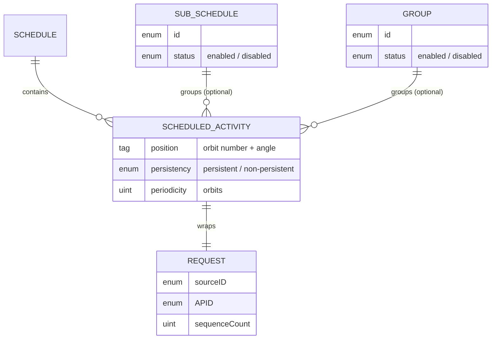
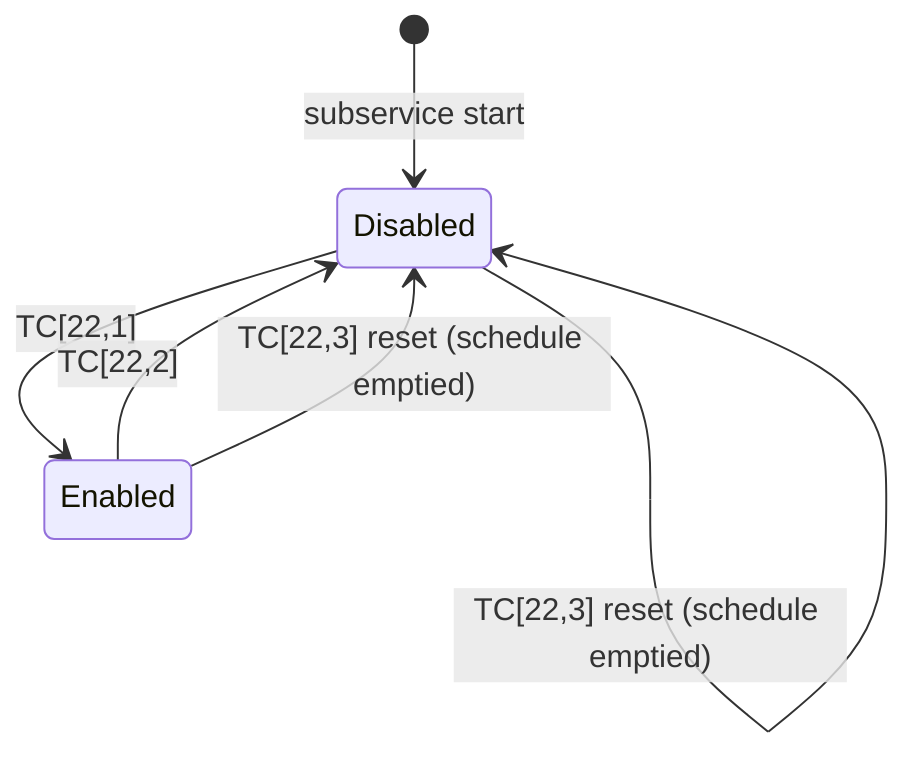
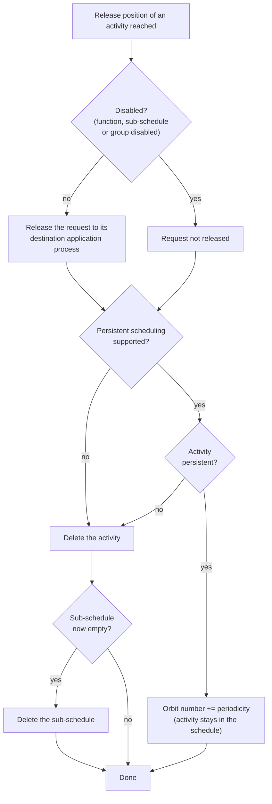
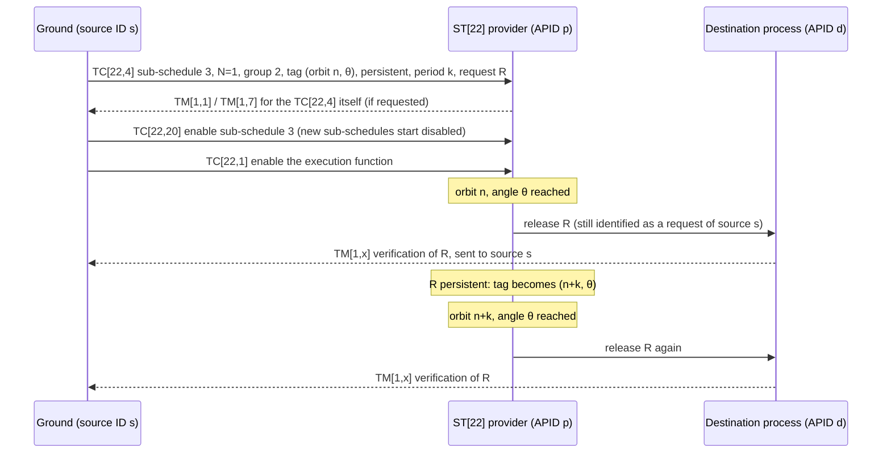

# ST[22] Position-based scheduling

**ST[22] position-based scheduling** is the [PUS-C](index.md) service type that keeps telecommands
on board and releases each one when the spacecraft reaches a chosen point on its orbit, instead of
at a chosen time. It is the orbit-position counterpart of [ST[11] time-based scheduling](st11-time-based-scheduling.md):
the ground loads requests together with a **position tag** (an orbit number plus a position on
that orbit), and the on-board subservice releases them when that position comes round. The
standard does not say how the spacecraft knows where it is; that is left to the mission.[^c-scope]
Because an orbit position comes back on every revolution, ST[22] also offers something ST[11]
does not: **persistent** activities that stay in the schedule and fire again on a later
orbit.[^c-sub][^c-persist]

!!! info "At a glance"
    | Item | Value |
    |---|---|
    | Defined in | ECSS-E-ST-70-41C (15 April 2016): system clause 6.22, interface clause 8.22, summary in Annex C Table C-31[^c-scope][^i-gen][^annex] |
    | Previous edition | none: PUS-A (2003) lists no service 22; its standard services stop at 19[^pusa-43] |
    | Subservice types | exactly one, the *position-based scheduling subservice*; at most one provider per application process[^c-layout] |
    | Message types | 28: 24 requests (TC) and 4 reports (TM), subtypes 1 to 28 with no gaps[^annex] |
    | Minimum capability | TC[22,1], TC[22,2], TC[22,3], TC[22,4]; everything else is "by declaration" or implied[^annex] |
    | Optional concepts | persistent scheduling, sub-schedules, groups, identification by request ID, position-window filters[^c-persist][^c-cap][^c-reqid][^c-filter] |
    | Draft revision | ECSS-E-ST-70-41C Rev.1 DIR1 (11 December 2024) changes several rules; see [below](#what-the-2024-rev1-draft-changes)[^r-pos] |
    | Solar Orbiter | does **not** implement it; its service type 22 is a mission "Context Saving" service[^solo-list] |

## Why schedule by position?

PUS-C groups ST[22] with ST[11] and [ST[19] event-action](st19-event-action.md) as service types that
hold requests and release them when something happens: a time, an orbit position, or an
event.[^std-types] Position-based scheduling extends ground monitoring and control. The
application process that executes a released request sends its verification reports
directly to the source named in the request, that is, the ground application that loaded it.
The release of a request does not depend on whether earlier released requests succeeded or
failed.[^c-sub] The released request is not generated by the scheduling subservice: it remains a
request of the original source.[^c-access]

The two scheduling services are built from the same template. Subtypes 1 to 27 have the same
numbers and the same names, with "time" replaced by "position", and every capability of ST[11] has
a positional twin:[^annex][^tbs-annex]

| Aspect | [ST[11] time-based](st11-time-based-scheduling.md) | ST[22] position-based |
|---|---|---|
| Release tag in TC[x,4] | *release time*, an absolute time field[^tbs-fig] | *position tag*, a "deduced" field whose structure the mission declares[^i-4][^i-gen] |
| Insertion guard | time margin: release time must be at least current time + margin[^tbs-margin] | position margin: release position must be at least current position + margin[^c-gen] |
| Release accuracy | maximum delta time between tag and real release, declared[^tbs-margin] | maximum delta position between tag and real release, declared[^c-gen] |
| Shifting | time-shift: TC[11,7], TC[11,8], TC[11,15][^tbs-annex] | position-shift: TC[22,7], TC[22,8], TC[22,15][^annex] |
| Repeating activities | not offered: Table C-17 ends at TM[11,27] with no persistency fields[^tbs-annex][^tbs-fig] | optional persistent activities with a periodicity in orbits[^c-persist] |
| Extra request | - | TC[22,28] set the orbit number[^c-orbit] |

## Core concepts

### Position tag: orbit number plus angle

Every position tag has two parts: the **orbit number** and the **position on that orbit**. The
orbit number never wraps round during a mission, while the position within the orbit is cyclic.
The orbit number increases on board by itself, and the ground can set it with TC[22,28].[^c-pos]
The position is an angle measured in the plane of the osculating inertial orbit, starting from
its intersection with the Earth-fixed equatorial plane. The 2016 standard goes no further: the
algorithm and the accuracy used to compute the angle are mission-specific.[^c-pos]

$$
\text{position tag} = (n, \theta), \qquad n \in \mathbb{N} \text{ (orbit number, never wraps)}, \qquad \theta \text{ (angle on the orbit, cyclic)}
$$

The bit layout of a position tag, and of the *delta position* used to shift activities, is not
fixed by the standard either: both must be declared when the subservice is specified, which is
why clause 8 types them as "deduced".[^i-gen] A deduced field (PTC 11, PFC 0) has a structure that
follows from preceding fields of the same packet or from mission constants.[^ptc-ded]

!!! warning "Inference"
    The standard compares positions ("earlier than", "greater than", "in the order of their
    release positions") without spelling out the ordering. Since the orbit number is monotonic
    and the angle is cyclic, the natural order is lexicographic: first by orbit number, then by
    angle. This wiki uses that reading in its examples.

### Scheduled activities

The schedule is a set of **scheduled activities**. Each one holds the request to be released and
its scheduling data:[^c-gen][^c-sub]

| Element | Present when | Meaning |
|---|---|---|
| Request | always | the telecommand packet to release later |
| Position tag | always | release position (orbit number, position on orbit) |
| Activity persistency status | persistent scheduling supported | `persistent` or `non-persistent` |
| Persistent activity periodicity | persistent scheduling supported (and status persistent, on the wire) | an integer number of orbits |
| Sub-schedule ID | sub-schedules supported | the sub-schedule the activity belongs to |
| Group ID | groups supported | the group the activity belongs to |

A scheduled activity is identified by the **request identifier** of the request it contains. PUS-C
builds that identifier from the source ID (the application process user identifier of the
originator), the destination (APID plus system identifier), and the packet sequence count or
request name.[^c-gen][^reqid] On the wire, ST[22] reports and requests carry it as three fields:
source ID, application process ID and sequence count.[^c-sumrep][^i-5]



The diagram restates clauses 6.22.1.2, 6.22.6.2, 6.22.7.1 and 6.22.8.1.[^c-sub][^c-gen][^c-subsch][^c-grp]
Position-based sub-schedules and groups are among the system objects that the standard says a
service maintains.[^objects]

### Persistent scheduling

By default an entry is deleted once its request is released. If the subservice supports
**persistent scheduling**, each activity carries an *activity persistency status*. A
non-persistent activity is deleted after release; a persistent one stays in the schedule and
can be released again or deleted later.[^c-persist] When a persistent activity's release position is
reached, the subservice adds its *persistent activity periodicity* (an integer number of orbits) to
its orbit number. The activity therefore comes back every *k* orbits at the same angle.[^c-logic][^c-gen]

### Sub-schedules

A **sub-schedule** is a sequence of position-tagged requests that together perform one coherent
on-board operation. Sub-schedules are created automatically when an insert request names an
unknown one, and they are deleted when they become empty. A new sub-schedule starts in the
`disabled` state.[^c-sub][^c-insert] Each sub-schedule has a status, enabled or disabled, and the
mission declares the maximum number that can exist at the same time.[^c-subsch]

### Groups

A **group** is a second, independent way to switch requests on and off. It works regardless of
the destination application process and of the sub-schedule. Groups typically map to spacecraft
entities such as a unit or a piece of software, and the standard's example is an instrument whose
requests are held back while its conditions are not met. Unlike sub-schedules, groups are
created and deleted by explicit request and may exist while empty.[^c-sub][^c-grp] A group that still
has activities cannot be deleted.[^c-grp-cd]

### The margins

Two declared quantities protect the schedule:[^c-gen]

* the **position margin**: an activity can only be inserted or shifted if its release position is
  at least the current position plus the margin. This keeps the schedule consistent at all times;
* the **maximum delta position**: the largest allowed gap between the release position in a
  scheduled activity and the position at which the request is really released.

## What a mission must declare

PUS-C leaves many ST[22] properties to the mission's own specification of the subservice. A
mission that implements ST[22] has to state at least the following:

| Declaration | Clause | Note |
|---|---|---|
| Application processes the subservice can release requests to | 6.22.3.1a[^c-access] | the hosting process is always addressable |
| Whether persistent scheduling is provided | 6.22.5a[^c-persist] | |
| Whether sub-schedules are supported | 6.22.6.1a[^c-cap] | |
| Whether groups are supported | 6.22.6.1b[^c-cap] | |
| Maximum number of scheduled activities | 6.22.6.2c[^c-gen] | resources assumed sufficient whatever the request sizes |
| Position margin | 6.22.6.2d[^c-gen] | |
| Maximum delta position | 6.22.6.2e[^c-gen] | |
| Capability to set the orbit number (TC[22,28]) | 6.22.6.4a[^c-orbit] | |
| Verification checks applied to a request being inserted | 6.22.6.6f[^c-insert] | |
| Maximum number of sub-schedules | 6.22.7.1a[^c-subsch] | |
| Maximum number of groups | 6.22.8.1a[^c-grp] | |
| Identification of activities by request identifier | 6.22.11.1a[^c-reqid] | needed by TC[22,5], [22,7], [22,9], [22,12] |
| Position-window filtering | 6.22.12.1a[^c-filter] | needed by TC[22,6], [22,8], [22,11], [22,14] |
| Structure and format of position tags and of delta positions | 8.22.1b, 8.22.1c[^i-gen] | the "deduced" fields of clause 8 |
| Each "by declaration" capability (Annex C) | Table C-31[^annex] | see the message table below |

## Schedule execution

### The execution function

The whole schedule has an on/off switch, the *position-based schedule execution function status*.
It is `disabled` when the subservice starts. TC[22,1] enables it and TC[22,2] disables it, whether
or not the schedule contains activities. TC[22,3] resets the schedule: it disables the function,
deletes every activity, deletes all sub-schedules (if supported) and re-enables all groups (if
supported).[^c-exec][^c-reset]



### Release logic

The execution process handles activities in order of release position. An activity counts as
**disabled** if the execution function is disabled, if its sub-schedule is disabled, or if its
group is disabled. When an activity's release position is reached, the process runs these steps
in order:[^c-logic]



Three consequences are worth spelling out, because they are easy to get wrong in an
implementation or a ground model:[^c-logic]

* A disabled activity is **not kept for later**. When its position passes, it is deleted (or, if
  persistent, moved on by its periodicity) exactly as if it had been released.
* The standard prescribes **no notification** to the ground when a request is deleted without
  having been released.
* The **release order** of activities with exactly the same position is not prescribed.

## Message types

The service defines 28 message types. Annex C gives each one an applicability constraint:
*minimum* (always provided), *by declaration* (the mission decides), *implied by* (provided
automatically with another capability), or *requires* (may only be declared if another is
provided).[^applic] Reports are listed as responses to their requests.[^annex]

| Message type | Name | Applicability (Annex C) | System | Interface |
|---|---|---|---|---|
| TC[22,1] | enable the position-based schedule execution function | minimum | 6.22.6.3.2 | 8.22.2.1 |
| TC[22,2] | disable the position-based schedule execution function | minimum | 6.22.6.3.3 | 8.22.2.2 |
| TC[22,3] | reset the position-based schedule | minimum | 6.22.6.5 | 8.22.2.3 |
| TC[22,4] | insert activities into the position-based schedule | minimum | 6.22.6.6 | 8.22.2.4 |
| TC[22,5] | delete position-based scheduled activities identified by request identifier | by declaration | 6.22.11.2 | 8.22.2.5 |
| TC[22,6] | delete the position-based scheduled activities identified by a filter | by declaration | 6.22.12.3 | 8.22.2.6 |
| TC[22,7] | position-shift scheduled activities identified by request identifier | by declaration | 6.22.11.3 | 8.22.2.7 |
| TC[22,8] | position-shift the scheduled activities identified by a filter | by declaration | 6.22.12.4 | 8.22.2.8 |
| TC[22,9] | detail-report position-based scheduled activities identified by request identifier | by declaration | 6.22.11.5 | 8.22.2.9 |
| TM[22,10] | position-based schedule detail report | response to TC[22,9], TC[22,11], TC[22,16] | 6.22.9.2 | 8.22.2.10 |
| TC[22,11] | detail-report the position-based scheduled activities identified by a filter | by declaration | 6.22.12.6 | 8.22.2.11 |
| TC[22,12] | summary-report position-based scheduled activities identified by request identifier | by declaration | 6.22.11.4 | 8.22.2.12 |
| TM[22,13] | position-based schedule summary report | response to TC[22,12], TC[22,14], TC[22,17] | 6.22.9.1 | 8.22.2.13 |
| TC[22,14] | summary-report the position-based scheduled activities identified by a filter | by declaration | 6.22.12.5 | 8.22.2.14 |
| TC[22,15] | position-shift all scheduled activities | by declaration | 6.22.10.2 | 8.22.2.15 |
| TC[22,16] | detail-report all position-based scheduled activities | by declaration | 6.22.10.4 | 8.22.2.16 |
| TC[22,17] | summary-report all position-based scheduled activities | by declaration | 6.22.10.3 | 8.22.2.17 |
| TC[22,18] | report the status of each position-based sub-schedule | by declaration | 6.22.7.2.3 | 8.22.2.18 |
| TM[22,19] | position-based sub-schedule status report | response to TC[22,18] | 6.22.7.2.3 | 8.22.2.19 |
| TC[22,20] | enable position-based sub-schedules | by declaration | 6.22.7.2.1 | 8.22.2.20 |
| TC[22,21] | disable position-based sub-schedules | implied by TC[22,20] | 6.22.7.2.2 | 8.22.2.21 |
| TC[22,22] | create position-based scheduling groups | by declaration | 6.22.8.2.1 | 8.22.2.22 |
| TC[22,23] | delete position-based scheduling groups | implied by TC[22,22] | 6.22.8.2.2 | 8.22.2.23 |
| TC[22,24] | enable position-based scheduling groups | implied by TC[22,22] | 6.22.8.3.1 | 8.22.2.24 |
| TC[22,25] | disable position-based scheduling groups | implied by TC[22,24] | 6.22.8.3.2 | 8.22.2.25 |
| TC[22,26] | report the status of each position-based scheduling group | requires TC[22,22] | 6.22.8.3.3 | 8.22.2.26 |
| TM[22,27] | position-based scheduling group status report | response to TC[22,26] | 6.22.8.3.3 | 8.22.2.27 |
| TC[22,28] | set the orbit number | by declaration | 6.22.6.4 | 8.22.2.28 |

Every packet of this service carries service type 22 in its [secondary header](packets.md).[^i-gen]
The same rows appear, with links, in the [PUS message type catalogue](message-types.md).

!!! note "A small inconsistency in Annex C"
    The system clause says the capability to report sub-schedule status (TC[22,18]) *requires*
    the capability to enable sub-schedules.[^c-subsch-rep] Annex C nevertheless marks TC[22,18]
    "by declaration", whereas its ST[11] twin TC[11,18] is marked "requires TC[11,20]".[^annex][^tbs-annex]

## Data fields, message by message

The structure diagrams of clause 8 give field names and PUS field types but no sizes: the
enumerated and unsigned integer widths are chosen by the mission, and position fields are
"deduced". Fields marked *optional* are present or absent at mission, application process or
service level (for example, the sub-schedule ID exists only if sub-schedules are supported). A
"repeated N times" block is an array: for a variable-length array the count N is sent first,
for a fixed-length one N is known implicitly. Every ST[22] array is of the first kind, with an
explicit N field.[^conv] See
[PUS parameter types](parameter-types.md) for the field types.

### Requests without application data

TC[22,1], TC[22,2], TC[22,3], TC[22,16], TC[22,17], TC[22,18] and TC[22,26] have no application
data field at all.[^i-1-3][^i-15-18][^i-26-27]

### TC[22,4] insert activities into the position-based schedule

| Field | Type | Presence | Meaning |
|---|---|---|---|
| sub-schedule ID | enumerated | optional (sub-schedules supported) | sub-schedule for all activities in this request; created (disabled) if unknown |
| N | unsigned integer | always | number of activities that follow |
| *repeated N times:* group ID | enumerated | optional (groups supported) | group of this activity |
| position tag | deduced | always | release position; structure declared by the mission |
| activity persistency status | enumerated | optional (persistent scheduling supported) | `non-persistent` = 0, `persistent` = 1 |
| persistent activity periodicity | unsigned integer | deduced presence: only when the status is persistent | period in orbits |
| request | TC packet | always | the complete telecommand packet to release |

This is Figure 8-240.[^i-4] The sub-schedule ID is per request, while group, position and
persistency are per instruction, mirroring the system requirements.[^c-insert] The embedded request
is a full PUS telecommand packet, which PUS-C types as PTC 12, PFC 1.[^ptc-pkt]

**Checks.** The whole request fails its start of execution if it would create a sub-schedule
beyond the declared maximum. Each instruction is then checked on its own and rejected if the
schedule is full, if it names an unknown group, if its position is inconsistent with the planned
orbit, if it is non-persistent and earlier than current position plus margin, or if the embedded
request fails the declared verification checks. Valid instructions are executed even when
others in the same request fail.[^c-insert]

**Effect.** For each valid instruction a new scheduled activity is created with the given request,
position tag, persistency status, sub-schedule and group. A persistent activity whose position is
already below current position plus margin is moved forward by its periodicity as many times as
needed, rather than rejected.[^c-insert]

### Requests that identify activities by request ID

TC[22,5] (delete), TC[22,9] (detail-report) and TC[22,12] (summary-report) all carry a list of
request identifiers; TC[22,7] (position-shift) puts one **delta position** in front of the list,
and that delta applies to every listed activity.[^i-5][^i-7][^i-9][^i-12][^c-reqid]

| Field | Type | Present in | Meaning |
|---|---|---|---|
| delta position | deduced | TC[22,7] only | shift to apply; format declared by the mission |
| N | unsigned integer | all four | number of request IDs |
| *repeated N times:* source ID | enumerated | all four | originator of the scheduled request |
| application process ID | enumerated | all four | destination APID of the scheduled request |
| sequence count | unsigned integer | all four | packet sequence count of the scheduled request |

An unknown request identifier makes only its own instruction fail (failed start of execution);
the others are still processed. Deleting the last activity of a sub-schedule deletes the
sub-schedule too.[^c-reqid]

### Requests that select activities with a filter

TC[22,6] (delete), TC[22,11] (detail-report) and TC[22,14] (summary-report) carry one filter;
TC[22,8] (position-shift) carries a delta position followed by the same filter.[^i-6][^i-8][^i-11][^i-14]

| Field | Type | Presence | Meaning |
|---|---|---|---|
| delta position | deduced | TC[22,8] only | shift to apply |
| position window: type | enumerated | always | 0 all, 1 between 2 position tags, 2 from position tag, 3 to position tag |
| tag 1 | deduced | deduced presence (types 1 and 2) | the "from" position tag |
| tag 2 | deduced | deduced presence (types 1 and 3) | the "to" position tag |
| N1 + N1 × sub-schedule ID | unsigned integer + enumerated | optional (sub-schedules supported) | zero or more sub-schedules |
| N2 + N2 × group ID | unsigned integer + enumerated | optional (groups supported) | zero or more groups |

The window types and their raw values come from Table 8-25.[^i-enum] The filter semantics are in
[Filtering](#filtering) below. A request fails as a whole if the window type is invalid or if the
"from" tag is greater than the "to" tag.[^c-filter-ops]

### TC[22,15] position-shift all scheduled activities

The only field is the **delta position** (deduced).[^i-15-18] The request is rejected, and nothing is
shifted, if the earliest non-persistent activity would end up before current position plus margin.
Otherwise every activity moves by the delta, and persistent activities that would fall below the
margin are pushed forward by whole periodicities.[^c-all]

### TM[22,10] position-based schedule detail report

| Field | Type | Presence | Meaning |
|---|---|---|---|
| N | (printed "enumerated", see note) | always | number of activities reported |
| *repeated N times:* sub-schedule ID | enumerated | optional | |
| group ID | enumerated | optional | |
| position tag | deduced | always | scheduled release position |
| activity persistency status | enumerated | optional | 0 non-persistent, 1 persistent |
| persistent activity periodicity | unsigned integer | deduced presence (persistent only) | orbits |
| request | TC packet | always | the complete stored request |

Entries are ordered by release position.[^i-10][^c-detrep] The detail report returns the complete stored
request, usually as a telecommand packet, whereas the summary report gives only its identifier.[^c-detrep]

!!! note "Printed type of N"
    Figure 8-246 types the counter N as "enumerated", while every other ST[22] array counter,
    including the one of the summary report, is an unsigned integer.[^i-10][^i-13] This looks like an
    editorial slip in the 2016 issue; it is not discussed in the available sources.

### TM[22,13] position-based schedule summary report

| Field | Type | Presence |
|---|---|---|
| N | unsigned integer | always |
| *repeated N times:* sub-schedule ID | enumerated | optional |
| group ID | enumerated | optional |
| position tag | deduced | always |
| persistency status | enumerated | optional |
| persistent activity periodicity | unsigned integer | deduced presence |
| request ID: source ID, application process ID, sequence count | enumerated, enumerated, unsigned integer | always |

Figure 8-249; entries are ordered by release position.[^i-13][^c-sumrep]

### Sub-schedule and group management

| Message | Fields | Notes |
|---|---|---|
| TC[22,20] enable / TC[22,21] disable position-based sub-schedules | N (unsigned integer), N × sub-schedule ID (enumerated) | **N = 0 means "all sub-schedules"**; unknown IDs are rejected one by one[^i-20-25][^c-subsch-en] |
| TM[22,19] position-based sub-schedule status report | N, N × (sub-schedule ID, sub-schedule status) | status: 0 disabled, 1 enabled[^i-19][^i-enum] |
| TC[22,22] create position-based scheduling groups | N, N × (group ID, group status) | the initial status is given at creation; rejected if the group exists or the maximum is reached[^i-20-25][^c-grp-cd] |
| TC[22,23] delete position-based scheduling groups | N, N × group ID | N = 0 deletes all groups; a group with activities cannot be deleted[^i-20-25][^c-grp-cd] |
| TC[22,24] enable / TC[22,25] disable position-based scheduling groups | N, N × group ID | N = 0 means all groups[^i-20-25][^c-grp-en] |
| TM[22,27] position-based scheduling group status report | N, N × (group ID, group status) | status: 0 disabled, 1 enabled[^i-26-27][^i-enum] |

The "delete all groups" variant has a twist: every group is deleted, and a failed execution
notification is raised for each group that still had activities.[^c-grp-cd]

!!! warning "Inference"
    Requirement 6.22.8.2.2h deletes the identifier of *every* group, yet 6.22.8.2.2d forbids
    deleting a group that has activities. Read together, the failure notification for such groups
    probably means those groups survive, but the text does not say so explicitly.

### TC[22,28] set the orbit number

One field: the **orbit number** (unsigned integer). The new number takes effect **at the end of the
current orbit**, not immediately. How the counter increments on board is left open.[^i-28][^c-orbit]

### Enumerations

| Table | Field | Raw value: meaning |
|---|---|---|
| 8-23 | sub-schedule status | 0 disabled, 1 enabled |
| 8-24 | group status | 0 disabled, 1 enabled |
| 8-25 | position window type | 0 all, 1 between 2 position tags, 2 from position tag, 3 to position tag |
| 8-26 | activity persistency status | 0 non-persistent, 1 persistent |

All four come from clause 8.22.3.[^i-enum]

## Filtering

When the position-window filtering function is declared, a filter combines a position window with
optional lists of sub-schedules and groups:[^c-filter]

* **from tag to tag**: activities between the two tags, both included;
* **from tag**: activities at or after the tag;
* **to tag**: activities before or at the tag;
* **all** (window type 0 in Table 8-25).[^i-enum]

The sub-schedule part selects every activity of the listed sub-schedules and silently ignores
unknown sub-schedules. The group part selects every activity of the listed groups. When more than
one part is present, the result is the **intersection**: (window) ∩ (union of the listed
sub-schedules) ∩ (union of the listed groups).[^c-filter]

!!! warning "Inference"
    The standard says unknown sub-schedules are ignored in a filter, but is silent about unknown
    groups. Whether an unknown group in a filter is an error is not stated in the available sources.

## Position-shifting rules

All three shift requests (TC[22,7], TC[22,8], TC[22,15]) follow the same pattern:[^c-all][^c-reqid][^c-filter-ops]

1. **All or nothing for non-persistent activities.** If adding the delta to the *earliest*
   non-persistent activity selected would put it before current position plus margin, the whole
   request fails at start of execution and nothing moves.
2. **Persistent activities never fail.** A persistent activity that would fall below the margin is
   moved forward by its periodicity, as many times as needed, so a shifted persistent activity can
   never end up with a past tag.

### Worked example (illustrative)

The numbers below are invented for explanation; the standard fixes neither the units nor the
encoding of positions and deltas.

!!! example "Shifting a persistent activity"
    *Assumptions:* current position (orbit 1000, 90°); position margin 10°, so the earliest
    acceptable position is (1000, 100°); a persistent activity at (1000, 120°) with a periodicity
    of 1 orbit; no non-persistent activities are selected.

    1. TC[22,7] asks for a delta of −30°. The new tag would be (1000, 90°), below (1000, 100°).
    2. Because the activity is persistent, the request is not rejected: the orbit number is
       incremented by the periodicity until the tag clears the margin, giving (1001, 90°).[^c-reqid]
    3. Had the activity been non-persistent, the same request would have been rejected with a
       failed start of execution and no activity would have moved.[^c-reqid]

## Observables

The subservice must publish five observables: the current orbit number; the execution function
status; the number of scheduled activities; and, when supported, the number of sub-schedules and
the number of groups.[^c-obs] The standard lists them as observables of the subservice; how a
mission reports them to the ground (for example as [housekeeping](st03-housekeeping.md)
parameters) is not stated in the available sources.

## A complete transaction

The sequence below follows one persistent activity from loading to its second release. It
combines the insertion rules, the release logic and the [ST[01]](st01-request-verification.md)
reporting rule that a released request reports to its *original* source.[^c-insert][^c-logic][^c-sub]



### Illustrative encoding of TC[22,4]

The diagram shows one possible tailoring, with field widths invented for this example (the
standard leaves all of them to the mission): 8-bit identifiers and counter, a position tag made of
a 32-bit orbit number and a 32-bit angle in units of 360°/2^32, an 8-bit persistency status and a
16-bit periodicity. Only the start of the embedded request (its 6-octet
[Space Packet primary header](../../ccsds/space-packet.md)) is drawn.

<div class="bitfield" data-title="TC[22,4] application data, ILLUSTRATIVE tailoring (sizes not from the standard)" data-width="32"
     data-fields='[{"n":"Sub-schedule ID","b":8,"v":"0x03","d":"enumerated; optional (sub-schedules supported)"},{"n":"N","b":8,"v":"0x01","d":"number of activities"},{"n":"Group ID","b":8,"v":"0x02","d":"enumerated; optional (groups supported)","g":"activity 1"},{"n":"Orbit number","b":32,"v":"0x00003039","d":"position tag, part 1 (12345); format declared by the mission","g":"activity 1"},{"n":"Angle","b":32,"v":"0x40000000","d":"position tag, part 2 (90 degrees in units of 360/2^32); format declared by the mission","g":"activity 1"},{"n":"Persistency","b":8,"v":"0x01","d":"1 = persistent (Table 8-26)","g":"activity 1"},{"n":"Periodicity","b":16,"v":"0x000F","d":"15 orbits; present only when persistent","g":"activity 1"},{"n":"Request: TC packet (primary header shown)","b":48,"d":"complete telecommand packet, PTC 12 PFC 1","g":"activity 1"}]'></div>

With these assumptions the first 14 octets would be `03 01 02 00 00 30 39 40 00 00 00 01 00 0F`,
followed by the embedded telecommand. These bytes are illustrative, not taken from any mission.

## What the 2024 Rev.1 draft changes

ECSS-E-ST-70-41C Rev.1 DIR1 is a public-review draft and not yet a standard.[^r-cover] For ST[22]
it keeps the same 28 message types[^r-annex] but rewrites several rules:

| Topic | 2016 issue | Rev.1 DIR1 draft (2024) |
|---|---|---|
| Angle | measured in the osculating orbit plane from the Earth-fixed equatorial plane; nothing more[^c-pos] | positive in the flight direction, measured from the ascending intersection with the equator, in degrees 0 to 360; angle accuracy must be declared[^r-pos] |
| Delta position | format declared by the mission[^i-gen] | two parts: a signed orbit-number shift and a position shift in degrees[^r-pos] |
| New declarations | - | position resolution; configuration policy at start and restart (for example, whether a sub-schedule or group is disabled after its last activity)[^r-gen] |
| Reset (TC[22,3]) | deletes all sub-schedules[^c-reset] | **enables** all sub-schedules[^r-reset] |
| Unknown sub-schedule on insert | created automatically, disabled[^c-insert] | rejected[^r-insert] |
| Faulty instructions | other instructions still processed[^c-insert] | the request is rejected as a whole; valid requests execute in order[^r-insert] |
| Same release position | order not prescribed[^c-logic] | insertion order, although the copied NOTE 3 still says "not prescribed"[^r-logic] |
| Late release | no rule | an event report if an activity cannot be released within the maximum delta position[^r-logic] |
| Observables | five[^c-obs] | adds first/last entry positions and the counts of persistent and non-persistent activities[^r-obs] |

## Solar Orbiter: a different "service 22"

Solar Orbiter's space-to-ground ICD tailors its services from the ESA PUS, which for this mission
is ECSS-E-70-41A (PUS-A), plus an ESA operations requirements document.[^solo-ad1] PUS-A has no
position-based scheduling, and the ICD uses type 22 for its own **Context Saving Service** instead.[^solo-list][^pusa-43]
The service lets a payload instrument save its operational context as a file in the OBC Mass
Memory (OMM) before switch-off and get it back later:[^solo-22]

| Subtype | Direction | Meaning in the Solar Orbiter ICD |
|---|---|---|
| (22,1) | TC, CSW to instrument | request the user to report its context |
| (22,2) | TM, instrument to CSW | context report from the user (context data up to 4094 octets) |
| (22,3) | TC, CSW to instrument | accept the requested context: 2-byte segment counter N (1 to 18) and up to 234 octets of context data, sent at 1 Hz |
| (22,4) | TC, ground to CSW | request the CSW to restore the stored context to an instrument (1-byte instrument PID) |
| (22,5) | TC, ground to CSW | request the CSW to perform context saving for an instrument (1-byte instrument PID) |

The OBC central software (CSW) stores the received TM(22,2) as a file in the OMM, where the
ground can reach it with the private file management service 133 (see
[ST[23] file management](st23-file-management.md#solar-orbiter-file-management-without-st23)).[^solo-22][^solo-csw]
The ICD prints both "up to 234 octets" and "236 octets" as the per-telecommand maximum; the MIB
definition discussed below uses 234.[^solo-22b][^mib25]

<div class="bitfield" data-title="Solar Orbiter TC(22,4) / TC(22,5) application data (from the ICD)" data-width="8"
     data-fields='[{"n":"Instrument PID","b":8,"d":"process ID of the payload user whose context is restored (22,4) or saved (22,5)"}]'></div>

### What the MIB contains

The September 2025 Solar Orbiter MIB (MIB__20250916M25925PFMS001_SOL) has six commands and one
telemetry packet of type 22, and no command or packet of type 22 with a position-based meaning:[^mib25]

| Name / SPID | Type, subtype | APID | Description in the MIB | Parameters |
|---|---|---|---|---|
| [ZIP16010](../../explorer/index.md#/solo/command/ZIP16010) | TC (22,1) | 1164 | requestContextReport | none |
| [ZIX22001](../../explorer/index.md#/solo/command/ZIX22001) | TC (22,1) | 1452 | STIX Request User to Report Context | none |
| [54331](../../explorer/index.md#/solo/packet/54331) | TM (22,2) | 1451 | STIX Context Report from User | - |
| [ZIP16030](../../explorer/index.md#/solo/command/ZIP16030) | TC (22,3) | 1164 | acceptContextReport | 16-bit segment counter (PTC 3, PFC 12), 1872-bit context data (PTC 7, PFC 234, i.e. 234 octets) |
| [ZIX22003](../../explorer/index.md#/solo/command/ZIX22003) | TC (22,3) | 1452 | STIX Accept Context | 16-bit "N - Context Data Struct" (PTC 3, PFC 12), defined as a group repeater (CDF_GRPSIZE 1) over the 8-bit "Context Octet" (PTC 3, PFC 4) |
| [ZCD01604](../../explorer/index.md#/solo/command/ZCD01604) | TC (22,4) | 172 | Request CSW to restore context. | 8-bit Process Identifier (PTC 2, PFC 8) |
| [ZCD01605](../../explorer/index.md#/solo/command/ZCD01605) | TC (22,5) | 172 | Request CSW to perform context saving fr... | 8-bit Process Identifier (PTC 2, PFC 8) |

The two TC(22,3) definitions differ. ZIP16030, whose parameters are named PHI\_CONTEXT\_segment and
PHI\_CONTEXT\_data, follows the ICD layout, a segment counter
followed by a fixed 234-octet block. STIX's ZIX22003 makes its 16-bit N a repeat count for the
octet that follows, so in the database N gives the number of context octets, not the segment
number that the ICD describes.[^mib25][^icd-grp][^solo-22b]

The Process Identifier parameter of ZCD01604 and ZCD01605 is decoded by the textual calibration
CCDT0202TC, which lists 55 instrument process IDs from `EPD_0_PID` (50) to `SPICE_8_PID` (104).
The April 2020 release had a second TM(22,2) packet, SPID 53091 "PHI\_contextData" on APID 1163,
which is no longer present in 2025.[^mib25][^mib20] The tables queried are
[ccf](../../mib/tables/ccf.md), [cdf](../../mib/tables/cdf.md), [cpc](../../mib/tables/cpc.md),
[pas](../../mib/tables/pas.md) and [pid](../../mib/tables/pid.md).

??? example "SQL used"
    ```sql
    -- solo-2025-09-16.sqlite (MIB__20250916M25925PFMS001_SOL); same queries on solo-2020-04-16.sqlite
    SELECT CCF_CNAME, CCF_DESCR, CCF_TYPE, CCF_STYPE, CCF_APID, CCF_NPARS
      FROM ccf WHERE CCF_TYPE = '22' ORDER BY CAST(CCF_STYPE AS INT);
    SELECT PID_TYPE, PID_STYPE, PID_APID, PID_SPID, PID_DESCR FROM pid WHERE PID_TYPE = '22';
    SELECT d.CDF_CNAME, d.CDF_ELLEN, d.CDF_BIT, d.CDF_PNAME, c.CPC_DESCR, c.CPC_PTC, c.CPC_PFC
      FROM cdf d LEFT JOIN cpc c ON c.CPC_NAME = d.CDF_PNAME
     WHERE d.CDF_CNAME IN ('ZIP16030','ZIX22003','ZCD01604','ZCD01605')
     ORDER BY 1, CAST(d.CDF_BIT AS INT);
    SELECT PAS_ALTXT, PAS_ALVAL FROM pas WHERE PAS_NUMBR = 'CCDT0202TC';
    ```

### Scheduling support in the SCOS-2000 database

The SCOS-2000 MIB has explicit support for *time*-based on-board scheduling. The ICD requires the
command that loads execution-time-tagged telecommands, the "(11,4)" insert command, to be defined
in the database (both ccf and cdf). SCOS-2000 wraps time-tagged commands in it, and the wrapper's
name, type, subtype and parameters are configured through SCOS-2000 MISCconfig variables
(`CMD_LOAD_TT*`); the wrapper also reduces the space left for command parameters.[^icd-tt] Each command can also name a default on-board
sub-schedule in CCF_SUBSCHEDID.[^icd-sub] Solar Orbiter's MIB defines that wrapper as
[INSERTTT](../../explorer/index.md#/solo/command/INSERTTT), type 11 subtype 4 on APID 172.[^mib25]

!!! warning "Inference"
    The ICD (issue 7.0) describes no equivalent for orbit-position tags. A mission flying ST[22]
    with SCOS-2000 would most likely define TC[22,4] as an ordinary [ccf](../../mib/tables/ccf.md)
    command whose last element carries the embedded packet, and build the position tag fields
    as normal command parameters. This is not documented in the available sources.

## Related pages

* [ST[11] Time-based scheduling](st11-time-based-scheduling.md), the time-tagged twin of this service.
* [ST[19] Event-action](st19-event-action.md) and [ST[21] Request sequencing](st21-request-sequencing.md), the other ways to release stored requests.
* [ST[01] Request verification](st01-request-verification.md) for the verification reports of released requests.
* [PUS packet structures](packets.md), [PUS parameter types](parameter-types.md) and the [message type catalogue](message-types.md).
* [PUS-A vs PUS-C](pus-a-vs-pus-c.md) for the history of the standard.
* [How Solar Orbiter uses PUS](../../missions/solar-orbiter/pus-usage.md) and [the Solar Orbiter MIB](../../missions/solar-orbiter/mib.md).
* Library: [ECSS-E-ST-70-41C](../../library/ecss-e-st-70-41c-15april2016.md), [Rev.1 DIR1](../../library/ecss-e-st-70-41c-rev1-dir1.md).

[^c-scope]: [ECSS-E-ST-70-41C, Telemetry and telecommand packet utilization](../../library/ecss-e-st-70-41c-15april2016.md), §6.22.1.1, PDF p. 369.
[^c-sub]: [ECSS-E-ST-70-41C](../../library/ecss-e-st-70-41c-15april2016.md), §6.22.1.2, PDF pp. 369-370.
[^c-layout]: [ECSS-E-ST-70-41C](../../library/ecss-e-st-70-41c-15april2016.md), §6.22.2.1-6.22.2.2, PDF p. 370.
[^c-access]: [ECSS-E-ST-70-41C](../../library/ecss-e-st-70-41c-15april2016.md), §6.22.3.1 (NOTE 1 to NOTE 3), PDF p. 370.
[^c-pos]: [ECSS-E-ST-70-41C](../../library/ecss-e-st-70-41c-15april2016.md), §6.22.4, PDF p. 371.
[^c-persist]: [ECSS-E-ST-70-41C](../../library/ecss-e-st-70-41c-15april2016.md), §6.22.5, PDF p. 371.
[^c-cap]: [ECSS-E-ST-70-41C](../../library/ecss-e-st-70-41c-15april2016.md), §6.22.6.1, PDF pp. 371-372.
[^c-gen]: [ECSS-E-ST-70-41C](../../library/ecss-e-st-70-41c-15april2016.md), §6.22.6.2, PDF pp. 372-373.
[^c-exec]: [ECSS-E-ST-70-41C](../../library/ecss-e-st-70-41c-15april2016.md), §6.22.6.3, PDF pp. 373-374.
[^c-orbit]: [ECSS-E-ST-70-41C](../../library/ecss-e-st-70-41c-15april2016.md), §6.22.6.4, PDF p. 374.
[^c-reset]: [ECSS-E-ST-70-41C](../../library/ecss-e-st-70-41c-15april2016.md), §6.22.6.5, PDF pp. 374-375.
[^c-insert]: [ECSS-E-ST-70-41C](../../library/ecss-e-st-70-41c-15april2016.md), §6.22.6.6, PDF pp. 375-377.
[^c-logic]: [ECSS-E-ST-70-41C](../../library/ecss-e-st-70-41c-15april2016.md), §6.22.6.7 (including NOTE 1 to NOTE 3), PDF pp. 377-378.
[^c-subsch]: [ECSS-E-ST-70-41C](../../library/ecss-e-st-70-41c-15april2016.md), §6.22.7.1, PDF p. 378.
[^c-subsch-en]: [ECSS-E-ST-70-41C](../../library/ecss-e-st-70-41c-15april2016.md), §6.22.7.2.1-6.22.7.2.2, PDF pp. 378-380.
[^c-subsch-rep]: [ECSS-E-ST-70-41C](../../library/ecss-e-st-70-41c-15april2016.md), §6.22.7.2.3, PDF p. 380.
[^c-grp]: [ECSS-E-ST-70-41C](../../library/ecss-e-st-70-41c-15april2016.md), §6.22.8.1, PDF p. 380.
[^c-grp-cd]: [ECSS-E-ST-70-41C](../../library/ecss-e-st-70-41c-15april2016.md), §6.22.8.2, PDF pp. 381-382.
[^c-grp-en]: [ECSS-E-ST-70-41C](../../library/ecss-e-st-70-41c-15april2016.md), §6.22.8.3.1-6.22.8.3.2, PDF pp. 382-384.
[^c-sumrep]: [ECSS-E-ST-70-41C](../../library/ecss-e-st-70-41c-15april2016.md), §6.22.9.1, PDF pp. 385-386.
[^c-detrep]: [ECSS-E-ST-70-41C](../../library/ecss-e-st-70-41c-15april2016.md), §6.22.9.2, PDF pp. 386-387.
[^c-all]: [ECSS-E-ST-70-41C](../../library/ecss-e-st-70-41c-15april2016.md), §6.22.10.2, PDF pp. 387-388.
[^c-reqid]: [ECSS-E-ST-70-41C](../../library/ecss-e-st-70-41c-15april2016.md), §6.22.11.1-6.22.11.5, PDF pp. 389-394.
[^c-filter]: [ECSS-E-ST-70-41C](../../library/ecss-e-st-70-41c-15april2016.md), §6.22.12.1-6.22.12.2, PDF pp. 394-396.
[^c-filter-ops]: [ECSS-E-ST-70-41C](../../library/ecss-e-st-70-41c-15april2016.md), §6.22.12.3-6.22.12.6, PDF pp. 396-401.
[^c-obs]: [ECSS-E-ST-70-41C](../../library/ecss-e-st-70-41c-15april2016.md), §6.22.13, PDF pp. 401-402.
[^i-gen]: [ECSS-E-ST-70-41C](../../library/ecss-e-st-70-41c-15april2016.md), §8.22.1, PDF p. 583.
[^i-1-3]: [ECSS-E-ST-70-41C](../../library/ecss-e-st-70-41c-15april2016.md), §8.22.2.1-8.22.2.3, PDF pp. 583-584.
[^i-4]: [ECSS-E-ST-70-41C](../../library/ecss-e-st-70-41c-15april2016.md), §8.22.2.4, Figure 8-240, PDF p. 584.
[^i-5]: [ECSS-E-ST-70-41C](../../library/ecss-e-st-70-41c-15april2016.md), §8.22.2.5, Figure 8-241, PDF p. 584.
[^i-6]: [ECSS-E-ST-70-41C](../../library/ecss-e-st-70-41c-15april2016.md), §8.22.2.6, Figure 8-242, PDF p. 585.
[^i-7]: [ECSS-E-ST-70-41C](../../library/ecss-e-st-70-41c-15april2016.md), §8.22.2.7, Figure 8-243, PDF p. 585.
[^i-8]: [ECSS-E-ST-70-41C](../../library/ecss-e-st-70-41c-15april2016.md), §8.22.2.8, Figure 8-244, PDF p. 586.
[^i-9]: [ECSS-E-ST-70-41C](../../library/ecss-e-st-70-41c-15april2016.md), §8.22.2.9, Figure 8-245, PDF p. 586.
[^i-10]: [ECSS-E-ST-70-41C](../../library/ecss-e-st-70-41c-15april2016.md), §8.22.2.10, Figure 8-246, PDF p. 587.
[^i-11]: [ECSS-E-ST-70-41C](../../library/ecss-e-st-70-41c-15april2016.md), §8.22.2.11, Figure 8-247, PDF pp. 587-588.
[^i-12]: [ECSS-E-ST-70-41C](../../library/ecss-e-st-70-41c-15april2016.md), §8.22.2.12, Figure 8-248, PDF p. 588.
[^i-13]: [ECSS-E-ST-70-41C](../../library/ecss-e-st-70-41c-15april2016.md), §8.22.2.13, Figure 8-249, PDF pp. 588-589.
[^i-14]: [ECSS-E-ST-70-41C](../../library/ecss-e-st-70-41c-15april2016.md), §8.22.2.14, Figure 8-250, PDF p. 589.
[^i-15-18]: [ECSS-E-ST-70-41C](../../library/ecss-e-st-70-41c-15april2016.md), §8.22.2.15-8.22.2.18, Figure 8-251, PDF pp. 590-591.
[^i-19]: [ECSS-E-ST-70-41C](../../library/ecss-e-st-70-41c-15april2016.md), §8.22.2.19, Figure 8-252, PDF p. 591.
[^i-20-25]: [ECSS-E-ST-70-41C](../../library/ecss-e-st-70-41c-15april2016.md), §8.22.2.20-8.22.2.25, Figures 8-253 to 8-258, PDF pp. 591-593.
[^i-26-27]: [ECSS-E-ST-70-41C](../../library/ecss-e-st-70-41c-15april2016.md), §8.22.2.26-8.22.2.27, Figure 8-259, PDF pp. 593-594.
[^i-28]: [ECSS-E-ST-70-41C](../../library/ecss-e-st-70-41c-15april2016.md), §8.22.2.28, Figure 8-260, PDF p. 594.
[^i-enum]: [ECSS-E-ST-70-41C](../../library/ecss-e-st-70-41c-15april2016.md), §8.22.3, Tables 8-23 to 8-26, PDF pp. 594-595.
[^annex]: [ECSS-E-ST-70-41C](../../library/ecss-e-st-70-41c-15april2016.md), Annex C, §C.2.22, Table C-31, PDF pp. 651-652.
[^tbs-annex]: [ECSS-E-ST-70-41C](../../library/ecss-e-st-70-41c-15april2016.md), Annex C, §C.2.11, Table C-17, PDF pp. 637-639.
[^tbs-margin]: [ECSS-E-ST-70-41C](../../library/ecss-e-st-70-41c-15april2016.md), §6.11.4.2, PDF pp. 170-171.
[^tbs-fig]: [ECSS-E-ST-70-41C](../../library/ecss-e-st-70-41c-15april2016.md), §8.11.2.4, Figure 8-91, PDF pp. 496-497.
[^std-types]: [ECSS-E-ST-70-41C](../../library/ecss-e-st-70-41c-15april2016.md), §4.2.3.2, PDF pp. 22-23.
[^objects]: [ECSS-E-ST-70-41C](../../library/ecss-e-st-70-41c-15april2016.md), §5.4.3.1, PDF pp. 40-41.
[^reqid]: [ECSS-E-ST-70-41C](../../library/ecss-e-st-70-41c-15april2016.md), §5.4.11.2.1c, PDF p. 49.
[^conv]: [ECSS-E-ST-70-41C](../../library/ecss-e-st-70-41c-15april2016.md), §7.2.1, Figure 7-2, PDF pp. 427-428.
[^ptc-ded]: [ECSS-E-ST-70-41C](../../library/ecss-e-st-70-41c-15april2016.md), §7.3.12, PDF p. 437.
[^ptc-pkt]: [ECSS-E-ST-70-41C](../../library/ecss-e-st-70-41c-15april2016.md), §7.3.13, Table 7-12, PDF p. 437.
[^pusa-43]: [ECSS-E-70-41A, Ground systems and operations - Telemetry and telecommand packet utilization](../../library/ecss-e-70-41a-30jan2003-pus.md), clause 22, Table 43, PDF pp. 183-187.
[^r-cover]: [ECSS-E-ST-70-41C Rev.1 DIR1](../../library/ecss-e-st-70-41c-rev1-dir1.md), Change log, PDF p. 3.
[^r-pos]: [ECSS-E-ST-70-41C Rev.1 DIR1](../../library/ecss-e-st-70-41c-rev1-dir1.md), §6.22.4, PDF p. 357.
[^r-gen]: [ECSS-E-ST-70-41C Rev.1 DIR1](../../library/ecss-e-st-70-41c-rev1-dir1.md), §6.22.6.2 (NOTE 2 to c, items f and g), PDF p. 359.
[^r-annex]: [ECSS-E-ST-70-41C Rev.1 DIR1](../../library/ecss-e-st-70-41c-rev1-dir1.md), Annex C, §C.2.22, Table C-31, PDF pp. 723-724.
[^r-reset]: [ECSS-E-ST-70-41C Rev.1 DIR1](../../library/ecss-e-st-70-41c-rev1-dir1.md), §6.22.6.5, PDF p. 361.
[^r-insert]: [ECSS-E-ST-70-41C Rev.1 DIR1](../../library/ecss-e-st-70-41c-rev1-dir1.md), §6.22.6.6, PDF pp. 361-363.
[^r-logic]: [ECSS-E-ST-70-41C Rev.1 DIR1](../../library/ecss-e-st-70-41c-rev1-dir1.md), §6.22.6.7, PDF pp. 364-365.
[^r-obs]: [ECSS-E-ST-70-41C Rev.1 DIR1](../../library/ecss-e-st-70-41c-rev1-dir1.md), §6.22.13, PDF pp. 388-389.
[^solo-ad1]: [Solar Orbiter TM/TC ICD, SOL.S.ASTR.TN.00079 issue 7](../../library/sol-s-astr-tn-00079-07.md), §5.1, PDF p. 31, and applicable documents list (AD1 = ECSS-E-70-41A), PDF p. 13.
[^solo-list]: [SOL.S.ASTR.TN.00079 issue 7](../../library/sol-s-astr-tn-00079-07.md), §5.1, Table 5.1-1, PDF p. 37.
[^solo-22]: [SOL.S.ASTR.TN.00079 issue 7](../../library/sol-s-astr-tn-00079-07.md), §5.23-5.23.2, PDF pp. 224-226.
[^solo-22b]: [SOL.S.ASTR.TN.00079 issue 7](../../library/sol-s-astr-tn-00079-07.md), §5.23.3-5.23.5, PDF pp. 227-229.
[^solo-csw]: [SOL.S.ASTR.TN.00079 issue 7](../../library/sol-s-astr-tn-00079-07.md), §5.16 (service 15 in the central SW and the SSMM SW), PDF p. 163, and list of abbreviations (CSW, OBC), PDF p. 270.
[^icd-tt]: [SCOS-2000 Database Import ICD, issue 7.0](../../library/icd-7-0-final.md), §3.3.3.2 (remarks on time-tagged commands), PDF pp. 131-132, and the PUS service support section "Service 11: on-board operations scheduling service" (time-tagged commands encapsulated in (11,4)), PDF p. 240.
[^icd-sub]: [SCOS-2000 Database Import ICD, issue 7.0](../../library/icd-7-0-final.md), §3.3.3.2.1, ccf field 21 CCF_SUBSCHEDID, PDF p. 140.
[^icd-grp]: [SCOS-2000 Database Import ICD, issue 7.0](../../library/icd-7-0-final.md), §3.3.3.2.3, cdf field 6 CDF_GRPSIZE (group repeater), PDF p. 156.
[^applic]: [ECSS-E-ST-70-41C](../../library/ecss-e-st-70-41c-15april2016.md), §5.3.4b (NOTE: meaning of the applicability constraints), PDF pp. 32-33.
[^mib25]: [Solar Orbiter MIB release MIB__20250916M25925PFMS001_SOL](../../library/mib-20250916m25925pfms001-sol.md), tables ccf, cdf, cpc, pas and pid (queries on this page).
[^mib20]: [Solar Orbiter MIB release MIB__20200416M10720PFMS001_SOL](../../library/mib-20200416m10720pfms001-sol.md), table pid (query on this page).
