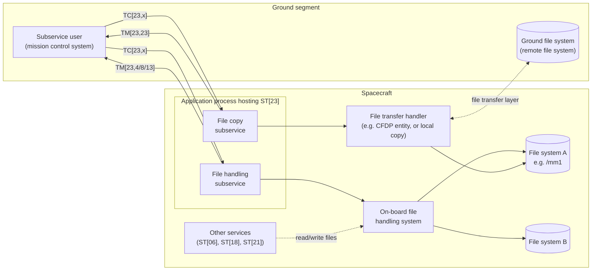
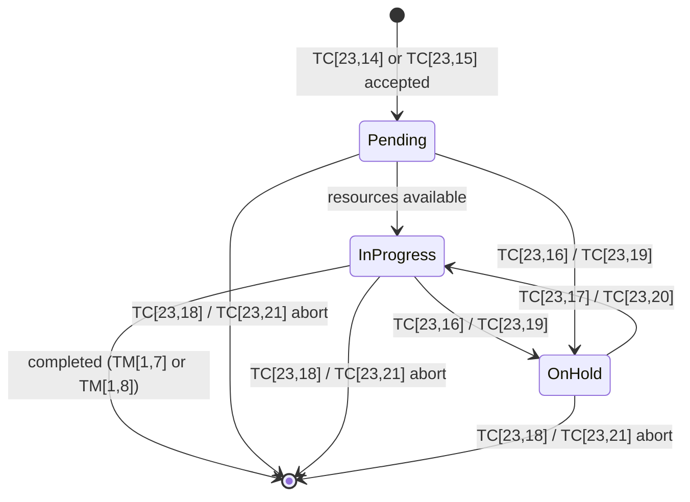
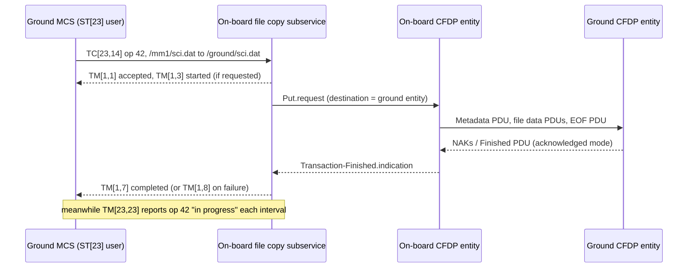

# ST[23] File management

**ST[23] file management** is the [PUS-C](index.md) service type that lets the ground manage
**on-board file systems**: create, delete, lock and inspect files, manage directories, search for
files, and copy or move files between file systems, including between the spacecraft and the
ground.[^c-scope][^c-subs] The user need not be on the ground: the standard's own example of an
on-board subservice user is a payload controlling a solid-state mass memory through file
management subservices.[^c-41] It is an interface service: it does not care what
is inside a file, and it sits on top of an on-board *file handling system* that does the real
work.[^c-scope][^std-types] For moving files across the space link it assumes a separate file
transfer layer, for example the [CCSDS File Delivery Protocol (CFDP)](../../ccsds/cfdp.md), but it
does not standardise that layer.[^c-subs]

!!! info "At a glance"
    | Item | Value |
    |---|---|
    | Defined in | ECSS-E-ST-70-41C (15 April 2016): system clause 6.23, interface clause 8.23, Annex C Tables C-32 and C-33[^c-scope][^i-gen][^annex] |
    | Previous edition | none: PUS-A (2003) has no file management service[^pusa-43] |
    | Subservice types | *file handling* (exactly one per service) and *file copy* (at most one); if both exist they are hosted by the same application process[^c-layout] |
    | Message types | 24: 20 requests (TC) and 4 reports (TM)[^annex] |
    | Minimum capability | TC[23,1] create, TC[23,2] delete, TC[23,3]/TM[23,4] report attributes; TC[23,14] copy a file when the optional file copy subservice exists[^annex][^c-layout] |
    | Related protocol | CFDP (CCSDS 727.0-B-5) as a possible underlying file transfer layer[^c-subs][^cfdp-gen] |
    | Draft revision | Rev.1 DIR1 (2024) adds checksum and directory protection, a new ST[24] file transfer service built on CFDP and a new ST[25] file data storage service[^r-if][^r-fbo] |
    | Solar Orbiter | no ST[23]; files are managed with private service 133 and SSMM extensions of services 13 and 15[^solo-list][^mib25] |

## Files, repositories and paths

PUS-C defines a small vocabulary for file systems:[^c-def][^c-fs][^c-scope]

| Term | Definition |
|---|---|
| **On-board file system** | a system that controls data organised in files; each one has exactly one identifier, unique across the whole spacecraft |
| **Object** | a file or a directory |
| **Repository path** | the logical path to where an object is located: a physical path such as a directory, or a logical path such as a mounted device (the standard's examples are `/mm1` for a mass memory and `/mm1/dir1`) |
| **Object name** | the identifier of an object within its repository |
| **Object path** | repository path + object name (a *file path* or *directory path*); unique at mission level |
| **Flat / structured** | a flat file system has no directories; a structured one stores files in directories |

For each file system the mission declares whether files may have **unbounded size** (limited only
by the physical memory), which **attributes** exist (for example type or creation date), and whether
files can be **locked**. A file system may be accessed by only one file management service.[^c-fs]
The service must always be able to read the **size in bytes** of any file, and, where locking exists,
its **lock status**; the readable and settable attribute sets are declared per file system.[^c-attr]
Each file system also declares the **wildcard characters** it recognises.[^c-wild]



The diagram combines clauses 6.23.1 to 6.23.3 and 6.23.5: the file handling subservice talks to the
on-board file handling system, the file copy subservice uses an underlying file transfer handler,
and other services may use the same file systems, because ST[23] has no exclusive access.[^c-subs][^c-overview][^c-copy]

### Who detects which error

The standard deliberately leaves argument checking to be shared between the service and the file
handling system, and defines only the outcome:[^c-overview]

| Error found by | Example | Reported as |
|---|---|---|
| the file management service | an invalid object path, a wildcard where none is allowed | **failed start of execution** |
| the on-board file handling system | creating a file that already exists, deleting a missing or protected file | **failed completion of execution** |

Both appear as [ST[01] request verification](st01-request-verification.md) reports (TM[1,4] and
TM[1,8]).[^st01]

## What a mission must declare

| Declaration | Clause |
|---|---|
| File systems accessed by the service | 6.23.3.2.1a[^c-access] |
| For each file system: unbounded file size supported; supported attributes; locking supported | 5.4.5c-e[^c-fs] |
| Wildcard characters recognised by each file system | 6.23.3.3a[^c-wild] |
| Readable and settable file attributes per file system | 6.23.3.4.1[^c-attr] |
| Wildcards supported in find patterns; extent of the search (one directory or recursive) | 6.23.4.4c-d[^c-find] |
| Type of directory deletion (empty only, no sub-directories, recursive, ...) | 6.23.4.5.2b[^c-rmdir] |
| Whether directory renaming is supported | 6.23.4.5.3b[^c-rendir] |
| File systems usable by the copy subservice as source, destination or both | 6.23.5.1a[^c-copy-fs] |
| Whether file copy status reports include a progress indicator | 6.23.5.5.1a[^c-status-gen] |
| Each "by declaration" capability of Annex C | Tables C-32, C-33[^annex] |

## Message types

| Message type | Name | Subservice | Applicability (Annex C) | System | Interface |
|---|---|---|---|---|---|
| TC[23,1] | create a file | file handling | minimum | 6.23.4.1.1 | 8.23.2.1 |
| TC[23,2] | delete a file | file handling | minimum | 6.23.4.1.2 | 8.23.2.2 |
| TC[23,3] | report the attributes of a file | file handling | minimum | 6.23.4.2 | 8.23.2.3 |
| TM[23,4] | file attribute report | file handling | response to TC[23,3] | 6.23.4.2 | 8.23.2.4 |
| TC[23,5] | lock a file | file handling | by declaration | 6.23.4.3.1 | 8.23.2.5 |
| TC[23,6] | unlock a file | file handling | implied by TC[23,5] | 6.23.4.3.2 | 8.23.2.6 |
| TC[23,7] | find files | file handling | by declaration | 6.23.4.4 | 8.23.2.7 |
| TM[23,8] | found files report | file handling | response to TC[23,7] | 6.23.4.4 | 8.23.2.8 |
| TC[23,9] | create a directory | file handling | by declaration | 6.23.4.5.1 | 8.23.2.9 |
| TC[23,10] | delete a directory | file handling | implied by TC[23,9] | 6.23.4.5.2 | 8.23.2.10 |
| TC[23,11] | rename a directory | file handling | implied by TC[23,9] | 6.23.4.5.3 | 8.23.2.11 |
| TC[23,12] | summary-report the content of a repository | file handling | by declaration | 6.23.4.6 | 8.23.2.12 |
| TM[23,13] | repository content summary report | file handling | response to TC[23,12] | 6.23.4.6 | 8.23.2.13 |
| TC[23,14] | copy a file | file copy | minimum | 6.23.5.2.2 | 8.23.2.14 |
| TC[23,15] | move a file | file copy | by declaration | 6.23.5.2.3 | 8.23.2.15 |
| TC[23,16] | suspend file copy operations | file copy | by declaration | 6.23.5.3.1 | 8.23.2.16 |
| TC[23,17] | resume file copy operations | file copy | implied by TC[23,16] | 6.23.5.3.2 | 8.23.2.17 |
| TC[23,18] | abort file copy operations | file copy | by declaration | 6.23.5.4.1 | 8.23.2.18 |
| TC[23,19] | suspend all file copy operations involving a repository path | file copy | by declaration | 6.23.5.3.3 | 8.23.2.19 |
| TC[23,20] | resume all file copy operations involving a repository path | file copy | implied by TC[23,19] | 6.23.5.3.4 | 8.23.2.20 |
| TC[23,21] | abort all file copy operations involving a repository path | file copy | by declaration | 6.23.5.4.2 | 8.23.2.21 |
| TC[23,22] | enable the periodic reporting of the file copy status | file copy | by declaration | 6.23.5.5.2 | 8.23.2.22 |
| TM[23,23] | file copy status report | file copy | "response" to TC[23,22] | 6.23.5.5.4 | 8.23.2.23 |
| TC[23,24] | disable the periodic reporting of the file copy status | file copy | implied by TC[23,22] | 6.23.5.5.3 | 8.23.2.24 |

The table follows Annex C, which lists TM[23,23] as a response to TC[23,22] even though the report
is generated periodically after that request, not once.[^annex][^c-status-rep] Every packet of the
service carries service type 23.[^i-gen] All rows also appear in the
[PUS message type catalogue](message-types.md).

## Field types used by ST[23]

Almost every ST[23] request is built from **variable-length character strings** (PTC 8, PFC 0):
an unsigned integer length followed by that many characters. The characters must be visible ASCII
characters, one octet each, and the width of the length field is declared per application
process.[^ptc-str] Paths are always split into two strings, repository path and object name, except
in the found-files report, which returns whole matching paths.[^i-1][^i-8] Other types used are
**Boolean** (PTC 1; PFC 0 is one bit, PFC n > 1 is n bits) for the lock status, **unsigned integer**
for sizes, counters and operation IDs, **enumerated** for object type and operation status,
**relative time** (PTC 10) for the reporting interval, and **deduced** (PTC 11) for the
mission-defined additional attributes.[^ptc-bool][^ptc-rel][^ptc-ded] See
[PUS parameter types](parameter-types.md) for the full PTC/PFC rules.

## File handling subservice

### TC[23,1] create a file

**Instruction content:** the object path; the maximum size in bytes (if the file system does not
support unbounded files); the lock status (if locking is supported); and any additional attributes
that can be set at creation. The request is rejected (failed start) for an invalid path or an
invalid maximum size; if the file system then fails to create the file, a failed completion is
reported.[^c-create]

| Field | Type | Presence | Meaning |
|---|---|---|---|
| repository path | variable character-string | always | where to create the file |
| file name | variable character-string | always | name of the new file |
| maximum size | unsigned integer | always on the wire | size limit in bytes; **0 means unbounded** |
| file locked status | Boolean | optional (locking supported) | create the file locked or unlocked |
| additional file attributes | deduced | optional | mission-defined attributes |

This is Figure 8-261, together with rule 8.23.2.1c on the value 0.[^i-1]

!!! note "A dangling \"repeated N times\""
    Figures 8-261 and 8-264 print a "repeated N times" label above the *additional file attributes*
    field, but neither figure contains an N field.[^i-1][^i-4] The available sources do not explain how
    the number of additional attributes is encoded; presumably it is part of the mission-defined
    (deduced) structure.

### TC[23,2] delete a file

One instruction with the object path (Figure 8-262: repository path + file name). Rejected if
the path is invalid or contains wildcard characters that the file system recognises: one request
deletes exactly one file. A locked file cannot be deleted.[^c-delete][^i-2-3]

### TC[23,3] report the attributes of a file and TM[23,4] file attribute report

The request carries one object path (Figure 8-263).[^i-2-3] If the file system returns the
attributes, the service sends one TM[23,4] with:[^c-attrrep][^i-4]

| Field | Type | Presence |
|---|---|---|
| repository path | variable character-string | always |
| file name | variable character-string | always |
| file size | unsigned integer | always (the minimum capability) |
| file locked status | Boolean | optional (locking supported) |
| additional file attributes | deduced | optional |

### TC[23,5] lock a file and TC[23,6] unlock a file

**Locking** a file makes it read-only: the file handling system must write-protect it and refuse to
delete or move it, and the only change allowed on a locked file is unlocking it. File systems
usually also protect files while they are open. Both requests carry one object path
(Figures 8-265 and 8-266) and reject wildcards. Unlock exists whenever lock is declared.[^c-lock][^c-unlock][^i-5-7]

### TC[23,7] find files and TM[23,8] found files report

The request carries a **repository path** and a **search pattern** (Figure 8-267). Wildcards are
allowed in the pattern only, never in the repository path, so one request cannot search several
repositories. Whether the search covers only the given directory or descends recursively is
declared by the mission.[^c-find][^i-5-7] The report repeats the repository path and the pattern,
followed by N (unsigned integer) and N matching file paths, each a single variable character
string (Figure 8-268). Finding nothing is not an error; the list is then empty.[^c-find][^i-8]

### TC[23,9] create, TC[23,10] delete and TC[23,11] rename a directory

Directory operations belong to structured file systems, and the three requests come as a set:
delete and rename are implied by create.[^c-overview][^annex]

* **Create a directory**: one directory path (repository path + directory name; Figure 8-269).[^c-mkdir][^i-9-11]
* **Delete a directory**: one directory path (Figure 8-270), no wildcards. The kind of deletion
  depends on the file handling system and is declared: only empty directories, only directories
  without sub-directories, or recursive deletion. A locked file anywhere below the directory
  prevents its deletion.[^c-rmdir][^i-9-11]
* **Rename a directory**: repository path, old directory name and new directory name (three
  strings, Figure 8-271). Support must be declared, and a locked file below the directory also
  prevents renaming.[^c-rendir][^i-9-11]

### TC[23,12] summary-report the content of a repository and TM[23,13]

The request carries one repository path, without wildcards (Figure 8-272). The report lists only the
**direct children** of that repository, never recursively. TM[23,13] contains the repository path,
N, and for each object its **object type** (enumerated: 0 file, 1 directory) and **object name**
(Figure 8-273). An empty repository gives an empty list, not an error.[^c-repo][^i-12-13][^i-enum]

### File handling observable

For each file system, the subservice exposes the **available unallocated memory**.[^c-fh-obs]

## File copy subservice

### File systems and operations

The copy subservice works across the file systems declared for it, as source, destination or
both. They include on-board file systems and **remote** ones such as the ground. A file on a
remote file system is identified by a *remote file path* (repository path + file name).[^c-copy-fs]
Each copy or move is a **file copy operation** with an **operation ID** that is unique for the
operation's lifetime. The requester (usually the ground) puts the ID in the copy or move request;
the ID is then used to suspend, resume or abort the operation and appears in its status reports.[^c-opid][^c-copy]

### TC[23,14] copy a file and TC[23,15] move a file

Both requests have the same layout (Figures 8-274 and 8-275):[^i-14-15]

| Field | Type | Meaning |
|---|---|---|
| operation ID | unsigned integer | identifier of the new file copy operation |
| source file path: repository path | variable character-string | where the source file is |
| source file path: file name | variable character-string | source file name |
| target file path: repository path | variable character-string | destination repository |
| target file path: file name | variable character-string | destination file name |

**Rejection (failed start):** the operation ID is already used by an ongoing operation; the source
or target path is invalid; or **both** source and target are on a remote file system, because
remote-to-remote copies are not allowed.[^c-copy][^c-move]

**Execution:** the subservice picks the **underlying file transfer handler** from the two paths.
That handler may be a file transfer layer or a capability of a local file system; the choice is
implementation-dependent. The subservice then processes the handler's execution notifications and
turns each one into an [ST[01]](st01-request-verification.md) execution verification report:
successful ones only if the acknowledgement flags asked for them, failed ones always. For example,
a lack of space on the target file system makes the handler fail and produces a failed execution
report.[^c-copy][^c-move] The attributes of the created target file, such as permissions, depend on
the file system and the implementation.[^c-copy]

!!! warning "Inference"
    Because the copy request is verified through the handler's notifications, a single TC[23,14]
    can produce progress or completion reports long after it was accepted, for example when a CFDP
    transfer spans several passes. The standard does not define how many progress steps there are;
    that follows from the request's execution verification profile.

### Suspending, resuming and aborting

| Request | Fields | Behaviour |
|---|---|---|
| TC[23,16] suspend file copy operations | N, N × operation ID | each unknown ID is rejected on its own; the handler is asked to suspend each valid one[^c-susp][^i-16-18] |
| TC[23,17] resume file copy operations | N, N × operation ID | mirror of TC[23,16][^c-resume][^i-16-18] |
| TC[23,18] abort file copy operations | N, N × operation ID | the handler is asked to abort each valid operation[^c-abort][^i-16-18] |
| TC[23,19] suspend all file copy operations involving a repository path | repository path | suspends every ongoing operation whose source **or** destination lies within the path[^c-susp-all][^i-19-21] |
| TC[23,20] resume all file copy operations involving a repository path | repository path | resumes operations that are on hold[^c-resume-all][^i-19-21] |
| TC[23,21] abort all file copy operations involving a repository path | repository path | rejected if no operation is ongoing; otherwise aborts ongoing operations[^c-abort-all][^i-19-21] |

The standard suggests using the repository path variants with the logical path that represents
the ground, to act on every transfer to or from the ground at once, or with the root path to act
on all transfers.[^c-susp-all][^c-abort-all] All six requests apply equally to operations started by
TC[23,14] and TC[23,15].[^c-susp]

!!! note "As printed"
    Only the *suspend all* requirement (6.23.5.3.3d) states the repository-path condition. The
    *resume all* (6.23.5.3.4d) and *abort all* (6.23.5.4.2f) requirements, read literally, act on
    every operation that is on hold or ongoing.[^c-resume-all][^c-abort-all] The caption of
    Figure 8-281, the layout of TC[23,21] *abort all*, also says "Suspend all".[^i-19-21] Both look
    like editorial slips.

### Periodic file copy status reporting

TC[23,22] enables periodic status reports with a **reporting interval** (relative time, Figure 8-282);
an invalid interval is rejected. TC[23,24], with no data, disables them.[^c-status-en][^c-status-dis][^i-22-24]
While enabled, the subservice sends exactly one **TM[23,23] file copy status report** at the end of
every interval, with one entry per ongoing operation:[^c-status-rep][^i-22-24]

| Field | Type | Presence | Meaning |
|---|---|---|---|
| N | unsigned integer | always | number of ongoing operations |
| *repeated N times:* operation ID | unsigned integer | always | the operation |
| operation status | enumerated | always | Table 8-27: 0 "pending", 1 "in progress" |
| progress indicator | unsigned integer | optional (declared) | percentage of completion |

!!! note "Three states, two codes"
    The system requirement lists three operation states: *in progress*, *pending* (waiting for
    on-board resources) and *on hold*.[^c-status-rep] Table 8-27 encodes only "pending" (0) and
    "in progress" (1), so the on-hold state of a suspended operation has no raw value.[^i-enum]
    Figure 8-283 also labels its array "repeated N2 times" while the counter is called N; the
    2024 draft prints "repeated N times".[^i-22-24][^r-if]



!!! warning "Inference"
    The three state names come from requirement 6.23.5.5.4c; the transitions are this wiki's
    reading of the suspend, resume and abort requirements. PUS-C does not draw a state machine for
    file copy operations.

### File copy observables

Three flags: at least one operation in progress, at least one operation on hold, and whether
status reporting is enabled.[^c-fc-obs]

## Worked example: creating a file (illustrative)

The bytes below are constructed for explanation: the field widths are a possible tailoring, not
values from the standard or from a mission. They assume 8-bit length fields for the character
strings, a 32-bit maximum size and an 8-bit Boolean (PFC 8), and use the standard's own example
repository `/mm1`.[^c-scope][^ptc-str][^ptc-bool]

<div class="bitfield" data-title="TC[23,1] create a file - ILLUSTRATIVE tailoring (sizes not from the standard)" data-width="32"
     data-fields='[{"n":"Length","b":8,"v":"0x04","d":"length of the repository path string","g":"repository path"},{"n":"/mm1","b":32,"v":"0x2F6D6D31","d":"4 ASCII characters","g":"repository path"},{"n":"Length","b":8,"v":"0x07","d":"length of the file name string","g":"file name"},{"n":"ctx.bin","b":56,"v":"0x6374782E62696E","d":"7 ASCII characters","g":"file name"},{"n":"Maximum size","b":32,"v":"0x00010000","d":"65536 bytes; 0 would mean unbounded"},{"n":"Locked","b":8,"v":"0x00","d":"Boolean, FALSE; present only if locking is supported"}]'></div>

The application data would be `04 2F 6D 6D 31 07 63 74 78 2E 62 69 6E 00 01 00 00 00` (18
octets). If the name were already taken, the service would pass the request on and the file
handling system would refuse it, producing a failed completion of execution (TM[1,8]).[^c-overview][^c-create]

## ST[23] and CFDP

### What the standards say

PUS-C states that it assumes a dedicated file transfer layer, CFDP being the example, to copy
files between ground and space, and that it does not standardise that protocol.[^c-subs] CFDP
(CCSDS 727.0-B-5) moves a file from one **filestore** to another, typically across a space link.
The unit it moves is a **file delivery unit (FDU)**: the file plus metadata such as file names,
filestore requests or messages to the user. Each end-to-end delivery is a **transaction** between
a sending and a receiving entity, run in unacknowledged or acknowledged mode.[^cfdp-gen] Its user
interface consists of the request primitives Put, Report, Cancel, Suspend and Resume, plus a set
of indications.[^cfdp-svc] A transaction ID combines the source entity ID with a sequence number
specific to that entity.[^cfdp-txid] See the [CFDP page](../../ccsds/cfdp.md) for the protocol itself.

CFDP also manipulates files. It assumes a **virtual filestore** that can at least create, delete,
rename, append to and replace files, create and remove directories, and list directories.[^cfdp-vfs]
These actions travel as **filestore requests** inside a transaction and are executed by the
destination when the data transfer is complete, in the order submitted.[^cfdp-fsreq] On the wire
each request is a Filestore Request TLV (type 0x00) with a 4-bit action code:[^cfdp-tlv]

| CFDP action code | Action | Second file name | Closest ST[23] request (Inference) |
|---|---|---|---|
| `0b0000` | Create File | no | TC[23,1] create a file |
| `0b0001` | Delete File | no | TC[23,2] delete a file |
| `0b0010` | Rename File | yes | none (ST[23] renames directories only, TC[23,11]); TC[23,15] move a file is the nearest |
| `0b0011` | Append File | yes | none |
| `0b0100` | Replace File | yes | none |
| `0b0101` | Create Directory | no | TC[23,9] create a directory |
| `0b0110` | Remove Directory | no | TC[23,10] delete a directory |
| `0b0111` | Deny File (delete if present) | no | none |
| `0b1000` | Deny Directory (remove if present) | no | none |
| (directory listing user operation) | list directory | - | TC[23,12] / TM[23,13], TC[23,7] / TM[23,8] |
| - | - | - | TC[23,5] / TC[23,6] lock and unlock have no CFDP counterpart |

CFDP returns directory listings through its *directory operations*, not through filestore
responses.[^cfdp-fsreq][^cfdp-userops]

!!! warning "Inference: one way to stack them"
    The right-hand column and the mapping below are this wiki's reading; neither PUS-C nor CFDP
    defines a mapping between the two.

    * TC[23,14] *copy a file* from an on-board path to a ground path would make the on-board file
      copy subservice issue a CFDP **Put.request** to the ground entity. A copy from the ground to
      the spacecraft would need the ground CFDP entity to send the file, for example through a CFDP
      **proxy operation**, which CFDP describes as a way to make a remote entity deliver a file.[^cfdp-userops][^cfdp-put]
    * TC[23,16], TC[23,17] and TC[23,18] correspond to CFDP **Suspend**, **Resume** and **Cancel**
      requests on the transaction behind the operation; TM[23,23] corresponds to what a
      **Report.request** returns.[^cfdp-svc]
    * The ST[23] operation ID is chosen by the requester, while a CFDP transaction ID is allocated
      by the source entity, so an implementation has to keep a table linking the two.[^c-opid][^cfdp-txid]



The diagram is illustrative: it combines the ST[23] copy rules with CFDP's copy procedure (metadata,
file data, EOF and, in acknowledged mode, NAK and Finished PDUs) and its indications.[^c-copy][^c-status-rep][^cfdp-inter][^cfdp-svc]

### The 2024 draft: ST[24] file transfer and ST[25] file data storage

The Rev.1 DIR1 draft fills the gap. It introduces **File Based Operations (FBO)** built from
communication links, file management systems (ST[23]), file transaction entities using CFDP, downlink
managers and data sources. Two new services carry it: **ST[24] file transfer**, with a CFDP *file
transaction* subservice and a *file downlink manager* subservice, and **ST[25] file data storage**,
which stores on-board data into files. These subservices need a file management system on board,
which implies at least one ST[23] file handling subservice.[^r-fbo]

## Files elsewhere in PUS-C

Several other services read or write the files that ST[23] manages:

| Service | Requests | Use of files |
|---|---|---|
| [ST[06] memory management](st06-memory-management.md) | TC[6,19], TC[6,21] load ... by reference; TC[6,20], TC[6,22] dump ... to file | memory loads read data from a file (path + offset + length); dumps create a file at the given object path[^mem-file] |
| [ST[18] on-board operations procedure](st18-onboard-operations-procedure.md) | TC[18,13] load an OBCP by reference; TC[18,19] load by reference and activate | the OBCP code is already on board in a file[^obcp-file] |
| [ST[21] request sequencing](st21-request-sequencing.md) | TC[21,2] load a request sequence by reference; TC[21,8] load by reference and activate | the sequence is already on board in a file[^seq-file] |

The standard notes this explicitly: the file management service has no exclusive access, and
request sequencing can, for example, load a sequence from an on-board file.[^c-overview]

## What the 2024 Rev.1 draft changes in ST[23]

The draft is under public review and is not yet a standard.[^r-cover] For ST[23] it proposes:

* **Wildcards in delete:** the delete-a-file request may delete several files when wildcards are
  used in the file name inside one directory, and a locked file is an explicit rejection reason.[^r-del]
* **Checksum a file:** new TC[23,25] *checksum a file* and report subtype 26, *checksum report of a
  file*, with a 16-bit bit-string checksum; the checksum type is mission-specific. The draft's
  clause 8 heading prints the report as "TC[23,26]" although its text describes a telemetry packet.[^r-cksum][^r-if]
* **Directory protection:** new TC[23,27] and TC[23,28] enable and disable protection, so that a
  directory cannot be deleted, moved or renamed.[^r-dirprot][^r-if]
* **Repository report:** TC[23,12] and TM[23,13] lose the word "summary", and each file entry now
  carries its attributes.[^r-repo][^r-if]
* **Copy and move with wildcards:** source file names may contain wildcards; the target name is
  then ignored.[^r-copywild]
* **Atomic requests:** suspend, resume and similar multi-instruction requests are rejected as a
  whole if one instruction is invalid, and valid ones execute in order.[^r-copywild]

## Solar Orbiter: file management without ST[23]

Solar Orbiter is a PUS-A mission and has no ST[23]; neither the 2020 nor the 2025 MIB contains any
packet or command of type 23.[^solo-ad1][^mib25][^mib20] Files exist on board all the same, and the mission
handles them with private services.

### Service 133 "File Management" (OBC)

The ICD reserves service 133 for the OBC central software. It manages files in the OBC local storage
areas, the OBC Mass Memory (OMM), the Safe Guard Memory (SGM) RAM and the SGM EEPROM. Files carry
uplinked command material (OBCPs, TC files, the back-up MTL), profiles and ephemerides, or software
patch data; the service manages the files but not the use of their contents.[^solo-133][^solo-sgm]
Files are named by a **partition ID** (1 byte) and a 32-bit **file ID** instead of character-string
paths:[^solo-133]

| Subtype | ICD name | Application or source data (ICD) |
|---|---|---|
| TC(133,6) | Copy File | source partition ID, source file ID, destination partition ID, destination file ID |
| TC(133,7) | Delete File | partition ID, file ID |
| TC(133,8) | Modify File Attributes | partition ID, file ID, type, protection |
| TC(133,9) | Request File Information | partition ID, file ID |
| TM(133,10) | File Information Report | partition ID, file ID, address, size, type, protection, mode (closed/open), creation time |
| TC(133,11) | Request Partition Mapping | partition ID |
| TM(133,12) | Partition Mapping Report | partition ID, N, then N × (file ID, address, size) |
| TC(133,128) | Verify File Checksum | partition ID, file ID, expected checksum |

For Copy File the ICD lists the accepted combinations: same name to another partition, new name
in the same partition, or new name in another partition. A second list, also headed "accepted"
as printed, names the remaining case, same name in the same partition.[^solo-133]

<div class="bitfield" data-title="Solar Orbiter TC(133,6) Copy File application data (ICD and MIB ZCD08506)" data-width="16"
     data-fields='[{"n":"Source partition ID","b":8,"d":"enumerated; calibration CCDT0192TX"},{"n":"Source file ID","b":32,"d":"unsigned integer (PTC 3, PFC 14)"},{"n":"Destination partition ID","b":8,"d":"enumerated; calibration CCDT0192TX"},{"n":"Destination file ID","b":32,"d":"unsigned integer (PTC 3, PFC 14)"}]'></div>

<div class="bitfield" data-title="Solar Orbiter TM(133,10) File Information Report source data (ICD and MIB SPID 14319)" data-width="32"
     data-fields='[{"n":"Partition ID","b":8,"d":"NCD850A1, packet byte 16"},{"n":"File ID","b":32,"d":"NCD850A2, byte 17"},{"n":"Address","b":32,"d":"NCD850A3, physical address on the storage area"},{"n":"Size","b":32,"d":"NCD850A4, bytes"},{"n":"Type","b":32,"d":"NCD850A5, calibration CCDT0082TX"},{"n":"Protection","b":32,"d":"NCD850A6, calibration CCDT0003TX"},{"n":"Mode","b":32,"d":"NCD850A7, 0 CLOSED, 1 OPEN"},{"n":"Creation time","b":48,"d":"NCD850A8, PTC 9 PFC 17"}]'></div>

Both layouts are real: the field order and sizes come from the ICD, and the MIB definitions match
them bit for bit. ZCD08506 places its four parameters at bits 0, 8, 40 and 48, and SPID 14319, a
47-byte packet, places its parameters from byte 16 to byte 41, the 6-octet creation time filling the
last bytes.[^solo-133][^mib25] Under the PUS-C rule for absolute time, PFC 17 means 4 octets of
coarse and 2 of fine time, which agrees with that layout.[^ptc-abs]

The MIB calibrations give the actual values:[^mib25]

| Calibration | Used by | Values (raw: text) |
|---|---|---|
| CCDT0192TX "Partition" | partition IDs | 161 OMM\_TC\_FILES\_A, 162 OMM\_OBCPS\_A, 163 OMM\_S\_FILES\_A, 164 OMM\_PAYLOAD\_A, 177 OMM\_TC\_FILES\_B, 178 OMM\_OBCPS\_B, 179 OMM\_S\_FILES\_B, 180 OMM\_PAYLOAD\_B, 193 SGMA\_TC\_FILES, 194 SGM\_OBCPS, 195 SGMB\_TC\_FILES |
| CCDT0082TX "File types" | file type | 0 FT\_INVALID, 1 FT\_OBCP, 2 FT\_DEL\_TCSEQ, 3 FT\_IMM\_TCSEQ, 4 FT\_PL\_CTX, 5 FT\_PS, 6 FT\_PLAIN, 7 FT\_FAT |
| CCDT0003TX "Disabled/Enabled status" | file protection | 0 DISABLED, 1 ENABLED |
| CCDT0080TM "Closed\_Open" | file mode | 0 CLOSED, 1 OPEN |

!!! note "Protection polarity"
    The ICD describes the protection field as "0 = Delete Enabled, 1 = Delete Disabled" for
    TC(133,8) but as "0 = Delete Disabled, 1 = Delete Enabled" for TM(133,10). The MIB simply labels
    both 0 DISABLED and 1 ENABLED.[^solo-133][^mib25] Which polarity the software implements is not
    stated in the available sources.

The MIB holds six service 133 commands, all on APID 172, and two reports on APID 163:[^mib25]

| MIB entry | Subtype | Description |
|---|---|---|
| [ZCD08506](../../explorer/index.md#/solo/command/ZCD08506) | TC(133,6) | Copy File |
| [ZCD08507](../../explorer/index.md#/solo/command/ZCD08507) | TC(133,7) | Delete File |
| [ZCD08508](../../explorer/index.md#/solo/command/ZCD08508) | TC(133,8) | Modify File Attributes |
| [ZCD08509](../../explorer/index.md#/solo/command/ZCD08509) | TC(133,9) | Request File Information |
| [ZCD0850B](../../explorer/index.md#/solo/command/ZCD0850B) | TC(133,11) | Request Partition Mapping |
| [ZCD08580](../../explorer/index.md#/solo/command/ZCD08580) | TC(133,128) | Verify File Checksum |
| [14319](../../explorer/index.md#/solo/packet/14319) | TM(133,10) | File Information Report (fixed layout, 47 bytes) |
| [14320](../../explorer/index.md#/solo/packet/14320) | TM(133,12) | Partition Mapping Report (variable layout: partition ID, file count NCD850C2 with a 3-parameter repeated group) |

!!! warning "Inference"
    The file type value FT\_PL\_CTX ("payload context") fits the Solar Orbiter context-saving
    service, whose instrument contexts the CSW stores as files in the OMM, reachable through
    service 133 (see [ST[22]](st22-position-based-scheduling.md#solar-orbiter-a-different-service-22)).[^solo-22]
    Likewise FT\_OBCP, FT\_DEL\_TCSEQ and FT\_IMM\_TCSEQ fit the OBCP and TC-file uses named in the ICD.
    The MIB does not document these meanings.

### SSMM packet stores as files (service 15) and file transfer (service 13)

On the Solid State Mass Memory (SSMM) side, the ICD lists private service 15 subtypes 129 to 133
to create, resize, delete, rename and list **packet stores** on the SSMM, and TM(15,134), the SSMM
packet stores list report. The MIB names the same commands "SSMM Create File", "SSMM Resize File",
"SSMM Delete File", "SSMM Rename File" and "SSMM List Files"
([ZSM00190](../../explorer/index.md#/solo/command/ZSM00190) to
[ZSM00210](../../explorer/index.md#/solo/command/ZSM00210), APID 492) and the report
"SSMM List File Report" (SPID [80021](../../explorer/index.md#/solo/packet/80021), APID 483).[^solo-15][^mib25] Files
are moved across the link with private service 13 subtypes. The ICD calls them file transfer
sessions and **low-level file transfers**, with an "End Of File Transfer" timeout; the MIB names
the same subtypes with the abbreviations FTS, LLFT and EOFT. The [CFDP page](../../ccsds/cfdp.md#solar-orbiter-file-transfer-without-cfdp)
describes them.[^solo-13][^mib25]

!!! warning "Inference"
    Matching the ICD subtype names with the MIB descriptions suggests that, on Solar Orbiter, FTS
    stands for "file transfer session", LLFT for "low-level file transfer" and EOFT for "end of file
    transfer". The MIB itself does not spell out these abbreviations.

??? example "SQL used"
    ```sql
    -- solo-2025-09-16.sqlite (MIB__20250916M25925PFMS001_SOL)
    SELECT CCF_TYPE, CCF_STYPE, COUNT(*) FROM ccf WHERE CCF_TYPE IN ('23','133') GROUP BY 1, 2;
    SELECT PID_TYPE, PID_STYPE, PID_APID, PID_SPID, PID_DESCR, PID_TPSD
      FROM pid WHERE PID_TYPE IN ('23','133');                     -- no type 23 rows
    SELECT d.CDF_CNAME, d.CDF_ELLEN, d.CDF_BIT, d.CDF_PNAME, c.CPC_DESCR, c.CPC_PTC, c.CPC_PFC, c.CPC_PAFREF
      FROM cdf d LEFT JOIN cpc c ON c.CPC_NAME = d.CDF_PNAME
     WHERE d.CDF_CNAME LIKE 'ZCD085%' ORDER BY 1, CAST(d.CDF_BIT AS INT);
    SELECT l.PLF_NAME, l.PLF_OFFBY, p.PCF_DESCR, p.PCF_PTC, p.PCF_PFC, p.PCF_CURTX
      FROM plf l JOIN pcf p ON p.PCF_NAME = l.PLF_NAME
     WHERE l.PLF_SPID = '14319' ORDER BY CAST(l.PLF_OFFBY AS INT);
    SELECT TPCF_SPID, TPCF_SIZE FROM tpcf WHERE TPCF_SPID IN ('14319','14320');
    SELECT VPD_POS, VPD_NAME, VPD_GRPSIZE FROM vpd WHERE VPD_TPSD = '14320' ORDER BY CAST(VPD_POS AS INT);
    SELECT PAS_NUMBR, PAS_ALVAL, PAS_ALTXT FROM pas WHERE PAS_NUMBR IN ('CCDT0192TX','CCDT0082TX','CCDT0003TX');
    SELECT TXP_NUMBR, TXP_FROM, TXP_ALTXT FROM txp WHERE TXP_NUMBR IN ('CCDT0080TM','CCDT0003TX','CCDT0082TX');
    SELECT CCF_CNAME, CCF_TYPE, CCF_STYPE, CCF_APID, CCF_DESCR FROM ccf
     WHERE CCF_TYPE = '15' AND CAST(CCF_STYPE AS INT) BETWEEN 129 AND 134;
    SELECT PID_STYPE, PID_APID, PID_SPID, PID_DESCR FROM pid WHERE PID_TYPE = '15' AND PID_STYPE = '134';
    -- solo-2020-04-16.sqlite: the same type 23 queries also return no rows
    ```

The tables used are [ccf](../../mib/tables/ccf.md), [cdf](../../mib/tables/cdf.md),
[cpc](../../mib/tables/cpc.md), [pid](../../mib/tables/pid.md), [plf](../../mib/tables/plf.md),
[pcf](../../mib/tables/pcf.md), [tpcf](../../mib/tables/tpcf.md), [vpd](../../mib/tables/vpd.md),
[pas](../../mib/tables/pas.md) and [txp](../../mib/tables/txp.md).

## Related pages

* [CFDP (CCSDS 727.0-B-5)](../../ccsds/cfdp.md), the file transfer layer ST[23] assumes.
* [ST[13] Large packet transfer](st13-large-packet-transfer.md), the packet-level alternative for big data.
* [ST[15] On-board storage and retrieval](st15-onboard-storage-retrieval.md), packet stores rather than files.
* [ST[06]](st06-memory-management.md), [ST[18]](st18-onboard-operations-procedure.md) and [ST[21]](st21-request-sequencing.md), the services that load from or dump to files.
* [PUS parameter types](parameter-types.md), [PUS packet structures](packets.md) and the [message type catalogue](message-types.md).
* [How Solar Orbiter uses PUS](../../missions/solar-orbiter/pus-usage.md) and [the Solar Orbiter MIB](../../missions/solar-orbiter/mib.md).
* Library: [ECSS-E-ST-70-41C](../../library/ecss-e-st-70-41c-15april2016.md), [Rev.1 DIR1](../../library/ecss-e-st-70-41c-rev1-dir1.md), [CCSDS 727.0-B-5](../../library/ccsds-727-0-727x0b5e1.md).

[^c-41]: [ECSS-E-ST-70-41C](../../library/ecss-e-st-70-41c-15april2016.md), §4.1, PDF p. 18.
[^c-def]: [ECSS-E-ST-70-41C, Telemetry and telecommand packet utilization](../../library/ecss-e-st-70-41c-15april2016.md), §3.2.12, §3.2.13 and §3.2.17, PDF pp. 14-15.
[^c-fs]: [ECSS-E-ST-70-41C](../../library/ecss-e-st-70-41c-15april2016.md), §5.4.5, PDF p. 45.
[^std-types]: [ECSS-E-ST-70-41C](../../library/ecss-e-st-70-41c-15april2016.md), §4.2.3.2, PDF pp. 22-23.
[^c-scope]: [ECSS-E-ST-70-41C](../../library/ecss-e-st-70-41c-15april2016.md), §6.23.1.1, PDF p. 403.
[^c-subs]: [ECSS-E-ST-70-41C](../../library/ecss-e-st-70-41c-15april2016.md), §6.23.1.2-6.23.1.3, PDF pp. 403-404.
[^c-layout]: [ECSS-E-ST-70-41C](../../library/ecss-e-st-70-41c-15april2016.md), §6.23.2, PDF p. 404.
[^c-overview]: [ECSS-E-ST-70-41C](../../library/ecss-e-st-70-41c-15april2016.md), §6.23.3.1, PDF pp. 404-405.
[^c-access]: [ECSS-E-ST-70-41C](../../library/ecss-e-st-70-41c-15april2016.md), §6.23.3.2.1, PDF p. 405.
[^c-wild]: [ECSS-E-ST-70-41C](../../library/ecss-e-st-70-41c-15april2016.md), §6.23.3.3, PDF p. 405.
[^c-attr]: [ECSS-E-ST-70-41C](../../library/ecss-e-st-70-41c-15april2016.md), §6.23.3.4, PDF p. 405.
[^c-create]: [ECSS-E-ST-70-41C](../../library/ecss-e-st-70-41c-15april2016.md), §6.23.4.1.1, PDF p. 406.
[^c-delete]: [ECSS-E-ST-70-41C](../../library/ecss-e-st-70-41c-15april2016.md), §6.23.4.1.2, PDF pp. 406-407.
[^c-attrrep]: [ECSS-E-ST-70-41C](../../library/ecss-e-st-70-41c-15april2016.md), §6.23.4.2, PDF pp. 407-408.
[^c-lock]: [ECSS-E-ST-70-41C](../../library/ecss-e-st-70-41c-15april2016.md), §6.23.4.3.1, PDF pp. 408-409.
[^c-unlock]: [ECSS-E-ST-70-41C](../../library/ecss-e-st-70-41c-15april2016.md), §6.23.4.3.2, PDF p. 409.
[^c-find]: [ECSS-E-ST-70-41C](../../library/ecss-e-st-70-41c-15april2016.md), §6.23.4.4, PDF pp. 410-411.
[^c-mkdir]: [ECSS-E-ST-70-41C](../../library/ecss-e-st-70-41c-15april2016.md), §6.23.4.5.1, PDF pp. 411-412.
[^c-rmdir]: [ECSS-E-ST-70-41C](../../library/ecss-e-st-70-41c-15april2016.md), §6.23.4.5.2, PDF p. 412.
[^c-rendir]: [ECSS-E-ST-70-41C](../../library/ecss-e-st-70-41c-15april2016.md), §6.23.4.5.3, PDF p. 413.
[^c-repo]: [ECSS-E-ST-70-41C](../../library/ecss-e-st-70-41c-15april2016.md), §6.23.4.6, PDF pp. 413-414.
[^c-fh-obs]: [ECSS-E-ST-70-41C](../../library/ecss-e-st-70-41c-15april2016.md), §6.23.4.7, PDF p. 415.
[^c-copy-fs]: [ECSS-E-ST-70-41C](../../library/ecss-e-st-70-41c-15april2016.md), §6.23.5.1, PDF p. 415.
[^c-opid]: [ECSS-E-ST-70-41C](../../library/ecss-e-st-70-41c-15april2016.md), §6.23.5.2.1, PDF p. 415.
[^c-copy]: [ECSS-E-ST-70-41C](../../library/ecss-e-st-70-41c-15april2016.md), §6.23.5.2.2, PDF pp. 415-416.
[^c-move]: [ECSS-E-ST-70-41C](../../library/ecss-e-st-70-41c-15april2016.md), §6.23.5.2.3, PDF pp. 417-418.
[^c-susp]: [ECSS-E-ST-70-41C](../../library/ecss-e-st-70-41c-15april2016.md), §6.23.5.3.1, PDF p. 418.
[^c-resume]: [ECSS-E-ST-70-41C](../../library/ecss-e-st-70-41c-15april2016.md), §6.23.5.3.2, PDF pp. 418-419.
[^c-susp-all]: [ECSS-E-ST-70-41C](../../library/ecss-e-st-70-41c-15april2016.md), §6.23.5.3.3, PDF pp. 419-420.
[^c-resume-all]: [ECSS-E-ST-70-41C](../../library/ecss-e-st-70-41c-15april2016.md), §6.23.5.3.4, PDF p. 420.
[^c-abort]: [ECSS-E-ST-70-41C](../../library/ecss-e-st-70-41c-15april2016.md), §6.23.5.4.1, PDF pp. 420-421.
[^c-abort-all]: [ECSS-E-ST-70-41C](../../library/ecss-e-st-70-41c-15april2016.md), §6.23.5.4.2, PDF pp. 421-422.
[^c-status-gen]: [ECSS-E-ST-70-41C](../../library/ecss-e-st-70-41c-15april2016.md), §6.23.5.5.1, PDF p. 422.
[^c-status-en]: [ECSS-E-ST-70-41C](../../library/ecss-e-st-70-41c-15april2016.md), §6.23.5.5.2, PDF p. 422.
[^c-status-dis]: [ECSS-E-ST-70-41C](../../library/ecss-e-st-70-41c-15april2016.md), §6.23.5.5.3, PDF pp. 422-423.
[^c-status-rep]: [ECSS-E-ST-70-41C](../../library/ecss-e-st-70-41c-15april2016.md), §6.23.5.5.4, PDF p. 423.
[^c-fc-obs]: [ECSS-E-ST-70-41C](../../library/ecss-e-st-70-41c-15april2016.md), §6.23.5.6, PDF p. 424.
[^i-gen]: [ECSS-E-ST-70-41C](../../library/ecss-e-st-70-41c-15april2016.md), §8.23.1, PDF p. 596.
[^i-1]: [ECSS-E-ST-70-41C](../../library/ecss-e-st-70-41c-15april2016.md), §8.23.2.1, Figure 8-261, PDF p. 596.
[^i-2-3]: [ECSS-E-ST-70-41C](../../library/ecss-e-st-70-41c-15april2016.md), §8.23.2.2-8.23.2.3, Figures 8-262 and 8-263, PDF pp. 596-597.
[^i-4]: [ECSS-E-ST-70-41C](../../library/ecss-e-st-70-41c-15april2016.md), §8.23.2.4, Figure 8-264, PDF p. 597.
[^i-5-7]: [ECSS-E-ST-70-41C](../../library/ecss-e-st-70-41c-15april2016.md), §8.23.2.5-8.23.2.7, Figures 8-265 to 8-267, PDF p. 598.
[^i-8]: [ECSS-E-ST-70-41C](../../library/ecss-e-st-70-41c-15april2016.md), §8.23.2.8, Figure 8-268, PDF p. 599.
[^i-9-11]: [ECSS-E-ST-70-41C](../../library/ecss-e-st-70-41c-15april2016.md), §8.23.2.9-8.23.2.11, Figures 8-269 to 8-271, PDF pp. 599-600.
[^i-12-13]: [ECSS-E-ST-70-41C](../../library/ecss-e-st-70-41c-15april2016.md), §8.23.2.12-8.23.2.13, Figures 8-272 and 8-273, PDF pp. 600-601.
[^i-14-15]: [ECSS-E-ST-70-41C](../../library/ecss-e-st-70-41c-15april2016.md), §8.23.2.14-8.23.2.15, Figures 8-274 and 8-275, PDF p. 601.
[^i-16-18]: [ECSS-E-ST-70-41C](../../library/ecss-e-st-70-41c-15april2016.md), §8.23.2.16-8.23.2.18, Figures 8-276 to 8-278, PDF p. 602.
[^i-19-21]: [ECSS-E-ST-70-41C](../../library/ecss-e-st-70-41c-15april2016.md), §8.23.2.19-8.23.2.21, Figures 8-279 to 8-281, PDF pp. 603-604.
[^i-22-24]: [ECSS-E-ST-70-41C](../../library/ecss-e-st-70-41c-15april2016.md), §8.23.2.22-8.23.2.24, Figures 8-282 and 8-283, PDF pp. 604-605.
[^i-enum]: [ECSS-E-ST-70-41C](../../library/ecss-e-st-70-41c-15april2016.md), §8.23.3, Tables 8-27 and 8-28, PDF p. 605.
[^annex]: [ECSS-E-ST-70-41C](../../library/ecss-e-st-70-41c-15april2016.md), Annex C, §C.2.23, Tables C-32 and C-33, PDF pp. 653-654.
[^ptc-bool]: [ECSS-E-ST-70-41C](../../library/ecss-e-st-70-41c-15april2016.md), §7.3.2, Table 7-2, PDF p. 429.
[^ptc-str]: [ECSS-E-ST-70-41C](../../library/ecss-e-st-70-41c-15april2016.md), §7.3.9, Table 7-9 and Figure 7-5, PDF pp. 433-434.
[^ptc-abs]: [ECSS-E-ST-70-41C](../../library/ecss-e-st-70-41c-15april2016.md), §7.3.10, Table 7-10, PDF pp. 435-436.
[^ptc-rel]: [ECSS-E-ST-70-41C](../../library/ecss-e-st-70-41c-15april2016.md), §7.3.11, PDF pp. 436-437.
[^ptc-ded]: [ECSS-E-ST-70-41C](../../library/ecss-e-st-70-41c-15april2016.md), §7.3.12, PDF p. 437.
[^mem-file]: [ECSS-E-ST-70-41C](../../library/ecss-e-st-70-41c-15april2016.md), §6.6.3.6-6.6.3.7 and §6.6.4.8-6.6.4.9, PDF pp. 136-138 and 147-150.
[^st01]: [ECSS-E-ST-70-41C](../../library/ecss-e-st-70-41c-15april2016.md), Annex C, Table C-2 (TM[1,4] failed start of execution, TM[1,8] failed completion of execution), PDF pp. 628-629.
[^obcp-file]: [ECSS-E-ST-70-41C](../../library/ecss-e-st-70-41c-15april2016.md), §6.18.4.4.1 (NOTE 2), PDF p. 326.
[^seq-file]: [ECSS-E-ST-70-41C](../../library/ecss-e-st-70-41c-15april2016.md), §6.21.5.1 and §6.21.5.3, PDF pp. 360-361.
[^pusa-43]: [ECSS-E-70-41A, Ground systems and operations - Telemetry and telecommand packet utilization](../../library/ecss-e-70-41a-30jan2003-pus.md), clause 22, Table 43, PDF pp. 183-187.
[^cfdp-gen]: [CCSDS 727.0-B-5, CCSDS File Delivery Protocol](../../library/ccsds-727-0-727x0b5e1.md), §2.3.1, PDF pp. 21-22.
[^cfdp-userops]: [CCSDS 727.0-B-5](../../library/ccsds-727-0-727x0b5e1.md), §2.3.2, PDF p. 22.
[^cfdp-vfs]: [CCSDS 727.0-B-5](../../library/ccsds-727-0-727x0b5e1.md), §2.3.5, PDF p. 23.
[^cfdp-inter]: [CCSDS 727.0-B-5](../../library/ccsds-727-0-727x0b5e1.md), §2.4, Figure 2-3, PDF p. 24.
[^cfdp-svc]: [CCSDS 727.0-B-5](../../library/ccsds-727-0-727x0b5e1.md), §3.1 and §3.2.1-3.2.2, PDF pp. 26-27.
[^cfdp-txid]: [CCSDS 727.0-B-5](../../library/ccsds-727-0-727x0b5e1.md), §3.2.9, PDF p. 28.
[^cfdp-fsreq]: [CCSDS 727.0-B-5](../../library/ccsds-727-0-727x0b5e1.md), §3.2.15-3.2.17, PDF pp. 29-30.
[^cfdp-put]: [CCSDS 727.0-B-5](../../library/ccsds-727-0-727x0b5e1.md), §3.4.1, PDF p. 33.
[^cfdp-tlv]: [CCSDS 727.0-B-5](../../library/ccsds-727-0-727x0b5e1.md), §5.4.1, Tables 5-15 and 5-16, PDF p. 86.
[^r-cover]: [ECSS-E-ST-70-41C Rev.1 DIR1](../../library/ecss-e-st-70-41c-rev1-dir1.md), Change log, PDF p. 3.
[^r-del]: [ECSS-E-ST-70-41C Rev.1 DIR1](../../library/ecss-e-st-70-41c-rev1-dir1.md), §6.23.4.1.2, PDF pp. 392-393.
[^r-cksum]: [ECSS-E-ST-70-41C Rev.1 DIR1](../../library/ecss-e-st-70-41c-rev1-dir1.md), §6.23.4.5, PDF pp. 397-398.
[^r-dirprot]: [ECSS-E-ST-70-41C Rev.1 DIR1](../../library/ecss-e-st-70-41c-rev1-dir1.md), §6.23.4.6.4-6.23.4.6.5, PDF pp. 400-402.
[^r-repo]: [ECSS-E-ST-70-41C Rev.1 DIR1](../../library/ecss-e-st-70-41c-rev1-dir1.md), §6.23.4.7, PDF pp. 402-403.
[^r-copywild]: [ECSS-E-ST-70-41C Rev.1 DIR1](../../library/ecss-e-st-70-41c-rev1-dir1.md), §6.23.5.2.2-6.23.5.3.2, PDF pp. 404-408.
[^r-if]: [ECSS-E-ST-70-41C Rev.1 DIR1](../../library/ecss-e-st-70-41c-rev1-dir1.md), §8.23.2.12-8.23.2.13 and §8.23.2.23-8.23.2.28, PDF pp. 647-648 and 651-653.
[^r-fbo]: [ECSS-E-ST-70-41C Rev.1 DIR1](../../library/ecss-e-st-70-41c-rev1-dir1.md), §6.24.1.1, Figures 6.24-1 and 6.24-2, PDF pp. 414-416.
[^solo-ad1]: [Solar Orbiter TM/TC ICD, SOL.S.ASTR.TN.00079 issue 7](../../library/sol-s-astr-tn-00079-07.md), §5.1, PDF p. 31.
[^solo-list]: [SOL.S.ASTR.TN.00079 issue 7](../../library/sol-s-astr-tn-00079-07.md), §5.1, Table 5.1-1, PDF p. 38.
[^solo-133]: [SOL.S.ASTR.TN.00079 issue 7](../../library/sol-s-astr-tn-00079-07.md), §5.27-5.27.8, PDF pp. 236-241.
[^solo-sgm]: [SOL.S.ASTR.TN.00079 issue 7](../../library/sol-s-astr-tn-00079-07.md), §5.6 (event reporting: SGM and OMM), PDF p. 67.
[^solo-22]: [SOL.S.ASTR.TN.00079 issue 7](../../library/sol-s-astr-tn-00079-07.md), §5.23, PDF pp. 224-225.
[^solo-15]: [SOL.S.ASTR.TN.00079 issue 7](../../library/sol-s-astr-tn-00079-07.md), §5.1, Table 5.1-1 (service 15), PDF pp. 35-36.
[^solo-13]: [SOL.S.ASTR.TN.00079 issue 7](../../library/sol-s-astr-tn-00079-07.md), §5.1, Table 5.1-1 (service 13), PDF pp. 34-35.
[^mib25]: [Solar Orbiter MIB release MIB__20250916M25925PFMS001_SOL](../../library/mib-20250916m25925pfms001-sol.md), tables ccf, cdf, cpc, pid, plf, pcf, tpcf, vpd, pas, txf and txp (queries on this page).
[^mib20]: [Solar Orbiter MIB release MIB__20200416M10720PFMS001_SOL](../../library/mib-20200416m10720pfms001-sol.md), tables ccf and pid (no rows of type 23).
