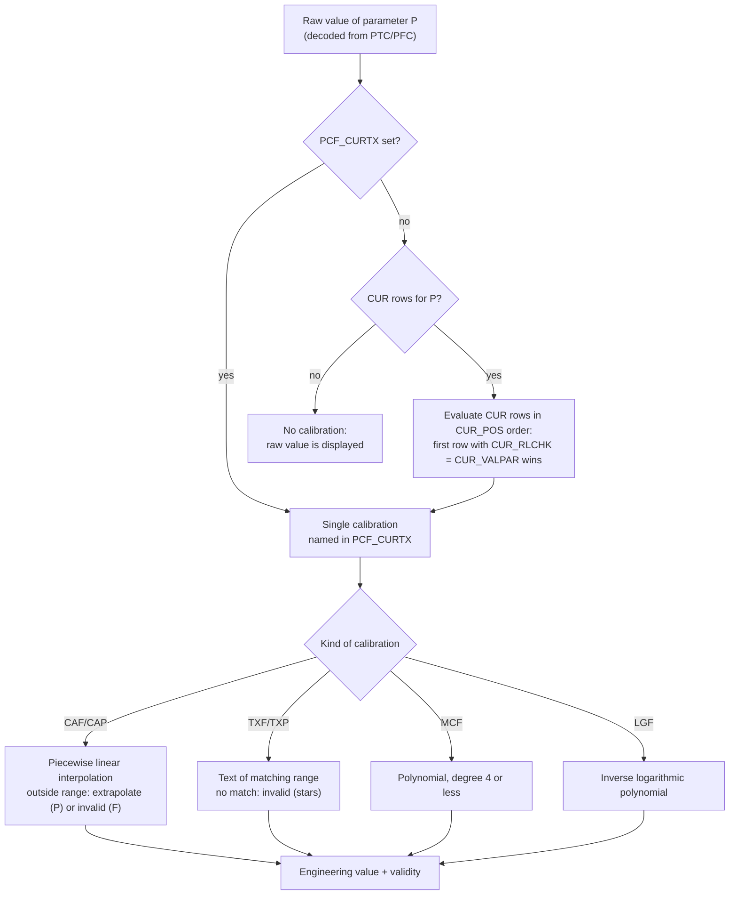
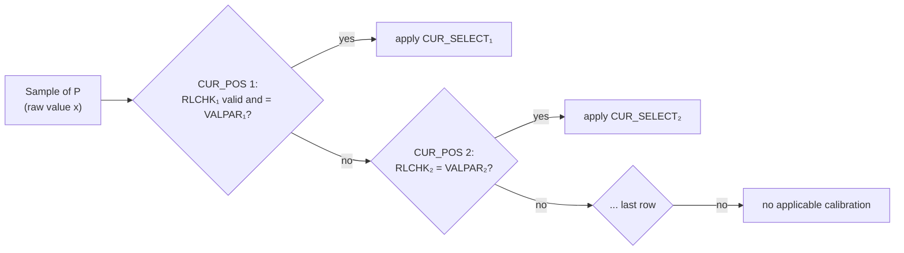

# Calibration in the MIB

A telemetry parameter arrives as bits. [SCOS-2000](../scos2000/index.md) first decodes them according to the parameter type into a **raw value**, then applies a calibration to obtain the **engineering value**, the number or text an operator reads. The ICD distinguishes three forms. The *encoded* value is the actual bits in the packet. The *raw* value is the value before calibration (for telemetry) or after de-calibration (for commands). The *engineering* value is the calibrated value. Raw and encoded values coincide only for unsigned integers. For a synthetic parameter, the raw value is whatever its OL or hard-coded routine returns.[^icd-defs] In the [MIB](index.md), calibrations are separate, named objects that many parameters can share. This page covers the four monitoring calibration types, the conditional selection mechanism (CUR) and the command-side (de-)calibrations. Where each table sits in the overall model is shown on [MIB data model](data-model.md). How calibrated values feed limit checks is on [Monitoring checks](monitoring-checks.md).

Any monitoring parameter can be calibrated: raw telemetry, user defined constants and synthetic parameters alike. The only condition is that its raw representation is numerical. Strings and times cannot be calibrated.[^icd-cal-intro] All Solar Orbiter numbers below come from this wiki's SQL queries on release `MIB__20250916M25925PFMS001_SOL`.[^mib-cal]

## The calibration tables at a glance

| Kind | Definition table | Values table | Engineering value | Solar Orbiter definitions | Parameters using it directly |
|---|---|---|---|---|---|
| Numerical (piecewise linear) | [CAF](tables/caf.md) | [CAP](tables/cap.md) | linear interpolation between (raw, eng) points | 679 (7,830 points) | 3,433 |
| Textual (aliases) | [TXF](tables/txf.md) | [TXP](tables/txp.md) | text for each raw range | 1,003 (35,032 ranges) | 26,533 |
| Polynomial | [MCF](tables/mcf.md) | (in MCF) | $A_0 + A_1X + \dots + A_4X^4$ | 229 | 970 |
| Logarithmic | [LGF](tables/lgf.md) | (in LGF) | $1/(A_0 + A_1\ln X + \dots + A_4\ln^4 X)$ | 0 | 0 |
| Conditional selection | [CUR](tables/cur.md) | | chooses one of the above at run time | 1,974 rows | 907 parameters |
| Command numerical | [CCA](tables/cca.md) | [CCS](tables/ccs.md) | engineering ↔ raw, both directions | 99 (1,226 points) | 327 command parameters |
| Command textual | [PAF](tables/paf.md) | [PAS](tables/pas.md) | text ↔ raw, both directions | 624 (11,834 aliases) | 1,624 command parameters |

Table structure from the ICD;[^icd-t1][^icd-t3] Solar Orbiter counts from the 2025 release.[^mib-cal]



Selection logic from the PCF and CUR field definitions.[^icd-pcf-curtx][^icd-cur][^icd-pcf-inter]

## How a parameter selects its calibration

Two PCF fields link a parameter to its calibration. `PCF_CATEG` says which family is allowed: `N` (numerical, polynomial or logarithmic), `S` (status, textual calibration only) or `T` (text, no calibration).[^icd-pcf-categ] `PCF_CURTX` names the calibration when there is exactly one. It must match a `TXF_NUMBR` when `PCF_CATEG = S`, and a `CAF_NUMBR`, `MCF_IDENT` or `LGF_IDENT` when `PCF_CATEG = N`. It is mandatory for status parameters. It must stay empty for text parameters, strings (PTC 7, 8), times (PTC 9, 10), and for any parameter calibrated through the CUR table.[^icd-pcf-curtx] Because CAF, MCF and LGF names share the single `PCF_CURTX` field, the ICD requires that polynomial and logarithmic identifiers never collide with other non-textual calibration names. It suggests a naming convention or reserved ranges to ensure this.[^icd-mcf][^icd-lgf] The SPIRE instrument team's MIB naming convention, for example, uses one pattern, `tttnnnrrr` (system element number, running number, real element number), for numerical, textual and polynomial calibrations as well as for the command-side curves.[^spire-nc]

In Solar Orbiter, every non-empty `PCF_CURTX` resolves to an existing definition: 26,533 textual, 3,433 numerical and 970 polynomial references. No parameter that appears in CUR also has `PCF_CURTX` set, as the ICD requires.[^mib-cal] Most Solar Orbiter telemetry calibration names end in `TM`: 649 of 679 CAF curves, 931 of 1,003 alias sets and all 229 polynomials. Most command calibration names end in `TC`: 97 of 99 CCA curves and 547 of 624 PAF sets. This is a convention visible in the data, not an ICD rule, and it has exceptions, such as the telemetry curve `CDST0007TC` [below](#same-quantity-both-directions-range-modulation-index).[^mib-cal]

## Numerical calibrations: CAF and CAP

A numerical calibration, also called a calibration curve, is a list of (raw, engineering) points. The [CAF](tables/caf.md) holds one record per curve and the [CAP](tables/cap.md) one record per point.[^icd-caf][^icd-cap]

| Table | # | Field | Type | M / default | Meaning |
|---|---|---|---|---|---|
| CAF | 1* | `CAF_NUMBR` | Char(10) | M | curve name |
| CAF | 2 | `CAF_DESCR` | Char(32) | | description |
| CAF | 3 | `CAF_ENGFMT` | Char(1) | M | engineering format of the CAP values: `I` signed integer, `U` unsigned integer, `R` real |
| CAF | 4 | `CAF_RAWFMT` | Char(1) | M | raw format of `CAP_XVALS`: `I`, `U` or `R`; must be compatible with the parameter type |
| CAF | 5 | `CAF_RADIX` | Char(1) | | radix of unsigned raw values: `D` decimal, `H` hexadecimal, `O` octal |
| CAF | 6 | `CAF_UNIT` | Char(4) | | engineering unit, for consistency checks against `PCF_UNIT` |
| CAF | 7 | `CAF_NCURVE` | Number(3) | | number of CAP points |
| CAF | 8 | `CAF_INTER` | Char(1) | `F` | outside the curve: `P` extrapolate linearly from the first two or last two points, `F` return an invalid value |
| CAP | 1* | `CAP_NUMBR` | Char(10) | M | curve name |
| CAP | 2* | `CAP_XVALS` | Char(14) | M | raw value, in `CAF_RAWFMT`; unsigned values in `CAF_RADIX` |
| CAP | 3 | `CAP_YVALS` | Char(14) | M | engineering value, in `CAF_ENGFMT`, always decimal |

Field definitions from ICD §3.3.2.2.2–3.3.2.2.3.[^icd-caf][^icd-cap]

Between two points SCOS-2000 interpolates linearly. Issue 6.9 of the ICD states this in its description of `CAF_INTER`: a value between two points of the curve is interpolated from the points on either side. Issue 7.0 describes only the behaviour outside the curve, by linear extrapolation from the end points.[^icd69-caf][^icd-caf] For a raw value $x$ with $x_i \le x \le x_{i+1}$:

$$y = y_i + (x - x_i)\,\frac{y_{i+1} - y_i}{x_{i+1} - x_i}$$

Outside the range of `CAP_XVALS`, `CAF_INTER` decides. With `P`, the end segment is extended. With `F`, the default, the engineering value is invalid.[^icd-caf] The flag belongs to the curve, not to the parameter. SCOS-2000 ignores `PCF_INTER`, so all parameters sharing a curve extrapolate the same way. If two parameters need different behaviour, the curve must be duplicated.[^icd-caf][^icd-pcf-inter] The change log of ICD issue 6.9 records that `CAF_INTER` had existed in SCOS-2000 since release R4 but had never been documented (S2K-SPR-4911).[^icd69-spr] The [ECSS-E-ST-70-31C](../ecss/e-st-70-31c.md) data model describes the same "linear interpolation" interpretation function, with an extrapolation attribute whose values are "extrapolate" and "invalid". It adds that every interpretation function must give a unique engineering value for each raw value.[^e3131-lin] When calibration fails, the engineering value carries a validity reason. The SCOS-2000 EGSE test language, for instance, defines a `VAL_CALIBRATION` ("Calibration failed") validity bit.[^emcs-val]

The two value fields are 14-character strings. That caps the precision of the curve: Solar Orbiter's longest `CAP_YVALS` strings, such as `80.59995922672`, use all 14 characters.[^icd-cap][^mib-caf]

**Solar Orbiter usage.** The 679 curves come in three format combinations: 612 map unsigned decimal raw values to reals (`U`/`R`/`D`), 66 map signed raw values to reals (`I`/`R`) and one maps real raw values to reals (`R`/`R`). No curve sets `CAF_INTER`, so every Solar Orbiter numerical calibration returns an invalid value outside its points. `CAF_NCURVE` matches the actual CAP count for every curve. 442 curves have only 2 points, a straight line, and 105 have 7. The largest have 229 points (`CITP1054TM` "Temp_NTC_MOU(PFM)") and 1,024 points (`CDST0007TM` "Rng_Mod_Index_Sel"). The second one stores `CAF_NCURVE = 1024`, a four-digit value in a field the ICD declares as `Number(3)`.[^icd-caf] 76 curves are not referenced by any PCF or CUR record, `CDST0007TM` among them. The most common units are `A` (363 curves), `V` (73) and `degC` (46).[^mib-caf]

### Worked example: NMUD1113

[`NMUD1113`](../explorer/index.md#/solo/param/NMUD1113) ("IMU11 SIA temperature", 12-bit unsigned, unit `degC`, 3 decimals) uses the 11-point curve [`CMUT0013TM`](../explorer/index.md#/solo/calib/num/CMUT0013TM) "FOG 200E temperature" (`U`/`R`/`D`). The points are real MIB data:[^mib-ex]

| Raw | 430 | 707 | 984 | 1261 | 1538 | 1815 | 2092 | 2369 | 2646 | 2923 | 3200 |
|---|---|---|---|---|---|---|---|---|---|---|---|
| degC | 80.600 | 61.577 | 48.640 | 38.380 | 29.475 | 21.219 | 13.110 | 4.649 | −4.883 | −17.041 | −38.255 |

(Engineering values rounded to three decimals here; the MIB stores up to 14 characters.) The curve falls as the raw count rises. Take an illustrative raw value of 1000, encoded as `0x3E8` in the 12-bit field at octet 69, bit 4 of the packet ([monitoring page](monitoring.md#example-bit-level-layout-in-an-imu-housekeeping-packet)). It lies between 984 and 1261, so

$$y = 48.63986 + (1000 - 984)\,\frac{38.37965 - 48.63986}{1261 - 984} = 48.63986 - 0.59265 = 48.047\ \text{degC}.$$

This value sits just above the 48 degC soft high limit of this parameter's checks, as the [monitoring checks page](monitoring-checks.md#example-soft-and-hard-limits-on-an-imu-temperature) shows. An illustrative raw value of 400 lies below the first point. Since `CAF_INTER` is empty (default `F`), the engineering value would be invalid. The arithmetic follows the ICD rule;[^icd-caf] the raw values are illustrative, not taken from downlinked telemetry.

### Two-point curves and signed or real raw values

A two-point curve is a linear scale factor with an offset. [`CAHP0002TM`](../explorer/index.md#/solo/calib/num/CAHP0002TM) "Motor current" maps raw 0 to 0 mA and raw 4095 to 999.75586 mA. Twelve current parameters of the `APMHA`/`APMHB` units use it, for example `NAHD0074` "APMHA_Hold_El_current" (12-bit unsigned). A raw value of 2048 therefore reads 2048 × 999.75586 / 4095 = 500.000 mA (real curve, illustrative raw value).[^mib-caf]

Signed raw formats (`CAF_RAWFMT = I`) work the same way on two's-complement values. `CAHP0000TM` "Coarse position" maps −2048 → −180 and 2047 → 179.91211 deg, and `CAHP0009TM` "Position" maps −1048576 → −180 and 1048575 → 179.99983 deg. The single real-raw curve, `CCFX0001TM` "LCL and HTR summed current", maps 0 → −0.1244 A and 409500 → 111.91 A.[^mib-caf]

## Textual calibrations: TXF and TXP

A textual calibration, or alias set, turns raw values into words: `0` → `OFF`, `1` → `ON`. The [TXF](tables/txf.md) holds one record per alias set and the [TXP](tables/txp.md) one record per (range, text) pair.[^icd-txf][^icd-txp]

| Table | # | Field | Type | M / default | Meaning |
|---|---|---|---|---|---|
| TXF | 1* | `TXF_NUMBR` | Char(10) | M | alias set name |
| TXF | 2 | `TXF_DESCR` | Char(32) | | description |
| TXF | 3 | `TXF_RAWFMT` | Char(1) | M | raw format: `I`, `U` or `R`; must be compatible with the parameter type |
| TXF | 4 | `TXF_NALIAS` | Number(3) | | number of TXP records |
| TXP | 1* | `TXP_NUMBR` | Char(10) | M | alias set name |
| TXP | 2* | `TXP_FROM` | Char(14) | M | lower raw value of the range, in decimal |
| TXP | 3 | `TXP_TO` | Char(14) | M | upper raw value of the range, in decimal |
| TXP | 4 | `TXP_ALTXT` | Char(14) | M | text shown for any raw value in `TXP_FROM`…`TXP_TO` |

Field definitions from ICD §3.3.2.2.4–3.3.2.2.5.[^icd-txf][^icd-txp] A raw value that falls in no range yields an invalid engineering value shown as stars (`****`).[^icd-pcf-inter] The Herschel ground segment added two constraints: `TXP_FROM` must not exceed `TXP_TO`, and ranges in a set must not overlap.[^hcss-txp] The Herschel/Planck database tooling also aligned text field lengths with the command-side PAF table.[^hpsdb-txf]

**Solar Orbiter usage.** 994 of the 1,003 alias sets use unsigned raw values and 9 use signed ones; 29 TXP rows start at a negative value. Only 31 of the 35,032 TXP rows cover a real range (`TXP_FROM ≠ TXP_TO`). The others map single values. The longest texts use all 14 characters. Two sets disagree with their own count: `CYCT0002TM` declares 2 aliases but has 3, and `CYNT0002TM` declares 2 but has 1.[^mib-txf]

Typical sets:[^mib-txf]

* [`CCDT0065TM`](../explorer/index.md#/solo/calib/txt/CCDT0065TM) "SCV OFF/ON type": 0 `NOT_APPLICABLE`, 1 `OFF`, 2 `ON`. It calibrates the status parameters that serve as validity parameters for thousands of others ([monitoring page](monitoring.md#validity-pcf_valid-pcf_valpar-and-expiry)).
* [`CCDT0011TX`](../explorer/index.md#/solo/calib/txt/CCDT0011TX): 0 `VALID`, 1 `UNCHECKED`, 2 `INVALID`, 4 `BELOW_LOW`, 5 `ABOVE_HIGH`, 6 `OUT_OF_LIMIT`. It decodes the checking statuses in the on-board monitoring reports ([monitoring checks](monitoring-checks.md#ground-checks-and-on-board-monitoring-pus-st12)).
* [`CDMTX000TM`](../explorer/index.md#/solo/calib/txt/CDMTX000TM) "DEU last received 1553 command", with 1,192 entries. It is one of the few sets with real ranges, for example 134217793…134256128 → `MOTOR 1 CLOSE`.

!!! info "A 19,803-entry alias set: on-board parameter IDs"
    [`PARAMIDTM`](../explorer/index.md#/solo/calib/txt/PARAMIDTM) "Parameter ID" has 19,803 TXP rows. Each maps an on-board parameter ID to the SCOS-2000 name of the parameter whose `PCF_PID` has that value, for example 167776256 (`0x0A001000`) → `NCDT00B0` "OBCHP_No_Of_TC_Acc_Succs". A join confirms that all 19,803 rows agree with the PCF. The set includes 0 → `DUMMYVAL`, a PCF entry described as "ALWAYS_VALID". 1,627 parameters name it in `PCF_CURTX`. One of them is `NCD0C095` "OBCHP_Monitored Par ID" in the on-board monitoring reports, so the report shows a parameter name instead of a 32-bit number.[^mib-txf] Note that `TXF_NALIAS` is declared `Number(3)`,[^icd-txf] yet this set, and three others with more than 999 entries (`CCDT0004TX` "Event ID list" 1,419, `CDMTX000TM` 1,192, `CCDT0384TM` 1,173), store four- and five-digit counts.[^mib-txf]

## Polynomial calibrations: MCF

A polynomial calibration needs no table of points. SCOS-2000 computes[^icd-mcf]

$$Y = A_0 + A_1 X + A_2 X^2 + A_3 X^3 + A_4 X^4$$

| # | Field | Type | M / default | Meaning |
|---|---|---|---|---|
| 1* | `MCF_IDENT` | Char(10) | M | name; must not collide with CAF or LGF names |
| 2 | `MCF_DESCR` | Char(32) | | description |
| 3 | `MCF_POL1` | Char(14) | M | $A_0$, real |
| 4 | `MCF_POL2` | Char(14) | `0` | $A_1$ |
| 5 | `MCF_POL3` | Char(14) | `0` | $A_2$ |
| 6 | `MCF_POL4` | Char(14) | `0` | $A_3$ |
| 7 | `MCF_POL5` | Char(14) | `0` | $A_4$ |

Field definitions from ICD §3.3.2.2.6.[^icd-mcf]

**Solar Orbiter usage.** Of the 229 polynomials, only 3 have a non-zero $A_2$ and only 1 reaches the fourth order. The rest are linear.[^mib-mcf] The simplest is [`CCAX0001TM`](../explorer/index.md#/solo/calib/poly/CCAX0001TM) "K to C": $Y = -273.15 + X$, used by real-valued parameters such as `NCAP044A` "FSSXPA_limFiltTemp". Many instrument curves are pure scale factors, such as `CIAP0007TM` "E33VD" with $A_1 = 0.001612$.[^mib-mcf]

**Worked example.** [`CIAP0081TM`](../explorer/index.md#/solo/calib/poly/CIAP0081TM) "DPU_TMP" uses all five coefficients (real MIB values): $A_0 = 180.65$, $A_1 = -0.4018$, $A_2 = 0.0003508$, $A_3 = -0.0000001434$, $A_4 = 0.000000000021$. It calibrates 16-bit unsigned instrument thermistor channels, for example `NIA00836` "PCDM_HK_IMON_THERM_A" and `NCL3Z019` "S130 Ex SWA Thermistor A".[^mib-mcf] For an illustrative raw value $X = 1000$:

$$Y = 180.65 - 401.8 + 350.8 - 143.4 + 21.0 = 7.25$$

`MCF_POL5` is written as `0.000000000021`, exactly 14 characters. The `Char(14)` field limits how small a coefficient can be written without exponent notation.[^icd-mcf][^mib-mcf] Other Solar Orbiter values do use exponent notation, for example `8.06E-4`.[^mib-mcf]

## Logarithmic calibrations: LGF

The logarithmic calibration is the inverse of a polynomial in $\ln X$:[^icd-lgf]

$$Y = \frac{1}{A_0 + A_1 \ln X + A_2 \ln^2 X + A_3 \ln^3 X + A_4 \ln^4 X}$$

The [LGF](tables/lgf.md) has the same layout as the MCF: `LGF_IDENT` Char(10) key, `LGF_DESCR` Char(32), and `LGF_POL1`…`LGF_POL5` Char(14) for $A_0$…$A_4$, with $A_0$ mandatory and the others defaulting to 0.[^icd-lgf]

!!! warning "Inference"
    Expressing $1/Y$ as a polynomial in $\ln X$ resembles a generalised Steinhart–Hart thermistor equation, where the inverse temperature is a polynomial in the logarithm of the resistance. That may be what the table was designed for. The ICD does not say so.

Solar Orbiter defines no logarithmic calibration: the LGF table is empty.[^mib-cal]

## Conditional selection: CUR

Some parameters need different calibrations at different times. A sensor read by either of two electronics units, or by an engineering model and a flight model, has a different curve for each. The [CUR](tables/cur.md) attaches several calibrations to one parameter, each guarded by an applicability condition.[^icd-cur]

| # | Field | Type | M | Meaning |
|---|---|---|---|---|
| 1* | `CUR_PNAME` | Char(8) | M | calibrated parameter (`PCF_NAME`) |
| 2* | `CUR_POS` | Number(2) | M | evaluation order, lowest first |
| 3 | `CUR_RLCHK` | Char(8) | M | applicability parameter |
| 4 | `CUR_VALPAR` | Number(5) | M | raw value of `CUR_RLCHK` that activates this calibration |
| 5 | `CUR_SELECT` | Char(10) | M | calibration to apply: a `TXF_NUMBR` for status parameters, otherwise a `CAF_NUMBR`, `MCF_IDENT` or `LGF_IDENT` |

Field definitions from ICD §3.3.2.2.1.[^icd-cur]

The rules:[^icd-cur]

* Rows are evaluated in `CUR_POS` order, and only the first row whose condition `CUR_RLCHK = CUR_VALPAR` holds is used.
* Applicability parameters must be integer-valued (raw) and processed by the telemetry model, the same restriction as for validity parameters.
* All calibrations attached to one parameter must give the same engineering format: ASCII for textual, real for polynomial, logarithmic and real-valued numerical curves, integer or unsigned integer for the corresponding numerical curves.
* Static PTV definitions may not use the engineering value of a conditionally calibrated parameter. The Variable Packets Display and the Packet History display show its raw value instead of the calibrated one.

The [ECSS-E-ST-70-31C](../ecss/e-st-70-31c.md) data model has the same construct in neutral form: a parameter carries an ordered list of interpretation functions, each with a selection condition, and the first one whose condition is true is applied.[^e3131-lin]



!!! warning "Inference"
    The ICD does not say what the engineering value is when no CUR row applies. The final box in the diagram reflects this gap and is not a documented SCOS-2000 behaviour. The SCOS-2000 EGSE language lists a validity bit `VAL_UNKNOWN_CRITERIA` ("Unknown applicability criteria"),[^emcs-val] which suggests the value is flagged invalid, but no source states this for CUR.

**Solar Orbiter usage.** The CUR has 1,974 rows for 907 parameters, using 52 distinct applicability parameters and 382 distinct calibrations: 1,944 rows point to CAF curves and 30 to alias sets. 865 parameters have exactly two alternatives, 26 have four, 4 have seven, 8 have eight and 4 have twelve.[^mib-cur]

### Example: engineering model or flight model?

The dominant selector, used in 1,718 of the 1,974 rows, is [`NPWZ0000`](../explorer/index.md#/solo/param/NPWZ0000) "PCDU_MODEL". It is a dynamic user defined constant: an `R`-nature parameter in the internal "Dynamic UDCs" packet (SPID 66830), set from the ground rather than downlinked.[^mib-cur] Its alias set `AYMODELE` maps 10 → `EM` and 11 → `FM`, among other values. For 859 parameters, the CUR holds one row selecting an EM curve when `NPWZ0000 = 10` and one selecting an FM curve when it equals 11.[^mib-cur]

[`NCAB0EP0`](../explorer/index.md#/solo/param/NCAB0EP0) "CPS A TLV LCL Cur" (unit `A`, 3 decimals) is one of them (real MIB data):[^mib-cur]

| `CUR_POS` | Condition | `CUR_SELECT` | Curve points (raw → A) |
|---|---|---|---|
| 1 | `NPWZ0000 = 10` (EM) | [`CPWP3005TM`](../explorer/index.md#/solo/calib/num/CPWP3005TM) | 0 → −0.1127; 4095 → 1.141 |
| 2 | `NPWZ0000 = 11` (FM) | [`CPWP8005TM`](../explorer/index.md#/solo/calib/num/CPWP8005TM) | 0 → 0; 432 → 0; 457 → 0.0201; 517 → 0.05; 638 → 0.1001; 2879 → 1.002; 4095 → 1.4909 |

With an illustrative raw value of 500, the EM curve gives −0.1127 + 500 × 1.2537 / 4095 = 0.040 A. The FM curve interpolates between 457 and 517 and gives 0.0201 + 43 × 0.0299 / 60 = 0.042 A. At this raw value the two curves differ by about 1 mA. The FM curve is also flat at 0 A up to raw 432, a dead band that the EM straight line does not have.

A second, subtler use: the MAG instrument's mode parameters `NIM01028` "MAG Previous Mode ID" and [`NIM01029`](../explorer/index.md#/solo/param/NIM01029) "MAG Current Mode ID" choose their alias set from the instrument software version, `NIMD6605` or `NIMD6609` "Sw Version Number" equal to 310, 320 or 420. A last row keys on an event ID. The text attached to a mode number therefore follows the instrument software version.[^mib-cur]

## Calibration and the rest of the MIB

Calibrations reach far beyond displays:

* **Limit checks.** `OCF_INTER = C` makes the OCP limits engineering values. This is allowed only for calibrated parameters, and `OCF_CODIN` must match the calibrated format: `R` for real curves and polynomials, `I` for integer curves, `A` for alias sets.[^icd-ocf] See [monitoring checks](monitoring-checks.md#ocf-one-record-per-checked-parameter).
* **Displays.** The format code `N` (normal) shows the engineering value: in alphanumeric displays (`DPC_FORM`) for parameters with one or more calibrations, in the Variable Packets Display (`VPD_FORM`) only for parameters with a single calibration in `PCF_CURTX`.[^icd-vpd-form] See [display definitions](displays.md).
* **Command verification and validation.** PTV and CVE checks can compare raw or engineering values (`PTV_INTER`, `CVE_INTER`), with the restriction above on conditionally calibrated parameters.[^icd-ptvcve][^icd-cur] See [command verification](command-verification.md).
* **Synthetic parameters.** A calibrated synthetic parameter treats its computed value as raw. `PCF_SPTYPE` lets the off-line checker catch synthetic parameters that already return engineering values but are wrongly given a calibration.[^icd-pcf-sptype] See [synthetic parameters](synthetic-parameters.md).
* **Retrieval.** A complete [TDRS](../scos2000/tdrs.md) result file lists, for each sample, the raw value, its validity, the engineering unit, the engineering value and its validity. The engineering column stays empty for a parameter without calibration.[^tdrs-res]

## Command-side (de-)calibration: CCA/CCS and PAF/PAS

Commands need the opposite conversion. An operator types an engineering value ("0.25 degree per second", "Standby") and SCOS-2000 must encode a raw number. The command-side tables are used in both directions: engineering to raw for encoding and display, raw to engineering for display. They serve both command and sequence parameters, again only for numerical raw representations.[^icd-ccal] The ICD adds a warning that follows from the bidirectional use: a command calibration must be one-to-one, or the raw value for a given engineering value would be ambiguous.[^icd-ccal]

| Table | # | Field | Type | M / default | Meaning |
|---|---|---|---|---|---|
| CCA | 1* | `CCA_NUMBR` | Char(10) | M | curve name |
| CCA | 2 | `CCA_DESCR` | Char(24) | | description |
| CCA | 3 | `CCA_ENGFMT` | Char(1) | `R` | engineering format `I`, `U`, `R` |
| CCA | 4 | `CCA_RAWFMT` | Char(1) | `U` | raw format `I`, `U`, `R` |
| CCA | 5 | `CCA_RADIX` | Char(1) | `D` | radix of unsigned raw values; may differ from the parameter's display radix |
| CCA | 6 | `CCA_UNIT` | Char(4) | | unit, checked against `CPC_UNIT`/`CSP_UNIT` |
| CCA | 7 | `CCA_NCURVE` | Number(3) | | number of CCS records |
| CCS | 1* | `CCS_NUMBR` | Char(10) | M | curve name |
| CCS | 2 | `CCS_XVALS` | Char | M | **engineering** value, decimal |
| CCS | 3* | `CCS_YVALS` | Char | M | **raw** value, in `CCA_RADIX` if unsigned |
| PAF | 1* | `PAF_NUMBR` | Char(10) | M | alias set name |
| PAF | 2 | `PAF_DESCR` | Char(24) | | description |
| PAF | 3 | `PAF_RAWFMT` | Char(1) | `U` | raw format `I`, `U`, `R` |
| PAF | 4 | `PAF_NALIAS` | Number(3) | | number of PAS records |
| PAS | 1* | `PAS_NUMBR` | Char(10) | M | alias set name |
| PAS | 2 | `PAS_ALTXT` | Char | M | text (engineering) value |
| PAS | 3* | `PAS_ALVAL` | Char | M | raw value, decimal |

Field definitions from ICD §3.3.3.6.[^icd-cca][^icd-paf] Note the reversal compared with CAP: in CCS the X column holds the engineering value and the key is the raw Y column, as the ICD itself remarks.[^icd-cca] The value fields of CCS and PAS have no fixed length. Their maximum depends on the maximum command size.[^icd-cca][^icd-paf]

A command parameter (CPC) chooses its conversion with `CPC_CATEG`. The values are `C` numerical (then `CPC_CCAREF` names a CCA), `T` textual (then `CPC_PAFREF` names a PAF), `B` both (not supported), `A` command ID, `P` parameter ID, and `N` or empty for none. `CPC_INTER = E` says that the default value `CPC_DEFVAL` is written in engineering form, which needs a calibration. `CPC_DISPFMT` gives the engineering format used for input and display.[^icd-cpc] Parameters of type deduced take their calibration from the associated telemetry parameter.[^icd-cpc] Range checks (PRF/PRV) can likewise be stated in raw or engineering form.[^icd-prf] The [commanding page](commanding.md) covers the CPC in full.

**Solar Orbiter usage.** Of the 7,155 command parameters, 327 use a numerical (de-)calibration and 1,624 a textual one. 152 are parameter IDs, 2 are command IDs and 5,050 have none. 316 parameters give their default in engineering form (5 numerical, 311 textual). The 99 CCA curves are mostly real-to-unsigned (80) or real-to-signed (17), and 80 of them have just two points. The 624 PAF sets use unsigned raw values in all but 2 cases.[^mib-ccal] Command and telemetry calibrations live in separate tables, but names can coincide: 8 CCA names also exist in the CAF and 86 PAF names also exist in the TXF.[^mib-ccal]

### Worked example: a signed rate command

[`CAHP0000TC`](../explorer/index.md#/solo/calib/cnum/CAHP0000TC) "Periodic TC angular rate" (engineering real, raw signed, unit `dg/s`) has two CCS points: −0.5 → −1024 and 0.49951 → 1023. It is used by `RAHD0000` "Go To Elevation Rate" (PTC 4, PFC 7: an 11-bit signed integer, range −1024…1023) in command [`ZAHG0000`](../explorer/index.md#/solo/command/ZAHG0000) "H-APME_A Go To Az-El", a TC(2,128) to APID 172. These are real MIB data.[^mib-ccal-ex] For an illustrative engineering value of 0.25 dg/s:

$$\text{raw} = -1024 + (0.25 + 0.5)\,\frac{1023 + 1024}{0.49951 + 0.5} = 512.003 \approx 512$$

The 11-bit two's-complement encoding of 512 is `0b01000000000` (`0x200`). For −0.25 dg/s the raw value is −511.999 ≈ −512, encoded as 2048 − 512 = 1536 (`0x600`). How SCOS-2000 rounds a non-integer de-calibrated value is not stated in the available sources. The end points span the full 11-bit range, so one raw step is 0.99951 / 2047 ≈ 0.000488 dg/s, which equals 0.5/1024.

### Worked example: a textual default

`PIC00020` "Mode" (16-bit unsigned, `CPC_CATEG = T`, `CPC_PAFREF =` [`CICT0005TC`](../explorer/index.md#/solo/calib/ctxt/CICT0005TC), `CPC_INTER = E`, `CPC_DEFVAL = Standby`) appears in [`ZIC00010`](../explorer/index.md#/solo/command/ZIC00010) "MODE_SET" and `ZIC00410` "MODE_CONFIGURE". The alias set maps `Standby` → 0, `Engineering` → 1, `Operate` → 2, `Boot_Maintenance` → 4 and `SAFE` → 255. Unless the operator changes it, the command is encoded with raw value 0 (real MIB data).[^mib-ccal-ex] Each text appears once in the set, as the one-to-one rule for command calibrations requires.[^icd-ccal]

### Same quantity, both directions: range modulation index

Solar Orbiter shows how the two sides can be kept consistent. Command [`ZDSG0019`](../explorer/index.md#/solo/command/ZDSG0019) "DST A Set ST Rng mod idx" carries `RDSD0015` "X-Band Rng Mod Idx_A_STD" (10-bit unsigned) with default 0.35 in engineering form. Its CCA [`CDST0007TC`](../explorer/index.md#/solo/calib/cnum/CDST0007TC) "Rng_Mod_Index_Sel_STD" maps 0.2 → 0 and 6.48 → 1023. A CAF curve with the same name and the inverse points (raw 0 → 0.2, raw 1023 → 6.48) calibrates the telemetry parameter [`NCFT29H0`](../explorer/index.md#/solo/param/NCFT29H0) "DST TX RNG Mod Idx". The CUR selects it when `NCFT29K0` "DST TX Ranging Select" equals 1 (`STDESA`), and selects `CDST0010TC` when it equals 0 (`PN`). Neither curve declares a unit (real MIB data).[^mib-ccal-ex]

The default 0.35 de-calibrates to (0.35 − 0.2) × 1023 / 6.28 = 24.43. If the command is encoded with raw 24, the telemetry echo reads back 0.2 + 24 × 6.28 / 1023 = 0.347. The difference of about 0.003 comes from quantisation: one raw step is 6.28 / 1023 ≈ 0.006 (worked from the real curves; the rounding to 24 is an assumption, see the note above).

??? example "SQL used"
    Run against `solo-2025-09-16.sqlite`. All columns are text, hence the casts.

    ```sql
    -- which family each PCF_CURTX points to
    SELECT count(*) FROM pcf c JOIN caf a ON a.CAF_NUMBR = c.PCF_CURTX;   -- 3,433
    SELECT count(*) FROM pcf c JOIN mcf a ON a.MCF_IDENT = c.PCF_CURTX;   -- 970
    SELECT count(*) FROM pcf c JOIN txf a ON a.TXF_NUMBR = c.PCF_CURTX;   -- 26,533
    SELECT count(*) FROM pcf WHERE PCF_CURTX <> '' AND PCF_CURTX NOT IN
      (SELECT CAF_NUMBR FROM caf UNION SELECT MCF_IDENT FROM mcf
       UNION SELECT TXF_NUMBR FROM txf UNION SELECT LGF_IDENT FROM lgf);  -- 0

    -- numerical curves
    SELECT CAF_ENGFMT, CAF_RAWFMT, CAF_RADIX, CAF_INTER, count(*) FROM caf GROUP BY 1,2,3,4;
    SELECT count(*) FROM caf a WHERE CAST(CAF_NCURVE AS int) <>
      (SELECT count(*) FROM cap WHERE CAP_NUMBR = a.CAF_NUMBR);            -- 0
    SELECT * FROM cap WHERE CAP_NUMBR = 'CMUT0013TM' ORDER BY CAST(CAP_XVALS AS int);

    -- textual calibrations
    SELECT count(*) FROM txp WHERE TXP_FROM <> TXP_TO;                     -- 31
    SELECT count(*) FROM txp t JOIN pcf c ON c.PCF_NAME = t.TXP_ALTXT
       AND c.PCF_PID = t.TXP_FROM WHERE t.TXP_NUMBR = 'PARAMIDTM';         -- 19,803

    -- conditional selection
    SELECT count(DISTINCT CUR_PNAME), count(DISTINCT CUR_RLCHK), count(DISTINCT CUR_SELECT) FROM cur;
    SELECT CUR_RLCHK, CUR_VALPAR, count(*) FROM cur GROUP BY 1,2 ORDER BY 3 DESC;
    SELECT * FROM cur WHERE CUR_PNAME IN ('NCAB0EP0', 'NCFT29H0', 'NIM01029') ORDER BY 1, CAST(CUR_POS AS int);

    -- command side
    SELECT CPC_CATEG, CPC_INTER, count(*) FROM cpc GROUP BY 1,2;
    SELECT * FROM ccs WHERE CCS_NUMBR IN ('CAHP0000TC', 'CDST0007TC');
    SELECT * FROM pas WHERE PAS_NUMBR = 'CICT0005TC';
    SELECT count(*) FROM cca WHERE CCA_NUMBR IN (SELECT CAF_NUMBR FROM caf);  -- 8
    SELECT count(*) FROM paf WHERE PAF_NUMBR IN (SELECT TXF_NUMBR FROM txf);  -- 86
    ```

## Related pages

* [Monitoring in the MIB: parameters and packets](monitoring.md) and [MIB parameter types](parameter-types.md).
* [Monitoring checks: limits and out-of-limits](monitoring-checks.md).
* [Commanding in the MIB](commanding.md) and [command sequences and parameter sets](sequences.md).
* [ECSS-E-ST-70-31C: monitoring and control data definition](../ecss/e-st-70-31c.md), the standard's neutral model of interpretation functions.
* Table reference pages: [cur](tables/cur.md), [caf](tables/caf.md), [cap](tables/cap.md), [txf](tables/txf.md), [txp](tables/txp.md), [mcf](tables/mcf.md), [lgf](tables/lgf.md), [cca](tables/cca.md), [ccs](tables/ccs.md), [paf](tables/paf.md), [pas](tables/pas.md).

[^icd-defs]: [SCOS-2000 Database Import ICD, EGOS-MCS-S2K-ICD-0001 issue 7.0](../library/icd-7-0-final.md), §1.3.1 Definitions and Terminology, PDF p. 17.
[^icd-cal-intro]: [SCOS-2000 Database Import ICD issue 7.0](../library/icd-7-0-final.md), §3.3.2.2 Monitoring parameters calibration, PDF p. 62.
[^icd-t1]: [SCOS-2000 Database Import ICD issue 7.0](../library/icd-7-0-final.md), §3.1 Table 1 "Summary of Monitoring related data", PDF pp. 26–27.
[^icd-t3]: [SCOS-2000 Database Import ICD issue 7.0](../library/icd-7-0-final.md), §3.1 Table 3 "Summary of Commanding related data", PDF pp. 29–30.
[^icd-pcf-categ]: [SCOS-2000 Database Import ICD issue 7.0](../library/icd-7-0-final.md), §3.3.2.1.1 field 10 PCF_CATEG, PDF p. 47.
[^icd-pcf-curtx]: [SCOS-2000 Database Import ICD issue 7.0](../library/icd-7-0-final.md), §3.3.2.1.1 field 12 PCF_CURTX, PDF p. 49.
[^icd-pcf-inter]: [SCOS-2000 Database Import ICD issue 7.0](../library/icd-7-0-final.md), §3.3.2.1.1 field 13 PCF_INTER, PDF p. 50.
[^icd-pcf-sptype]: [SCOS-2000 Database Import ICD issue 7.0](../library/icd-7-0-final.md), §3.3.2.1.1 field 19 PCF_SPTYPE, PDF p. 52, and §3.3.2.1.2, PDF p. 58.
[^icd-cur]: [SCOS-2000 Database Import ICD issue 7.0](../library/icd-7-0-final.md), §3.3.2.2.1 Calibration conditional selection: cur, PDF pp. 63–65.
[^icd-caf]: [SCOS-2000 Database Import ICD issue 7.0](../library/icd-7-0-final.md), §3.3.2.2.2 Numerical calibrations: caf, PDF pp. 65–67.
[^icd-cap]: [SCOS-2000 Database Import ICD issue 7.0](../library/icd-7-0-final.md), §3.3.2.2.3 Numerical calibrations definition: cap, PDF p. 68.
[^icd-txf]: [SCOS-2000 Database Import ICD issue 7.0](../library/icd-7-0-final.md), §3.3.2.2.4 Textual calibrations: txf, PDF p. 69.
[^icd-txp]: [SCOS-2000 Database Import ICD issue 7.0](../library/icd-7-0-final.md), §3.3.2.2.5 Textual calibrations definition: txp, PDF pp. 69–70.
[^icd-mcf]: [SCOS-2000 Database Import ICD issue 7.0](../library/icd-7-0-final.md), §3.3.2.2.6 Polynomial calibrations definitions: mcf, PDF pp. 70–71.
[^icd-lgf]: [SCOS-2000 Database Import ICD issue 7.0](../library/icd-7-0-final.md), §3.3.2.2.7 Logarithmic calibrations definitions: lgf, PDF pp. 71–72.
[^icd-ocf]: [SCOS-2000 Database Import ICD issue 7.0](../library/icd-7-0-final.md), §3.3.2.3.1 fields OCF_INTER and OCF_CODIN, PDF pp. 74–75.
[^icd-vpd-form]: [SCOS-2000 Database Import ICD issue 7.0](../library/icd-7-0-final.md), §3.3.2.5.2 field VPD_FORM, PDF p. 104, and §3.3.2.7.2 field DPC_FORM, PDF p. 113.
[^icd-ptvcve]: [SCOS-2000 Database Import ICD issue 7.0](../library/icd-7-0-final.md), §3.3.3.2.4 ptv fields PTV_INTER and PTV_VAL, PDF pp. 160–161, and §3.3.3.4.2 cve, PDF pp. 195–197.
[^icd-ccal]: [SCOS-2000 Database Import ICD issue 7.0](../library/icd-7-0-final.md), §3.3.3.6 Command/Sequence Parameters (De-)calibrations, PDF p. 205.
[^icd-cca]: [SCOS-2000 Database Import ICD issue 7.0](../library/icd-7-0-final.md), §3.3.3.6.1–3.3.3.6.2 cca and ccs, PDF pp. 206–208.
[^icd-paf]: [SCOS-2000 Database Import ICD issue 7.0](../library/icd-7-0-final.md), §3.3.3.6.3–3.3.3.6.4 paf and pas, PDF pp. 208–210.
[^icd-prf]: [SCOS-2000 Database Import ICD issue 7.0](../library/icd-7-0-final.md), §3.3.3.7.1 Parameter range sets: prf, field PRF_INTER, PDF p. 211.
[^icd-cpc]: [SCOS-2000 Database Import ICD issue 7.0](../library/icd-7-0-final.md), §3.3.3.2 command parameters cpc, fields CPC_PFC to CPC_INTER, PDF pp. 144–148.
[^hcss-txp]: [HCSS MIB Clarification and Tailoring Note, HSC/DOC/0300 issue 1.5](../library/hcss-mib-clarification-tailoring-note.md), points 5.2.12–5.2.13, PDF p. 14.
[^hpsdb-txf]: [H-P-1-ASP-TN-1060, MIB files processing by HPSDB](../library/h-p-1-asp-tn-1060-mib-processing-hpsdb.md), §5.2.2 and §5.2.4, PDF pp. 21–22.
[^spire-nc]: [SPIRE MIB Naming Convention 1.2](../library/spire-mib-naming-convention-1-2.md), naming table entries for CCA_NUMBR, PAF_NUMBR, CAF_NUMBR, TXF_NUMBR and MCF_IDENT, PDF pp. 1–2.
[^icd69-spr]: [SCOS-2000 Database Import ICD issue 6.9](../library/icd-6-9-archive-org.md), change record entry S2K-SPR-4911, PDF p. 249.
[^icd69-caf]: [SCOS-2000 Database Import ICD issue 6.9](../library/icd-6-9-archive-org.md), §3.3.2.2.2 caf, field 8 CAF_INTER, PDF p. 66.
[^tdrs-res]: [SCOS-2000 TDRS External Interfaces ICD, EGOS-MCS-S2K-ICD-0017 issue 5.1](../library/icd-0017-tdrs-5-1.md), §10.6 Spreadsheet Result Data File and §10.8–10.9 examples, PDF pp. 32–34.
[^e3131-lin]: [ECSS-E-ST-70-31C](../library/ecss-e-st-70-31c.md), §6.6.3.3.2 Table 6-77 Interpretation data (including the ordered list of interpretation functions with selection conditions) and Table 6-78 Linear interpolation data, and requirement 6.6.3.3.2d, PDF pp. 102–104.
[^emcs-val]: [EGSE based on SCOS 2000, EMCS Software User Manual issue 4.0](../library/emcs-sum-4-0.md), §6.2 Fetch a parameter, validity constants, PDF pp. 35–36.
[^mib-cal]: [Solar Orbiter MIB release MIB__20250916M25925PFMS001_SOL](../library/mib-20250916m25925pfms001-sol.md), tables `pcf`, `cur`, `caf`, `cap`, `txf`, `txp`, `mcf`, `lgf`, `cca`, `ccs`, `paf`, `pas`, `cpc`; queries by this wiki.
[^mib-caf]: [Solar Orbiter MIB release MIB__20250916M25925PFMS001_SOL](../library/mib-20250916m25925pfms001-sol.md), tables `caf` and `cap` (joined with `pcf`, `cur`); queries by this wiki.
[^mib-ex]: [Solar Orbiter MIB release MIB__20250916M25925PFMS001_SOL](../library/mib-20250916m25925pfms001-sol.md), `pcf`, `plf`, `caf`, `cap` rows for `NMUD1113` and `CMUT0013TM`; queries by this wiki.
[^mib-txf]: [Solar Orbiter MIB release MIB__20250916M25925PFMS001_SOL](../library/mib-20250916m25925pfms001-sol.md), tables `txf` and `txp` (joined with `pcf`); queries by this wiki.
[^mib-mcf]: [Solar Orbiter MIB release MIB__20250916M25925PFMS001_SOL](../library/mib-20250916m25925pfms001-sol.md), table `mcf` (joined with `pcf`); queries by this wiki.
[^mib-cur]: [Solar Orbiter MIB release MIB__20250916M25925PFMS001_SOL](../library/mib-20250916m25925pfms001-sol.md), table `cur` joined with `pcf`, `caf`, `cap`, `txp`, `plf`; queries by this wiki.
[^mib-ccal]: [Solar Orbiter MIB release MIB__20250916M25925PFMS001_SOL](../library/mib-20250916m25925pfms001-sol.md), tables `cpc`, `cca`, `ccs`, `paf`, `pas` (compared with `caf`, `txf`); queries by this wiki.
[^mib-ccal-ex]: [Solar Orbiter MIB release MIB__20250916M25925PFMS001_SOL](../library/mib-20250916m25925pfms001-sol.md), `cpc`, `cdf`, `ccf`, `cca`, `ccs`, `paf`, `pas`, `caf`, `cap`, `cur` rows for `RAHD0000`, `PIC00020`, `RDSD0015` and `NCFT29H0`; queries by this wiki.
