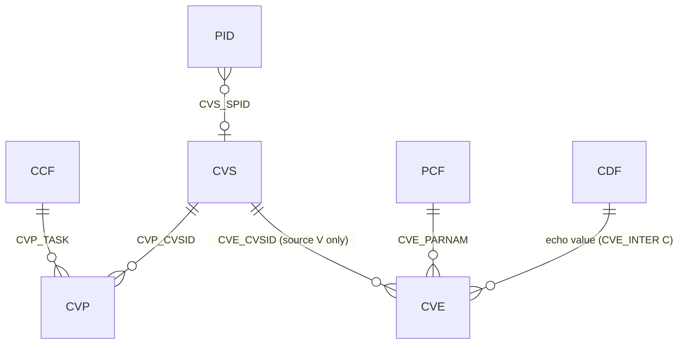
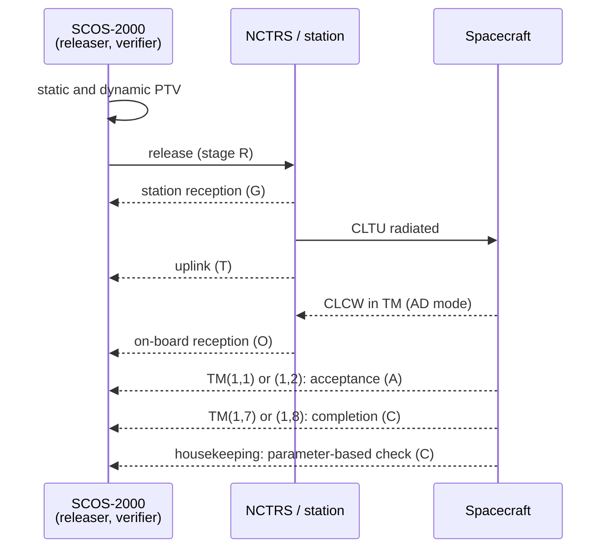
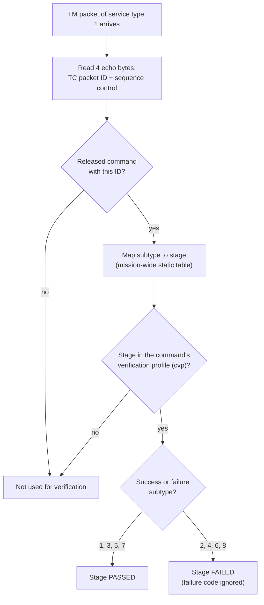
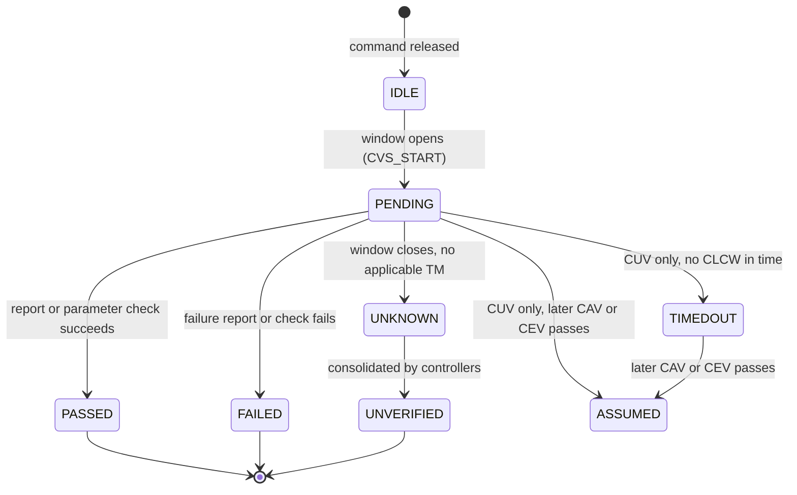
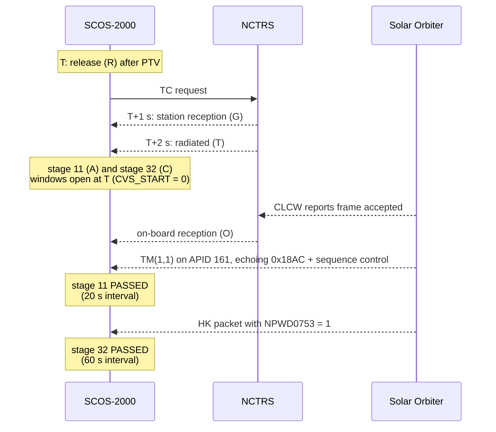

# Command verification in the MIB

Releasing a telecommand is only the start. The flight control team needs to know, for every command,
whether the ground station received it, whether it was radiated, whether the spacecraft received the
frame, whether the addressed application accepted the packet, and whether the action actually took
effect. [SCOS-2000](../scos2000/index.md) tracks each command through these **verification stages**
and shows their status in the command history. The ground stages are driven by the
[NCTRS](../scos2000/nctrs-nis.md) and the [COP-1](../ccsds/cop-1.md) protocol. The on-board stages,
called command execution verification, are defined per command in three [MIB](index.md) tables:
`cvs` (what a stage is), `cve` (which telemetry values prove it) and `cvp` (which stages a command
has).[^icd-ver][^icd-overview] This page explains those tables, how SCOS-2000 combines them with the
reports of [PUS ST[01] request verification](../ecss/pus/st01-request-verification.md), and how the
Solar Orbiter MIB uses them. The command definitions themselves are on
[Commanding in the MIB](commanding.md).

## Two kinds of check

SCOS-2000 supports two kinds of verification check:[^icd-ver]

* **Report-based** checks rely on dedicated telemetry packets that report the success or failure of an
  execution stage, that is the PUS Service 1 reports.
* **Parameter-based** checks compare the value of one or more monitoring parameters with a criterion,
  for example "the converter status reads ON".

A stage is defined once in `cvs` and can be shared by many commands; the many-to-many relationship
with commands is resolved by `cvp`. A parameter-based stage owns one or more expressions in `cve`,
which are ANDed. `cve` has a second job: it names the parameters that a command is expected to change,
so their status consistency checking can be suspended while the command executes.[^icd-overview]
Verification of sequences is foreseen by the table design but not supported by SCOS-2000 at issue
7.0.[^icd-ver]



The relationships follow the field definitions of the three tables in ICD 7.0.[^icd-cvs][^icd-cve][^icd-cvp]

## The stages of a command's life

The ICD names five stages that an interlock can wait for: reception at the ground station (`R`), uplink,
also called radiation or transmission (`U`), on-board reception, also called transfer and the final
uplink verification (`O`), application acceptance (`A`) and completion (`C`). When commanding in BD mode
`O` is automatically handled as `U`; the Rosetta/Mars Express command history likewise marks on-board
reception as applicable only in AD mode.[^icd-il][^mex-cols] The on-board side adds start of execution and
up to ten progress steps.[^icd-cvs]

| Stage | Name in TC history | Evidence (summary) | Defined in |
|---|---|---|---|
| Release | R | Command passed PTV and was handed to the NCTRS (or SLE user) | SCOS-2000 itself |
| Ground station reception (1st uplink stage) | G (CRV) | Station TC front-end reports the command received | NCTRS |
| Uplink / radiation (2nd uplink stage) | T (CSV) | Station TC front-end reports the command sent | NCTRS |
| On-board reception / transfer (3rd uplink stage, AD only) | O (CUV) | CLCW verification of the transfer frame | COP-1 via NCTRS |
| Application acceptance | A (CAV) | TM(1,1)/(1,2) or parameter check | `cvs` type `A` |
| Start of execution | SS | TM(1,3)/(1,4) or parameter check | `cvs` type `S` |
| Progress step 0–9 | 1122… | TM(1,5)/(1,6) (step 0 only) or parameter check | `cvs` type `0`–`9` |
| Completion of execution | C (CEV), CC | TM(1,7)/(1,8) or parameter check | `cvs` type `C` |

The history letters and abbreviations come from the command history descriptions of the Rosetta/Mars
Express control system and of the EDDS external user ICD (version 24.0), which also shows that the
execution stages are tracked twice, once from real-time and once from playback telemetry.[^mex-cols][^euicd-cols]
The SCOS-2000 EGSE manual describes the three uplink acknowledgements as returned by the ground station
or SCOE TC front-end on reception, on sending in BD mode, and on the spacecraft's confirmation in AD
mode.[^emcs-ack]
CRV, CSV, CUV, CAV and CEV are the stage abbreviations of the Rosetta/Mars Express document (the EDDS ICD
uses only the letters); CUV is described there as the CLCW verification of the transfer frame.[^mex-hdr][^mex-cols]



The diagram is this wiki's summary of the stages listed above; which reports a command really produces
depends on its acknowledgement flags and on the on-board software.[^icd-ack][^pusc-ack]

## Background: PUS Service 1

ECSS-E-ST-70-41C defines ST[01] request verification with three subservices: routing and reporting,
acceptance and reporting, and execution reporting. The acceptance subservice checks a request before it
is passed to the service that executes it; the execution reporting subservice issues reports on behalf of
that service when it notifies start, progress or completion of execution.[^pusc-st01] Each request
carries four flags that ask for the *successful* acceptance, start, progress and completion reports; a
failure is always reported.[^pusc-ack][^pusc-acc]

| Report | PUS-C name | Generated when |
|---|---|---|
| TM[1,1] | successful acceptance verification report | acceptance passed and the acceptance flag is set |
| TM[1,2] | failed acceptance verification report | acceptance failed (always) |
| TM[1,3] / TM[1,4] | successful / failed start of execution | flag set / always |
| TM[1,5] / TM[1,6] | successful / failed progress of execution | flag set / if configured for the request type |
| TM[1,7] / TM[1,8] | successful / failed completion of execution | flag set / always |
| TM[1,10] | failed routing verification report | a routing check failed (PUS-C only) |

[^pusc-acc][^pusc-exe][^pusc-rout]

In ECSS-E-ST-70-41C the flags occupy the 4-bit acknowledgement field of the TC secondary header: bit 3
for acceptance, bit 2 for start, bit 1 for progress and bit 0 for completion.[^pusc-dfh] PUS-A
(ECSS-E-70-41A), which Solar Orbiter follows, uses the same assignment and states that the Ack field also
tells the ground which stages to expect, so it can show "packets uplinked but not yet verified".[^pusa-ack]
In the MIB the default value of the field is `CCF_ACK`, a decimal number from 0 to 15; 9 means acceptance
plus completion.[^icd-ack]

Every report starts with a copy of the request's packet ID and packet sequence control, which together
identify the request. Failure reports add a failure code and optional data; progress reports add a step
number.[^pusc-rep][^pusa-rep]

<div class="bitfield" data-title="Start of every ST[01] report: request ID (32 bits)" data-width="16"
     data-fields='[{"n":"Version","b":3,"g":"Packet ID of the TC"},{"n":"Type","b":1,"g":"Packet ID of the TC"},{"n":"Sec. hdr flag","b":1,"g":"Packet ID of the TC"},{"n":"APID","b":11,"g":"Packet ID of the TC"},{"n":"Seq. flags","b":2,"g":"Sequence control of the TC"},{"n":"Sequence count","b":14,"g":"Sequence control of the TC"}]'></div>

<div class="bitfield" data-title="Solar Orbiter TM(1,2) and TM(1,8) source data (variable length)" data-width="16"
     data-fields='[{"n":"TC packet ID","b":16,"d":"copy of the packet ID of the reported TC"},{"n":"TC packet sequence control","b":16,"d":"copy of the sequence control of the reported TC"},{"n":"Failure ID","b":16,"d":"failure code, see the TM/TC ICD Annex 9"},{"n":"Parameters (optional, any size)","b":16,"d":"complementary information; width shown is a placeholder"}]'></div>

The Solar Orbiter TM/TC ICD defines these reports with 2-byte packet ID, 2-byte sequence control and,
for failures, a 2-byte failure ID followed by optional parameters.[^tn-s1rep] PUS-A defines six standard
acceptance failure codes: 0 illegal APID, 1 incomplete or invalid length, 2 incorrect checksum, 3 illegal
packet type, 4 illegal packet subtype, 5 illegal or inconsistent application data.[^pusa-rep] The
service in general is covered on [ST[01] Request verification](../ecss/pus/st01-request-verification.md).

## How SCOS-2000 uses Service 1 reports

Appendix C of the ICD states how the SCOS-2000 verifier handles Service 1:[^icd-appc-s1]

* It extracts the four bytes that echo the TC packet header (packet ID and sequence control) from each
  Service 1 packet and uses them to find the command instance. The four bytes must be at the same
  position in all type 1 packets.
* The mapping of subtypes to stages is static configuration (subtype 1 is typically success of the
  acceptance stage) and is the same for every command of the mission.
* Progress reports (subtypes 5 and 6) can only feed progress step 0; further steps must be
  parameter-based.
* The failure code of negative reports is ignored; only the subtype tells the verifier that a stage
  failed.



The flowchart restates the Appendix C rules; the exact matching order inside the verifier is not stated
in the available sources.[^icd-appc-s1]

!!! warning "Inference"
    Because the request ID in a report does not contain the source of the request, PUS-C notes that the
    destination ID of the report's secondary header is needed to identify the request
    uniquely.[^pusc-rep] SCOS-2000 as described in ICD 7.0 matches only on the 4 echo bytes. A ground
    system that runs several command sources with independent sequence counters for the same APID could
    therefore see ambiguous matches; how SCOS-2000 avoids this is not stated in the available sources.
    The Solar Orbiter TM/TC ICD asks for the TC sequence count to be maintained per APID *and* Source
    ID, which makes such duplicates possible in principle on that mission.[^tn-hdr]

## `cvs`: verification stages

`cvs` has one record per stage; the same stage may be used by many commands.[^icd-cvs]

| # | Field | Type | Meaning and values | Default |
|---|---|---|---|---|
| 1* | `CVS_ID` | Number(5), M | Unique stage identifier, 0–32767 | |
| 2 | `CVS_TYPE` | Char(1), M | Stage in the execution profile: `A` application acceptance, `S` start of execution, `0`–`9` progress step n, `C` completion | |
| 3 | `CVS_SOURCE` | Char(1), M | `R` based on TM report packets; `V` based on monitoring parameter values checked against `cve` | |
| 4 | `CVS_START` | Number(5), M | Seconds after release (after execution for time-tagged commands) before the verification window opens | |
| 5 | `CVS_INTERVAL` | Number(5), M | Seconds; length of the sampling interval used to compute the overall verification window | |
| 6 | `CVS_SPID` | Number(10) | SPID of the TM packet whose arrival closes the stage after the window (future extension; source `V` only) | |
| 7 | `CVS_UNCERTAINTY` | Number(5) | Seconds; stage-specific window replacing the default window of the TC SPACON; `-1` keeps the default | `-1` |

[^icd-cvs][^icd-cvs2]

Two constraints shape every profile. The verifier processes TM(1,5) progress reports only for stage
`0`, so a report-based progress stage can only have `CVS_TYPE = 0`; this is a limitation of the SCOS-2000
Service 1 implementation.[^icd-cvs] And a command may have at most one stage of each `CVS_TYPE`, so only
one acceptance stage and one completion stage.[^icd-cvp]

Without `CVS_SPID`, a parameter-based stage closes as soon as any valid sample of any of its parameters
arrives with a time stamp during or after the window closure time. That is why the ICD recommends taking all
parameters of one stage from the same TM packet.[^icd-cvs2][^icd-cve-intro]

!!! info "The window formula is not in the ICD"
    The ICD says that `CVS_INTERVAL` is used to calculate the overall verification window "as specified
    in [AD-2]", the SCOS-2000 Commanding SRD (SRD-0002). That document is not among the available
    sources, so the exact formula is not stated here.[^icd-cvs2][^icd-ad]

## `cve`: verification expressions

`cve` has one record per check. All checks of one stage are ANDed, and only stages with
`CVS_SOURCE = V` may have checks.[^icd-cve-intro][^icd-cve]

| # | Field | Type | Meaning and values | Default |
|---|---|---|---|---|
| 1* | `CVE_CVSID` | Number(5), M | Stage (`CVS_ID`, source `V`) | |
| 2* | `CVE_PARNAM` | Char(8), M | Monitoring parameter with a numerical raw value, processed by the TM model (in `plf` or synthetic) | |
| 3 | `CVE_INTER` | Char(1) | `R` raw values (for synthetics, the OL output); `E` engineering values (calibrated parameters only); `C` `CVE_VAL` names a command parameter whose value is echoed, `CVE_TOL` raw | `R` |
| 4 | `CVE_VAL` | Char(17) | Expected value, decimal if raw; for `C`, the command parameter name (first instance if it repeats). Only used if `CVE_CHECK = B` | |
| 5 | `CVE_TOL` | Char(17) | Tolerance: the check passes if the parameter lies within `CVE_VAL` ± `CVE_TOL`. Must be null for engineering checks of status parameters | |
| 6 | `CVE_CHECK` | Char(1) | `B` used for verification and for status consistency checking (the value becomes the new expected value at the end of the window); `S` only suspends status consistency checking, and only alongside a `B` check of the same stage | `B` |

[^icd-cve][^icd-cve2]

The ICD adds several consistency rules:[^icd-cve-intro][^icd-cve][^icd-cve2]

* The validity of the parameter is part of the check: a check passes only if the parameter is valid and
  satisfies the criterion.
* For a parameter subject to status consistency checking (`PCF_USCON = Y`) the representation in
  `CVE_INTER` must match that of its out-of-limits checks (`OCF_INTER`); echo checks then require raw OOL
  checks.
* A parameter must use the same representation in every `cve` record; engineering is allowed only if
  all its records use it.

**Echo verification** (`CVE_INTER = C`) compares telemetry with the value the operator actually gave to
a command parameter, for example a commanded set point, so one stage definition can serve every value of
the command.[^icd-cve] **Status consistency checking** compares the valid value of a parameter, typically
a status affected by commanding, with a reference value that SCOS-2000 maintains from the predicted or
detected effect of commands.[^icd-scc] The `cve` records of a command tell SCOS-2000 which parameters to
leave alone during the window and, with `CVE_CHECK = B`, what the new reference is afterwards. See
[Monitoring checks](monitoring-checks.md).[^icd-cve-intro][^icd-cve2]

## `cvp`: verification profiles

`cvp` attaches stages to commands, one record per stage of a command.[^icd-cvp]

| # | Field | Type | Meaning | Default |
|---|---|---|---|---|
| 1* | `CVP_TASK` | Char(8), M | Command (`CCF_CNAME`) or sequence (`CSF_NAME`) | |
| 2* | `CVP_TYPE` | Char(1) | `C` command; `S` sequence (not supported) | `C` |
| 3* | `CVP_CVSID` | Number(5), M | Stage (`CVS_ID`); at most one per `CVS_TYPE` | |

Since SCOS-2000 R4.0 an operator can disable a report-based stage when loading a command, by clearing the
corresponding acknowledgement flag. The mechanism can only switch off stages that are already in the
profile; it cannot add one. Every command for which the receiving application generates a Service 1
report must therefore have the matching stage in `cvp`.[^icd-cvp]

The interlock stage of a command (`CCF_ILSTAGE`, overridable per sequence element with `CSS_ILSTAGE`) is
checked against the profile on import: if it asks for an execution stage the profile does not have, the
importer replaces it with the highest stage that applies.[^icd-il]

## Stage status and the verification window

SCOS-2000 reports each stage with a status. The Rosetta/Mars Express data delivery ICD encodes it in a
16-bit word per stage with exactly one bit set (bit 0 is the least significant bit); an all-zero word
means the stage did not apply, because it was not in the database or was disabled before release.[^mex-flags]

<div class="bitfield" data-title="Rosetta/MEX command history: verification flag word (16 bits, one bit set)" data-width="16"
     data-fields='[{"n":"spare","b":7,"d":"bits 15 to 9"},{"n":"ASSUMED","b":1,"d":"bit 8: CUV only, superseded by a later successful CAV or CEV"},{"n":"SCC ONLY","b":1,"d":"bit 7: no verification expression, stage exists to disable status consistency checking"},{"n":"TIMED-OUT","b":1,"d":"bit 6: CUV only, no response within the CUV window"},{"n":"UNKNOWN","b":1,"d":"bit 5: window closed without applicable telemetry"},{"n":"UNVERIFIED","b":1,"d":"bit 4: no telemetry, consolidated by the controllers"},{"n":"FAILED","b":1,"d":"bit 3: explicitly unsuccessful according to telemetry"},{"n":"PASSED","b":1,"d":"bit 2: successful according to telemetry"},{"n":"PENDING","b":1,"d":"bit 1: window open, no information yet"},{"n":"IDLE","b":1,"d":"bit 0: window not yet open"}]'></div>

Only PASSED, FAILED and UNVERIFIED are final; a command is complete when all its stages are final.[^mex-flags]



The state diagram is this wiki's rendering of the status definitions; the source defines the statuses,
not the transitions.[^mex-flags] The EDDS TC report, whose ASCII layout follows the Command History
application of SCOS-2000 5.3/5.4, lists more statuses: Fail,
Unverified, Unknown, Pending, Time-out, Success, Idle, Assumed Passed, Affected, Uncertain Successful,
Uncertain Failed and Superseded, plus "D" for execution stages of a time-tagged command disabled at
execution and "DELETED" for a time-tagged command deleted before execution.[^euicd-cols]

For time-tagged commands `CVS_START` counts from the execution time instead of the release
time.[^icd-cvs] SCOS-2000 supports this delayed verification from live and from playback telemetry, but
playback data must arrive in chronological order for parameter-based verification to work.[^icd-appc-s11]

!!! note "Verification data stays with the command"
    The command history must remain readable after the MIB has changed. In the Solar Orbiter control
    system each released command is archived as a SCOS-2000 TC packet that holds the static MIB
    information (mnemonic, parameters, verification details) and the dynamic status of the verification
    checks. A separate packet with SPID 200 stores the PTV/CEV details of each command, such as the
    expected values of parameter-based checks.[^solo-ddid] See [Mission archives](../scos2000/archives.md)
    and [EDDS](../scos2000/edds.md).

## Interlocks

An interlock holds back further commanding, within its scope, until the chosen stage of the interlocking
command has been verified; the ICD calls this the WAIT state. Its scope is `CCF_ILSCOPE` (or `CSS_ILSCOPE` in a sequence) and its stage `CCF_ILSTAGE` (or `CSS_ILSTAGE`):[^icd-il][^icd-css-il]

| Scope | Effect (ICD 7.0) | EDDS TC report label |
|---|---|---|
| `G` | Interlocks the whole system | Wait-Fail Global |
| `L` | Interlocks only the local command source | Wait-Fail Local |
| `S` | Interlocks local commanding of the command's subsystem | Wait-Fail Subsystem Local |
| `B` | Interlocks global commanding of the command's subsystem | (not listed) |
| `F` | Local source, only on verification failure (no WAIT state) | Fail-Only Local |
| `T` | Subsystem-local, only on verification failure | Fail-Only Subsystem Local |
| `N` | No interlock | |

[^icd-il][^euicd-cols]

The ICD's recommendation for BC frames illustrates the use: a global interlock at the uplink stage ensures
that no further command leaves before the AD set-up directives have gone through.[^icd-ctype] Within a
group or block of a sequence, the scopes `G` and `L` are allowed only on the last command.[^icd-css-il]
Group and block semantics are on [Command sequences and parameter sets](sequences.md).

## Solar Orbiter: the verification set-up

The September 2025 Solar Orbiter MIB has 206 stages, 171 expressions and 10,697 profile records, the same
number of stages and expressions as the April 2020 release (which had 10,277 profile records).[^mib-ver][^mib-2020]

| Kind | `CVS_TYPE` / `CVS_SOURCE` | Stages |
|---|---|---|
| Acceptance by report | `A` / `R` | 16 |
| Completion by report | `C` / `R` | 23 |
| Completion by parameter check | `C` / `V` | 167 |

[^mib-ver]

No start or progress stage exists, which matches the Solar Orbiter rule that the start and progress
acknowledgement bits are always zero.[^mib-ver][^tn-s1] The same ICD describes `0001` as "acceptance
success or failure" with no TM(1,7) or TM(1,8), and `1000` as execution success or failure with no TM(1,1)
or TM(1,2), so on Solar Orbiter the two remaining bits select which report stages exist at all, not only
whether success is reported.[^tn-s1] Every stage opens its window immediately
(`CVS_START = 0`) and no stage overrides the default window (`CVS_UNCERTAINTY` is never set). All 167
parameter-based stages use `CVS_INTERVAL = 60` s and each is used by exactly one command.[^mib-ver]

### Profiles agree with the acknowledgement flags

Grouping the 5,454 commands by the shape of their profile and by their default Ack value shows a
consistent design:[^mib-ver]

| Profile | Commands | `CCF_ACK` | Typical commands |
|---|---|---|---|
| Acceptance report + completion report | 5,225 | 9 (`1001`) | almost all PUS commands |
| Acceptance report + completion by parameters | 78 | 1 (`0001`) | TC(2,128) power commands such as `ZPW04604` |
| Completion by parameters only | 89 | null | 88 CPDU (`HPC1_TC`) commands and `REIN_TTR` |
| No verification | 62 | 0 (21) or null (41) | 6 NIS throw events, 7 FDIR TC-file executions, 8 instrument commands (7 EUI `ZID…`, `ZIM02028`), 37 CPDU commands, `RESET`, `SETVR`, `TC_ONLY`, `UNLOCK` |

Two more `cvp` records point at a command, `ZCSD2005`, that does not exist in `ccf`.[^mib-ver] The CPDU
commands have no data field header and hence no Ack field, so they cannot ask for Service 1 reports; they
can only be verified through telemetry.[^mib-ver][^tn-hdr]

### Report-based stages

The report-based stages come in pairs, one for acceptance and one for completion, mostly per instrument or
unit. In seven pairs (11/17, 10001/10007, 14001/14007, 51901/51907, 58901/58907, 60001/60007, 70001/70007)
the last digit mirrors the PUS subtype of the success report, 1 or 7; the others are numbered
consecutively.[^mib-ver] Units are identified from the command APIDs with the Solar Orbiter process ID
allocation.[^tn-apid]

| Stages (A / C) | Interval A / C (s) | `cvp` users | Command APIDs (process ID: unit) |
|---|---|---|---|
| [11](../explorer/index.md#/solo/verif/11) / [17](../explorer/index.md#/solo/verif/17) | 20 / 20 | 2,263 / 2,185 | 172, 188, 220, 236, … (platform CSW), 1532 (SWA), 1948, … |
| [14001](../explorer/index.md#/solo/verif/14001) / 14007 | 20 / 20 | 1,524 | 172, 188, 204, 220, 236, 268 (platform CSW) |
| 10001 / 10007 | 20 / 20 | 112 | 492, 508, 524 (30–32: SSMM) |
| [50001](../explorer/index.md#/solo/verif/50001) / 50002 | 60 / 60 | 126 | 1020 (63: MAG) |
| 51901 / 51907, 51917, 51927 | 4 / 4, 60, 36,000 | 122 / 99, 4, 19 | 924 (57: EUI) |
| 52000 / 52001 | 60 / 60 | 39 | 812 (50: EPD) |
| 52700 / 52701 | 60 / 60 | 73 | 876 (54: EPD) |
| 53001 / 53002, 53003, 53004 | 10 / 60, 120, 180 | 200 / 193, 5, 2 | 1164 (72: PHI), 796 |
| 54001 / 54002, 54003, 54004 | 20 / 60, 1,800, 9,999 | 99 / 81, 2, 16 | 1452 (90: STIX), 796 |
| 55000 / 55001 | 20 / 20 | 138 | 1212–1308 (75–81: RPW) |
| 56000 / 56001 | 60 / 180 | 102 | 1324 (82: SoloHI) |
| 57490 / 57491 | 60 / 60 | 91 | 1372 (85: SPICE) |
| 58901 / 58907 | 20 / 20 | 199 | 1532 (95: SWA) |
| 59001 / 59003, 59004 | 16 / 32, 4,561 | 126 / 125, 1 | 1084 (67: METIS) |
| 60001 / 60007 and 70001 / 70007 | 20 / 20 | 45 each | 652 and 668 (40, 41: star trackers A and B) |

[^mib-ver][^tn-apid]

Several instruments have more than one completion stage, differing only in the interval, so that
long-running commands get a longer window: EUI's 51927 allows 36,000 s (10 hours) for 19 commands, STIX's
54004 allows 9,999 s for 16.[^mib-ver]

!!! note "CVS_SPID on report-based stages"
    The ICD says `CVS_SPID` may only be given for parameter-based stages and is irrelevant for report
    stages.[^icd-cvs2] In the Solar Orbiter MIB it is empty on every parameter-based stage, but set on 20
    report-based ones. Some values point at the instrument's own TM(1,1) and TM(1,7) packets (MAG
    50001/50010, STIX 54001/54013), others at SPID 20000, which is an unrelated TM(5,1) event packet
    "CPS_Activation_Ended", and stages 14001/14007 carry 0.[^mib-ver] The SWA instrument database gives
    its two stages 58901/58907 the same value 20000.[^mib-swa] The Herschel/Planck System database
    (HPSDB) forced the field to null on output.[^tn1060-cvs]

!!! warning "Inference"
    Since the ICD calls `CVS_SPID` a future extension and the values found are inconsistent, the field is
    most likely ignored by the Solar Orbiter control system for report-based stages. This is not stated
    in the available sources.

### How failure reports are identified

The verifier only looks at the subtype of a failure report, but the MIB still describes each failure code
separately. The packet identification criteria (`pic`) give TM(1,2) and TM(1,8) an additional
identification field at byte 20 of the packet, 16 bits wide, while TM(1,1) and TM(1,7) need none. Across
29 report APIDs the MIB defines 29 TM(1,1), 274 TM(1,2), 29 TM(1,7) and 1,477 TM(1,8) packets.[^mib-s1pkt]
For example the platform report APID 161 (process ID 10, category 1) has TM(1,2) SPID 14068 "Illegal CCSDS
packet version number" for code 256 and SPID 14064 "Illegal packet type" for code 257.[^mib-s1pkt][^tn-apid]
See [Monitoring in the MIB](monitoring.md) for `pid` and `pic`.

!!! warning "Inference"
    Byte 20 is where the failure ID follows the 4 echo bytes in the Solar Orbiter report layout, so each
    failure code becomes its own packet type with a readable description. Operators therefore see *why* a
    command failed even though the verifier itself ignores the code. This reading combines the `pic` data
    with the report layout; neither source states it.

### Parameter-based examples

[`ZPW04604`](../explorer/index.md#/solo/command/ZPW04604) "PCDU A BDR1_C1 SwitchON" (the worked example on
[Commanding in the MIB](commanding.md#worked-example-zpw04604-a-real-solar-orbiter-command)) has stages 11
(acceptance report) and [32](../explorer/index.md#/solo/verif/32). Stage 32 is a completion check with one
expression: [`NPWD0753`](../explorer/index.md#/solo/param/NPWD0753) "IFA_BDR1_Conv1_ST" must equal raw 1
with tolerance 0, within a 60 s window.[^mib-ex] Its `CCF_ACK` is 1, so the spacecraft sends only the
acceptance report and the completion is proven by telemetry.[^mib-ex]

[`ZBC04001`](../explorer/index.md#/solo/command/ZBC04001) "Select PM A EEPROM Image 1", a CPDU command, has
a single stage [9000](../explorer/index.md#/solo/verif/9000): parameter `NCDD05GE` "PM A Image select
status" must read `IMAGE_1` in engineering form.[^mib-ex]

Stage [9082](../explorer/index.md#/solo/verif/9082), used by `ZBC06011` "RIU Ctrl-A On", has two
expressions, ANDed: `NCD2Z003` "OBCA RIU A Status A" and `NCD2Z00U` "OBCA RIU A Status B" must both read
`On`. Four stages of the MIB have two expressions; the other 163 have one.[^mib-ex][^mib-ver]

Stage [84](../explorer/index.md#/solo/verif/84), for `ZPW04300` "PCDU A EOC 25.200 V Set", checks the
synthetic parameter [`NPWSX001`](../explorer/index.md#/solo/param/NPWSX001) for raw 1. Its OL source
returns 1 when at least two of three voltage readings (`NPWD5012`, `NPWD5013`, `NPWD5014`, engineering
values) lie strictly between 25.1 and 25.3, a two-out-of-three vote that a single `cve` comparison could
not express.[^mib-ex] Of the 171 expressions, 25 use dynamic synthetic parameters (`PCF_NATUR = D`) and
146 use status parameters acquired from telemetry (`PCF_NATUR = R`, `PCF_CATEG = S`); 90 are engineering
and 81 raw; all use `CVE_CHECK = B`, none uses echo verification, and none
of the parameters is status-consistency checked.[^mib-ver] See
[Synthetic parameters and the OL language](synthetic-parameters.md).

### Turning verification off in sequences

Sequence elements can disable the CEV checks of a command with `CSS_CEV = Y`.[^icd-css-cev] Solar Orbiter
does this for 17 elements, all in two sequences that define on-board TC files:
[`AACC362D`](../explorer/index.md#/solo/sequence/AACC362D) "Define SNAFU TCF v02" and `ATTC810F` "Def
LossOfUL REC TCF v02".[^mib-ver]

!!! warning "Inference"
    Commands written into an on-board TC file are stored for later execution, not executed at once, so
    their normal execution checks would fail or time out. Disabling CEV for exactly these elements fits
    that explanation, which is not stated in the available sources.

## A verification timeline (illustrative)

The sequence below shows how `ZPW04604` would be tracked when released at time T in AD mode. The stage
definitions are real; the times of the replies are invented for the illustration, and the exact window
lengths depend on the Commanding SRD formula and TC SPACON settings, which are not in the available
sources.[^mib-ex][^icd-cvs2]



Because `CCF_ACK = 1`, no TM(1,7) is expected. The report APID 161 in the diagram is derived from the
Solar Orbiter rule that Service 1 reports use packet category 1 of the commanded process ID (10), and the
MIB indeed defines TM(1,1) on APID 161 as SPID 14181 "Telecommand Acceptance Report - Success".[^tn-apid][^mib-s1pkt]
Setting the completion flag on the stack would not add a report-based completion stage, because the
acknowledgement mechanism can only disable stages that are already in the profile.[^icd-cvp][^mib-ex]

## How the verification tables evolved

| ICD issue | Change |
|---|---|
| 6.0 (R4.0) | Acknowledgement flags can be changed at load time, disabling report-based stages |
| 6.1 | `CVS_TYPE`/`CVS_SOURCE` clarified: report-based progress stages only for step 0 (S2K-40-DCR-0821) |
| 6.7 (R5.2) | `CVS_UNCERTAINTY` added to override the TC SPACON window (S2K-SCR-3774); `CVS_ID` restricted to a signed short (S2K-DCR-3909) |
| 6.9 | `CVE_CVSID` and `CVP_CVSID` lengths aligned with `CVS_ID` as Number(5); `CVS_UNCERTAINTY` description updated (S2K-NCR-5531) |

[^icd-annex][^icd69-log]

The Solar Orbiter SWA instrument database still uses six-field `cvs` records (without
`CVS_UNCERTAINTY`) and defines only the two stages 58901 and 58907, for all 198 of its commands.[^mib-swa]
Other projects attached meaning to stage numbers; the Herschel/Planck System database (HPSDB),
for example, coded specific stages with four digits and generic ones as `1xxxx`.[^tn1060-name] More on mission
conventions in [Mission tailoring of the MIB](tailoring.md).

??? example "SQL used"
    Queries ran with `sqlite3 -readonly` on this wiki's SQLite copy of the Solar Orbiter MIB
    (`solo-2025-09-16.sqlite`). The three verification tables are not in the automatic schema, so their
    columns are `COL1..COLn` in file order. From the ICD field order: `cvs` COL1 `CVS_ID`, COL2
    `CVS_TYPE`, COL3 `CVS_SOURCE`, COL4 `CVS_START`, COL5 `CVS_INTERVAL`, COL6 `CVS_SPID`, COL7
    `CVS_UNCERTAINTY`; `cve` COL1 `CVE_CVSID`, COL2 `CVE_PARNAM`, COL3 `CVE_INTER`, COL4 `CVE_VAL`, COL5
    `CVE_TOL`, COL6 `CVE_CHECK`; `cvp` COL1 `CVP_TASK`, COL2 `CVP_TYPE`, COL3 `CVP_CVSID`.

    ```sql
    SELECT COL2 AS type, COL3 AS source, count(*) FROM cvs GROUP BY 1, 2;
    SELECT COL4, COL5, count(*) FROM cvs GROUP BY 1, 2 ORDER BY 3 DESC;
    SELECT * FROM cvs WHERE COL6 <> '' ORDER BY cast(COL1 AS int);
    -- profile shape per command, against the default Ack flags
    SELECT c.CCF_ACK, ifnull(prof, '(none)'), count(*)
      FROM ccf c LEFT JOIN (SELECT p.COL1 AS cmd, group_concat(s.COL2 || s.COL3, '+') AS prof
                              FROM cvp p JOIN cvs s ON s.COL1 = p.COL3 GROUP BY p.COL1) x
        ON x.cmd = c.CCF_CNAME
     GROUP BY 1, 2;
    -- report-based stages, their users and APIDs
    SELECT s.COL1, s.COL2, s.COL5, s.COL6, count(p.COL1), group_concat(DISTINCT c.CCF_APID)
      FROM cvs s LEFT JOIN cvp p ON p.COL3 = s.COL1 LEFT JOIN ccf c ON c.CCF_CNAME = p.COL1
     WHERE s.COL3 = 'R' GROUP BY s.COL1 ORDER BY cast(s.COL1 AS int);
    -- expressions
    SELECT e.*, f.PCF_DESCR, f.PCF_NATUR, f.PCF_USCON FROM cve e LEFT JOIN pcf f ON f.PCF_NAME = e.COL2;
    SELECT SOURCE FROM synthetic WHERE NAME = 'NPWSX001';
    -- Service 1 packets and their identification
    SELECT * FROM pic WHERE PIC_TYPE = '1';
    SELECT PID_STYPE, count(*), count(DISTINCT PID_APID) FROM pid WHERE PID_TYPE = '1' GROUP BY 1;
    -- CEV disabled in sequences
    SELECT CSS_SQNAME, CSS_ENTRY, CSS_ELEMID FROM css WHERE CSS_CEV = 'Y';
    ```

## Related pages

* [Commanding in the MIB](commanding.md) and [Command sequences and parameter sets](sequences.md)
* [ST[01] Request verification](../ecss/pus/st01-request-verification.md), [PUS packet structures](../ecss/pus/packets.md)
* [Monitoring checks: limits and out-of-limits](monitoring-checks.md), [Synthetic parameters](synthetic-parameters.md)
* [NCTRS, NIS and the ground station interface](../scos2000/nctrs-nis.md), [COP-1](../ccsds/cop-1.md)
* [Uplink: from operator command to on-board execution](../overview/uplink.md)
* The instrument verification stages in context: [Solar Orbiter STIX instrument database](../missions/solar-orbiter/stix.md),
  [SWA](../missions/solar-orbiter/swa.md) and [Solar Orbiter instrument interfaces](../missions/solar-orbiter/instrument-interfaces.md)
* [Operations preparation](../scos2000/operations-preparation.md#command-verification-beyond-the-database)
  (command verification that the database cannot express)
* Generated table references: [cvs](tables/cvs.md), [cve](tables/cve.md), [cvp](tables/cvp.md)
* Sources: [ICD 7.0](../library/icd-7-0-final.md), [ECSS-E-ST-70-41C](../library/ecss-e-st-70-41c-15april2016.md),
  [Solar Orbiter MIB 2025](../library/mib-20250916m25925pfms001-sol.md); terms in the [glossary](../glossary.md)

[^icd-ver]: [SCOS-2000 Database Import ICD, issue 7.0](../library/icd-7-0-final.md), §3.3.3.4 "Verification", PDF p. 191.
[^icd-overview]: [SCOS-2000 Database Import ICD, issue 7.0](../library/icd-7-0-final.md), §3.3.3 "Commanding data" (relationships of CCF with CVS, CVE, CVP), PDF p. 126.
[^icd-il]: [SCOS-2000 Database Import ICD, issue 7.0](../library/icd-7-0-final.md), §3.3.3.2.1, fields CCF_ILSCOPE and CCF_ILSTAGE, PDF pp. 137–138.
[^icd-ctype]: [SCOS-2000 Database Import ICD, issue 7.0](../library/icd-7-0-final.md), §3.3.3.2.1, field CCF_CTYPE (remark on BC frames), PDF p. 134.
[^icd-ack]: [SCOS-2000 Database Import ICD, issue 7.0](../library/icd-7-0-final.md), §3.3.3.2.1, field CCF_ACK, PDF p. 140.
[^icd-cvs]: [SCOS-2000 Database Import ICD, issue 7.0](../library/icd-7-0-final.md), §3.3.3.4.1 "Verification stages file: cvs", fields 1–2, PDF p. 192.
[^icd-cvs2]: [SCOS-2000 Database Import ICD, issue 7.0](../library/icd-7-0-final.md), §3.3.3.4.1, fields CVS_SOURCE to CVS_UNCERTAINTY, PDF pp. 193–194.
[^icd-scc]: [SCOS-2000 Database Import ICD, issue 7.0](../library/icd-7-0-final.md), §3.3.2.3.2 "Monitoring checks definition: ocp" (status consistency checks), PDF p. 76.
[^emcs-ack]: [EGSE based on SCOS 2000, EMCS SUM issue 4.0](../library/emcs-sum-4-0.md), §7.2 "The EMCS Request acknowledgement Policy" (GS_Ack, UL_Ack, ONB_Ack), PDF p. 46.
[^icd-cve-intro]: [SCOS-2000 Database Import ICD, issue 7.0](../library/icd-7-0-final.md), §3.3.3.4.2 "Verification expressions: cve", introduction and remarks, PDF pp. 194–195.
[^icd-cve]: [SCOS-2000 Database Import ICD, issue 7.0](../library/icd-7-0-final.md), §3.3.3.4.2, fields CVE_CVSID to CVE_VAL, PDF pp. 195–198.
[^icd-cve2]: [SCOS-2000 Database Import ICD, issue 7.0](../library/icd-7-0-final.md), §3.3.3.4.2, fields CVE_TOL and CVE_CHECK, PDF p. 199.
[^icd-cvp]: [SCOS-2000 Database Import ICD, issue 7.0](../library/icd-7-0-final.md), §3.3.3.4.3 "Verification profiles: cvp", PDF pp. 199–200.
[^icd-css-il]: [SCOS-2000 Database Import ICD, issue 7.0](../library/icd-7-0-final.md), §3.3.3.3.2, fields CSS_ILSCOPE and CSS_ILSTAGE, PDF pp. 176–178.
[^icd-css-cev]: [SCOS-2000 Database Import ICD, issue 7.0](../library/icd-7-0-final.md), §3.3.3.3.2, field CSS_CEV, PDF p. 179.
[^icd-appc-s1]: [SCOS-2000 Database Import ICD, issue 7.0](../library/icd-7-0-final.md), Appendix C §3.1 "Service 1: Telecommand verification service", PDF p. 237.
[^icd-appc-s11]: [SCOS-2000 Database Import ICD, issue 7.0](../library/icd-7-0-final.md), Appendix C §3.9 "Service 11", PDF pp. 240–241.
[^icd-ad]: [SCOS-2000 Database Import ICD, issue 7.0](../library/icd-7-0-final.md), §1.4.1 "Applicable documents" (AD-2 SRD-0002 SCOS-2000 Commanding SRD), PDF p. 18.
[^icd-annex]: [SCOS-2000 Database Import ICD, issue 7.0](../library/icd-7-0-final.md), Annex 1 (ICD 6.0, 6.1, 6.7 and 6.9 entries), PDF pp. 249–251 and 258–260.
[^icd69-log]: [SCOS-2000 Database Import ICD, issue 6.9](../library/icd-6-9-archive-org.md), document change log entry for issue 6.9 (update of CVE_CVSID, CVP_CVSID), PDF p. 6.
[^pusc-st01]: [ECSS-E-ST-70-41C](../library/ecss-e-st-70-41c-15april2016.md), §6.1.1 "Scope" of ST[01] request verification, PDF pp. 55–56.
[^pusc-ack]: [ECSS-E-ST-70-41C](../library/ecss-e-st-70-41c-15april2016.md), §5.4.11.2.2 "Acknowledgement", PDF p. 50.
[^pusc-acc]: [ECSS-E-ST-70-41C](../library/ecss-e-st-70-41c-15april2016.md), §6.1.4.2–6.1.4.3, reporting successful and failed acceptance, PDF pp. 59–60.
[^pusc-exe]: [ECSS-E-ST-70-41C](../library/ecss-e-st-70-41c-15april2016.md), §6.1.5, reporting start, progress and completion of execution, PDF pp. 61–63.
[^pusc-rout]: [ECSS-E-ST-70-41C](../library/ecss-e-st-70-41c-15april2016.md), §6.1.3.3 "Reporting failed routing", PDF p. 58.
[^pusc-dfh]: [ECSS-E-ST-70-41C](../library/ecss-e-st-70-41c-15april2016.md), §7.4.4.1 "Telecommand packet secondary header", requirement d, PDF p. 443.
[^pusc-rep]: [ECSS-E-ST-70-41C](../library/ecss-e-st-70-41c-15april2016.md), §8.1.2.1–8.1.2.6, Figures 8-1 to 8-6, PDF pp. 445–448.
[^pusa-ack]: [ECSS-E-70-41A (PUS-A)](../library/ecss-e-70-41a-30jan2003-pus.md), §5.3.3, Ack field of the data field header, PDF p. 44.
[^pusa-rep]: [ECSS-E-70-41A (PUS-A)](../library/ecss-e-70-41a-30jan2003-pus.md), §6.2–6.3, telecommand verification service concept and reports, PDF pp. 51–54.
[^tn-hdr]: [Solar Orbiter TM-TC and Packet Structure ICD, SOL.S.ASTR.TN.00079 issue 7](../library/sol-s-astr-tn-00079-07.md), §3.2.1.1 (data field header flag absent only for CPDU commands), PDF p. 15, and §3.2.1.2 (sequence count maintained by APID and Source ID), PDF p. 16.
[^tn-s1]: [Solar Orbiter TM-TC and Packet Structure ICD, SOL.S.ASTR.TN.00079 issue 7](../library/sol-s-astr-tn-00079-07.md), §3.2.2.1 (Ack bits) PDF p. 17, and §5.2 "Service 1: Telecommand Verification", PDF p. 40.
[^tn-s1rep]: [Solar Orbiter TM-TC and Packet Structure ICD, SOL.S.ASTR.TN.00079 issue 7](../library/sol-s-astr-tn-00079-07.md), §5.2.1–5.2.4, TM(1,1), (1,2), (1,7), (1,8), PDF pp. 41–43.
[^tn-apid]: [Solar Orbiter TM-TC and Packet Structure ICD, SOL.S.ASTR.TN.00079 issue 7](../library/sol-s-astr-tn-00079-07.md), Annex 8 §13.1, packet categories and process IDs, PDF pp. 272–275.
[^mex-hdr]: [Rosetta/Mars Express DDID, RO-ESC-IF-5003 / MEX-ESC-IF-5003 issue B5](../library/mex-esc-if-5003-b5.md), §7.7.2.2 "Header Records" (CUV, CAV, CEV fields), PDF pp. 66–67.
[^mex-flags]: [Rosetta/Mars Express DDID, RO-ESC-IF-5003 / MEX-ESC-IF-5003 issue B5](../library/mex-esc-if-5003-b5.md), §7.7.2.2, "Verification Flags", PDF p. 68.
[^mex-cols]: [Rosetta/Mars Express DDID, RO-ESC-IF-5003 / MEX-ESC-IF-5003 issue B5](../library/mex-esc-if-5003-b5.md), §7.7.3.2 "Columns of the Printout", Table 1, PDF pp. 69–71.
[^euicd-cols]: [EDDS External User ICD, EGOS-GEN-EDDS-ICD-1001 version 24.0](../library/euicd-v25.md), §6.6 "ASCII", Table 26 "TC Report ASCII column output", PDF pp. 51–53.
[^solo-ddid]: [Solar Orbiter Data Delivery ICD, SOL-ESC-IF-05011 issue 1 rev. 2](../library/solo-ddid-i1r2.md), §7.1 PDF p. 19 and §7.1.4 "Command Details Data", PDF p. 25.
[^tn1060-cvs]: [H-P-1-ASP-TN-1060, MIB files processing by HPSDB](../library/h-p-1-asp-tn-1060-mib-processing-hpsdb.md), §5.3.13–5.3.15 (CVS, CVE, CVP), PDF pp. 37–39.
[^tn1060-name]: [H-P-1-ASP-TN-1060, MIB files processing by HPSDB](../library/h-p-1-asp-tn-1060-mib-processing-hpsdb.md), §4.2.2 "G4 – Naming convention for S2K command verification stages", PDF p. 11.
[^mib-ver]: [Solar Orbiter MIB release MIB__20250916M25925PFMS001_SOL](../library/mib-20250916m25925pfms001-sol.md), tables cvs, cve, cvp, ccf, pcf, css and synthetic; queries by this wiki.
[^mib-2020]: [Solar Orbiter MIB release MIB__20200416M10720PFMS001_SOL](../library/mib-20200416m10720pfms001-sol.md), row counts of cvs, cve and cvp; queries by this wiki.
[^mib-ex]: [Solar Orbiter MIB release MIB__20250916M25925PFMS001_SOL](../library/mib-20250916m25925pfms001-sol.md), tables ccf, cvp, cvs, cve, pcf and synthetic for ZPW04604, ZBC04001, ZBC06011, ZPW04300 and NPWSX001; queries by this wiki.
[^mib-s1pkt]: [Solar Orbiter MIB release MIB__20250916M25925PFMS001_SOL](../library/mib-20250916m25925pfms001-sol.md), tables pid and pic (PIC_TYPE 1); queries by this wiki.
[^mib-swa]: [Solar Orbiter SWA instrument database (ASCII)](../library/swa-idb-ascii.md), tables cvs, cvp and ccf; queries by this wiki.
