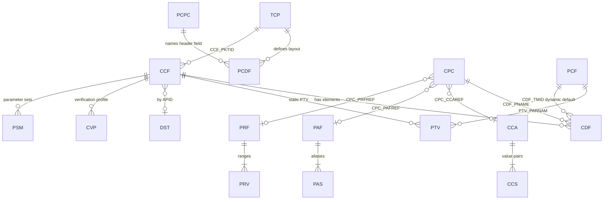
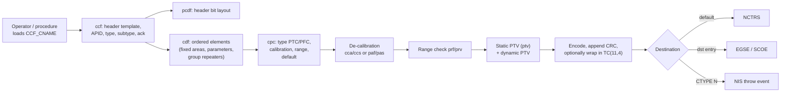
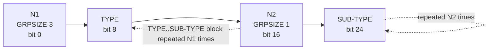
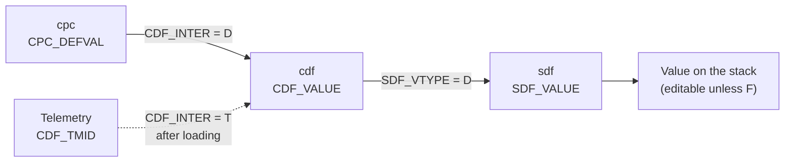

# Commanding in the MIB: commands and their parameters

A telecommand in [SCOS-2000](../scos2000/index.md) is never typed bit by bit. The operator picks a
mnemonic such as `ZPW04604` from a command stack. The system looks the mnemonic up in the
[Mission Information Base (MIB)](index.md) and builds the packet from three kinds of definition: a
reusable **packet header** template, the command's own **structure** (an ordered list of fixed areas
and parameters), and the **characteristics of each parameter** (type, calibration, allowed range,
default value). This page goes through every commanding table of the *SCOS-2000 Database Import
ICD* (EGOS-MCS-S2K-ICD-0001, issue 7.0) field by field, explains why each field exists, and shows
how the real Solar Orbiter MIB uses it. Verification of executed commands is covered in
[Command verification in the MIB](command-verification.md). Command sequences and parameter sets
are covered in [Command sequences and parameter sets](sequences.md).[^icd-overview][^mib-release]

## The commanding tables at a glance

The ICD groups the commanding data into packet headers, commands, sequences, verification,
parameter sets, (de-)calibrations and range checks. The command definition (`ccf`) is the central
entity, and many-to-many relationships are resolved with mapping tables (`cdf` maps commands to
parameters, `cvp` maps commands to verification stages, `psm` maps commands to parameter
sets).[^icd-overview][^icd-summary]

| Table | One record per | Key fields | Role | ICD clause |
|---|---|---|---|---|
| [`tcp`](tables/tcp.md) | TC packet header | `TCP_ID` | Names a header template | §3.3.3.1.1 |
| [`pcpc`](tables/pcpc.md) | Header parameter | `PCPC_PNAME` | Named variable header field and its value format | §3.3.3.1.2 |
| [`pcdf`](tables/pcdf.md) | Element of a header | `PCDF_TCNAME`, `PCDF_BIT` | Bit layout of each header template | §3.3.3.1.3 |
| [`ccf`](tables/ccf.md) | Command | `CCF_CNAME` | Identity, routing, header values and default behaviour of a command | §3.3.3.2.1 |
| [`dst`](tables/dst.md) | APID (optional) | `DST_APID` | Destination of commands of one APID (EGSE use) | §3.3.3.2.1.1 |
| [`cpc`](tables/cpc.md) | Command parameter | `CPC_PNAME` | Type, display, calibration, range set and default of a parameter | §3.3.3.2.2 |
| [`cdf`](tables/cdf.md) | Element of a command | `CDF_CNAME`, `CDF_BIT`, `CDF_GRPSIZE` | Ordered structure of the application data field | §3.3.3.2.3 |
| [`ptv`](tables/ptv.md) | Static PTV check | `PTV_CNAME`, `PTV_PARNAM` | Telemetry condition that must hold before release | §3.3.3.2.4 |
| [`cca`](tables/cca.md) / [`ccs`](tables/ccs.md) | Curve / point | `CCA_NUMBR`; `CCS_NUMBR`, `CCS_YVALS` | Numerical (de-)calibration of command parameters | §3.3.3.6.1–2 |
| [`paf`](tables/paf.md) / [`pas`](tables/pas.md) | Alias set / alias | `PAF_NUMBR`; `PAS_NUMBR`, `PAS_ALVAL` | Textual (de-)calibration | §3.3.3.6.3–4 |
| [`prf`](tables/prf.md) / [`prv`](tables/prv.md) | Range set / range | `PRF_NUMBR`; `PRV_NUMBR`, `PRV_MINVAL` | Allowed values or ranges | §3.3.3.7.1–2 |

Fields marked as keys in the ICD (a `*` after the field number) may appear in only one record per
combination of values, and an "M" marks a mandatory field that may not be left null.[^icd-format]



The diagram restates the relationships described in the ICD: one command references one header and
many PTV expressions; command parameters are shared between commands through `cdf`; each parameter
references at most one numerical curve, one alias set and one range set, each of which can be shared
by many parameters.[^icd-overview] The monitoring side of the same database
(`pcf`, `plf`, and so on) is described in [Monitoring in the MIB](monitoring.md), and the whole model in
[MIB data model](data-model.md).

## From mnemonic to packet

The packet header is the first portion of the encoded TC packet and is followed by the application
data field defined through `cpc` and `cdf`. Header fields are not edited by the operator: the command
source or command handler fills them in, taking APID, type and subtype from `ccf`, computing the packet
length (including repeated groups), and maintaining the source sequence counter per APID.[^icd-hdr]
Only command parameter values, not fixed areas, appear in the command history; fixed areas survive
only in the hex dump of the packet.[^icd-cmds]



The order of the boxes follows the processing described in the ICD; the split into separate steps is
this wiki's presentation.[^icd-cmds][^icd-ptv] The ground-side layers below the packet (segment, frame,
[CLTU](../ccsds/tc-coding-cltu.md), [COP-1](../ccsds/cop-1.md)) and the route through
[NCTRS and NIS](../scos2000/nctrs-nis.md) are explained in [Uplink](../overview/uplink.md).

### Maximum command size

The size of a command is capped by the configuration variable `CMDP_MAX_BLOCK_SIZE`, which defaults to
248 bytes. Parameters must share what is left after the header (the sum of its `PCDF_LEN` values), the
CRC (`CMD_CRC_SIZE`, default 2 bytes) and, for execution time-tagged commands, the parameters of the
TC(11,4) wrapper named in `CMD_LOAD_TT_NAME` (default 20 bytes if that command is not found). The ICD's
own example: with a 10-byte header and no CRC or time tag, a single parameter can be up to 238 bytes;
with default time tagging and CRC it shrinks to 216 bytes.[^icd-size] Because the wrapper is added on
top of `CMDP_MAX_BLOCK_SIZE`, the ICD advises setting that variable to the mission's maximum CLTU size
minus the length of the wrapper parameters.[^icd-size]

For Solar Orbiter the spacecraft TM/TC ICD caps the TC packet data field at 242 octets: 4 octets of
data field header, 236 octets of application data and 2 octets of packet error control.[^tn-len] With the
6-octet primary header that is a 248-octet packet, the same figure as the SCOS-2000 default.

!!! warning "Inference"
    The match between the Solar Orbiter maximum packet (6 + 242 = 248 octets) and the SCOS-2000
    default `CMDP_MAX_BLOCK_SIZE` of 248 bytes is arithmetic done by this wiki. The value actually
    configured in the Solar Orbiter mission control system is not stated in the available sources.

## Packet headers: `tcp`, `pcpc`, `pcdf`

### `tcp`: header templates

| # | Field | Type | Meaning |
|---|---|---|---|
| 1* | `TCP_ID` | Char(8), M | Unique name of the packet header |
| 2 | `TCP_DESC` | Char(24) | Textual description |

`tcp` has one record per TC packet header.[^icd-hdr]

### `pcpc`: header parameters

| # | Field | Type | Meaning |
|---|---|---|---|
| 1* | `PCPC_PNAME` | Char(8), M | Unique name of the header parameter |
| 2 | `PCPC_DESC` | Char(24), M | Description |
| 3 | `PCPC_CODE` | Char(1), default `U` | Format of the value in `PCDF_VALUE`: `I` signed integer, `U` unsigned integer |

[^icd-hdr]

### `pcdf`: header layout

`pcdf` has one record per element of a header.[^icd-hdr]

| # | Field | Type | Meaning and values |
|---|---|---|---|
| 1* | `PCDF_TCNAME` | Char(8), M | Header (`TCP_ID`) the element belongs to |
| 2 | `PCDF_DESC` | Char(24) | Description, used for fixed areas only |
| 3 | `PCDF_TYPE` | Char(1), M | `F` fixed area (value from `PCDF_VALUE`); `A` APID from `CCF_APID`; `T` service type from `CCF_TYPE`; `S` subtype from `CCF_STYPE`; `K` acknowledgement flags from `CCF_ACK`; `P` other parameter set automatically by the command subsystem (packet length, source sequence counter) |
| 4 | `PCDF_LEN` | Number(4), M | Element length in bits. The same `PCDF_PNAME` must always have the same length, in every header |
| 5* | `PCDF_BIT` | Number(4), M | Bit offset from the start of the whole packet |
| 6 | `PCDF_PNAME` | Char(8) | Header parameter (`PCPC_PNAME`); for types `A`, `T`, `S`, `K`, `P` only, null for `F` |
| 7 | `PCDF_VALUE` | Char(10), M | Fixed value in hex for `F`; otherwise the default value (decimal for signed, `PCDF_RADIX` for unsigned) |
| 8 | `PCDF_RADIX` | Char(1), default `H` | `D`, `H` or `O` for unsigned values |

[^icd-hdr]

### The Solar Orbiter headers

The Solar Orbiter MIB (release `25925PFM`, comment `20250916-CSW3.1.2_MAS7.33`) defines four headers.
`NOM_TC` is used by 5,318 commands, `HPC1_TC` by 125, `NOS2KHDR` ("NIS Throw Events") by 6 and
`NO_HDR` ("TCP Header for CF/CS") by 5. Only `NOM_TC` (13 rows) and `HPC1_TC` (7 rows) have a layout in
`pcdf`; `NO_HDR` and `NOS2KHDR` have no `pcdf` rows at all. Of the seven `pcpc` parameters, `PH_APID`,
`PH_SSC` and `PH_LEN` are used by both of those headers, while `DFH_ACK`, `DFH_TYPE`, `DFH_STPE` and
`DFH_SRC` are used by `NOM_TC` only.[^mib-hdr]

<div class="bitfield" data-title="Solar Orbiter NOM_TC header as defined in pcdf (80 bits)" data-width="16"
     data-fields='[{"n":"Version","b":3,"v":"000","g":"Packet ID","d":"F, fixed 0"},{"n":"Type","b":1,"v":"1","g":"Packet ID","d":"F, fixed 1 (telecommand)"},{"n":"DFH flag","b":1,"v":"1","g":"Packet ID","d":"F, fixed 1"},{"n":"APID","b":11,"g":"Packet ID","d":"A, PH_APID, taken from CCF_APID"},{"n":"Seq. flags","b":2,"v":"11","g":"Sequence control","d":"F, fixed 3 (stand-alone)"},{"n":"Sequence count","b":14,"g":"Sequence control","d":"P, PH_SSC, maintained by SCOS-2000"},{"n":"Packet length","b":16,"d":"P, PH_LEN, computed by SCOS-2000"},{"n":"Sec. hdr flag","b":1,"v":"0","g":"Data field header","d":"F, fixed 0"},{"n":"PUS version","b":3,"v":"001","g":"Data field header","d":"F, fixed 1"},{"n":"Ack","b":4,"g":"Data field header","d":"K, DFH_ACK, taken from CCF_ACK"},{"n":"Service type","b":8,"g":"Data field header","d":"T, DFH_TYPE, from CCF_TYPE"},{"n":"Service subtype","b":8,"g":"Data field header","d":"S, DFH_STPE, from CCF_STYPE"},{"n":"Source ID","b":8,"g":"Data field header","d":"type O, DFH_SRC, default 0"}]'></div>

The diagram is drawn from the 13 `pcdf` rows of `NOM_TC`.[^mib-hdr] It matches the Solar Orbiter TM/TC
ICD: version `000`, type 1, data field header present on every command except CPDU commands, the
APID split into a 7-bit process ID and a 4-bit packet category fixed to 12, sequence flags `11`
(stand-alone), and a 4-octet data field header with the secondary header flag set to 0, PUS version 1,
the Ack field, the service type and the subtype. The remaining octet holds the Source ID, which the TN
defines in its Annex 8.[^tn-hdr][^tn-src] The 1-bit secondary
header flag and 3-bit PUS version follow the PUS-A (ECSS-E-70-41A) layout; ECSS-E-ST-70-41C uses a
4-bit version field set to 2 and a 16-bit source ID instead.[^pusa-dfh][^pusc-dfh] See
[PUS packet structures](../ecss/pus/packets.md) and [PUS-A vs PUS-C](../ecss/pus/pus-a-vs-pus-c.md).

<div class="bitfield" data-title="Solar Orbiter HPC1_TC header (48 bits, no data field header)" data-width="16"
     data-fields='[{"n":"Version","b":3,"v":"000"},{"n":"Type","b":1,"v":"1"},{"n":"DFH flag","b":1,"v":"0","d":"F, fixed 0: no data field header"},{"n":"APID","b":11,"d":"A, from CCF_APID (44 for all 125 HPC1 commands)"},{"n":"Seq. flags","b":2,"v":"11"},{"n":"Sequence count","b":14,"d":"P, PH_SSC"},{"n":"Packet length","b":16,"d":"P, PH_LEN"}]'></div>

`HPC1_TC` carries only the 6-octet primary header, with the data field header flag fixed to 0. All
125 commands that use it have APID 44, which is process ID 2, the OBC hardware function that receives
high-priority commands for the Command Pulse Distribution Unit (CPDU) on MAP ID 0.[^mib-hdr][^tn-apid][^tn-map]

!!! note "A header type the ICD does not define"
    In `NOM_TC` the Source ID element has `PCDF_TYPE = O`, a value not among the six types listed in
    ICD 7.0 (`F`, `A`, `T`, `S`, `K`, `P`), nor in issues 6.7 and 6.9.[^icd-hdr][^mib-hdr] The Solar
    Orbiter SWA instrument database instead defines the same 8-bit field as a fixed area (`F`) with
    value `0x78` (120).[^mib-swa] The April 2020 release of the Solar Orbiter MIB also had the Source
    ID as a fixed area (`F`, value 0) and no `DFH_SRC` parameter in `pcpc`, so type `O` and `DFH_SRC`
    were introduced between the two releases.[^mib-2020] The Solar Orbiter TM/TC ICD reserves Source
    ID 120 for "Direct commands" from ground, and 110 to 113 for the mission timeline, TC sequences,
    recovery actions and the back-up timeline.[^tn-src]

!!! warning "Inference"
    `PCDF_TYPE = O` is most likely a mission-specific extension that lets the Solar Orbiter control
    system set the Source ID according to the origin of each command (manual stack, timeline,
    sequence), instead of using one fixed value. This is not documented in the available sources.

## Commands: `ccf`

`ccf` has one record per command. Commands may be destined for the spacecraft or for other control
domains such as ground equipment.[^icd-ccf-intro]

| # | Field | Type | Meaning and allowed values | Import default |
|---|---|---|---|---|
| 1* | `CCF_CNAME` | Char(8), M | Unique command name (mnemonic) | |
| 2 | `CCF_DESCR` | Char(24), M | Short description | |
| 3 | `CCF_DESCR2` | Char(64) | Detailed description | |
| 4 | `CCF_CTYPE` | Char(8) | Command type; special values `R`, `F`, `S`, `T`, `N` (below); anything else is mission-specific | |
| 5 | `CCF_CRITICAL` | Char(1) | `Y` critical (hazardous), `N` not critical. The extra protection is mission-specific | `N` |
| 6 | `CCF_PKTID` | Char(8), M | Header template (`TCP_ID`) | |
| 7 | `CCF_TYPE` | Number(3) | Service type 0–255; may be null if the header has no `T` element | |
| 8 | `CCF_STYPE` | Number(3) | Service subtype 0–255; may be null if no `S` element | |
| 9 | `CCF_APID` | Number(5) | 0–2047 for spacecraft commands, 2048–65535 for non-spacecraft commands; may be null if no `A` element | |
| 10 | `CCF_NPARS` | Number(3) | Number of elements (parameters and fixed areas), for consistency checking against `cdf` | |
| 11 | `CCF_PLAN` | Char(1) | Which sources may put the command directly in a planning file: `A` all, `F` flight dynamics only, `S` SOC only, `N` none | `N` |
| 12 | `CCF_EXEC` | Char(1) | `Y` may be loaded stand-alone on a manual stack; `N` only inside sequences | `Y` |
| 13 | `CCF_ILSCOPE` | Char(1) | Default interlock: `G` global, `L` local source, `S` local for the subsystem, `B` global for the subsystem, `F` local and only on verification failure, `T` subsystem-local and only on failure, `N` none | `N` |
| 14 | `CCF_ILSTAGE` | Char(1) | Stage the interlock waits for: `R` ground station reception, `U` uplink, `O` on-board reception, `A` application acceptance, `C` completion | `C` |
| 15 | `CCF_SUBSYS` | Number(3) | Subsystem identifier 1–255 | |
| 16 | `CCF_HIPRI` | Char(1) | `Y` high priority on board: MAP ID forced to `CCF_MAPID`, cannot be execution time-tagged or blocked (typically CPDU commands) | `N` |
| 17 | `CCF_MAPID` | Number(2) | MAP ID 0–63 for high-priority commands; irrelevant unless `CCF_HIPRI = Y` | |
| 18 | `CCF_DEFSET` | Char(8) | Default parameter value set (`PSV_PVSID`) | |
| 19 | `CCF_RAPID` | Number(5) | Redundant APID (1–2047 or 2048–65535); requires `CCF_APID`; all commands with one prime APID must share one redundant APID | |
| 20 | `CCF_ACK` | Number(2) | Default acknowledgement flags: the decimal value 0–15 of the whole Ack field; may be null if no `K` element | |
| 21 | `CCF_SUBSCHEDID` | Number(5) | Default on-board sub-schedule (1–65535) when loaded as execution time-tagged; falls back to `CCF_SUBSYS` | |

[^icd-ccf][^icd-ctype][^icd-il][^icd-hipri][^icd-ack]

### Special command types (`CCF_CTYPE`)

For missions that follow the ESA Packet Telecommand Standard, five values of `CCF_CTYPE` mark special
commands:[^icd-ctype]

| Value | Meaning | What `pcdf`/`cdf` describe |
|---|---|---|
| `R` | Control segment, also called "Reset Map Command" | The frame data field, not a packet |
| `F` | Control frame (BC frame, for example Unlock and Set V(R)) | The frame data field |
| `S` | Command packet without the Packet Error Control field; the releaser does not append the 16-bit CRC. Typically used by EGSE for non-spacecraft commands | Header and application data |
| `T` | SLE throw event, sent to the SLE service provider but not uplinked | Event ID and following fields of the SLE forward service ICD |
| `N` | NIS throw event, executed by the NIS and not forwarded to the station | Event ID and following fields of the NIS throw events ICD |

The ICD strongly recommends that BC frames (`F`) carry a global interlock (`CCF_ILSCOPE = G`) waiting
at least for the uplink stage (`U`), so that no further command is released before the AD mode set-up
is complete.[^icd-ctype] Throw events cannot be blocked with other entries of a sequence or command
source.[^icd-ccf-intro] Frame-level directives are explained in [COP-1](../ccsds/cop-1.md); throw
events in [SLE FCLTU](../ccsds/sle/fcltu.md) and [NCTRS, NIS and the ground station
interface](../scos2000/nctrs-nis.md).

Solar Orbiter uses all of these mechanisms except `S` and `T`. Its five `NO_HDR` commands are
[`UNLOCK`](../explorer/index.md#/solo/command/UNLOCK) and [`SETVR`](../explorer/index.md#/solo/command/SETVR)
(`CCF_CTYPE = F`, FARM directives) and `RESET`, `REIN_TTR` and `TC_ONLY` (`R`). Its six NIS throw
events (`N`, header `NOS2KHDR`, type 251, subtype 1, APID 1964) open and close the session, the TC link
and the TM link, for example [`ESESIONO`](../explorer/index.md#/solo/command/ESESIONO) "OPEN SESSION".[^mib-ccf]
The `cdf` rows of the two FARM directives hold the frame data field exactly as CCSDS defines the
control commands: `UNLOCK` is one fixed octet `0x00`, and `SETVR` is the fixed area `0x8200` followed by
an editable 8-bit `VR` parameter.[^mib-cdf][^ccsds-cc]

### How the Solar Orbiter MIB fills `ccf`

The 5,454 commands of the September 2025 release use the fields as follows.[^mib-ccf]

| Field | Values found (number of commands) |
|---|---|
| `CCF_PKTID` | `NOM_TC` 5,318; `HPC1_TC` 125; `NOS2KHDR` 6; `NO_HDR` 5 |
| `CCF_CTYPE` | null 5,443; `N` 6; `R` 3; `F` 2 |
| `CCF_CRITICAL` | `N` 5,448; null 6 (throw events). No command is flagged critical |
| `CCF_PLAN` | `N` 5,448; `A` 6 (the throw events) |
| `CCF_EXEC` | `Y` 5,448; null 6 |
| `CCF_ILSCOPE` / `CCF_ILSTAGE` | `N` / `C` 5,443; `N` / null 6; `N` / `N` 5 (directives) |
| `CCF_HIPRI` / `CCF_MAPID` | `Y` / 0: 125 (HPC1); `Y` / null: 5 (directives); `N` / null 5,119; `N` / 1: 128; `N` / 54: 77 |
| `CCF_ACK` | 9: 5,225; 1: 78; 0: 21; null 130 |
| `CCF_DEFSET`, `CCF_RAPID` | never used |
| `CCF_SUBSCHEDID` | equal to `CCF_SUBSYS` in every record (17 distinct values, null in 150 records) |
| `CCF_APID` | 32 distinct values; the largest groups are 172 (1,971 commands), 236 (966), 188 (454) |
| `CCF_TYPE` | 78 distinct service types; the largest are 2 (1,363), 131 (875), 3 (345), 12 (254) |

The APIDs decode with the Solar Orbiter allocation (APID = 16 × process ID + category 12): 172 is
process ID 10 (OBC central software, data management), 236 is 14 (system control), 188 is 11 (AOCS), and
1532 is 95 (SWA).[^tn-apid][^mib-ccf] No command declares a default interlock, so any interlock must be
chosen on the stack. 205 normal-priority commands still carry a MAP ID (1 or 54), which the ICD says is
ignored when `CCF_HIPRI` is not `Y`.[^icd-hipri][^mib-ccf]

!!! note "Observed oddities"
    * `CCF_ILSTAGE = N` on the five frame directives is not one of the ICD values (`R`, `U`, `O`, `A`,
      `C`).[^icd-il][^mib-ccf]
    * The NIS throw events use APID 1964, which lies in the spacecraft range 0–2047 although they are
      never uplinked; 1964 is process ID 122, inside the EGSE range 112–127 of the Solar Orbiter
      allocation.[^icd-ccf][^tn-apid][^mib-ccf]

### The acknowledgement field (`CCF_ACK`)

`CCF_ACK` is the decimal value of the complete 4-bit Ack field of the data field header. Since SCOS-2000
R4.0 the operator can change the flags when loading the command.[^icd-ack] In ECSS-E-ST-70-41C, bit 3
of the field (the last transmitted) requests successful acceptance reports, bit 2 start of execution,
bit 1 progress and bit 0 (the first transmitted) completion; PUS-A assigns the bits the same way.[^pusc-dfh][^pusa-dfh]

<div class="bitfield" data-title="Ack field (4 bits) and the weight of each flag in CCF_ACK" data-width="8"
     data-fields='[{"n":"Completion (8)","b":1,"d":"bit 0: request successful completion of execution report"},{"n":"Progress (4)","b":1,"d":"bit 1: request successful progress of execution reports"},{"n":"Start (2)","b":1,"d":"bit 2: request successful start of execution report"},{"n":"Acceptance (1)","b":1,"d":"bit 3: request successful acceptance report"}]'></div>

Solar Orbiter restricts the field to `0000`, `0001` (acceptance), `1000` (execution) and `1001` (both);
the start and progress bits must be zero.[^tn-ack] In the MIB, 5,225 commands default to 9 (`1001`),
78 to 1 (acceptance only) and 21 to 0.[^mib-ccf] In the PUS, failure reports are generated whatever the
flags say; the flags only request the *success* reports.[^pusa-dfh][^pusc-ack] The Solar Orbiter TM/TC ICD
words its four settings differently: `0001` asks for the acceptance report (success or failure) and no
TM(1,7) or TM(1,8) is generated, `1000` asks for the execution report (success or failure) and no TM(1,1)
or TM(1,2) is generated, and only for `0000` does it state that failures are still reported.[^tn-ack] How these reports are matched to
verification stages is the subject of [Command verification in the MIB](command-verification.md) and
[ST[01] Request verification](../ecss/pus/st01-request-verification.md).

## Command routing: `dst`

`dst` is optional and was, at issue 7.0, only used by SCOS-2000 based EGSE. It has at most one record
per APID; commands whose APID is absent go to the default destination, the NCTRS.[^icd-dst]

| # | Field | Type | Meaning |
|---|---|---|---|
| 1* | `DST_APID` | Number(5), M | Command APID, 0–65535 |
| 2 | `DST_ROUTE` | Char(30), M | "Destination ID": up to three dot-separated fields. First: `NCTRS` (spacecraft commands only, the default) or `EGSE`. Second (EGSE only): `SCOE` for non-spacecraft or `TC` for spacecraft commands. Third (spacecraft commands not via NCTRS): address of the ground equipment |

The ICD gives `NCTRS`, `EGSE.SCOE` and `EGSE.TC.0x8800` (via the SCOE and TC front-end `0x8800`) as
valid examples.[^icd-dst] The EGSE user manual of the same era shows the same routing being chosen per
command in test procedures, with the `dst` table as the default.[^emcs-via]

The Solar Orbiter MIB has exactly one `dst` record, in both the 2020 and the 2025 release: APID 1372 is
routed to `EGSE.TC.0x8800`. APID 1372 is process ID 85, which belongs to the SPICE instrument, and 91
commands use it.[^mib-dst][^tn-apid]

!!! warning "Inference"
    A single `dst` entry pointing to an EGSE TC front-end looks like a leftover from instrument-level
    testing. Whether the operational control system honours it is not stated in the available sources.

## Command structure: `cdf`

`cdf` lists the elements of every command in order, one record per element. The elements are encoded
with no gaps between them, so every bit of the application data field, padding included, must be
covered by an element.[^icd-cdf-intro]

| # | Field | Type | Meaning and values | Import default |
|---|---|---|---|---|
| 1* | `CDF_CNAME` | Char(8), M | Command (`CCF_CNAME`) | |
| 2 | `CDF_ELTYPE` | Char(1), M | `A` fixed area; `F` fixed (non-editable) parameter; `E` editable parameter. Only `E` parameters may appear in `sdf` | |
| 3 | `CDF_DESCR` | Char(24) | Description, for fixed areas only | |
| 4 | `CDF_ELLEN` | Number(4), M | Length in bits. Used for fixed areas; for parameters the length comes from PTC/PFC and this field is only a consistency check; 0 for variable-length parameters | |
| 5* | `CDF_BIT` | Number(4), M | Bit offset from the start of the unexpanded application data field (after the header and data field header), computed as if every counter were 1. Only used to sort the elements | |
| 6* | `CDF_GRPSIZE` | Number(2) | For a group repeater: number of following elements in the repeated group; otherwise 0 or null. Part of the key when non-zero | `0` |
| 7 | `CDF_PNAME` | Char(8) | Parameter (`CPC_PNAME`), mandatory for `F` and `E` | |
| 8 | `CDF_INTER` | Char(1) | How `CDF_VALUE` is expressed: `R` raw; `E` engineering (calibrated parameters only); `D` take `CPC_DEFVAL`; `T` dynamic default from the monitoring parameter `CDF_TMID` (editable parameters only, static raw default still required) | `R` |
| 9 | `CDF_VALUE` | Char | Fixed or default value. Fixed areas: raw unsigned hex, at most 32 bits (`FFFF FFFF`). Command ID parameters: a fully defined command name. Parameter ID parameters: a `PCF_NAME` with an on-board ID. Null on an editable parameter means the operator must enter a value | |
| 10 | `CDF_TMID` | Char(8) | Monitoring parameter for dynamic defaults; same PTC/PFC as the command parameter; must be processed by the TM model (in `plf` or synthetic) | |

[^icd-cdf][^icd-cdf-val]

The ICD adds that fixed areas must not be used for Service 11 command elements that the ground model of
the on-board queue has to interpret.[^icd-cdf-val] It also notes that the size limit of `CDF_VALUE`
follows from the maximum command size.[^icd-cdf-val]

### Repeated groups

PUS requests often contain a counter N followed by N repetitions of a group of fields, sometimes nested.
SCOS-2000 models this with one number per element: if `CDF_GRPSIZE` is greater than zero, the element is
a counter and the value says how many following elements form the group.[^icd-cdf-rep] The ICD's own
examples are the PUS-A Distribute On/Off command (2,1), where an address repeats N times (counter with
group size 1), and the Disable Transmission of Telemetry Source Packets request (14,2), where
`N1, TYPE, N2, SUB-TYPE` has N1 with group size 3 and N2 with group size 1.[^icd-cdf-rep]



At load time the command is expanded from left to right: the operator is asked for N1 (unless it is
fixed), the next three elements are generated N1 times, then each N2 is asked for and its subtype
repeated.[^icd-cdf-rep] A counter can also be fixed in the database: with group size 0 it is just a
fixed value and the repeated elements must be defined explicitly; with a fixed value and a group size
above 0 the expansion happens without prompting. Since R4.2 commands with repeaters may be used in
sequences, but only if every repeated value is fixed in the database.[^icd-cdf-rep2]

In the Solar Orbiter MIB, 569 elements in 512 commands are group repeaters.[^mib-cdf] A typical case is
[`ZCA00C05`](../explorer/index.md#/solo/command/ZCA00C05), TC(12,5) "Add parameters to Monitoring
list": its first element `PCD0C051` "Nb PMONs to add" (unsigned 8 bits) has `CDF_GRPSIZE = 15`, so the
following 15 elements (monitoring ID, two *Parameter ID* parameters, intervals, limits, event IDs, mask
and expected value) repeat once per monitor.[^mib-ex] On-board monitoring itself is described in
[ST[12]](../ecss/pus/st12-onboard-monitoring.md).

### Default values and dynamic defaults

A parameter can receive a default at three levels: the parameter (`CPC_DEFVAL`), the command
(`CDF_VALUE`) and the sequence element (`SDF_VALUE`). Option `D` (`CDF_INTER`, `SDF_VTYPE`) makes a
level inherit the value of the level below, so a value maintained once in `cpc` propagates to every
command and sequence. Conversely `CDF_ELTYPE = F` or `SDF_FTYPE = F` freezes the value at that
level.[^icd-cpc-def]



A *dynamic default* replaces the static default with the current value of a monitoring parameter, for
example to initialise part of a command from the on-board state, or to steer a routing parameter used
by many commands centrally through a User Defined Constant. The static raw default is still needed so the
command can be loaded; the telemetry value takes over only after loading, and stops being tracked as
soon as the operator types an explicit value.[^icd-cdf-dyn]

The Solar Orbiter MIB never uses dynamic defaults: `CDF_TMID` is empty in all 47,609 `cdf`
records.[^mib-cdf]

| `CDF_ELTYPE` | `CDF_INTER` | Records |
|---|---|---|
| `A` (fixed area) | `R` / null | 15,292 / 1,614 |
| `F` (fixed parameter) | `R` / `E` / `D` | 14,730 / 2,019 / 932 |
| `E` (editable parameter) | `R` / `D` / `E` | 5,876 / 4,863 / 2,283 |

The elements belong to 5,011 commands; the remaining 443 commands have no application data, such as
[`ZCD01101`](../explorer/index.md#/solo/command/ZCD01101) TC(17,1) "Perform Connection Test". For every
command with a value in `CCF_NPARS`, that value equals its number of `cdf` records.[^mib-cdf]

## Command parameters: `cpc`

`cpc` has one record per command parameter and describes how the parameter is typed, entered, displayed,
calibrated and checked.[^icd-cpc-def]

| # | Field | Type | Meaning and values | Import default |
|---|---|---|---|---|
| 1* | `CPC_PNAME` | Char(8), M | Unique parameter name | |
| 2 | `CPC_DESCR` | Char(24) | Description | |
| 3 | `CPC_PTC` | Number(2), M | Parameter Type Code (Appendix A); 11 for *Deduced* parameters since R5 | |
| 4 | `CPC_PFC` | Number(5), M | Parameter Format Code; for *Deduced* (PTC 11), 0 means "width of the TM parameter", a value above 0 forces the width in bits | |
| 5 | `CPC_DISPFMT` | Char(1) | Input/display format of engineering values: `A` ASCII (textual calibration), `I`/`U`/`R` per `CCA_ENGFMT` (numerical calibration), `T` absolute time (PTC 9), `D` relative time (PTC 10) | `R` |
| 6 | `CPC_RADIX` | Char(1) | Default radix of unsigned raw values: `D`, `H`, `O` | `D` |
| 7 | `CPC_UNIT` | Char(4) | Engineering unit shown next to values | |
| 8 | `CPC_CATEG` | Char(1) | `C` numerical calibration (needs `CPC_CCAREF`); `T` textual (needs `CPC_PAFREF`); `B` both (not supported); `A` *Command ID* (PTC 7, PFC 0); `P` *Parameter ID* (PTC 3); `N` none | `N` |
| 9 | `CPC_PRFREF` | Char(10) | Range set (`PRF_NUMBR`); its `PRF_DSPFMT` must suit the parameter | |
| 10 | `CPC_CCAREF` | Char(10) | Numerical curve (`CCA_NUMBR`); null unless category `C` or `B` | |
| 11 | `CPC_PAFREF` | Char(10) | Alias set (`PAF_NUMBR`); null unless category `T` or `B` | |
| 12 | `CPC_INTER` | Char(1) | Representation of `CPC_DEFVAL`: `R` raw, `E` engineering (calibrated parameters only) | `R` |
| 13 | `CPC_DEFVAL` | Char | Default used when `CDF_INTER = D`. Command ID: a fully defined command; Parameter ID: a `PCF_NAME` with on-board ID | |
| 14 | `CPC_CORR` | Char(1) | `Y` apply time correlation to absolute times, `N` do not; must be `N` for relative times | `Y` |
| 15 | `CPC_OBTID` | Number(5) | Which on-board clock (1..N) defines correlation or epoch; default from `TCO_DEFAULT_OBT_ID` | `0` |
| 16 | `CPC_ENDIAN` | Char(1) | Future extension: `B` big endian, `L` little endian, for whole-byte types | `B` |

[^icd-cpc][^icd-cpc2][^icd-cpc3]

!!! info "Column names in this wiki's SQLite copy"
    The SQLite database used for this page follows the pyscos2000 schema, which names the first column
    `CPC_NAME` (ICD: `CPC_PNAME`) and the fifteenth `CPC_OBTIP` (ICD: `CPC_OBTID`), and adds a
    `CPC_DESCR2` column before `CPC_ENDIAN`. The Solar Orbiter `cpc.dat` file has 15 fields per record,
    so `CPC_DESCR2` and `CPC_ENDIAN` are always empty.[^mib-cpc]

### Special PUS parameter kinds

SCOS-2000 offers three special kinds of command parameter to make PUS requests easier to build:[^icd-cpc-def][^icd-appc-types]

* **Command ID** (`CPC_CATEG = A`, PTC 7, PFC 0): the operator gives a command name and SCOS-2000 encodes
  the raw packet of that command as a variable octet string. This serves requests that carry other
  requests, such as TC(19,1). The referenced command must be fully encodable without input.
* **Parameter ID** (`CPC_CATEG = P`, PTC 3): the operator gives a monitoring parameter name and SCOS-2000
  encodes its on-board identifier (`PCF_PID`). This serves requests such as TC(4,6) or TC(12,1).
* **Deduced** (PTC 11, since R5): the type, width and calibration come from the TM parameter named by the
  first *Parameter ID* parameter within the same (repeated) array of the command; PFC above 0 forces the width.

Appendix C of the ICD adds a caveat for Service 19: the packet embedded through a Command ID parameter is
encoded with fixed header values, for example for the sequence counter.[^icd-appc-s19]

The Solar Orbiter MIB has two Command ID parameters and 152 Parameter ID parameters, and no Deduced
parameter.[^mib-cpc] [`ZCSX0031`](../explorer/index.md#/solo/command/ZCSX0031) "Define P_OFF_EPD S19" is a
TC(19,1) whose last element `PCD13013` "TC to send upon event" is a fixed Command ID with value `ZCSX0023`,
the TC(11,2) "P_OFF_EPD SSID". The Parameter ID parameters appear in TC(3,1), (3,2), (3,138), (12,5),
(18,140) and several private services (130, 131, 139, 142), for example `PCD03014` "Datapool parameter ID" (unsigned 32 bits) in
`ZCA00C05`.[^mib-ex] See [ST[19] Event-action](../ecss/pus/st19-event-action.md) and
[ST[11] Time-based scheduling](../ecss/pus/st11-time-based-scheduling.md).

### Parameter types

The PTC/PFC pairs follow Appendix A of the ICD, which in turn follows the PUS. Unsigned and signed
integers are limited to 32 bits (PFC 15 and 16, 48 and 64 bits, are not supported); PTC 5 PFC 4, the
48-bit MIL-STD-1750A real, is supported for command parameters only; variable-length octet strings
(PTC 7, PFC 0) and character strings (PTC 8, PFC 0) exist only on the commanding side; absolute time with
a p-field (PTC 9, PFC 0) is not supported; CDS time without microseconds (9,1) is supported from R5.0,
and (9,30) is a Unix-style time not defined in PUS.[^icd-appa][^icd-appc-types] For variable strings the
command source derives the length from the value it is given, and since R4.0 SCOS-2000 can be configured
to insert the PUS length field automatically.[^icd-appa] Details are on
[MIB parameter types](parameter-types.md) and [PUS parameter types](../ecss/pus/parameter-types.md).

In the Solar Orbiter MIB the 7,155 command parameters are dominated by unsigned integers of 16 bits
(PTC 3, PFC 12: 1,540), 8 bits (3,4: 1,120) and 32 bits (3,14: 984), IEEE single-precision reals
(5,1: 630), and 1-bit and 8-bit enumerations (2,1: 598; 2,8: 364).[^mib-cpc]

| Field | Values found (number of parameters) |
|---|---|
| `CPC_CATEG` | `N` 4,991; `T` 1,624; `C` 327; `P` 152; null 59; `A` 2 |
| `CPC_DISPFMT` | `R` 5,468; `A` 1,624; `T` 58; `U` 4; `D` 1 |
| `CPC_RADIX` | `D` 3,155; `H` 2,195; null 1,805 |
| `CPC_INTER` | `R` 6,839; `E` 316 |
| References | range set 694; numerical curve 327; alias set 1,624; default value 1,230; unit 458 |
| Times | 35 parameters (9,15) and 23 (9,17), CUC with 4 coarse and 0 or 2 fine octets; one (10,17) relative time; `CPC_CORR` set in 13 records |

[^mib-cpc]

## De-calibration of command parameters

Command calibrations work in both directions: engineering to raw for encoding, raw to engineering for
display. Only parameters whose raw representation is numerical (no strings or times) can be calibrated,
and the ICD warns that every command curve must be one-to-one, otherwise an engineering value would map to
more than one raw value.[^icd-cal-intro] Monitoring calibrations, which only go from raw to engineering,
are described in [Calibration in the MIB](calibration.md).

### Numerical curves: `cca` and `ccs`

| Table | # | Field | Type | Meaning | Default |
|---|---|---|---|---|---|
| `cca` | 1* | `CCA_NUMBR` | Char(10), M | Curve name | |
| | 2 | `CCA_DESCR` | Char(24) | Description | |
| | 3 | `CCA_ENGFMT` | Char(1) | Engineering format `I`, `U` or `R` | `R` |
| | 4 | `CCA_RAWFMT` | Char(1) | Raw format `I`, `U` or `R` | `U` |
| | 5 | `CCA_RADIX` | Char(1) | Radix of unsigned raw values `D`, `H`, `O` (may differ from the parameter's) | `D` |
| | 6 | `CCA_UNIT` | Char(4) | Unit, for consistency checks | |
| | 7 | `CCA_NCURVE` | Number(3) | Number of `ccs` records | |
| `ccs` | 1* | `CCS_NUMBR` | Char(10), M | Curve | |
| | 2 | `CCS_XVALS` | Char, M | Engineering value, always decimal | |
| | 3* | `CCS_YVALS` | Char, M | Raw value, in the curve's radix | |

[^icd-cca]

Note the swap compared with monitoring curves: in `ccs` the *engineering* value is the X column and the
raw value the Y column, the reverse of `cap`.[^icd-cca]

Solar Orbiter has 99 command curves; 80 of them are two-point straight lines, and 80 map unsigned raw
values to real engineering values.[^mib-cal] Curve
[`CAHP0000TC`](../explorer/index.md#/solo/calib/cnum/CAHP0000TC) "Periodic TC angular rate" (unit
`dg/s`, raw format `I`) has two points: engineering −0.5 at raw −1024, and 0.49951 at raw 1023. It
is shared by six parameters, among them `PCS2Z007` "H-APME El Rate", a 16-bit signed parameter of
[`ZCS2Z050`](../explorer/index.md#/solo/command/ZCS2Z050) "Set HGA-APME Go To Az-El".[^mib-cal]

!!! warning "Inference: worked de-calibration (illustrative)"
    The two points of `CAHP0000TC` lie on the line raw = 2048 × engineering, that is 1/2048 dg/s per
    least significant bit. If the curve is interpolated linearly, an operator entry of 0.25 dg/s gives
    raw 512 (`0x0200`) and −0.1 dg/s gives raw −204.8, which then needs rounding. ICD 7.0 does not state
    the interpolation or rounding rule for `cca` curves; linear interpolation is this wiki's
    assumption, based on how numerical calibration curves work for monitoring parameters.

### Textual de-calibrations: `paf` and `pas`

| Table | # | Field | Type | Meaning | Default |
|---|---|---|---|---|---|
| `paf` | 1* | `PAF_NUMBR` | Char(10), M | Alias set name | |
| | 2 | `PAF_DESCR` | Char(24) | Description | |
| | 3 | `PAF_RAWFMT` | Char(1) | Raw format `I`, `U` or `R` | `U` |
| | 4 | `PAF_NALIAS` | Number(3) | Number of `pas` records | |
| `pas` | 1* | `PAS_NUMBR` | Char(10), M | Alias set | |
| | 2 | `PAS_ALTXT` | Char, M | Text shown and typed by the operator | |
| | 3* | `PAS_ALVAL` | Char, M | Raw value, decimal | |

[^icd-paf]

The aliases can be used as default values, so a command definition can say `BUS_1` instead of `0`.
Solar Orbiter has 624 alias sets with 11,834 aliases.[^icd-paf][^mib-cal] Set
[`CCDT0126TX`](../explorer/index.md#/solo/calib/ctxt/CCDT0126TX) "Process IDentifier reach" maps 60
process IDs to names (30 `OP_SSMM` … 50 `EPD_0` … 95 `SWA_0` … 104 `SPICE_8`); it is the textual
calibration of `PCD11031` "Process IDentifier" in
[`ZCD01103`](../explorer/index.md#/solo/command/ZCD01103) TC(17,3) "Request Connection Test", so the
operator chooses an instrument by name.[^mib-cal]

## Range checks: `prf` and `prv`

Range sets restrict the values an operator may enter. They apply to command and sequence parameters whose
raw representation is numerical or a time; strings cannot be range checked. When a sequence is loaded only
its formal parameters are checked against their range sets, unless SCOS-2000 is configured to check every
value.[^icd-prf]

| Table | # | Field | Type | Meaning | Default |
|---|---|---|---|---|---|
| `prf` | 1* | `PRF_NUMBR` | Char(10), M | Range set name | |
| | 2 | `PRF_DESCR` | Char(24) | Description | |
| | 3 | `PRF_INTER` | Char(1) | `R` raw limits; `E` engineering limits (all users calibrated) | `R` |
| | 4 | `PRF_DSPFMT` | Char(1) | Value format: `A`, `I`, `U`, `R`, `T` (absolute time), `D` (relative time) | `U` |
| | 5 | `PRF_RADIX` | Char(1) | Radix for unsigned values `D`, `H`, `O` | `D` |
| | 6 | `PRF_NRANGE` | Number(3) | Number of `prv` records | |
| | 7 | `PRF_UNIT` | Char(4) | Unit, for consistency checks | |
| `prv` | 1* | `PRV_NUMBR` | Char(10), M | Range set | |
| | 2* | `PRV_MINVAL` | Char, M | Low limit, or the single allowed value if `PRV_MAXVAL` is null | |
| | 3 | `PRV_MAXVAL` | Char | High limit (inclusive) | |

A set may combine discrete values and ranges, one `prv` record each; a value passes if it lies within, or
equals, the limits of any record.[^icd-prf]

Solar Orbiter defines 565 range sets with 1,072 values.[^mib-cal] They expose a practical pitfall of the
24-character description field: set [`VCD00176`](../explorer/index.md#/solo/calib/range/VCD00176) is
described as "Integer between 1 and 25" but its single `prv` record allows 1 to 255, and `VCD00269`
(same description) allows 1 to 254. Both descriptions read like "…255" and "…254" cut at 24
characters.[^mib-cal] The ICD says over-long fields are truncated on import with only a
warning.[^icd-import]

## Pre-transmission validation: `ptv`

Static pre-transmission validation (PTV) blocks the release of a command unless telemetry shows the right
state. Each `ptv` record is one check; all checks of a command are ANDed. An expression belongs to exactly
one command and must be repeated for every other command that needs it.[^icd-overview][^icd-ptv]

| # | Field | Type | Meaning | Default |
|---|---|---|---|---|
| 1* | `PTV_CNAME` | Char(8), M | Command | |
| 2* | `PTV_PARNAM` | Char(8), M | Monitoring parameter: numerical raw value, processed by the TM model (in `plf` or synthetic) | |
| 3 | `PTV_INTER` | Char(1) | `R` raw (for synthetics, the OL output); `E` engineering, only for parameters with a single calibration (`PCF_CURTX`) | `R` |
| 4 | `PTV_VAL` | Char(17), M | Value the parameter must *equal*, decimal if raw | |

[^icd-ptv]

The validity of the monitoring parameter is taken into account implicitly: a check passes only if the
parameter is valid *and* has the required value.[^icd-ptv] Besides this static, telemetry-based PTV,
SCOS-2000 runs *dynamic* PTV (feasibility and time checks, interlocks); a sequence element can override
either kind through `CSS_DYNPTV` and `CSS_STAPTV`, and EGSE test procedures could switch static PTV,
dynamic PTV and CEV off per command.[^icd-css-ptv][^emcs-via][^emcs-ack]

Solar Orbiter's MIB had no PTV check in April 2020 and has five in September 2025.[^mib-ptv]

| Command | Description | PUS type | Parameter | Required raw value |
|---|---|---|---|---|
| [`ZCD00D09`](../explorer/index.md#/solo/command/ZCD00D09) | Accept First Uplink Part | (13,9) | [`NCDXS005`](../explorer/index.md#/solo/param/NCDXS005) "Nb Immediate TCF" | 0 |
| [`ZSM00120`](../explorer/index.md#/solo/command/ZSM00120) | SSMM Abort LLFT | (13,145) | [`NMAXS005`](../explorer/index.md#/solo/param/NMAXS005) "SSMM FTS COMMANDING PTV" | 0 |
| `ZSM00125` | SSMM Repeat LLFT Parts | (13,146) | `NMAXS005` | 0 |
| `ZSM00130` | SSMM Confirm Correct FDUs Reception | (13,147) | `NMAXS005` | 0 |
| `ZSM00135` | SSMM Request LLFT EOFT Report | (13,148) | `NMAXS005` | 0 |

[^mib-ptv]

Both parameters are dynamic synthetic parameters. The OL source of `NMAXS005` wraps another parameter,
`NMAXU005`, so that the result is always valid: it returns 0 ("NO WAIT") unless `NMAXU005` is valid, in
which case it returns that parameter's raw value.[^mib-ptv]

!!! warning "Inference"
    Wrapping the real telemetry in a synthetic that defaults to the permissive value means that the PTV
    check never blocks a command merely because the underlying packet is missing or stale. That design
    intent is this wiki's reading of the OL source; it is not documented in the available sources. See
    [Synthetic parameters and the OL language](synthetic-parameters.md).

## Worked example: `ZPW04604`, a real Solar Orbiter command

[`ZPW04604`](../explorer/index.md#/solo/command/ZPW04604) "PCDU A BDR1_C1 SwitchON" uses the `NOM_TC`
header, PUS type 2 subtype 128, APID 172, six elements, Ack 1 (acceptance report only), no interlock and
sub-schedule 1.[^mib-ex] TC(2,128) "Distribute MilBus 1553 Commands" sends low-level MIL-STD-1553 commands
on a selected bus; its fields are the bus, the bus coupler, the number of command words, the 1553 command
word, the number of data words and the data words.[^tn-2-128]

| `CDF_BIT` | Bits | `CDF_ELTYPE` | Element | `CDF_INTER` / `CDF_VALUE` | Raw value |
|---|---|---|---|---|---|
| 0 | 8 | `F` | `PCD02801` "Bus ID" (PTC 2, PFC 8, alias set `CCDT0031TX`) | `E` / `BUS_1` | 0 |
| 8 | 8 | `E` | `PCD02802` "Bus Coupler ID" (alias set `CCDT0030TX`) | `E` / `BUSCPLR_DEF` | 0 |
| 16 | 8 | `A` | "Number of bus commands" | `R` / `0001` | `0x01` |
| 24 | 16 | `A` | "CMDWORD of RPW04604" | `2201` | `0x2201` |
| 40 | 8 | `A` | "Length of RPW04604" | `1` | `0x01` |
| 48 | 16 | `F` | `RPW04604` "BDR1_BDR1_ON" (PTC 3, PFC 12, radix `H`) | `D` → `CPC_DEFVAL` `0181` | `0x0181` |

[^mib-ex]

The aliases come from `pas`: `BUS_1` = 0 and `BUS_2` = 1; `BUSCPLR_DEF` = 0, `BUSCPLR_A` = 1, `BUSCPLR_B`
= 2. These match the TM/TC ICD, which defines bus 0 as "Bus 1" and bus coupler 0 as the default.[^mib-ex][^tn-2-128]
Only the bus coupler is editable; everything else is frozen by the database.

<div class="bitfield" data-title="ZPW04604 application data (64 bits) as defined in cdf" data-width="32"
     data-fields='[{"n":"Bus ID","b":8,"v":"0x00","d":"PCD02801, fixed, engineering BUS_1"},{"n":"Bus coupler","b":8,"v":"0x00","d":"PCD02802, editable, default BUSCPLR_DEF"},{"n":"N commands","b":8,"v":"0x01","d":"fixed area"},{"n":"1553 command word","b":16,"v":"0x2201","d":"fixed area"},{"n":"N data words","b":8,"v":"0x01","d":"fixed area"},{"n":"Data word","b":16,"v":"0x0181","d":"RPW04604, fixed, value from CPC_DEFVAL"}]'></div>

Putting the header, data field header and application data together gives the packet below. The
application data bytes follow directly from the MIB; the sequence count, the Source ID and the CRC are
assigned at release, so the values shown for them are **illustrative**.

| Octets | Field | Value | Origin |
|---|---|---|---|
| 0–1 | Packet ID | `0x18AC` | version 0, type 1, DFH 1, APID 172 |
| 2–3 | Sequence control | `0xC000` | flags `11`, count 0 (illustrative) |
| 4–5 | Packet length | `0x000D` | 4 + 8 + 2 octets of data field, minus 1 |
| 6 | Sec. header flag, PUS version, Ack | `0x11` | `0`, `001`, `0001` (`CCF_ACK = 1`) |
| 7 | Service type | `0x02` | `CCF_TYPE` |
| 8 | Service subtype | `0x80` | `CCF_STYPE` = 128 |
| 9 | Source ID | `0x78` | 120, "Direct commands" (illustrative) |
| 10–17 | Application data | `00 00 01 22 01 01 01 81` | `cdf`, `cpc`, `pas` |
| 18–19 | Packet error control | CRC | computed by the releaser |

[^mib-ex][^tn-hdr][^tn-src][^tn-len]

The same command is verified by its acceptance report and a parameter check of the converter status, as
shown in [Command verification in the MIB](command-verification.md#parameter-based-examples). A full
byte-level walk-through including the CRC is on
[Worked example: building a real Solar Orbiter telecommand](../overview/worked-example-tc.md).

## A time-tag wrapper: TC(11,4)

To load execution time-tagged commands, the command used as wrapper ("Insert Telecommands in the Command
Schedule", (11,4)) must itself exist in `ccf` and `cdf`; its name, type, subtype and parameters are set by
the `CMD_LOAD_TT*` configuration variables. SCOS-2000 then encapsulates each time-tagged command in one
(11,4) packet; several blocked time-tagged commands become several (11,4) packets aggregated in one TC
segment, never one (11,4) with several commands.[^icd-cmds][^icd-appc-s11]

The Solar Orbiter wrapper candidates `INSERTTT` and
[`ZCD00B04`](../explorer/index.md#/solo/command/ZCD00B04) (both TC(11,4), APID 172) have the same four
elements:[^mib-ex]

| `CDF_BIT` | Bits | Element | Type | Notes |
|---|---|---|---|---|
| 0 | 8 | `PCD0B041` "Sub_schedule Identifier" | (3,4) | range set `VCD00269` (1–254) |
| 8 | 8 | `PCD0B042` "Nb TCs to add in Sub-Sch" | (3,4) | group repeater, `CDF_GRPSIZE = 2`, default 1, range 1–13 |
| 16 | 48 | `PCD0B043` "Time Tag" | (9,17) | absolute CUC time, 4 + 2 octets |
| 64 | variable | `PCD0B044` "Complete TC packet" (`ZCD00B04`) or `PCDXB044` (`INSERTTT`) | (7,0) | Command ID in `ZCD00B04`; plain variable octet string in `INSERTTT` |

[^mib-ex]

The time tag and embedded packet form the repeated group. Appendix C lists what SCOS-2000 does around
Service 11: automatic encapsulation, a ground model of the on-board schedule, delayed verification of
time-tagged commands from live and playback telemetry, and automatic generation of Service 11 commands;
relative time tags, interlock modelling and the time-shift command are not modelled.[^icd-appc-s11] The
service itself is described in [ST[11] Time-based scheduling](../ecss/pus/st11-time-based-scheduling.md).

## High-priority commands and CPDU

The CPDU in the Solar Orbiter on-board computer can generate command pulses directly from ground
commands, without the central software, so vital units can be switched even when the software is down.
These ground commands are called HPC-1 and travel on MAP ID 0; normal commands use MAP ID 1.[^tn-map]
In the MIB the 125 `HPC1_TC` commands all have `CCF_HIPRI = Y`, `CCF_MAPID = 0` and no Ack field, and
their application data is two fixed areas: an HPC line ID and a pulse length. For example
[`ZBC04001`](../explorer/index.md#/solo/command/ZBC04001) "Select PM A EEPROM Image 1" has line ID 2 and
pulse length 1.[^mib-ex] The ICD notes that SCOS-2000 can prevent CPDU commands from being included in
TC(11,4) commands or aggregated with other commands in one segment, and that aggregation in general
happens only at segment level, never inside one packet.[^icd-appc-s2][^icd-hipri]

## Import-time checks and pitfalls

The SCOS-2000 importer only catches the most dangerous inconsistencies; the ICD leaves full consistency to
the off-line database system. On import:[^icd-import]

* every field is checked against its declared characteristics; too-long fields are truncated with a
  warning, which matters for anything but descriptions;
* a null mandatory field produces a warning and becomes 0 or an empty string;
* a record that breaks relational integrity (for example a reference to a missing parameter) is not
  imported;
* command and sequence parameter values are syntax-checked against Appendix A; a bad value becomes 0,
  an empty string, or `1970.001.00.00.00` for absolute times.

Names must be unique without regard to case, and the importer gives no warning when two names differ
only in case.[^icd-format] The ICD also checks `CCF_ILSTAGE` against the verification profile: if it asks
for an execution stage (`A` or `C`) that the command's `cvp`/`cvs` definition does not have, the importer
lowers it to the highest applicable level.[^icd-il]

## How the commanding tables evolved

The change annexes of ICD 7.0 record the evolution relevant to this page:[^icd-annex]

| Issue | Change |
|---|---|
| 6.0 (R4.0) | *Command ID* and *Parameter ID* parameter types (repatriated from CryoSat); default sub-schedule ID fields in `ccf` and `csf`; acknowledgement flags editable when loading a command, which allows report-based verification stages to be disabled dynamically |
| 6.4 (R5.0) | Throw events added to `CCF_CTYPE`; Deduced command parameters; time type (9,1); clarification that only TM-model parameters may be used in `CDF_TMID`, `PTV_PARNAM` and similar fields |
| 6.5 (R4.2) | Commands with group repeaters allowed in sequences (`SDF_REPPOS`) |
| 6.7 (R5.2) | `CPC_CORR` and `CPC_OBTID`; time type (9,30) |
| 7.0 | Maximum sizes of `CPC_DEFVAL`, `CDF_VALUE`, `CCS_*`, `PAS_*`, `PRV_*` and others tied to the maximum command size; `CCF_ILSCOPE` values `F` and `T` documented; `CPC_ENDIAN` added as future extension; TC(11,4) encoding according to the `cdf` definition |

The issue history as a whole is on [History of the Database Import ICD](icd-history.md). Projects that
generate MIB files from their own databases sometimes impose extra rules; for example the Herschel/Planck
System database (HPSDB) recomputed `CCF_NPARS`, `CCF_HIPRI` and `CCF_SUBSYS` itself and did not load the `dst`
table.[^tn1060-ccf] More on that in [Mission tailoring of the MIB](tailoring.md).

## Solar Orbiter: 2020 and 2025 compared

| Table | April 2020 (`10720PFM`) | September 2025 (`25925PFM`) |
|---|---|---|
| `ccf` | 5,238 | 5,454 |
| `cpc` | 6,947 | 7,155 |
| `cdf` | 44,944 | 47,609 |
| `ptv` | 0 | 5 |
| `prf` / `prv` | 531 / 631 | 565 / 1,072 |
| `paf` / `pas` | 605 / 9,741 | 624 / 11,834 |
| `cca` / `ccs` | 100 / 1,233 | 99 / 1,226 |
| `tcp` / `pcpc` / `pcdf` / `dst` | 4 / 6 / 20 / 1 | 4 / 7 / 20 / 1 |

[^mib-release][^mib-2020]

The header layer changed in one place: in 2020 the `NOM_TC` Source ID was a fixed area with value 0,
while in 2025 it is an element of type `O` linked to the new `pcpc` parameter `DFH_SRC` (see the note in
[The Solar Orbiter headers](#the-solar-orbiter-headers)); the description of `NOM_TC` also changed from
"Normal Header" to "NOM_DH_TC_Packet_Header". The growth is in commands, parameters and especially
aliases and range values. The [Solar Orbiter MIB](../missions/solar-orbiter/mib.md) page puts
these numbers in the context of the whole database, and [How Solar Orbiter uses
PUS](../missions/solar-orbiter/pus-usage.md) covers the services behind the commands.

??? example "SQL used"
    All queries ran with `sqlite3 -readonly` on this wiki's SQLite copy of the Solar Orbiter MIB
    (`solo-2025-09-16.sqlite`; `solo-2020-04-16.sqlite` and `swa-idb.sqlite` for the comparisons).
    Every column is stored as text, so numeric comparisons need `cast(... as int)`.

    ```sql
    -- headers
    SELECT * FROM tcp;
    SELECT * FROM pcpc;
    SELECT * FROM pcdf ORDER BY PCDF_TCNAME, cast(PCDF_BIT AS int);
    SELECT CCF_PKTID, count(*) FROM ccf GROUP BY 1;
    -- ccf profile
    SELECT CCF_CTYPE, count(*) FROM ccf GROUP BY 1;
    SELECT CCF_HIPRI, CCF_MAPID, count(*) FROM ccf GROUP BY 1, 2;
    SELECT CCF_ACK, count(*) FROM ccf GROUP BY 1;
    SELECT CCF_ILSCOPE, CCF_ILSTAGE, count(*) FROM ccf GROUP BY 1, 2;
    SELECT sum(CCF_SUBSYS = CCF_SUBSCHEDID), sum(CCF_SUBSYS <> CCF_SUBSCHEDID) FROM ccf;
    SELECT CCF_APID, count(*) FROM ccf GROUP BY 1 ORDER BY 2 DESC;
    -- cdf / cpc profile
    SELECT CDF_ELTYPE, CDF_INTER, count(*) FROM cdf GROUP BY 1, 2;
    SELECT count(*), count(DISTINCT CDF_CNAME) FROM cdf WHERE cast(CDF_GRPSIZE AS int) > 0;
    SELECT count(*) FROM cdf WHERE CDF_TMID <> '';
    SELECT CPC_PTC, CPC_PFC, count(*) FROM cpc GROUP BY 1, 2 ORDER BY 3 DESC;
    SELECT CPC_CATEG, count(*) FROM cpc GROUP BY 1;
    -- examples
    SELECT d.*, c.* FROM cdf d LEFT JOIN cpc c ON c.CPC_NAME = d.CDF_PNAME
     WHERE CDF_CNAME = 'ZPW04604' ORDER BY cast(CDF_BIT AS int);
    SELECT * FROM pas WHERE PAS_NUMBR IN ('CCDT0030TX', 'CCDT0031TX');
    SELECT * FROM cca JOIN ccs ON CCS_NUMBR = CCA_NUMBR WHERE CCA_NUMBR = 'CAHP0000TC';
    SELECT * FROM prf JOIN prv ON PRV_NUMBR = PRF_NUMBR WHERE PRF_NUMBR IN ('VCD00176', 'VCD00269');
    SELECT p.*, f.PCF_DESCR, f.PCF_NATUR FROM ptv p LEFT JOIN pcf f ON f.PCF_NAME = p.PTV_PARNAM;
    SELECT SOURCE FROM synthetic WHERE NAME = 'NMAXS005';
    SELECT * FROM dst;
    ```

## Related pages

* [The MIB: Mission Information Base](index.md) and [MIB data model](data-model.md)
* [Command verification in the MIB](command-verification.md)
* [Command sequences and parameter sets](sequences.md)
* [MIB parameter types](parameter-types.md), [Calibration in the MIB](calibration.md)
* [Uplink: from operator command to on-board execution](../overview/uplink.md)
* [PUS packet structures](../ecss/pus/packets.md), [PUS message type catalogue](../ecss/pus/message-types.md)
* Generated table references: [ccf](tables/ccf.md), [cdf](tables/cdf.md), [cpc](tables/cpc.md),
  [pcdf](tables/pcdf.md), [ptv](tables/ptv.md), [prf](tables/prf.md), [paf](tables/paf.md), [cca](tables/cca.md)
* Source documents: [ICD 7.0](../library/icd-7-0-final.md), [ICD 6.9](../library/icd-6-9-archive-org.md),
  [Solar Orbiter MIB 2025](../library/mib-20250916m25925pfms001-sol.md); terms in the [glossary](../glossary.md)

[^icd-overview]: [SCOS-2000 Database Import ICD, issue 7.0](../library/icd-7-0-final.md), §3.3.3 "Commanding data", PDF pp. 126–128.
[^icd-summary]: [SCOS-2000 Database Import ICD, issue 7.0](../library/icd-7-0-final.md), §3.1 Table 3 and §3.2, PDF pp. 29–34.
[^icd-format]: [SCOS-2000 Database Import ICD, issue 7.0](../library/icd-7-0-final.md), §3.3 "Detailed definition of the ASCII tables structure", PDF pp. 35–36.
[^icd-hdr]: [SCOS-2000 Database Import ICD, issue 7.0](../library/icd-7-0-final.md), §3.3.3.1.1–3.3.3.1.3 (tcp, pcpc, pcdf), PDF pp. 128–131.
[^icd-cmds]: [SCOS-2000 Database Import ICD, issue 7.0](../library/icd-7-0-final.md), §3.3.3.2 "Commands", PDF p. 131.
[^icd-size]: [SCOS-2000 Database Import ICD, issue 7.0](../library/icd-7-0-final.md), §3.3.3.2, remarks on maximum command size, PDF pp. 131–132.
[^icd-ccf-intro]: [SCOS-2000 Database Import ICD, issue 7.0](../library/icd-7-0-final.md), §3.3.3.2.1 introduction and remarks, PDF p. 132.
[^icd-ccf]: [SCOS-2000 Database Import ICD, issue 7.0](../library/icd-7-0-final.md), §3.3.3.2.1, fields 1–12 of ccf, PDF pp. 133–136.
[^icd-ctype]: [SCOS-2000 Database Import ICD, issue 7.0](../library/icd-7-0-final.md), §3.3.3.2.1, field CCF_CTYPE, PDF pp. 134–135.
[^icd-il]: [SCOS-2000 Database Import ICD, issue 7.0](../library/icd-7-0-final.md), §3.3.3.2.1, fields CCF_ILSCOPE, CCF_ILSTAGE and CCF_SUBSYS, PDF pp. 137–138.
[^icd-hipri]: [SCOS-2000 Database Import ICD, issue 7.0](../library/icd-7-0-final.md), §3.3.3.2.1, fields CCF_HIPRI, CCF_MAPID and CCF_DEFSET, PDF p. 139.
[^icd-ack]: [SCOS-2000 Database Import ICD, issue 7.0](../library/icd-7-0-final.md), §3.3.3.2.1, fields CCF_RAPID, CCF_ACK and CCF_SUBSCHEDID, PDF p. 140.
[^icd-dst]: [SCOS-2000 Database Import ICD, issue 7.0](../library/icd-7-0-final.md), §3.3.3.2.1.1 "Command routing: DST", PDF pp. 141–142.
[^icd-cpc-def]: [SCOS-2000 Database Import ICD, issue 7.0](../library/icd-7-0-final.md), §3.3.3.2.2, "Command Parameters Default Values" and "Special PUS Command Parameter Types", PDF pp. 142–143.
[^icd-cpc]: [SCOS-2000 Database Import ICD, issue 7.0](../library/icd-7-0-final.md), §3.3.3.2.2, fields CPC_PNAME to CPC_CATEG, PDF pp. 143–146.
[^icd-cpc2]: [SCOS-2000 Database Import ICD, issue 7.0](../library/icd-7-0-final.md), §3.3.3.2.2, fields CPC_PRFREF to CPC_DEFVAL, PDF pp. 147–149.
[^icd-cpc3]: [SCOS-2000 Database Import ICD, issue 7.0](../library/icd-7-0-final.md), §3.3.3.2.2, fields CPC_CORR, CPC_OBTID and CPC_ENDIAN, PDF pp. 150–151.
[^icd-cdf-intro]: [SCOS-2000 Database Import ICD, issue 7.0](../library/icd-7-0-final.md), §3.3.3.2.3 introduction, PDF p. 151.
[^icd-cdf-rep]: [SCOS-2000 Database Import ICD, issue 7.0](../library/icd-7-0-final.md), §3.3.3.2.3, "Repeated Groups", PDF pp. 151–153.
[^icd-cdf-rep2]: [SCOS-2000 Database Import ICD, issue 7.0](../library/icd-7-0-final.md), §3.3.3.2.3, "Repeated Groups" (fixed counters, use in sequences), PDF p. 153.
[^icd-cdf-dyn]: [SCOS-2000 Database Import ICD, issue 7.0](../library/icd-7-0-final.md), §3.3.3.2.3, "Dynamic Defaults", PDF pp. 153–154.
[^icd-cdf]: [SCOS-2000 Database Import ICD, issue 7.0](../library/icd-7-0-final.md), §3.3.3.2.3, fields CDF_CNAME to CDF_PNAME, PDF pp. 154–156.
[^icd-cdf-val]: [SCOS-2000 Database Import ICD, issue 7.0](../library/icd-7-0-final.md), §3.3.3.2.3, fields CDF_INTER, CDF_VALUE and CDF_TMID, PDF pp. 157–159.
[^icd-ptv]: [SCOS-2000 Database Import ICD, issue 7.0](../library/icd-7-0-final.md), §3.3.3.2.4 "Commands pre-transmission validation: ptv", PDF pp. 159–161.
[^icd-css-ptv]: [SCOS-2000 Database Import ICD, issue 7.0](../library/icd-7-0-final.md), §3.3.3.3.2, fields CSS_DYNPTV and CSS_STAPTV, PDF p. 178.
[^icd-cal-intro]: [SCOS-2000 Database Import ICD, issue 7.0](../library/icd-7-0-final.md), §3.3.3.6 "Command/Sequence Parameters (De-)calibrations", PDF p. 205.
[^icd-cca]: [SCOS-2000 Database Import ICD, issue 7.0](../library/icd-7-0-final.md), §3.3.3.6.1–3.3.3.6.2 (cca, ccs), PDF pp. 206–208.
[^icd-paf]: [SCOS-2000 Database Import ICD, issue 7.0](../library/icd-7-0-final.md), §3.3.3.6.3–3.3.3.6.4 (paf, pas), PDF pp. 208–210.
[^icd-prf]: [SCOS-2000 Database Import ICD, issue 7.0](../library/icd-7-0-final.md), §3.3.3.7 (prf, prv), PDF pp. 210–213.
[^icd-appa]: [SCOS-2000 Database Import ICD, issue 7.0](../library/icd-7-0-final.md), Appendix A, Tables 4 and 5, PDF pp. 214–228.
[^icd-appc-types]: [SCOS-2000 Database Import ICD, issue 7.0](../library/icd-7-0-final.md), Appendix C §1 "Support of PUS data types", PDF p. 235.
[^icd-appc-s2]: [SCOS-2000 Database Import ICD, issue 7.0](../library/icd-7-0-final.md), Appendix C §3.2 "Service 2", PDF pp. 237–238.
[^icd-appc-s11]: [SCOS-2000 Database Import ICD, issue 7.0](../library/icd-7-0-final.md), Appendix C §3.9 "Service 11", PDF pp. 240–241.
[^icd-appc-s19]: [SCOS-2000 Database Import ICD, issue 7.0](../library/icd-7-0-final.md), Appendix C §3.16 "Service 19", PDF p. 243.
[^icd-import]: [SCOS-2000 Database Import ICD, issue 7.0](../library/icd-7-0-final.md), §2.4 "Checks applied at import time", PDF pp. 22–23.
[^icd-annex]: [SCOS-2000 Database Import ICD, issue 7.0](../library/icd-7-0-final.md), Annex 1 (PDF pp. 244–260; the entries cited here are on pp. 249–260) and Annex 2 (PDF pp. 261–263); the Annex 1 entries up to issue 6.9 also appear in [ICD issue 6.9](../library/icd-6-9-archive-org.md), Annex 1, PDF pp. 234–250.
[^mib-release]: [Solar Orbiter MIB release MIB__20250916M25925PFMS001_SOL](../library/mib-20250916m25925pfms001-sol.md), table vdf (VDF_NAME `25925PFM`, VDF_COMMENT `20250916-CSW3.1.2_MAS7.33`) and row counts of the commanding tables; queries by this wiki.
[^mib-2020]: [Solar Orbiter MIB release MIB__20200416M10720PFMS001_SOL](../library/mib-20200416m10720pfms001-sol.md), row counts of the commanding tables and tables tcp, pcpc and pcdf; queries by this wiki.
[^ccsds-cc]: [CCSDS 232.0-B-4, TC Space Data Link Protocol](../library/ccsds-232-0-232x0b4e1c1.md), §4.1.3.3.2 "Unlock" and §4.1.3.3.3 "Set V(R)", PDF p. 77.
[^mib-hdr]: [Solar Orbiter MIB release MIB__20250916M25925PFMS001_SOL](../library/mib-20250916m25925pfms001-sol.md), tables tcp, pcpc, pcdf and ccf (CCF_PKTID); queries by this wiki.
[^mib-swa]: [Solar Orbiter SWA instrument database (ASCII)](../library/swa-idb-ascii.md), tables tcp and pcdf; queries by this wiki.
[^mib-ccf]: [Solar Orbiter MIB release MIB__20250916M25925PFMS001_SOL](../library/mib-20250916m25925pfms001-sol.md), table ccf; queries by this wiki.
[^mib-dst]: [Solar Orbiter MIB releases 2025](../library/mib-20250916m25925pfms001-sol.md) and [2020](../library/mib-20200416m10720pfms001-sol.md), tables dst and ccf; queries by this wiki.
[^mib-cdf]: [Solar Orbiter MIB release MIB__20250916M25925PFMS001_SOL](../library/mib-20250916m25925pfms001-sol.md), tables cdf and ccf; queries by this wiki.
[^mib-cpc]: [Solar Orbiter MIB release MIB__20250916M25925PFMS001_SOL](../library/mib-20250916m25925pfms001-sol.md), table cpc and the raw file cpc.dat (15 tab-separated fields per record); queries by this wiki.
[^mib-cal]: [Solar Orbiter MIB release MIB__20250916M25925PFMS001_SOL](../library/mib-20250916m25925pfms001-sol.md), tables cca, ccs, paf, pas, prf, prv, cpc and cdf; queries by this wiki.
[^mib-ptv]: [Solar Orbiter MIB releases 2025](../library/mib-20250916m25925pfms001-sol.md) and [2020](../library/mib-20200416m10720pfms001-sol.md), tables ptv, ccf, pcf and synthetic (NMAXS005); queries by this wiki.
[^mib-ex]: [Solar Orbiter MIB release MIB__20250916M25925PFMS001_SOL](../library/mib-20250916m25925pfms001-sol.md), tables ccf, cdf, cpc, pas and prv for ZPW04604, ZCA00C05, ZCSX0031, ZCD00B04, INSERTTT and ZBC04001; queries by this wiki.
[^tn-hdr]: [Solar Orbiter TM-TC and Packet Structure ICD, SOL.S.ASTR.TN.00079 issue 7](../library/sol-s-astr-tn-00079-07.md), §3.2.1–3.2.2.1, PDF pp. 15–17.
[^tn-len]: [Solar Orbiter TM-TC and Packet Structure ICD, SOL.S.ASTR.TN.00079 issue 7](../library/sol-s-astr-tn-00079-07.md), §3.2.1.3 "TC Packet Length", PDF p. 16.
[^tn-ack]: [Solar Orbiter TM-TC and Packet Structure ICD, SOL.S.ASTR.TN.00079 issue 7](../library/sol-s-astr-tn-00079-07.md), §3.2.2.1 (Ack field), PDF p. 17, and §5.2 "Service 1: Telecommand Verification", PDF p. 40.
[^tn-map]: [Solar Orbiter TM-TC and Packet Structure ICD, SOL.S.ASTR.TN.00079 issue 7](../library/sol-s-astr-tn-00079-07.md), §3.3.1 "TC Segment Header" and §3.3.1.1 "CPDU Telecommands", PDF pp. 18–19.
[^tn-2-128]: [Solar Orbiter TM-TC and Packet Structure ICD, SOL.S.ASTR.TN.00079 issue 7](../library/sol-s-astr-tn-00079-07.md), §5.3.2 "TC (2,128) Distribute MilBus 1553 Commands", PDF pp. 45–46.
[^tn-apid]: [Solar Orbiter TM-TC and Packet Structure ICD, SOL.S.ASTR.TN.00079 issue 7](../library/sol-s-astr-tn-00079-07.md), Annex 8 §13.1 "Application Process ID Assignment", PDF pp. 272–274.
[^tn-src]: [Solar Orbiter TM-TC and Packet Structure ICD, SOL.S.ASTR.TN.00079 issue 7](../library/sol-s-astr-tn-00079-07.md), Annex 8 §13.2 "Source ID", PDF pp. 275–276.
[^pusa-dfh]: [ECSS-E-70-41A (PUS-A)](../library/ecss-e-70-41a-30jan2003-pus.md), §5.3.3 "Packet data field" (data field header and Ack field), PDF p. 44.
[^pusc-dfh]: [ECSS-E-ST-70-41C](../library/ecss-e-st-70-41c-15april2016.md), §7.4.4.1 "Telecommand packet secondary header", requirements b–d, PDF pp. 442–443.
[^pusc-ack]: [ECSS-E-ST-70-41C](../library/ecss-e-st-70-41c-15april2016.md), §5.4.11.2.2 "Acknowledgement", PDF p. 50.
[^emcs-via]: [EGSE based on SCOS 2000, EMCS SUM issue 4.0](../library/emcs-sum-4-0.md), §6.1 "Sending Commands to the Unit Under Test and/or SCOEs" (via, mapid, checks, ack clauses), PDF pp. 28–29.
[^emcs-ack]: [EGSE based on SCOS 2000, EMCS SUM issue 4.0](../library/emcs-sum-4-0.md), §7.2 "The EMCS Request acknowledgement Policy", PDF pp. 46–47.
[^tn1060-ccf]: [H-P-1-ASP-TN-1060, MIB files processing by HPSDB](../library/h-p-1-asp-tn-1060-mib-processing-hpsdb.md), §5.3.4 "Command characteristics: CCF" and §5.3.5 "Command routing: DST", PDF pp. 32–34.
