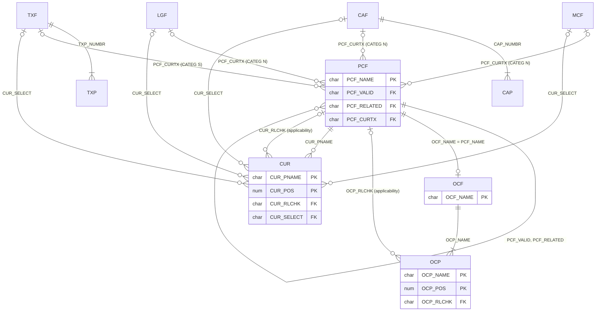
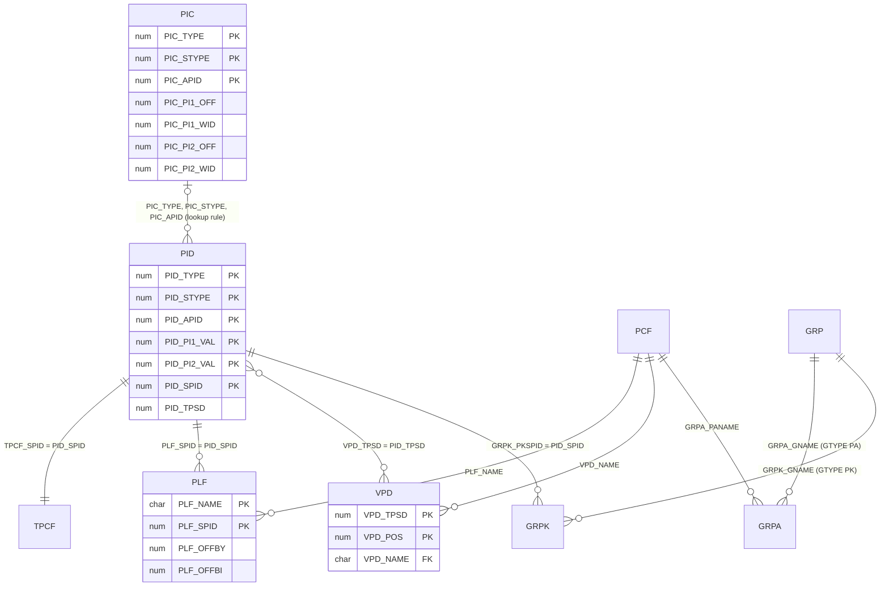
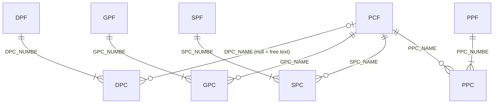
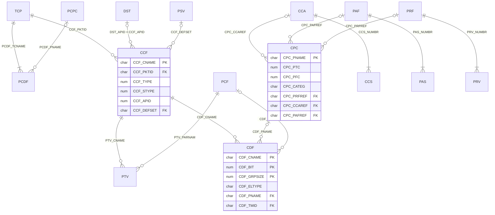
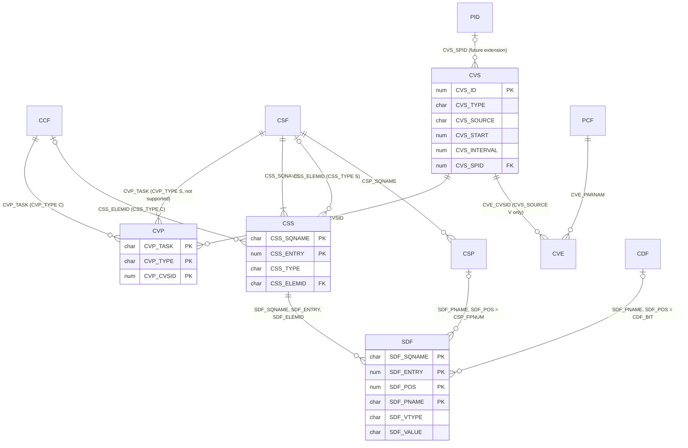
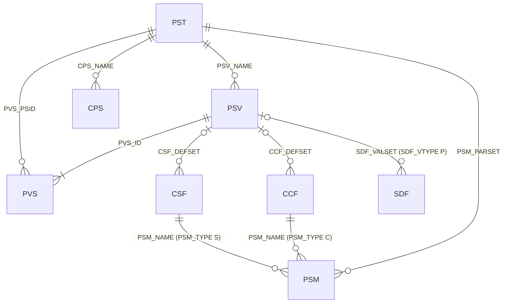

# MIB data model: how the tables relate

The [MIB](index.md) is a relational database spread over 53 tab-separated files. No file
declares its relationships. Instead, the [Database Import ICD](../library/icd-7-0-final.md)
says, in the description of each field, which field of which other table its value must
match. This page collects those statements into one model. It lists the key of every table,
draws the references as entity-relationship diagrams for each area (monitoring, packets,
displays, commanding, verification and sequences, parameter sets), walks the main join paths
with real records from the [Solar Orbiter MIB](../missions/solar-orbiter/mib.md), and
reports how well that MIB respects the model.

Appendix B of the ICD contains six relationship figures: monitoring, display, command,
command sequence, parameter set, and command and sequence parameter tables.[^i70-appb] In
the 7.0 PDF they are images only. The extracted text of issue 5.1 still carries the field
labels of the same figures.[^i51-appb] The diagrams on this page are therefore rebuilt from
the field definitions of issue 7.0, cross-checked against the 5.1 figure labels, and then
tested against the data.

## Modelling principles

**Normalised tables.** All tables are normalised: each field holds a single item, never a
variable-length list. Many-to-many relationships are resolved through mapping
tables.[^i70-31] For example, a parameter can appear in many packets and a packet holds many
parameters, so `plf` sits between `pcf` and `pid`. Likewise, `cvp` sits between commands and
verification stages, and `psm` between commands or sequences and parameter sets.[^i70-332][^i70-333]

**Keys.** In the ICD's field tables, an asterisk after the field number (`1*`) marks a key
field. A table may contain only one record for each combination of key values.[^i70-conv]
The key is therefore the natural primary key of the file. Key fields are always
mandatory.[^i70-conv2]

**Names and identifiers.** References use the referenced item's *name* (an alphanumeric
ID, typically up to 8 characters) or *identifier* (a number).[^i70-defs] There are no
surrogate keys. Renaming a parameter in the off-line database means rewriting every row that
mentions it.

**Integrity at import.** The importer checks relational integrity. A record that refers to
something missing, such as an unknown parameter, is not imported and a warning is
logged.[^i70-24] A reference error does not stop the import. The offending row is simply
missing from the run-time database, and only the import log records why.

**Cardinality as stated by the ICD.** The overview sections spell out the cardinalities of
the main relationships:[^i70-332][^i70-333]

| Relationship | Cardinality stated in the ICD |
|---|---|
| Parameter → validity parameter (`PCF_VALID`) | many-to-1. One validity parameter can serve many parameters. |
| Parameter ↔ calibrations via `cur` | many-to-many |
| Parameter → numerical curve (`caf`) / textual calibration (`txf`) | many-to-1. Curves are shareable. Each has 1 or more points. |
| Parameter → monitoring check set (`ocf`) | 1-to-1. One set holds up to 16 checks. |
| Check → applicability parameter (`OCP_RLCHK`) | Each check may reference 1 parameter. One parameter can serve many checks. |
| Parameter ↔ TM packets via `plf` / `vpd` | many-to-many |
| Parameter ↔ groups (`grpa`), parameter ↔ displays (`dpc`, `gpc`, `spc`) | many-to-many, possibly with repetitions |
| Command → PTV expressions (`ptv`) | 1-to-many. Expressions are ANDed and not shared between commands. |
| Command ↔ verification stages via `cvp` | many-to-many. Each stage has 1 or more ANDed `cve` expressions. |
| Command ↔ parameter sets via `psm` | many-to-many |
| Command ↔ command parameters via `cdf` | many-to-many. `cdf` gives each parameter's position. |
| Command parameter → `cca` / `paf` / `prf` | many-to-1. Each is shareable and has 1 or more points or entries. |
| Sequence → elements (`css`) → element parameters (`sdf`) | 1-to-many, and 1-to-many |
| Sequence → formal parameters (`csp`) | 1-to-many |
| Packet header (`tcp`) ↔ header parameters (`pcpc`) via `pcdf` | many-to-many |
| Packet header (`tcp`) → commands (`ccf`) | 1-to-many. Each command references exactly one header. |

## Keys of every table

The keys below are exactly as marked in ICD 7.0. "Page" is the PDF page of the field
table.[^i70-keys]

| Table | Key fields (ICD 7.0) | Page | Remarks |
|---|---|---:|---|
| [`vdf`](tables/vdf.md) | none | 38 | The last record imported wins.[^i70-vdf] |
| [`pcf`](tables/pcf.md) | `PCF_NAME` | 41 | |
| [`cur`](tables/cur.md) | `CUR_PNAME`, `CUR_POS` | 64 | `CUR_POS` gives the evaluation order. |
| [`caf`](tables/caf.md) | `CAF_NUMBR` | 65 | `Char(10)` since ICD 6.0 (was `Number(4)`). |
| [`cap`](tables/cap.md) | `CAP_NUMBR`, `CAP_XVALS` | 68 | Each raw value occurs at most once per curve. |
| [`txf`](tables/txf.md) | `TXF_NUMBR` | 69 | |
| [`txp`](tables/txp.md) | `TXP_NUMBR`, `TXP_FROM` | 70 | |
| [`mcf`](tables/mcf.md) | `MCF_IDENT` | 71 | |
| [`lgf`](tables/lgf.md) | `LGF_IDENT` | 72 | |
| [`ocf`](tables/ocf.md) | `OCF_NAME` | 73 | Same value as the parameter's `PCF_NAME`. |
| [`ocp`](tables/ocp.md) | `OCP_NAME`, `OCP_POS` | 78 | |
| [`pid`](tables/pid.md) | `PID_TYPE`, `PID_STYPE`, `PID_APID`, `PID_PI1_VAL`, `PID_PI2_VAL`, `PID_SPID` | 84–86 | The packetiser's lookup key is the first five. Since R5.0 each SPID should map to one key.[^i70-pid] |
| [`pic`](tables/pic.md) | `PIC_TYPE`, `PIC_STYPE`, `PIC_APID` | 92–93 | `PIC_APID` became a key in issue 7.0 (S2K-8528).[^i70-a2] Issue 6.7 had explicitly dropped it from the key because it may be null (S2K-DCR-5502).[^i70-a1-5502] |
| [`tpcf`](tables/tpcf.md) | `TPCF_SPID` | 93 | |
| [`plf`](tables/plf.md) | `PLF_NAME`, `PLF_SPID` | 97 | A super-commutated parameter has one row per packet. |
| [`vpd`](tables/vpd.md) | `VPD_TPSD`, `VPD_POS` | 100 | |
| [`grp`](tables/grp.md) | `GRP_NAME` | 108 | |
| [`grpa`](tables/grpa.md) | `GRPA_GNAME`, `GRPA_PANAME` | 109 | |
| [`grpk`](tables/grpk.md) | `GRPK_GNAME`, `GRPK_PKSPID` | 109–110 | |
| [`dpf`](tables/dpf.md) | `DPF_NUMBE` | 111 | |
| [`dpc`](tables/dpc.md) | `DPC_NUMBE`, `DPC_FLDN` | 111–112 | |
| [`gpf`](tables/gpf.md) | `GPF_NUMBE` | 114 | |
| [`gpc`](tables/gpc.md) | `GPC_NUMBE`, `GPC_POS` | 117 | |
| [`spf`](tables/spf.md) | `SPF_NUMBE` | 120 | |
| [`spc`](tables/spc.md) | `SPC_NUMBE`, `SPC_POS` | 121 | |
| [`ppf`](tables/ppf.md) | `PPF_NUMBE` | 124 | |
| [`ppc`](tables/ppc.md) | `PPC_NUMBE`, `PPC_POS` | 124–125 | |
| [`tcp`](tables/tcp.md) | `TCP_ID` | 128 | |
| [`pcpc`](tables/pcpc.md) | `PCPC_PNAME` | 128 | |
| [`pcdf`](tables/pcdf.md) | `PCDF_TCNAME`, `PCDF_BIT` | 129–130 | |
| [`ccf`](tables/ccf.md) | `CCF_CNAME` | 133 | |
| [`dst`](tables/dst.md) | `DST_APID` | 141 | |
| [`cpc`](tables/cpc.md) | `CPC_PNAME` | 143 | |
| [`cdf`](tables/cdf.md) | `CDF_CNAME`, `CDF_BIT`, `CDF_GRPSIZE` | 154–156 | `CDF_GRPSIZE` is not a key in issue 5.1.[^i51-cdf] |
| [`ptv`](tables/ptv.md) | `PTV_CNAME`, `PTV_PARNAM` | 160 | |
| [`csf`](tables/csf.md) | `CSF_NAME` | 165 | |
| [`css`](tables/css.md) | `CSS_SQNAME`, `CSS_ENTRY` | 169 | Entries must be consecutive (no gaps). |
| [`sdf`](tables/sdf.md) | `SDF_SQNAME`, `SDF_ENTRY`, `SDF_POS`, `SDF_PNAME` | 180–181 | `SDF_PNAME` is part of the key when the command has group repeaters. |
| [`csp`](tables/csp.md) | `CSP_SQNAME`, `CSP_FPNAME` | 184 | |
| [`cvs`](tables/cvs.md) | `CVS_ID` | 192 | Range 0 to 32,767 |
| [`cve`](tables/cve.md) | `CVE_CVSID`, `CVE_PARNAM` | 195–196 | |
| [`cvp`](tables/cvp.md) | `CVP_TASK`, `CVP_TYPE`, `CVP_CVSID` | 200 | |
| [`pst`](tables/pst.md) | `PST_NAME` | 201 | |
| [`psv`](tables/psv.md) | `PSV_PVSID` | 201 | `PSV_NAME` (the owning set) is not part of the key. |
| [`cps`](tables/cps.md) | `CPS_NAME`, `CPS_BIT` | 202 | |
| [`pvs`](tables/pvs.md) | `PVS_ID`, `PVS_BIT` | 202–204 | |
| [`psm`](tables/psm.md) | `PSM_NAME`, `PSM_TYPE`, `PSM_PARSET` | 205 | |
| [`cca`](tables/cca.md) | `CCA_NUMBR` | 206 | |
| [`ccs`](tables/ccs.md) | `CCS_NUMBR`, `CCS_YVALS` | 207–208 | In `ccs`, `CCS_YVALS` is the *raw* value and `CCS_XVALS` the engineering value, the reverse of `cap`.[^i70-ccs] |
| [`paf`](tables/paf.md) | `PAF_NUMBR` | 209 | |
| [`pas`](tables/pas.md) | `PAS_NUMBR`, `PAS_ALVAL` | 210 | |
| [`prf`](tables/prf.md) | `PRF_NUMBR` | 211 | |
| [`prv`](tables/prv.md) | `PRV_NUMBR`, `PRV_MINVAL` | 213 | |

!!! note "Raw and engineering columns in `cap` and `ccs`"
    In the monitoring curve table `cap`, `CAP_XVALS` holds the raw value. In the command
    curve table `ccs` the columns are swapped: the ICD remarks that the engineering values
    are in `CCS_XVALS`, and `CCS_YVALS` holds the raw value.[^i70-ccs] Both tables are
    therefore keyed on the raw value (`CAP_XVALS`, `CCS_YVALS`). The Solar Orbiter data
    agrees: in curve `CAHP0000TC` the `CCS_XVALS` are reals such as −0.5 and the
    `CCS_YVALS` are integers such as −1024, matching `CCA_ENGFMT` = `R` and
    `CCA_RAWFMT` = `I`.[^solo] Command curves must also map raw and engineering values
    one to one, because they are used in both directions.[^i70-ccadir]

## Monitoring: parameters, calibrations and checks



**Validity and related parameters.** `PCF_VALID` names a parameter whose raw value is
compared with `PCF_VALPAR` to decide whether this parameter is valid. The validity parameter
must be an integer parameter that the TM model processes, and circular validity chains are
forbidden.[^i70-valid] `PCF_RELATED` has two uses. For a saved synthetic parameter it names
the synthetic parameter whose value is stored. For a parameter of type *deduced* (PTC 11)
it names the parameter that carries the on-board parameter ID used to interpret
it.[^i70-related]

**Calibration.** A parameter has either one calibration or several.[^i70-curtx][^i70-cur]

* **One calibration:** `PCF_CURTX` holds its name. The target table depends on
  `PCF_CATEG`. With category `S` (status) the name must be a `TXF_NUMBR`. With category `N`
  (numerical) it must be a `CAF_NUMBR`, an `MCF_IDENT` or an `LGF_IDENT`. The field carries
  no indication of which of the three it is.
* **Several calibrations:** `PCF_CURTX` stays empty and `cur` lists the candidates. For
  each parameter, the `cur` rows are evaluated in increasing `CUR_POS`. The first whose
  applicability expression `CUR_RLCHK = CUR_VALPAR` holds selects the calibration named in
  `CUR_SELECT`.

`PCF_CURTX` must be empty for text parameters, for string and time parameters (PTC 7, 8, 9
and 10), and for every parameter that appears in `cur`.[^i70-curtx] The calibration tables
themselves are described on [Calibration in the MIB](calibration.md).

**Monitoring checks.** `ocf` holds one record per checked parameter, keyed by the parameter's
own name. It contains the number of checks and whether limits are expressed in raw or
engineering form. `ocp` holds the individual checks, up to 16 per parameter. Each check may
carry an applicability expression `OCP_RLCHK = OCP_VALPAR`. That expression is ignored for
status-consistency checks (`OCP_TYPE` = `C`).[^i70-332][^i70-ocp] See
[Monitoring checks](monitoring-checks.md).

## Packets: identification, layout and groups



Two numbers identify every SCOS-2000 TM packet:[^i70-pidintro][^i70-tpsd]

* the **SPID** (SCOS-2000 Packet ID), which keys the fixed layout in `plf` and the
  characteristics in `tpcf`;
* the **TPSD** (Telemetry Packet Structure Definition), which keys the variable layout in
  `vpd`. It is −1 for packets that have no variable definition.

**Identification.** The packetiser recognises an incoming source packet in three
steps:[^i70-pidintro][^i70-pic]

1. It reads the APID, type and subtype at fixed, MISCconfig-defined positions.
2. It looks up `pic`, first for the type/subtype/APID combination and then for the
   type/subtype alone. The APID-specific lookup exists from issue 6.5, through
   `PIC_APID`.[^i70-a1-65] The `pic` record says where up to two further identification
   fields (PI1, PI2) sit and how wide they are.
3. It looks up `pid` with APID, type, subtype, PI1 and PI2 to obtain the SPID and TPSD.

The `pic`→`pid` relationship is therefore a lookup rule, not a stored foreign key. A packet
type with no `pic` entry is looked up with PI1 = PI2 = 0.[^i70-pi1][^i70-pic]

**Layout.** `plf` places a parameter at `PLF_OFFBY` bytes plus `PLF_OFFBI` bits. For the SCOS-2000
packetiser, the reference is the start of the source packet header.[^i70-plf][^i70-tmproc]
`vpd` lists the parameters of a variable structure in `VPD_POS` order, with repeat counters
(`VPD_GRPSIZE`, `VPD_FIXREP`) and parameter-ID fields (`VPD_PIDREF`).[^i70-vpd] The data
model allows a packet to be both fixed and variable.[^i70-pidintro] In the Solar Orbiter
release none is (see [integrity](#how-well-the-solar-orbiter-mib-respects-the-model)).

**Groups.** `grp` defines a named group of type `PA` (parameters) or `PK` (packets). `grpa`
and `grpk` list the members. Groups exist so that their members can be enabled or inhibited
together.[^i70-grp]

## Displays and printouts



Each display or printout is a header table (`*pf`) with one row per display and a content
table (`*pc`) with one row per field. Every content row names a monitoring parameter
(`PCF_NAME`).[^i70-dpc][^i70-gpc][^i70-spc][^i70-ppc] An empty `DPC_NAME` marks a free-text
entry, whose text is in `DPC_TEXT`. Free entries were added in ICD 6.0.[^i70-dpc][^i70-a1-dpc]
Only parameters that the TM model processes may appear in displays. Values from variable
packets can only be displayed with the Variable Packet Display, which `vpd` itself
drives.[^i70-disp] See [Display definitions in the MIB](displays.md).

## Commanding: packet headers, commands and command parameters



A command definition is built in three layers:[^i70-333][^i70-cmds]

1. **The packet header.** `CCF_PKTID` selects a header layout in `tcp`, whose elements are
   listed bit by bit in `pcdf`. Each element is either a fixed area (`F`, with a value in
   `PCDF_VALUE`) or a named header parameter from `pcpc`. A named parameter takes its value
   from the command (`A` APID, `T` type, `S` subtype, `K` acknowledgement flags) or from the
   command subsystem (`P`, for example packet length and sequence count).[^i70-pcdf]
2. **The application data field.** `cdf` lists the command's elements in bit order. Each
   element is a fixed area (`A`), an editable parameter (`E`) or a fixed, non-editable
   parameter (`F`), and parameter elements name a `cpc` parameter. Only editable
   parameters can be given values in sequences (`sdf`). Elements are encoded with no gaps, so padding
   must be defined explicitly.[^i70-cdf]
3. **The parameter definitions.** `cpc` gives each parameter's type (PTC/PFC; see
   [parameter types](parameter-types.md)), display format, and optional references. A
   numerical (de-)calibration goes to `cca`/`ccs`, a textual one to `paf`/`pas`, and a range
   check to `prf`/`prv`. `CPC_CATEG` decides which references are allowed. `C` requires
   `CPC_CCAREF`. `T` requires `CPC_PAFREF`. `A`, `P` and `N` forbid both.[^i70-cpcref]

`ptv` attaches static pre-transmission validation expressions (parameter = value) to a
command. These are ANDed and never shared.[^i70-333] `CDF_TMID` names a monitoring parameter
whose current value becomes a dynamic default. The PTC/PFC of that parameter must equal those
of the command parameter.[^i70-tmid] `dst` (optional, mainly for EGSE) maps an APID to a
routing string such as `NCTRS` or `EGSE.TC.0x8800`. APIDs not listed go to `NCTRS`.[^i70-dst]
The single Solar Orbiter `dst` record routes APID 1372 to `EGSE.TC.0x8800`.[^solo] More on these tables:
[Commanding in the MIB](commanding.md).

### TC packet headers: tcp, pcpc, pcdf

The real Solar Orbiter header layout `NOM_TC` ("NOM_DH_TC_Packet_Header") is used by 5,318
of the 5,454 commands. Its 13 `pcdf` records describe this 80-bit structure. The values and
bit positions below are real, taken from the `pcdf` table:[^solo]

<div class="bitfield" data-title="Solar Orbiter TC header NOM_TC as defined in pcdf (80 bits, real data)" data-width="16"
     data-fields='[{"n":"Version Number","b":3,"v":"000","d":"PCDF_TYPE F, value 0","g":"Packet primary header"},{"n":"Type","b":1,"v":"1","d":"F, value 1"},{"n":"DataFieldHeaderFlag","b":1,"v":"1","d":"F, value 1"},{"n":"APID","b":11,"d":"A: from CCF_APID (PH_APID)"},{"n":"Sequence Flag","b":2,"v":"11","d":"F, value 3"},{"n":"Sequence Count","b":14,"d":"P: set by the command subsystem (PH_SSC)"},{"n":"Packet Length","b":16,"d":"P: set by the command subsystem (PH_LEN)"},{"n":"Secondary Header Flag","b":1,"v":"0","d":"F, value 0","g":"Data field header"},{"n":"PUS Version","b":3,"v":"001","d":"F, value 1"},{"n":"Ack","b":4,"d":"K: from CCF_ACK (DFH_ACK)"},{"n":"Service Type","b":8,"d":"T: from CCF_TYPE (DFH_TYPE)"},{"n":"Service Subtype","b":8,"d":"S: from CCF_STYPE (DFH_STPE)"},{"n":"Source ID","b":8,"d":"PCDF_TYPE O (not an ICD 7.0 type), DFH_SRC"}]'></div>

The field names above are the `PCDF_DESC` texts, and the codes are the `PCDF_TYPE` values.
The first seven fields (bits 0 to 47) follow the CCSDS
[Space Packet primary header](../ccsds/space-packet.md). The last six (bits 48 to 79) form
the PUS TC data field header (see [PUS packet structures](../ecss/pus/packets.md)). The
other three Solar Orbiter headers are `HPC1_TC` (125 commands, 7 `pcdf` records covering
only the 48-bit primary header), `NOS2KHDR` ("NIS Throw Events", 6 commands) and `NO_HDR`
("TCP Header for CF/CS", 5 commands). The last two have no `pcdf` records at all.[^solo]

The "Source ID" element changed between releases. In the 2020 release it was a fixed area
(`F`, value 0) with no header parameter. In 2025 it has type `O` and the new header
parameter `DFH_SRC` ("Source ID") in `pcpc`.[^solo][^solo2020]

!!! warning "Inference"
    ICD 7.0 lists the `PCDF_TYPE` values `F`, `A`, `T`, `S`, `K` and `P`.[^i70-pcdf] The
    `O` used for "Source ID" is not among them. It is presumably a Solar Orbiter or newer
    SCOS-2000 extension, for example a value supplied by the ground. How SCOS-2000
    populates it is not stated in the available sources.

## Verification and sequences



**Verification.** A verification stage (`cvs`) is defined once and shared. It has a stage
type, which is acceptance `A`, start `S`, progress `0`–`9` or completion `C`. It also has a
source: report-based `R` (PUS service 1 reports) or parameter-based `V`, plus a time
window.[^i70-cvs] `cvp` links stages to commands (`CVP_TYPE` = `C`). The option `S` for
sequences is defined, but the ICD states that SCOS-2000 supports verification for commands
only, and a command may have at most one stage of each `CVS_TYPE`. `cve` holds the
parameter/value expressions of parameter-based stages only.[^i70-cvp][^i70-cve]
An expression with `CVE_INTER` = `C` is an echo check. In that case `CVE_VAL` names a command
parameter (`CDF_PNAME`), not a value.[^i70-cveval] See [Command verification](command-verification.md).

**Sequences.** A sequence (`csf`) holds numbered elements (`css`) without gaps. Each element
is a command (`CSS_TYPE` = `C`, a `ccf` name) or a nested sequence (`S`, a `csf` name).
Comments (`T`) and formal-parameter elements (`F`, `P`) are defined in the ICD but marked as
unsupported or future.[^i70-css] The `CSS_ELEMID` description still says that a command
element must not contain group repeaters, while the `cdf` section allows them from R4.2
when all repeated values are fixed in the database.[^i70-css][^i70-cdf] Solar Orbiter uses
this: 2,467 command elements (234 distinct commands) contain a group repeater.[^solo] Each element's
parameter values are in `sdf`. A row there is keyed to the element by sequence name and entry
number. For a command element, `SDF_POS` is the parameter's bit offset (`CDF_BIT`). For a
nested sequence, it is the formal parameter number (`CSP_FPNUM`). With group repeaters,
`SDF_POS` is the offset after expansion and `SDF_REPPOS` gives the original
`CDF_BIT`.[^i70-sdf] `csp` declares the sequence's formal parameters. An `sdf` value can
refer to one of them (`SDF_VTYPE` = `F`). See [Command sequences and parameter sets](sequences.md).

## Parameter sets



A parameter set (`pst`) is a named collection of command or sequence parameters. A
parameter value set (`psv`) is a named combination of values for those parameters, and its
values are in `pvs`. `psm` attaches sets to commands and sequences. A command or sequence may
name a default value set (`CCF_DEFSET`, `CSF_DEFSET`), and a sequence element may take its
values from a set (`SDF_VALSET`).[^i70-ps][^i70-defset][^i70-sdfvalset] The membership table
`cps` is not used by SCOS-2000.[^i70-cps] In `cps` and `pvs`, the parameter is identified the
same way as in `sdf`. That is `CDF_PNAME` plus `CDF_BIT` for commands, or `CSP_FPNAME` plus
`CSP_FPNUM` for sequences.[^i70-cps][^i70-pvs] Solar Orbiter defines no parameter sets: all
five tables are empty.[^solo]

## Foreign keys at a glance

| Child field | Refers to | Condition | ICD 7.0 page |
|---|---|---|---:|
| `PCF_VALID` | `pcf.PCF_NAME` | integer parameter processed by the TM model | 45 |
| `PCF_RELATED` | `pcf.PCF_NAME` | saved synthetic (`NATUR` = `S`) or deduced (PTC 11) | 46 |
| `PCF_CURTX` | `txf.TXF_NUMBR` / `caf.CAF_NUMBR` / `mcf.MCF_IDENT` / `lgf.LGF_IDENT` | by `PCF_CATEG` (`S` → txf, `N` → the others) | 49 |
| `CUR_PNAME`, `CUR_RLCHK` | `pcf.PCF_NAME` | | 64 |
| `CUR_SELECT` | any calibration name | | 64 |
| `CAP_NUMBR` / `TXP_NUMBR` | `caf.CAF_NUMBR` / `txf.TXF_NUMBR` | | 68 / 70 |
| `OCF_NAME` | `pcf.PCF_NAME` | | 73 |
| `OCP_NAME` / `OCP_RLCHK` | `ocf.OCF_NAME` / `pcf.PCF_NAME` | `RLCHK` unused for `OCP_TYPE` = `C` | 78 / 81 |
| `TPCF_SPID`, `PLF_SPID`, `GRPK_PKSPID`, `CVS_SPID` | `pid.PID_SPID` | | 93, 97, 110, 194 |
| `VPD_TPSD` | `pid.PID_TPSD` | | 100 |
| `PLF_NAME`, `VPD_NAME`, `GRPA_PANAME` | `pcf.PCF_NAME` | | 97, 100, 109 |
| `GRPA_GNAME`, `GRPK_GNAME` | `grp.GRP_NAME` | `GTYPE` `PA` / `PK` | 109 |
| `DPC_NAME`, `GPC_NAME`, `SPC_NAME`, `PPC_NAME` | `pcf.PCF_NAME` | `DPC_NAME` may be null | 112, 117, 121, 125 |
| `DPC_NUMBE`, `GPC_NUMBE`, `SPC_NUMBE`, `PPC_NUMBE` | the matching `*pf` table | | 111–124 |
| `PCDF_TCNAME` / `PCDF_PNAME` | `tcp.TCP_ID` / `pcpc.PCPC_PNAME` | `PNAME` null for fixed areas | 129 / 130 |
| `CCF_PKTID` | `tcp.TCP_ID` | | 135 |
| `CCF_DEFSET`, `CSF_DEFSET`, `SDF_VALSET` | `psv.PSV_PVSID` | | 139, 168, 184 |
| `DST_APID` | `ccf.CCF_APID` (value match) | optional table | 141 |
| `CPC_PRFREF` / `CPC_CCAREF` / `CPC_PAFREF` | `prf` / `cca` / `paf` | by `CPC_CATEG` | 147–148 |
| `CPC_DEFVAL` | `ccf.CCF_CNAME` or `pcf.PCF_NAME` | only for `CPC_CATEG` `A` / `P` | 149 |
| `CDF_CNAME` / `CDF_PNAME` / `CDF_TMID` | `ccf` / `cpc` / `pcf` | `TMID` only with `CDF_INTER` = `T` | 154 / 156 / 159 |
| `PTV_CNAME` / `PTV_PARNAM` | `ccf` / `pcf` | | 160 |
| `CSS_SQNAME` / `CSS_ELEMID` | `csf` / `ccf`, `csf` or `csp` | by `CSS_TYPE` | 169 |
| `SDF_SQNAME`, `SDF_ENTRY`, `SDF_ELEMID` | `css` | | 180 |
| `SDF_POS`, `SDF_PNAME`, `SDF_REPPOS` | `cdf` or `csp` | by element type | 180–184 |
| `CSP_SQNAME` | `csf.CSF_NAME` | | 184 |
| `CSP_PRFREF` / `CSP_CCAREF` / `CSP_PAFREF` | `prf` / `cca` / `paf` | | 189–190 |
| `CVE_CVSID` / `CVE_PARNAM` | `cvs.CVS_ID` / `pcf.PCF_NAME` | stage with `CVS_SOURCE` = `V` | 195 / 196 |
| `CVP_TASK` / `CVP_CVSID` | `ccf` or `csf` / `cvs` | by `CVP_TYPE` | 200 |
| `PSV_NAME`, `CPS_NAME`, `PVS_PSID`, `PSM_PARSET` | `pst.PST_NAME` | | 201–205 |
| `PVS_ID` | `psv.PSV_PVSID` | | 202 |
| `PSM_NAME` | `ccf` or `csf` | by `PSM_TYPE` | 205 |
| `CCS_NUMBR` / `PAS_NUMBR` / `PRV_NUMBR` | `cca` / `paf` / `prf` | | 207 / 210 / 213 |

Page numbers are those of the field descriptions in ICD 7.0.[^i70-keys]

### Polymorphic references

Several fields point to *one of several* tables, and a type flag in the same or another
record tells which. A generic schema tool cannot enforce these references. They are also the
usual source of import warnings:

* `PCF_CURTX` and `CUR_SELECT` share one namespace across `caf`, `mcf`, `lgf` and `txf`,
  disambiguated by `PCF_CATEG` (and, for `N`, by whichever table actually contains the
  name).[^i70-curtx][^i70-cur] In 2001 the HIFI editor evaluation reported the rule then
  used, with numeric IDs: check `caf` first, then `mcf`, and keep the two number ranges
  disjoint.[^hifi]
* `CVP_TASK` and `PSM_NAME` hold a command or a sequence name, with `CVP_TYPE` or `PSM_TYPE`
  saying which.[^i70-cvp][^i70-psm]
* `CSS_ELEMID` holds a command, a sequence or a formal parameter, according to `CSS_TYPE`.[^i70-css]
* `SDF_POS`/`SDF_PNAME`, `CPS_PAR`/`CPS_BIT` and `PVS_PNAME`/`PVS_BIT` hold a command
  parameter (name plus bit offset) or a sequence formal parameter (name plus
  number).[^i70-sdf][^i70-cps][^i70-pvs]
* `CPC_DEFVAL` and `CSP_DEFVAL` normally hold a *value*. For "Command ID" parameters
  (`CATEG` = `A`) they hold a command name, and for "Parameter ID" parameters (`P`) a
  parameter name.[^i70-cpcdef]
* `CVE_VAL` normally holds a value, but a command parameter name when `CVE_INTER` =
  `C`.[^i70-cveval]

## Walking the main join paths with real data

The examples below come from the 2025-09-16 Solar Orbiter MIB. The names link to the
[MIB explorer](../explorer/index.md).[^solo]

### Packet → PID → PLF → PCF → calibration

The housekeeping packet `TM(3,25) - SID 103 - Analog HK VLDA` arrives with APID 1092, type
3 and subtype 25.

1. **`pic`** for type 3 / subtype 25 (no APID given) says that PI1 is 8 bits wide at byte
   offset 16. There is no PI2 (offset −1).
2. **`pid`** for (3, 25, 1092, PI1 = 103, PI2 = 0) gives SPID
   [59203](../explorer/index.md#/solo/packet/59203), TPSD −1 (fixed layout) and
   `PID_DFHSIZE` = 16. The ICD declares `PID_DFHSIZE` irrelevant for fixed
   packets.[^i70-dfhsize]
3. **`tpcf`** for SPID 59203 gives the mnemonic `YIT59203` and `TPCF_SIZE` = 39. That
   size field is not imported and serves only mission-specific tools.[^i70-tpcf]
4. **`plf`** for SPID 59203 places 12 parameters, at byte offsets 16, 17, 19, …, 37. All
   are 16-bit unsigned integers (PTC 3, PFC 12), except the 8-bit SID field at offset 16.
5. **`pcf`** for [`NIT0E028`](../explorer/index.md#/solo/param/NIT0E028) ("V_Pix") gives
   category `N` and `PCF_CURTX` = `CIT01053TM`. The parameter `NIT83001` ("HK_SID", PTC 2
   PFC 8) is category `S` with `PCF_CURTX` = `CITT1120TM`.
6. **Calibration.** `CIT01053TM` is not in `caf`. It is in **`mcf`**
   ([poly/CIT01053TM](../explorer/index.md#/solo/calib/poly/CIT01053TM), "Vpix_Abs_Bias"),
   a polynomial with coefficients 0 and 0.001033884, so eng = 0.001033884 × raw.
   `CITT1120TM` is in **`txf`** ([txt/CITT1120TM](../explorer/index.md#/solo/calib/txt/CITT1120TM),
   18 aliases). Its `txp` maps raw 103 to `HK_SID_103`.

The SID field (`NIT83001`) is placed by `plf` at byte 16, exactly where `pic` tells the
packetiser to read PI1. The identification field and the parameter that displays it are
one and the same bits, defined twice: once as an identification rule and once as a
parameter.

??? example "SQL used"
    ```sql
    SELECT * FROM pic WHERE PIC_TYPE='3' AND PIC_STYPE='25';
    SELECT * FROM pid WHERE PID_SPID='59203';
    SELECT * FROM tpcf WHERE TPCF_SPID='59203';
    SELECT l.PLF_NAME, c.PCF_DESCR, c.PCF_PTC, c.PCF_PFC, l.PLF_OFFBY, l.PLF_OFFBI,
           c.PCF_CATEG, c.PCF_CURTX
      FROM plf l JOIN pcf c ON c.PCF_NAME = l.PLF_NAME
     WHERE l.PLF_SPID='59203' ORDER BY CAST(PLF_OFFBY AS int);
    SELECT * FROM caf WHERE CAF_NUMBR='CIT01053TM';     -- no row
    SELECT * FROM mcf WHERE MCF_IDENT IN ('CIT01053TM','CIT01063TM','CIT01064TM');
    SELECT * FROM txp WHERE TXP_NUMBR='CITT1120TM';
    ```

### Parameter → CUR → CAF/CAP, and parameter → OCF → OCP

The parameter [`NCFT2X70`](../explorer/index.md#/solo/param/NCFT2X70) ("BattDischarge_I1
(PCDUA)", PTC 3 / PFC 12, unit `A`) shows the two remaining monitoring paths. It is carried
in SPID 30552, "SYS Safe Mode ULGA", at byte 182.[^solo]

1. **`pcf`** gives category `N` and an empty `PCF_CURTX`, because the parameter has
   several calibrations.
2. **`cur`** has two rows. Position 1 selects the numerical curve `CPWP4752TM` when
   `NPWZ0000` = 10. Position 2 selects `CPWP9752TM` when `NPWZ0000` = 11.
3. **The applicability parameter** `NPWZ0000` ("PCDU_MODEL", PTC 2 / PFC 8) is a dynamic
   user-defined constant: `PCF_NATUR` = `R`, located in SPID 66830 "Dynamic UDCs". Its
   textual calibration `AYMODELE` labels raw 10 as `EM` and raw 11 as `FM`.
4. **`caf`/`cap`.** Both curves have two points. `CPWP4752TM` maps raw 0 and 4095 to
   −8.8449 and 29.8655. `CPWP9752TM` maps them to −8.9764 and 28.93.
5. **`ocf`** for `NCFT2X70` declares 2 checks (`OCF_NBOOL`) on calibrated values
   (`OCF_INTER` = `C`, real limits `OCF_CODIN` = `R`). An out-of-limit state needs 2
   consecutive violating samples (`OCF_NBCHCK`).
6. **`ocp`** holds the two checks: position 1 is a soft limit (`S`) from −8.9764 to 0.14,
   position 2 a hard limit (`H`) from −8.9764 to 0.15. Neither has an applicability
   parameter.

The calibration of this parameter therefore depends on a value that operators set on the
ground through TM SPACON (see [the MIB](index.md#special-kinds-of-monitoring-parameter)).
The field semantics are those of the ICD.[^i70-cur][^i70-ocf][^i70-udc]

??? example "SQL used"
    ```sql
    SELECT * FROM cur WHERE CUR_PNAME='NCFT2X70';
    SELECT PCF_NAME, PCF_DESCR, PCF_PTC, PCF_PFC, PCF_CATEG, PCF_CURTX, PCF_NATUR FROM pcf
     WHERE PCF_NAME IN ('NCFT2X70','NPWZ0000');
    SELECT PLF_NAME, PLF_SPID, PLF_OFFBY FROM plf WHERE PLF_NAME IN ('NCFT2X70','NPWZ0000');
    SELECT * FROM txp WHERE TXP_NUMBR='AYMODELE' AND TXP_FROM IN ('10','11');
    SELECT * FROM cap WHERE CAP_NUMBR IN ('CPWP4752TM','CPWP9752TM');
    SELECT * FROM ocf WHERE OCF_NAME='NCFT2X70';
    SELECT * FROM ocp WHERE OCP_NAME='NCFT2X70';
    ```

### Command → CCF → CDF → CPC → PRF, and CVP → CVS

The command [`ZCD00382`](../explorer/index.md#/solo/command/ZCD00382) ("Define HK Para Rpt
Collection Interval", TC(3,130), APID 172) walks the commanding chain:

1. **`ccf`** gives `CCF_PKTID` = `NOM_TC`, so the header is the 80-bit layout shown
   [above](#tc-packet-headers-tcp-pcpc-pcdf).
2. **`cdf`** has two elements, both editable (`E`) and both taking their default from the
   parameter definition (`CDF_INTER` = `D`): `PCD03011` (8 bits at bit 0) and `PCD03012`
   (16 bits at bit 8).
3. **`cpc`** gives `PCD03011` ("HK SID") the type PTC 3 / PFC 4, an 8-bit unsigned integer,
   with range set `VCD00353`. `PCD03012` ("generation period report") gets PTC 3 / PFC 12,
   16 bits, with range set `VCD00187`.
4. **`prf`/`prv`.** `VCD00353` allows 1 to 192 and `VCD00187` allows 1 to 65535. Their
   descriptions read "Integer between 1 and 19" and "Integer between 1 and 65". Both are
   exactly 24 characters long, the `Char(24)` limit of `PRF_DESCR`, so they appear to be
   the real ranges cut off at that limit (84 `prf` descriptions are exactly 24
   characters).[^solo][^i70-prf]
5. **`cvp`** attaches stages 14001 and 14007. In **`cvs`**,
   [14001](../explorer/index.md#/solo/verif/14001) is acceptance (`A`) and
   [14007](../explorer/index.md#/solo/verif/14007) is completion (`C`). Both are report-based
   (`R`), open 0 s after release and use a 20 s interval. Report-based stages have no `cve`
   rows.

??? example "SQL used"
    ```sql
    SELECT * FROM cdf WHERE CDF_CNAME='ZCD00382';
    SELECT CPC_NAME, CPC_DESCR, CPC_PTC, CPC_PFC, CPC_CATEG, CPC_PRFREF FROM cpc  -- CPC_PNAME is CPC_NAME in the SQLite copy
     WHERE CPC_NAME IN (SELECT CDF_PNAME FROM cdf WHERE CDF_CNAME='ZCD00382');
    SELECT * FROM prv WHERE PRV_NUMBR IN ('VCD00353','VCD00187');
    SELECT * FROM cvp WHERE COL1='ZCD00382';        -- cvp/cvs are stored as COL1..COLn
    SELECT * FROM cvs WHERE COL1 IN ('14001','14007');
    SELECT * FROM pcdf WHERE PCDF_TCNAME='NOM_TC';
    ```

### Sequence → CSF → CSS → SDF / CSP

The sequence [`AACC309A`](../explorer/index.md#/solo/sequence/AACC309A) ("STR A time update
v06") has one formal parameter and two elements:

| `css` entry | Element | Release | `sdf` rows (`SDF_POS`, `SDF_PNAME`, `SDF_VTYPE`, `SDF_VALUE`) |
|---|---|---|---|
| 1 | command `ZST15401` "STR1 Select ASP Channel", TC(154,1) | `A` (relative to sequence start), 00.00.00 | 8, `PST05054`, `F` (formal parameter), `XC309A01` |
| 2 | command `ZCD00982` "Start Time Synchronisation to User", TC(9,130) | `R`, 00.00.01, with `CSS_MANDISP` = `Y` | 0, `PCD09821`, `E` (engineering), `STAR_TRACKER_A`; and 8, `PCD09822`, `R` (raw), `0` |

The formal parameter `XC309A01` ("ASP CHANNEL") is declared in **`csp`** with PTC 2 / PFC 8
and category `T` (textual calibration). When the sequence is loaded, the operator's value
for `XC309A01` flows into the `PST05054` parameter of the first command.[^solo] In the
release column, `CSS_RELTYPE` = `A` counts `CSS_RELTIME` from the start of the sequence,
and `R` counts it from the release of the previous command. For a command that needs its
own manual dispatch (`CSS_MANDISP` = `Y`, as both elements here do), `R` counts from that
command's dispatch time instead.[^i70-reltype] More on release timing:
[Command sequences](sequences.md).

??? example "SQL used"
    ```sql
    SELECT * FROM csf WHERE CSF_NAME='AACC309A';
    SELECT CSS_ENTRY, CSS_TYPE, CSS_ELEMID, CSS_RELTYPE, CSS_RELTIME, CSS_MANDISP FROM css WHERE CSS_SQNAME='AACC309A';
    SELECT * FROM sdf WHERE SDF_SQNAME='AACC309A';
    SELECT CSP_FPNAME, CSP_FPNUM, CSP_DESCR, CSP_PTC, CSP_PFC, CSP_CATEG FROM csp WHERE CSP_SQNAME='AACC309A';
    ```

## How well the Solar Orbiter MIB respects the model

This wiki tested every main reference in the 2025-09-16 release:[^solo]

| Reference | Rows | Resolved | Notes |
|---|---:|---:|---|
| `plf.PLF_SPID` → `pid` | 400,792 | 400,792 | |
| `plf.PLF_NAME` → `pcf` | 400,792 | 400,791 | `NYM0796V` in SPID 66028 is missing from `pcf`. |
| `tpcf.TPCF_SPID` ↔ `pid.PID_SPID` | 11,150 | 11,150 | Exactly one `tpcf` per `pid`. |
| `vpd.VPD_TPSD` → `pid.PID_TPSD`, `vpd.VPD_NAME` → `pcf` | 19,863 | 19,863 | 2,063 distinct TPSDs |
| `pcf.PCF_CURTX` → calibration | 30,936 | 30,936 | 26,533 `txf`, 3,433 `caf`, 970 `mcf`, 0 `lgf` |
| `cur` → `pcf` / calibration | 1,974 | 1,974 | 907 parameters. 1,944 select a `caf`, 30 a `txf`. None also has `PCF_CURTX`. |
| `ocf` → `pcf`, `ocp` → `ocf` | 5,338 / 7,369 | all | 859 checks have an applicability parameter, all resolved. |
| `cap` → `caf`, `txp` → `txf` | 7,830 / 35,032 | all | |
| `ccf.CCF_PKTID` → `tcp` | 5,454 | 5,454 | 4 header layouts |
| `cdf.CDF_CNAME` → `ccf`, `CDF_PNAME` → `cpc` | 47,609 / 30,703 | all | The other 16,906 elements are fixed areas (`A`). |
| `cpc` → `prf` / `cca` / `paf` | 694 / 327 / 1,624 | all | |
| `cvp.CVP_TASK` → `ccf` | 10,697 | 10,695 | Two rows reference `ZCSD2005`, which is not in `ccf`. All `CVP_TYPE` values are `C`. |
| `cvp.CVP_CVSID` → `cvs` | 10,697 | 10,697 | All 206 stages are used. |
| `cve` → `cvs` (source `V`) | 171 | 171 | All 167 `V` stages have expressions. No `R` stage has any. |
| `css.CSS_ELEMID` → `ccf` / `csf` | 12,629 / 1,250 | all | Only types `C` and `S` occur. |
| `sdf` → `css` | 50,014 | 50,014 | |
| `sdf` (command elements) → `cdf` by name and bit | 48,356 | 48,356 | 36,460 match `SDF_POS` = `CDF_BIT`. The other 11,896 match only through `SDF_REPPOS` = `CDF_BIT` (group repeaters). |
| `sdf` (sequence elements) → `csp` by name and number | 1,658 | 1,658 | |
| `sdf` with `SDF_VTYPE` = `F` → `csp` of the same sequence | 11,575 | 11,575 | |

By the ICD's import rule, the three orphan rows (one `plf` row and two `cvp` rows) would
simply not be imported.[^i70-24] The references agree with the model everywhere else,
including the subtle `SDF_REPPOS` rule for commands with repeated groups.[^i70-sdf]

This wiki also tested the key of every populated table against the 2025 data. All keys are
unique except in two tables:[^solo]

* **`txp`.** Calibration `CYCT0002TM` contains the row raw 1 → "Active" twice, so the key
  `TXP_NUMBR` + `TXP_FROM` is duplicated once. The 2020 release has no such duplicate.[^solo2020]
* **`ccs`.** The key `CCS_NUMBR` + `CCS_YVALS` (raw) is unique, which confirms the reading
  of the columns above. On the engineering side, curve `CPWP8010TM` maps engineering 0 to
  both raw 0 and raw 430. This conflicts with the ICD's requirement that command curves
  be one to one.[^i70-ccadir]

The `pid` key, which includes `PID_SPID`, is unique. The packetiser's lookup key (the first
five fields) is not: the three ground-frame packets 1000002, 1000003 and 1000006 ("Bad",
"Idle" and "Good complete transfer frame") all use type 0, subtype 0, APID 1, PI1 0, PI2 0,
and all three have `PID_VALID` = `Y`. The ICD allows several records with one lookup key,
but only one may be valid, and at import only the last one with `Y` stays valid.[^i70-pid][^i70-pidvalid]

??? example "SQL used (key checks)"
    ```sql
    -- repeat for each table with its ICD key
    SELECT count(*) FROM (SELECT TXP_NUMBR, TXP_FROM FROM txp GROUP BY 1,2 HAVING count(*) > 1);   -- 1
    SELECT count(*) FROM (SELECT CCS_NUMBR, CCS_YVALS FROM ccs GROUP BY 1,2 HAVING count(*) > 1);  -- 0
    SELECT count(*) FROM (SELECT CCS_NUMBR, CCS_XVALS FROM ccs GROUP BY 1,2 HAVING count(*) > 1);  -- 1
    SELECT PID_TYPE, PID_STYPE, PID_APID, PID_PI1_VAL, PID_PI2_VAL, count(*) FROM pid
     GROUP BY 1,2,3,4,5 HAVING count(*) > 1;                                                       -- 0|0|1|0|0|3
    ```

??? example "SQL used (integrity checks)"
    ```sql
    SELECT count(*), sum(PLF_SPID IN (SELECT PID_SPID FROM pid)),
           sum(PLF_NAME IN (SELECT PCF_NAME FROM pcf)) FROM plf;
    SELECT count(*), sum(PCF_CURTX<>''), sum(PCF_CURTX IN (SELECT CAF_NUMBR FROM caf)),
           sum(PCF_CURTX IN (SELECT TXF_NUMBR FROM txf)), sum(PCF_CURTX IN (SELECT MCF_IDENT FROM mcf))
      FROM pcf;
    SELECT count(*) FROM pcf WHERE PCF_NAME IN (SELECT CUR_PNAME FROM cur) AND PCF_CURTX<>'';  -- 0
    SELECT * FROM cvp WHERE COL1 NOT IN (SELECT CCF_CNAME FROM ccf);
    SELECT COL3, count(*), sum(COL1 IN (SELECT COL1 FROM cve)) FROM cvs GROUP BY 1;
    -- sdf -> cdf (temporary indexed copy, because the database is opened read-only)
    CREATE TEMP TABLE tcdf AS SELECT CDF_CNAME, CDF_PNAME, CDF_BIT FROM cdf;
    CREATE INDEX temp.i1 ON tcdf(CDF_CNAME, CDF_PNAME, CDF_BIT);
    SELECT count(*), sum(EXISTS(SELECT 1 FROM tcdf d WHERE d.CDF_CNAME=s.SDF_ELEMID
                                AND d.CDF_PNAME=s.SDF_PNAME AND d.CDF_BIT=s.SDF_POS))
      FROM sdf s WHERE s.SDF_ELEMID IN (SELECT CCF_CNAME FROM ccf);
    ```

## Related pages

* Per-table field references: [MIB tables](tables/index.md).
* The types behind every value: [MIB parameter types](parameter-types.md).
* How the model grew (for example `cur`, `lgf` and the groups in issue 6.0, `PIC_APID` in
  6.5, `CVS_UNCERTAINTY` in 6.7): [History of the Database Import ICD](icd-history.md).
* The model in use end to end: [Downlink](../overview/downlink.md) and
  [Uplink](../overview/uplink.md).

[^i70-appb]: [SCOS-2000 Database Import ICD issue 7.0](../library/icd-7-0-final.md), Appendix B, Figures 1–6, PDF pp. 229–233.
[^i51-appb]: [ICD issue 5.1](../library/icd-5-1-tos-gci.md), Appendix B, Figures 1–6, PDF pp. 113–118.
[^i70-31]: [ICD 7.0](../library/icd-7-0-final.md), §3.1 Relationship between the ASCII tables and the database items, PDF p. 25.
[^i70-332]: [ICD 7.0](../library/icd-7-0-final.md), §3.3.2 Monitoring Data, PDF pp. 38–39.
[^i70-333]: [ICD 7.0](../library/icd-7-0-final.md), §3.3.3 Commanding data, PDF pp. 126–128.
[^i70-conv]: [ICD 7.0](../library/icd-7-0-final.md), §3.3 Detailed definition of the ASCII tables structure, PDF p. 35.
[^i70-conv2]: [ICD 7.0](../library/icd-7-0-final.md), §3.3 (continued), PDF p. 36.
[^i70-defs]: [ICD 7.0](../library/icd-7-0-final.md), §1.3.1 Definitions and Terminology, PDF p. 17.
[^i70-24]: [ICD 7.0](../library/icd-7-0-final.md), §2.4 Checks applied at import time, PDF p. 23.
[^i70-keys]: [ICD 7.0](../library/icd-7-0-final.md), field tables of §3.3.1 to §3.3.3.7, PDF pp. 38–213 (the page of each table is given in the tables above).
[^i70-vdf]: [ICD 7.0](../library/icd-7-0-final.md), §3.3.1.1 vdf, PDF p. 37.
[^i70-pid]: [ICD 7.0](../library/icd-7-0-final.md), §3.3.2.4.1 pid, PDF p. 83.
[^i70-a2]: [ICD 7.0](../library/icd-7-0-final.md), Annex 2, item S2K-8528, PDF p. 262.
[^i51-cdf]: [ICD 5.1](../library/icd-5-1-tos-gci.md), §3.3.3.2.3 cdf, field `CDF_GRPSIZE`, PDF p. 72.
[^i70-ccs]: [ICD 7.0](../library/icd-7-0-final.md), §3.3.3.6.2 ccs (remark and fields `CCS_XVALS`, `CCS_YVALS`), PDF pp. 207–208; compare §3.3.2.2.3 cap, PDF p. 68.
[^i70-ccadir]: [ICD 7.0](../library/icd-7-0-final.md), §3.3.3.6 Command/Sequence Parameters (De-)calibrations, PDF p. 205.
[^i70-a1-5502]: [ICD 7.0](../library/icd-7-0-final.md), Annex 1, S2K-DCR-5502 item 3 (ICD 6.7), PDF p. 258.
[^i70-pic]: [ICD 7.0](../library/icd-7-0-final.md), §3.3.2.4.2 pic (lookup precedence rules), PDF pp. 91–92.
[^i70-a1-65]: [ICD 7.0](../library/icd-7-0-final.md), Annex 1, "Changes applicable as from R4.2 implemented in ICD version 6.5" (addition of `PIC_APID`), PDF p. 255.
[^i70-dfhsize]: [ICD 7.0](../library/icd-7-0-final.md), §3.3.2.4.1 field `PID_DFHSIZE`, PDF p. 87.
[^i70-pidvalid]: [ICD 7.0](../library/icd-7-0-final.md), §3.3.2.4.1 field `PID_VALID`, PDF p. 88.
[^i70-prf]: [ICD 7.0](../library/icd-7-0-final.md), §3.3.3.7.1 prf, field `PRF_DESCR`, PDF p. 211.
[^i70-ocf]: [ICD 7.0](../library/icd-7-0-final.md), §3.3.2.3.1 ocf and §3.3.2.3.2 ocp, PDF pp. 72–81.
[^i70-udc]: [ICD 7.0](../library/icd-7-0-final.md), §3.3.2.1.3 User Defined Constants, PDF pp. 58–60.
[^solo2020]: [Solar Orbiter MIB release MIB__20200416M10720PFMS001_SOL](../library/mib-20200416m10720pfms001-sol.md), tables `pcdf`, `pcpc` and `txp`, queried by this wiki on 2026-11-12.
[^i70-valid]: [ICD 7.0](../library/icd-7-0-final.md), §3.3.2.1.1 field `PCF_VALID`, PDF p. 45.
[^i70-related]: [ICD 7.0](../library/icd-7-0-final.md), §3.3.2.1.1 field `PCF_RELATED`, PDF p. 46.
[^i70-curtx]: [ICD 7.0](../library/icd-7-0-final.md), §3.3.2.1.1 fields `PCF_CATEG` and `PCF_CURTX`, PDF pp. 47 and 49.
[^i70-cur]: [ICD 7.0](../library/icd-7-0-final.md), §3.3.2.2.1 cur, PDF pp. 63–64.
[^i70-ocp]: [ICD 7.0](../library/icd-7-0-final.md), §3.3.2.3.2 ocp, fields `OCP_RLCHK` and `OCP_VALPAR`, PDF p. 81.
[^i70-pidintro]: [ICD 7.0](../library/icd-7-0-final.md), §3.3.2.4 Telemetry Packets Definition and §3.3.2.4.1, PDF pp. 81–83.
[^i70-tpsd]: [ICD 7.0](../library/icd-7-0-final.md), §3.3.2.4.1 field `PID_TPSD`, PDF p. 87.
[^i70-pi1]: [ICD 7.0](../library/icd-7-0-final.md), §3.3.2.4.1 fields `PID_PI1_VAL` and `PID_PI2_VAL`, PDF p. 85.
[^i70-plf]: [ICD 7.0](../library/icd-7-0-final.md), §3.3.2.5.1 plf, PDF pp. 97–98.
[^i70-tmproc]: [ICD 7.0](../library/icd-7-0-final.md), §3.3.2.5 Telemetry Packets Processing, PDF pp. 96–97.
[^i70-vpd]: [ICD 7.0](../library/icd-7-0-final.md), §3.3.2.5.2 vpd, PDF pp. 99–105.
[^i70-grp]: [ICD 7.0](../library/icd-7-0-final.md), §3.3.2.6 Monitoring Groups, PDF pp. 108–110.
[^i70-dpc]: [ICD 7.0](../library/icd-7-0-final.md), §3.3.2.7.2 dpc, PDF pp. 111–113.
[^i70-gpc]: [ICD 7.0](../library/icd-7-0-final.md), §3.3.2.7.4 gpc, PDF p. 117.
[^i70-spc]: [ICD 7.0](../library/icd-7-0-final.md), §3.3.2.7.6 spc, PDF p. 121.
[^i70-ppc]: [ICD 7.0](../library/icd-7-0-final.md), §3.3.2.7.8 ppc, PDF pp. 124–125.
[^i70-a1-dpc]: [ICD 7.0](../library/icd-7-0-final.md), Annex 1, "DPC table modification" (ICD 6.0), PDF p. 250.
[^i70-disp]: [ICD 7.0](../library/icd-7-0-final.md), §3.3.2.7 Displays and reports, PDF p. 110.
[^i70-cmds]: [ICD 7.0](../library/icd-7-0-final.md), §3.3.3.1 Packet Headers and §3.3.3.2 Commands, PDF pp. 128 and 131.
[^i70-pcdf]: [ICD 7.0](../library/icd-7-0-final.md), §3.3.3.1.3 pcdf, field `PCDF_TYPE`, PDF p. 130.
[^i70-cdf]: [ICD 7.0](../library/icd-7-0-final.md), §3.3.3.2.3 cdf, including field `CDF_ELTYPE`, PDF pp. 151–157.
[^i70-tpcf]: [ICD 7.0](../library/icd-7-0-final.md), §3.3.2.4.3 tpcf, field `TPCF_SIZE`, PDF p. 95.
[^i70-reltype]: [ICD 7.0](../library/icd-7-0-final.md), §3.3.3.3.2 css, fields `CSS_RELTYPE` and `CSS_RELTIME`, PDF pp. 170–171.
[^i70-cpcref]: [ICD 7.0](../library/icd-7-0-final.md), §3.3.3.2.2 cpc, fields `CPC_CATEG` to `CPC_PAFREF`, PDF pp. 146–148.
[^i70-tmid]: [ICD 7.0](../library/icd-7-0-final.md), §3.3.3.2.3 cdf, field `CDF_TMID`, PDF p. 159.
[^i70-dst]: [ICD 7.0](../library/icd-7-0-final.md), §3.3.3.2.1.1 dst, PDF pp. 141–142.
[^i70-cvs]: [ICD 7.0](../library/icd-7-0-final.md), §3.3.3.4.1 cvs, PDF pp. 192–194.
[^i70-cvp]: [ICD 7.0](../library/icd-7-0-final.md), §3.3.3.4.3 cvp, PDF pp. 199–200.
[^i70-cve]: [ICD 7.0](../library/icd-7-0-final.md), §3.3.3.4.2 cve, field `CVE_CVSID`, PDF p. 195.
[^i70-cveval]: [ICD 7.0](../library/icd-7-0-final.md), §3.3.3.4.2 cve, fields `CVE_INTER` and `CVE_VAL`, PDF pp. 197–198.
[^i70-css]: [ICD 7.0](../library/icd-7-0-final.md), §3.3.3.3.2 css, fields `CSS_TYPE` and `CSS_ELEMID`, PDF p. 169.
[^i70-sdf]: [ICD 7.0](../library/icd-7-0-final.md), §3.3.3.3.3 sdf, fields 1–5, PDF pp. 180–181.
[^i70-ps]: [ICD 7.0](../library/icd-7-0-final.md), §3.3.3.5 Command/Sequence Parameter Sets, PDF pp. 201–205.
[^i70-defset]: [ICD 7.0](../library/icd-7-0-final.md), fields `CCF_DEFSET` (PDF p. 139) and `CSF_DEFSET` (PDF p. 168).
[^i70-sdfvalset]: [ICD 7.0](../library/icd-7-0-final.md), §3.3.3.3.3 field `SDF_VALSET`, PDF p. 184.
[^i70-cps]: [ICD 7.0](../library/icd-7-0-final.md), §3.3.3.5.3 cps, PDF p. 202.
[^i70-pvs]: [ICD 7.0](../library/icd-7-0-final.md), §3.3.3.5.4 pvs, PDF pp. 202–204.
[^i70-psm]: [ICD 7.0](../library/icd-7-0-final.md), §3.3.3.5.5 psm, PDF p. 205.
[^i70-cpcdef]: [ICD 7.0](../library/icd-7-0-final.md), §3.3.3.2.2 field `CPC_DEFVAL`, PDF p. 149.
[^hifi]: [HIFI MIB editor evaluation report](../library/hifi-mib-editor-evaluation.md), Remark #1 (reply by the editor's author), PDF p. 3.
[^solo]: [Solar Orbiter MIB release MIB__20250916M25925PFMS001_SOL](../library/mib-20250916m25925pfms001-sol.md), tables `pid`, `pic`, `tpcf`, `plf`, `vpd`, `pcf`, `cur`, `caf`, `cap`, `mcf`, `txf`, `txp`, `ocf`, `ocp`, `tcp`, `pcpc`, `pcdf`, `ccf`, `dst`, `cdf`, `cpc`, `prf`, `prv`, `cca`, `ccs`, `cvs`, `cve`, `cvp`, `csf`, `css`, `sdf`, `csp`, `pst`, `psv`, `cps`, `pvs`, `psm`, queried by this wiki on 2026-11-12.
