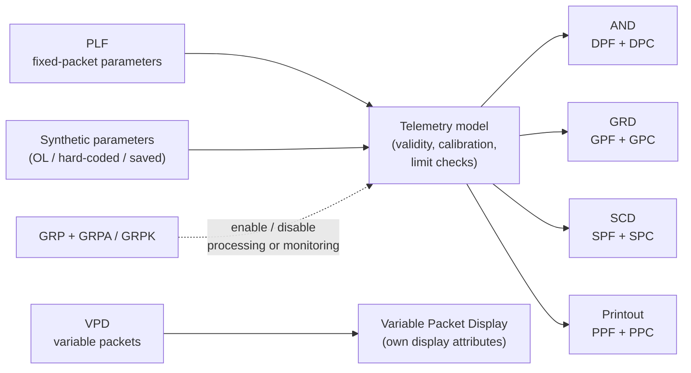
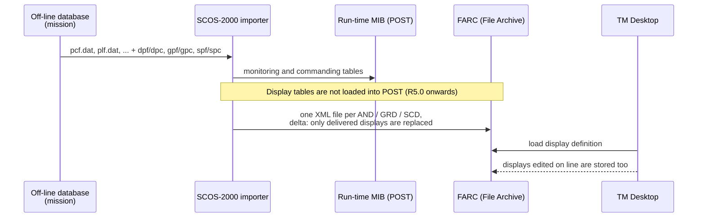
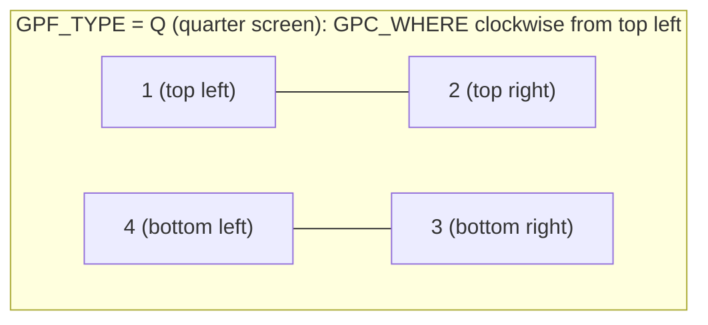

# Display definitions in the MIB

A [SCOS-2000](../scos2000/index.md) operator rarely looks at raw packets. They look at
**displays**: pages of named parameter values, plots against time, or scrolling lists of
samples. The [Mission Information Base](index.md) (MIB) can define three kinds of telemetry
display and one kind of printed report. Each has a pair of tables, a header table and a
content table: [DPF](tables/dpf.md)/[DPC](tables/dpc.md) for alphanumeric displays (ANDs),
[GPF](tables/gpf.md)/[GPC](tables/gpc.md) for graphic displays (GRDs),
[SPF](tables/spf.md)/[SPC](tables/spc.md) for scrolling displays (SCDs) and
[PPF](tables/ppf.md)/[PPC](tables/ppc.md) for printout proformas.[^icd-disp-intro] Three
more tables, [GRP](tables/grp.md), [GRPA](tables/grpa.md) and [GRPK](tables/grpk.md), group
parameters and packets so that their processing or monitoring can be switched on and off
together.[^icd-groups]

This page describes every field of these eleven tables, following the Database Import ICD
issue 7.0 (EGOS-MCS-S2K-ICD-0001, 2017-08-11), and notes where older issues differ. It then
looks at how projects handled the tables and at what the public Solar Orbiter MIB release
`MIB__20250916M25925PFMS001_SOL` actually contains. All Solar Orbiter numbers come from this
wiki's own SQL queries.[^mib-dpf]

## Where displays fit

The SCOS-2000 monitoring chain turns packets into parameter samples (see
[Monitoring in the MIB](monitoring.md)), applies [calibrations](calibration.md) and
[limit checks](monitoring-checks.md), and finally shows the results. A 2003 ESA overview lists
the monitoring displays of the system: alphanumeric displays of 32 or 64 parameters, graphic
displays of 1 to 8 parameters against time or against another parameter (also as a strip
chart), mimic displays, scrolling displays, the Telemetry Query Display (TQD), out-of-limits
displays, packet displays (the Variable Packet Display and the Telemetry Packet History
Display) and the On-Board Event History Display.[^gsaw-disp] The same overview lists
alphanumeric and graphic definitions among the items that can be changed on line.[^gsaw-mon]

Only the first three display kinds, plus printouts, have MIB tables:

| Display kind | Header table | Content table | One content record per | Solar Orbiter 2025 (header / content rows) |
|---|---|---|---|---|
| Alphanumeric display (AND) | [DPF](tables/dpf.md) | [DPC](tables/dpc.md) | displayed parameter or free-text entry | 33 / 626 |
| Graphic display (GRD) | [GPF](tables/gpf.md) | [GPC](tables/gpc.md) | plotted parameter | 0 / 0 |
| Scrolling display (SCD) | [SPF](tables/spf.md) | [SPC](tables/spc.md) | parameter column | 1 / 5 |
| Printout proforma | [PPF](tables/ppf.md) | [PPC](tables/ppc.md) | printed parameter | 0 / 0 |
| Monitoring group | [GRP](tables/grp.md) | [GRPA](tables/grpa.md) (parameters), [GRPK](tables/grpk.md) (packets) | group member | 2 / 0 + 4 |

Roles from the ICD;[^icd-t2][^icd-sum] counts from the Solar Orbiter MIB.[^mib-counts]

The ICD's summary of display data adds two limits. The DPF/DPC pair does not define the
Telemetry Query Display or the detailed out-of-limits display. And the
[VPD](tables/vpd.md) table, which describes variable packets, carries its own display
attributes.[^icd-t2] The ICD defines no table for mimic displays.



Diagram drawn from the ICD's description of displays, groups and variable packets.[^icd-disp-intro][^icd-groups][^icd-vpd-intro]

### Which parameters can appear on a display

Only parameters processed by the telemetry model library can be put on an AND, GRD, SCD or
printout. That means telemetry parameters located through the [PLF](tables/plf.md), and
synthetic parameters of any kind. Values extracted from variable packets can only be shown by
the VPD application.[^icd-disp-intro] Issue 5.1 of the ICD (2001) was stricter: it allowed
only values extracted from fixed packets with the PLF, and did not mention synthetic
parameters.[^i51-disp] Issue 6.4 added the wider rule as a clarification valid for all
SCOS-2000 releases. The same restriction applies to the fields `CDF_TMID`, `CUR_RLCHK`,
`PCF_VALID`, `OCP_RLCHK`, `PTV_PARNAM` and `CVE_PARNAM`.[^icd-annex-r5] Elsewhere the ICD
explains why: values extracted from variable packets do not take part in full telemetry
processing, because their parameters and time references are only known once the packet is
opened (see [Monitoring in the MIB](monitoring.md)),[^icd-pusvar] while synthetic parameters
are handled like telemetry parameters once computed (see
[Synthetic parameters](synthetic-parameters.md)).[^icd-syn-handling]

## From ASCII tables to XML in the FARC

From SCOS-2000 release 5.0 (ICD issue 6.4, March 2007), display and command sequence
definitions are kept outside the run-time ("POST") MIB database, where earlier releases held
them (the GPF and GPC were already read directly by the applications rather than imported,
even in issue 5.1).[^i51-gpfrem] Each AND, GRD and SCD is
stored as an XML file in the [FARC](../scos2000/archives.md) (File Archive), and the
applications, such as the TM Desktop, load the definitions from there.[^icd-change-64][^icd-import-r5]

The ASCII tables are still accepted for backward compatibility. On user request, the
importer converts them into XML files. The conversion works as a **delta**: only the displays
present in the delivered ASCII files are replaced, and existing definitions, including
displays drawn interactively with the TM Desktop display editor, are kept.[^icd-disp-intro][^icd-import-r5]
The ICD gives two consequences of the change. A display can be updated without importing a new
TM/TC database, and importing displays never deletes the ones already there.[^icd-import-r5]
The XML format itself is defined in a separate document, AD-5, ICD-5001 "SCOS-2000 TM Displays
and Printout definitions Service ICD".[^icd-ad] That document is not in this wiki's library,
so the XML schema is not described here.



Sequence drawn from ICD §2.5 and §3.3.2.7.[^icd-import-r5][^icd-disp-intro]

!!! warning "Inference"
    Because the run-time system keeps its displays in the FARC, a mission's delivered
    `dpf.dat` and `dpc.dat` need not hold the full set of displays used in operations. Displays
    created with the TM Desktop editor exist only as XML files. A small or empty display table
    in a public MIB release therefore says little about how many displays the control team uses.

## Alphanumeric displays: DPF and DPC

An **alphanumeric display** (AND) is a page of parameter names and current values. The DPF
holds one record per display, and the DPC one record per displayed parameter or free comment.[^icd-dpf][^icd-dpc1]

### DPF fields

| # | Field | Type | M/Def | Meaning |
|---|---|---|---|---|
| 1 (key) | `DPF_NUMBE` | Char(8) | M | Name of the AND, unique. |
| 2 | `DPF_TYPE` | Char(1) | M | `1`: 32-parameter display that also shows information about the packet that carried the last displayed sample. `3`: 64-parameter display. |
| 3 | `DPF_HEAD` | Char(32) | | Header text on the top line of the display. |

Fields from the ICD.[^icd-dpf] No value `2` is defined: the ICD lists only `1` and `3`, in
issue 5.1 as in issue 7.0.[^icd-dpf][^i51-dpf]

### DPC fields

| # | Field | Type | M/Def | Meaning |
|---|---|---|---|---|
| 1 (key) | `DPC_NUMBE` | Char(8) | M | AND name, matching `DPF_NUMBE`. |
| 2 | `DPC_NAME` | Char(8) | | Parameter to display (a `PCF_NAME`), or null for a free-text entry. When null, `DPC_COMM`, `DPC_MODE` and `DPC_FORM` are irrelevant. When not null, `DPC_TEXT` is irrelevant. |
| 3 (key) | `DPC_FLDN` | Number(2) | M | Position on the display, 0 to 63. Positions 0–31 are in the left column, 32–63 in the right column. |
| 4 | `DPC_COMM` | Number(4) | `0` | Which sample of a super-commutated parameter (`PLF_NBOCC` > 1) to show, 0 to 9999. `0` selects all samples, shown in turn if super-commutated processing is enabled in the TM Desktop. |
| 5 | `DPC_MODE` | Char(1) | `Y` | `Y`: invalid values are shown only if the TM Desktop option "Display invalid values" is set. `N`: invalid values are always shown. |
| 6 | `DPC_FORM` | Char(1) | `N` | Value format: `B` binary, `O` octal, `D` decimal, `H` hexadecimal, `N` normal. B, O and H apply only to raw values of unsigned integers. N shows the engineering value of a calibrated parameter, and the raw value in decimal otherwise. |
| 7 | `DPC_TEXT` | Char(32) | | Free comment, used only when `DPC_NAME` is null. Optional, for backward compatibility. |

Fields from the ICD.[^icd-dpc1][^icd-dpc2][^icd-dpc3] The key is `DPC_NUMBE` plus
`DPC_FLDN`: one record per position. The 64 positions map onto the display like this:

| Left column | Right column |
|---|---|
| position 0 | position 32 |
| position 1 | position 33 |
| … | … |
| position 31 | position 63 |

Layout rule from `DPC_FLDN`.[^icd-dpc2] A type `1` display holds 32 parameters and also shows
information about the packet of the last displayed sample.[^icd-dpf]

!!! warning "Inference"
    The ICD does not say in so many words that a type `1` AND is restricted to positions 0–31.
    It follows from "32-parameter display" combined with the left/right split of `DPC_FLDN`,
    and the Solar Orbiter data agree: none of the 404 DPC records of its type `1` displays uses
    a position above 31, while 93 of the 222 records of its type `3` displays do.[^mib-dpc]

### How the DPC changed between ICD issues

The DPC is one of the few display tables that changed noticeably after 2001:

| Field | Issue 5.1 (2001) | Issue 7.0 (2017) |
|---|---|---|
| `DPC_NAME` | mandatory | may be null (free-text entry) |
| `DPC_COMM` | default `1`, range 1–9999 | default `0`, range 0–9999, `0` = all samples |
| `DPC_FORM` = `N` | engineering value "for parameters associated to a calibration curve" | engineering value for parameters with "one or more calibration definitions" |
| `DPC_TEXT` | absent (6 fields) | field 7, free comment |

Comparison from the two issues.[^i51-dpf][^icd-dpc2][^icd-dpc3] The change log of issue 7.0 dates
the free-text entries: they came with SCOS-2000 release 4.0, in ICD issue 6.0 ("It is now
possible to insert free entries in ANDs display").[^icd-annex60b]

!!! warning "Inference"
    The new `DPC_FORM` wording plausibly follows the addition of multiple, conditional
    calibrations through the [CUR](tables/cur.md) table (see
    [Calibration in the MIB](calibration.md)); the change log does not link the two.

### Generated ANDs: the System Control tool

Not every AND is written by hand. The ICD describes a tool, `SCTLgenerateMIB`, that reads the
configuration file of the System Control application (SCTL, which starts, stops and monitors
the SCOS-2000 server families) and adds default records to the MIB ASCII files: PLF, PID, TPCF,
OCF, OCP, TXP and a table printed "TXT" (presumably TXF) for the system control parameters, and
DPF and DPC records for their ANDs. It must be run before System Control is first launched, followed by an import of
the domain's database.[^icd-sctl]

### Worked example: a real Solar Orbiter AND record

The real line below (bytes from the Solar Orbiter file `dpc.dat`, with each tab shown as `⇥`)
puts the parameter `NIC00M00` at position 0 of the AND `DICAMCK0`:[^mib-dpc-ex]

```text
DICAMCK0⇥NIC00M00⇥0⇥1⇥N⇥N⇥
```

Read against the field table: display `DICAMCK0`, parameter `NIC00M00`, position 0, sample 1,
invalid values always shown (`N`), normal format (`N`), and an empty seventh field
(`DPC_TEXT`). The trailing tab is required: the ICD asks for the separator of every field to
be present even when the value is null.[^icd-ascii] The four records of this display, joined
with the [PCF](tables/pcf.md), give the whole page:[^mib-dpc-ex]

| Pos. | Parameter | `PCF_DESCR` | PTC/PFC | Calibration | `DPC_FORM` |
|---|---|---|---|---|---|
| 0 | [`NIC00M00`](../explorer/index.md#/solo/param/NIC00M00) | Memory ID | 2/16 | `CICT0205TM` | `N` |
| 1 | [`NIC00M05`](../explorer/index.md#/solo/param/NIC00M05) | Start Address | 3/14 | – | `H` |
| 2 | [`NIC00M10`](../explorer/index.md#/solo/param/NIC00M10) | NSAUs | 3/14 | – | `H` |
| 3 | [`NIC00M20`](../explorer/index.md#/solo/param/NIC00M20) | Memory CRC | 3/12 | – | `H` |

The display header in `dpf.dat` is `DICAMCK0⇥1⇥Memory Check Report`: a type `1`
display.[^mib-dpc-ex] The memory identifier is an enumerated value (PTC 2) shown as text
through its textual calibration. The start address, the size and the CRC are unsigned integers
(PTC 3; see [parameter types](parameter-types.md)) shown in hexadecimal, which is exactly the
case the ICD allows for format `H`.[^icd-dpc3] In the PLF these parameters sit in the packet
(6,10) "SPICE Memory Check Report" of APID 1385, a [PUS service 6](../ecss/pus/st06-memory-management.md)
memory check report, so the display puts the result of a memory check on one page.[^mib-dpc-ex]

## Graphic displays: GPF and GPC

A **graphic display** (GRD) plots up to eight parameters against time, or against another
parameter. The ICD remarks that the GPF and the GPC are not imported into the SCOS-2000
database but read directly by the SCOS-2000 applications.[^icd-gpf1]

### GPF fields

| # | Field | Type | M/Def | Meaning |
|---|---|---|---|---|
| 1 (key) | `GPF_NUMBE` | Char(8) | M | Name of the GRD, unique. |
| 2 | `GPF_TYPE` | Char(1) | M | Layout: `F` full screen, 8 plots against time or another parameter. `H` half screen, 2 × 4 plots. `Q` quarter screen, 4 × 2 plots. `S` sliced screen, 8 × 1 plot. The plot count per area is a maximum, at present 8. |
| 3 | `GPF_HEAD` | Char(32) | | Header text on the top line. |
| 4 | `GPF_SCROL` | Char(1) | `N` | `Y`: scroll the display when the plot reaches the end of the area. Meaningless for plots against spin phase or another parameter. |
| 5 | `GPF_HCOPY` | Char(1) | `N` | `Y`: automatic hard copy at the end of the plot area. |
| 6 | `GPF_DAYS` | Number(2) | M | Days in the X-axis time span, 0–99. For parameter-against-parameter plots it sets the display duration. |
| 7 | `GPF_HOURS` | Number(2) | M | Hours in the time span, 0–23. Same note. |
| 8 | `GPF_MINUT` | Number(2) | M | Minutes in the time span, 0–59. Same note. |
| 9 | `GPF_AXCLR` | Char(1) | M | Colour of axes, ticks and grids (colour codes below). |
| 10 | `GPF_XTICK` | Number(2) | M | Intervals between ticks on the X axis, 1–99. |
| 11 | `GPF_YTICK` | Number(2) | M | Intervals between ticks on the Y axis, 1–99. |
| 12 | `GPF_XGRID` | Number(2) | M | Intervals between grid lines on the X axis, 1–99. |
| 13 | `GPF_YGRID` | Number(2) | M | Intervals between grid lines on the Y axis, 1–99. |
| 14 | `GPF_UPUN` | Number(2) | | Update rate in seconds, 1–99, for external applications that read the database. Not used by SCOS-2000. |

Fields from the ICD.[^icd-gpf1][^icd-gpf2][^icd-gpf3] Issue 5.1 differs on two points.
`GPF_MINUT` was a decimal number from 0.0 to 59.9, so that `0.1` with no days and hours gave
a 6-second axis. `GPF_UPUN` was expressed in milliseconds.[^i51-gpf] Issue 6.7 corrected the
`GPF_MINUT` description to an integer from 0 to 59 as an editorial fix (S2K-DCR-5502),
applicable to all releases.[^icd-annex67]

### GPC fields

The GPC holds one record per plotted parameter and is expected to be sorted by `GPC_NUMBE`
and `GPC_POS`.[^icd-gpc1]

| # | Field | Type | M/Def | Meaning |
|---|---|---|---|---|
| 1 (key) | `GPC_NUMBE` | Char(8) | M | GRD name, matching `GPF_NUMBE`. |
| 2 (key) | `GPC_POS` | Number(1) | M | Order of the entry in the GRD. |
| 3 | `GPC_WHERE` | Char(1) | M | Plot area (see the layout table below). |
| 4 | `GPC_NAME` | Char(8) | M | Parameter to plot (`PCF_NAME`). |
| 5 | `GPC_RAW` | Char(1) | `U` | `C` or space: plot the calibrated value. `U`: plot the raw value. |
| 6 | `GPC_MINIM` | Char(14) | M | Value at the start of the axis, raw or engineering according to `GPC_RAW`, in a format compatible with the parameter type. |
| 7 | `GPC_MAXIM` | Char(14) | M | Value at the end of the axis, same rules. |
| 8 | `GPC_PRCLR` | Char(1) | M | Colour of the symbols and connecting lines. |
| 9 | `GPC_SYMB0` | Char(1) | `0` | Symbol per sample: `0` none, `1` X, `2` +, `3` 0, `4` \*, `5` <>, `6` []. |
| 10 | `GPC_LINE` | Char(1) | `0` | Line between samples: `0` none, `1` solid, `2` long dash, `3` dash, `4` short dash, `5` dash alternated with short dash. |
| 11 | `GPC_DOMAIN` | Number(5) | | Domain of the parameter, 0 to 2^16−1, for displays that mix parameters of several domains. Optional, for backward compatibility. |

Fields from the ICD.[^icd-gpc1][^icd-gpc2][^icd-gpc3][^icd-gpc4] The symbol field really is
spelled `GPC_SYMB0`, with a zero, in both issue 5.1 and issue 7.0.[^icd-gpc3][^i51-gpc]
`GPC_DOMAIN` is the only new GPC field since issue 5.1. It lets one GRD mix parameters of
several SCOS-2000 domains (see [SCOS-2000 architecture](../scos2000/architecture.md)).[^icd-gpc4][^i51-gpc]
It was added for SCOS-2000 release 4.0 (ICD issue 6.0). The change log adds that the
equivalent for ANDs and SCDs would only be supported from release 5.0, and indeed the DPC and
SPC have no domain field.[^icd-annex60]

`GPC_WHERE` depends on the GRD type:

| `GPF_TYPE` | Plot areas | `GPC_WHERE` values |
|---|---|---|
| `F` full screen | 1 | `1` parameter to plot, `P` the X-axis parameter (for a parameter-against-parameter plot) |
| `H` half screen | 2 | `1` top graph, `2` bottom graph |
| `Q` quarter screen | 4 | `1`–`4`, numbered clockwise from the top-left area |
| `S` sliced screen | 8 | `1`–`8`, numbered top-down from the top-most area |

Mapping from the ICD.[^icd-gpc1]



Area numbering for type `Q` as stated by the ICD.[^icd-gpc1]

### Colour codes

GRDs and SCDs share one eight-colour code:

| Code | `0` | `1` | `2` | `3` | `4` | `5` | `6` | `7` |
|---|---|---|---|---|---|---|---|---|
| Colour | Black (SPC only) | Green | Blue | Cyan | Red | Yellow | Magenta | White |

`GPF_AXCLR` and `GPC_PRCLR` accept codes 1 to 7. `SPC_BACK` and `SPC_FORE` also accept `0`,
black.[^icd-gpf3][^icd-gpc2][^icd-spc3]

## Scrolling displays: SPF and SPC

A **scrolling display** (SCD) shows up to five parameters. For each parameter, a new sample
either opens a new line, so that the display becomes a running log, or overwrites the previous
value.[^icd-spf][^icd-spc1]

### SPF fields

| # | Field | Type | M/Def | Meaning |
|---|---|---|---|---|
| 1 (key) | `SPF_NUMBE` | Char(8) | M | Name of the SCD, unique. |
| 2 | `SPF_HEAD` | Char(32) | | Header text on the top line. |
| 3 | `SPF_NPAR` | Number(1) | M | Number of parameters, 1–5. Must equal the number of SPC records of this SCD. |
| 4 | `SPF_UPUN` | Number(2) | | Update rate in seconds, 1–99, for external applications. Not used by SCOS-2000. |

### SPC fields

The SPC is expected to be sorted by `SPC_NUMBE` and `SPC_POS`.[^icd-spc1]

| # | Field | Type | M/Def | Meaning |
|---|---|---|---|---|
| 1 (key) | `SPC_NUMBE` | Char(8) | M | SCD name, matching `SPF_NUMBE`. |
| 2 (key) | `SPC_POS` | Number(1) | M | Order of the entry in the SCD. |
| 3 | `SPC_NAME` | Char(8) | M | Parameter (`PCF_NAME`). |
| 4 | `SPC_UPDT` | Char(1) | space | Space or null: update by scrolling onto a new line. `N`: overwrite the old value (no scrolling). |
| 5 | `SPC_MODE` | Char(1) | space | Space or null: invalid values shown only if the TM Desktop option is set. `N`: invalid values always shown. |
| 6 | `SPC_FORM` | Char(1) | `N` | Value format, same codes as `DPC_FORM`. |
| 7 | `SPC_BACK` | Char(1) | `0` | Background colour of the field. |
| 8 | `SPC_FORE` | Char(1) | M | Foreground colour of the field. |

Fields from the ICD.[^icd-spf][^icd-spc1][^icd-spc2][^icd-spc3] Note the asymmetry with the
DPC: on an AND the default `DPC_MODE` is `Y`, while on an SCD the "respect the TM Desktop
option" setting is a space.[^icd-dpc3][^icd-spc2] As with the GRD, issue 5.1 expressed
`SPF_UPUN` in milliseconds.[^i51-spf]

## Printouts: PPF and PPC

A **printout proforma** lists up to 32 parameters to be printed. The ICD says that the PPF
and PPC need not be imported into the run-time database and may be read directly by the
relevant application as initialisation files. It also warns that, at present, printout
proformas can only be defined with the SCOS-2000 editor: importing them as specified would
need changes to the underlying data structures.[^icd-ppf]

| Table | # | Field | Type | M/Def | Meaning |
|---|---|---|---|---|---|
| PPF | 1 (key) | `PPF_NUMBE` | Char(4) | M | Name of the proforma, unique. Note the 4-character limit. |
| PPF | 2 | `PPF_HEAD` | Char(32) | | Header printed on the top line of each page. |
| PPF | 3 | `PPF_NBPR` | Number(2) | | Number of parameters, 1–32, consistent with the PPC records. |
| PPC | 1 (key) | `PPC_NUMBE` | Char(4) | M | Proforma name, matching `PPF_NUMBE`. |
| PPC | 2 (key) | `PPC_POS` | Number(2) | M | Position of the parameter in the printout. |
| PPC | 3 | `PPC_NAME` | Char(8) | M | Parameter (`PCF_NAME`). |
| PPC | 4 | `PPC_FORM` | Char(1) | `N` | Print format, same codes as `DPC_FORM`. |

Fields from the ICD.[^icd-ppf][^icd-ppc] Issue 5.1 spells the third PPF field `PPF_NBPR0`.[^i51-ppf]

## Value formats shared by all displays

The format code is the same in DPC, SPC and PPC (and, for variable packets, `VPD_FORM`):

| Code | Shows | Allowed for |
|---|---|---|
| `B` | binary | raw values of unsigned integer parameters |
| `O` | octal | raw values of unsigned integer parameters |
| `D` | decimal | no restriction stated |
| `H` | hexadecimal | raw values of unsigned integer parameters |
| `N` | "normal": the engineering value if the parameter is calibrated, otherwise the raw value in decimal | any |

Codes from the ICD.[^icd-dpc3][^icd-spc2][^icd-ppc] For `VPD_FORM`, "normal" means the
engineering value only when the parameter has a single calibration in `PCF_CURTX`.[^icd-vpd-disp]
The calibration section of the ICD gives the reason: the Variable Packets Display, like the
Packet History Display, cannot show the calibrated value of a parameter with conditional
calibrations and shows the raw value instead.[^icd-cal-vpd]

## Display attributes of variable packets

Variable packets have no DPF/GPF/SPF entries. The ICD says explicitly that the VPD has no
relation to the DPF, GPF, SPF or PLF tables. The VPD carries its own display attributes, and a
fixed packet can also be described in the VPD just to view it with the Variable Packet Display.[^icd-vpd-intro]

| Field | Meaning for the display |
|---|---|
| `VPD_DISDESC` Char(16) | Text used to build the header line. |
| `VPD_WIDTH` Number(2) | `0`: value not shown. Greater than 0: value shown in full. |
| `VPD_JUSTIFY` Char(1) | `L` left (default), `R` right, `C` centred. |
| `VPD_NEWLINE` Char(1) | `Y`: show this parameter on a new line. Only for packets without repeated groups; repeated groups are aligned one repetition per row automatically. |
| `VPD_DCHAR` Number(1) | `0` value only, `1` name and value, `2` name, `PCF_DESCR` and value. In variable packets, `2` only for parameters with `VPD_PIDREF = Y`. |
| `VPD_FORM` Char(1) | Value format, codes as above. |

Fields from the ICD.[^icd-vpd-disp][^icd-vpd-dchar] The full VPD, including how repeated
groups and choice fields are decoded, is on [Monitoring in the MIB](monitoring.md).

## Monitoring groups: GRP, GRPA and GRPK

Groups are not displays, but the ICD files them next to the display tables and they serve the
same operator. A group lets the control system enable or disable the processing or the
monitoring of a set of parameters or packets with one action.[^icd-groups]

| Table | # | Field | Type | M | Meaning |
|---|---|---|---|---|---|
| GRP | 1 (key) | `GRP_NAME` | Char(14) | M | Group name, unique. |
| GRP | 2 | `GRP_DESCR` | Char(24) | M | Description. |
| GRP | 3 | `GRP_GTYPE` | Char(2) | M | `PA` parameter group, `PK` packet group. |
| GRPA | 1 (key) | `GRPA_GNAME` | Char(14) | M | Group (`GRP_NAME` of a `PA` group). |
| GRPA | 2 (key) | `GRPA_PANAME` | Char(8) | M | Member parameter (`PCF_NAME`); only PLF parameters or synthetic parameters. |
| GRPK | 1 (key) | `GRPK_GNAME` | Char(14) | M | Group (`GRP_NAME` of a `PK` group). |
| GRPK | 2 (key) | `GRPK_PKSPID` | Number(10) | M | Member packet (`PID_SPID`). |

Fields from the ICD.[^icd-groups][^icd-grpa][^icd-grpk] Note that group names may be 14
characters long, longer than the 8 characters of parameter and display names. The three
tables are absent from ICD issue 5.1 and present in issue 6.7 Draft A (see
[History of the Database Import ICD](icd-history.md)).[^i51-disp][^i67-grp]

## How projects treated the display tables

Several Herschel/Planck documents show how projects and tools handled the display tables.

**HPSDB, the Herschel/Planck system database.** The Alcatel technical note on MIB processing
by HPSDB lists, field by field, how each table is loaded and regenerated:[^tn1060-disp]

* DPF and DPC fields are copied. Names follow the project naming convention, and display
  headers must avoid the characters reserved by XML (`<`, `>`, quote, double quote and `&`).[^tn1060-disp][^tn1060-g13]
* `GPF_MINUT` must be an integer from 00 to 59; real values are forbidden. This matches the
  later ICD rule, but not issue 5.1, which allowed tenths of a minute.[^tn1060-gpf][^i51-gpf]
* `GPF_UPUN` and `SPF_UPUN` are not loaded and not generated, and must be set to null. A
  non-conformance report was open to support them.[^tn1060-gpf]
* `GPC_POS` must be in the range 0–7. A non-conformance report asked for 0–9, and the note finds
  it odd that a key field could be null. For `SPC_POS` an NCR was to be written to enforce the
  range 1–9 with at most 5 records. `SPF_NPAR` is recalculated rather than copied.[^tn1060-gpf]
* PPF and PPC are not loaded at all and "shall not be present".[^tn1060-ppf]
* GRP, GRPA and GRPK are treated as Central Checkout System (CCS) data. Members of a parameter
  group must all be of the same type.[^tn1060-grp]

**HIFI.** The HIFI requirements for a MIB editor (2000) group the six display tables as
"Operator" data and ask for a form showing the layout of alphanumeric, graphic and scrolling
displays.[^hifi-req-forms][^hifi-req-annex] HIFI's evaluation of ESOC's MS-Access database
editor found that `gpf_upun` and `spf_upun` were wrongly enforced as mandatory.[^hifi-eval-upun]

**SPIRE.** The SPIRE MIB naming convention gives each display kind its own name pattern:
`SAiiippp` for numerical (alphanumeric) displays, `SGiiippp` for graphical displays and
`SLiiippp` for scrolling displays. Here `iii` is a theoretical parameter identifier and `ppp`
a position identifier.[^spire-nc] The details are on [Mission tailoring of the MIB](tailoring.md).

**EGSE.** ESA's SCOS-2000 based EGSE (EMCS; the copy in the library comes from the SPIRE
archive) came with a minimum data set, `MIN_EGSE` (directory `MIN_EGSE_v2`), whose `dpc.dat`
holds AND definitions. A mission had to update the `ZREJTM` and `ZVERIFT6` definitions in
`dpc.dat` to match its own TM packet header.[^emcs-min]
See [SCOS-2000 as EGSE](../scos2000/egse.md).

The Herschel/Planck Operations Interface Requirements Document lists AND as "Alphanumerical
Display", GRD as "Graphical Display" and MDD as "Mimic Display Diagrams" among its
acronyms.[^oird-acr]

## What the Solar Orbiter MIB contains

The September 2025 Solar Orbiter release contains all eleven display and group tables. Four
of them (`gpf.dat`, `gpc.dat`, `ppf.dat`, `ppc.dat`) are empty files, and `grpa.dat` is empty
too.[^mib-files]

### Alphanumeric displays

There are 33 ANDs: 28 of type `1` (32 parameters) and 5 of type `3` (64 parameters), with
626 DPC records in total.[^mib-dpf] Every DPC record names a parameter. There are no free-text
entries, so the optional seventh field `DPC_TEXT` is filled only in a single test record, where
it is irrelevant (see below). Every displayed parameter exists in the PCF. 621 of them are
located by the PLF, and the other 5 are dynamic OL synthetic parameters (`PCF_NATUR = D`),
which the ICD allows.[^mib-dpc]

The display names show who supplied them. Thirty-one of the 33 ANDs begin with `DICA`, and
608 of the 626 records display parameters whose names begin with `NIC`. Their headers and
parameter descriptions point to the SPICE instrument: "SPICE Temperatures", "SPICE Instrument
Params", "Focus_Derived_Posn".[^mib-dpf][^mib-dpc] One AND, `DIPA0001` "Status Overview",
shows 17 `NIP` parameters such as `NIPS0000` "PHI_TMTCDB_version".[^mib-dpc]

| AND | Type | Header | Records |
|---|---|---|---|
| `DICA0000` | 3 | SEB/DPM Params | 61 |
| `DICA1100` | 3 | SPICE Temperatures | 33 |
| `DICA1200` | 3 | RT HK Params | 63 |
| `DICA2000` | 3 | SPICE Instrument Params | 64 |
| `DICA0100`–`DICA1500` (12 displays) | 1 | SDM, Detector Assembly, Slit Change Mechanism, Scan Stage, Focus Stage, FEE, HVPS, LVPS, PDS, TCS, Mechanisms, Static HK | 10–27 each |
| `DICA5100`–`DICA5400` | 1 | Nominal Progress / Low / Medium / High Severity Event Report | 8 each |
| `DICARHK0`–`DICARHK3` | 1 | RTHK Heaters & Temperatures, HV Parameters, Mechanism Parameters, Miscellaneous Parameters | 14–24 each |
| `DICADHK0`, `DICAFHK0`, `DICAUHK0` | 1 | Diagnostic HK, IPF HK, CPU HK Display | 6–21 each |
| `DICAMCK0`, `DICATM12`, `DICATM18`, `DICA3000` | 1 | Memory Check Report, TM Acceptance Failure Report, TM Execution Failure Report, SPICE SpW and Safety Params | 4–23 each |
| `DIPA0001` | 1 | Status Overview | 17 |
| `DQQA1234` | 3 | This is a test | 1 |

All rows from `dpf` joined with `dpc`.[^mib-dpf][^mib-dpc]

The field values are strikingly uniform. 625 records set `DPC_COMM = 1` (show the first
sample) and `DPC_MODE = N` (always show invalid values). Formats are `N` for 578 records,
`H` for 41 and `D` for 7. All 48 records with `H` or `D` are unsigned integers (PTC 3), as the
ICD requires for `H`.[^mib-dpc]

The event-report displays show a typical use of format `H`. `DICA5400` "High Severity Event
Report" shows an event identifier with its textual calibration (`N`), followed by a time stamp,
five event parameters and a checksum, all in hexadecimal:[^mib-dpc-ex]

| Pos. | Parameter | `PCF_DESCR` | PTC/PFC | `DPC_FORM` |
|---|---|---|---|---|
| 0 | `NIC05400` | TM_54_EventID | 2/16 | `N` |
| 1 | `NIC05405` | TM_54_TimeStamp | 3/4 | `H` |
| 2–6 | `NIC05410`–`NIC05430` | TM_54_Par1 … TM_54_Par5 | 3/4 | `H` |
| 7 | `NIC05435` | TM_54_Cksum | 3/12 | `H` |

In the PLF these parameters sit in packets of type (5,4), APID 1367, a high-severity
[event report](../ecss/pus/st05-event-reporting.md), and the display is a simple decoder for
them.[^mib-dpc-ex]

### The scrolling display

The single SCD, `DICSP000` "SPICE SFM Positions", declares `SPF_NPAR = 5` with an update rate
of 10 s, and has exactly five SPC records, as the ICD requires.[^mib-spf] All five scroll
(`SPC_UPDT` empty), always show invalid values (`N`), and use black background (`0`) with
blue foreground (`2`). Four unsigned parameters, `NIC0P015` Scan_LVDT_Cmd, `NIC0P005`
Scan_Position, `NIC0P020` Focus_LVDT_Cmd and `NIC0P010` Focus_Position, are shown in
hexadecimal. The fifth, `NICDF014` Scan_Loop_Mode, is an enumeration shown in normal format.[^mib-spf]

### Groups

Two groups are defined: `GRPHK` "Packet for HK monitoring" (`PK`) and `GRPPAR` "Example for
Parameters" (`PA`). `GRPPAR` has no members. `GRPHK` holds four packets, all of them SWA
housekeeping packets of type (3,25): SPIDs 58200 `SWA_TM_DPU_HK`, 58201 `SWA_TM_EAS1_HK` and
58202 `SWA_TM_EAS2_HK` from APID 1540, and 58907 `SWA_TM_II_INFO` from APID 1525.[^mib-grp]

### Traces of an instrument template

The test display `DQQA1234` "This is a test" holds one record. It shows the SWA parameter
`NIA00510` (PLUS_12V_HT_OUT) at position 2, with `DPC_COMM = 0`, `DPC_MODE = Y` and the text
"Comment" in `DPC_TEXT`, which the ICD ignores when a parameter is named.[^mib-dpc] Exactly
the same DPF and DPC rows, and the same two groups, appear in the separately published SWA
instrument database.[^swa-disp] In the April 2020 release, the DPF, DPC, SPF, SPC and GRPK
tables are identical to those of 2025, while `GRPPAR` is not yet defined.[^mib2020]

!!! warning "Inference"
    The display content of the public Solar Orbiter MIB looks like a merge of instrument
    contributions (SPICE, PHI and SWA) rather than the display set of the mission control team:
    no platform subsystem has an AND, and the only test display and both groups match the SWA
    instrument database one for one. Since SCOS-2000 release 5 keeps displays as XML files in
    the FARC, it is likely that the operational displays are maintained there and not delivered
    in the ASCII MIB. The MIB release itself does not say how its display tables are used.

??? example "SQL used"
    Run against `solo-2025-09-16.sqlite` (and `solo-2020-04-16.sqlite`, `swa-idb.sqlite` for the
    comparisons). The display and group tables are not in the pyscos2000 schema, so their
    columns are named `COL1`…`COLn` in ICD order: for `dpc`, `COL1` = `DPC_NUMBE`,
    `COL2` = `DPC_NAME`, `COL3` = `DPC_FLDN`, `COL4` = `DPC_COMM`, `COL5` = `DPC_MODE`,
    `COL6` = `DPC_FORM`, `COL7` = `DPC_TEXT`.

    ```sql
    -- row counts
    SELECT count(*) FROM dpf;   -- 33   (likewise dpc 626, gpf 0, gpc 0, spf 1, spc 5,
                                --       ppf 0, ppc 0, grp 2, grpa 0, grpk 4)
    SELECT COL2, count(*) FROM dpf GROUP BY 1;            -- type 1: 28, type 3: 5

    -- records per AND and position range
    SELECT COL1, count(*), min(CAST(COL3 AS int)), max(CAST(COL3 AS int)) FROM dpc GROUP BY 1;
    SELECT f.COL2, count(*), sum(CAST(d.COL3 AS int) >= 32)
      FROM dpc d JOIN dpf f ON f.COL1 = d.COL1 GROUP BY 1; -- type 1: 404/0, type 3: 222/93

    -- field value distributions
    SELECT COL4, count(*) FROM dpc GROUP BY 1;   -- DPC_COMM
    SELECT COL5, count(*) FROM dpc GROUP BY 1;   -- DPC_MODE
    SELECT d.COL6, p.PCF_PTC, count(*) FROM dpc d JOIN pcf p ON p.PCF_NAME = d.COL2 GROUP BY 1, 2;

    -- integrity and nature of displayed parameters
    SELECT count(*), sum(p.PCF_NAME IS NULL),
           sum(EXISTS (SELECT 1 FROM plf l WHERE l.PLF_NAME = d.COL2))
      FROM dpc d LEFT JOIN pcf p ON p.PCF_NAME = d.COL2;   -- 626, 0, 621
    SELECT p.PCF_NATUR, count(*) FROM dpc d JOIN pcf p ON p.PCF_NAME = d.COL2 GROUP BY 1;
    SELECT substr(COL2, 1, 3), count(*) FROM dpc GROUP BY 1;   -- NIC 608, NIP 17, NIA 1

    -- scrolling display, groups
    SELECT * FROM spf;  SELECT * FROM spc;
    SELECT * FROM grp;
    SELECT k.COL2, t.TPCF_NAME, p.PID_TYPE, p.PID_STYPE, p.PID_APID, p.PID_DESCR
      FROM grpk k JOIN pid p ON p.PID_SPID = k.COL2 LEFT JOIN tpcf t ON t.TPCF_SPID = k.COL2;
    ```

    The 2020 comparison compares the sorted contents of each table between the two databases;
    the SWA comparison reads `dpf`, `dpc`, `grp` and `grpk` of `swa-idb.sqlite`.

## Related pages

* [Monitoring in the MIB](monitoring.md): PCF, PLF and VPD, which feed every display.
* [Synthetic parameters and the OL language](synthetic-parameters.md): computed parameters
  that can be displayed like telemetry.
* [Mission tailoring of the MIB](tailoring.md) and [MIB tooling](tooling.md).
* [Mission archives: PARC, DARC and FARC](../scos2000/archives.md), where release 5
  stores display definitions.
* [The Solar Orbiter MIB](../missions/solar-orbiter/mib.md) and the
  [MIB explorer](../explorer/index.md#/solo/search/NIC00M) (search for the parameters of the memory check display).

[^icd-disp-intro]: [SCOS-2000 Database Import ICD, EGOS-MCS-S2K-ICD-0001 issue 7.0](../library/icd-7-0-final.md), §3.3.2.7 Displays and reports (introduction), PDF p. 110.
[^icd-groups]: [SCOS-2000 Database Import ICD issue 7.0](../library/icd-7-0-final.md), §3.3.2.6 Monitoring Groups and §3.3.2.6.1 grp, PDF p. 108.
[^icd-grpa]: [SCOS-2000 Database Import ICD issue 7.0](../library/icd-7-0-final.md), §3.3.2.6.2 grpa and §3.3.2.6.3 grpk (field 1), PDF p. 109.
[^icd-grpk]: [SCOS-2000 Database Import ICD issue 7.0](../library/icd-7-0-final.md), §3.3.2.6.3 grpk (field 2), PDF p. 110.
[^icd-t2]: [SCOS-2000 Database Import ICD issue 7.0](../library/icd-7-0-final.md), §3.1, Table 2 "Summary of Displays related data", PDF p. 28.
[^icd-sum]: [SCOS-2000 Database Import ICD issue 7.0](../library/icd-7-0-final.md), §3.2 Summary of the ASCII tables, PDF pp. 31–32.
[^icd-vpd-intro]: [SCOS-2000 Database Import ICD issue 7.0](../library/icd-7-0-final.md), §3.3.2.5.2 Variable packet definition: vpd (introduction), PDF p. 99.
[^icd-vpd-disp]: [SCOS-2000 Database Import ICD issue 7.0](../library/icd-7-0-final.md), §3.3.2.5.2, fields 8–11 and 13 (VPD_DISDESC, VPD_WIDTH, VPD_JUSTIFY, VPD_NEWLINE, VPD_FORM), PDF pp. 102–104.
[^icd-vpd-dchar]: [SCOS-2000 Database Import ICD issue 7.0](../library/icd-7-0-final.md), §3.3.2.5.2, field 12 VPD_DCHAR, PDF p. 104.
[^icd-annex-r5]: [SCOS-2000 Database Import ICD issue 7.0](../library/icd-7-0-final.md), Annex, "Document clarifications introduced in ICD version 6.4 but applicable to all SCOS releases", PDF p. 254.
[^icd-pusvar]: [SCOS-2000 Database Import ICD issue 7.0](../library/icd-7-0-final.md), Appendix C §2 Support of PUS data structures, PDF p. 236.
[^icd-syn-handling]: [SCOS-2000 Database Import ICD issue 7.0](../library/icd-7-0-final.md), §3.3.2.1.2 Synthetic parameters (closing paragraphs), PDF p. 58.
[^icd-annex67]: [SCOS-2000 Database Import ICD issue 7.0](../library/icd-7-0-final.md), Annex, clarifications introduced in issue 6.7 (S2K-DCR-5502, item 2), PDF p. 258.
[^icd-annex60]: [SCOS-2000 Database Import ICD issue 7.0](../library/icd-7-0-final.md), Annex, "modifications related to SCOS-2000 R4.0 implemented in ICD version 6.0" (GPC table modification), PDF p. 249.
[^icd-change-64]: [SCOS-2000 Database Import ICD issue 7.0](../library/icd-7-0-final.md), document change record, issue 6.4 (07/03/07), PDF p. 5.
[^icd-import-r5]: [SCOS-2000 Database Import ICD issue 7.0](../library/icd-7-0-final.md), §2.5 Import options, PDF pp. 23–24.
[^icd-ad]: [SCOS-2000 Database Import ICD issue 7.0](../library/icd-7-0-final.md), §1.4.1 Applicable documents (AD-5), PDF p. 18.
[^icd-ascii]: [SCOS-2000 Database Import ICD issue 7.0](../library/icd-7-0-final.md), §2.3 Structure of the ASCII files, PDF p. 22.
[^icd-dpf]: [SCOS-2000 Database Import ICD issue 7.0](../library/icd-7-0-final.md), §3.3.2.7.1 Alphanumeric displays: dpf, PDF pp. 110–111.
[^icd-dpc1]: [SCOS-2000 Database Import ICD issue 7.0](../library/icd-7-0-final.md), §3.3.2.7.2 Alphanumeric displays definition: dpc, field 1, PDF p. 111.
[^icd-dpc2]: [SCOS-2000 Database Import ICD issue 7.0](../library/icd-7-0-final.md), §3.3.2.7.2, fields 2–4, PDF p. 112.
[^icd-dpc3]: [SCOS-2000 Database Import ICD issue 7.0](../library/icd-7-0-final.md), §3.3.2.7.2, fields 5–7, PDF p. 113.
[^icd-gpf1]: [SCOS-2000 Database Import ICD issue 7.0](../library/icd-7-0-final.md), §3.3.2.7.3 Graphic displays: gpf, fields 1–3, PDF p. 114.
[^icd-gpf2]: [SCOS-2000 Database Import ICD issue 7.0](../library/icd-7-0-final.md), §3.3.2.7.3, fields 4–8, PDF p. 115.
[^icd-gpf3]: [SCOS-2000 Database Import ICD issue 7.0](../library/icd-7-0-final.md), §3.3.2.7.3, fields 9–14, PDF p. 116.
[^icd-gpc1]: [SCOS-2000 Database Import ICD issue 7.0](../library/icd-7-0-final.md), §3.3.2.7.4 Graphic displays definition: gpc, fields 1–4, PDF pp. 116–117.
[^icd-gpc2]: [SCOS-2000 Database Import ICD issue 7.0](../library/icd-7-0-final.md), §3.3.2.7.4, fields 5–8, PDF p. 118.
[^icd-gpc3]: [SCOS-2000 Database Import ICD issue 7.0](../library/icd-7-0-final.md), §3.3.2.7.4, fields 9–10, PDF p. 119.
[^icd-gpc4]: [SCOS-2000 Database Import ICD issue 7.0](../library/icd-7-0-final.md), §3.3.2.7.4, field 11 GPC_DOMAIN, PDF p. 120.
[^icd-spf]: [SCOS-2000 Database Import ICD issue 7.0](../library/icd-7-0-final.md), §3.3.2.7.5 Scrolling displays: spf, PDF pp. 120–121.
[^icd-spc1]: [SCOS-2000 Database Import ICD issue 7.0](../library/icd-7-0-final.md), §3.3.2.7.6 Scrolling displays definition: spc, fields 1–4, PDF p. 121.
[^icd-spc2]: [SCOS-2000 Database Import ICD issue 7.0](../library/icd-7-0-final.md), §3.3.2.7.6, fields 5–6, PDF p. 122.
[^icd-spc3]: [SCOS-2000 Database Import ICD issue 7.0](../library/icd-7-0-final.md), §3.3.2.7.6, fields 7–8, PDF p. 123.
[^icd-ppf]: [SCOS-2000 Database Import ICD issue 7.0](../library/icd-7-0-final.md), §3.3.2.7.7 Printout proforma: ppf, PDF pp. 123–124.
[^icd-ppc]: [SCOS-2000 Database Import ICD issue 7.0](../library/icd-7-0-final.md), §3.3.2.7.8 Printout proforma definition: ppc, PDF pp. 124–125.
[^i51-disp]: [SCOS-2000 Database Import ICD issue 5.1, S2K-MCS-ICD-0001-TOS-GCI](../library/icd-5-1-tos-gci.md), §3.3.2.6 Displays and reports (introduction), PDF p. 50. Issue 5.1 has no grp, grpa or grpk tables.
[^i67-grp]: [SCOS-2000 Database Import ICD issue 6.7 Draft A](../library/icd-6-7-drafta.md), §3.3.2.6.1 grp, PDF p. 102.
[^i51-dpf]: [SCOS-2000 Database Import ICD issue 5.1](../library/icd-5-1-tos-gci.md), §3.3.2.6.1–3.3.2.6.2 dpf and dpc, PDF pp. 50–52.
[^i51-gpf]: [SCOS-2000 Database Import ICD issue 5.1](../library/icd-5-1-tos-gci.md), §3.3.2.6.3 gpf, fields 8 and 14, PDF p. 53.
[^i51-gpc]: [SCOS-2000 Database Import ICD issue 5.1](../library/icd-5-1-tos-gci.md), §3.3.2.6.4 gpc, PDF pp. 54–55.
[^i51-spf]: [SCOS-2000 Database Import ICD issue 5.1](../library/icd-5-1-tos-gci.md), §3.3.2.6.5 spf, field 4, PDF p. 56.
[^i51-ppf]: [SCOS-2000 Database Import ICD issue 5.1](../library/icd-5-1-tos-gci.md), §3.3.2.6.7 ppf, PDF p. 58.
[^gsaw-disp]: [N. Peccia, SCOS-2000 presentation, GSAW 2003](../library/gsaw2003-peccia.md), slide "Monitoring functions" (Displays), PDF p. 27.
[^gsaw-mon]: [N. Peccia, SCOS-2000 presentation, GSAW 2003](../library/gsaw2003-peccia.md), slide "Monitoring functions" (Online changes), PDF p. 26.
[^tn1060-disp]: [H-P-1-ASP-TN-1060, MIB files processing by HPSDB](../library/h-p-1-asp-tn-1060-mib-processing-hpsdb.md), §5.2.14–5.2.15 DPF and DPC, PDF p. 28.
[^tn1060-g13]: [H-P-1-ASP-TN-1060, MIB files processing by HPSDB](../library/h-p-1-asp-tn-1060-mib-processing-hpsdb.md), §4.10 "G13 – Reserved characters", PDF pp. 14–15.
[^tn1060-gpf]: [H-P-1-ASP-TN-1060, MIB files processing by HPSDB](../library/h-p-1-asp-tn-1060-mib-processing-hpsdb.md), §5.2.16–5.2.19 GPF, GPC, SPF and SPC, PDF pp. 29–30.
[^tn1060-ppf]: [H-P-1-ASP-TN-1060, MIB files processing by HPSDB](../library/h-p-1-asp-tn-1060-mib-processing-hpsdb.md), §5.2.20–5.2.21 PPF and PPC, PDF p. 31.
[^tn1060-grp]: [H-P-1-ASP-TN-1060, MIB files processing by HPSDB](../library/h-p-1-asp-tn-1060-mib-processing-hpsdb.md), §5.4.2–5.4.4 GRP, GRPA and GRPK ("Specific CCS data"), PDF pp. 42–43.
[^hifi-req-forms]: [HIFI MIB editor requirements specification, SRON-U/HIFI-SP-2000-2](../library/hifi-mib-editor-requirements.md), RQ 3.2.5, PDF pp. 3–4.
[^icd-cal-vpd]: [SCOS-2000 Database Import ICD issue 7.0](../library/icd-7-0-final.md), §3.3.2.2 Monitoring parameters calibration (limitations of conditional calibrations), PDF p. 63.
[^icd-sctl]: [SCOS-2000 Database Import ICD issue 7.0](../library/icd-7-0-final.md), §3.3.2.1.5 System Control Parameters, PDF p. 62.
[^icd-annex60b]: [SCOS-2000 Database Import ICD issue 7.0](../library/icd-7-0-final.md), Annex, modifications related to SCOS-2000 R4.0 in ICD version 6.0 (DPC table modification), PDF p. 250.
[^i51-gpfrem]: [SCOS-2000 Database Import ICD issue 5.1](../library/icd-5-1-tos-gci.md), §3.3.2.6.3 gpf (remark), PDF p. 52.
[^hifi-req-annex]: [HIFI MIB editor requirements specification](../library/hifi-mib-editor-requirements.md), Annex A "File overview", PDF p. 8.
[^hifi-eval-upun]: [HIFI MIB editor evaluation report, SRON-U/HIFI/RP/2001-1 issue 2](../library/hifi-mib-editor-evaluation.md), §3.3.3, Remark #26, PDF p. 10.
[^spire-nc]: [SPIRE MIB Naming Convention, SPIRE-RAL-NOT-001155 issue 1.2](../library/spire-mib-naming-convention-1-2.md), §2 Naming convention, PDF pp. 1–2.
[^emcs-min]: [EGSE based on SCOS 2000, EMCS Software User Manual issue 4.0](../library/emcs-sum-4-0.md), §4.1.1 The minimum EGSE data set, PDF p. 21.
[^oird-acr]: [Herschel/Planck Operations Interface Requirements Document, SCI-PT-RS-07360 issue 2.2](../library/cosmos-operations-interface-requirements.md), Annex A5 List of acronyms, PDF p. 71.
[^mib-counts]: [Solar Orbiter MIB release MIB__20250916M25925PFMS001_SOL](../library/mib-20250916m25925pfms001-sol.md), row counts of tables `dpf`, `dpc`, `gpf`, `gpc`, `spf`, `spc`, `ppf`, `ppc`, `grp`, `grpa`, `grpk`; queries by this wiki.
[^mib-files]: [Solar Orbiter MIB release MIB__20250916M25925PFMS001_SOL](../library/mib-20250916m25925pfms001-sol.md), file sizes in the release archive (`gpf.dat`, `gpc.dat`, `ppf.dat`, `ppc.dat`, `grpa.dat`: 0 bytes); inspection by this wiki.
[^mib-dpf]: [Solar Orbiter MIB release MIB__20250916M25925PFMS001_SOL](../library/mib-20250916m25925pfms001-sol.md), table `dpf` (and `vdf`: database version 25925PFM); queries by this wiki.
[^mib-dpc]: [Solar Orbiter MIB release MIB__20250916M25925PFMS001_SOL](../library/mib-20250916m25925pfms001-sol.md), table `dpc` joined with `dpf`, `pcf` and `plf`; queries by this wiki.
[^mib-dpc-ex]: [Solar Orbiter MIB release MIB__20250916M25925PFMS001_SOL](../library/mib-20250916m25925pfms001-sol.md), `dpf.dat` and `dpc.dat` records of `DICAMCK0` and `DICA5400` joined with `pcf`, `plf` and `pid`; raw file lines and queries by this wiki.
[^mib-spf]: [Solar Orbiter MIB release MIB__20250916M25925PFMS001_SOL](../library/mib-20250916m25925pfms001-sol.md), tables `spf` and `spc` joined with `pcf`; queries by this wiki.
[^mib-grp]: [Solar Orbiter MIB release MIB__20250916M25925PFMS001_SOL](../library/mib-20250916m25925pfms001-sol.md), tables `grp`, `grpa` and `grpk` joined with `pid` and `tpcf`; queries by this wiki.
[^mib2020]: [Solar Orbiter MIB release MIB__20200416M10720PFMS001_SOL](../library/mib-20200416m10720pfms001-sol.md), tables `dpf`, `dpc`, `spf`, `spc`, `grp`, `grpk` compared with the 2025 release; queries by this wiki.
[^swa-disp]: [Solar Orbiter SWA instrument database (ASCII.zip)](../library/swa-idb-ascii.md), tables `dpf`, `dpc`, `grp` and `grpk`; queries by this wiki.
