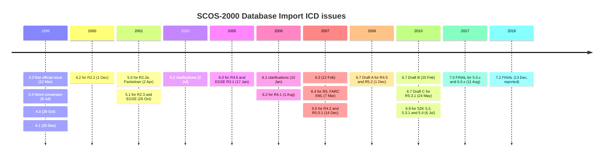

# History of the Database Import ICD (issues 5.1 to 7.2)

The **SCOS-2000 Database Import ICD** defines the ASCII tables of the [MIB](index.md). It
has changed together with [SCOS-2000](../scos2000/index.md) itself, from the first official
issue 3.2 in March 1999 to issue 7.0 in August 2017, and to an issue 7.2 of December 2019
that is known only indirectly. Each new issue documented a new SCOS-2000 release, merged
functions developed for particular missions (the Herschel/Planck checkout system and
Cryosat), or clarified how the importer actually behaved.[^i70-a1-hp][^i70-a1-cryo] Compatibility is a stated goal. Issue 6.0
preserved compatibility with databases built for S2K-R3.1. Issue 7.0 states that all its
changes are backwards compatible: new tables and fields may be omitted, so a MIB written to
the previous issue can still be imported.[^i70-331][^i70-log]

This page reconstructs that history from the four issues in the wiki's library, using the
change logs, the two annexes of implemented changes in issue 7.0, and a field-by-field
comparison of the table definitions in each issue.

| Issue in the library | Date | Document reference | Issued by | Library page |
|---|---|---|---|---|
| 5.1 | 2001-10-26 | S2K-MCS-ICD-0001-TOS-GCI | ESA/TOS-GCI, "SCOS-2000 Team" | [icd-5-1-tos-gci](../library/icd-5-1-tos-gci.md) |
| 6.7 Draft A | 2009-12-01 | EGOS-MCS-S2K-ICD-0001 | ESA/OPS-GIC, "SCOS-2000 R5.2 Team" | [icd-6-7-drafta](../library/icd-6-7-drafta.md) |
| 6.9 | 2010-07-06 | EGOS-MCS-S2K-ICD-0001 | ESA/OPS-GIC, "SCOS-2000 Team" | [icd-6-9-archive-org](../library/icd-6-9-archive-org.md) |
| 7.0 FINAL | 2017-08-11 | EGOS-MCS-S2K-ICD-0001 | ESA/OPS-GIC, "SCOS-2000 GIMUS Team" | [icd-7-0-final](../library/icd-7-0-final.md) |

The title pages give the dates, references and preparing teams.[^i51-title][^i67-title][^i69-title][^i70-title]
Between 5.1 and 6.x, the document reference changed from the "TOS-GCI" form to the "EGOS"
form, and the issuing unit appears as ESA/OPS-GIC instead of ESA/TOS-GCI. The library page of
each source records where and when this wiki copied it. The 6.9 copy is a third-party
copy held by the Internet Archive (a "manualzilla" item), not a download from ESA.

## Timeline



Issues 3.2 to 7.0 and their dates come from the 7.0 change log.[^i70-log] Issue 6.6 appears in
that log without a date, and no library document dates it. The Herschel Science Archive's
spacecraft database page, which is not in the library, gives "2008-08-25" for issue 6.6 as the
format reference of the Herschel-Planck database (see
[Herschel/Planck ground segment](../scos2000/herschel-planck-ground.md)).[^hsa-66] No issue 6.8
appears in any of the logs. The 7.2 entry is discussed [below](#issue-72-2019).

## Issues and SCOS-2000 releases

| Issue | Date | SCOS-2000 release(s) | Summary in the change log |
|---|---|---|---|
| 3.2 | 1999-03-12 | (first issue) | First official issue for SCOS-2000 |
| 3.3 | 1999-07-09 | – | Conversion into Microsoft Word (internal distribution only) |
| 4.0 | 1999-10-29 | – | Many editorial and some non-editorial changes |
| 4.1 | 1999-12-20 | – | Clarifications of the actual implementation |
| 4.2 | 2000-12-01 | R2.2 | Changes introduced in R2.2 |
| 5.0 | 2001-04-02 | R2.2e | Mainly the addition of the SCOS-2000 Packetiser |
| 5.1 | 2001-10-26 | R2.3 (to be implemented in R3.0), EGSE evolution | Changes of R2.3, plus specific additions for EGSE systems |
| 5.2 | 2003-07-02 | – | Clarifications |
| 6.0 | 2005-01-17 | R4.0, EGSE R3.1 | Extensions of S2K-R4.0 and EGSE R3.1. Compatible with S2K-R3.1 databases. |
| 6.1 | 2006-01-10 | – | Additional clarifications |
| 6.2 | 2006-08-01 | R4.1 | Merged the 4.0.1 and S2K-3.1_M-04 baselines (see `PCF_USCON`) |
| 6.3 | 2007-02-12 | – | Added the missing indication of document updates to Annex 1 |
| 6.4 | 2007-03-07 | R5 | Sequences and displays moved to the FARC as XML. SLE throw-event command type. |
| 6.5 | 2007-12-14 | R4.2, R5.0.1 | Updates for those releases |
| 6.6 | not in the change log (2008-08-25 per a web page outside the library) | – | See Annex 1 |
| 6.7 Draft A | 2009-12-01 | R4.5, R5.2.0i1 | Includes NCR-5711 and SPR-4911 |
| 6.7 Draft B | 2010-02-20 | R4.5, R5.2 | SCR-3774 (from DCR-6008) |
| 6.7 Draft C | 2010-05-24 | R5.3.1 | SPR-5504 (dynamic changes to TPSD) |
| 6.9 | 2010-07-06 | S2K 5.3, 5.3.1, 5.4 | Consolidated version merging the parallel branches s2k52, s2k53, s2k531 and s2k4.51 |
| 7.0 FINAL | 2017-08-11 | 5.5.x and 6.0.x (per Annex 2) | 17 change requests and document updates (Annex 2) |
| 7.2 FINAL | 2019-12-13 | not stated in the available sources | Not in the library (see below) |

The release mapping for 3.2 to 6.9 is taken from the change log.[^i70-log] For 7.0 it comes
from the "Applicable SCOS release" column of Annex 2.[^i70-a2] Issue 5.1 carries the same log
up to its own entry.[^i51-log] Two parallel SCOS-2000 lines can be seen in the table. The
**R4.x** line (4.0, 4.1, 4.2, 4.5) and the **R5.x** line (5.0 to 5.4) were maintained side by
side, which is why 6.5 serves both R4.2 and R5.0.1, and why 6.9 had to merge branches.

## The issues seen through their users

The library shows which issue real projects worked against:

* The Herschel/Planck instrument EGSE "S2K", version 2.3eP5 based on SCOS-2000 2.3e, used
  **ICD 5.1**. The HPSDB technical note of 2006 takes it as its applicable
  document.[^tn1060]
* The EGSE and Mission Control System (EMCS) user manual, issue 4.0, cites **ICD 5.1** for
  the MIB.[^emcs]
* The HIFI MIB editor requirements of August 2000 cite the ICD as "S2K-MCS-ICD-1-TOS-GCI"
  without an issue number.[^hifi]
* The Thales Alenia Space/Intecs SRDB Translator was compliant with **ICD 6.1** (its paper
  is undated in the PDF and cites issue 6.1 as "February 2006", while the 7.0 change log
  dates 6.1 to 10 January 2006). It could not import BepiColombo databases written to an
  earlier issue until the missing columns were added.[^comi][^i70-log]
* The 2025 Solar Orbiter MIB has the `pcf` (23 fields) and `cvs` (7 fields) layout of
  issues **6.9 and 7.0**. Its `cpc` stops after `CPC_OBTID` (15 fields), which is the
  6.7/6.9 layout without the 7.0 future-extension field `CPC_ENDIAN`. The Solar Orbiter SWA
  instrument database writes `pcf` with 19 fields, `cpc` with 13, `cvs` with 6, `caf` with
  7 and `pic` with 6, which are the **5.1** lengths, but `vdf` with 5, `ccf` with 21 and
  `dpc` with 7, which are the lengths introduced with **6.0**.[^solo][^swa]
* The STIX instrument database v2.26.38 has the same mixture: `pcf` with 19 fields, `cpc` with
  13, `pic` and `cvs` with 6 and `caf` with 7 (the **5.1** lengths), but `vdf` with 5 and `ccf`
  with 21 (see [the STIX page](../missions/solar-orbiter/stix.md)).[^stix]

## What changed, era by era

### Up to issue 5.1 (1999–2001)

Issue 5.1 already has 48 of the 53 tables of issue 7.0. It lacks only `cur`, `lgf`, `grp`,
`grpa` and `grpk` (see the [field comparison](#field-level-comparison-of-the-library-issues)).
Its Annex 1 lists the document changes that led to it:[^i51-a1]

* **DCR-237.** PTC 5 / PFC 4 was added, so that 48-bit MIL-STD reals are supported.
* **DCR-251.** User-defined constants were aligned with the consolidated ICD 4.3. One UDC can
  no longer belong to both the static and the dynamic view.
* **DCR-253.** The mapping from identification fields to SPIDs must not change, and SPIDs used
  during a mission phase must not be deleted. Data retrieval functions such as GDDS rely on
  this (see [GDDS](../scos2000/gdds-and-ddids.md)).
* **DCR-260.** Only one valid SPID/TPSD/APID/type/subtype combination is allowed, for
  filtering in the packet history display.
* **DCR-261.** Parameter names may not start with `$`.
* **DCR-262.** `VPD_OFFSET` was added, so that variable packet definitions can contain gaps
  and overlaps.
* **DCR-263.** The applicability fields `OCP_RLCHK`/`OCP_VALPAR` are not used for status
  consistency checks. The start reference of `pic` positions became the start of the source
  packet header.
* **DCR-255.** `CSF_ELEMS` was widened from 3 to 5 digits.
* **DCR-188.** High-priority commands may not be blocked. Blocking means aggregation into one
  segment.
* **DCR-241.** A new command category `S` was introduced, for which no CRC is appended. The
  annex writes the field as `CCF_TYPE`, while the 5.1 and 7.0 field tables carry the option
  in `CCF_CTYPE`.[^i70-ctype]
* **DCR-242.** A new, optional routing table was added (`dst`, for EGSE systems).
* **DCR-266.** `CCF_APID`, `CCF_RAPID` and `PID_APID` were widened from Number(4) to
  Number(5). Values 0–2047 identify on-board APIDs and 2048–65535 ground processes.

### Issue 6.0 (2005): SCOS-2000 R4.0 and the checkout repatriations

Issue 6.0 is the largest single change in the library record. Its content is listed in the
7.0 Annex 1 under several headings.[^i70-a1-60]

**R4.0 change requests.** DCR-2421 extended `PCF_PID` and `PID_SPID` from 2^31−1 to 2^32−1.
DCR-2422 allowed super-commutated parameters in alphanumeric displays.[^i70-a1-60]

**Functions repatriated from the Herschel/Planck Central Checkout System:**[^i70-a1-hp]

| Function | MIB impact |
|---|---|
| Curve selection | New table `cur`. A parameter can have several calibrations, selected by another parameter's value. |
| Delta limits | New monitoring check type: the change between successive samples must stay within a threshold. |
| Enable/inhibit parameter or packet | Processing can be stopped per parameter or per packet. |
| Parameter and packet groups | New tables `grp`, `grpa` and `grpk`, for enabling or inhibiting by group |
| Curve ID | Calibration identifiers changed from Number(4) to Char(10) |
| Verification stage ID | `CVS_ID` widened from Number(5) to Number(8) (later restricted again, see 6.7). The `CVS_ID` field itself is printed as Number(5) in all four library issues. |
| Range set ID | Command parameter range set identifiers changed from Number(4) to Char(10) |
| Logarithmic curve | New table `lgf`, Y = 1 / (A0 + A1·ln X + A2·ln² X + A3·ln³ X + A4·ln⁴ X), for platinum thermistors |
| String parameters | Octet and character strings editable on manual stacks |
| Variable strings | Optional automatic insertion of the PUS length field *n* |

The Herschel/Planck HPSDB note of 2006 still lists `cur`, `grp`, `grpa`, `grpk` and `lgf`
as "Specific CCS data" next to the ICD 5.1 tables. It confirms that these tables began as
checkout-system extensions.[^tn1060-ccs]

**Functions repatriated from Cryosat:** "Command ID" and "Parameter ID" command parameters,
and a default sub-schedule ID for execution-time-tagged commands. The sub-schedule ID added
one field each to `ccf` and `csf`, namely `CCF_SUBSCHEDID` and `CSF_SUBSCHEDID`.[^i70-a1-cryo]

**R4.0 table changes:** `vdf` gained the domain, release and issue fields. `gpc` gained
`GPC_DOMAIN`, for multi-domain graphic displays (the same for ANDs and SCDs only from
R5.0). Status parameters can have several OOL check sets with different applicability.
`dpc` allows free-text entries (`DPC_TEXT`). Report-based verification can be disabled
dynamically, through `CCF_ACK`.[^i70-a1-r40]

**EGSE delivery only:** `PCF_NATUR` = `P`, for SPEL-based derived parameters.[^i70-a1-egse]

### Issues 6.1 to 6.3 (2006–2007): R4.1 and clarifications

Issue 6.1 restricted 48-bit reals (5/4) to command parameters (S2K-40-DCR-808). It stated
that progress verification stages from spacecraft reports must be at stage 0 (DCR-0821). It
corrected the `PLF_TDOCC` default from 0 to 1 (DCR-847). It also integrated DCRs from
SCOS-2000 3.1 maintenance releases and clarified group repeaters and delta limits.[^i70-a1-61]
Issues 6.2 and 6.3 (R4.1) changed the field types of the calibration and verification
identifiers (`CAF_NUMBR`, `CAP_NUMBR`, `TXF_NUMBR`, `TXP_NUMBR`, `CVS_ID`, `CVP_CVSID`,
`CCA_NUMBR`). They also removed the mandatory flag from `PCF_NATUR` and updated many field
descriptions.[^i70-a1-62]

### Issue 6.4 (2007): SCOS-2000 R5 and the FARC

With R5.0, command sequences and display definitions left the run-time database. They are
converted into XML files in the FARC and imported as deltas, so they can be changed without
re-importing the TM/TC database (see [The MIB](index.md#sequences-and-displays-live-in-the-farc-from-r50)).
Issue 6.4 also added:[^i70-a1-64]

* a new command type for **SLE throw events**, `CCF_CTYPE` = `T`;
* **command parameters of type Deduced**;
* the absolute time format **9/1** (CDS without µs);
* the rule that only parameters processed by the TM model may be used in `CDF_TMID`,
  `CUR_RLCHK`, `PCF_VALID`, `OCP_RLCHK`, `PTV_PARNAM`, `CVE_PARNAM` and in displays.

### Issues 6.5 and 6.6: R4.2 and R5.0.1

Issue 6.5 added the following:[^i70-a1-65]

* `PIC_APID` (SPR-3071, DCR-4535), so that the position of the extra identification fields
  can depend on the APID as well as on type/subtype;
* `SDF_REPPOS` (SPR-2904), so that commands with group repeaters can be used in sequences;
* **NIS throw events** (`CCF_CTYPE` = `N`), beside SLE throw events (see
  [NCTRS and NIS](../scos2000/nctrs-nis.md));
* `CSP_FPNUM` extended to 65,535 formal parameters;
* the deprecation of several packets sharing one SPID, since R5.0 stores packets in a
  database.

Issue 6.6 only clarified `OCP_TYPE`, `CCF_HIPRI` (high-priority commands cannot be blocked)
and the `CDF_ELTYPE`/`SDF_FTYPE` combinations.[^i70-a1-66]

### Issue 6.7 (2009–2010): R5.2, time correlation and the DARC

Issue 6.7 brought the `pcf` record to its final length of 23 fields. Draft A already has
all four new fields:[^i70-a1-67][^i67-pcf]

* `PCF_DARC` (S2K-DCR-5146, S2K-SPR-5711) flags parameters for the parameter archive
  ([DARC](../scos2000/archives.md)). The importer itself ignores it.
* `PCF_CORR` and `PCF_OBTID`, with `CPC_CORR` and `CPC_OBTID` (S2K-SCR-4917), encode time
  parameters according to on-board clock and correlation. The Unix time format **9/30** came
  with them.
* `PCF_ENDIAN` (S2K-DCR-5192) is meant for little-endian telemetry. Draft A and 6.9 still
  describe it as a field that "can be used in the future". Issue 7.0 removes that wording
  (S2K-8353, applicable from SCOS-2000 6.0.1).[^i67-pcf][^i70-a2]
* `PCF_DESCR` was widened from 16 to 24 characters (S2K-SPR-3797).

Issue 6.7 also restricted `CVS_ID` to a signed short (S2K-DCR-3909). It documented
`CAF_INTER`, present since R4 but never described (S2K-SPR-4911). And it added
**Appendix C**, on PUS support in SCOS-2000 (S2K-DCR-5303).[^i70-a1-67] Draft B added
`CVS_UNCERTAINTY` (S2K-SCR-3774), a per-stage verification window that overrides the TC
SPACON default. Draft A does not yet have this field. Issue 6.9 has it.[^i70-a1-69][^i67-cvs][^i69-cvs]

### Issue 6.9 (2010): the consolidated R5.3/R5.4 baseline

Issue 6.9 merged the parallel R5.2, R5.3, R5.3.1 and R4.5.1 work into one document. It set
`CVE_CVSID` and `CVP_CVSID` to Number(5), in line with `CVS_ID`. It made `PCF_OBTID` and
`CPC_OBTID` applicable from s2k52. It added §3.3.2.1.5 on **system control parameters**
(SCTL and the `SCTLgenerateMIB` tool).[^i70-a1-69]

### Issue 7.0 (2017): 17 changes for 5.5.x and 6.0.x

Annex 2 of issue 7.0 lists every change, with the SCOS-2000 release from which it
applies:[^i70-a2]

| ID | Type | Change | Applicable release |
|---|---|---|---|
| S2K-6680 | Change request | New usage of `CSF_SUBSCHEDID` | 5.5.2+, 6.0.0+ |
| S2K-8073 | Change request | Value fields (`CPC_DEFVAL`, `CDF_VALUE`, `CSP_DEFVAL`, `SDF_VALUE`, `CCS_XVALS`, `CCS_YVALS`, `PAS_ALVAL`, `PAS_ALTXT`, `PVS_VALS`, `PRV_MINVAL`, `PRV_MAXVAL`) limited only by the maximum command size. Importer warnings removed. | 5.5.3+, 6.0.0+ |
| S2K-8325 | Change request | `PCF_INTER` and `CAF_INTER` descriptions aligned with the implementation | 5.5.4+, 6.0.0+ |
| S2K-8137 | Document update | ORACLE reference removed from §1.1 | all |
| S2K-8353 | Change request | `PCF_ENDIAN` description updated | 6.0.1+ |
| S2K-8560 | Document update | `CCF_ILSCOPE` values `F` and `T` documented (already supported) | all |
| S2K-8528 | Document update | `PIC_APID` made part of the key | 4.2+ |
| S2K-7551 | Document update | Files are in Unix format | all |
| S2K-7749 | Document update | New field `CPC_ENDIAN` as a future extension | none |
| S2K-7750 | Document update | `VPD_FIXREP` = −1 (repeat the group until the end of the packet) as a future extension | none |
| S2K-6884 | Change request | Reserved ground-station parameter names listed under `PCF_NAME` | all |
| S2K-8572 | Document update | `PCF_CORR` must be `N` for relative times | all |
| S2K-8063 | Document update | Blocking problem with the maximum time-tag encoding length explained | all |
| S2K-8681 | Document update | TMPH does not handle conditional calibration: the Packet History display shows raw values for such parameters (§3.3.2.2.1) | all |
| S2K-8782 | Document update | `CDF_VALUE` description updated | all |
| S2K-8226 | Change request | TC(11,4) encoded according to its `cdf` definition (MISCconfig variables) | 5.5.4+ |
| S2K-8778 | Document update | `CPC_CORR` cannot be `Y` for relative times | all |

### Issue 7.2 (2019)

!!! warning "Not in the library"
    No copy of issue 7.2 is in this wiki's library, and nothing on this page about 7.2 has
    been checked against the document itself. Two web pages outside the library report
    it, and this wiki has not re-opened either of them:

    * The Solar Orbiter operations wiki is reported to list the MIB ICD "iss 7.2, Final
      version, Dec 2019" among the MOC applicable documents:
      <https://issues.cosmos.esa.int/solarorbiterwiki/display/SOSP/MOC+Applicable+Documents>.
    * The documentation of the Python library **pyscos2000** (IRF) is reported to state that
      its table schemas are based on EGOS-MCS-S2K-ICD-0001 issue 7.2-FINAL of 2019-12-13:
      <https://irf.developer.irf.se/pyscos2000/>.

This wiki builds its SQLite copies of the MIB with column names taken from the pyscos2000
schema (see [MIB tooling](tooling.md)). Comparing those column lists with ICD 7.0 shows what
pyscos2000 expects:

| Table | ICD 7.0 | pyscos2000 ("7.2") | Difference |
|---|---|---|---|
| `pcf` | 23 fields, ending `PCF_ENDIAN` | 24 columns | An extra last column, `PCF_DESCR2` |
| `cpc` | 16 fields, ending `CPC_ENDIAN` | 17 columns | `CPC_DESCR2` inserted before `CPC_ENDIAN` |
| `vdf`, `cpc`, `css` | `VDF_DOMAINID`, `CPC_PNAME`, `CPC_OBTID`, `CSS_STAPTV` | `VDF_DOMAIN`, `CPC_NAME`, `CPC_OBTIP`, `CSS_STATPTV` | Spelling only |
| all others among its 36 tables | – | same names and order | – |

pyscos2000 has no schema for 17 of the 53 ICD 7.0 tables: `grp`, `grpa`, `grpk`, the eight
display tables, `cvs`, `cve`, `cvp`, `cps`, `pvs` and `psm`.

!!! warning "Inference"
    The two "DESCR2" columns suggest that issue 7.2 added a long second description to
    monitoring and command parameters, like the existing `CCF_DESCR2` and `CSF_DESC2`. The
    spelling differences may be pyscos2000's own choices or real 7.2 renamings, and the
    available sources cannot tell which. The Solar Orbiter files, which follow the 7.2
    baseline according to the operations wiki above, use neither `PCF_DESCR2` (23 fields
    per `pcf` line) nor `CPC_ENDIAN` (15 fields per `cpc` line).[^solo]

## Field-level comparison of the library issues

The table below compares the field tables of the four issues in the library. Fields were
extracted from the text of each PDF, with their position, key flag and declared type, and
compared table by table, then checked by hand against the PDF text. Only differences are
listed. Two apparent differences are typing errors in issue 5.1 and are not listed: it numbers
both `PID_EVENT` and `PID_EVID` as field 15, and prints `PPF_NBPR` as `PPF_NBPR0`. Issue 6.9
prints the `CVE_CVSID` and `CVP_CVSID` types as "Number(105", read here as the Number(5) that
its Annex 1 entry states.[^i51-tables][^i69-cvsid]

| Table | 5.1 → 6.7 Draft A | 6.7 Draft A → 6.9 | 6.9 → 7.0 |
|---|---|---|---|
| `vdf` | +`VDF_DOMAINID`, `VDF_RELEASE`, `VDF_ISSUE` (2 → 5 fields) | – | – |
| `pcf` | +`PCF_CORR`, `PCF_OBTID`, `PCF_DARC`, `PCF_ENDIAN` (19 → 23). `PCF_DESCR` Char(16) → Char(24). `PCF_CURTX` Number(4) → Char(10). | – | – |
| `cur`, `lgf`, `grp`, `grpa`, `grpk` | new tables | – | – |
| `caf`, `cap`, `txf`, `txp`, `mcf`, `cca`, `ccs`, `paf`, `pas`, `prf`, `prv` | Identifier Number(4) → Char(10). +`CAF_INTER`. | – | Value fields of `ccs`, `pas` and `prv` lose their length limit |
| `pic` | +`PIC_APID` (6 → 7) | – | `PIC_APID` becomes a key |
| `dpc`, `gpc` | +`DPC_TEXT`, +`GPC_DOMAIN` | – | – |
| `ccf` | +`CCF_SUBSCHEDID` (20 → 21) | – | – |
| `cpc` | +`CPC_CORR`, `CPC_OBTID` (13 → 15). Reference fields Number(4) → Char(10). | – | +`CPC_ENDIAN` (15 → 16). `CPC_DEFVAL` unlimited. |
| `cdf` | `CDF_GRPSIZE` becomes a key | – | `CDF_VALUE` unlimited |
| `csf` | +`CSF_SUBSCHEDID` (15 → 16) | – | – |
| `css` | `CSS_EXTIME` Char(16) → Char(17) | – | – |
| `sdf` | +`SDF_REPPOS` (9 → 10). `SDF_PNAME` becomes a key. | – | `SDF_VALUE` unlimited |
| `csp` | `CSP_FPNUM` Number(3) → Number(5). Reference fields → Char(10). | – | `CSP_DEFVAL` unlimited |
| `cvs` | – | +`CVS_UNCERTAINTY` (6 → 7) | – |
| `cve`, `cvp` | `*_CVSID` Number(5) → Number(10) | → Number(5) (per Annex 1) | – |
| `pvs` | – | – | `PVS_VALS` unlimited |

The rows above are this wiki's comparison of §3.3 in each issue.[^i51-tables][^i67-pcf][^i69-cvs][^i70-keys]
Each change matches an Annex 1 or Annex 2 entry described above. The table count rose from
48 (5.1) to 53 (6.7 Draft A onwards) and has not changed since, as far as the library
issues show.

!!! note "How to read 'unlimited'"
    In issue 7.0, the value fields are typed `Char` without a length. §3.3 explains that a
    field without a length is limited by another limit, here the maximum size of a
    command.[^i70-conv]

## Practical consequences for MIB producers and consumers

* **Readers must accept several record lengths.** The 7.0 importer reads `pcf` records with
  19 to 23 fields, and the backward-compatibility rule covers the other tables
  too.[^i70-pcf][^i70-331] Real deliveries differ: 23 fields for the Solar Orbiter `pcf`,
  19 for the SWA IDB.[^solo][^swa] A tool that hard-codes one issue's field count will
  reject valid MIBs. This is the failure the SRDB Translator ran into with BepiColombo
  databases.[^comi]
* **Identifiers changed type.** Calibration and range-set identifiers changed from numbers
  to strings in 6.0 (verification-stage identifiers stayed numeric). A 5.1-era tool that stores them as integers loses
  leading zeros and cannot represent names such as `CIT01053TM`.[^i70-a1-hp][^solo]
* **Sequences and displays are delta-imported** from R5.0. Removing a definition from the
  ASCII files does not remove it from the FARC.[^i70-25]
* **Future-extension fields exist.** `CPC_ENDIAN`, `VPD_FIXREP` = −1 and `CVS_SPID` are
  documented but not implemented (the first two are "No SCOS version" in Annex 2). A MIB may
  fill them in, but SCOS-2000 will not act on them.[^i70-a2][^i70-cvsspid]

??? example "SQL and commands used for the Solar Orbiter field counts"
    ```bash
    # fields per line in the raw .dat files (2025 and 2020 releases, SWA IDB)
    awk -F'\t' '{print NF}' pcf.dat | sort | uniq -c    # 2025: 126745 x 23; SWA: 2885 x 19
    awk -F'\t' '{print NF}' cpc.dat | sort | uniq -c    # 2025: 7155 x 15;   SWA: 531 x 13
    awk -F'\t' '{print NF}' cvs.dat | sort | uniq -c    # 2025: 206 x 7;     SWA: 2 x 6
    ```
    ```sql
    -- the SQLite copy uses the pyscos2000 column names; the extra columns stay empty
    SELECT count(*) FROM pcf WHERE PCF_DESCR2 <> '';    -- 0
    SELECT count(*) FROM cpc WHERE CPC_ENDIAN <> '';    -- 0
    ```

## Related pages

* What the tables contain today: [The MIB](index.md), [MIB data model](data-model.md),
  [MIB parameter types](parameter-types.md).
* SCOS-2000 releases and their context: [SCOS-2000](../scos2000/index.md),
  [SCOS-2000 architecture](../scos2000/architecture.md),
  [Ancillary systems and EGS-CC](../scos2000/ancillary-and-egs-cc.md).
* The parallel history of ESA's packet standards, from the PSS series to CCSDS and ECSS:
  [From ESA PSS to CCSDS and ECSS](../overview/history.md).
* Missions behind the repatriated functions: [Herschel and Planck](../missions/herschel-planck.md),
  [Rosetta, Mars Express and Venus Express](../missions/rosetta-mex-vex.md),
  [Other missions](../missions/other-missions.md).

[^i70-331]: [SCOS-2000 Database Import ICD issue 7.0](../library/icd-7-0-final.md), §3.3.1 General (backwards compatibility), PDF p. 37.
[^i70-log]: [ICD 7.0](../library/icd-7-0-final.md), Document change log, PDF pp. 3–6.
[^i51-title]: [ICD issue 5.1](../library/icd-5-1-tos-gci.md), title and approval pages, PDF pp. 1–2.
[^i67-title]: [ICD issue 6.7 Draft A](../library/icd-6-7-drafta.md), title and approval pages, PDF pp. 1–2.
[^i69-title]: [ICD issue 6.9](../library/icd-6-9-archive-org.md), title and approval pages, PDF pp. 1–2.
[^i70-title]: [ICD 7.0](../library/icd-7-0-final.md), title and approval pages, PDF pp. 1–2.
[^i70-a2]: [ICD 7.0](../library/icd-7-0-final.md), Annex 2 "List of implemented Document Changes in ICD Version 7.0", PDF pp. 261–263.
[^i51-log]: [ICD 5.1](../library/icd-5-1-tos-gci.md), Document change log, PDF pp. 3–4.
[^tn1060]: [H-P-1-ASP-TN-1060, MIB files processing by HPSDB](../library/h-p-1-asp-tn-1060-mib-processing-hpsdb.md), §1 Scope, §2.1 Applicable documents and §3 Acronyms, PDF pp. 7–8.
[^emcs]: [EMCS SUM issue 4.0](../library/emcs-sum-4-0.md), reference [R5], PDF p. 8.
[^hifi]: [HIFI MIB editor requirements, SRON-U/HIFI-SP-2000-2](../library/hifi-mib-editor-requirements.md), §2 Applicable documents, PDF p. 3.
[^comi]: [Comi, Insinga, Sala, SRDB Translator](../library/indico-109-comi-2009436.md), "Main Features" and "Limits", PDF pp. 5–6.
[^solo]: [Solar Orbiter MIB release MIB__20250916M25925PFMS001_SOL](../library/mib-20250916m25925pfms001-sol.md), raw files `pcf.dat`, `cpc.dat`, `cvs.dat` and the SQLite copy, inspected by this wiki on 2026-11-12. The 2020 release ([MIB__20200416M10720PFMS001_SOL](../library/mib-20200416m10720pfms001-sol.md)) has the same field counts.
[^stix]: [STIX instrument database v2.26.38](../library/stix-idb-v2-26-38-raw.md), raw files `pcf.dat`, `cpc.dat`, `pic.dat`, `cvs.dat`, `caf.dat`, `vdf.dat` and `ccf.dat` (TAB-separated fields per record counted), inspected by this wiki on 2026-11-12.
[^swa]: [Solar Orbiter SWA instrument database (ASCII)](../library/swa-idb-ascii.md), raw files `pcf.dat`, `cpc.dat` and `cvs.dat`, inspected by this wiki on 2026-11-12.
[^i51-a1]: [ICD 5.1](../library/icd-5-1-tos-gci.md), Annex 1 "List of implemented Document Changes", PDF pp. 119–120.
[^i70-ctype]: [ICD 7.0](../library/icd-7-0-final.md), §3.3.3.2.1 field `CCF_CTYPE` (option `S`), PDF p. 134.
[^i70-a1-60]: [ICD 7.0](../library/icd-7-0-final.md), Annex 1, "Document Changes applicable as from R4.0 implemented in the ICD version 6.0", PDF p. 246.
[^i70-a1-hp]: [ICD 7.0](../library/icd-7-0-final.md), Annex 1, "Implement modifications related to Hershel & Planck Check Out System functionalities repatriation implemented in the ICD version 6.0", PDF pp. 246–248.
[^tn1060-ccs]: [H-P-1-ASP-TN-1060](../library/h-p-1-asp-tn-1060-mib-processing-hpsdb.md), table of contents, §5.4 "Specific CCS data", PDF p. 6.
[^i70-a1-cryo]: [ICD 7.0](../library/icd-7-0-final.md), Annex 1, "Cryosat special command/sequence parameter types repatriation integrated in release 4.0", PDF p. 249.
[^i70-a1-r40]: [ICD 7.0](../library/icd-7-0-final.md), Annex 1, "Implement modifications related to SCOS-2000 R4.0 in ICD version 6.0", PDF pp. 249–250.
[^i70-a1-egse]: [ICD 7.0](../library/icd-7-0-final.md), Annex 1, "Document Changes only applicable in the EGSE Delivery in ICD version 6.0", PDF p. 250.
[^i70-a1-61]: [ICD 7.0](../library/icd-7-0-final.md), Annex 1, "Additional modifications implemented in ICD version 6.1", PDF pp. 251–252.
[^i70-a1-62]: [ICD 7.0](../library/icd-7-0-final.md), Annex 1, "Changes applicable as from R4.1 implemented in ICD versions 6.2/6.3", PDF pp. 253–254.
[^i70-a1-64]: [ICD 7.0](../library/icd-7-0-final.md), Annex 1, "Changes applicable as from R5.0 implemented in ICD version 6.4" and the 6.4 clarifications, PDF pp. 254–255.
[^i70-a1-65]: [ICD 7.0](../library/icd-7-0-final.md), Annex 1, changes and clarifications of ICD version 6.5, PDF pp. 255–257.
[^hsa-66]: Web page outside the library: <https://archives.esac.esa.int/hsa/legacy/operations/moc/sdb/>, as surveyed for this project on 2026-11-05 and reported on [Herschel/Planck ground segment](../scos2000/herschel-planck-ground.md); not re-checked for this page and not archived in this wiki's library.
[^i70-a1-66]: [ICD 7.0](../library/icd-7-0-final.md), Annex 1, "Document clarifications introduced in ICD version 6.6", PDF p. 257.
[^i70-a1-67]: [ICD 7.0](../library/icd-7-0-final.md), Annex 1, "Changes applicable as from R5.2 implemented in ICD version 6.7" and the 6.7 clarifications, PDF pp. 258–259.
[^i67-pcf]: [ICD 6.7 Draft A](../library/icd-6-7-drafta.md), §3.3.2.1.1 pcf, fields 2 and 20–23, PDF pp. 38 and 50–51.
[^i70-a1-69]: [ICD 7.0](../library/icd-7-0-final.md), Annex 1, "Document clarifications introduced in ICD version 6.9" and "Changes applicable as from R5.2 in ICD version 6.7" (S2K-SCR-3774), PDF p. 260.
[^i67-cvs]: [ICD 6.7 Draft A](../library/icd-6-7-drafta.md), §3.3.3.4.1 cvs (fields 1–6 only), PDF pp. 180–181.
[^i69-cvs]: [ICD 6.9](../library/icd-6-9-archive-org.md), §3.3.3.4.1 cvs, field 7 `CVS_UNCERTAINTY`, PDF p. 186.
[^i69-cvsid]: [ICD 6.9](../library/icd-6-9-archive-org.md), §3.3.3.4.2 cve and §3.3.3.4.3 cvp, PDF pp. 187 and 192, and Annex 1 entry S2K-DCR-3909, PDF p. 250.
[^i51-tables]: [ICD 5.1](../library/icd-5-1-tos-gci.md), §3.3 field tables, PDF pp. 22–104.
[^i70-keys]: [ICD 7.0](../library/icd-7-0-final.md), §3.3 field tables, PDF pp. 37–213.
[^i70-conv]: [ICD 7.0](../library/icd-7-0-final.md), §3.3 Detailed definition of the ASCII tables structure, PDF p. 35.
[^i70-pcf]: [ICD 7.0](../library/icd-7-0-final.md), §3.3.2.1.1 pcf (note on fields 20–23), PDF p. 40.
[^i70-25]: [ICD 7.0](../library/icd-7-0-final.md), §2.5 Import options, PDF p. 24.
[^i70-cvsspid]: [ICD 7.0](../library/icd-7-0-final.md), §3.3.3.4.1 field `CVS_SPID` ("future extension"), PDF p. 194.
