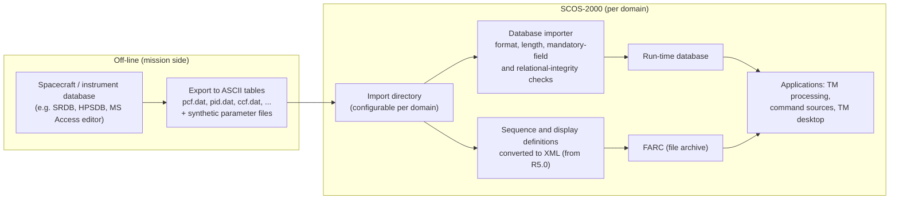
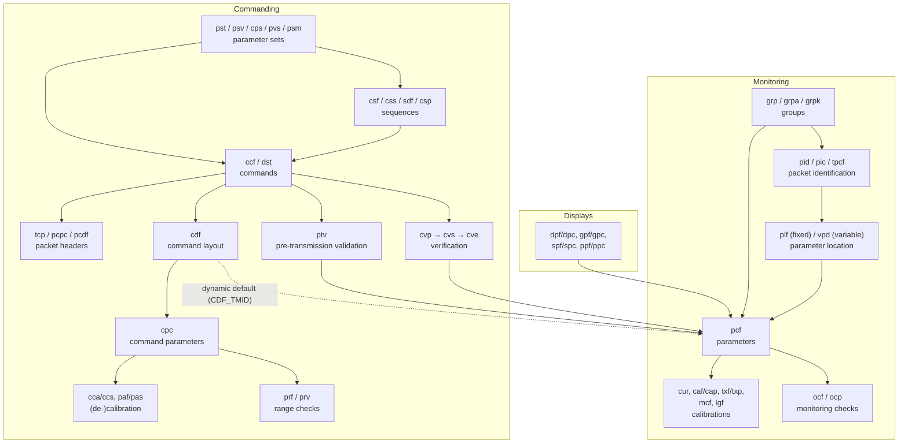

# The MIB: Mission Information Base

The **Mission Information Base (MIB)** is the body of data that tells ESA's mission control
system [SCOS-2000](../scos2000/index.md) everything it must know about one spacecraft: every
telemetry parameter and how to extract, calibrate and limit-check it, every telemetry packet
and how to recognise it, every telecommand and how to encode, check and verify it, and the
command sequences and displays built on top of them. The MIB is delivered to SCOS-2000 as a
set of tab-separated ASCII files, one file per table, whose layout is fixed by the
**SCOS-2000 Database Import ICD** (EGOS-MCS-S2K-ICD-0001). SCOS-2000 then imports these files
into its own run-time database.[^i70-scope]

This page explains what the MIB contains and how the interface works. It then maps all 53
tables of the ICD and takes a tour of a real, publicly posted MIB: the one used to operate
[Solar Orbiter](../missions/solar-orbiter/index.md). Related pages go deeper:

* [MIB data model](data-model.md): how the tables reference each other (keys and join paths).
* [MIB parameter types](parameter-types.md): the PTC/PFC codes that define every value's encoding.
* [History of the Database Import ICD](icd-history.md): how the tables evolved from issue 3.2 (1999) to 7.2 (2019).
* Topic pages on [monitoring](monitoring.md), [calibration](calibration.md),
  [monitoring checks](monitoring-checks.md), [commanding](commanding.md),
  [command verification](command-verification.md), [sequences and parameter sets](sequences.md),
  [displays](displays.md), [synthetic parameters](synthetic-parameters.md),
  [mission tailoring](tailoring.md) and [tooling](tooling.md).
* One generated reference page per table under [MIB tables](tables/index.md), and the
  interactive [MIB explorer](../explorer/index.md) for browsing the Solar Orbiter data.

## What the MIB is

### Static database and dynamic archive

The ICD divides the SCOS-2000 Mission Information Base into two parts. The **static part**,
usually just called "the database", holds the definitions described on this page. The
**dynamic part** is the packet archive, which holds the telemetry and telecommand history
that SCOS-2000 records during operations.[^i70-defs] The Database Import ICD only concerns the
static part. The other sources in this library also use "MIB" for the static database, for
example the HIFI team's description of the MIB as a set of ASCII files,[^hifi-req] and that
is how this wiki uses the word. Issue 5.1 of the ICD (2001) still called the dynamic part the
"history files"; issue 6.7 replaced that term with "packet archive".[^i51-defs][^i70-a1-hist]

### The scope of the ICD: generic tables only

The ICD describes how a "client mission" must present its data so that the SCOS-2000
importer can read it. It covers only the "generic" portion of the static database, meaning
the data that standard SCOS-2000 functions need. The abstract states explicitly that
mission-specific extensions are possible.[^i70-abstract] Two mechanisms support this:

* **Extra fields.** A mission may add its own fields to any table, but only at the end of
  each record. The length of these extra fields is limited only by the maximum string size
  of the computer that runs the importer.[^i70-23]
* **Extra tables and files.** A mission may deliver further files for its own applications.
  For some tables that SCOS-2000 itself does not use, the ICD prints a complete suggested
  structure, so that mission-specific implementations stay harmonised. These "grey" tables
  are not imported.[^i70-conv2]

The Solar Orbiter MIB uses both mechanisms (see the [tour below](#a-tour-of-the-solar-orbiter-mib)).
Mission tailoring in general is covered in [Mission tailoring of the MIB](tailoring.md).

### Raw, engineering and encoded values

Three words describe a parameter's value throughout the ICD, and the distinction matters
for every table:[^i70-defs]

| Term | Meaning in the ICD |
|---|---|
| **Raw value** | For a monitoring parameter, the value before calibration. For a command or sequence parameter, the value after de-calibration. For a synthetic parameter, the output of its OL or hard-coded routine. |
| **Engineering value** | The calibrated value, for example a temperature in °C. |
| **Encoded value** | The actual bits carried in the TM or TC packet. SCOS-2000 encodes and decodes it automatically according to the parameter type, and never displays it. |

The raw value and the encoded value are identical only for unsigned integers. The ICD's own
example: a 16-bit signed integer with raw value −1 has the encoded value `0xFFFF`.[^i70-defs]
The encoding rules for each type are on [MIB parameter types](parameter-types.md).

### Names and identifiers

When an item's unique ID is an alphanumeric string (typically up to 8 characters, such as a
parameter name), the ICD calls it a **name**. When the ID is a number (such as a command
verification stage), it calls it an **identifier**.[^i70-defs] Names must be unique
regardless of letter case: `A1000` and `a1000` may not coexist, and the importer does not
warn if they do. Spaces inside names are discouraged.[^i70-conv1] Some names are reserved.
Monitoring parameter names may not start with `VAR`, `GVAR` or `$`, because the Operations
Language uses those prefixes to identify other kinds of objects. The prefixes `NNO`, `CEB`,
`KRU`, `MSP`, `VL2`, `PER`, `RED` and `MLG` followed by four digits are reserved for
ground-station telemetry.[^i70-pcfname]

## From the off-line database to the run-time system

The ICD describes a four-step activation process:[^i70-scope]

1. The mission's MIB is converted or exported from its **off-line database system** into
   ASCII files that follow the ICD.
2. The ASCII files are copied to a directory that the SCOS-2000 importer can read.
3. The importer converts them into the SCOS-2000 run-time database format and location.
4. Each application that needs the data uses it after its next restart.



The diagram combines §1.1 and §2.5 of the ICD.[^i70-scope][^i70-25b] The ICD sets no rules on
how the off-line database is built or maintained. It mentions MS Access as a typical
off-line system. Issue 5.1 also named ORACLE, and issue 7.0 removed that reference
(change S2K-8137).[^i70-21][^i51-scope][^i70-a2]

### Where missions get their MIB

In practice, the MIB is generated from a larger engineering database that the spacecraft
prime contractor or instrument team maintains. The sources in this wiki's library describe
several such set-ups:

* **The ICD's own view.** Appendix C notes that new housekeeping packets are best defined
  in the TM/TC database first, with the matching PUS service 3 commands then generated from
  that definition. ESA missions typically do this in a mission-specific "TM/TC database
  manager", not in the run-time SCOS-2000 kernel.[^i70-c3] The library sources do not name
  or describe a specific ESA database-manager product (such as a "DBM").
* **Satellite Reference Database (SRDB).** A paper by Intecs and Thales Alenia Space
  Italia (the PDF carries no date; the newest document it cites is ICD issue 6.1 of 2006)[^comi-7]
  notes that SCOS-2000 had become standard in ESA missions, so the SRDB holding all
  spacecraft data definitions was "almost always" based on the SCOS-2000 run-time database.
  Their *SRDB Translator* imports a SCOS-2000-compliant SRDB into the ECHO checkout system.
  It was first developed for Galileo GIOVE-B, whose SRDB was delivered as a single MS Access
  2000 file, and was reused for Sentinel-1 and BepiColombo.[^comi-1][^comi-6] The paper
  also documents mismatches between data models. Two examples: SCOS-2000 numerical
  calibration curve IDs are `Char(10)`, while ECHO uses integers from 1 to 9999. SCOS-2000
  handles logarithmic curves, which ECHO originally did not.[^comi-4]
* **Solar Orbiter.** The spacecraft TM/TC ICD states that on-board parameter IDs are defined
  in the SRDB and are frozen for a given central software (CSW) release.[^sol-srdb]
* **Herschel/Planck.** The *Herschel/Planck System Data Base* (HPSDB), developed by GMV,
  kept data consistent between engineering, on-board software, AIT and flight
  operations.[^nlr-hpsdb] An Alcatel Alenia Space technical note describes how HPSDB ingested
  instrument MIBs written to ICD issue 5.1, and generated SCOS-2000 or Central Checkout
  System MIB files from its own object model. It lists the constraints that make a round
  trip loss-free. For example, the output files are sorted by the ICD primary keys, orphan
  items are not loaded, and every description field must be filled in.[^tn1060-scope][^tn1060-sort]
* **Instrument teams.** For the Herschel (then "FIRST") instruments, which used SCOS-2000 as
  EGSE, the HIFI team specified a MIB editor. It required one table per SCOS-2000 file and
  column names exactly as in the ICD, and it described the MIB as "more than 30 ASCII
  files".[^hifi-req] Their evaluation of ESOC's MS Access-based editor (the "Integral MS
  Access editor", version 2.0) shows typical problems. In the version they assessed, a
  polynomial curve could not be referenced from `PCF_CURTX`, and the VDF table was filled in
  automatically at export.[^hifi-eval]

Tools and open-source libraries that read and write MIBs are collected in
[MIB tooling](tooling.md). The relationship between the MIB and the CCSDS
[XTCE](../ccsds/xtce.md) exchange format and the ECSS
[monitoring and control data definition standard](../ecss/e-st-70-31c.md) is discussed on
those pages.

!!! info "Configuration identification in ECSS-E-ST-70-31C"
    ECSS-E-ST-70-31C requires that any electronic database used to transfer monitoring and
    control data is under configuration management. The database must carry an identifier,
    a version number, a generation date, a supplier ID and a list of its files with
    checksums.[^e7031-61] In the MIB, the `vdf` table plays a comparable role for
    identification (see [below](#the-database-version-vdf)), although the ICD defines no
    checksums.

## The file format

### Location and naming

Each ASCII file holds exactly one table, which is why the ICD uses "ASCII file" and "ASCII
table" interchangeably.[^i70-defs] The rules for files are:[^i70-22]

* Each file is named after its table in **lower case** with the extension `.dat`, for
  example `pcf.dat`. The operating system is case sensitive, so the lower-case rule is
  binding, even though the ICD text writes table names in either case.[^i70-defs]
* SCOS-2000 can control several **domains** (separately managed entities). Each domain has
  its own set of ASCII files in a configurable directory, with sub-directories for the
  synthetic parameter files.
* The **General Domain** also needs the files of every domain, plus its own small
  "multi-domain database". That database contains only multi-domain synthetic parameters.
* Each dynamic synthetic parameter is defined in **its own file**. The file is named exactly
  after the parameter (`PCF_NAME`), without an extension, and contains the Operations
  Language (OL) expression.[^i70-22] For dynamic OL parameters, the importer reads these
  files from the directory given by the MISCconfig variable `IMPT_EXPR_DIR`. SPEL-based
  parameters come from `IMPT_SPEL_DIR`.[^i70-synth] See
  [Synthetic parameters and the OL language](synthetic-parameters.md).

Issue 5.1 gave the typical locations as `/home/sops1/data/ASCII` and
`/home/sops1/data/ASCII/SYNTHETIC`. The multi-domain rules first appear in the later
issues.[^i51-22]

### Record structure

The record syntax is deliberately simple:[^i70-21][^i70-23]

| Rule | Detail |
|---|---|
| Line format | Unix text files. One line per record. End of file is EOF. (The "Unix format" statement was added in issue 7.0, change S2K-7551.[^i70-a2]) |
| Field separator | One TAB character. A mission may use a different separator, but the importer must then be reconfigured. |
| Empty fields | Every field must be present. A null field consists of its separator only, so two TABs in a row mean an empty field. |
| Field order | Fixed. It is the order of the "Fi. Nr" column in the ICD. Mission fields go after the last ICD field. |
| Field length | The lengths in the ICD are maxima. Shorter values are allowed. A longer value is truncated with a warning. |
| Sorting | Some tables have no position field, so their records must arrive sorted. The ICD says so for each table where this applies, for example "The VPD is expected to be sorted in VPD_TPSD and VPD_POS order".[^i70-vpd] |

### Field types and value syntax

Each field is declared either `Number(n)` or `Char(n)`, where *n* is the maximum number of
digits or characters.[^i70-conv1][^i70-conv2]

* **Number** fields take integers only (signed or unsigned). In issues 6.7 Draft A, 6.9
  and 7.0, integers may be written in decimal, hexadecimal or octal using the C++
  convention. `0x12F4` is hexadecimal, `0767` is octal and `767` is decimal.
  Floating-point values must be written in decimal. Issue 5.1 still required decimal for
  everything unless a field said otherwise.[^i70-conv2][^i67-conv][^i51-conv]
* **Char** fields take alphanumeric ASCII characters (`A`–`Z`, `0`–`9`) plus underscore,
  plus, minus, dot and dash. Other characters "shall be avoided".[^i70-conv1]
* Some fields have no declared length. Their length depends on another limit. This is the
  case for command parameter values, whose size is bounded by the maximum allowed command
  size.[^i70-conv1]
* A parameter value must use the syntax of its parameter type. Absolute times, for
  example, are written `yyyy.ddd.hh.mm.ss` (see
  [parameter types](parameter-types.md#raw-value-syntax)).[^i70-conv1]

### Mandatory fields, defaults and presentation conventions

The last column of every ICD table, "Ma/Def", is either `M` (mandatory: the field may not
be null) or an **import default**, which the importer uses when an optional field is left
null. An optional null field without a default is imported as null. All key fields are
mandatory. The ICD stresses that an import default is not the same as a default proposed by
an off-line database editor.[^i70-conv2]

Fields whose position number carries an asterisk (`1*`) are **table keys**. The table may
contain only one record for each combination of key values. The ICD's example: `plf` is
keyed on `PLF_NAME` and `PLF_SPID`, so one parameter can appear only once in a given
packet.[^i70-conv1] The [data model](data-model.md) page lists the keys of every table.

The printed ICD also uses typography as a signal:[^i70-conv1][^i70-conv2]

* a **grey row** marks a field that SCOS-2000 never uses. Such fields usually exist for the
  off-line consistency checker or for historical reasons;
* *italics* mark options or fields that SCOS-2000 does not support yet;
* a **whole grey table** is not imported at all. It is printed as a suggested structure for
  mission-specific applications.

### A real record, field by field

The first record of `pid.dat` in the Solar Orbiter MIB released on 2025-09-16, with each TAB
shown as `→`:[^solo]

```text
0→0→1→0→0→1000002→Bad complete transfer frame→→-1→0→N→→Y→1→N→
```

Read against the 16 fields of the ICD's `pid` table, this is: `PID_TYPE`=0, `PID_STYPE`=0,
`PID_APID`=1, `PID_PI1_VAL`=0, `PID_PI2_VAL`=0, `PID_SPID`=1000002,
`PID_DESCR`="Bad complete transfer frame", `PID_UNIT` empty, `PID_TPSD`=−1 (not a variable
packet), `PID_DFHSIZE`=0, `PID_TIME`=N, `PID_INTER` empty, `PID_VALID`=Y, `PID_CHECK`=1,
`PID_EVENT`=N, `PID_EVID` empty. The record ends with a TAB followed by the newline.
TYPE=STYPE=0 is the ICD's convention for a packet that is identified by APID alone.[^i70-pid1]
Two other ground-frame packets (SPIDs 1000003 and 1000006) use the same lookup key and are
also flagged valid, which the ICD resolves at import by keeping only the last valid record
(see [data model](data-model.md#how-well-the-solar-orbiter-mib-respects-the-model)).[^solo][^i70-pidvalid]
All `.dat` files of this release use LF line ends only and contain nothing but printable
ASCII and TABs.[^solo] The SWA instrument database is different: all 20,552 lines of its
`.dat` files end in CR LF (DOS line ends), although issue 7.0 states that the files are in
Unix format.[^swa][^i70-21]

??? example "Commands used to inspect the raw files"
    ```bash
    # field counts per line, for each table file
    for f in *.dat; do printf "%s " $f; awk -F'\t' '{print NF}' "$f" | sort | uniq -c; done
    # any byte outside TAB, LF and printable ASCII?
    LC_ALL=C grep -c -P '[\x00-\x08\x0b-\x1f\x7f-\xff]' pcf.dat   # -> 0
    LC_ALL=C grep -c $'\r' pcf.dat                          # -> 0
    ```

## Import: checks and options

### What the importer checks

The importer is designed to catch only "the most dangerous inconsistencies", not every
possible one. Ensuring consistency is the job of the off-line database system. From R4.0
an off-line consistency checker is delivered with the SCOS-2000 test environment.[^i70-24]
The checks and their effects are:[^i70-24b]

| Check | Effect when it fails |
|---|---|
| Field characteristics (type, length) against the ICD | Warning (if the warning flag is set when the import is launched). A field that is too long is truncated. |
| Mandatory field (`M`) left null | Warning. The value is set to `0` for numbers and to an empty string for strings. |
| Relational integrity (for example, a reference to a parameter that does not exist) | The record is **not imported**, with a warning. |
| Syntax of command and sequence parameter values against their type | Warning. The value is replaced by `0` (integers, reals, delta times), an empty string, or `1970.001.00.00.00` (absolute times). |

All importer messages go to an ASCII log file that is overwritten at each import. The ICD
gives the path `/home/sops1/Import.log`.[^i70-24b] The `vdf` table is explicitly declared
mandatory: `vdf.dat` must exist in the import directory with at least one record.[^i70-vdf]

### Import options

Issue 7.0 lists two options:[^i70-25]

* **Full database import** (default). This builds a completely new internal database. It
  can target one domain via a command-line domain identifier. From a specific domain only
  that domain's database can be imported. From the General Domain any domain, including the
  multi-domain database, can be imported. The importer cross-checks the domain identifier in
  `vdf` against this option.[^i70-vdf]
* **Check only.** This changes nothing and only reports the results of the structure and
  field-length checks.

Issue 5.1 also offered "Monitoring tables only", "Commanding tables only" and "Selected
tables only".[^i51-25] The 7.0 change log records their removal from §2.5, because the
evolution line of SCOS-2000 did not support them.[^i70-a1-hist]

### Sequences and displays live in the FARC (from R5.0)

From SCOS-2000 release 5.0, command sequence and TM display definitions are no longer
loaded into the run-time ("POST") database. On user request, the importer converts the
relevant ASCII tables into XML files and stores them in the **FARC** (File
Archive[^glo]; see [Mission archives](../scos2000/archives.md)). Command sources and the TM desktop then load
the definitions from there.[^i70-25b] This has two consequences:[^i70-25b]

1. Sequences and displays can be updated without importing a new version of the whole TM/TC
   database.
2. The conversion is a **delta** import. Only the definitions present in the delivered files
   are updated, and existing definitions in the FARC are kept. Displays created in the TM
   desktop editor survive a re-import as well.[^i70-disp]

The ASCII tables affected are `csf`, `css`, `sdf` and `csp` for sequences, and `dpf`/`dpc`,
`gpf`/`gpc` and `spf`/`spc` for displays.[^i70-25b][^i70-disp] The XML formats are specified
in two separate ICDs: ICD-0051 for TC sequences and ICD-5001 for TM displays and
printouts.[^i70-ad]

## The database version: vdf

`vdf` names the database version. If it holds several records, the last one imported sets
the internal name and description. The version name is shown on displays and used to make
sure, for example, that a saved command stack is loaded against the same database version
that created it.[^i70-vdf]

| # | Field | Type | Meaning | Default |
|---|---|---|---|---|
| 1 | `VDF_NAME` | Char(8) | Name of the database version | M |
| 2 | `VDF_COMMENT` | Char(32) | Free comment | — |
| 3 | `VDF_DOMAINID` | Number(5) | Domain identifier (0 to 2^16−1). If null, the local domain is assumed. | — |
| 4 | `VDF_RELEASE` | Number(5) | Database release (0 to 2^16−1) | `0` |
| 5 | `VDF_ISSUE` | Number(5) | Database issue (0 to 2^16−1) | `0` |

Fields 3 to 5 appeared with SCOS-2000 R4.0 (ICD 6.0). Issue 5.1 has only `VDF_NAME` and
`VDF_COMMENT`.[^i70-vdf][^i70-a1-r40][^i51-vdf]

The real data shows two quite different styles:

* **Solar Orbiter** delivers one record per release. The 2025-09-16 MIB has
  `VDF_NAME`=`25925PFM`, `VDF_COMMENT`=`20250916-CSW3.1.2_MAS7.33`, domain 0, release 25925,
  issue 733. The 2020-04-16 MIB has `10720PFM`, `20200416-CSW3.0.3p1_MAS6.51`, 0, 10720,
  651.[^solo][^solo2020]
* The **SWA instrument database** uses `vdf` as a release history with 70 records, from
  `SWA_00.2` ("Received from MSSL") to `SWA_6.3.4` ("Released on 29/11/2021"). By the ICD rule
  only the last record counts. 67 of the 70 names are longer than `Char(8)`, the longest
  having 14 characters, so the SCOS-2000 importer would truncate them with a
  warning.[^swa][^i70-24b]

!!! warning "Inference"
    In the Solar Orbiter VDF, the number at the start of `VDF_NAME` (25925, 10720) repeats
    `VDF_RELEASE`, and the suffix of the comment repeats `VDF_ISSUE` (MAS 7.33 → 733).
    "CSW" matches the Solar Orbiter abbreviation for Central Software.[^sol-csw] What "MAS"
    stands for is not stated in the available sources.

??? example "SQL used"
    ```sql
    -- solo-2025-09-16.sqlite, solo-2020-04-16.sqlite (column VDF_DOMAINID is named VDF_DOMAIN there)
    SELECT * FROM vdf;
    -- swa-idb.sqlite
    SELECT rowid, * FROM vdf ORDER BY rowid DESC LIMIT 3;
    SELECT count(*), sum(length(VDF_NAME) > 8), max(length(VDF_NAME)) FROM vdf;   -- 70 | 67 | 14
    ```

## Map of the tables

Chapter 3 of ICD issue 7.0 defines 53 tables. Besides `vdf` there are 18 monitoring tables
(including the three group tables) and 8 display tables. The 26 commanding tables split into
3 for packet headers, 5 for commands, 4 for sequences, 3 for verification, 5 for parameter
sets and 6 for calibration and range checks of command parameters.[^i70-toc] The summary
list in §3.2 names only 51 of them: the printout tables `ppf` and `ppc` appear only in their
own sections of §3.3.2.7.[^i70-32][^i70-ppf] Each table
name below links to its generated reference page. The "ICD §" column gives the 7.0 section,
and "PDF p." gives the page in the 7.0 PDF where the table starts.

### General

| Table | Purpose | ICD § | PDF p. |
|---|---|---|---|
| [`vdf`](tables/vdf.md) | Database version name, comment, domain, release and issue | 3.3.1.1 | 37 |

### Monitoring parameters, calibration and checks

The parameter characteristics table `pcf` is the "central table" of monitoring
data.[^i70-332]

| Table | Purpose | ICD § | PDF p. |
|---|---|---|---|
| [`pcf`](tables/pcf.md) | One record per monitoring parameter: telemetry, synthetic or user-defined constant | 3.3.2.1.1 | 40 |
| [`cur`](tables/cur.md) | Conditional selection among several calibrations of one parameter | 3.3.2.2.1 | 63 |
| [`caf`](tables/caf.md) | Numerical (point-pair) calibration curves | 3.3.2.2.2 | 65 |
| [`cap`](tables/cap.md) | The raw/engineering points of each `caf` curve | 3.3.2.2.3 | 68 |
| [`txf`](tables/txf.md) | Textual calibrations (raw value → text) | 3.3.2.2.4 | 69 |
| [`txp`](tables/txp.md) | The raw ranges and texts of each `txf` calibration | 3.3.2.2.5 | 69 |
| [`mcf`](tables/mcf.md) | Polynomial calibrations (up to 5 coefficients) | 3.3.2.2.6 | 70 |
| [`lgf`](tables/lgf.md) | Logarithmic calibrations (thermistor-type formula) | 3.3.2.2.7 | 71 |
| [`ocf`](tables/ocf.md) | The set of monitoring checks of a parameter | 3.3.2.3.1 | 72 |
| [`ocp`](tables/ocp.md) | The individual limit, delta, status-consistency and event checks | 3.3.2.3.2 | 75 |

### Telemetry packets and groups

| Table | Purpose | ICD § | PDF p. |
|---|---|---|---|
| [`pid`](tables/pid.md) | Maps APID, type, subtype and up to two extra identification values to the SCOS-2000 packet ID (SPID) and the variable-structure ID (TPSD) | 3.3.2.4.1 | 82 |
| [`pic`](tables/pic.md) | Position and width of the extra identification fields for each type/subtype (optionally APID) | 3.3.2.4.2 | 91 |
| [`tpcf`](tables/tpcf.md) | SCOS-2000 packet mnemonic and filing size for each SPID | 3.3.2.4.3 | 93 |
| [`plf`](tables/plf.md) | Location of each parameter in each fixed-layout packet | 3.3.2.5.1 | 97 |
| [`vpd`](tables/vpd.md) | Structure of variable packets (repeat counters, parameter IDs, display hints) | 3.3.2.5.2 | 99 |
| [`grp`](tables/grp.md) | Monitoring groups (of parameters or of packets) | 3.3.2.6.1 | 108 |
| [`grpa`](tables/grpa.md) | Members of parameter groups | 3.3.2.6.2 | 109 |
| [`grpk`](tables/grpk.md) | Members of packet groups | 3.3.2.6.3 | 109 |

### Displays and printouts

| Table | Purpose | ICD § | PDF p. |
|---|---|---|---|
| [`dpf`](tables/dpf.md) | Alphanumeric displays (ANDs) | 3.3.2.7.1 | 110 |
| [`dpc`](tables/dpc.md) | Contents of each AND | 3.3.2.7.2 | 111 |
| [`gpf`](tables/gpf.md) | Graphic displays (GRDs) | 3.3.2.7.3 | 114 |
| [`gpc`](tables/gpc.md) | Contents of each GRD | 3.3.2.7.4 | 116 |
| [`spf`](tables/spf.md) | Scrolling displays (SCDs) | 3.3.2.7.5 | 120 |
| [`spc`](tables/spc.md) | Contents of each SCD | 3.3.2.7.6 | 121 |
| [`ppf`](tables/ppf.md) | Printout proformas | 3.3.2.7.7 | 123 |
| [`ppc`](tables/ppc.md) | Contents of each printout | 3.3.2.7.8 | 124 |

### Commanding: packet headers, commands, sequences

| Table | Purpose | ICD § | PDF p. |
|---|---|---|---|
| [`tcp`](tables/tcp.md) | TC packet header definitions | 3.3.3.1.1 | 128 |
| [`pcpc`](tables/pcpc.md) | TC packet header parameters | 3.3.3.1.2 | 128 |
| [`pcdf`](tables/pcdf.md) | Bit layout of each packet header | 3.3.3.1.3 | 129 |
| [`ccf`](tables/ccf.md) | One record per command: header, type/subtype, APID, interlocks, flags | 3.3.3.2.1 | 132 |
| [`dst`](tables/dst.md) | Routing/destination of commands by APID (optional, mainly EGSE) | 3.3.3.2.1.1 | 141 |
| [`cpc`](tables/cpc.md) | Command parameters: type, calibration, range check, default | 3.3.3.2.2 | 142 |
| [`cdf`](tables/cdf.md) | Layout of each command's application data: parameters and fixed areas | 3.3.3.2.3 | 151 |
| [`ptv`](tables/ptv.md) | Static pre-transmission validation checks | 3.3.3.2.4 | 159 |
| [`csf`](tables/csf.md) | Command sequences | 3.3.3.3.1 | 165 |
| [`css`](tables/css.md) | Elements (commands or nested sequences) of each sequence | 3.3.3.3.2 | 168 |
| [`sdf`](tables/sdf.md) | Parameter values of each sequence element | 3.3.3.3.3 | 179 |
| [`csp`](tables/csp.md) | Formal parameters of sequences | 3.3.3.3.4 | 184 |

### Verification, parameter sets, calibrations and range checks for commands

| Table | Purpose | ICD § | PDF p. |
|---|---|---|---|
| [`cvs`](tables/cvs.md) | Verification stages: stage type, report- or parameter-based, time window | 3.3.3.4.1 | 192 |
| [`cve`](tables/cve.md) | Parameter/value expressions of parameter-based stages | 3.3.3.4.2 | 194 |
| [`cvp`](tables/cvp.md) | Which stages apply to which command or sequence | 3.3.3.4.3 | 199 |
| [`pst`](tables/pst.md) | Parameter sets | 3.3.3.5.1 | 201 |
| [`psv`](tables/psv.md) | Parameter value sets | 3.3.3.5.2 | 201 |
| [`cps`](tables/cps.md) | Members of parameter sets (not used by SCOS-2000) | 3.3.3.5.3 | 201 |
| [`pvs`](tables/pvs.md) | Values of each parameter value set | 3.3.3.5.4 | 202 |
| [`psm`](tables/psm.md) | Mapping of parameter sets to commands and sequences | 3.3.3.5.5 | 205 |
| [`cca`](tables/cca.md) | Numerical (de-)calibration curves for command parameters | 3.3.3.6.1 | 206 |
| [`ccs`](tables/ccs.md) | Points of each `cca` curve | 3.3.3.6.2 | 207 |
| [`paf`](tables/paf.md) | Textual (de-)calibrations ("aliases") for command parameters | 3.3.3.6.3 | 208 |
| [`pas`](tables/pas.md) | The alias/value pairs of each `paf` | 3.3.3.6.4 | 210 |
| [`prf`](tables/prf.md) | Range sets for command parameter values | 3.3.3.7.1 | 210 |
| [`prv`](tables/prv.md) | Allowed values or min/max ranges of each `prf` | 3.3.3.7.2 | 213 |

Section and page numbers come from the 7.0 table of contents and table headings.[^i70-toc]

### Tables that are not ordinary imports

Several tables are read directly by applications or are not used at all, so a missing or
"wrong" record in them behaves differently:

| Table(s) | Status according to ICD 7.0 |
|---|---|
| `pic` | Loaded directly by the TM packetiser, not imported into the run-time database[^i70-pic] |
| `gpf`, `gpc` | Not imported. Read directly by SCOS-2000 applications.[^i70-gpf] |
| `ppf`, `ppc` | Need not be imported. They can serve as initialisation files read directly by the application. The ICD notes that printouts could at that time only be defined with the SCOS-2000 editor.[^i70-ppf] |
| `cps` | Not used by SCOS-2000. Parameter set membership comes from the other parameter set tables.[^i70-cps] |
| `dpf`…`spc`, `csf`…`csp` | Converted to XML in the FARC from R5.0 ([above](#sequences-and-displays-live-in-the-farc-from-r50))[^i70-25b] |

## How the families fit together

The diagram below shows the main dependencies between families. The full keys and
references are on the [data model](data-model.md) page.



The relationships follow the summaries in §3.3.2 and §3.3.3 of the ICD.[^i70-332][^i70-333]
Commands depend on monitoring in three places: pre-transmission validation (`ptv`), verification
expressions (`cve`) and dynamic defaults (`cdf`). In all three, the monitoring parameter must
be one that the TM model actually processes: a parameter with a `plf` entry, or a synthetic
parameter.[^i70-a1-tmparams]

## Special kinds of monitoring parameter

Not every row in `pcf` is a parameter extracted from spacecraft telemetry. The field
`PCF_NATUR` gives the parameter's nature:[^i70-natur]

| `PCF_NATUR` | Nature | Where the value comes from |
|---|---|---|
| `R` | Raw telemetry parameter (also a "dynamic" user-defined constant) | Extracted from TM packets using `plf` or `vpd` |
| `D` | Dynamic OL synthetic parameter | Evaluated from an OL expression file |
| `P` | SPEL-based dynamic synthetic parameter | Evaluated from a SPEL file. Only in the EGSE delivery of SCOS-2000.[^i70-synth] |
| `H` | Hard-coded synthetic parameter | C++ code linked into SCOS-2000 |
| `S` | Saved synthetic parameter | Computed centrally by the SPPG and stored in "synthetic packets" |
| `C` | Constant ("static" user-defined constant) | `PCF_PARVAL` |

The MIB also describes packets that SCOS-2000 generates itself, because they are processed
like spacecraft telemetry and so need `pid`, `tpcf` and `plf` entries:[^i70-intpkts]

* the **constants TM packet** carrying the dynamic user-defined constants, which operators
  set through TM SPACON;[^i70-udc]
* the **MISC packet**, in which the MISC server publishes selected dynamic configuration
  variables as pseudo-telemetry. These must be typed as 32-bit signed integers (PTC 4,
  PFC 14), double reals (5/2) or character strings (8/n);[^i70-dcv]
* **synthetic packets**, which hold the saved synthetic parameters. Each one occupies a
  13-byte slot in its packet;[^i70-synth2]
* **system control** packets of the SCTL application. A tool, `SCTLgenerateMIB`, appends
  default entries for them to the MIB ASCII files.[^i70-sctl]

The Solar Orbiter MIB defines exactly such packets on APID 1966, with mission-specific type
numbers between 160 and 166 and 251. Examples are SPID 66830 "Dynamic UDCs" (160/3), 66832
"MISC_PACKET" (160/5), 66838 "Saved Synthetics" (251/2) and 66840 "Time Correlation Report"
(164/1). It also defines packets with APIDs from 2048 to 2065, named "LMS_CEB", "LMS_MLG" and
"LMS_NNO". That APID range is the one the ICD reserves for packets not generated by the
spacecraft.[^solo][^i70-pidapid] In packet 66838, the two saved synthetic parameters
`NTTSS030` and `NTTSS031` sit at byte offsets 0 and 13, which matches the 13-byte slot
rule.[^solo][^i70-synth2]

??? example "SQL used"
    ```sql
    SELECT PID_TYPE, PID_STYPE, PID_APID, PID_SPID, PID_DESCR FROM pid
     WHERE CAST(PID_APID AS int) > 2047 OR PID_APID = '1966' OR CAST(PID_SPID AS int) >= 1000000
     ORDER BY CAST(PID_SPID AS int);
    SELECT PLF_NAME, PLF_SPID, PLF_OFFBY FROM plf WHERE PLF_SPID = '66838';
    ```

## SCOS-2000 and the PUS services

Appendix C of the ICD (added in issue 6.7, change S2K-DCR-5303) states how far SCOS-2000
supports the [Packet Utilization Standard](../ecss/pus/index.md), and therefore what a MIB
can describe.[^i70-a1-appc] In general, SCOS-2000 can decode and encode every PUS packet
type and subtype, within the limits on data types and structures described on
[MIB parameter types](parameter-types.md). However, it adds special processing for only a
few services:[^i70-appc3]

| PUS service | Specific SCOS-2000 support and notable limitations (ICD 7.0 Appendix C) |
|---|---|
| [1 Verification](../ecss/pus/st01-request-verification.md) | The verifier matches reports to commands through the 4 echoed header bytes, which must be at the same position in every type-1 packet. The subtype-to-stage mapping is mission-wide. Progress reports map only to progress step 0. Failure codes are ignored.[^i70-c1] |
| [2 Device access](../ecss/pus/st02-device-access.md) | No specific processing. Commands can be blocked at TC segment level, but not aggregated inside one packet.[^i70-c2] |
| [3 Housekeeping](../ecss/pus/st03-housekeeping.md) | No specific processing. Every packet must already be in the MIB before it is enabled on board. Sample time offsets and generation intervals are static in the MIB.[^i70-c3] |
| [4](../ecss/pus/st04-parameter-statistics.md), [12](../ecss/pus/st12-onboard-monitoring.md) | All reports are variable packets, so the variable-packet limitations apply (see below).[^i70-c4] |
| [5 Event reporting](../ecss/pus/st05-event-reporting.md) | Any TM packet can raise a SCOS-2000 event with a severity and message (`PID_EVENT`, `PID_EVID`).[^i70-c4] |
| [6 Memory management](../ecss/pus/st06-memory-management.md) | Handled by the OBSM subsystem. The packet structures are mission-specific.[^i70-c6] |
| [9 Time management](../ecss/pus/st09-time-management.md) | Time reports feed [time correlation](../scos2000/time-correlation.md) (generic from R5.2).[^i70-c9] |
| [11 Time-based scheduling](../ecss/pus/st11-time-based-scheduling.md) | Automatic wrapping in TC(11,4), a ground model of the on-board schedule and delayed verification. The packet structure follows Rosetta. Absolute time tags only.[^i70-c11] |
| [13 Large data transfer](../ecss/pus/st13-large-packet-transfer.md) | Not supported generically. Needs a mission-specific implementation.[^i70-c13] |
| [15 On-board storage](../ecss/pus/st15-onboard-storage-retrieval.md) | No modelling of on-board stores. Packets wrapped in (15,8) are not unwrapped.[^i70-c13] |
| [19 Event-action](../ecss/pus/st19-event-action.md) | Easier to define with "Command ID" parameters, but the embedded TC uses fixed header values.[^i70-c19] |

The variable-packet limitation applies throughout. Values extracted from variable packets
(`vpd`) do not take part in full TM processing: validity, monitoring checks,
validation/verification and synthetic parameters. The reason is that their identity and time
reference become known only when the packet is opened. The ICD therefore advises against
using variable packets for regular housekeeping.[^i70-c-struct] Solar Orbiter's use of PUS
is described in [How Solar Orbiter uses PUS](../missions/solar-orbiter/pus-usage.md).

## A tour of the Solar Orbiter MIB

Releases of the operational Solar Orbiter MIB are publicly posted on the
solarorbiter.irap.omp.eu document server. This wiki holds two releases and the SWA instrument
database. Their library pages give the original URLs and the time each was
copied.[^solo][^solo2020][^swa]

| Release | Library page | VDF name |
|---|---|---|
| 2025-09-16 (latest) | [MIB__20250916M25925PFMS001_SOL](../library/mib-20250916m25925pfms001-sol.md) | `25925PFM` |
| 2020-04-16 | [MIB__20200416M10720PFMS001_SOL](../library/mib-20200416m10720pfms001-sol.md) | `10720PFM` |
| SWA instrument IDB | [SWA IDB ASCII](../library/swa-idb-ascii.md) | last record `SWA_6.3.4` |

The full story of the Solar Orbiter MIB is on [The Solar Orbiter MIB](../missions/solar-orbiter/mib.md)
and [Solar Orbiter SWA instrument database](../missions/solar-orbiter/swa.md). Every
parameter, packet, command and sequence can be browsed in the [MIB explorer](../explorer/index.md).

### Row counts per table

Number of records in each ICD table, counted by this wiki from the SQLite copies of the
releases:[^solo][^solo2020][^swa]

| Family | Table | 2020-04-16 | 2025-09-16 | SWA IDB |
|---|---|---:|---:|---:|
| General | `vdf` | 1 | 1 | 70 |
| Parameters | `pcf` | 102,104 | 126,745 | 2,885 |
| Calibration | `cur` | 1,586 | 1,974 | 0 |
| | `caf` / `cap` | 676 / 7,753 | 679 / 7,830 | 1 / 8 |
| | `txf` / `txp` | 955 / 31,904 | 1,003 / 35,032 | 128 / 1,460 |
| | `mcf` | 226 | 229 | 80 |
| | `lgf` | 0 | 0 | 0 |
| Checks | `ocf` / `ocp` | 3,304 / 4,686 | 5,338 / 7,369 | 206 / 326 |
| Packets | `pid` | 9,027 | 11,150 | 609 |
| | `pic` | 228 | 256 | 24 |
| | `tpcf` | 9,027 | 11,150 | 609 |
| | `plf` | 326,492 | 400,792 | 6,507 |
| | `vpd` | 18,770 | 19,863 | 481 |
| Groups | `grp` / `grpa` / `grpk` | 1 / 0 / 4 | 2 / 0 / 4 | 2 / 0 / 4 |
| Displays | `dpf` / `dpc` | 33 / 626 | 33 / 626 | 1 / 1 |
| | `gpf` / `gpc`, `ppf` / `ppc` | 0 | 0 | 0 |
| | `spf` / `spc` | 1 / 5 | 1 / 5 | 0 / 0 |
| TC headers | `tcp` / `pcpc` / `pcdf` | 4 / 6 / 20 | 4 / 7 / 20 | 1 / 6 / 13 |
| Commands | `ccf` | 5,238 | 5,454 | 198 |
| | `dst` | 1 | 1 | 0 |
| | `cpc` | 6,947 | 7,155 | 531 |
| | `cdf` | 44,944 | 47,609 | 1,173 |
| | `ptv` | 0 | 5 | 0 |
| Sequences | `csf` | 2,701 | 3,404 | 0 |
| | `css` | 9,089 | 13,879 | 0 |
| | `sdf` | 30,985 | 50,014 | 0 |
| | `csp` | 5,598 | 10,981 | 0 |
| Verification | `cvs` / `cve` / `cvp` | 206 / 171 / 10,277 | 206 / 171 / 10,697 | 2 / 0 / 396 |
| Parameter sets | `pst`, `psv`, `cps`, `pvs`, `psm` | 0 | 0 | 0 |
| TC calibration | `cca` / `ccs` | 100 / 1,233 | 99 / 1,226 | 3 / 15 |
| | `paf` / `pas` | 605 / 9,741 | 624 / 11,834 | 75 / 1,041 |
| Range checks | `prf` / `prv` | 531 / 631 | 565 / 1,072 | 0 / 0 |

Some observations from these numbers:

* **Scale.** The 2025 release defines 126,745 monitoring parameters and 11,150 TM packet
  types on 293 distinct APIDs, located by 400,792 `plf` records. It also defines 5,454
  telecommands and 3,404 command sequences.[^solo]
* **Fixed and variable packets.** 9,056 of the 11,150 packets have a fixed layout in `plf`,
  and 2,063 have a variable layout in `vpd` (a TPSD other than −1). No packet has both, and
  31 have neither.[^solo]
* **Growth.** Between April 2020 and September 2025, the number of parameters grew by
  24,641 (24,801 names added, 160 removed), packets by 2,123 (2,135 SPIDs added, 12
  removed) and commands by 216 (239 added, 23 removed). The number of sequences grew by 703
  (790 added, 87 removed) and the number of sequence elements (`css`) by 53%.[^solo][^solo2020]
* **Unused features.** Solar Orbiter defines no logarithmic calibrations, no parameter
  sets and no graphic displays. The 2025 release declares one parameter group
  (`GRPPAR`, "Example for Parameters") but gives it no members (`grpa` is empty). The only
  populated group is the packet group `GRPHK` with 4 packets. Only five static
  pre-transmission checks exist, all added after 2020.[^solo][^solo2020]
* **Parameter natures.** In 2025, 125,161 parameters are raw telemetry (`R`), 1,582 are
  dynamic OL synthetics (`D`) and 2 are saved synthetics (`S`). The release ships 1,582
  synthetic parameter files, one per `D` parameter.[^solo]

### Field counts: which ICD issue the files follow

Counting the TAB-separated fields per line shows how closely each delivery follows the ICD
issues (see [ICD history](icd-history.md)):[^solo][^swa][^stix]

| Table | ICD 5.1 | ICD 7.0 | SolO 2025 | SolO 2020 | SWA IDB | STIX IDB |
|---|---:|---:|---:|---:|---:|---:|
| `pcf` | 19 | 23 | 23 | 23 | 19 | 19 |
| `cpc` | 13 | 16 | 15 | 15 | 13 | 13 |
| `cvs` | 6 | 7 | 7 | 7 | 6 | 6 |
| `ccf` | 20 | 21 | 21 | 21 | 21 | 21 |

The ICD explicitly allows `pcf` records with 19 to 23 fields, for backward
compatibility.[^i70-pcf] The Solar Orbiter `cpc` file stops at `CPC_OBTID` (field 15), which
is the layout of issues 6.7 and 6.9. It omits `CPC_ENDIAN`, which issue 7.0 adds as a future
extension.[^i70-cpcendian] The SWA files mix generations: `pcf`, `cpc`, `cvs`, `caf` (7
fields) and `pic` (6) have the issue 5.1 lengths, while `vdf` (5), `ccf` (21) and `dpc` (7)
have the lengths introduced with issue 6.0.[^swa][^i70-a1-r40] The STIX instrument database
v2.26.38 shows the same pattern (`caf` 7, `pic` 6, `vdf` 5 fields; see
[the STIX page](../missions/solar-orbiter/stix.md)).[^stix]

### Mission-specific files

Besides the ICD tables, the 2025 release contains files that the ICD does not
define:[^solo]

| File | Records | Columns | First values seen |
|---|---:|---:|---|
| `ASW_sw_para.dat` | 105,222 | 3 | a MIB name (77,565 match `pcf`, 3,676 `cpc`, 2,221 `ccf`) and a long software symbol name (e.g. `SSEA_SEGMENTS_END_TIME_C`) |
| `pcf_glob_det.dat` | 56,631 | 3 | two parameter names (all present in `pcf`) and a number |
| `dup.dat` | 69 | 2 | an SPID and an APID (all present in `pid`) |
| `s13a.dat`, `s13p.dat`, `s13t.dat` | 7, 11, 12 | 6–7 | labels such as `PLAIN`, `OBCP`, `TCFA` "OMM TC Files (A)" |

!!! warning "Inference"
    From the column contents, `ASW_sw_para` appears to map MIB names to on-board software
    symbol names, and the `s13*` files appear to configure large-packet or file transfer
    categories. These purposes are not documented in the ICD. They are deduced from the
    data and discussed further on [The Solar Orbiter MIB](../missions/solar-orbiter/mib.md).

### Where the real data departs from the ICD

Real MIBs are not always fully within the ICD limits. Two examples from the 2025 release:

* `CCF_DESCR` is `Char(24)` in the ICD,[^i70-ccf] yet 2,876 Solar Orbiter commands have
  longer descriptions, up to 40 characters.[^solo] A standard SCOS-2000 importer would
  truncate them with a warning, which for a display-only text has no further
  effect.[^i70-24b] How Solar Orbiter's own ground tools handle the longer field is not
  stated in the available sources (see [tailoring](tailoring.md)).
* The header layout `NOM_TC` uses a `pcdf` element type `O` for its "Source ID" field, linked
  to a header parameter `DFH_SRC`. ICD 7.0 lists only the types `F`, `A`, `T`, `S`, `K` and
  `P`.[^i70-pcdf][^solo] In the 2020 release the same field was still a fixed area (`F`,
  value 0), and `DFH_SRC` did not exist in `pcpc`.[^solo2020] See the
  [data model](data-model.md#tc-packet-headers-tcp-pcpc-pcdf) page.

Referential integrity is otherwise very good. All 400,792 `plf` records point to an existing
packet, and all but one point to an existing parameter. The exception is `NYM0796V` in SPID
66028.[^solo]

??? example "SQL used"
    ```sql
    -- row counts (repeat for each table and database)
    SELECT count(*) FROM pcf;
    -- parameter natures
    SELECT PCF_NATUR, count(*) FROM pcf GROUP BY 1;                 -- R 125161 | D 1582 | S 2
    SELECT count(*), sum(NAME IN (SELECT PCF_NAME FROM pcf WHERE PCF_NATUR='D')) FROM synthetic;
    -- APIDs, fixed vs variable packets
    SELECT count(DISTINCT PID_APID) FROM pid;                        -- 293
    SELECT sum(PID_TPSD <> '-1' AND PID_TPSD <> ''), count(*) FROM pid;   -- 2063 | 11150
    SELECT count(DISTINCT PLF_SPID) FROM plf;                        -- 9056
    -- integrity of plf
    SELECT count(*), sum(PLF_SPID IN (SELECT PID_SPID FROM pid)),
           sum(PLF_NAME IN (SELECT PCF_NAME FROM pcf)) FROM plf;    -- 400792 | 400792 | 400791
    SELECT * FROM plf WHERE PLF_NAME NOT IN (SELECT PCF_NAME FROM pcf);
    -- over-long command descriptions
    SELECT sum(length(CCF_DESCR) > 24), max(length(CCF_DESCR)) FROM ccf;   -- 2876 | 40
    SELECT PCDF_TYPE, count(*) FROM pcdf GROUP BY 1;        -- run on both releases
    SELECT * FROM grp; SELECT * FROM grpk;
    -- growth: names added and removed between releases
    ATTACH 'solo-2020-04-16.sqlite' AS o;
    SELECT (SELECT count(*) FROM pcf WHERE PCF_NAME NOT IN (SELECT PCF_NAME FROM o.pcf)),
           (SELECT count(*) FROM o.pcf WHERE PCF_NAME NOT IN (SELECT PCF_NAME FROM main.pcf));
                                                                    -- 24801 | 160 (same for pid, ccf, csf)
    -- mission-specific files
    SELECT count(*), sum(COL1 IN (SELECT PID_SPID FROM pid)), sum(COL2 IN (SELECT PID_APID FROM pid)) FROM dup;
    SELECT count(*), sum(COL1 IN (SELECT PCF_NAME FROM pcf)), sum(COL2 IN (SELECT PCF_NAME FROM pcf)) FROM pcf_glob_det;
    SELECT count(*), sum(COL1 IN (SELECT PCF_NAME FROM pcf)), sum(COL1 IN (SELECT CPC_NAME FROM cpc)),
           sum(COL1 IN (SELECT CCF_CNAME FROM ccf)) FROM asw_sw_para;
    ```

## Further reading

* The four issues of the ICD in the library:
  [7.0 (2017)](../library/icd-7-0-final.md), [6.9 (2010)](../library/icd-6-9-archive-org.md),
  [6.7 Draft A (2009)](../library/icd-6-7-drafta.md) and [5.1 (2001)](../library/icd-5-1-tos-gci.md).
  Their differences are traced on [History of the Database Import ICD](icd-history.md).
* How SCOS-2000 uses the MIB at run time: [SCOS-2000 architecture](../scos2000/architecture.md);
  in EGSE and checkout systems: [SCOS-2000 as EGSE](../scos2000/egse.md). The EGSE user
  manual describes loading the MIB ASCII files into the internal SCOS MIB database and
  switching between MIB directories with a `setSCOSdata` facility.[^emcs]
* Instrument databases and how they enter the spacecraft MIB:
  [SWA](../missions/solar-orbiter/swa.md), [STIX](../missions/solar-orbiter/stix.md) and
  [Solar Orbiter instrument interfaces](../missions/solar-orbiter/instrument-interfaces.md).
* Who prepares and delivers a MIB, and the tools around it:
  [operations preparation](../scos2000/operations-preparation.md) and [MIB tooling](tooling.md).
* End-to-end walkthroughs that use the MIB: [Downlink](../overview/downlink.md),
  [Uplink](../overview/uplink.md), and the worked examples for a
  [telemetry packet](../overview/worked-example-tm.md) and a
  [telecommand](../overview/worked-example-tc.md).
* Abbreviations are in the [glossary](../glossary.md). All sources are in the
  [reference catalogue](../references/index.md).

[^i70-scope]: [SCOS-2000 Database Import ICD, EGOS-MCS-S2K-ICD-0001 issue 7.0](../library/icd-7-0-final.md), §1.1 Scope, PDF p. 15.
[^i70-defs]: [ICD 7.0](../library/icd-7-0-final.md), §1.3.1 Definitions and Terminology and §1.3.2, PDF p. 17.
[^i51-defs]: [ICD issue 5.1, S2K-MCS-ICD-0001-TOS-GCI](../library/icd-5-1-tos-gci.md), §1.4.1, PDF p. 10.
[^i70-a1-hist]: [ICD 7.0](../library/icd-7-0-final.md), Annex 1: item 1 (partial import options removed), PDF p. 244; item S2K-DCR-5502 point 8 ("history files" replaced by "packet archive", issue 6.7), PDF p. 259.
[^i70-abstract]: [ICD 7.0](../library/icd-7-0-final.md), Abstract, PDF p. 8.
[^i70-23]: [ICD 7.0](../library/icd-7-0-final.md), §2.3 Structure of the ASCII files, PDF p. 22.
[^i70-conv1]: [ICD 7.0](../library/icd-7-0-final.md), §3.3 Detailed definition of the ASCII tables structure, PDF p. 35.
[^i70-conv2]: [ICD 7.0](../library/icd-7-0-final.md), §3.3 (continued), PDF p. 36.
[^i70-pcfname]: [ICD 7.0](../library/icd-7-0-final.md), §3.3.2.1.1, field `PCF_NAME`, PDF p. 41.
[^i70-21]: [ICD 7.0](../library/icd-7-0-final.md), §2 Interface overview and §2.1 Assumptions and constraints, PDF p. 21.
[^i70-25b]: [ICD 7.0](../library/icd-7-0-final.md), §2.5 Import options (R5.0 approach for sequences and displays), PDF p. 24.
[^i51-scope]: [ICD 5.1](../library/icd-5-1-tos-gci.md), §1.2 Scope, PDF p. 9.
[^i70-a2]: [ICD 7.0](../library/icd-7-0-final.md), Annex 2, items S2K-8137 (ORACLE reference removed) and S2K-7551 (Unix format), PDF pp. 261–262.
[^comi-1]: [Comi, Insinga, Sala, "SRDB Translator: A Tool to Transfer Data from S2K to ECHO Databases"](../library/indico-109-comi-2009436.md), Introduction, PDF p. 1.
[^comi-6]: [Comi et al.](../library/indico-109-comi-2009436.md), "Applications", PDF p. 6.
[^comi-4]: [Comi et al.](../library/indico-109-comi-2009436.md), Table 2 "Numerical calibration conversion rules", PDF p. 4.
[^comi-7]: [Comi et al.](../library/indico-109-comi-2009436.md), References [1]–[2], PDF p. 7.
[^sol-srdb]: [Solar Orbiter TM-TC and Packet Structure ICD, SOL.S.ASTR.TN.00079 issue 7](../library/sol-s-astr-tn-00079-07.md), on-board parameters section (requirement 5753), PDF p. 246.
[^nlr-hpsdb]: [NLR-TP-2007-240, Herschel/Planck ACMS operations database paper](../library/nlr-report-e0d9e9a5.md), sections "Industrial team" and "Herschel/Planck System Data Base", PDF pp. 9 and 11.
[^tn1060-scope]: [H-P-1-ASP-TN-1060, MIB files processing by HPSDB](../library/h-p-1-asp-tn-1060-mib-processing-hpsdb.md), §1 Scope and §3 Acronyms, PDF pp. 7–8.
[^tn1060-sort]: [H-P-1-ASP-TN-1060](../library/h-p-1-asp-tn-1060-mib-processing-hpsdb.md), §4.14 G17, §4.15 G18 and §4.16 G19, PDF p. 16.
[^hifi-req]: [HIFI MIB editor requirements specification, SRON-U/HIFI-SP-2000-2](../library/hifi-mib-editor-requirements.md), §1 Introduction and RQ 3.1.2–3.2.2, PDF p. 3.
[^hifi-eval]: [HIFI MIB editor evaluation report, SRON-U/HIFI/RP/2001-1](../library/hifi-mib-editor-evaluation.md), §1 and Remarks #1–#2, PDF pp. 2–4.
[^e7031-61]: [ECSS-E-ST-70-31C](../library/ecss-e-st-70-31c.md), §6.1 Data exchange, requirements g–h and Table 6-1, PDF pp. 38–39.
[^i70-22]: [ICD 7.0](../library/icd-7-0-final.md), §2.2 Location and naming convention of the ASCII files, PDF pp. 21–22.
[^i70-synth]: [ICD 7.0](../library/icd-7-0-final.md), §3.3.2.1.2 Synthetic parameters, PDF pp. 55–56.
[^i51-22]: [ICD 5.1](../library/icd-5-1-tos-gci.md), §2.2, PDF p. 12.
[^i70-vpd]: [ICD 7.0](../library/icd-7-0-final.md), §3.3.2.5.2 vpd, PDF p. 100.
[^i51-conv]: [ICD 5.1](../library/icd-5-1-tos-gci.md), §3.3, PDF p. 20.
[^i67-conv]: [ICD issue 6.7 Draft A](../library/icd-6-7-drafta.md), §3.3, PDF p. 34; [ICD issue 6.9](../library/icd-6-9-archive-org.md), §3.3, PDF p. 36.
[^solo]: [Solar Orbiter MIB release MIB__20250916M25925PFMS001_SOL](../library/mib-20250916m25925pfms001-sol.md), tables `vdf`, `pcf`, `pid`, `plf`, `grp`, `grpk`, `ptv`, `ccf`, `cpc`, `csf`, `pcdf`, `pcpc`, `synthetic` and the raw `.dat` files, queried by this wiki on 2026-11-12.
[^i70-pid1]: [ICD 7.0](../library/icd-7-0-final.md), §3.3.2.4.1 pid (remarks and fields 1–3), PDF pp. 83–84.
[^i70-pidvalid]: [ICD 7.0](../library/icd-7-0-final.md), §3.3.2.4.1 remarks on the lookup key and field `PID_VALID`, PDF pp. 83 and 88.
[^i70-24]: [ICD 7.0](../library/icd-7-0-final.md), §2.4 Checks applied at import time, PDF p. 22.
[^i70-24b]: [ICD 7.0](../library/icd-7-0-final.md), §2.4 (continued), PDF p. 23.
[^i70-vdf]: [ICD 7.0](../library/icd-7-0-final.md), §3.3.1.1 Database version: vdf, PDF pp. 37–38.
[^i70-25]: [ICD 7.0](../library/icd-7-0-final.md), §2.5 Import options, PDF pp. 23–24.
[^i51-25]: [ICD 5.1](../library/icd-5-1-tos-gci.md), §2.5 Import options, PDF p. 13.
[^i70-disp]: [ICD 7.0](../library/icd-7-0-final.md), §3.3.2.7 Displays and reports, PDF p. 110.
[^i70-ad]: [ICD 7.0](../library/icd-7-0-final.md), §1.4.1 Applicable documents (AD-4, AD-5), PDF p. 18.
[^i70-a1-r40]: [ICD 7.0](../library/icd-7-0-final.md), Annex 1, ICD version 6.0 entries: Cryosat sub-schedule ID field added to `ccf`, and "Implement modifications related to SCOS-2000 R4.0" (VDF table modification, DPC free entries), PDF pp. 249–250.
[^i51-vdf]: [ICD 5.1](../library/icd-5-1-tos-gci.md), §3.3.1.1 vdf, PDF p. 22.
[^solo2020]: [Solar Orbiter MIB release MIB__20200416M10720PFMS001_SOL](../library/mib-20200416m10720pfms001-sol.md), all ICD tables, queried by this wiki on 2026-11-12.
[^stix]: [STIX instrument database v2.26.38](../library/stix-idb-v2-26-38-raw.md), raw `.dat` files `pcf`, `cpc`, `cvs`, `ccf`, `caf`, `pic` and `vdf` (TAB-separated fields per record counted), inspected by this wiki on 2026-11-12.
[^swa]: [Solar Orbiter SWA instrument database (ASCII)](../library/swa-idb-ascii.md), tables `vdf`, `pcf`, `cpc`, `cvs`, `caf`, `pic`, `ccf`, `dpc` and the raw `.dat` files (field counts and line ends), queried by this wiki on 2026-11-12.
[^sol-csw]: [SOL.S.ASTR.TN.00079 issue 7](../library/sol-s-astr-tn-00079-07.md), acronym list ("CSW Central Software"), PDF p. 270.
[^i70-32]: [ICD 7.0](../library/icd-7-0-final.md), §3.2 Summary of the ASCII tables, PDF pp. 30–34 (51 tables listed; no `ppf` or `ppc` entry).
[^i70-332]: [ICD 7.0](../library/icd-7-0-final.md), §3.3.2 Monitoring Data (relationships of the PCF), PDF pp. 38–39.
[^i70-toc]: [ICD 7.0](../library/icd-7-0-final.md), Table of contents, PDF pp. 9–13, and the section headings of chapter 3.
[^i70-pic]: [ICD 7.0](../library/icd-7-0-final.md), §3.3.2.4.2 pic, PDF p. 92.
[^i70-gpf]: [ICD 7.0](../library/icd-7-0-final.md), §3.3.2.7.3 gpf, PDF p. 114.
[^i70-ppf]: [ICD 7.0](../library/icd-7-0-final.md), §3.3.2.7.7 ppf and §3.3.2.7.8 ppc, PDF pp. 123–124.
[^i70-cps]: [ICD 7.0](../library/icd-7-0-final.md), §3.3.3.5.3 cps, PDF p. 202.
[^i70-333]: [ICD 7.0](../library/icd-7-0-final.md), §3.3.3 Commanding data, PDF pp. 126–127.
[^i70-a1-tmparams]: [ICD 7.0](../library/icd-7-0-final.md), Annex 1, "Document clarifications introduced in ICD version 6.4" (constraints in the use of TM parameters), PDF p. 254.
[^i70-natur]: [ICD 7.0](../library/icd-7-0-final.md), §3.3.2.1.1 field `PCF_NATUR`, PDF pp. 48–49.
[^i70-intpkts]: [ICD 7.0](../library/icd-7-0-final.md), §3.3.2.4.1 (remark on internally generated TM packets), PDF p. 83, and §3.3.2.5, PDF p. 96.
[^i70-udc]: [ICD 7.0](../library/icd-7-0-final.md), §3.3.2.1.3 User Defined Constants, PDF pp. 58–60.
[^i70-dcv]: [ICD 7.0](../library/icd-7-0-final.md), §3.3.2.1.4 Dynamic Configuration Variables, PDF pp. 60–62.
[^i70-synth2]: [ICD 7.0](../library/icd-7-0-final.md), §3.3.2.1.2 (saved synthetic parameters), PDF pp. 56–57.
[^i70-sctl]: [ICD 7.0](../library/icd-7-0-final.md), §3.3.2.1.5 System Control Parameters, PDF p. 62.
[^i70-pidapid]: [ICD 7.0](../library/icd-7-0-final.md), §3.3.2.4.1 field `PID_APID`, PDF p. 84.
[^i70-a1-appc]: [ICD 7.0](../library/icd-7-0-final.md), Annex 1, "Document clarifications introduced in ICD version 6.7" (S2K-DCR-5303), PDF p. 259.
[^i70-appc3]: [ICD 7.0](../library/icd-7-0-final.md), Appendix C §3 Specific support of TM/TC services, PDF p. 237.
[^i70-c1]: [ICD 7.0](../library/icd-7-0-final.md), Appendix C §3.1, PDF p. 237.
[^i70-c2]: [ICD 7.0](../library/icd-7-0-final.md), Appendix C §3.2, PDF pp. 237–238.
[^i70-c3]: [ICD 7.0](../library/icd-7-0-final.md), Appendix C §3.3, PDF pp. 238–239.
[^i70-c4]: [ICD 7.0](../library/icd-7-0-final.md), Appendix C §3.4, §3.5 and §3.10, PDF pp. 239 and 241–242.
[^i70-c6]: [ICD 7.0](../library/icd-7-0-final.md), Appendix C §3.6, PDF pp. 239–240.
[^i70-c9]: [ICD 7.0](../library/icd-7-0-final.md), Appendix C §3.8, PDF p. 240.
[^i70-c11]: [ICD 7.0](../library/icd-7-0-final.md), Appendix C §3.9, PDF pp. 240–241.
[^i70-c13]: [ICD 7.0](../library/icd-7-0-final.md), Appendix C §3.11 and §3.13, PDF p. 242.
[^i70-c19]: [ICD 7.0](../library/icd-7-0-final.md), Appendix C §3.16, PDF p. 243.
[^i70-c-struct]: [ICD 7.0](../library/icd-7-0-final.md), Appendix C §2 Support of PUS data structures, PDF p. 236.
[^i70-pcf]: [ICD 7.0](../library/icd-7-0-final.md), §3.3.2.1.1 (note on fields 20–23), PDF p. 40.
[^i70-cpcendian]: [ICD 7.0](../library/icd-7-0-final.md), §3.3.3.2.2 field `CPC_ENDIAN`, PDF p. 151.
[^i70-ccf]: [ICD 7.0](../library/icd-7-0-final.md), §3.3.3.2.1 field `CCF_DESCR`, PDF p. 133.
[^i70-pcdf]: [ICD 7.0](../library/icd-7-0-final.md), §3.3.3.1.3 field `PCDF_TYPE`, PDF p. 130.
[^glo]: [EDDS Glossary, EGOS-GEN-EDDS-GLO](../library/glo.md), acronym list (FARC), PDF p. 9.
[^emcs]: [EGSE and Mission Control System (EMCS) SUM issue 4.0](../library/emcs-sum-4-0.md), §4.1 and §4.1.3, PDF pp. 12 and 22.
