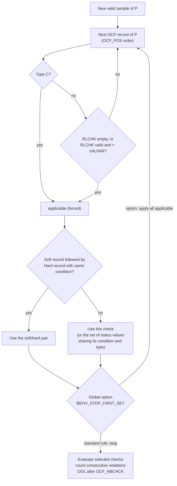
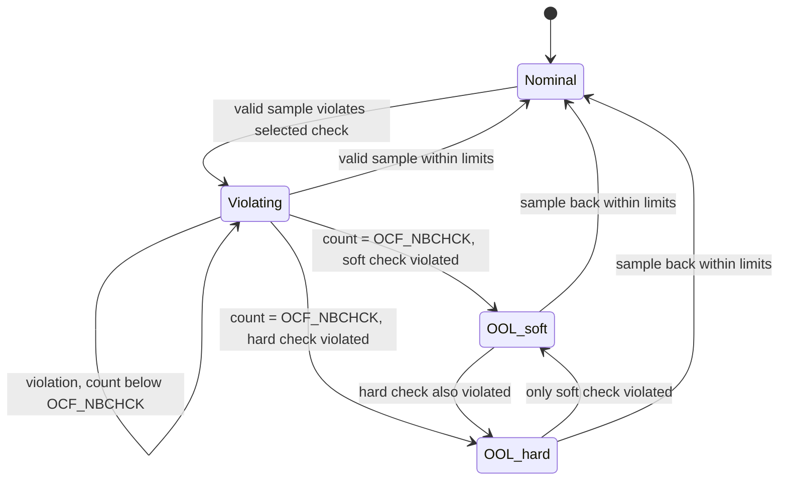
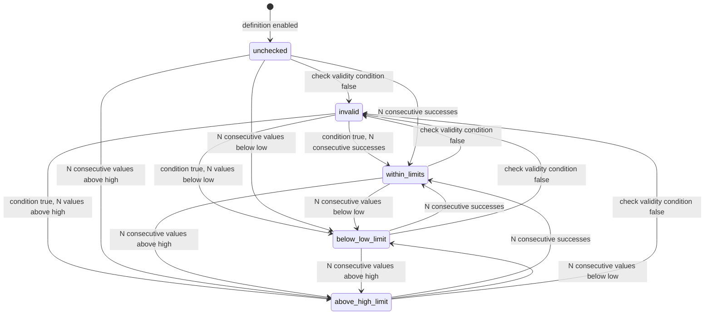

# Monitoring checks: limits and out-of-limits

Calibration turns a telemetry sample into an engineering value. **Monitoring checks** decide whether that value is acceptable. In the [SCOS-2000](../scos2000/index.md) [MIB](index.md), two tables define every check the ground applies. The [OCF](tables/ocf.md) holds one record per checked parameter. The [OCP](tables/ocp.md) holds the checks themselves: soft and hard limits, expected statuses, deltas between samples, status consistency with commanding, and event triggers. Each check can be guarded by an applicability condition.[^icd-t1][^icd-ocp-intro] When a valid sample violates an applicable check often enough, SCOS-2000 declares the parameter **out of limits** (OOL). It then shows the parameter on the OOL display. OOL records also end up in the packet archive, from which the EDDS delivers them to users.[^s2k-guide][^edds-ool]

Spacecraft can also check their own parameters, with the PUS on-board monitoring service [ST[12]](../ecss/pus/st12-onboard-monitoring.md). The [last section](#ground-checks-and-on-board-monitoring-pus-st12) compares the two and shows how the Solar Orbiter MIB decodes the on-board reports. All Solar Orbiter numbers come from this wiki's SQL queries on release `MIB__20250916M25925PFMS001_SOL`.[^mib-checks] Parameters and calibrations used here are introduced on [Monitoring in the MIB](monitoring.md) and [Calibration in the MIB](calibration.md).

## OCF: one record per checked parameter

The OCF holds at most one record per parameter. It says how many checks the parameter has, how many consecutive violations make it OOL, and in which representation the limits are written.[^icd-ocf]

| # | Field | Type | M | Meaning |
|---|---|---|---|---|
| 1* | `OCF_NAME` | Char(8) | M | checked parameter (`PCF_NAME`) |
| 2 | `OCF_NBCHCK` | Number(2) | M | number of consecutive **valid** samples violating a check that are needed to declare the parameter OOL |
| 3 | `OCF_NBOOL` | Number(2) | M | number of OCP records for this parameter, 1 to 16 |
| 4 | `OCF_INTER` | Char(1) | M | `U` uncalibrated: limits are raw values; `C` calibrated: limits are engineering values (only for calibrated parameters) |
| 5 | `OCF_CODIN` | Char(1) | M | format of the limit values: `R` real, `I` integer, `A` ASCII |

Field definitions from ICD §3.3.2.3.1.[^icd-ocf] `OCF_CODIN` must match the representation chosen by `OCF_INTER`:[^icd-ocf]

| `OCF_CODIN` | Allowed when |
|---|---|
| `R` real | raw values of real parameters (`OCF_INTER = U`, PTC 5), or engineering values of parameters with a real numerical curve, a polynomial or a logarithmic calibration |
| `I` integer | raw values of integer parameters (`OCF_INTER = U`, PTC < 5), or engineering values of integer-valued numerical curves |
| `A` ASCII | engineering values of status parameters (`PCF_CATEG = S`, `OCF_INTER = C`), compared with alias texts |

If the parameter is also used in a command verification expression, `OCF_CODIN` must be compatible with `CVE_INTER`.[^icd-ocf]

!!! note "A configuration coupling"
    SCOS-2000's Behaviour Limit Checker can skip consecutive samples of periodic parameters whose value and validity are unchanged. If this optimisation is on (`BEHV_ENABLE_OPTIMIZATION = 1`), the configuration variable `MVC_MAX_CONST_NUMBR` must exceed the largest `OCF_NBCHCK` in the MIB.[^icd-ocf-warn]

## OCP: the checks

The OCP holds one record per check. SCOS-2000 applies the checks of a parameter in the order of the table, which must be sorted by `OCP_NAME` and `OCP_POS`.[^icd-ocp-intro][^icd-ocp-fields]

| # | Field | Type | M / default | Meaning |
|---|---|---|---|---|
| 1* | `OCP_NAME` | Char(8) | M | checked parameter (`OCF_NAME`) |
| 2* | `OCP_POS` | Number(2) | M | order of the check; soft/hard pairs ordered soft first |
| 3 | `OCP_TYPE` | Char(1) | M | `S` soft limit check; `H` "hard limit or soft status check" (wording of ICD 6.7 to 7.0); `D` delta check; `C` status consistency (needs `PCF_USCON = Y`); `E` event generation only, no OOL |
| 4 | `OCP_LVALU` | Char(14) | | low limit (numerical `S`, `H`, `E` checks; mandatory); **or** one expected status value (status parameters, `S`/`H`; mandatory); **or** minimum delta (`D`; optional, positive or empty) |
| 5 | `OCP_HVALU` | Char(14) | | high limit (numerical `S`, `H`, `E`; mandatory); **or** maximum delta (`D`; optional, positive or empty); irrelevant for status parameters and `C` |
| 6 | `OCP_RLCHK` | Char(8) | | applicability parameter; not used for `C` |
| 7 | `OCP_VALPAR` | Number(5) | `1` | raw value of `OCP_RLCHK` that makes the check applicable; not used for `C` |

Field definitions from ICD §3.3.2.3.2.[^icd-ocp-fields] Like validity and calibration-selection parameters, an applicability parameter must have an integer raw representation and be processed by the telemetry model (extracted through the PLF, or synthetic). SCOS-2000 also requires the applicability parameter to be valid.[^icd-ocp-fields]

!!! warning "Inference"
    ICD issues 6.7, 6.9 and 7.0 all describe `OCP_TYPE = H` as "Hard limit or soft status check".[^icd-ocp-fields][^icd69-ocp] Issue 5.1 simply has `S` soft OOL and `H` hard OOL,[^icd51-ocp] and the 7.0 rules say status checks, like limit checks, "can be associated to a check severity (Soft or Hard)".[^icd-ocp-intro] This wiki therefore reads `S` and `H` as soft and hard severity for both limit and status checks. The "soft status" wording looks like an editorial slip. In the Solar Orbiter MIB, status checks use both letters: 1,360 `S` and 696 `H` records.[^mib-ocp]

## The five kinds of check

### Limit checks (soft and hard)

A limit check compares the valid value with a low/high pair. Limit checks are always given in pairs: a low limit alone is not possible. They apply only to numerical parameters (`PCF_CATEG = N`).[^icd-ocp-rules] Each check has a severity, soft (`S`) or hard (`H`). A soft/hard pair must share the same applicability condition (or have none) and follow each other in the order soft, then hard. Soft and hard checks may use the same low or high value. Either severity can also stand alone: a soft check does not need a hard partner.[^icd-ocp-rules]

A value exactly equal to a limit is **not** out of limits.[^icd-ocp-rules] The Herschel clarification note puts it the other way round: OOL is raised only if the value is below the low limit or above the high limit, for both soft and hard limits.[^hcss-ool] A parameter that violates several checks at once, such as a soft and a hard one, is displayed according to the more critical violation.[^icd-ocp-rules]

### Status checks

A status check compares a status parameter's value with a set of allowed values. Each allowed value takes one OCP record, with the value in `OCP_LVALU`. With `OCF_CODIN = A` the values are alias texts, which requires `OCF_INTER = C`.[^icd-ocp-fields][^icd-ocf] All records with the same applicability condition and the same type form one set of allowed values. Several sets, under different applicability conditions, let the expected status depend on the configuration.[^icd-ocp-rules]

### Delta checks

A delta check compares the difference between the current valid value and the last valid value with a minimum and maximum. `OCP_LVALU` is the minimum delta and `OCP_HVALU` the maximum. Either may be left empty to skip that side. Both must be positive, because the check applies to positive and negative deltas alike.[^icd-ocp-fields][^icd-ocp-rules] Delta checks are allowed on numerical representations: `PCF_CATEG = N`, or the raw value of any parameter with PTC < 6.[^icd-ocp-rules] The ICD's compatibility note lists delta checks among the options introduced in recent issues. Issue 5.1 had no `D` type.[^icd-compat][^icd51-ocp]

### Status consistency checks

A status consistency check (SCC) compares a parameter, typically a status affected by commanding, with a **reference value** that SCOS-2000 maintains from the predicted or detected effect of commands.[^icd-ocp-intro] Several rules apply:[^icd-ocp-rules][^icd-pcf-uscon][^icd-cve-scc]

* The parameter needs `PCF_USCON = Y`.
* The applicability condition is forced to true.
* `C` checks (and `E` checks) must precede all other checks of the same parameter.
* The CVE table, besides defining verification, identifies the parameters that a command affects. Their SCC is disabled during that command's verification window. For such parameters, the verification value (`CVE_INTER`) must use the same raw or engineering representation as the OOL checks (`OCF_INTER`).
* `CVE_CHECK` says what a CVE record does for SCC. With `B` (the default), the record verifies the command and drives the SCC: its `CVE_VAL` becomes the new expected value of the parameter at the end of the verification stage window. With `S`, the record only disables the SCC during the window, and it must be combined with at least one `B` record of the same stage.[^icd-cve-scc]
* The number of SCC parameters has a hard ceiling, set by the size of the SCOS-2000 packet that holds the snapshot of all SCC states. The ICD contradicts itself on whether the ceiling can be configured. The `PCF_USCON` description says it can be modified from release 4.1 through `MAX_SCC_MESSAGE_LENGTH`; the OCP rules say it "cannot be modified by configuration".[^icd-pcf-uscon][^icd-ocp-rules]

The operator can reset SCC states from TM SPACON.[^gsaw-mon] The EGSE test language reports SCC states as `SCC_UNINIT`, `SCC_INIT`, `SCC_DISABLE` and `SCC_OFF`.[^emcs-ool] [ECSS-E-ST-70-31C](../ecss/e-st-70-31c.md) defines the same idea in neutral terms. The reference is either the last uplinked value of a command argument, with the check suspended during the command's execution window, or an expression for autonomous on-board changes.[^e3131-scc]

### Event checks

An `E` check is not a monitoring check in the usual sense. When the parameter leaves the given range (and the check is applicable), SCOS-2000 generates an event with the full ID `BEHV::<OCP_NAME>`. Such events can trigger configured actions such as sending an e-mail, setting a configuration variable or running a script. A parameter that triggers an `E` check does not appear on the OOL display.[^icd-ocp-intro] This differs from the packet-level `PID_EVENT` mechanism, which raises an event when a packet *arrives* ([PID fields](monitoring.md#pid-packet-identification)).[^icd-s5]

## How SCOS-2000 selects and applies checks

For each new valid sample, SCOS-2000 runs through the parameter's OCP records in table order:[^icd-ocp-rules]

1. A check is applicable when it has no applicability parameter, or when its applicability parameter is valid and equals `OCP_VALPAR`. For `C` checks applicability is always true.
2. The search stops at the **first applicable check or soft/hard pair**. Later sets are ignored, including after `C` or `E` checks. A global configuration variable, `BEHV_STOP_FIRST_SET`, can make SCOS-2000 apply all applicable checks instead, but only for the whole system, not per parameter.
3. The selected checks are evaluated. A violation that persists for `OCF_NBCHCK` consecutive valid samples declares the parameter OOL.[^icd-ocf]

!!! warning "Inference"
    `C` and `E` checks must come first, and the search stops at the first applicable check, which for `C` is always the case. Read together, the two rules imply that a parameter with a status consistency check gets no further limit or status checks unless the global all-applicable option is set. The ICD does not spell this consequence out.



Logic from the OCP processing rules.[^icd-ocp-rules] Invalid samples are not limit checked, because the checks compare the *valid* value.[^icd-ocp-intro]



!!! warning "Inference"
    The state diagram is this wiki's reading of the ICD. The ICD defines when a parameter *becomes* OOL (`OCF_NBCHCK` consecutive valid violating samples) and that the more critical violation is displayed. It does not state whether a return to nominal also needs `OCF_NBCHCK` samples, or what happens to the counter on invalid samples. The TDRS output, which includes a state `VIOL` for "not in limits, but its number of violations is not equal to the maximum number of violations", suggests the intermediate "violating" state exists in the implementation.[^tdrs-ool] PUS ST[12], by contrast, applies its repetition number in both directions ([below](#ground-checks-and-on-board-monitoring-pus-st12)).

## What the operator and the archive see

**Displays and logs.** The OOL display lists the telemetry parameters that are currently out of limits. The message display (event logger) scrolls SCOS-2000 log messages.[^s2k-guide] Parameters carry an OOL state next to their value and validity. The SCOS-2000 EGSE test language, for example, returns an OOL state of `NOMINAL`, `WARNING`, `ALARM` or `SCC` for a parameter.[^emcs-ool] It also lets a test procedure subscribe to a parameter so that it is notified when a limit applicability parameter or a calibration selection parameter changes, not only the value.[^emcs-sub] Limit values, like calibration points and OL expressions, can be changed on line.[^gsaw-mon]

**Packets and files.** The Herschel/Planck EGSE configuration of SCOS-2000 stores OOL event packets under a system SPID, `OOL_PACKET_APID`, default 3000.[^emcs-oolpkt] Herschel's science ground segment pulled OOL data out of SCOS-2000 as "Out-of-Limits files" (ORF). A file retriever asks SCOS-2000 for a time period and receives the name of the written file, and an ingestor links each OOL packet to the observation building block closest in time. In routine phase the same ingestor read OOL files from the MOC's Data Disposition System, recognised by the extensions `.OOL` or `.TLM`.[^tchool] See [Herschel/Planck ground segment](../scos2000/herschel-planck-ground.md).

**Retrieval services.** The [TDRS](../scos2000/tdrs.md) complete result file gives an OOL code for every sample.[^tdrs-ool] The [EDDS](../scos2000/edds.md) delivers OOL records from the packet archive (PARC) with a typed state model. EDDS stream clients store them in `OolRecording_…` files.[^edds-ool]

| Source | OOL vocabulary |
|---|---|
| EGSE test language (`getoolstate`) | `NOMINAL`, `WARNING`, `ALARM`, `SCC` |
| TDRS result file (OOL column) | `NOM`, `L` low, `LL` low-low, `H` high, `HH` high-high, `SCC_UNIT` (SCC initialised), `SCC_F` (SCC failure), `UDEF`, delta codes (`MIN_D_LOW`, `MIN_D_HIGH`, `MAX_D_LOW`, `D_EQUAL` and a second `MIN_D_HIGH` described as the high limit for positive deltas), `VIOL` |
| EDDS OOL record (`OOLRecordType`) | `LIMIT`, `STATE`, `STATUS_CONSISTENCY`, `SOFT_HARD_LIMIT`, `LIMIT_MO`, `DELTA` |
| EDDS `OOLParameterState` | `NOMINAL`, `WARNING`, `OUT_OF_LIMITS`, `SCC`, `SCC_DISABLE`, `SCC_OFF`, `SCC_UNINIT`, `VIOLATION`, `NO_VALUE` |
| EDDS limit / status / delta / SCC states | `LIMIT_HIGH`, `LIMIT_HIGH_HIGH`, `LIMIT_LOW`, `LIMIT_LOW_LOW`, `LIMIT_WITHIN_RANGE`; `STATUS_ALLOWED`, `STATUS_UNEXPECTED`; `DELTA_ALLOWED`, `DELTA_EQUAL`, `MAX_DELTA_HIGH`, `MAX_DELTA_LOW`, `MIN_DELTA_HIGH`, `MIN_DELTA_LOW`; `B_SCC_ENABLE`, `B_SCC_DISABLE`, `B_SCC_FAIL`, `B_SCC_OFF`, `B_SCC_UNINIT` |

Vocabularies as printed in the sources.[^emcs-ool][^tdrs-ool][^edds-ool] An EDDS OOL record also carries the value, the lower and upper limits, the allowed values, the SCC reference value, the delta and last values, and hard and soft violation counts.[^edds-ool]

!!! warning "Inference"
    The sources do not give a mapping from MIB check types to these vocabularies. A natural reading: a soft limit violation shows as `WARNING` / `L` or `H` / `LIMIT_LOW` or `LIMIT_HIGH`; a hard violation as `ALARM` (EGSE) or `OUT_OF_LIMITS` (EDDS) / `LL` or `HH` / `LIMIT_LOW_LOW` or `LIMIT_HIGH_HIGH`; a status check failure as `STATUS_UNEXPECTED`; an SCC failure as `SCC` / `SCC_F` / `B_SCC_FAIL`. Treat this as a hypothesis to verify against real EDDS output.

## Solar Orbiter: checks in numbers

| Quantity | 2020-04-16 | 2025-09-16 |
|---|---|---|
| OCF records (checked parameters) | 3,304 | 5,338 |
| OCP records | 4,686 | 7,369 |
| hard (`H`) / soft (`S`) | 2,306 / 2,265 | 4,153 / 3,096 |
| delta (`D`) | 102 | 105 |
| status consistency (`C`) / `PCF_USCON = Y` | 13 / 13 | 15 / 15 |
| event (`E`) | 0 | 0 |
| OCP records with an applicability condition | 703 | 859 |

Counts from both releases.[^mib-checks][^mib2020]

More detail on the 2025 release:[^mib-checks][^mib-ocp]

* **Representation.** 2,029 parameters are checked on raw integers (`U`/`I`) and 110 on raw reals (`U`/`R`). 1,558 are checked on calibrated reals (`C`/`R`), 8 on calibrated integers (`C`/`I`) and 1,633 on alias texts (`C`/`A`).
* **Number of checks.** 3,649 parameters have one OCP record, 1,453 have two, 185 three, 31 four, 1 five, 17 six, and 2 have fifteen.
* **Persistence.** 3,989 parameters go OOL on the first violating sample (`OCF_NBCHCK = 1`), 1,116 need 2 samples and 203 need 3. A handful need 4, 5, 8, 10, 14, 15 or 24.
* **Pairs.** Among numerical limit sets, 1,534 are soft/hard pairs. 1,921 are hard checks alone and 202 soft checks alone. Every pair is ordered soft before hard, and no limit set has its low limit above its high limit.
* **Applicability.** 859 OCP records use 180 distinct applicability parameters. The most frequent is `NSM00002` "Current SSMM Mode act" (120 records), followed by the heater status parameters `NPWSX053` "EUI OU DEC HEATER Sts" (54) and `NPWSX051` "SPICE CE DEC HEATER Sts" (42).
* **Synthetic parameters.** 242 of the checked parameters are dynamic OL synthetic parameters (`PCF_NATUR = D`).

### Example: soft and hard limits on an IMU temperature

[`NMUD1113`](../explorer/index.md#/solo/param/NMUD1113) "IMU11 SIA temperature" has `OCF_NBCHCK = 1`, `OCF_NBOOL = 2`, `OCF_INTER = C` and `OCF_CODIN = R`: two checks on calibrated real values, OOL at the first violation. Its OCP records (real MIB data):[^mib-ex]

| `OCP_POS` | Type | Low | High | Applicability |
|---|---|---|---|---|
| 1 | `S` soft | −16 | 48 | `NCSD0P43 = 2` (IMUA Gyr1 SCV status `ON`) |
| 2 | `H` hard | −18 | 54 | `NCSD0P43 = 2` |

The applicability parameter is the same one that makes the parameter valid (`PCF_VALID = NCSD0P43`, `PCF_VALPAR = 2`). Combined with the 11-point calibration curve `CMUT0013TM` ([calibration page](calibration.md#worked-example-nmud1113)), these illustrative raw values give:

| Raw (12-bit) | Engineering (degC) | Outcome |
|---|---|---|
| 400 (`0x190`) | invalid (below the curve, `CAF_INTER` = `F`) | not checked: only valid values are checked |
| 850 (`0x352`) | 54.898 | hard OOL (above 54) |
| 1000 (`0x3E8`) | 48.047 | soft OOL (above 48, below 54) |
| 1100 (`0x44C`) | 44.343 | nominal |
| 2850 (`0xB22`) | −13.837 | nominal |
| 2900 (`0xB54`) | −16.032 | soft OOL (below −16) |
| 3150 (`0xC4E`) | −34.426 | hard OOL (below −18) |

The outcomes apply the ICD rules to real MIB definitions; the raw values are illustrative.[^icd-ocp-rules][^mib-ex] Its neighbour `NMUD1112` "IMU11 ORG temperature" uses the same curve, the same validity criterion and the same high limits (48 and 54), but its low limits are 2 (soft) and 1 (hard), and both checks are conditioned on `NCSD0P73` ("IMUA Gyr4 SCV Stat.Tm") while its validity uses `NCSD0P43`.[^mib-ex] This may be deliberate or a copy slip; the MIB does not say.

### Example: limits that depend on a heater

[`NRU02712`](../explorer/index.md#/solo/param/NRU02712) "ANP_1_1_12 SPICE CE" (16-bit raw, calibrated through the 51-point curve `COMB000000` to DegC, `OCF_NBCHCK = 2`) has six checks. The heater status `NPWSX051` "SPICE CE DEC HEATER Sts" (`0 NOMINAL OFF`, `1 NOMINAL ON`, `2 INCORRECT CONF`) selects one of three soft/hard pairs (real MIB data):[^mib-ex2]

| `OCP_POS` | Type | Low | High | Applies when `NPWSX051` = |
|---|---|---|---|---|
| 1 | `S` | −44.5 | −38.5 | 0 (`NOMINAL OFF`) |
| 2 | `H` | −47.5 | −35.5 | 0 |
| 3 | `S` | −44.5 | 57 | 1 (`NOMINAL ON`) |
| 4 | `H` | −47.5 | 60 | 1 |
| 5 | `S` | −44.5 | −38.5 | 2 (`INCORRECT CONF`) |
| 6 | `H` | −47.5 | −35.5 | 2 |

With the heater off, or incorrectly configured, the nominal band is −44.5 to −38.5 degC and the hard band −47.5 to −35.5 degC. With the heater on, the high limits rise to 57 and 60 degC. Under the standard "stop at first applicable set" rule, only the pair whose condition is true is evaluated, and two consecutive violating samples are needed.[^icd-ocp-rules] The parameter is located in three packets, `YCF1Z079`, `YCF2Z003` and `YCS2X188`, all TM(3,25).[^mib-ex2] The same pattern exists for other SPICE and EUI temperatures with six checks, keyed on `NPWSX051` or on `NPWSX053` "EUI OU DEC HEATER Sts" (for example `NRU02730`, `NTCD50D6`, `NTCD50L6`).[^mib-ocp]

### Example: a 15-value status check

[`NCDT09N0`](../explorer/index.md#/solo/param/NCDT09N0) "OMMA_State" (32-bit enumerated, alias set `CCDT0098TM` with 16 states) has `OCF_INTER = C`, `OCF_CODIN = A`, and fifteen `S` records listing allowed texts: `OFF`, `POWER_ON`, `POWER_OFF`, `FILLING`, `CHECKING`, `PREOPERATIONAL`, `OPERATIONAL`, `INIT`, `SYNCHRONISING`, `NOT_SYNC`, `ABORT_FILLING`, `ABORT_CHECKING`, `POWER_ON_END`, `POWER_OFF_END`, `INIT_END`. The only state of the alias set that is missing is `FAILED` (raw 8). In effect, the soft status check flags that single state. `NCDT09X0` (OMMB) is defined the same way (real MIB data).[^mib-ex3]

### Example: delta checks on error counters

All 105 delta checks in the Solar Orbiter MIB belong to 105 different `NIU…` counters, such as [`NIU01008`](../explorer/index.md#/solo/param/NIU01008) "TC_Bad", `NIU0100A` "TM_Bad", `NIU0101C` "SpWwriteErr" and `NIU0202C` "EUV_HSL_CommandsBad". Every one has `OCF_NBCHCK = 1`, `OCF_INTER = U`, `OCF_CODIN = I`, a single `D` check and no other check. In 102 of them the minimum and maximum delta are both 0. The other three, `NIU0700B` "FSI_HSL_Timeout", `NIU0800B` "Lya_HSL_Timeout" and `NIU0900B` "EUV_HSL_Timeout" (16-bit unsigned), have both thresholds set to 2048 (real MIB data).[^mib-ex3]

!!! warning "Inference"
    With a maximum delta of 0, any change of the counter between two valid samples exceeds the maximum, so each new error raises an OOL. The minimum delta of 0 can never be undercut by an absolute difference. For the three timeout parameters with both thresholds at 2048, any delta other than exactly 2048 lies below the minimum or above the maximum. The ICD does not say whether a delta exactly equal to a threshold counts as a violation. EDDS and TDRS both have a separate "delta equal" state (`DELTA_EQUAL`, `D_EQUAL`),[^edds-ool][^tdrs-ool] which suggests the implementation distinguishes it. Why these three checks use 2048 is not stated in the available sources.

### Example: status consistency checks

All 15 SCC parameters are counters of numerical category (13 unsigned integers and 2 enumerated parameters), each with one `C` check, `OCF_INTER = U` and `OCF_CODIN = I`; five use `OCF_NBCHCK = 3` and ten use 1. Examples are `NCDT02A0` "OBCHP_TTRMA_VC0_NB_Err" (`OCF_NBCHCK = 3`), `NCDT07K0` "OBCHP_Nb_Reject_TcBuff", `NDSD0046` "DST-A WD Reset Counter" and `NSM01800` "PS0 Stored PKT counter". None of them appears in the CVE table, so no command verification disables their SCC (real MIB data).[^mib-ex3]

!!! warning "Inference"
    The ICD documents one way to set the SCC reference value: the `CVE_VAL` of a `CVE_CHECK = B` record at the end of a verification window. Because no CVE record names these counters, their reference value can only come from SCOS-2000's internal handling (for example initialisation from the first sample, or an operator reset in TM SPACON). The check then works like a latching "the counter has changed" alarm. The ICD does not describe how the reference value is initialised.

### Data-quality observations

The following points come from simple consistency queries. They are reported as observations, not as errors of the mission's MIB:[^mib-ocp]

* `NCDX9308` has an OCF record with `OCF_NBOOL = 2` but no OCP records. The ICD requires the count to match the OCP table.[^icd-ocf]
* 349 status parameters (`PCF_CATEG = S`) carry raw integer limit pairs (`OCF_INTER = U`, `OCF_CODIN = I`, `OCP_HVALU` filled). For example, `NCDX9000` "E_SCV_OBC_TTR_CPDU_A" has a soft pair 2…2 and a hard pair 1…2. The ICD restricts limit checks to `PCF_CATEG = N` and calls `OCP_HVALU` irrelevant for status parameters.[^icd-ocp-rules][^icd-ocp-fields] How SCOS-2000 treats these records is not stated in the available sources.

## Ground checks and on-board monitoring (PUS ST[12])

Ground checks run in the control centre on every valid sample that reaches it. On-board monitoring runs on the spacecraft itself, and its events can trigger on-board reactions. The PUS-C standard defines it as ST[12]. Its parameter monitoring subservice checks on-board parameters against definitions loaded by the ground, reports check transitions to the ground and raises events when conditions are violated. Those events can be caught on board, for example by the [event-action service ST[19]](../ecss/pus/st19-event-action.md).[^pus-scope]

### ST[12] parameter monitoring in brief

* **Check types.** Limit checks and expected-value checks are mandatory; delta checks are optional. A limit check succeeds when low ≤ value ≤ high. An expected-value check masks the value and compares it with the expected value. A delta check compares the difference between consecutive values with two thresholds; its definition includes the number of consecutive deltas that are averaged.[^pus-checks][^pus-def]
* **Definitions.** Each parameter monitoring definition (PMON) contains its own ID, the monitored parameter, an optional check validity condition, an optional definition-specific monitoring interval and a check definition. The check definition holds a repetition number, the check type, the limits or expected value and mask, and an optional event ID for each kind of violation. Several definitions may watch the same parameter, one with warning limits and one with danger limits, for example.[^pus-scope][^pus-def]
* **Check validity condition.** A validity parameter, a bit mask and an expected value. The condition is true when (validity parameter AND mask) equals the expected value.[^pus-def]
* **Statuses.** For a limit check the checking status is "unchecked", "invalid", "within limits", "below low limit" or "above high limit". A new status is established only after "repetition number" consecutive checks agree, in either direction.[^pus-status][^pus-process]
* **Reporting.** Each status change is recorded in a check transition list, reported in TM[12,12] check transition reports when a declared maximum number of transitions is reached or at the maximum transition reporting delay after the first recorded transition. TC[12,10] requests a TM[12,11] out-of-limits report.[^pus-trans][^pus-ool]



Limit-check status model of ECSS-E-ST-70-41C, with *N* the repetition number. Every new status different from the previous one is recorded as a check transition.[^pus-status][^pus-process][^pus-newstatus] While the check validity condition is false, the status is "invalid" and the repetition counter is reset.[^pus-process]

### Solar Orbiter's on-board monitoring and how the MIB decodes it

Solar Orbiter implements its own tailoring of service 12.[^sol-s12] Each monitoring entry added with TC(12,5) contains a monitoring ID, the parameter ID, a validity parameter ID (0 means "always check"; the validity parameter is a Boolean), a monitoring interval in application cycles, a repetition count `Rep` (1–255, the number of successive samples needed both to declare a parameter out of limits and to declare it back within limits), an enable status, and either a limit definition (low limit with EID, high limit with EID) or an expected-value definition (mask, expected value, EID).[^sol-s12-tc] The checking statuses are coded 0 (within limits or expected value), 1 unchecked, 2 invalid, 3 unselected (not used), 4 unexpected value or below low limit, and 5 above high limit. The maximum reporting delay is counted in 8 Hz cycles, and 0 disables transition reports.[^sol-s12-tm][^sol-s12-delay]

The reports reach the ground as variable packets. The MIB defines TM(12,9) monitoring list, TM(12,11) out-of-limit list and TM(12,12) check transition reports as variable packets for the six APIDs 163, 179, 195, 211, 227 and 259, each with its own TPSD, plus one more TM(12,12) on APID 1075. The TM(12,11) of APID 163 is TPSD 14173.[^mib-s12] Its [VPD layout](monitoring.md#example-the-out-of-limit-list-report-tm1211) is drawn here (real MIB definitions; field sizes also printed in the Solar Orbiter TM-TC and Packet Structure ICD):[^mib-s12][^sol-s12-tm]

<div class="bitfield" data-title="Solar Orbiter TM(12,11): counter and one out-of-limit entry (source data from octet 16)" data-width="32"
     data-caption="Entry repeated N times (VPD_GRPSIZE = 8); value and limit are deduced from the monitored parameter's type and right-aligned in 8 octets"
     data-fields='[{"n":"N (NCD0C0B1)","b":16,"g":"counter","d":"PTC 3, PFC 12; repeat counter"},{"n":"Mon ID (NCD0C094)","b":8,"g":"entry 1"},{"n":"Parameter ID (NCD0C095, PIDREF)","b":32,"g":"entry 1","d":"PTC 2, PFC 32; textual calibration PARAMIDTM gives the parameter name"},{"n":"Mask (NCD0C0B4)","b":32,"g":"entry 1"},{"n":"Parameter value (NCD0C0B5, deduced)","b":64,"g":"entry 1","d":"PTC 11, PCF_WIDTH 64, PCF_RELATED NCD0C095"},{"n":"Limit crossed (NCD0C0B6, deduced)","b":64,"g":"entry 1","d":"PTC 11, PCF_WIDTH 64"},{"n":"Prev status (NCD0C0B7)","b":8,"g":"entry 1","d":"alias set CCDT0011TX"},{"n":"Curr status (NCD0C0C8)","b":8,"g":"entry 1","d":"alias set CCDT0011TX"},{"n":"Transition time, coarse (NCD0C0B9)","b":32,"g":"entry 1","d":"PTC 9, PFC 17: CUC 4 octets coarse + 2 octets fine"},{"n":"Transition time, fine","b":16,"g":"entry 1"}]'></div>

The status fields use the alias set `CCDT0011TX` (`0 VALID`, `1 UNCHECKED`, `2 INVALID`, `4 BELOW_LOW`, `5 ABOVE_HIGH`, `6 OUT_OF_LIMIT`). That set matches the codes of the TM-TC and Packet Structure ICD and adds a value 6 that the ICD does not list.[^mib-s12][^sol-s12-tm] The Database Import ICD notes that all service 12 reports are variable packets. Their values therefore do not take part in validity, monitoring checks or synthetic parameters on the ground. The ICD recommends variable packets only for special reports that need no such cross-processing with other telemetry.[^icd-s12][^icd-pusvar] The MIB also contains fixed-layout TM(12,9) definitions on APIDs 1986 to 1990 ("AOCS", "PAYLOAD", "PLATFORM", "SYSTEM" and "THERMAL" monitoring list reports, numbered #1 to #3). They are distinguished by two 8-bit identification fields: PI1 at octet 19 and PI2 at an APID-specific offset (octet 883 for AOCS, 2083 for PAYLOAD, 2755 for PLATFORM, 2227 for SYSTEM and 2179 for THERMAL). The PLF names what sits there: the monitoring-ID fields of fixed entry slots. In SPID 65909 (AOCS #1), for example, octet 19 holds `NXAS001A` "PID11_S001_ID" and octet 883 holds `NXAS041A` "PID11_S041_ID". The three AOCS reports have PI1/PI2 values 1/41, 122/142 and 220/242. Two SYSTEM definitions (SPIDs 65917 and 65954) share PI1 = 1 and differ only in PI2 (255 and 253).[^mib-s12] This matches the TM-TC ICD, where the monitoring status, the maximum reporting delay and the count *N* precede the first monitoring ID of the report.[^sol-s12-tm9]

!!! warning "Inference"
    The fixed (12,9) definitions look like a way to decode the expected content of the on-board monitoring list, split over several report packets, with the full PLF machinery rather than the VPD. The monitoring IDs of two entry slots then tell the packets apart. The source documents do not explain these definitions.

### Side by side

| Aspect | SCOS-2000 ground checks (OCF/OCP) | PUS-C ST[12] parameter monitoring | Solar Orbiter service 12 |
|---|---|---|---|
| Where and when | control centre, every valid sample received | on board, every monitoring interval | on board, interval in application cycles |
| Defined by | MIB import; limit values changeable on line[^gsaw-mon] | ground requests TC[12,5] etc. at run time | TC(12,5) add/modify, TC(12,7) modify |
| Check types | soft/hard limit, status set, delta, status consistency, event | limit, expected value (mask), optional delta | limit or expected value (mask) |
| Severity levels | soft and hard in one set | separate definitions (e.g. warning and danger) | one limit pair per entry, an EID per limit |
| Conditional checking | `OCP_RLCHK = OCP_VALPAR`, first applicable set wins | check validity condition: (param AND mask) = expected | Boolean validity parameter (0 = always) |
| Persistence | `OCF_NBCHCK` consecutive violating valid samples | repetition number, both directions | `Rep`, 1–255, both directions |
| At the limit | equal is not OOL | low ≤ value ≤ high is success | not stated |
| Result | OOL display, events, OOL archive (EDDS, TDRS) | events; TM[12,12] transitions; TM[12,11] OOL list | events; TM(12,12); TM(12,11) |

Sources: ICD rules,[^icd-ocp-rules][^icd-ocf] ECSS-E-ST-70-41C clauses 6.12.3.2–6.12.3.12,[^pus-checks][^pus-def][^pus-status][^pus-trans][^pus-ool] and the Solar Orbiter TM-TC and Packet Structure ICD.[^sol-s12][^sol-s12-tc] Earlier ESA requirements show the same model. The Herschel/Planck operations interface requirements ask that a parameter fail (or pass again) the given number of times before an event is generated, both when going out of limits and when returning within limits.[^hp-oird]

The neutral data model of [ECSS-E-ST-70-31C](../ecss/e-st-70-31c.md) covers both worlds. A limit check carries domain-specific limit sets (AIV, Operations, Software), each selected by a validity condition expression, with upper and lower *danger* and *warning* limits and a corrective activity for each. Delta checks have maximum and minimum thresholds, expected-state checks have lists of values, and status consistency checks have a command argument or expression as reference.[^e3131-limit][^e3131-scc]

!!! warning "Inference"
    ECSS-E-ST-70-31C *warning* and *danger* limits correspond naturally to SCOS-2000 *soft* and *hard* limits, and its "first true validity condition applies" matches the SCOS-2000 "first applicable set" rule. Neither document states this correspondence.

??? example "SQL used"
    Run against `solo-2025-09-16.sqlite` (and `solo-2020-04-16.sqlite` for the 2020 column).

    ```sql
    SELECT OCP_TYPE, count(*) FROM ocp GROUP BY 1;
    SELECT OCF_INTER, OCF_CODIN, count(*) FROM ocf GROUP BY 1,2;
    SELECT OCF_NBOOL, count(*) FROM ocf GROUP BY 1;
    SELECT OCF_NBCHCK, count(*) FROM ocf GROUP BY 1;
    SELECT count(*) FROM ocp WHERE OCP_RLCHK <> '';
    SELECT OCP_RLCHK, count(*) FROM ocp WHERE OCP_RLCHK <> '' GROUP BY 1 ORDER BY 2 DESC LIMIT 6;

    -- soft/hard pairs versus isolated limit checks (numerical sets only)
    SELECT count(*) FROM (SELECT OCP_NAME, OCP_RLCHK, OCP_VALPAR FROM ocp o
       JOIN ocf f ON f.OCF_NAME = o.OCP_NAME
      WHERE f.OCF_CODIN <> 'A' AND OCP_TYPE IN ('S','H')
      GROUP BY 1,2,3 HAVING sum(OCP_TYPE='S') = 1 AND sum(OCP_TYPE='H') = 1);   -- 1,534

    -- examples
    SELECT * FROM ocp WHERE OCP_NAME IN ('NMUD1113','NRU02712','NCDT09N0','NIU01008')
     ORDER BY OCP_NAME, CAST(OCP_POS AS int);
    SELECT OCP_LVALU, OCP_HVALU, count(*) FROM ocp WHERE OCP_TYPE = 'D' GROUP BY 1,2;  -- 0/0: 102, 2048/2048: 3
    SELECT * FROM ocp WHERE OCP_TYPE = 'C';
    SELECT * FROM cve WHERE COL2 IN (SELECT PCF_NAME FROM pcf WHERE PCF_USCON = 'Y');  -- none

    -- consistency observations
    SELECT f.* FROM ocf f WHERE CAST(OCF_NBOOL AS int) <>
      (SELECT count(*) FROM ocp WHERE OCP_NAME = f.OCF_NAME);                       -- NCDX9308
    SELECT count(DISTINCT o.OCP_NAME) FROM ocp o JOIN pcf p ON p.PCF_NAME = o.OCP_NAME
     WHERE OCP_TYPE IN ('S','H') AND p.PCF_CATEG = 'S' AND o.OCP_HVALU <> '';         -- 349

    -- on-board monitoring reports
    SELECT PID_TYPE, PID_STYPE, PID_APID, PID_PI1_VAL, PID_SPID, PID_TPSD, PID_DESCR
      FROM pid WHERE PID_TYPE = '12';
    ```

## Related pages

* [Monitoring in the MIB: parameters and packets](monitoring.md) and [Calibration in the MIB](calibration.md).
* [Command verification in the MIB](command-verification.md) (CVE and the SCC window) and [Commanding in the MIB](commanding.md) (PTV checks).
* [ST[12] On-board monitoring](../ecss/pus/st12-onboard-monitoring.md), [ST[05] Event reporting](../ecss/pus/st05-event-reporting.md), [ST[19] Event-action](../ecss/pus/st19-event-action.md).
* [How Solar Orbiter uses PUS](../missions/solar-orbiter/pus-usage.md).
* [EDDS](../scos2000/edds.md), [EDDS request and data formats](../scos2000/edds-formats.md), [TDRS](../scos2000/tdrs.md) and [mission archives](../scos2000/archives.md).
* Table reference pages: [ocf](tables/ocf.md), [ocp](tables/ocp.md), [pcf](tables/pcf.md), [cve](tables/cve.md).

[^icd-t1]: [SCOS-2000 Database Import ICD, EGOS-MCS-S2K-ICD-0001 issue 7.0](../library/icd-7-0-final.md), §3.1 Table 1 "Summary of Monitoring related data", PDF pp. 26–27.
[^icd-compat]: [SCOS-2000 Database Import ICD issue 7.0](../library/icd-7-0-final.md), §3.3.1 General (backward compatibility, "newly introduced options such as e.g. delta checks"), PDF p. 37.
[^icd-pcf-uscon]: [SCOS-2000 Database Import ICD issue 7.0](../library/icd-7-0-final.md), §3.3.2.1.1 field 14 PCF_USCON, PDF p. 51.
[^icd-ocf]: [SCOS-2000 Database Import ICD issue 7.0](../library/icd-7-0-final.md), §3.3.2.3.1 Monitoring checks: ocf, PDF pp. 72–75.
[^icd-ocf-warn]: [SCOS-2000 Database Import ICD issue 7.0](../library/icd-7-0-final.md), §3.3.2.3.1, warning on BEHV_ENABLE_OPTIMIZATION and MVC_MAX_CONST_NUMBR, PDF p. 73.
[^icd-ocp-intro]: [SCOS-2000 Database Import ICD issue 7.0](../library/icd-7-0-final.md), §3.3.2.3.2 Monitoring checks definition: ocp, introduction and check types, PDF pp. 75–76.
[^icd-ocp-rules]: [SCOS-2000 Database Import ICD issue 7.0](../library/icd-7-0-final.md), §3.3.2.3.2, rules for the population and processing of OCP records, PDF pp. 76–78.
[^icd-ocp-fields]: [SCOS-2000 Database Import ICD issue 7.0](../library/icd-7-0-final.md), §3.3.2.3.2, fields 1–7, PDF pp. 78–81.
[^icd-cve-scc]: [SCOS-2000 Database Import ICD issue 7.0](../library/icd-7-0-final.md), §3.3.3.4.2 Verification expressions: cve, introduction and fields CVE_PARNAM and CVE_INTER, PDF pp. 195–197, and field 6 CVE_CHECK, PDF p. 199.
[^icd-s5]: [SCOS-2000 Database Import ICD issue 7.0](../library/icd-7-0-final.md), Appendix C §3.5 Service 5, PDF p. 239, and §3.3.2.4.1 field 15 PID_EVENT, PDF p. 90.
[^icd-s12]: [SCOS-2000 Database Import ICD issue 7.0](../library/icd-7-0-final.md), Appendix C §3.10 Service 12, PDF pp. 241–242.
[^icd-pusvar]: [SCOS-2000 Database Import ICD issue 7.0](../library/icd-7-0-final.md), Appendix C §2 Support of PUS data structures, PDF p. 236.
[^icd69-ocp]: [SCOS-2000 Database Import ICD issue 6.9](../library/icd-6-9-archive-org.md), §3.3.2.3.2 field OCP_TYPE, PDF p. 76; the same wording is in [issue 6.7 draft A](../library/icd-6-7-drafta.md), PDF p. 73.
[^icd51-ocp]: [SCOS-2000 Database Import ICD issue 5.1](../library/icd-5-1-tos-gci.md), §3.3.2.3.2 ocp, field OCP_TYPE, PDF p. 38.
[^hcss-ool]: [HCSS MIB Clarification and Tailoring Note, HSC/DOC/0300 issue 1.5](../library/hcss-mib-clarification-tailoring-note.md), point 4.1.5, PDF p. 10.
[^emcs-ool]: [EGSE based on SCOS 2000, EMCS Software User Manual issue 4.0](../library/emcs-sum-4-0.md), §6.2 access functions `getoolstate` and `getsccstate`, PDF p. 37.
[^emcs-sub]: [EMCS Software User Manual issue 4.0](../library/emcs-sum-4-0.md), §6.3 Subscribe to a parameter, PDF pp. 37–38.
[^emcs-oolpkt]: [EMCS Software User Manual issue 4.0](../library/emcs-sum-4-0.md), configuration variable `OOL_PACKET_APID`, PDF p. 25.
[^s2k-guide]: [Herschel SCOS 2000 User Guide for the impatient, PICC-ME-MN-001 issue 2.0](../library/s2k-guide-for-the-impatient.md), §4 Using SCOS 2000 (applications OOL and EVLOG), PDF p. 7.
[^gsaw-mon]: [N. Peccia, SCOS-2000 presentation, GSAW 2003](../library/gsaw2003-peccia.md), slides "Monitoring functions" (behaviour checking, online changes of limit values, TM SPACON reset of status consistency check state), PDF pp. 26–27.
[^tchool]: [User Manual for Telecommand History and Out-of-Limits ingestion, SPIRE-RAL-DOC-001852 issue 2.3](../library/tch-ool-user-guide-v2-3.md), §2 Ingestion overview and §2.1, PDF p. 6; §2.3.5, PDF p. 7; §3.3, PDF p. 11.
[^tdrs-ool]: [SCOS-2000 TDRS External Interfaces ICD, EGOS-MCS-S2K-ICD-0017 issue 5.1](../library/icd-0017-tdrs-5-1.md), §10.6 Spreadsheet Result Data File, field 9 OOL, PDF p. 33.
[^edds-ool]: [EDDS External User Interface Control Document, EGOS-GEN-EDDS-ICD-1001 version 24.0 (2025-01-10)](../library/euicd-v25.md), §6.7.3.3.12 Out of Limit Record Report, PDF pp. 68–70, and §7.2.1.3 OOL requests, PDF p. 84.
[^pus-scope]: [ECSS-E-ST-70-41C](../library/ecss-e-st-70-41c-15april2016.md), §6.12.1 Scope, PDF pp. 198–199.
[^pus-checks]: [ECSS-E-ST-70-41C](../library/ecss-e-st-70-41c-15april2016.md), §6.12.3.2 Check types, PDF p. 200.
[^pus-def]: [ECSS-E-ST-70-41C](../library/ecss-e-st-70-41c-15april2016.md), §6.12.3.3 Parameter monitoring definition, PDF pp. 201–203.
[^pus-status]: [ECSS-E-ST-70-41C](../library/ecss-e-st-70-41c-15april2016.md), §6.12.3.4 Statuses, PDF pp. 203–204.
[^pus-process]: [ECSS-E-ST-70-41C](../library/ecss-e-st-70-41c-15april2016.md), §6.12.3.6.3 Parameter monitoring process, PDF pp. 207–208.
[^pus-newstatus]: [ECSS-E-ST-70-41C](../library/ecss-e-st-70-41c-15april2016.md), §6.12.3.6.3 requirements d–g (check transition on a new status; new checking status for expected-value, limit and delta checks), PDF pp. 207–208.
[^pus-trans]: [ECSS-E-ST-70-41C](../library/ecss-e-st-70-41c-15april2016.md), §6.12.3.7 Reporting the check transitions, PDF pp. 208–209.
[^pus-ool]: [ECSS-E-ST-70-41C](../library/ecss-e-st-70-41c-15april2016.md), §6.12.3.12 Report the out-of-limits, PDF pp. 216–217.
[^e3131-limit]: [ECSS-E-ST-70-31C](../library/ecss-e-st-70-31c.md), §6.6.6.1–6.6.6.3, Tables 6-85 Limit check data, 6-86 Delta check data and 6-87 Expected state check data, PDF pp. 107–110.
[^e3131-scc]: [ECSS-E-ST-70-31C](../library/ecss-e-st-70-31c.md), §6.6.6.4, Table 6-88 Status consistency checking data, PDF pp. 110–111.
[^sol-s12]: [Solar Orbiter TM-TC and Packet Structure ICD, SOL.S.ASTR.TN.00079 issue 7](../library/sol-s-astr-tn-00079-07.md), §5.13 Service 12: Onboard Parameter Monitoring, PDF pp. 117–118.
[^sol-s12-tc]: [SOL.S.ASTR.TN.00079 issue 7](../library/sol-s-astr-tn-00079-07.md), §5.13.5 TC (12,5) Add/Modify Parameters to the Monitoring List, PDF pp. 121–123.
[^sol-s12-delay]: [SOL.S.ASTR.TN.00079 issue 7](../library/sol-s-astr-tn-00079-07.md), §5.13.3 TC (12,3) Change Maximum Report Delay, PDF p. 121.
[^sol-s12-tm9]: [SOL.S.ASTR.TN.00079 issue 7](../library/sol-s-astr-tn-00079-07.md), §5.13.9 TM (12,9) Current Parameter Monitoring List Report, parameter definitions, PDF pp. 127–128.
[^sol-s12-tm]: [SOL.S.ASTR.TN.00079 issue 7](../library/sol-s-astr-tn-00079-07.md), §5.13.11 TM (12,11) and §5.13.12 TM(12,12), PDF pp. 129–132.
[^hp-oird]: [Herschel/Planck Operations Interface Requirements Document, SCI-PT-RS-07360 issue 2.2](../library/cosmos-operations-interface-requirements.md), §3.10 On-Board Monitoring (Service 12), requirements OBMF-3 and OBMF-7, PDF pp. 33–34.
[^mib-checks]: [Solar Orbiter MIB release MIB__20250916M25925PFMS001_SOL](../library/mib-20250916m25925pfms001-sol.md), tables `ocf`, `ocp`, `pcf`; queries by this wiki.
[^mib-ocp]: [Solar Orbiter MIB release MIB__20250916M25925PFMS001_SOL](../library/mib-20250916m25925pfms001-sol.md), tables `ocp` and `ocf` joined with `pcf`; queries by this wiki.
[^mib-ex]: [Solar Orbiter MIB release MIB__20250916M25925PFMS001_SOL](../library/mib-20250916m25925pfms001-sol.md), `pcf`, `ocf`, `ocp`, `cap` rows for `NMUD1113` and `NMUD1112`; queries by this wiki.
[^mib-ex2]: [Solar Orbiter MIB release MIB__20250916M25925PFMS001_SOL](../library/mib-20250916m25925pfms001-sol.md), `pcf`, `ocf`, `ocp`, `txp`, `caf`, `plf`, `pid` rows for `NRU02712` and `NPWSX051`; queries by this wiki.
[^mib-ex3]: [Solar Orbiter MIB release MIB__20250916M25925PFMS001_SOL](../library/mib-20250916m25925pfms001-sol.md), `pcf`, `ocf`, `ocp`, `txp`, `cve` rows for the status, delta and status consistency examples; queries by this wiki.
[^mib-s12]: [Solar Orbiter MIB release MIB__20250916M25925PFMS001_SOL](../library/mib-20250916m25925pfms001-sol.md), `pid` and `pic` rows of type 12, `plf` rows for SPIDs 65909–65920 and 65954, `vpd` rows for TPSD 14173, `pcf` and `txp` for the status codes; queries by this wiki.
[^mib2020]: [Solar Orbiter MIB release MIB__20200416M10720PFMS001_SOL](../library/mib-20200416m10720pfms001-sol.md), tables `ocf`, `ocp`, `pcf`; same queries on the April 2020 release.
