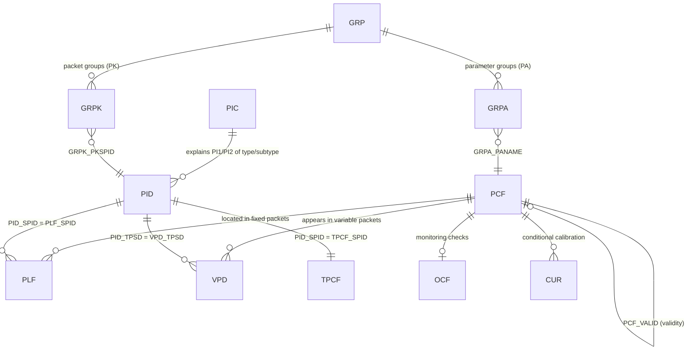
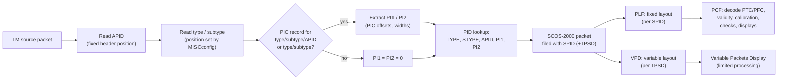

# Monitoring in the MIB: parameters and packets

The [SCOS-2000](../scos2000/index.md) [Mission Information Base](index.md) (MIB) is split into a static part, usually called the database, and a dynamic part, the packet archive.[^icd-defs] The static part tells the control system everything it needs to turn downlinked telemetry packets into named, typed and validated parameter samples. On the monitoring side, nine ASCII tables do this work. The [PCF](tables/pcf.md) defines every monitoring parameter. [PID](tables/pid.md), [PIC](tables/pic.md) and [TPCF](tables/tpcf.md) tell the telemetry packetiser how to recognise an incoming packet and which processing keys to give it. [PLF](tables/plf.md) and [VPD](tables/vpd.md) describe where parameter values sit inside fixed and variable packets. [GRP](tables/grp.md), [GRPA](tables/grpa.md) and [GRPK](tables/grpk.md) group parameters and packets.[^icd-t1] Calibration and limit checking hang off the PCF and have their own pages: [Calibration in the MIB](calibration.md) and [Monitoring checks](monitoring-checks.md).

This page follows the Database Import ICD issue 7.0 (EGOS-MCS-S2K-ICD-0001, 2017-08-11). The library copy comes from the Solar Orbiter MOC document server, where the file name begins with "MOC-applicable MIB".[^icd-pcf] Every Solar Orbiter number below comes from this wiki's own SQL queries on the public release `MIB__20250916M25925PFMS001_SOL` (database version `25925PFM`, comment `20250916-CSW3.1.2_MAS7.33`).[^mib-vdf] You can browse every object mentioned here in the [MIB explorer](../explorer/index.md).

## The monitoring tables at a glance

Each table is a tab-separated ASCII file named after the table in lower case (for example `pcf.dat`), with one record per line. An empty optional field still carries its separator.[^icd-ascii] Fields marked with `*` in the ICD form the table key. Fields marked `M` are mandatory. An optional field left empty takes the import default given in the ICD.[^icd-conv]

| Table | One record per | Role | Solar Orbiter rows (2025) |
|---|---|---|---|
| [PCF](tables/pcf.md) | monitoring parameter | name, type, validity, nature, calibration link, display and archive flags | 126,745 |
| [PID](tables/pid.md) | packet identification key | maps APID/type/subtype/PI1/PI2 to the processing keys SPID and TPSD | 11,150 |
| [PIC](tables/pic.md) | type/subtype (optionally APID) | where to find the extra identification fields PI1 and PI2 | 256 |
| [TPCF](tables/tpcf.md) | SPID | packet mnemonic and (informative) size | 11,150 |
| [PLF](tables/plf.md) | parameter occurrence in a fixed packet | byte and bit offset, super-commutation, time offsets | 400,792 |
| [VPD](tables/vpd.md) | element of a variable packet structure | ordered layout, repeat counters, display attributes | 19,863 |
| [GRP](tables/grp.md) | monitoring group | group name, description and type (parameters or packets) | 2 |
| [GRPA](tables/grpa.md) | parameter in a parameter group | membership | 0 |
| [GRPK](tables/grpk.md) | packet in a packet group | membership | 4 |

Sources for the table: roles from the ICD,[^icd-t1][^icd-sum] row counts from the Solar Orbiter MIB.[^mib-counts]

The PCF sits at the centre of the data model. Each parameter can reference one validity parameter (many-to-one onto the PCF itself), one or several calibrations, at most one set of up to 16 monitoring checks, and any number of packets, groups and displays.[^icd-scope] The diagram shows the monitoring relationships described on this page. The [data model page](data-model.md) gives the full picture, including commanding.



Diagram based on the ICD's description of the monitoring data organisation.[^icd-scope]

## From packet to parameter sample

The processing chain explains why the tables look the way they do. The SCOS-2000 telemetry packetiser receives a telemetry source packet. It reads the APID from its fixed place in the packet header, and the PUS service type and subtype from a position set by configuration variables. If the PIC says that this type/subtype needs more identification data, it extracts up to two further fields (PI1, PI2) from the packet data field. It then looks up the PID table with the full key and files and distributes a SCOS-2000 packet under the processing keys found there: the SPID for fixed packets and the TPSD for variable packets.[^icd-pkt] PLF (fixed) or VPD (variable) definitions then govern parameter extraction.[^icd-pkt]



Flow drawn from the packetiser description in the ICD.[^icd-pkt][^icd-pic] The SCOS-2000 packet body holds the complete TM source packet. For missions that use the standard packetiser, PLF offsets therefore count from the first octet of the source packet header, and VPD processing starts `PID_DFHSIZE` octets later.[^icd-proc]

!!! note "Two design constraints for the on-board software"
    The ICD warns that the packetiser assumes two things. First, the type and subtype fields, when present, sit at the same position in every packet the spacecraft generates. Second, every packet with a given type/subtype carries its additional identification fields at the same position and with the same width.[^icd-pkt] The ICD flags both as constraints that the on-board design must respect.

## PCF: monitoring parameter characteristics

The PCF holds one record per monitoring parameter. The word "monitoring parameter" covers three things: telemetry parameters extracted from packets, user defined constants and synthetic parameters computed on the ground.[^icd-pcf-intro] Fields 20 to 23 are optional, for backward compatibility, and the importer accepts PCF records with 19 to 23 fields.[^icd-pcf-intro] The Solar Orbiter `pcf.dat` has 23 fields in every record.[^mib-counts]

### Field reference

| # | Field | Type | M / default | Meaning |
|---|---|---|---|---|
| 1* | `PCF_NAME` | Char(8) | M | Unique parameter name. It must not start with `VAR`, `GVAR` or `$` (reserved by the Operations Language), and the patterns `NNOiiii`, `CEBiiii`, `KRUiiii`, `MSPiiii`, `VL2iiii`, `PERiiii`, `REDiiii`, `MLGiiii` are reserved for ground-station telemetry.[^icd-pcf-name] |
| 2 | `PCF_DESCR` | Char(24) | | Free-text description.[^icd-pcf-name] |
| 3 | `PCF_PID` | Number(10) | | On-board parameter identifier ("Parameter#" of the PUS), range 0 to 2^32−1. It identifies the parameter in PUS variable packets. It must be unique; it is left empty for ground-only parameters.[^icd-pcf-pid] |
| 4 | `PCF_UNIT` | Char(4) | | Engineering unit shown next to the calibrated value, or next to the raw value when there is no calibration.[^icd-pcf-pid] |
| 5 | `PCF_PTC` | Number(2) | M | Parameter Type Code, 1 to 13. Needed even for synthetic parameters; saved synthetic parameters must use PTC 13.[^icd-pcf-type] |
| 6 | `PCF_PFC` | Number(5) | M | Parameter Format Code. With the PTC it fixes the length of values extracted from packets.[^icd-pcf-type] |
| 7 | `PCF_WIDTH` | Number(6) | | Padded width in bits. Used only for VPD extraction, to find where the next parameter starts; also controls fixed-width extraction of deduced parameters (PTC 11).[^icd-pcf-width] |
| 8 | `PCF_VALID` | Char(8) | | Name of the validity parameter.[^icd-pcf-valid] |
| 9 | `PCF_RELATED` | Char(8) | | For saved synthetic parameters: the synthetic parameter that is computed. For deduced parameters: the parameter that carries the on-board parameter ID.[^icd-pcf-related] |
| 10 | `PCF_CATEG` | Char(1) | M | Calibration category: `N` numerical, `S` status (textual calibration), `T` text (character strings).[^icd-pcf-categ] |
| 11 | `PCF_NATUR` | Char(1) | M | Nature: `R` raw TM, `D` dynamic OL synthetic, `P` SPEL synthetic, `H` hard-coded synthetic, `S` saved synthetic, `C` constant.[^icd-pcf-natur] |
| 12 | `PCF_CURTX` | Char(10) | | Name of the single calibration (numerical, polynomial, logarithmic or textual). Empty when the CUR table selects among several calibrations.[^icd-pcf-curtx] |
| 13 | `PCF_INTER` | Char(1) | `F` | Extrapolation flag (`P` extrapolate, `F` invalid). Ignored by SCOS-2000, which uses `CAF_INTER` instead.[^icd-pcf-inter] |
| 14 | `PCF_USCON` | Char(1) | `N` | `Y` if the parameter is status-consistency checked. Must be `Y` when OCP holds a status consistency check.[^icd-pcf-uscon] |
| 15 | `PCF_DECIM` | Number(3) | | Number of decimal places for displaying real values.[^icd-pcf-uscon] |
| 16 | `PCF_PARVAL` | Char(14) | | Default raw value of a static user defined constant (`PCF_NATUR = C`, then mandatory).[^icd-pcf-uscon] |
| 17 | `PCF_SUBSYS` | Char(8) | | Group the parameter belongs to; reserved for future filtering.[^icd-pcf-misc] |
| 18 | `PCF_VALPAR` | Number(5) | `1` | Raw value of the validity parameter that makes this parameter valid.[^icd-pcf-misc] |
| 19 | `PCF_SPTYPE` | Char(1) | | Output view of a synthetic parameter (`E` engineering, `R` raw). Not imported; used by the off-line consistency checker.[^icd-pcf-misc] |
| 20 | `PCF_CORR` | Char(1) | `Y` | Apply time correlation to absolute time parameters (`Y`/`N`); must be `N` for relative times (PTC 10).[^icd-pcf-time] |
| 21 | `PCF_OBTID` | Number(5) | | On-board clock identifier (1..N) used for time correlation or for the time epoch; default from `TCO_DEFAULT_OBT_ID`.[^icd-pcf-time] |
| 22 | `PCF_DARC` | Char(1) | `0` | `1` adds the parameter to the parameter archive (DARC) recording list; `0` leaves it unchanged. Not imported by SCOS-2000.[^icd-pcf-darc] |
| 23 | `PCF_ENDIAN` | Char(1) | `B` | Byte order (`B` big endian, `L` little endian) for whole-octet integers, strings, octet strings and times.[^icd-pcf-darc] |

Names must be unique regardless of letter case (`A1000` and `a1000` clash), but the importer does not warn about such clashes.[^icd-conv]

### Type and width: PTC, PFC and PCF_WIDTH

The PTC/PFC pair is the parameter's encoding. SCOS-2000 uses it to decode values of parameters whose nature is `R` or `C`.[^icd-pcf-type] The meaning of each pair is listed in Appendix A of the ICD, which follows the nomenclature of the Packet Utilisation Standard ([PUS](../ecss/pus/index.md)). The [MIB parameter types](parameter-types.md) page covers it in full, and [PUS parameter types](../ecss/pus/parameter-types.md) gives the PUS side. Values are always handled in three forms. The **encoded** value is the bits in the packet. The **raw** value is the decoded number before calibration. The **engineering** value is the result of calibration. Raw and encoded values only coincide for unsigned integers; a 16-bit signed raw value of −1, for example, is encoded as `0xFFFF`.[^icd-defs]

The Solar Orbiter PCF uses these type codes:

| PTC | Appendix A meaning | Solar Orbiter parameters |
|---|---|---|
| 1 | Boolean, 1 bit (PFC 0) | 4,380 |
| 2 | Enumerated, PFC bits (1–32) | 29,443 |
| 3 | Unsigned integer (PFC 0–12 → 4 to 16 bits, PFC 13 → 24 bits, PFC 14 → 32 bits; 48 and 64 bits not supported) | 50,341 |
| 4 | Signed integer (same PFC scheme as PTC 3) | 1,950 |
| 5 | Real (PFC 1 IEEE single, 2 IEEE double, 3 MIL-STD-1750A 32-bit) | 29,718 |
| 6 | Bit string, handled as unsigned integer of PFC bits (monitoring only) | 950 |
| 7 | Octet string (PFC > 0: fixed length in octets) | 5,990 |
| 8 | ASCII string (PFC > 0: fixed length in octets) | 120 |
| 9 | Absolute time (CDS or CUC variants; PFC 30 Unix time) | 3,796 |
| 10 | Relative time (CUC variants) | 47 |
| 11 | Deduced (type taken from the parameter ID in the packet) | 8 |
| 13 | Saved synthetic parameter | 2 |

Type meanings from Appendix A and the PCF field descriptions;[^icd-appa][^icd-pcf-type][^icd-pcf-width] counts from the Solar Orbiter PCF.[^mib-pcf]

`PCF_WIDTH` matters only for variable packets. It gives the slot width when it differs from the length implied by PTC/PFC, for example when padding bits byte-align the next field; padding bits always precede the value. For a deduced parameter (PTC 11), a width means "extract from a fixed-width slot"; no width means "use the length of the actual type, padded as defined for that type".[^icd-pcf-width][^icd-vpd] Only seven Solar Orbiter parameters set it. Five are deduced parameters of the on-board monitoring reports, each with a 64- or 32-bit slot. Two are saved synthetic parameters with a 104-bit (13-octet) slot.[^mib-pcf] Thirteen octets is exactly the size the ICD prescribes for a saved synthetic parameter: 8 octets of value, 1 octet of value type and 4 octets of validity flags.[^icd-syn]

### Validity: PCF_VALID, PCF_VALPAR and expiry

A parameter value is only meaningful in some on-board states. A heater current means nothing while the heater's power line is off. The MIB expresses this with a **validity criterion**: the parameter is valid when the parameter named in `PCF_VALID` has the raw value `PCF_VALPAR` (default 1). SCOS-2000 also requires the validity parameter itself to be valid. The validity parameter must have an integer raw representation and must be processed by the telemetry model (it appears in the PLF or it is synthetic). Circular validity chains are not allowed.[^icd-pcf-valid] For a synthetic parameter, the overall validity is the logical AND of the validity derived from its inputs and its own explicit criterion.[^icd-pcf-valid]

A second mechanism needs no MIB entry. When no instance of a periodic packet arrives within its generation interval (`PID_INTER`) plus a globally configured margin, every parameter in it is flagged invalid ("expired"). The ICD notes that this removes the need to encode in validity criteria all the on-board conditions under which a packet is generated.[^icd-pcf-intro] Behind the single word "invalid" sits a bit set of reasons. The SCOS-2000 EGSE test language, for example, exposes flags such as `VAL_STATE_OFF` (state validity evaluates to 0), `VAL_EXPIRED` (packet not arrived), `VAL_CALIBRATION` (calibration failed) and `VAL_UNKNOWN_STATE` (state parameter invalid).[^emcs-val]

In the Solar Orbiter MIB, 20,692 parameters have a validity parameter, drawn from 2,933 distinct validity parameters, all of them integer types (PTC 1 to 4). The most used validity parameters are the `…SCV Status.scvTm` enumerations of the two PCDU and two RIU sides: `NCSD0PC3` (PCDU A, 1,369 dependants), `NCSD0PD3` (PCDU B, 1,357), `NCSD0PE3` (RIU A, 1,210) and `NCSD0PF3` (RIU B, 1,210). Their textual calibration `CCDT0065TM` maps 0, 1 and 2 to `NOT_APPLICABLE`, `OFF` and `ON`. Dependent parameters therefore use `PCF_VALPAR = 2`, which means "valid when ON". Of the 20,692 records, 9,775 use the value 1, 8,216 use 2 and 2,436 leave the field empty and inherit the default 1. The remaining 265 use 0 (243 records), 80 (12), 32 (8) or 64 (2).[^mib-pcf] No Solar Orbiter PID record sets `PID_INTER`, so, as far as the MIB is concerned, no packet is declared periodic for expiry purposes.[^mib-pid][^icd-pid]

### Category and nature

`PCF_CATEG` tells SCOS-2000 which family of calibration applies. `N` covers numerical parameters, with or without a numerical, polynomial or logarithmic calibration, and all non-numerical types except character strings. `S` (status) is for parameters with a textual calibration. `T` (text) is for character strings (PTC 8).[^icd-pcf-categ] Solar Orbiter has 100,087 `N`, 26,538 `S` and 120 `T` parameters. The 120 `T` parameters match its 120 PTC 8 parameters exactly.[^mib-pcf]

`PCF_NATUR` tells SCOS-2000 where the value comes from:[^icd-pcf-natur][^icd-syn][^icd-udc]

| Nature | Name | Source of the value | Solar Orbiter 2025 | Solar Orbiter 2020 |
|---|---|---|---|---|
| `R` | Raw telemetry | extracted from TM packets (also dynamic UDCs and MISC variables, from internal packets) | 125,161 | 101,714 |
| `D` | Dynamic OL synthetic | Operations Language expression in a file named after the parameter, interpreted, not stored | 1,582 | 354 |
| `P` | SPEL synthetic | Synthetic Parameter Expression Language file; EGSE deliveries only | 0 | 0 |
| `H` | Hard-coded synthetic | C++ (written directly or compiled from OL) | 0 | 36 |
| `S` | Saved synthetic | value of the synthetic named in `PCF_RELATED`, computed centrally and stored in synthetic packets | 2 | 0 |
| `C` | Constant (static UDC) | value in `PCF_PARVAL` | 0 | 0 |

Counts from both public releases.[^mib-pcf][^mib2020]

Synthetic parameters behave like telemetry parameters once computed. They can be displayed, calibrated (the computed source value is treated as the raw value) and limit checked.[^icd-syn-handling] Dynamic OL parameters are recomputed whenever a contributing sample changes in value or validity, also during retrieval. Saved synthetic parameters are computed by the Synthetic Parameters Packet Generator (SPPG) and written into synthetic packets, so retrieval shows exactly what was computed in real time. The price is that only the values present when a triggering packet arrives are stored.[^icd-syn] The [synthetic parameters page](synthetic-parameters.md) covers the languages and the 1,582 Solar Orbiter definition files. Solar Orbiter's two saved synthetic parameters are `NTTSS030` and `NTTSS031` ("Last C_Lock DST-1/2"). They save the synthetic parameters `NTTSX030` and `NTTSX031`, use PTC 13 and have the 104-bit width noted above. Their PLF entries place them at octets 0 and 13 of SPID 66838 "Saved Synthetics" (type 251, subtype 2, APID 1966), one 13-octet slot each.[^mib-pcf][^mib-plf]

**User defined constants (UDCs)** come in two kinds. A static UDC has `PCF_NATUR = C` and a database default in `PCF_PARVAL`, which can only be changed through the OL editor. A dynamic UDC has `PCF_NATUR = R` and a PLF entry in an internally generated "constants TM packet", whose values operators set through TM SPACON or the parameter injection interface.[^icd-udc] Solar Orbiter uses only dynamic UDCs. Its constants packet is SPID 66830 "Dynamic UDCs" (APID 1966, type 160, subtype 3). Among its 13 parameters are `NCFZ0001` "TC Link Time Out", `NDSZX003` "DST Uplink Path" and `NPWZ0000` "PCDU_MODEL".[^mib-udc] The last one selects calibration curves at run time; see [conditional calibration](calibration.md#conditional-selection-cur). The same pattern serves the MISC packet, which carries selected configuration variables as pseudo-telemetry. Those variables must be 32-bit signed integers (PTC 4, PFC 14), IEEE doubles (PTC 5, PFC 2) or character strings (PTC 8).[^icd-misc] Solar Orbiter's MISC packet is SPID 66832 "MISC_PACKET: Config variables packet MISCdynamic server" (APID 1966, type 160, subtype 5), with 21 parameters. Two of them use types outside that list: `NYG01921` "TCO_DEFAULT_ENCOD_SCHEME" is PTC 5, PFC 1 (IEEE single) and `NYG01923` "CMD VC ID" is PTC 4, PFC 12 (16-bit signed).[^mib-udc]

### Calibration, checks and display fields

`PCF_CURTX` names the single calibration of a parameter. It must match a `TXF_NUMBR` for status parameters, or a `CAF_NUMBR`, `MCF_IDENT` or `LGF_IDENT` for numerical ones. It is mandatory for status parameters. It must be empty for text, string (PTC 7, 8) and time (PTC 9, 10) parameters, and for parameters calibrated through the CUR table.[^icd-pcf-curtx] In Solar Orbiter, 30,936 parameters name a calibration: 26,533 textual, 3,433 numerical and 970 polynomial. Another 907 parameters use conditional selection through CUR.[^mib-cal] `PCF_INTER` is a leftover. The ICD states that SCOS-2000 ignores it and takes extrapolation behaviour from the calibration curve.[^icd-pcf-inter] The [calibration page](calibration.md) gives the details.

`PCF_USCON = Y` enables status consistency checking. The number of such parameters has a hard upper limit, set by the size of the packet that holds the snapshot of all status consistency checks; the `PCF_USCON` description says that from release 4.1 it can be changed with the configuration variable `MAX_SCC_MESSAGE_LENGTH`.[^icd-pcf-uscon] The OCP rules elsewhere in the same ICD say it cannot be changed by configuration; see [monitoring checks](monitoring-checks.md#status-consistency-checks). Solar Orbiter flags 15 parameters, all with one OCP check of type `C` ([monitoring checks](monitoring-checks.md#status-consistency-checks)).[^mib-pcf]

`PCF_UNIT` and `PCF_DECIM` are pure display attributes. Solar Orbiter gives a unit to 5,124 parameters. Where `PCF_DECIM` is set, the most common values are 3 (23,081 parameters) and 2 (13,434).[^mib-pcf]

### Time parameters, archiving and byte order

For absolute times, `PCF_CORR = Y` converts the on-board time to UTC with the time correlation of the clock named by `PCF_OBTID`. With `N`, the value is extracted unchanged and the clock's time format defines the epoch, or `TCO_ESA_EPOCH` when no clock is given.[^icd-pcf-time] See [time correlation in SCOS-2000](../scos2000/time-correlation.md) and [CCSDS time codes](../ccsds/time-codes.md). Solar Orbiter sets `N` for all 47 relative-time parameters, as the ICD requires, and for 3 absolute-time parameters. It never sets `PCF_OBTID`, so the mission default clock applies.[^mib-pcf]

`PCF_DARC = 1` asks the parameter archive ([DARC](../scos2000/archives.md)) to record the parameter. Solar Orbiter sets it on 49,330 parameters.[^mib-pcf][^icd-pcf-darc] `PCF_ENDIAN = L` declares a little-endian parameter. Exactly one Solar Orbiter parameter uses it: `NYG02201` "GS Packet Size", a 32-bit unsigned integer.[^mib-pcf]

### Worked example: `NMUD1113`, an IMU temperature

[`NMUD1113`](../explorer/index.md#/solo/param/NMUD1113) ("IMU11 SIA temperature") shows most PCF features at once (real MIB values).[^mib-ex]

| Field | Value | Reading |
|---|---|---|
| `PCF_NAME` / `PCF_DESCR` | `NMUD1113` / `IMU11 SIA temperature` | |
| `PCF_PTC` / `PCF_PFC` | 3 / 8 | 12-bit unsigned integer |
| `PCF_UNIT` | `degC` | shown next to the calibrated value |
| `PCF_CATEG` / `PCF_NATUR` | `N` / `R` | numerical, extracted from telemetry |
| `PCF_CURTX` | [`CMUT0013TM`](../explorer/index.md#/solo/calib/num/CMUT0013TM) | 11-point numerical curve "FOG 200E temperature" |
| `PCF_VALID` / `PCF_VALPAR` | `NCSD0P43` / 2 | valid only while "IMUA Gyr1 SCV Stat.Tm" reads 2 (`ON`) |
| `PCF_DECIM` | 3 | three decimals on displays |
| `PCF_DARC` | 1 | recorded in the parameter archive |
| `PCF_PID`, `PCF_WIDTH`, `PCF_OBTID` | empty | no on-board ID, not used in variable packets |

The PLF places it in two packets, [SPID 29534](../explorer/index.md#/solo/packet/29534) (`YCA2Z011`) and [SPID 29517](../explorer/index.md#/solo/packet/29517) (`YCA1Z087`), both "AOCS IMU RAW" TM(3,25) packets. In both it sits at octet 69, bit 4.[^mib-ex] The [calibration page](calibration.md#worked-example-nmud1113) converts one of its raw values, and the [checks page](monitoring-checks.md#example-soft-and-hard-limits-on-an-imu-temperature) evaluates it against its limits.

## Recognising packets: PID, PIC and TPCF

### PID: packet identification

The PID maps packet identification values to SCOS-2000 packet IDs. The SPID identifies the structure of a fixed packet, as defined in the PLF. The TPSD identifies the structure of a variable packet, as defined in the VPD. One telemetry packet can be processed both ways.[^icd-pid-intro]

| # | Field | Type | M / default | Meaning |
|---|---|---|---|---|
| 1* | `PID_TYPE` | Number(3) | M | PUS service type, 0–255; 0 means no data field header |
| 2* | `PID_STYPE` | Number(3) | M | PUS service subtype, 0–255; 0 as above |
| 3* | `PID_APID` | Number(5) | M | APID: 0–2047 for spacecraft packets, 2048–65535 for packets generated by SCOS-2000 applications or other domains such as SCOEs |
| 4* | `PID_PI1_VAL` | Number(10) | `0` | value of the first additional identification field (for example a structure ID), 0 to 2^31−1 |
| 5* | `PID_PI2_VAL` | Number(10) | `0` | value of the second additional identification field (for example a function ID) |
| 6* | `PID_SPID` | Number(10) | M | SCOS-2000 packet ID, 1 to 2^32−1 (0 not allowed); up to S2K-R5 it also chose the history file |
| 7 | `PID_DESCR` | Char(64) | | description; also the message text of the event raised when `PID_EVENT` is set |
| 8 | `PID_UNIT` | Char(8) | | on-board subsystem (future filtering) |
| 9 | `PID_TPSD` | Number(10) | `-1` | structure ID for the Variable Packets Display; −1 if the packet is not in the VPD |
| 10 | `PID_DFHSIZE` | Number(2) | M | octets from the start of the source packet to where VPD processing begins (0–99), typically primary header plus data field header |
| 11 | `PID_TIME` | Char(1) | `N` | `Y` if the packet carries a generation time field |
| 12 | `PID_INTER` | Number(8) | | generation interval of a periodic packet in ms, used for expiry; empty for non-periodic packets |
| 13 | `PID_VALID` | Char(1) | `Y` | which of several records with the same key is valid |
| 14 | `PID_CHECK` | Number(1) | `0` | `1` to check the Packet Error Control CRC, `0` not to |
| 15 | `PID_EVENT` | Char(1) | `N` | raise a SCOS-2000 event on reception: `N` none, `I` info, `W` warning, `A` alarm |
| 16 | `PID_EVID` | Char(17) | | event number; the full event ID becomes `TPKT_OBE::nnnn`; 1–9999 suggested |

Field definitions from ICD §3.3.2.4.1.[^icd-pid]

The ICD attaches rules to the PID that protect the archive. These rules matter for anyone who maintains a MIB over a long mission:[^icd-pid-rules]

* The packetiser key is the first five fields. Associating several keys with one SPID is deprecated from release 5.0: each distinct packet must have its own SPID.
* Packets identified by APID alone, without a data field header, get 0 in all other key fields.
* Once mission telemetry is being archived, the mapping from identification fields to SPID must not change. PID entries whose SPIDs exist in the archive must not be deleted, or advanced retrieval services such as the [GDDS](../scos2000/gdds-and-ddids.md) break. The TPSD of archived packets must not change either.
* Internally generated packets (UDC, MISC, synthetic and system control packets) should also have PID entries, with a type/subtype/APID combination that no other source uses, plus a TPCF entry for the mnemonic.

### PIC: where the extra identification fields are

Many PUS packets share a type/subtype and differ only in the first field of their data. A housekeeping report TM(3,25) carries a structure ID; an event report TM(5,x) carries an event ID. The [PIC](tables/pic.md) tells the packetiser, for each type/subtype (and optionally APID), where the extra identification fields are. Offsets count in octets from the start of the source packet. Widths count in bits. An offset of −1 means "no such field".[^icd-pic]

| # | Field | Type | M / default | Meaning |
|---|---|---|---|---|
| 1* | `PIC_TYPE` | Number(3) | M | service type |
| 2* | `PIC_STYPE` | Number(3) | M | service subtype |
| 3 | `PIC_PI1_OFF` | Number(5) | M | octet offset of PI1 from the start of the source packet, or −1 |
| 4 | `PIC_PI1_WID` | Number(3) | M | width of PI1 in bits |
| 5 | `PIC_PI2_OFF` | Number(5) | M | octet offset of PI2, or −1 |
| 6 | `PIC_PI2_WID` | Number(3) | M | width of PI2 in bits |
| 7* | `PIC_APID` | Number(5) | `99999` | APID the record applies to; empty means all APIDs |

Precedence: a record matching type/subtype/APID wins. Otherwise a record matching type/subtype applies. Otherwise PI1 and PI2 are taken as 0. The packetiser reads the PIC directly; it is not imported into the run-time database.[^icd-pic] The Herschel ground segment added a sanity rule: a PID entry must not carry a non-zero PI1 when the matching PIC says PI1 is not used.[^hcss-pic]

On Solar Orbiter every telemetry packet except the standard spacecraft time packet has a data field header. The primary header is 6 octets and the data field header 10 octets, so source data starts at octet 16.[^ccsds-ph][^sol-apid][^sol-len][^sol-dfh] This matches `PID_DFHSIZE = 16` on 11,138 of the 11,150 PID records.[^mib-pid] The diagram shows the first 17 octets of a Solar Orbiter housekeeping report, the part the packetiser needs.

<div class="bitfield" data-title="Solar Orbiter TM(3,25) packet: header and SID as seen by the packetiser (136 bits)" data-width="32"
     data-caption="Primary header per CCSDS 133.0-B-2 and SOL.S.ASTR.TN.00079 §4.2.1; data field header (10 octets: spare and PUS version, type, subtype, destination ID, CUC 4+2 time) per §4.2.2.1 and §13.3; SID per §5.4.13"
     data-fields='[{"n":"Version","b":3,"v":"000","g":"Packet ID"},{"n":"Type","b":1,"v":"0","g":"Packet ID"},{"n":"DFH flag","b":1,"v":"1","g":"Packet ID"},{"n":"APID: process ID","b":7,"g":"Packet ID","d":"7 most significant APID bits identify the source application"},{"n":"APID: category","b":4,"g":"Packet ID","d":"4 least significant APID bits: packet category"},{"n":"Grouping flags","b":2,"g":"Sequence control"},{"n":"Source sequence count","b":14,"g":"Sequence control"},{"n":"Packet length","b":16,"d":"octets in packet data field minus 1; at most 4106 octets of data field on Solar Orbiter"},{"n":"Data field header (type at octet 7, subtype at octet 8, destination ID, time)","b":80,"g":"PID_DFHSIZE = 16","d":"10 octets; exact layout in SOL.S.ASTR.TN.00079 figure 4.2-2 (not available as text); octet positions inferred"},{"n":"SID = PI1 (PIC: offset 16, width 8)","b":8,"g":"Source data","d":"Structure ID of the housekeeping report"}]'></div>

!!! warning "Inference"
    The positions of type and subtype inside the 10-octet data field header (octets 7 and 8 from the packet start) follow from the field order printed in SOL.S.ASTR.TN.00079 §4.2.2.1 (spares, PUS version, service type, subtype, spacecraft time), assuming the spares and the version share the first octet. The TN also defines an 8-bit destination ID in the TM data field header (§13.3), and the time field is CUC with 4 coarse and 2 fine octets. One octet each for version/spares, type, subtype and destination ID plus 6 time octets gives the 10 octets, but the order of the destination ID and the time is not stated in the text.[^sol-dfh][^sol-dest] The figure with exact offsets was not available as text. The positions are a SCOS-2000 configuration item (MISCconfig), not part of the MIB.[^icd-pkt]

The Solar Orbiter PIC shows the pattern clearly:[^mib-pic]

| Type/subtype | PI1 offset / width | PI2 offset / width | What PI1 is (from the packet definitions) |
|---|---|---|---|
| (3,25), (3,26) | 16 / 8 | −1 | 1-octet SID of the housekeeping or diagnostic report[^sol-3-25] |
| (5,1) to (5,4), all APIDs | 16 / 16 | −1 | event ID |
| (5,1), (5,2), (5,3): 25 APID-specific records | 16 / 16 | 18 / 8, 18 / 16, 18 / 32 or 19 / 8 | event ID plus a second field defined per APID |
| (1,2), (1,8) | 20 / 16 | −1 | failure code after the 4-octet TC packet ID and sequence control echo |
| (1,1), (1,7), (12,11), (12,12) and others (183 records in all) | −1 | −1 | no extra identification |

183 of the 256 PIC records declare no extra fields at all.[^mib-pic]

### TPCF: packet characteristics

The [TPCF](tables/tpcf.md) holds one record per SPID with the packet mnemonic, shown on displays to identify where a value came from (`None` when missing), and `TPCF_SIZE`. `TPCF_SIZE` is not imported. It exists for missions that generate history-file configuration and should then hold the full SCOS-2000 packet size: the source packet plus the SCOS-2000 packet header of 64 octets (header versions 0 to 3) or 76 octets (version 4), or 0 for truly variable packets.[^icd-tpcf] Solar Orbiter has a TPCF record for every PID SPID. 2,325 of them have size 0 and 8,825 give a non-zero size, from 6 to 4,136 octets. 7,484 of the non-zero sizes are below 64 octets, the size of the SCOS-2000 packet header alone, so the mission does not fill this field according to the ICD guideline (it is not imported, so this has no run-time effect).[^mib-pid][^icd-tpcf]

### Solar Orbiter packets in numbers

The 11,150 PID records use 293 distinct APIDs. Event reporting and request verification account for most of them, because every event ID and every failure code gets its own SPID. The table lists the largest groups and the housekeeping and diagnostic reports; other groups, such as (21,6) with 151 records, are left out:[^mib-pid]

| Type/subtype | Records | `PID_EVENT` | Meaning on Solar Orbiter |
|---|---|---|---|
| (5,3) | 2,911 | `A` | error/anomaly report, medium severity[^sol-events] |
| (5,4) | 1,698 | `A` | error/anomaly report, high severity |
| (1,8) | 1,477 | `A` | TC completion report failure, one SPID per failure code |
| (5,1) | 1,374 | `I` | nominal/progress report |
| (5,2) | 1,159 | `W` | error/anomaly report, low severity |
| (131,128) | 460 | empty | "OBDB Dump" reports (from `PID_DESCR`); service 131 is the private function management service[^sol-131] |
| (6,6) | 289 | `N` | memory dump report |
| (3,25) | 288 | empty or `N` | housekeeping parameter report |
| (1,2) | 274 | `A` | TC acceptance report failure |
| (131,2) | 232 | empty | "PCDU Snapshot" reports (from `PID_DESCR`) |
| (3,26) | 89 | empty or `N` | diagnostic parameter report |

Because `PID_DESCR` becomes the event text, an operator who receives, for example, the TM(1,8) with failure code 264 from APID 161 (SPID 14088) sees an alarm saying "The actual TC length is different from the expected TC length". No record sets `PID_EVID`, so no custom event IDs are used.[^mib-pid][^icd-pid]

Other features of the Solar Orbiter PID table:[^mib-pid]

* `PID_TIME = Y` for 11,141 records. The 9 exceptions are the 3 transfer-frame pseudo-packets and the 6 ground-station packets described below.
* `PID_DFHSIZE` is 16 except for 12 records. Six have 0: the three transfer-frame pseudo-packets (APID 1, type 0) and the three MATIS packets of type 166. Six have 6, that is the primary header only: the time report SPID 9999 and five internal packets of types 160 and 161. The time report is keyed as type 9, subtype 2 on APID 0, the APID that Solar Orbiter reserves for its time packet, which has no data field header.[^sol-apid] The TM-TC ICD itself calls this packet "TM (9,2)" while stating that it has no data field header.[^sol-dest] The Database Import ICD's general rule would key a packet without data field header with type and subtype 0;[^icd-pid-rules] how the Solar Orbiter packetiser reconciles the two is not stated in the available sources.
* `PID_CHECK = 1` (verify the packet error control) appears on only 6 records: the three "complete transfer frame" pseudo-packets `CTFBAD`, `CTFIDLE`, `CTFGOOD` (APID 1, type 0) and three MATIS packets. Every spacecraft packet has `PID_CHECK = 0`.
* Six records use APIDs above 2047, as the ICD reserves for non-spacecraft sources. They are ground-station packets `LMS_NNO`, `LMS_CEB` and `LMS_MLG`, each at low and high frequency, on APIDs 2048–2065, with parameter descriptions such as "LMS_NNO WSDS1 Temp", "WSDS1 Wind Speed" and "FEC1 AZ act Pos". Their parameters are named `NYN…`, `NYC…` and `NYM…` rather than the reserved `NNOiiii`-style names.
* Eighteen SCOS-internal and ground-generated packets share APID 1966 and use the private types 160 to 166 and 251. Examples are "Dynamic UDCs" (160,3), the MISC packet (160,5), "TC Spacon Packet" (160,6), the mini-transfer-frame packets (161,3–5), "Bad Telemetry Packets" (162,1), the time correlation packets (164,1–3), the three MATIS status packets (166,1–3) and "Saved Synthetics" (251,2). APID 1966 lies inside the range 0–2047 that the ICD assigns to spacecraft packets; the ICD only asks that internal packets use a type/subtype/APID combination that no other source produces.[^icd-pid][^icd-pid-rules]
* 2,063 records have a TPSD. In every one of them the TPSD equals the SPID (for example 14173), and 2,063 distinct TPSDs are defined in the VPD.

The APID itself has structure on Solar Orbiter: 7 bits of process ID and 4 bits of packet category.[^sol-apid] APID 178 of `YCA2Z011` is binary `0001011 0010`, process ID 11 and category 2 (simple arithmetic on the rule; the APID allocation itself is in Annex 8 of the TN). See the [APID 178 explorer page](../explorer/index.md#/solo/apid/178).

## Fixed packets: the PLF

The [PLF](tables/plf.md) describes packets whose layout is fixed, identified by SPID. A parameter can appear in many packets. Overlapping entries (two parameters from the same bits) and gaps are both allowed, but a parameter may have only one record per packet. A super-commutated parameter is therefore described by one record with a repetition count.[^icd-plf] All standard monitoring displays (alphanumeric, graphic, scrolling) extract values through the PLF.[^icd-plf]

| # | Field | Type | M / default | Meaning |
|---|---|---|---|---|
| 1* | `PLF_NAME` | Char(8) | M | parameter (`PCF_NAME`) |
| 2* | `PLF_SPID` | Number(10) | M | packet (`PID_SPID`) |
| 3 | `PLF_OFFBY` | Number(5) | M | octet offset of the first occurrence, from the end of the SCOS-2000 header, which is the first octet of the source packet with the standard packetiser |
| 4 | `PLF_OFFBI` | Number(1) | M | bit (0–7) of the first bit within that octet; bit 0 is the leftmost, most significant bit |
| 5 | `PLF_NBOCC` | Number(4) | `1` | number of occurrences (1–9999); 1 for normal parameters |
| 6 | `PLF_LGOCC` | Number(5) | `0` | bits between the starts of two consecutive occurrences (0–32767) |
| 7 | `PLF_TIME` | Number(9) | `0` | time offset of the first occurrence from the packet time, in ms (±4,080,000) |
| 8 | `PLF_TDOCC` | Number(9) | `1` | time between consecutive occurrences in ms (1–4,080,000) |

Field definitions from ICD §3.3.2.5.1.[^icd-plf] The Herschel clarification note confirms that bit 0 is the most significant bit, and that offsets coincide with the source packet start only with the generic packetiser.[^hcss-plf] The value length is not in the PLF: it follows from PTC/PFC.[^icd-pcf-width] `PLF_TIME` and `PLF_TDOCC` time-stamp each sample. Graphic displays use them to plot super-commutated values, and scrolling displays and printouts use them to show times.[^icd-plf]

The ICD's housekeeping note explains why these offsets have to be static. SCOS-2000 time-stamps each sample from the packet time plus the fixed MIB offset, so the offsets must be known in advance and be the same in every instance of the packet. Likewise, the collection interval of a periodic packet is fixed in the database; SCOS-2000 does not update it when a ST[03] command changes it on board.[^icd-s3] New ST[03] housekeeping structures must also be defined in the MIB before the spacecraft starts sending them; ESA missions usually generate the [ST[03]](../ecss/pus/st03-housekeeping.md) definition commands from the database.[^icd-s3]

In the Solar Orbiter MIB the PLF holds 400,792 records for 107,792 distinct parameters in 9,056 packets. 725 records are super-commutated, and 91 have a non-zero `PLF_TIME`.[^mib-plf]

### Example: bit-level layout in an IMU housekeeping packet

Octets 65 to 70 of [`YCA2Z011`](../explorer/index.md#/solo/packet/29534) (SPID 29534, TM(3,25), APID 178, SID 11) hold status bits and two 12-bit temperatures of gyro IMU11 (real PLF data).[^mib-plf-ex]

<div class="bitfield" data-title="YCA2Z011, octets 65–70 (PLF_OFFBY 65 to 70), decomposed view" data-width="16"
     data-caption="Real Solar Orbiter PLF entries; the 8- and 16-bit overlay parameters NMU0Z000…NMU0Z003, which cover the same bits, are not drawn"
     data-fields='[{"n":"(in NMU0Z000 only)","b":5,"g":"octet 65"},{"n":"NMUD1101 Adc survey","b":1,"g":"octet 65"},{"n":"NMUD1102 Hard reset","b":1,"g":"octet 65"},{"n":"NMUD1103 Optical pwr delta","b":1,"g":"octet 65"},{"n":"NMUD1104 Input rate Wpi","b":1,"g":"octet 66"},{"n":"NMUD1105 Power max thresh","b":1,"g":"octet 66"},{"n":"NMUD1106 Power min thresh","b":1,"g":"octet 66"},{"n":"NMUD1107 Vpi loop error","b":1,"g":"octet 66"},{"n":"NMUD1108 ADC saturation","b":1,"g":"octet 66"},{"n":"NMUD1109 Reserved 1","b":1,"g":"octet 66"},{"n":"NMUD1110 Reserved 2","b":1,"g":"octet 66"},{"n":"NMUD1111 Validity bit","b":1,"g":"octet 66"},{"n":"(in NMU0Z002 only)","b":4,"g":"octets 67-68"},{"n":"NMUD1112 ORG temperature (PTC 3, PFC 8)","b":12,"g":"octets 67-68","d":"PLF_OFFBY 67, PLF_OFFBI 4"},{"n":"(in NMU0Z003 only)","b":4,"g":"octets 69-70"},{"n":"NMUD1113 SIA temperature (PTC 3, PFC 8)","b":12,"g":"octets 69-70","d":"PLF_OFFBY 69, PLF_OFFBI 4"}]'></div>

Three PLF features show here. Single-bit flags are located by `PLF_OFFBI` alone (`NMUD1104`…`NMUD1111` at bits 0–7 of octet 66). A 12-bit value starts in the middle of an octet (`PLF_OFFBI = 4`). The same bits are also exposed as whole 8- and 16-bit raw words (`NMU0Z000`: PTC 3, PFC 4 at octet 65; `NMU0Z002`: PTC 3, PFC 12 at octet 67), which is allowed because overlaps are legal.[^icd-plf][^mib-plf-ex]

### Example: super-commutation at 8 Hz

[`YCA2Z229`](../explorer/index.md#/solo/packet/29540) (SPID 29540, TM(3,26) "AOCS OCM 8Hz Diag", APID 184, SID 229) carries 16 samples of an AOCS state block. Every block parameter has `PLF_NBOCC = 16`, `PLF_LGOCC = 744` bits (93 octets), `PLF_TIME = −1875` ms and `PLF_TDOCC = 125` ms. The *n*-th sample (*n* = 0…15) of a parameter first located at octet *o* therefore sits at bit $8o + 744n$ and is time-stamped $t_{pkt} - 1875 + 125n$ ms. The last sample carries the packet time itself, and the first is 1.875 s older (real PLF data; the formula restates the ICD field definitions).[^mib-plf-ex][^icd-plf]

<div class="bitfield" data-title="YCA2Z229: one 93-octet occurrence of the super-commutated block (starts at octet 18, repeated 16 times every 744 bits)" data-width="32"
     data-caption="Real Solar Orbiter PLF layout; overlay octet-string parameters NCA3Z001, NCA3Z00D, NCA3Z00J and NCA3Z00K cover the vectors and are not drawn"
     data-fields='[{"n":"NCA3Z002 ACC X (real32)","b":32,"g":"accelerations"},{"n":"NCA3Z003 ACC Y (real32)","b":32,"g":"accelerations"},{"n":"NCA3Z004 ACC Z (real32)","b":32,"g":"accelerations"},{"n":"NCA3Z00E quat V-X (real64)","b":64,"g":"estimated quaternion"},{"n":"NCA3Z00F quat V-Y (real64)","b":64,"g":"estimated quaternion"},{"n":"NCA3Z00G quat V-Z (real64)","b":64,"g":"estimated quaternion"},{"n":"NCA3Z00H quat scalar (real64)","b":64,"g":"estimated quaternion"},{"n":"NCA3Z00L rate X (real64)","b":64,"g":"estimated rate"},{"n":"NCA3Z00M rate Y (real64)","b":64,"g":"estimated rate"},{"n":"NCA3Z00N rate Z (real64)","b":64,"g":"estimated rate"},{"n":"FCV1","b":8,"g":"thruster valve durations","d":"NCA3Z01N"},{"n":"FCV2","b":8,"g":"thruster valve durations","d":"NCA3Z01P"},{"n":"FCV3","b":8,"g":"thruster valve durations","d":"NCA3Z01R"},{"n":"FCV4","b":8,"g":"thruster valve durations","d":"NCA3Z01S"},{"n":"FCV5","b":8,"g":"thruster valve durations","d":"NCA3Z01T"},{"n":"FCV6","b":8,"g":"thruster valve durations","d":"NCA3Z01U"},{"n":"FCV7","b":8,"g":"thruster valve durations","d":"NCA3Z01V"},{"n":"FCV8","b":8,"g":"thruster valve durations","d":"NCA3Z01W"},{"n":"FCV9","b":8,"g":"thruster valve durations","d":"NCA3Z01X"},{"n":"NCA3Z025 RW1 rate (real32)","b":32,"g":"wheel rates"},{"n":"NCA3Z026 RW2 rate (real32)","b":32,"g":"wheel rates"},{"n":"NCA3Z027 RW3 rate (real32)","b":32,"g":"wheel rates"},{"n":"NCA3Z028 RW4 rate (real32)","b":32,"g":"wheel rates"}]'></div>

The block adds up to 744 bits, exactly the `PLF_LGOCC` step, so consecutive samples are packed with no gap. Before the block sit the SID (`NCD030C1`, octet 16, 8 bits) and an enable flag (`NCA3Z03A`, octet 17).[^mib-plf-ex] The largest repetition count in the Solar Orbiter MIB is 2,046: `NIH0XCPI` "Data from CPIO file", a 2-octet string repeated every 16 bits from octet 20 of SPID 56333 "SSMM XF Engineering Files".[^mib-plf] The ICD warns that a synthetic parameter fed by a super-commutated parameter is recomputed for every sample, which can be costly, and that saved synthetic parameters cannot be super-commutated.[^icd-syn]

## Variable packets: the VPD

Some PUS reports have no fixed layout. A repeat counter *N* precedes *N* groups, or a parameter ID decides how the following value is interpreted. The [VPD](tables/vpd.md) describes such packets, element by element, for packets whose PID gives a TPSD. It has no relation to the PLF or the display tables.[^icd-vpd] Each element starts where the previous one ended, shifted by `VPD_OFFSET` bits: a positive offset makes a gap, a negative one an overlap.[^icd-vpd] The table must be sorted by `VPD_TPSD` and `VPD_POS`.[^icd-vpd]

| # | Field | Type | M / default | Meaning |
|---|---|---|---|---|
| 1* | `VPD_TPSD` | Number(10) | M | structure ID (`PID_TPSD`) |
| 2* | `VPD_POS` | Number(4) | M | ordinal position of the element |
| 3 | `VPD_NAME` | Char(8) | M | parameter (`PCF_NAME`) |
| 4 | `VPD_GRPSIZE` | Number(3) | `0` | for a repeat counter (or a dummy fixed-repeat element): number of following elements in the repeated group; nesting is allowed |
| 5 | `VPD_FIXREP` | Number(3) | `0` | 0 no repeat; > 0 fixed number of repetitions (the counter element is then a dummy, defined in the PCF but absent from the packet); −1 repeat to end of packet (future extension) |
| 6 | `VPD_CHOICE` | Char(1) | `N` | `Y`: the value is a TPSD that defines the rest of the packet; must be the last element of its structure (choice is not supported by the VPD application) |
| 7 | `VPD_PIDREF` | Char(1) | `N` | `Y`: the value is an on-board parameter ID, looked up in `PCF_PID` to name a following deduced value |
| 8 | `VPD_DISDESC` | Char(16) | | column header text on displays |
| 9 | `VPD_WIDTH` | Number(2) | M | 0 hides the value; > 0 displays it in full |
| 10 | `VPD_JUSTIFY` | Char(1) | `L` | `L`, `R` or `C` justification |
| 11 | `VPD_NEWLINE` | Char(1) | `N` | `Y` starts a new line; not allowed inside repeated groups |
| 12 | `VPD_DCHAR` | Number(1) | `0` | 0 value only, 1 name and value, 2 name, `PCF_DESCR` and value |
| 13 | `VPD_FORM` | Char(1) | `N` | `B`, `O`, `D`, `H` or `N` (normal: engineering value if a single calibration exists) |
| 14 | `VPD_OFFSET` | Number(6) | `0` | bits between the end of the previous element and this one (−32768…32767) |

Field definitions from ICD §3.3.2.5.2.[^icd-vpd]

!!! warning "Limitations of variable packets"
    Appendix C of the ICD states that values extracted from variable packets do not take part in full telemetry processing: no validity, no monitoring checks, no validation or verification checks and no synthetic parameter evaluation. Their parameters and time references are only known once the packet is opened. The ICD therefore advises against delivering regular housekeeping in variable packets.[^icd-pusvar] Only parameters of packets defined in the VPD are shown in the full mode of the Packets History Display.[^icd-proc]

Solar Orbiter defines 2,063 variable structures in 19,863 VPD rows. 711 rows are repeat counters (`VPD_GRPSIZE > 0`) and 1,449 rows carry parameter IDs (`VPD_PIDREF = Y`). No row uses `VPD_FIXREP` or `VPD_CHOICE`. 404 rows have a non-zero offset, 389 of them negative (overlaps).[^mib-vpd]

### Example: the out-of-limit list report TM(12,11)

The on-board monitoring report TM(12,11) on APID 163 (SPID and TPSD [14173](../explorer/index.md#/solo/packet/14173), "Parameters Out-of-limit List Report") is a textbook variable packet. A 2-octet counter *N* is followed by *N* repetitions of eight fields, whose value fields take their type from the monitored parameter (real VPD data).[^mib-vpd-ex][^sol-s12]

| POS | `VPD_NAME` | Description | PTC/PFC | VPD attributes |
|---|---|---|---|---|
| 1 | `NCD0C0B1` | OBCHP_Nb Mon in 12,11 | 3/12 (16-bit unsigned) | `GRPSIZE = 8`: repeat the next 8 elements *N* times |
| 2 | `NCD0C094` | OBCHP_S12_Mon_ID | 3/4 (8-bit) | |
| 3 | `NCD0C095` | OBCHP_Monitored Par ID | 2/32 (32-bit enumerated) | `PIDREF = Y` |
| 4 | `NCD0C0B4` | OBCHP_S12_Bit Mask | 3/14 (32-bit) | |
| 5 | `NCD0C0B5` | OBCHP_S12_Par value | 11/0 deduced, `PCF_WIDTH = 64`, `PCF_RELATED = NCD0C095` | |
| 6 | `NCD0C0B6` | OBCHP_S12_Crossed Limit | 11/0 deduced, width 64, related `NCD0C095` | |
| 7 | `NCD0C0B7` | OBCHP_S12_Prev Status | 2/8 | |
| 8 | `NCD0C0C8` | OBCHP_S12_Curr Status | 2/8 | |
| 9 | `NCD0C0B9` | OBCHP_S12_Trans time | 9/17 (CUC, 4 + 2 octets) | |

The VPD reproduces the structure printed in the Solar Orbiter TM-TC and Packet Structure ICD. The document gives the counter as 2 octets, the monitoring ID as 1, the parameter ID as 4, the mask as 4, parameter value and limit crossed as 8 octets each ("deduced"), the two statuses as 1 octet each and the transition time as 6 octets.[^sol-s12] The deduced value fields show how `PCF_RELATED`, `PCF_WIDTH` and `VPD_PIDREF` work together. `NCD0C095` delivers an on-board parameter ID, which SCOS-2000 matches against `PCF_PID` to find the monitored parameter and its type. The following 64-bit slots are decoded with that type.[^icd-pcf-related][^icd-pcf-width] The same nine-element structure is reused for the TM(12,12) check transition report (TPSD 14171), with counter `NCAB0021` "Nb of PMONs in TM(12,12)".[^mib-vpd-ex] The [monitoring checks page](monitoring-checks.md#ground-checks-and-on-board-monitoring-pus-st12) compares these on-board reports with ground checking. The [ECSS-E-ST-70-31C](../ecss/e-st-70-31c.md) data model describes the same idea in neutral terms: arrays with a repetition-number format, and deduced structures selected by conditions.[^e3131-arr]

## Monitoring groups: GRP, GRPA, GRPK

Groups let SCOS-2000 enable or disable the processing or monitoring of sets of parameters or packets in one action.[^icd-grp]

| Table | Fields | Notes |
|---|---|---|
| [GRP](tables/grp.md) | `GRP_NAME` Char(14) key; `GRP_DESCR` Char(24); `GRP_GTYPE` Char(2): `PA` parameter group, `PK` packet group | all three mandatory |
| [GRPA](tables/grpa.md) | `GRPA_GNAME` Char(14), `GRPA_PANAME` Char(8), both keys | members must be processed by the telemetry model (in the PLF, or synthetic) |
| [GRPK](tables/grpk.md) | `GRPK_GNAME` Char(14), `GRPK_PKSPID` Number(10), both keys | members are SPIDs |

Field definitions from ICD §3.3.2.6.[^icd-grp] Solar Orbiter barely uses groups. `GRPHK` ("Packet for HK monitoring", type `PK`) holds four SWA instrument packets: SPIDs 58200 `SWA_TM_DPU_HK`, 58201 `SWA_TM_EAS1_HK`, 58202 `SWA_TM_EAS2_HK` and 58907 `SWA_TM_II_INFO`. `GRPPAR` ("Example for Parameters", type `PA`) has no members, and GRPA is empty.[^mib-grp] See the [SWA instrument database](../missions/solar-orbiter/swa.md) page for the instrument's own MIB.

## How the Solar Orbiter monitoring data grew

| Table | 2020-04-16 release | 2025-09-16 release |
|---|---|---|
| PCF | 102,104 | 126,745 |
| PID | 9,027 | 11,150 |
| PIC | 228 | 256 |
| PLF | 326,492 | 400,792 |
| VPD | 18,770 | 19,863 |
| GRP / GRPK | 1 / 4 | 2 / 4 |

Counts from the two public releases.[^mib-counts][^mib2020] The 2020 release had 36 hard-coded synthetic parameters (`H`) that are gone in 2025. Dynamic OL parameters grew from 354 to 1,582 over the same period.[^mib-pcf][^mib2020]

All 36 of the 2020 `H` parameters still exist in the 2025 PCF, now with nature `D`. The 2020 release already shipped an OL definition file for each of them: its `synthetic` table holds 390 files, one for each of the 354 `D` and 36 `H` parameters.[^mib-pcf][^mib2020]

!!! warning "Inference"
    The data suggest that the mission switched these 36 parameters from compiled to interpreted evaluation of the same OL definitions between the two releases. The MIB itself does not record the reason.

??? example "SQL used"
    Run against `solo-2025-09-16.sqlite` (and `solo-2020-04-16.sqlite` for the 2020 column). All columns are stored as text, hence the casts.

    ```sql
    -- table sizes and database version
    SELECT * FROM vdf;
    SELECT count(*) FROM pcf;  -- likewise pid, pic, tpcf, plf, vpd, grp, grpa, grpk

    -- PCF distributions
    SELECT PCF_NATUR, count(*) FROM pcf GROUP BY 1;
    SELECT PCF_CATEG, count(*) FROM pcf GROUP BY 1;
    SELECT PCF_PTC,   count(*) FROM pcf GROUP BY 1;
    SELECT PCF_VALPAR, count(*) FROM pcf WHERE PCF_VALID <> '' GROUP BY 1;
    SELECT PCF_VALID, count(*) FROM pcf WHERE PCF_VALID <> '' GROUP BY 1 ORDER BY 2 DESC LIMIT 8;
    SELECT count(*) FROM pcf v WHERE v.PCF_NAME IN (SELECT PCF_VALID FROM pcf WHERE PCF_VALID <> '')
       AND CAST(v.PCF_PTC AS int) NOT IN (1,2,3,4);                       -- 0
    SELECT PCF_NAME, PCF_DESCR, PCF_PTC, PCF_PFC, PCF_WIDTH, PCF_RELATED FROM pcf WHERE PCF_WIDTH <> '';

    -- packet identification
    SELECT PID_TYPE||','||PID_STYPE, PID_EVENT, count(*) FROM pid GROUP BY 1,2 ORDER BY 3 DESC;
    SELECT PID_DFHSIZE, count(*) FROM pid GROUP BY 1;
    SELECT * FROM pid WHERE CAST(PID_APID AS int) > 2047 OR PID_CHECK = '1' OR PID_TIME = 'N';
    SELECT PIC_PI1_OFF, PIC_PI1_WID, PIC_PI2_OFF, PIC_PI2_WID, count(*) FROM pic GROUP BY 1,2,3,4;
    SELECT TPCF_SIZE = '0', count(*), min(CAST(TPCF_SIZE AS int)), max(CAST(TPCF_SIZE AS int))
      FROM tpcf GROUP BY 1;                                                 -- 2,325 zero / 8,825 non-zero
    SELECT count(*) FROM pid WHERE PID_TPSD <> '-1' AND PID_TPSD <> PID_SPID;  -- 0

    -- fixed packets
    SELECT count(*) FROM plf WHERE CAST(PLF_NBOCC AS int) > 1;
    SELECT l.*, c.PCF_PTC, c.PCF_PFC FROM plf l JOIN pcf c ON c.PCF_NAME = l.PLF_NAME
     WHERE PLF_SPID = '29540' ORDER BY CAST(PLF_OFFBY AS int);

    -- variable packets
    SELECT v.*, c.PCF_PTC, c.PCF_PFC, c.PCF_WIDTH, c.PCF_RELATED
      FROM vpd v JOIN pcf c ON c.PCF_NAME = v.VPD_NAME
     WHERE VPD_TPSD = '14173' ORDER BY CAST(VPD_POS AS int);
    ```

## Related pages

* [Calibration in the MIB](calibration.md): turning raw values into engineering values.
* [Monitoring checks: limits and out-of-limits](monitoring-checks.md): OCF/OCP and the OOL machinery.
* [MIB parameter types](parameter-types.md) and [PUS parameter types](../ecss/pus/parameter-types.md).
* [Synthetic parameters and the OL language](synthetic-parameters.md) and [display definitions](displays.md).
* [PUS packet structures](../ecss/pus/packets.md), [ST[03] housekeeping](../ecss/pus/st03-housekeeping.md) and [ST[05] event reporting](../ecss/pus/st05-event-reporting.md).
* [The Solar Orbiter MIB](../missions/solar-orbiter/mib.md) and [worked example: decoding a real Solar Orbiter telemetry packet](../overview/worked-example-tm.md).
* Table reference pages: [pcf](tables/pcf.md), [pid](tables/pid.md), [pic](tables/pic.md), [tpcf](tables/tpcf.md), [plf](tables/plf.md), [vpd](tables/vpd.md), [grp](tables/grp.md), [grpa](tables/grpa.md), [grpk](tables/grpk.md).

[^icd-defs]: [SCOS-2000 Database Import ICD, EGOS-MCS-S2K-ICD-0001 issue 7.0](../library/icd-7-0-final.md), §1.3.1 Definitions and Terminology, PDF p. 17.
[^icd-ascii]: [SCOS-2000 Database Import ICD issue 7.0](../library/icd-7-0-final.md), §2.2–2.3, PDF p. 22.
[^icd-conv]: [SCOS-2000 Database Import ICD issue 7.0](../library/icd-7-0-final.md), §3.3 (reading the table definitions), PDF pp. 35–36.
[^icd-t1]: [SCOS-2000 Database Import ICD issue 7.0](../library/icd-7-0-final.md), §3.1, Table 1 "Summary of Monitoring related data", PDF pp. 26–27.
[^icd-sum]: [SCOS-2000 Database Import ICD issue 7.0](../library/icd-7-0-final.md), §3.2 Summary of the ASCII tables, PDF pp. 30–32.
[^icd-scope]: [SCOS-2000 Database Import ICD issue 7.0](../library/icd-7-0-final.md), §3.3.2 Monitoring Data, PDF pp. 38–39.
[^icd-pcf]: [SCOS-2000 Database Import ICD issue 7.0](../library/icd-7-0-final.md), title page, PDF p. 1. The file name of the copied PDF on solarorbiter.irap.omp.eu begins with "MOC-applicable MIB" (see the library page for the URL and copy time).
[^icd-pcf-intro]: [SCOS-2000 Database Import ICD issue 7.0](../library/icd-7-0-final.md), §3.3.2.1.1 (introductory remarks), PDF p. 40.
[^icd-pcf-name]: [SCOS-2000 Database Import ICD issue 7.0](../library/icd-7-0-final.md), §3.3.2.1.1, fields 1–2, PDF pp. 41–42.
[^icd-pcf-pid]: [SCOS-2000 Database Import ICD issue 7.0](../library/icd-7-0-final.md), §3.3.2.1.1, fields 3–4, PDF p. 42.
[^icd-pcf-type]: [SCOS-2000 Database Import ICD issue 7.0](../library/icd-7-0-final.md), §3.3.2.1.1, fields 5–6, PDF p. 43.
[^icd-pcf-width]: [SCOS-2000 Database Import ICD issue 7.0](../library/icd-7-0-final.md), §3.3.2.1.1, field 7 PCF_WIDTH, PDF p. 44.
[^icd-pcf-valid]: [SCOS-2000 Database Import ICD issue 7.0](../library/icd-7-0-final.md), §3.3.2.1.1, field 8 PCF_VALID, PDF p. 45.
[^icd-pcf-related]: [SCOS-2000 Database Import ICD issue 7.0](../library/icd-7-0-final.md), §3.3.2.1.1, field 9 PCF_RELATED, PDF p. 46.
[^icd-pcf-categ]: [SCOS-2000 Database Import ICD issue 7.0](../library/icd-7-0-final.md), §3.3.2.1.1, field 10 PCF_CATEG, PDF p. 47.
[^icd-pcf-natur]: [SCOS-2000 Database Import ICD issue 7.0](../library/icd-7-0-final.md), §3.3.2.1.1, field 11 PCF_NATUR, PDF pp. 48–49.
[^icd-pcf-curtx]: [SCOS-2000 Database Import ICD issue 7.0](../library/icd-7-0-final.md), §3.3.2.1.1, field 12 PCF_CURTX, PDF p. 49.
[^icd-pcf-inter]: [SCOS-2000 Database Import ICD issue 7.0](../library/icd-7-0-final.md), §3.3.2.1.1, field 13 PCF_INTER, PDF p. 50.
[^icd-pcf-uscon]: [SCOS-2000 Database Import ICD issue 7.0](../library/icd-7-0-final.md), §3.3.2.1.1, fields 14–16, PDF p. 51.
[^icd-pcf-misc]: [SCOS-2000 Database Import ICD issue 7.0](../library/icd-7-0-final.md), §3.3.2.1.1, fields 17–19, PDF p. 52.
[^icd-pcf-time]: [SCOS-2000 Database Import ICD issue 7.0](../library/icd-7-0-final.md), §3.3.2.1.1, fields 20–21, PDF pp. 53–54.
[^icd-pcf-darc]: [SCOS-2000 Database Import ICD issue 7.0](../library/icd-7-0-final.md), §3.3.2.1.1, fields 22–23, PDF pp. 54–55.
[^icd-syn]: [SCOS-2000 Database Import ICD issue 7.0](../library/icd-7-0-final.md), §3.3.2.1.2 Synthetic parameters, PDF pp. 55–58.
[^icd-syn-handling]: [SCOS-2000 Database Import ICD issue 7.0](../library/icd-7-0-final.md), §3.3.2.1.2 (closing paragraphs), PDF p. 58.
[^icd-udc]: [SCOS-2000 Database Import ICD issue 7.0](../library/icd-7-0-final.md), §3.3.2.1.3 User Defined Constants, PDF pp. 58–60.
[^icd-misc]: [SCOS-2000 Database Import ICD issue 7.0](../library/icd-7-0-final.md), §3.3.2.1.4 Dynamic Configuration Variables, PDF pp. 60–62.
[^icd-appa]: [SCOS-2000 Database Import ICD issue 7.0](../library/icd-7-0-final.md), Appendix A SCOS-2000 Parameter Types, Table 4, PDF pp. 214–224.
[^icd-pkt]: [SCOS-2000 Database Import ICD issue 7.0](../library/icd-7-0-final.md), §3.3.2.4 Telemetry Packets Definition, PDF pp. 81–82.
[^icd-pid-intro]: [SCOS-2000 Database Import ICD issue 7.0](../library/icd-7-0-final.md), §3.3.2.4.1 (introduction), PDF pp. 82–83.
[^icd-pid]: [SCOS-2000 Database Import ICD issue 7.0](../library/icd-7-0-final.md), §3.3.2.4.1 Packets identification: pid, fields 1–16, PDF pp. 84–91.
[^icd-pid-rules]: [SCOS-2000 Database Import ICD issue 7.0](../library/icd-7-0-final.md), §3.3.2.4.1 (remarks), PDF pp. 83–84, and field 9 warning, PDF p. 87.
[^icd-pic]: [SCOS-2000 Database Import ICD issue 7.0](../library/icd-7-0-final.md), §3.3.2.4.2 Packets identification criteria: pic, PDF pp. 91–93.
[^icd-tpcf]: [SCOS-2000 Database Import ICD issue 7.0](../library/icd-7-0-final.md), §3.3.2.4.3 Telemetry packets characteristics: tpcf, PDF pp. 93–96.
[^icd-proc]: [SCOS-2000 Database Import ICD issue 7.0](../library/icd-7-0-final.md), §3.3.2.5 Telemetry Packets Processing, PDF pp. 96–97.
[^icd-plf]: [SCOS-2000 Database Import ICD issue 7.0](../library/icd-7-0-final.md), §3.3.2.5.1 Parameters location in fixed packets: plf, PDF pp. 97–99.
[^icd-vpd]: [SCOS-2000 Database Import ICD issue 7.0](../library/icd-7-0-final.md), §3.3.2.5.2 Variable packet definition: vpd, PDF pp. 99–108.
[^icd-grp]: [SCOS-2000 Database Import ICD issue 7.0](../library/icd-7-0-final.md), §3.3.2.6 Monitoring Groups, PDF pp. 108–110.
[^icd-pusvar]: [SCOS-2000 Database Import ICD issue 7.0](../library/icd-7-0-final.md), Appendix C §2 Support of PUS data structures, PDF p. 236.
[^icd-s3]: [SCOS-2000 Database Import ICD issue 7.0](../library/icd-7-0-final.md), Appendix C §3.3 Service 3, PDF pp. 238–239.
[^hcss-plf]: [HCSS MIB Clarification and Tailoring Note, HSC/DOC/0300 issue 1.5](../library/hcss-mib-clarification-tailoring-note.md), points 4.1.6 and 4.1.7, PDF p. 10.
[^hcss-pic]: [HCSS MIB Clarification and Tailoring Note](../library/hcss-mib-clarification-tailoring-note.md), point 5.2.6, PDF p. 13.
[^ccsds-ph]: [CCSDS 133.0-B-2, Space Packet Protocol](../library/ccsds-133-0-133x0b2e2.md), §4.1 and §4.1.3 Packet Primary Header (6 octets), PDF pp. 31–32. See [Space Packet Protocol](../ccsds/space-packet.md).
[^sol-apid]: [Solar Orbiter TM-TC and Packet Structure ICD, SOL.S.ASTR.TN.00079 issue 7](../library/sol-s-astr-tn-00079-07.md), §4.2.1.1 TM Packet ID (APID structure, APID 0 reserved for the time packet), PDF pp. 24–25.
[^sol-len]: [SOL.S.ASTR.TN.00079 issue 7](../library/sol-s-astr-tn-00079-07.md), §4.2.1.3 TM Packet Length (maximum data field 4106 octets including the 10-octet data field header), PDF p. 25.
[^sol-dfh]: [SOL.S.ASTR.TN.00079 issue 7](../library/sol-s-astr-tn-00079-07.md), §4.2.2.1 TM Data Field Header, PDF p. 26.
[^sol-dest]: [SOL.S.ASTR.TN.00079 issue 7](../library/sol-s-astr-tn-00079-07.md), §13.3 Destination ID (8-bit field, all zeros meaning Ground) and the note to figure 13.3-1 that the time packet TM (9,2) has no data field header and therefore no destination ID, PDF pp. 276–277.
[^sol-131]: [SOL.S.ASTR.TN.00079 issue 7](../library/sol-s-astr-tn-00079-07.md), §5.25 Service 131: Private Function Management, PDF p. 232.
[^sol-3-25]: [SOL.S.ASTR.TN.00079 issue 7](../library/sol-s-astr-tn-00079-07.md), §5.4.13 TM (3,25) HK Parameter Report (SID enumerated, 1 byte), PDF p. 59.
[^sol-events]: Subtype meanings from [SOL.S.ASTR.TN.00079 issue 7](../library/sol-s-astr-tn-00079-07.md): §5.2.2 TM(1,2) and §5.2.4 TM(1,8), PDF pp. 42–43; §5.4.13–5.4.14 TM(3,25) and TM(3,26), PDF p. 59; §5.6.1–5.6.4 TM(5,1) to TM(5,4), PDF pp. 68–70; §5.7.3 TM(6,6), PDF p. 82.
[^sol-s12]: [SOL.S.ASTR.TN.00079 issue 7](../library/sol-s-astr-tn-00079-07.md), §5.13.11 TM (12,11) Current Out of Limit List Report, PDF pp. 129–130.
[^emcs-val]: [EGSE based on SCOS 2000, EMCS Software User Manual issue 4.0](../library/emcs-sum-4-0.md), §6.2 Fetch a parameter (validity bit set), PDF pp. 35–36.
[^e3131-arr]: [ECSS-E-ST-70-31C](../library/ecss-e-st-70-31c.md), §6.6.4.3 Table 6-82 Array data and §6.6.4.4 Table 6-83 Deduced structure data, PDF pp. 105–106.
[^mib-vdf]: [Solar Orbiter MIB release MIB__20250916M25925PFMS001_SOL](../library/mib-20250916m25925pfms001-sol.md), table `vdf`; query by this wiki.
[^mib-counts]: [Solar Orbiter MIB release MIB__20250916M25925PFMS001_SOL](../library/mib-20250916m25925pfms001-sol.md), row counts of tables `pcf`, `pid`, `pic`, `tpcf`, `plf`, `vpd`, `grp`, `grpa`, `grpk`, and the field count of `pcf.dat`; queries by this wiki.
[^mib-pcf]: [Solar Orbiter MIB release MIB__20250916M25925PFMS001_SOL](../library/mib-20250916m25925pfms001-sol.md), table `pcf` (joined with `txf`/`txp` for the validity parameters); queries by this wiki.
[^mib-udc]: [Solar Orbiter MIB release MIB__20250916M25925PFMS001_SOL](../library/mib-20250916m25925pfms001-sol.md), tables `pid`, `plf` and `pcf` for SPIDs 66830 (dynamic UDCs) and 66832 (MISC packet); queries by this wiki.
[^mib-cal]: [Solar Orbiter MIB release MIB__20250916M25925PFMS001_SOL](../library/mib-20250916m25925pfms001-sol.md), `pcf.PCF_CURTX` joined with `caf`, `mcf`, `txf`, `lgf`, and table `cur`; queries by this wiki.
[^mib-ex]: [Solar Orbiter MIB release MIB__20250916M25925PFMS001_SOL](../library/mib-20250916m25925pfms001-sol.md), tables `pcf`, `plf`, `pid`, `tpcf`, `caf`, `txp` for `NMUD1113`; queries by this wiki.
[^mib-pid]: [Solar Orbiter MIB release MIB__20250916M25925PFMS001_SOL](../library/mib-20250916m25925pfms001-sol.md), tables `pid`, `tpcf` and `plf`; queries by this wiki.
[^mib-pic]: [Solar Orbiter MIB release MIB__20250916M25925PFMS001_SOL](../library/mib-20250916m25925pfms001-sol.md), table `pic`; queries by this wiki.
[^mib-plf]: [Solar Orbiter MIB release MIB__20250916M25925PFMS001_SOL](../library/mib-20250916m25925pfms001-sol.md), table `plf` (joined with `pcf`, `pid`); queries by this wiki.
[^mib-plf-ex]: [Solar Orbiter MIB release MIB__20250916M25925PFMS001_SOL](../library/mib-20250916m25925pfms001-sol.md), `plf` rows for SPIDs 29534 and 29540 joined with `pcf` and `pid`; queries by this wiki.
[^mib-vpd]: [Solar Orbiter MIB release MIB__20250916M25925PFMS001_SOL](../library/mib-20250916m25925pfms001-sol.md), table `vpd`; queries by this wiki.
[^mib-vpd-ex]: [Solar Orbiter MIB release MIB__20250916M25925PFMS001_SOL](../library/mib-20250916m25925pfms001-sol.md), `vpd` rows for TPSDs 14173 and 14171 joined with `pcf`, and `pid` rows of type 12; queries by this wiki.
[^mib-grp]: [Solar Orbiter MIB release MIB__20250916M25925PFMS001_SOL](../library/mib-20250916m25925pfms001-sol.md), tables `grp`, `grpa`, `grpk` joined with `pid`; queries by this wiki.
[^mib2020]: [Solar Orbiter MIB release MIB__20200416M10720PFMS001_SOL](../library/mib-20200416m10720pfms001-sol.md), same queries on the April 2020 release, plus its `synthetic` table (OL definition files) compared with the 2025 `pcf`.
