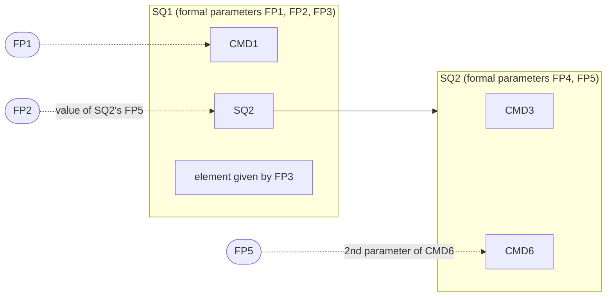
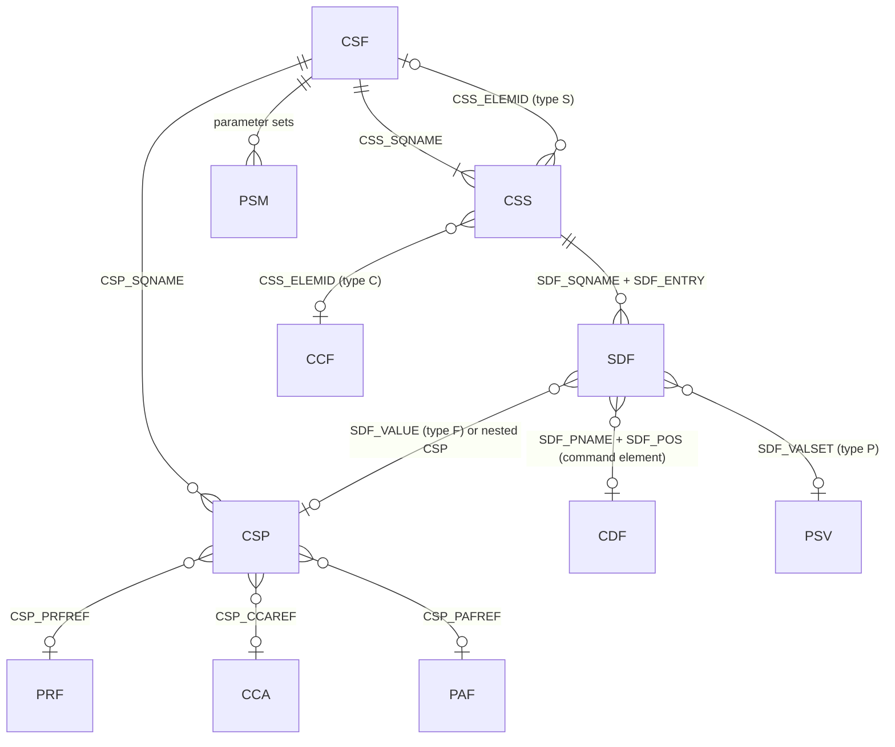
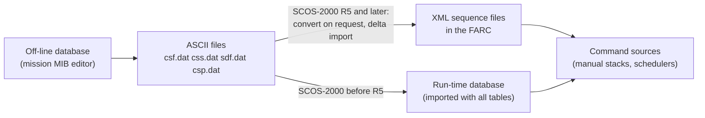
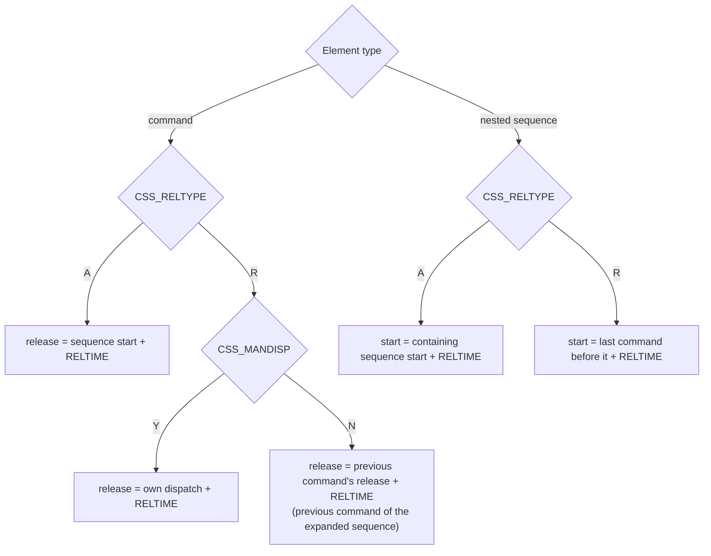
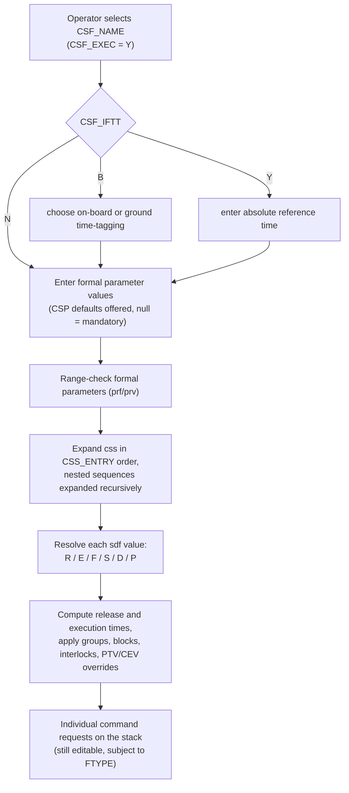
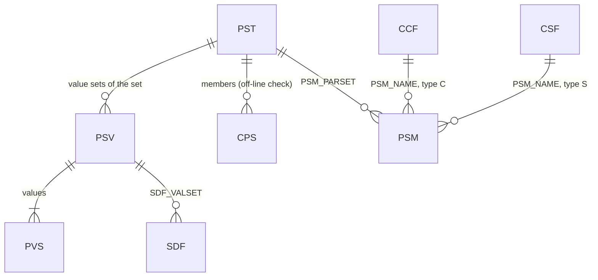
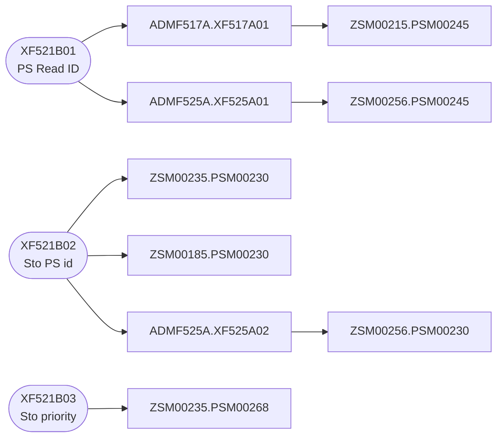

# Command sequences and parameter sets

A spacecraft procedure rarely consists of one telecommand. Switching on an instrument, changing an
on-board mode or dumping a packet store takes a fixed series of commands, released at set intervals and
sharing a few values that the operator supplies. In [SCOS-2000](../scos2000/index.md) such a series is
a **command sequence**: an ordered list of commands and nested sequences, stored in the
[MIB](index.md) as a template with place-holders called **formal parameters**. When the operator loads
the sequence on a command stack, SCOS-2000 asks for the formal parameter values, expands nested
sequences like macros, computes release and execution times, and turns the result into individual
command requests.[^icd-intro][^icd-seq-intro] The MIB describes a sequence in four tables: `csf` (the sequence), `css`
(its elements), `sdf` (the values of element parameters) and `csp` (its formal parameters). Five more
tables define **parameter sets**, named collections of preset values for commands and sequences. This
page covers all nine tables field by field and shows how the Solar Orbiter MIB uses them. Individual
commands are described on [Commanding in the MIB](commanding.md) and their verification on
[Command verification in the MIB](command-verification.md).

## Concepts and terminology

The ICD uses three terms that are easy to confuse:[^icd-seq-terms]

* An **element** is one entry of a sequence: a command, a nested sequence, or (in principle) a formal
  parameter standing for a command or sequence name that is given later.
* An **element parameter** is a parameter of an element: a command parameter if the element is a
  command, or a parameter of the nested sequence if the element is a sequence.
* A **formal parameter** is an argument of the sequence being defined. Seen from a parent sequence, the
  formal parameters of a nested sequence are called *sequence parameters*.

An element parameter gets its value in one of three ways: explicitly in `sdf`, from the default of the
original definition (`cdf` for commands, `csp` for nested sequences), or by mapping it to a formal
parameter of the current sequence. Several element parameters may share one formal parameter if they
have the same raw and engineering formats.[^icd-seq-terms] A sequence can contain sequences to any
depth, provided it never contains itself.[^icd-seq-intro]

The ICD illustrates the tables with two sequences. SQ1 has three elements: command CMD1, sequence SQ2 and
a formal parameter element FP3. SQ2 has two commands, CMD3 and CMD6. SQ1's formal parameters are FP1 (a
command parameter), FP2 (a sequence parameter) and FP3 (a command or sequence name); SQ2's are FP4 and
FP5.[^icd-seq-example]



In the ICD's example the tables hold 2 `csf`, 5 `css`, 10 `sdf` and 5 `csp` records, and a value given
for FP2 at load time travels through FP5 into the second parameter of CMD6. The element defined by FP3
has no parameters of its own; its parameters come from the defaults of whatever command or sequence is
named, so only fully defined commands and sequences may be used that way.[^icd-seq-example] Formal
parameter names need only be unique within one sequence.[^icd-seq-example]



The relationships restate the ICD overview of the commanding data and the field definitions below.[^icd-overview]

## Where sequences live: from the run-time database to the FARC

In SCOS-2000 releases before R5, sequence tables were imported with all other ASCII tables into the
run-time database; ICD issue 5.1 describes `csf`, `css`, `sdf` and `csp` without any special
handling, and issue 7.0 dates the separate storage of sequences from R5.0.[^icd51][^icd-seq-intro] ICD issue 6.4, written for SCOS-2000 R5, moved TC sequence and TM display definitions
out of the run-time (POST) MIB database into the FARC as XML files.[^icd69-log] FARC is the SCOS-2000
File Archive.[^glo] From R5 the command sources load sequence definitions from the FARC; the XML format
is specified in a separate document, ICD-0051 "SCOS-2000 TC Sequences definitions ICD", which is not
among the available sources.[^icd-import][^icd-ad]

The ASCII tables remain the import format, for full backward compatibility. On request their content is
converted into XML files and imported into the FARC with a "delta" approach: only the sequences in the
delivered files are replaced, and previously imported sequences stay available.[^icd-seq-intro][^icd-import]
The ICD lists two consequences: sequences and displays are imported independently of the TM/TC database,
so a sequence can be updated without importing a new database; and the delta import never removes old
definitions.[^icd-import]



The diagram summarises ICD issues 5.1, 6.9 and 7.0; it is this wiki's drawing.[^icd51][^icd-import][^icd69-import]
The same text appears in ICD issues 6.9 and 7.0, so the arrangement is unchanged since R5.[^icd69-import][^icd-seq-intro]
The archives of SCOS-2000 are described on [Mission archives: PARC, DARC and FARC](../scos2000/archives.md),
and the release history of the ICD on [History of the Database Import ICD](icd-history.md).

## `csf`: sequence header

`csf` has one record per sequence.[^icd-csf]

| # | Field | Type | Meaning and values | Default |
|---|---|---|---|---|
| 1* | `CSF_NAME` | Char(8), M | Unique sequence name | |
| 2 | `CSF_DESC` | Char(24), M | Description | |
| 3 | `CSF_DESC2` | Char(64) | Detailed description | |
| 4 | `CSF_IFTT` | Char(1) | Execution time-tags: `Y` the sequence (or a nested one) contains execution time-tagged commands and the operator gives an absolute reference time at load time, for commands with both a release and an execution time-tag; `B` the operator chooses at load time between on-board time-tagged (execution tags only) and ground time-tagged (release tags only, immediate execution); `N` no execution time-tags | `N` |
| 5 | `CSF_NFPARS` | Number(3) | Number of formal parameters, for consistency checks against `csp` | |
| 6 | `CSF_ELEMS` | Number(5) | Number of elements, for consistency checks against `css` | |
| 7 | `CSF_CRITICAL` | Char(1) | `Y` critical (hazardous), `N` not; extra protection is mission-specific | `N` |
| 8 | `CSF_PLAN` | Char(1) | Which sources may use the sequence in a planning file: `A` all, `F` flight dynamics, `S` SOC, `N` none | `N` |
| 9 | `CSF_EXEC` | Char(1) | `Y` may be loaded stand-alone; `N` only as a nested sequence | `Y` |
| 10 | `CSF_SUBSYS` | Number(3) | Subsystem 1–255 | |
| 11 | `CSF_GENTIME` | Char(17) | Time the sequence was generated | |
| 12 | `CSF_DOCNAME` | Char(32) | Document it was generated from | |
| 13 | `CSF_ISSUE` | Char(10) | Issue of that document | |
| 14 | `CSF_DATE` | Char(17) | Issue date of that document | |
| 15 | `CSF_DEFSET` | Char(8) | Default parameter value set (`PSV_PVSID`) | |
| 16 | `CSF_SUBSCHEDID` | Number(5) | Default on-board sub-schedule (1–65535) for execution time-tagged loading | |

[^icd-csf][^icd-csf2]

The meaning of `CSF_SUBSCHEDID` changed in ICD 7.0 (change request S2K-6680, SCOS 5.5.2 and later). In
issue 6.9 it gave all time-tagged commands of the sequence the same sub-schedule and fell back to
`CSF_SUBSYS` when empty; in issue 7.0 a non-null value still forces one sub-schedule for the whole
sequence, but when it is null each command keeps its own `CCF_SUBSCHEDID`.[^icd69-subsched][^icd-csf2][^icd-annex2]

## `css`: sequence elements

`css` has one record per element. Everything it says about a command is a default: after loading, the
command requests can still be edited on the manual stack.[^icd-css-intro]

| # | Field | Type | Meaning and values | Default |
|---|---|---|---|---|
| 1* | `CSS_SQNAME` | Char(8), M | Sequence the element belongs to | |
| 2 | `CSS_COMM` | Char(32) | Comment; for a textual comment element it is shown in command sources | |
| 3* | `CSS_ENTRY` | Number(5), M | Position of the element; consecutive, no gaps | |
| 4 | `CSS_TYPE` | Char(1), M | `C` command; `S` sequence; `T` textual comment (not supported by SCOS-2000); `F` formal parameter standing for a command, `P` for a sequence (future extensions) | |
| 5 | `CSS_ELEMID` | Char(8) | `CCF_CNAME` for `C`, `CSF_NAME` for `S`, `CSP_FPNAME` for `F`/`P`, null for `T`. The field text still says a command element must not contain group repeaters, although `sdf` allows them since R4.2 (see below) | |
| 6 | `CSS_NPARS` | Number(3) | Number of editable parameters (records in `sdf`) | |
| 7 | `CSS_MANDISP` | Char(1) | `Y` the command needs its own manual dispatch (ARM and GO); `N` it is dispatched with the previous command. Null for non-first commands of a group or block | `N` |
| 8 | `CSS_RELTYPE` | Char(1) | `R` release time relative to the previous command (or to its own dispatch if manually dispatched); `A` relative to the start of the sequence | `R` |
| 9 | `CSS_RELTIME` | Char(8) | Delta release time `hh.mm.ss` (up to 23.59.59, other separators allowed). Null for a command means release as soon as possible; for a sequence, zero offset | |
| 10 | `CSS_EXTIME` | Char(17) | Delta execution time `[+][ddd.]hh.mm.ss[.mmm]` or negative `-[ddd.]hh.mm.ss[.mmm]`. Null means not execution time-tagged (command) or zero offset (sequence) | |
| 11 | `CSS_PREVREL` | Char(1) | `R` execution time relative to the previous time-tagged command; `A` relative to the sequence's execution start | `R` |
| 12 | `CSS_GROUP` | Char(1) | `S`, `M`, `E`: start, middle, end of a group released as a batch, not interleaved with other sources | |
| 13 | `CSS_BLOCK` | Char(1) | `S`, `M`, `E`: start, middle, end of a block aggregated into one TC segment | |
| 14 | `CSS_ILSCOPE` | Char(1) | Interlock scope `G`, `L`, `S`, `B`, `F`, `T`, `N`; null takes `CCF_ILSCOPE` | |
| 15 | `CSS_ILSTAGE` | Char(1) | Interlock stage `R`, `U`, `O`, `A`, `C`; null takes `CCF_ILSTAGE` | |
| 16 | `CSS_DYNPTV` | Char(1) | `Y` override dynamic PTV (feasibility and time checks, interlocks) | `N` |
| 17 | `CSS_STAPTV` | Char(1) | `Y` override static (telemetry-based) PTV | `N` |
| 18 | `CSS_CEV` | Char(1) | `Y` disable command execution verification checks | `N` |

[^icd-css][^icd-css2][^icd-css3]

!!! info "Column names in this wiki's SQLite copy"
    The pyscos2000 schema used by this wiki's SQLite database calls field 17 `CSS_STATPTV`; ICD 7.0
    calls it `CSS_STAPTV`.[^icd-css3][^mib-seq]

### Release times, execution times and manual dispatch

Release times and execution times are computed by two parallel sets of rules. For release (`CSS_RELTYPE`,
`CSS_RELTIME`):[^icd-css2]

* a command with `R` and manual dispatch is released `CSS_RELTIME` after the operator dispatches it;
* a command with `R` and no manual dispatch is released `CSS_RELTIME` after the release of the previous
  command of the *expanded* top-level sequence. If the previous element is a nested sequence, that means
  its last command;
* a command with `A` is released `CSS_RELTIME` after the release start time of its own sequence;
* a nested sequence with `R` starts `CSS_RELTIME` after the last command before it; with `A`, after the
  start of the containing sequence. The start of the top-level sequence is given by the operator at
  load time.

Execution times (`CSS_PREVREL`, `CSS_EXTIME`) follow the same pattern relative to the previous execution
time-tagged command (`R`) or to the execution start of the sequence (`A`).[^icd-css2] Whether the release
or the execution tags are used is decided by `CSF_IFTT` at load time; on-board time-tagged commands are
wrapped in TC(11,4) as explained on [Commanding in the MIB](commanding.md#a-time-tag-wrapper-tc114).[^icd-csf]



The flowchart restates the field description of `CSS_RELTIME`.[^icd-css2]

### Groups and blocks

A **group** is released as a batch that other command sources cannot interleave. A **block** goes further:
its commands are aggregated into a single TC segment data field.[^icd-css3] Appendix C of the ICD adds that
such an aggregated segment is transmitted to the spacecraft as a single frame and CLTU.[^icd-appc-s2] Both need at least one `S` and one `E` entry, with a configurable maximum number of `M`
entries between them, and only the first command may carry the manual dispatch flag or a release
time-tag. A block may sit inside a group but not the reverse; a block must not exceed a mission limit on
its length and must not contain high-priority commands (`CCF_HIPRI = Y`). Inside a group or block the
interlock scopes `G` and `L` are allowed only on the last command.[^icd-css3] Segments and frames are
described in [TC Space Data Link Protocol](../ccsds/tc-sdlp.md).

## `sdf`: values of element parameters

`sdf` has one record per editable parameter of an element and says where its value comes from when the
sequence is loaded.[^icd-sdf-intro]

| # | Field | Type | Meaning and values | Default |
|---|---|---|---|---|
| 1* | `SDF_SQNAME` | Char(8), M | Sequence | |
| 2* | `SDF_ENTRY` | Number(5), M | Element (`CSS_ENTRY`), of type `C` or `S` | |
| 3 | `SDF_ELEMID` | Char(8), M | Element name (`CSS_ELEMID`) | |
| 4* | `SDF_POS` | Number(4), M | For a command: bit offset of the parameter (`CDF_BIT`), after expansion of repeated groups. For a nested sequence: position of the sequence parameter (`CSP_FPNUM`) | |
| 5* | `SDF_PNAME` | Char(8), M | Editable command parameter (`CDF_PNAME` with `CDF_ELTYPE = E`) or sequence parameter (`CSP_FPNAME`) | |
| 6 | `SDF_FTYPE` | Char(1) | `F` fixed once loaded; `E` editable on the stack | `E` |
| 7 | `SDF_VTYPE` | Char(1), M | Source of the value: `R` raw from `SDF_VALUE`; `E` engineering from `SDF_VALUE` (calibrated parameters); `F` from the formal parameter named in `SDF_VALUE` (not for group repeaters); `P` from the value set in `SDF_VALSET`; `S` from the nested sequence's `CSP_DEFVAL`; `D` from the command's `CDF_VALUE` (or `CPC_DEFVAL`, or telemetry for a dynamic default) | |
| 8 | `SDF_VALUE` | Char | The value, or the formal parameter name for `F`. Command ID parameters take a fully defined command, Parameter ID parameters a `PCF_NAME` with on-board ID. May be null only for `D`, `P` or `S` | |
| 9 | `SDF_VALSET` | Char(8) | Parameter value set (`PSV_PVSID`); mandatory for `SDF_VTYPE = P` | |
| 10 | `SDF_REPPOS` | Number(4) | Original `CDF_BIT` of a parameter shifted by group expansion; mandatory when `SDF_POS` differs from `CDF_BIT` | |

[^icd-sdf][^icd-sdf2][^icd-sdf3]

Only parameters that are editable in the command definition may appear in `sdf`, and the importer rejects
the invalid combinations:[^icd-sdf-intro]

| `CDF_ELTYPE` | `SDF_FTYPE` | Result |
|---|---|---|
| `F` | `F` or `E` | not allowed |
| `E` | `F` | valid; parameter not editable in the sequence |
| `E` | `E` | valid; parameter editable in the sequence |
| `F` | no `sdf` record | valid; parameter not editable |

Since R4.2, commands with group repeaters can be sequence elements, provided every repeater value and
every repeated parameter is defined in the database. One `sdf` record is needed per repeated instance;
with a repeater value of 3, each repeated parameter needs three records, and `SDF_REPPOS` maps each
shifted instance back to its `CDF_BIT`.[^icd-sdf-intro][^icd-sdf]

## `csp`: formal parameters

`csp` has one record per formal parameter. Formal parameters are declared much like command parameters and
use the same calibration and range tables; they can also be of the special kinds *Command ID* and
*Parameter ID*.[^icd-seq-terms][^icd-csp]

| # | Field | Type | Meaning and values | Default |
|---|---|---|---|---|
| 1* | `CSP_SQNAME` | Char(8), M | Sequence | |
| 2* | `CSP_FPNAME` | Char(8), M | Name, unique within the sequence | |
| 3 | `CSP_FPNUM` | Number(5), M | Position, consecutive; 0–65535 since R5.0 (0–999 before) | |
| 4 | `CSP_DESCR` | Char(24) | Description | |
| 5 | `CSP_PTC` | Number(2), M | Parameter Type Code; must equal that of every element parameter mapped to it | |
| 6 | `CSP_PFC` | Number(5), M | Parameter Format Code; same rule | |
| 7 | `CSP_DISPFMT` | Char(1) | Engineering format `A`, `I`, `U`, `R`, `T`, `D`; same rule | `R` |
| 8 | `CSP_RADIX` | Char(1) | Default radix `D`, `H`, `O`; may differ from the element parameters | `D` |
| 9 | `CSP_TYPE` | Char(1), M | `C` command name, `S` sequence name (future extensions); `P` mapped to one or more element parameters | |
| 10 | `CSP_VTYPE` | Char(1) | Representation of the default: `R` raw, `E` engineering; required for type `P` with a default, null for `C`/`S` | |
| 11 | `CSP_DEFVAL` | Char | Default value; null means the operator must enter a value before loading | |
| 12 | `CSP_CATEG` | Char(1) | `C` numerical, `T` textual calibration, `A` Command ID, `P` Parameter ID, `B` both (future), `N` none; `A`/`P` only if every mapped element parameter is of the same kind | `N` |
| 13 | `CSP_PRFREF` | Char(10) | Range set; may differ from the element parameters, but should only be more restrictive | |
| 14 | `CSP_CCAREF` | Char(10) | Numerical curve; must be the same as that of the mapped element parameters | |
| 15 | `CSP_PAFREF` | Char(10) | Alias set; must be the same as that of the mapped element parameters | |
| 16 | `CSP_UNIT` | Char(4) | Unit, consistent with the element parameters | |

[^icd-csp][^icd-csp2][^icd-csp3]

At issue 7.0, formal parameters standing for a command or sequence name were still not supported by
SCOS-2000.[^icd-seq-terms] When a sequence is loaded, only the formal parameter values are checked
against their range sets, unless SCOS-2000 is configured to check every parameter of every contained
command.[^icd-prf-seq] Range sets, calibrations and the PTC/PFC codes are described on
[Commanding in the MIB](commanding.md#range-checks-prf-and-prv) and [MIB parameter types](parameter-types.md).

## What happens at load time

Putting the rules together, loading a sequence on a manual stack goes roughly as follows.



!!! warning "Inference"
    The order of the steps in this flowchart is this wiki's reconstruction from the field descriptions
    of `csf`, `css`, `sdf`, `csp` and `prf`. The ICD describes what each field means, not the algorithm of
    the command sources, which is specified in documents that are not among the available sources.[^icd-intro][^icd-ad]

## Parameter sets: `pst`, `psv`, `cps`, `pvs`, `psm`

A **parameter set** is a named collection of command or sequence parameters. A **parameter value set** is a
named combination of values for the parameters of one set. Applying a value set in real time fills all its
parameters at once under one high-level mnemonic. Sets and value sets can be defined for commands and for
sequences.[^icd-ps]

| Table | # | Field | Type | Meaning | Default |
|---|---|---|---|---|---|
| `pst` | 1* | `PST_NAME` | Char(8), M | Unique name of the parameter set | |
| | 2 | `PST_DESCR` | Char(24) | Description | |
| `psv` | 1 | `PSV_NAME` | Char(8), M | Parameter set (`PST_NAME`) | |
| | 2* | `PSV_PVSID` | Char(8), M | Unique name of the value set | |
| | 3 | `PSV_DESCR` | Char(24) | Description | |
| `cps` | 1* | `CPS_NAME` | Char(8), M | Parameter set | |
| | 2 | `CPS_PAR` | Char(8), M | Command parameter (`CDF_PNAME`) or formal parameter (`CSP_FPNAME`) in the set | |
| | 3* | `CPS_BIT` | Number(4), M | `CDF_BIT` of a command parameter, or `CSP_FPNUM` of a sequence parameter | |
| `pvs` | 1* | `PVS_ID` | Char(8), M | Value set (`PSV_PVSID`) | |
| | 2 | `PVS_PSID` | Char(8), M | Parameter set (`PST_NAME`) | |
| | 3 | `PVS_PNAME` | Char(8), M | Parameter given a value | |
| | 4 | `PVS_INTER` | Char(1) | `R` raw, `E` engineering (calibrated parameters only) | `R` |
| | 5 | `PVS_VALS` | Char | The value; null leaves the current value unchanged | |
| | 6* | `PVS_BIT` | Number(4), M | `CDF_BIT` or `CSP_FPNUM`, for unique identification | |
| `psm` | 1* | `PSM_NAME` | Char(8), M | Command (`CCF_CNAME`) or sequence (`CSF_NAME`) | |
| | 2* | `PSM_TYPE` | Char(1), M | `C` command, `S` sequence | |
| | 3* | `PSM_PARSET` | Char(8), M | Parameter set (`PST_NAME`) | |

[^icd-ps][^icd-ps2][^icd-psm]

A few rules tie the tables together:[^icd-ps2][^icd-psm]

* `cps` is not used by SCOS-2000, which takes set membership from `pst`; the off-line database can use it to
  check that value sets are complete.
* If a command parameter and a sequence parameter with the same name are both used in parameter sets, they
  must share PTC and display format.
* One parameter set cannot serve both a command and a sequence, because `PVS_BIT` would have to be a bit
  offset for one and a parameter position for the other.

Commands and sequences reference a default value set through `CCF_DEFSET` and `CSF_DEFSET`, and a sequence
element can take its values from a set with `SDF_VTYPE = P` and `SDF_VALSET`.[^icd-csf2][^icd-sdf3]



## Solar Orbiter: sequences in practice

### Overall numbers

The September 2025 Solar Orbiter MIB holds 3,404 sequences with 13,879 elements, 50,014 element parameter
values and 10,981 formal parameters. The April 2020 release had 2,701 sequences, 9,089 elements, 30,985
values and 5,598 formal parameters.[^mib-seq][^mib-2020]

| Field | Values found |
|---|---|
| `CSS_TYPE` | `C` 12,629; `S` 1,250; no comments or formal-parameter elements |
| Elements per sequence | 1 element: 1,773 sequences; 2: 533; 3: 263; up to 312 (`AIPF981A` "PHI copy cal data v06") |
| `CSF_IFTT` | `B` 3,354; `N` 50 |
| `CSF_PLAN` | `N` 2,029; `S` (SOC) 1,177; `F` (flight dynamics) 195; `A` 3 |
| `CSF_CRITICAL`, `CSF_EXEC` | `N` and `Y` in every record |
| `CSF_SUBSCHEDID` | set in every record (33 distinct values); `CSF_SUBSYS` null in 2,633 |
| `CSF_DEFSET` | never used |
| `CSF_DOCNAME` | every sequence names its source document: `xx-FCP-nnn` 2,243, `xx-CRP-nnn` 1,091, `xx-SEQ-nnn` 70 |
| `CSF_DATE` | issue dates from 2016 to 2025; 1,481 sequences carry a 2019 date |
| Formal parameters | 1,575 sequences declare at least one (`CSF_NFPARS` > 0) and 1,573 have `csp` records; maximum 217; `CSF_NFPARS` disagrees with `csp` for 3 sequences (`APWC508A`, `APWC508B`, `ATCC011C`) |

[^mib-seq]

Nesting is used but shallow: 467 sequences contain nested sequences, 321 distinct sequences are used as
elements, and the deepest chain has three levels, for example
[`ATCC010A`](../explorer/index.md#/solo/sequence/ATCC010A) "DUP_TCL_RAM_P1 v02" → `ATCC007A` → `ATCC008A`
→ `ADMF013F`.[^mib-seq]

!!! warning "Inference: naming convention"
    Every Solar Orbiter sequence name starts with `A`, followed by a two-letter subsystem code, a letter
    for the kind of procedure (`F`, `C` or `S`) matching `FCP`, `CRP` or `SEQ` in `CSF_DOCNAME`, a
    three-digit procedure number and a variant letter: `ADMF521B` comes from `DM-FCP-521`. The only
    exception is `ADUMMYSQ` (document `SY-CRP-501`). 1,072 of the
    1,177 SOC-plannable sequences have a second letter `I`, which appears to denote the instruments, and
    138 of the 195 flight-dynamics-plannable sequences belong to the `AC` subsystem, apparently AOCS. The convention is deduced
    from the data; it is not documented in the available sources.[^mib-seq] Naming conventions in general
    are discussed on [Mission tailoring of the MIB](tailoring.md).

### Timing, dispatch and overrides

| Field | Values found (elements) |
|---|---|
| `CSS_MANDISP` | `Y` for 12,199 of the 12,629 command elements; `N` for 430 and for all nested sequences |
| `CSS_RELTYPE` / `CSS_PREVREL` | always equal: `R` 10,475; `A` 3,404 |
| `CSS_RELTIME` | most common `00.00.01` (6,658), `00.00.00` (3,181), `00.00.01.000` (962), `00.00.02` (927), `00.00.05` (714) |
| `CSS_EXTIME` | same pattern; null in 95 |
| `CSS_ILSCOPE` / `CSS_ILSTAGE` | `N` / `C` for 12,494 commands; `N` / null for 6; null (taken from `ccf`) for 129 commands and all sequences |
| `CSS_DYNPTV`, `CSS_STAPTV` | never overridden |
| `CSS_CEV` | `Y` in 17 elements of two TC-file definition sequences |

[^mib-seq]

The 3,404 elements with `A` are exactly the first entries of the 3,404 sequences: every Solar Orbiter
sequence anchors its first element to the sequence start and times all others relative to the previous
command.[^mib-seq] 1,107 release times (962 of them `00.00.01.000`) are written with milliseconds, always
`.000` and always in the same elements as a millisecond execution time; this is a 12-character form that the ICD gives for `CSS_EXTIME` but not for `CSS_RELTIME`, whose documented format
is `hh.mm.ss` in a Char(8) field; 44 release times are null.[^mib-seq][^icd-css2] The ICD says that a field
longer than its declared length is truncated on import, with a warning.[^icd-checks]

!!! warning "Inference"
    Truncating `00.00.01.000` to 8 characters gives `00.00.01`, so these values would most likely still
    import as the intended whole-second offsets. Whether the Solar Orbiter importer or the XML conversion
    for the FARC truncates them, accepts them or rejects them is not stated in the available sources.

The elements with `CSS_CEV = Y`
are discussed on [Command verification in the MIB](command-verification.md#turning-verification-off-in-sequences).

### Groups and blocks

Blocks appear in 29 sequences and groups in 23, covering 76 elements in total.[^mib-seq]
[`ADMC403A`](../explorer/index.md#/solo/sequence/ADMC403A) "Set RM A Program Set v11" blocks four TC(6,2)
memory loads (entries 2 to 5) between two high-priority CPDU commands, `ZBC04010` "RM A Disable" and
`ZBC04009` "RM A Enable", which stay outside the block as the ICD requires for high-priority
commands.[^mib-seq][^icd-css3] [`ATTF100A`](../explorer/index.md#/solo/sequence/ATTF100A) "DST full Power
mode v08" puts all six of its commands in one group that contains three blocks of two commands, the
"block inside a group" case the ICD allows.[^mib-seq][^icd-css3]

| Entry | Command | Description | `CSS_GROUP` | `CSS_BLOCK` | `CSS_MANDISP` |
|---|---|---|---|---|---|
| 1 | `ZCS2Z05L` | Set DST Output Pwr Clamp Status SDP | `S` | `S` | `Y` |
| 2 | `ZCSD3403` | Dst-Tx Set Clamp ON-OFF | `M` | `E` | `N` |
| 3 | `ZCS2Z0AF` | Set DST TX A Output Pwr Sel PFM | `M` | `S` | `N` |
| 4 | `ZCS2Z07T` | Dst Set Tx output power (A:PFM) | `M` | `E` | `N` |
| 5 | `ZCS2Z0AL` | Set DST TX B Output Pwr Sel FM1 | `M` | `S` | `N` |
| 6 | `ZCS2Z07U` | Dst Set Tx output power (B:FM1) | `E` | `E` | `N` |

[^mib-seq]

The ICD asks for `CSS_MANDISP` and `CSS_RELTIME` to be null on every command of a group or block except the
first; in the Solar Orbiter data all 46 such commands instead carry `N` and `00.00.00`.[^icd-css][^icd-css2][^mib-seq]

### Values of element parameters

| Element | `SDF_VTYPE` R | E | F | D | S |
|---|---|---|---|---|---|
| Command (48,356 values) | 25,071 | 9,529 | 11,428 | 2,328 | — |
| Nested sequence (1,658 values) | 612 | 849 | 147 | — | 50 |

[^mib-seq]

Every command parameter in `sdf` is editable in its `cdf` definition (`CDF_ELTYPE = E`), as the ICD
requires; 44,596 stay editable after loading (`SDF_FTYPE = E`) and 3,760 are frozen (`F`).[^mib-seq][^icd-sdf-intro]
No value comes from a parameter value set (`P`). `SDF_REPPOS` is filled in every record, also where it
equals `SDF_POS`; for nested sequence elements it is 0. For command elements it differs from `SDF_POS`
in 11,896 values of 103 commands, all but two of them instances shifted by group expansion; 234 distinct
commands with group repeaters appear in 2,467 sequence elements.[^mib-seq]

## Worked example: `ADMF521B`, a sequence with nesting and formal parameters

[`ADMF521B`](../explorer/index.md#/solo/sequence/ADMF521B) "SSMM ChngPsPrioDump v05" comes from procedure
`DM-FCP-521`, issue 5 of 04/10/2024. It has four elements, three formal parameters, `CSF_IFTT = B`, is not
plannable and defaults to sub-schedule 1.[^mib-ex]

| `CSS_ENTRY` | Type | Element | Comment | `CSS_MANDISP` | Release | Execution |
|---|---|---|---|---|---|---|
| 1 | `S` | `ADMF517A` | SSMM Stop PS read v02 | `N` | `A` 00.00.00 | `A` 00.00.00 |
| 2 | `C` | [`ZSM00235`](../explorer/index.md#/solo/command/ZSM00235) | SSMM Change PS Default Priority, TC(15,139) | `Y` | `R` 00.00.01 | `R` 00.00.01 |
| 3 | `C` | [`ZSM00185`](../explorer/index.md#/solo/command/ZSM00185) | SSMM Rep Catalogues Select Pkt Store, TC(15,12) | `Y` | `R` 00.00.01 | `R` 00.00.01 |
| 4 | `S` | `ADMF525A` | SSMM unbound PS dump v01 | `N` | `R` 00.00.01 | `R` 00.00.01 |

[^mib-ex]

| `CSP_FPNUM` | `CSP_FPNAME` | Description | Type | Range set | Default |
|---|---|---|---|---|---|
| 1 | `XF521B01` | PS Read ID (PS ID + 200) | (3,4) | none | none |
| 2 | `XF521B02` | Sto PS id | (3,4) | `VSM00011` (0–63) | none |
| 3 | `XF521B03` | Sto priority | (3,4) | `VSM00018` (0–15) | none |

[^mib-ex]

Because no formal parameter has a default, the operator must enter all three before loading. The `sdf`
records then distribute them:[^mib-ex][^icd-csp2]

| Entry | Element | `SDF_POS` | Parameter | `SDF_FTYPE` / `SDF_VTYPE` | Value |
|---|---|---|---|---|---|
| 1 | `ADMF517A` | 1 | `XF517A01` | `E` / `F` | ← `XF521B01` |
| 2 | `ZSM00235` | 0 | `PSM00230` "Sto PS id" | `E` / `F` | ← `XF521B02` |
| 2 | `ZSM00235` | 8 | `PSM00268` "Sto priority" | `E` / `F` | ← `XF521B03` |
| 3 | `ZSM00185` | 8 | `PSM00226` (group repeater, `CDF_GRPSIZE = 2`) | `F` / `R` | 1 |
| 3 | `ZSM00185` | 24 | `PSM00230` | `E` / `F` | ← `XF521B02` |
| 4 | `ADMF525A` | 1, 2 | `XF525A01`, `XF525A02` | `E` / `F` | ← `XF521B01`, `XF521B02` |
| 4 | `ADMF525A` | 3–6 | `XF525A03` … `XF525A06` | `E` / `S` | defaults of `ADMF525A`: 1, `SM VCA OBC VC3`, 0, 0 |

[^mib-ex]



The nested sequences each contain one command: `ADMF517A` releases `ZSM00215` "SSMM Stop Downln Pkt Store"
TC(15,135) and `ADMF525A` releases `ZSM00256` "SSMM Unbounded DWL PS" TC(15,145), both with their own
`sdf` mapping to their formal parameters.[^mib-ex] One value typed for `XF521B02` thus lands in two
command parameters directly and in a third through the nested sequence, which is the mechanism of the
ICD's SQ1/SQ2 example applied to real procedures.[^icd-seq-example]

`ZSM00185` contains a group repeater: `PSM00226` at bit 8 repeats the next two elements. Because the
sequence fixes it to 1, the command can be a sequence element, and no position shifts, so `SDF_POS`
equals `CDF_BIT`.[^mib-ex][^icd-sdf-intro]

With `CSF_IFTT = B`, the operator decides at load time whether the four commands are released with the
ground release offsets (the first command at the sequence start, each later one 1 s after the previous
command or after its own manual dispatch) or executed on board at times derived from the execution
offsets.[^icd-csf][^icd-css2][^mib-ex]

!!! example "Expanded result (illustrative values)"
    With `XF521B01 = 205`, `XF521B02 = 5` and `XF521B03 = 2`, chosen by this wiki for illustration and
    within the range sets, loading produces four command requests: `ZSM00215` (PSM00245 = 205),
    `ZSM00235` (PSM00230 = 5, PSM00268 = 2), `ZSM00185` (PSM00226 = 1, PSM00230 = 5) and `ZSM00256`
    (PSM00245 = 205, PSM00230 = 5, plus the fixed and default values of `ADMF525A`). Element parameters
    marked `E` in `SDF_FTYPE` remain editable on the stack; `PSM00226` does not.[^mib-ex]

## Worked example: repeated groups inside a sequence

[`AACC250B`](../explorer/index.md#/solo/sequence/AACC250B) "Exit OCM after RWMai v05" uses
[`ZCA08E01`](../explorer/index.md#/solo/command/ZCA08E01) "Enable Functional Monitoring", TC(142,1), at
entry 2. In `cdf`, `ZCA08E01` has a 16-bit counter `PCD8E011` "Nb FMONs to process" at bit 0 with group
size 1, followed by the 32-bit `PCD8E012` "FMON Id to process" at bit 16.[^mib-ex]

| `SDF_POS` | `SDF_PNAME` | `SDF_FTYPE` / `SDF_VTYPE` | `SDF_VALUE` | `SDF_REPPOS` |
|---|---|---|---|---|
| 0 | `PCD8E011` | `F` / `R` | 4 | 0 |
| 16 | `PCD8E012` | `E` / `R` | 161 | 16 |
| 48 | `PCD8E012` | `E` / `R` | 162 | 16 |
| 80 | `PCD8E012` | `E` / `R` | 163 | 16 |
| 112 | `PCD8E012` | `E` / `R` | 164 | 16 |

[^mib-ex]

The counter is fixed to 4 and there is one `sdf` record per repeated FMON ID, at the expanded bit offsets
16, 48, 80 and 112; `SDF_REPPOS = 16` maps each instance back to the single `cdf` definition, exactly the
rule of the ICD.[^icd-sdf-intro][^icd-sdf][^mib-ex] Functional monitoring is Service 142, a Solar Orbiter
private service, and TC(142,1) "Enable Functional Monitoring" is defined in the Solar Orbiter TM/TC
ICD;[^tn-142] see [How Solar Orbiter uses PUS](../missions/solar-orbiter/pus-usage.md).

## Parameter sets on Solar Orbiter and elsewhere

All five parameter set tables are empty in the 2020 and 2025 Solar Orbiter releases and in the SWA
instrument database, and no command or sequence names a default value set.[^mib-seq][^mib-2020][^mib-swa]
The SWA database also has no sequences at all.[^mib-swa] The Herschel/Planck System database (HPSDB),
which ingested and generated MIB files both for the SCOS-2000 based instrument EGSE and for the Central
Checkout System (CCS), marked `csf`, `css`, `sdf` and all parameter set tables as not supported by CCS
("do not use") and left `csp` "to be written", while HPSDB itself could still load them, for the sequence
tables "in order to interface with MOIS for operations".[^tn1060] MOIS itself, the procedure preparation
tool, is described on [operations preparation](../scos2000/operations-preparation.md#mois-and-astral-prepare).

!!! warning "Inference"
    Parameter sets solve a problem that Solar Orbiter's large sequence library handles differently: preset
    combinations are expressed as separate sequences (variant letters such as `ADMC403A`/`ADMC403B`) or as
    formal parameters with defaults. That this is a deliberate design choice is this wiki's reading of the
    data, not a statement of the sources.

??? example "SQL used"
    Queries ran with `sqlite3 -readonly` on this wiki's SQLite copy of the Solar Orbiter MIB
    (`solo-2025-09-16.sqlite`; `solo-2020-04-16.sqlite` and `swa-idb.sqlite` for comparisons). All columns
    are stored as text, so counts and comparisons use `cast(... as int)`.

    ```sql
    SELECT count(*) FROM csf; SELECT count(*) FROM css; SELECT count(*) FROM sdf; SELECT count(*) FROM csp;
    SELECT CSF_IFTT, count(*) FROM csf GROUP BY 1;
    SELECT CSF_PLAN, substr(CSF_NAME, 2, 2), count(*) FROM csf GROUP BY 1, 2;
    SELECT substr(CSF_DOCNAME, 4, 3), count(*) FROM csf GROUP BY 1;
    SELECT n, count(*) FROM (SELECT CSS_SQNAME, count(*) AS n FROM css GROUP BY 1) GROUP BY n;
    -- consistency of the counters
    SELECT sum(cast(CSF_ELEMS AS int) <> (SELECT count(*) FROM css WHERE CSS_SQNAME = CSF_NAME)),
           sum(cast(CSF_NFPARS AS int) <> (SELECT count(*) FROM csp WHERE CSP_SQNAME = CSF_NAME)) FROM csf;
    -- nesting depth
    WITH RECURSIVE r(top, cur, depth) AS (
      SELECT CSF_NAME, CSF_NAME, 0 FROM csf
      UNION ALL SELECT r.top, s.CSS_ELEMID, r.depth + 1 FROM r
        JOIN css s ON s.CSS_SQNAME = r.cur AND s.CSS_TYPE = 'S' WHERE r.depth < 10)
    SELECT max(depth) FROM r;
    -- timing, groups, blocks, overrides
    SELECT CSS_MANDISP, CSS_RELTYPE, CSS_PREVREL, count(*) FROM css GROUP BY 1, 2, 3;
    SELECT CSS_RELTIME, count(*) FROM css GROUP BY 1 ORDER BY 2 DESC;
    SELECT CSS_GROUP, CSS_BLOCK, count(*) FROM css GROUP BY 1, 2;
    -- value sources by element type
    SELECT s.SDF_VTYPE, e.CSS_TYPE, count(*) FROM sdf s
      JOIN css e ON e.CSS_SQNAME = s.SDF_SQNAME AND e.CSS_ENTRY = s.SDF_ENTRY GROUP BY 1, 2;
    SELECT d.CDF_ELTYPE, s.SDF_FTYPE, count(*) FROM sdf s
      JOIN css e ON e.CSS_SQNAME = s.SDF_SQNAME AND e.CSS_ENTRY = s.SDF_ENTRY AND e.CSS_TYPE = 'C'
      JOIN cdf d ON d.CDF_CNAME = s.SDF_ELEMID AND d.CDF_PNAME = s.SDF_PNAME AND d.CDF_BIT = s.SDF_REPPOS
     GROUP BY 1, 2;
    -- worked examples
    SELECT * FROM css WHERE CSS_SQNAME = 'ADMF521B' ORDER BY cast(CSS_ENTRY AS int);
    SELECT * FROM sdf WHERE SDF_SQNAME = 'ADMF521B' ORDER BY cast(SDF_ENTRY AS int), cast(SDF_POS AS int);
    SELECT * FROM csp WHERE CSP_SQNAME IN ('ADMF521B', 'ADMF525A') ORDER BY 1, cast(CSP_FPNUM AS int);
    SELECT * FROM sdf WHERE SDF_SQNAME = 'AACC250B' AND SDF_ELEMID = 'ZCA08E01';
    -- parameter sets
    SELECT (SELECT count(*) FROM pst), (SELECT count(*) FROM psv), (SELECT count(*) FROM cps),
           (SELECT count(*) FROM pvs), (SELECT count(*) FROM psm);
    ```

## Related pages

* [Commanding in the MIB](commanding.md) and [Command verification in the MIB](command-verification.md)
* [MIB data model](data-model.md), [History of the Database Import ICD](icd-history.md)
* [ST[11] Time-based scheduling](../ecss/pus/st11-time-based-scheduling.md),
  [ST[21] Request sequencing](../ecss/pus/st21-request-sequencing.md) (the on-board counterpart of a sequence)
* [Mission archives: PARC, DARC and FARC](../scos2000/archives.md), [SCOS-2000 architecture](../scos2000/architecture.md)
* [Operations preparation](../scos2000/operations-preparation.md) (procedures, MOIS and OPEN) and
  [ECSS-E-ST-70-32C PLUTO](../ecss/e-st-70-32c.md#command-sequences-in-the-mib) (sequences compared with procedures)
* [The Solar Orbiter MIB](../missions/solar-orbiter/mib.md), [Solar Orbiter SWA instrument database](../missions/solar-orbiter/swa.md)
* [Solar Orbiter simulator](../simulator/index.md#how-to-use-it): load and release 27 real Solar Orbiter sequences, such as
  [`ADMF011E`](../simulator/index.md#seq=ADMF011E), and watch their commands verified
* Generated table references: [csf](tables/csf.md), [css](tables/css.md), [sdf](tables/sdf.md), [csp](tables/csp.md),
  [pst](tables/pst.md), [psv](tables/psv.md), [cps](tables/cps.md), [pvs](tables/pvs.md), [psm](tables/psm.md)
* Sources: [ICD 7.0](../library/icd-7-0-final.md), [ICD 6.9](../library/icd-6-9-archive-org.md),
  [ICD 5.1](../library/icd-5-1-tos-gci.md), [Solar Orbiter MIB 2025](../library/mib-20250916m25925pfms001-sol.md);
  terms in the [glossary](../glossary.md)

[^icd-intro]: [SCOS-2000 Database Import ICD, issue 7.0](../library/icd-7-0-final.md), §3.3.3 "Commanding data" (description of CSF and its relationships), PDF p. 127.
[^icd-overview]: [SCOS-2000 Database Import ICD, issue 7.0](../library/icd-7-0-final.md), §3.3.3 "Commanding data", PDF pp. 126–127.
[^icd-seq-intro]: [SCOS-2000 Database Import ICD, issue 7.0](../library/icd-7-0-final.md), §3.3.3.3 "Command Sequences", introduction, PDF p. 161.
[^icd-seq-terms]: [SCOS-2000 Database Import ICD, issue 7.0](../library/icd-7-0-final.md), §3.3.3.3, terminology of formal and sequence parameters and the roles of CSF, CSS, SDF, CSP, PDF pp. 161–162.
[^icd-seq-example]: [SCOS-2000 Database Import ICD, issue 7.0](../library/icd-7-0-final.md), §3.3.3.3, SQ1/SQ2 example, PDF pp. 163–164.
[^icd-import]: [SCOS-2000 Database Import ICD, issue 7.0](../library/icd-7-0-final.md), §2.5 "Import options" (R5 handling of sequences and displays), PDF p. 24.
[^icd-ad]: [SCOS-2000 Database Import ICD, issue 7.0](../library/icd-7-0-final.md), §1.4.1 "Applicable documents" (AD-2 Commanding SRD, AD-4 ICD-0051 TC Sequences definitions ICD), PDF p. 18.
[^icd-csf]: [SCOS-2000 Database Import ICD, issue 7.0](../library/icd-7-0-final.md), §3.3.3.3.1 "Command sequence characteristics: csf", fields 1–10, PDF pp. 165–167.
[^icd-csf2]: [SCOS-2000 Database Import ICD, issue 7.0](../library/icd-7-0-final.md), §3.3.3.3.1, fields CSF_GENTIME to CSF_SUBSCHEDID, PDF p. 168.
[^icd-css-intro]: [SCOS-2000 Database Import ICD, issue 7.0](../library/icd-7-0-final.md), §3.3.3.3.2 "Command sequences definition: css", introduction, PDF p. 168.
[^icd-css]: [SCOS-2000 Database Import ICD, issue 7.0](../library/icd-7-0-final.md), §3.3.3.3.2, fields CSS_SQNAME to CSS_MANDISP, PDF pp. 169–170.
[^icd-css2]: [SCOS-2000 Database Import ICD, issue 7.0](../library/icd-7-0-final.md), §3.3.3.3.2, fields CSS_RELTYPE, CSS_RELTIME, CSS_EXTIME and CSS_PREVREL, PDF pp. 170–175.
[^icd-css3]: [SCOS-2000 Database Import ICD, issue 7.0](../library/icd-7-0-final.md), §3.3.3.3.2, fields CSS_GROUP to CSS_CEV, PDF pp. 175–179.
[^icd-sdf-intro]: [SCOS-2000 Database Import ICD, issue 7.0](../library/icd-7-0-final.md), §3.3.3.3.3 "Command sequence element parameters: sdf", introduction and CDF_ELTYPE/SDF_FTYPE table, PDF pp. 179–180.
[^icd-sdf]: [SCOS-2000 Database Import ICD, issue 7.0](../library/icd-7-0-final.md), §3.3.3.3.3, fields SDF_SQNAME to SDF_PNAME, PDF pp. 180–181.
[^icd-sdf2]: [SCOS-2000 Database Import ICD, issue 7.0](../library/icd-7-0-final.md), §3.3.3.3.3, fields SDF_FTYPE and SDF_VTYPE, PDF pp. 181–183.
[^icd-sdf3]: [SCOS-2000 Database Import ICD, issue 7.0](../library/icd-7-0-final.md), §3.3.3.3.3, fields SDF_VALUE, SDF_VALSET and SDF_REPPOS, PDF pp. 183–184.
[^icd-csp]: [SCOS-2000 Database Import ICD, issue 7.0](../library/icd-7-0-final.md), §3.3.3.3.4 "Command sequence formal parameters: csp", fields 1–6, PDF pp. 184–185.
[^icd-csp2]: [SCOS-2000 Database Import ICD, issue 7.0](../library/icd-7-0-final.md), §3.3.3.3.4, fields CSP_DISPFMT to CSP_DEFVAL, PDF pp. 186–188.
[^icd-csp3]: [SCOS-2000 Database Import ICD, issue 7.0](../library/icd-7-0-final.md), §3.3.3.3.4, fields CSP_CATEG to CSP_UNIT, PDF pp. 188–191.
[^icd-prf-seq]: [SCOS-2000 Database Import ICD, issue 7.0](../library/icd-7-0-final.md), §3.3.3.7.1 "Parameter range sets: prf", remark on sequence loading, PDF p. 211.
[^icd-ps]: [SCOS-2000 Database Import ICD, issue 7.0](../library/icd-7-0-final.md), §3.3.3.5 "Command/Sequence Parameter Sets" and §3.3.3.5.1–3.3.3.5.2 (pst, psv), PDF pp. 200–201.
[^icd-ps2]: [SCOS-2000 Database Import ICD, issue 7.0](../library/icd-7-0-final.md), §3.3.3.5.3–3.3.3.5.4 (cps, pvs), PDF pp. 201–204.
[^icd-psm]: [SCOS-2000 Database Import ICD, issue 7.0](../library/icd-7-0-final.md), §3.3.3.5.5 "Parameter sets mapping to commands/sequences: psm", PDF p. 205.
[^icd-checks]: [SCOS-2000 Database Import ICD, issue 7.0](../library/icd-7-0-final.md), §2.4 "Checks applied at import time" (truncation of over-long fields), PDF p. 23.
[^tn-142]: [Solar Orbiter TM-TC and Packet Structure ICD, SOL.S.ASTR.TN.00079 issue 7](../library/sol-s-astr-tn-00079-07.md), §5.32 "Service 142: Functional Monitoring", PDF p. 249, and §5.32.1 "TC (142,1) Enable Functional Monitoring", PDF p. 252.
[^icd-appc-s2]: [SCOS-2000 Database Import ICD, issue 7.0](../library/icd-7-0-final.md), Appendix C §3.2 "Service 2" (aggregation of packets in one segment), PDF pp. 237–238.
[^icd-annex2]: [SCOS-2000 Database Import ICD, issue 7.0](../library/icd-7-0-final.md), Annex 2, entry S2K-6680 "Change usage of CSF_SUBSCHEDID", PDF p. 261.
[^icd69-log]: [SCOS-2000 Database Import ICD, issue 6.9](../library/icd-6-9-archive-org.md), document change log, entry for issue 6.4 (07/03/07), PDF p. 5.
[^icd69-import]: [SCOS-2000 Database Import ICD, issue 6.9](../library/icd-6-9-archive-org.md), §2.5 PDF p. 24 and §3.3.3.3 "Command Sequences", PDF p. 155.
[^icd69-subsched]: [SCOS-2000 Database Import ICD, issue 6.9](../library/icd-6-9-archive-org.md), §3.3.3.3.1, field CSF_SUBSCHEDID, PDF p. 161.
[^icd51]: [SCOS-2000 Database Import ICD, issue 5.1](../library/icd-5-1-tos-gci.md), §1.1 (import of the ASCII files into the run-time database) PDF p. 9, and §3.3.3.3 "Command Sequences", PDF p. 74.
[^glo]: [EDDS Glossary (EGOS-GEN-EDDS-GLO)](../library/glo.md), acronym list, entry "FARC File Archive", PDF p. 9.
[^tn1060]: [H-P-1-ASP-TN-1060, MIB files processing by HPSDB](../library/h-p-1-asp-tn-1060-mib-processing-hpsdb.md), §5.3.9–5.3.20 (CSF, CSS, SDF, CSP, PST, PSV, CPS, PVS, PSM), PDF pp. 36–40.
[^mib-seq]: [Solar Orbiter MIB release MIB__20250916M25925PFMS001_SOL](../library/mib-20250916m25925pfms001-sol.md), tables csf, css, sdf, csp, cdf, ccf, pst, psv, cps, pvs and psm; queries by this wiki.
[^mib-2020]: [Solar Orbiter MIB release MIB__20200416M10720PFMS001_SOL](../library/mib-20200416m10720pfms001-sol.md), row counts of csf, css, sdf, csp and the parameter set tables; queries by this wiki.
[^mib-swa]: [Solar Orbiter SWA instrument database (ASCII)](../library/swa-idb-ascii.md), row counts of csf, css, sdf, csp and the parameter set tables; queries by this wiki.
[^mib-ex]: [Solar Orbiter MIB release MIB__20250916M25925PFMS001_SOL](../library/mib-20250916m25925pfms001-sol.md), tables csf, css, sdf, csp, prv, pas, ccf and cdf for ADMF521B, ADMF517A, ADMF525A, AACC250B and ZCA08E01; queries by this wiki.
