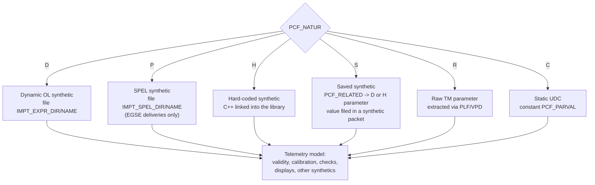
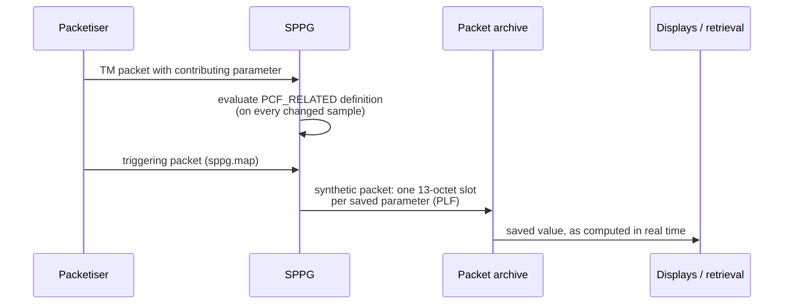
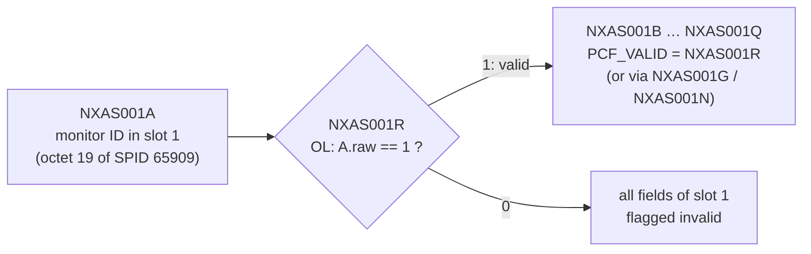

# Synthetic parameters and the OL language

A **synthetic parameter** is a monitoring parameter whose value is computed by
[SCOS-2000](../scos2000/index.md) on the ground instead of being extracted from a telemetry
packet. Older ESA control systems called them derived parameters.[^icd-syn] A synthetic
parameter can convert an attitude quaternion into angles, combine two redundant units into one
"in use" value, or decide whether another parameter is meaningful at all. Once computed, it is
treated like any other telemetry parameter. It can be displayed, calibrated, limit checked and
used inside other synthetic parameters.[^icd-syn-handling]

In the [MIB](index.md), a synthetic parameter is a [PCF](tables/pcf.md) record whose nature
field `PCF_NATUR` is not `R`. Most synthetic parameters also have a text file, named after the
parameter, that holds its definition in the SCOS-2000 **Operations Language** (OL).[^icd-natur][^icd-files]
This page describes the kinds of synthetic parameter and how each is evaluated, what the
available sources say about the OL, and what the real definitions in the Solar Orbiter MIB
release `MIB__20250916M25925PFMS001_SOL` look like. Every Solar Orbiter number comes from this
wiki's own SQL queries on that release.[^mib-natur]

## The kinds of synthetic parameter

`PCF_NATUR` (field 11 of the PCF, Char(1), mandatory) gives the nature of every monitoring
parameter. Five of its six values describe computed or constant parameters:

| `PCF_NATUR` | Name in the ICD | Defined by | Evaluated | Stored? | Solar Orbiter 2020 | Solar Orbiter 2025 |
|---|---|---|---|---|---|---|
| `R` | Raw telemetry parameter | position in a packet ([PLF](tables/plf.md) or [VPD](tables/vpd.md)) | extracted from TM | in the packet | 101,714 | 125,161 |
| `D` | Dynamic OL parameter | one OL file, interpreted | locally, on demand, when a contributing sample changes | no | 354 | 1,582 |
| `P` | SPEL based dynamic parameter | one SPEL file | like `D` | no | 0 | 0 |
| `H` | Hard coded parameter | C++, written directly or compiled from OL | like `D` | no | 36 | 0 |
| `S` | Saved synthetic parameter | the synthetic named in `PCF_RELATED` | centrally, by the SPPG | yes, in synthetic packets | 0 | 2 |
| `C` | Constant parameter (static UDC) | value in `PCF_PARVAL` | – | – | 0 | 0 |

Natures from the ICD;[^icd-natur][^icd-syn][^icd-syn-p] counts from the two public Solar
Orbiter releases.[^mib-natur][^mib2020] ICD issue 5.1 (2001) already had `R`, `D`, `H`, `S`
and `C`.[^i51-natur] The SPEL nature `P` was added in issue 6.0, as a change applicable only to
the EGSE delivery of SCOS-2000.[^icd-annex60-spel]



Diagram based on the PCF_NATUR definitions and §3.3.2.1.2 of the ICD.[^icd-natur][^icd-syn][^icd-syn-p]

### Dynamic OL synthetic parameters (`D`)

A dynamic OL synthetic parameter is defined by an OL text. Its life cycle has four properties
that matter in practice:[^icd-syn]

* **Local and lazy.** It is evaluated in the process that needs it, and only if some server
  or user application needs it, for example a TM Desktop display or the validity of another
  displayed parameter.
* **Change driven.** When needed, it is re-evaluated every time a sample of a contributing
  dynamic parameter is received and its value or validity has changed.
* **Not stored.** Computed values are not archived. In retrieval mode the parameter is
  recomputed in the same way as in real time.
* **Editable on line.** After import the OL definition can be changed on line. The change is
  local unless it is broadcast, in which case all processes use it until the next database
  import.

The ICD adds a warning about [super-commutated](monitoring.md) inputs: a synthetic parameter
that uses one is recomputed once per sample of that input, which can be very costly.[^icd-syn-p]

### SPEL synthetic parameters (`P`)

SPEL parameters behave exactly like dynamic OL parameters, but their definitions use the
Synthetic Parameters Expression Language and live in the directory named by the
`IMPT_SPEL_DIR` configuration variable. The ICD notes that, for the time being, SPEL is
supported only by the SCOS-2000 delivery for EGSE systems, not by the standard
deliveries.[^icd-natur][^icd-syn-p] The SPEL syntax is not described in the available sources.

### Hard-coded synthetic parameters (`H`)

A hard-coded synthetic parameter is a C++ routine, either written directly or produced by the
OL compiler from a dynamic OL definition, and linked into the relevant library. It is used
exactly like a dynamic OL parameter. The ICD weighs the choice: hard-coded parameters need much
less processing power and are not limited by the OL syntax, but their definition can neither be
seen nor changed on line.[^icd-syn-p] A 2003 ESA presentation lists the same three flavours,
"OL-synthetic", "Compiled OL" and "Hard-coded (C++)", next to the item "Re-calculated for
retrieved data".[^gsaw-syn]

### Saved synthetic parameters (`S`)

A saved synthetic parameter has no expression of its own. `PCF_RELATED` names a dynamic OL or
hard-coded synthetic parameter, and a central process, the Synthetic Parameters Packet
Generator (SPPG), evaluates that definition systematically whenever a changed sample of a
contributing parameter arrives.[^icd-related][^icd-syn-p] The values are written, in raw or
engineering form as computed and with their validity flags, into SCOS-2000 TM packets of their
own, the **synthetic packets**.[^icd-syn-p]

Two configuration files drive the SPPG. `sppg.apid.ctrl` lists the synthetic packets (by
SCOS-2000 packet ID) that the SPPG generates. `sppg.map` gives, for each synthetic packet, the
packet ID of the TM packet whose arrival triggers its generation, and optionally the domain of
that packet. Each line holds tab-separated fields, and several triggering packets may feed the
same synthetic packet. The triggering packet must contribute, directly or indirectly, to one of
the saved parameters, otherwise the SPPG never registers for it.[^icd-syn-p][^icd-syn-s]

Each saved parameter needs a [PLF](tables/plf.md) entry giving its position in the synthetic
packet, without overlaps. The slot is always 13 octets long, and `PCF_PTC` must be 13.[^icd-syn-s][^icd-ptc]

<div class="bitfield" data-title="Saved synthetic parameter slot in a synthetic packet (13 octets = 104 bits), parts in the order the ICD lists them" data-width="32"
     data-fields='[{"n":"Parameter value","b":64,"d":"8 octets: the computed value, raw or engineering as calculated"},{"n":"Value type","b":8,"d":"1 octet: the type of the stored value"},{"n":"Validity flags","b":32,"d":"4 octets: validity flags of the computed value"}]'></div>

Slot sizes from the ICD.[^icd-syn-s] The ICD gives the three sizes but not their order inside
the slot, nor the coding of the value-type octet. The diagram uses the order of the ICD's
sentence.

Saving has clear trade-offs, which the ICD spells out:[^icd-syn-s][^icd-syn-end]

| Saved synthetic parameter | Dynamic synthetic parameter |
|---|---|
| Computed once, centrally; no load on the workstations | Computed in every process that displays or uses it |
| Not recomputed in retrieval: shows exactly the real-time value, and the same value whether retrieval moves forwards or backwards | Recomputed in retrieval, with the definition that is current at retrieval time |
| Only the value present when the triggering packet arrives is stored; intermediate values are lost | Every change of an input is reflected |
| Cannot be super-commutated: one value per synthetic packet | Super-commutated inputs cause one evaluation per sample |
| Its PLF position must not change across database versions, or archived packets are misread | No archive layout |



Sequence drawn from §3.3.2.1.2 of the ICD.[^icd-syn-p][^icd-syn-s]

**Solar Orbiter.** The 2025 release has two saved synthetic parameters, `NTTSS030` and
`NTTSS031` ("Last C_Lock DST-1" and "DST-2"). Their `PCF_RELATED` names the dynamic
parameters `NTTSX030` and `NTTSX031`, and both use PTC 13. Their PLF entries put them at octets
0 and 13 of SPID 66838, a packet of type (251,2) from APID 1966 described as "Saved
Synthetics". The 13-octet step is exactly the ICD slot size, and both PCF records give
`PCF_WIDTH = 104` bits, the same 13 octets.[^mib-saved] The related dynamic
parameters return an absolute time (PTC 9, PFC 17) and are discussed in the OL section below.

### Static user defined constants (`C`)

A static user defined constant (UDC) is a parameter whose value comes from `PCF_PARVAL`. The
ICD says that SCOS-2000 handles static UDCs as synthetic parameters with a constant value. The
value can be changed, locally or globally, with the OL editor of the Telemetry Query Display.
Dynamic UDCs, in contrast, have nature `R` and live in an internally generated "constants TM
packet".[^icd-udc] In OL expressions both kinds are read through the `.raw` view (the value
entered) or the `.eng` view (the calibrated value, only if the UDC is calibrated), for example
`C1000.raw`.[^icd-udc-ol] Solar Orbiter defines no parameter of nature `C`.[^mib-natur]

## How SCOS-2000 evaluates synthetic parameters

**Cascades.** A synthetic parameter is potentially recomputed whenever any contributing
sample arrives. If C uses B and B uses A, a new sample for A triggers A, then B, then C. The
ICD stresses that this differs from earlier control systems, where a derived parameter was
computed when a given source packet arrived. Up to release 3.1 this meant that circular
dependencies had to be avoided. Later releases compute each parameter at most once per update
cycle triggered by a new source packet.[^icd-syn-end]

**Validity.** SCOS-2000 derives the validity of a synthetic value from the current validity of
the values used to compute it. An explicit criterion in `PCF_VALID`/`PCF_VALPAR` can restrict
it further. The overall validity is the logical AND of both.[^icd-syn-end][^icd-valid] The
SCOS-2000 EGSE manual shows validity as a bit set with named conditions, among them
`VAL_DIVIDE_BY_ZERO` and `VAL_OL_PARSE` ("An error occurred parsing OL expression").[^emcs-val]

**Calibration.** A synthetic parameter can be calibrated. SCOS-2000 then treats the computed
value as the raw value, whatever its meaning.[^icd-syn-end] The ICD's definitions say the same
from the other side: for a synthetic parameter, the raw value is the output of its OL or
hard-coded routine.[^icd-defs] The PCF field `PCF_SPTYPE` (`E` engineering, `R` raw) records
which view the expression returns. It is not imported, and serves the off-line consistency
checker to catch synthetics that return an engineering value and are wrongly calibrated again.[^icd-sptype]

**Types.** A valid PTC and PFC must be given even for synthetic parameters, matching the format
of the computed value, otherwise the importer rejects the parameter.[^icd-ptc]

**Where synthetics may be used.** Because synthetic parameters are processed by the telemetry
model, they are allowed wherever the ICD restricts a reference to "TM model" parameters:
validity parameters, calibration and limit applicability parameters, verification and
pre-transmission validation expressions, `CDF_TMID`, and displays.[^icd-valid][^icd-annex64]

**Update policy seen from a test procedure.** In the SCOS-2000 EGSE, a test procedure that
subscribes to a parameter in the default `UPDATE` mode is notified when a TM packet updates it
or when a contributing parameter is updated: for a synthetic parameter one of its source
parameters, and for any parameter its validity, limit applicability or calibration selection
parameter.[^emcs-sub] For the variant running on the Herschel/Planck Central Checkout System
(TOPE/CCS), the manual states that the policy for synthetic parameters is the same, and lists
the status consistency (SCC) state among the triggers.[^emcs-upd]

## Definition files

The ICD's interface overview says that dynamic synthetic definitions are stored as separate
files, one per parameter, next to the ASCII tables.[^icd-files] The rules are:

* The file name is the parameter name (`PCF_NAME`), without extension.[^icd-files-name]
* Dynamic OL files go into the directory given by the `IMPT_EXPR_DIR` configuration variable,
  SPEL files into `IMPT_SPEL_DIR`.[^icd-syn][^icd-syn-p] Issue 5.1 gives the typical location
  `/home/sops1/data/ASCII/SYNTHETIC`.[^i51-files]
* A file may have any number of lines. The importer reads it and verifies the content.[^icd-syn]
* In a multi-domain installation each domain has its own files, and the General Domain holds
  a "multi-domain database" whose only content is the multi-domain synthetic parameters.[^icd-files][^icd-files-name]

Projects that consumed MIBs treated the folder differently. The HCSS MIB Clarification and
Tailoring Note accepted synthetic definitions in a subdirectory called `synthetic` for its
final interface, where only constants (`PCF_NATUR = C`) were to be ignored. Its software
version 0.2 ignored the folder and considered only parameters of nature `R`, and a check that
would raise an error on invalid synthetic definitions was still "to be implemented".[^hcss-syn][^hcss-natur]
The Alcatel note on MIB processing by the Herschel/Planck system database (HPSDB) requires the
"derived parameter expression files" to be delivered with the MIB files.[^tn1060-g20] On the
documentation side, the Herschel/Planck Operations Interface Requirements Document asks each
instrument user manual to define every synthetic parameter by its purpose, its nature
(dynamic, hard-coded or saved, with reference to ICD issue 5.1), its `PCF_NAME`, its input
parameters from housekeeping or diagnostic packets, its algorithm and its validity
condition.[^oird-syn] See [Mission tailoring](tailoring.md).

The Solar Orbiter release follows the ICD layout: its archive contains a directory `synthetic`
with 1,582 files, one per parameter of nature `D`, each named after its parameter. This wiki's
SQLite copy holds them in the table `synthetic(NAME, SOURCE)`. Every `D` parameter has a file,
and every file belongs to a `D` parameter.[^mib-files]

## The Operations Language

### What the sources say

The ICD says that the syntax of dynamic OL synthetic parameters is documented in the
"SCOS-2000 Synthetic Parameters SUM" (RD-9, SUM-0019).[^icd-syn] Its reference list also
includes a "SCOS-2000 Operations Language ADD" (RD-2, ADD-0007).[^icd-rd] Neither document is
in this wiki's library. The ICD gives only scattered facts:

* Synthetic parameter expressions are written in OL, and the importer verifies them.[^icd-syn]
* Parameters have a `.raw` and an `.eng` view (shown for UDCs as `C1000.raw` and `C1000.eng`).[^icd-udc-ol]
  From release 2.3 the OL "only supports one view" to return a parameter's source value,
  whatever the parameter's nature, which is why a UDC may no longer be tied to both the static
  and the dynamic view.[^icd-udc]
* Issue 5.1 adds that another synthetic parameter is referred to through its `.syn` view; issue
  7.0 no longer mentions this view.[^i51-syn][^icd-syn-handling] No Solar Orbiter file uses `.syn`.[^mib-ol]
* The OL recognises the kind of a component from its first characters, so no parameter name
  may begin with `VAR`, `GVAR` or `$`.[^icd-pcfname]
* SCOS-2000 has an OL compiler that turns a dynamic OL definition into C++.[^icd-syn-p]

The 2003 ESA presentation adds that SCOS-2000 uses the public-domain tools Flex and Bison for
OL parsing.[^gsaw-flex]

### The SCOS II OL: design intent

A paper by ESOC and Computer Resources International describes the Operations Language of
**SCOS II**, the control system generation that ESOC was developing for Huygens, Artemis and
Envisat.[^ol-context] The paper carries the NASA report number N95-17533 and plans its "release
1" for the first quarter of 1995.[^ol-status] Its design goals
explain much of what SCOS-2000 synthetic definitions look like:

* **Why a language.** Calibrations cover most derivation needs, but some values must be
  computed by combining parameters algorithmically. In the Multi-Spacecraft Support System
  (MSSS) an operations engineer specified such algorithms on paper and a software engineer
  coded them; in SCOS I the operations engineer wrote them directly in FORTRAN with a few added
  constructs. In both cases the code was compiled and linked into the control system, an
  algorithm error was found only when it crashed at run time, and changes took a long time.[^ol-bg]
* **Kinds of knowledge.** The paper separates declarative knowledge (calibration curves,
  parameter structures, entered through forms) from expressive knowledge (derived parameters,
  command validation conditions) and procedural knowledge (operations procedures), the last two
  written in OL.[^ol-concepts]
* **Layers.** An interaction layer (user interface), a logical layer centred on the OL, and a
  physical layer that provides the control-system services, linked by an explicit
  object-oriented data model.[^ol-concepts]
* **Interpreted and strongly typed.** OL scripts are interpreted, but the data model is part of
  the type system, so misuse of an object is detected when the database is prepared rather
  than at execution. A script is a declaration part plus a statement list, and can be as small
  as a single Boolean expression.[^ol-facilities]
* **Default attributes.** Each class may have a default attribute. For a parameter it is the
  engineering value, so the expression `P112` means `P112.eng.value`. A parameter also offers a
  `delta` service to reach historical samples.[^ol-constructs]
* **Validity propagates.** A value computed from non-valid values is itself non-valid.[^ol-impl]
* **Parsing once.** Scripts are part of the database configuration, so their parse trees are
  built at preparation time with lex and yacc and are used directly by the interpreter.[^ol-constructs][^ol-impl]
* **Kept simple.** The authors describe the language as deliberately "kept simple and stupid",
  with the intelligent behaviour left to the physical layer objects.[^ol-concl]

The paper's own example computes a derived parameter P117: if the limit status of P112 is
above limits, P117 takes the upper limit of P112, otherwise the engineering value of P112.[^ol-facilities]
Its Figure-2 writes this with `:=` for assignment and an `if … then … else … endif;` block.[^ol-constructs]
Its table of constructs lists assignment, wait, function invocation, goto-label, if-then-else,
select-case, while-do, repeat-until, for-in-list-do and for-to-step-next statements; value
reference, function invocation, Boolean, numeric, string, time, list, set, matrix, vector and
map expressions; and mathematical, statistical and bit-manipulation functions, object creation
and object copy.[^ol-constructs]

!!! warning "Inference"
    The available sources do not state how far the SCOS-2000 OL follows the SCOS II OL. The
    shared name, the `:=` assignment and the `if … then … else … endif;` block of the paper's
    example (both found in the Solar Orbiter files), and the `.raw`/`.eng` views, suggest a
    common lineage, but the SCOS-2000 grammar may differ in detail. The syntax summary below is
    therefore derived from what the real Solar Orbiter files contain, not from a specification.

### The OL as used in the Solar Orbiter files

Stripping `#` comments and counting the constructs that occur in the 1,582 Solar Orbiter
files gives a practical picture of the language:[^mib-ol]

| Construct | Example from the files | Files using it |
|---|---|---|
| Statement terminator `;` | `return(VAR_out);` | 1,515 |
| Parameter view `.raw` | `NCAD4N12.raw` | 1,267 |
| Parameter view `.eng` | `NAHD0000.eng == "Standby"` | 163 |
| Parameter without view | `NYG01905 * 299792.458;` | 152 |
| Return | `return(1);` | 1,403 |
| Conditional | `if … then … else … endif;` | 1,385 |
| Comparison | `==` (1,329 files), `>=`, `<=`, `<>`, `<`, `>` | – |
| Boolean operators | `land` (178), `lor` (83), `and` (21), `or` (3) | – |
| Local variables | `VAR_x := …;` (assignment `:=`) | 138 |
| Global variables | `GVAR_NPWx4752avg := …;` | 9 |
| String literals | `"Rx-A"`, `"NOK"` | 124 |
| Mathematical functions | `arctan` (6), `arcsin` (3), `abs` (16) | – |
| Time view and functions | `NSM00798.time`, `OPMCS_utc2obt(…)` (3), `OPMCS_timeoffset(…)` (27) | – |
| Validity view | `NMAXU005.isvalid == 1` | 1 |
| Static reference | `$NTTSS030;` | 2 |
| Comments | `# …` to end of line | 1,254 |

!!! warning "Inference"
    The meanings below are this wiki's reading of the files, not documented semantics.
    `:=` assigns, `==` compares, `return(x)` ends the evaluation with result x, and a file that
    ends with a bare expression (as `NYGSX001` or `NPWSX054` do) seems to return the value of
    that expression. `land`/`lor` and `and`/`or` both appear as logical operators. Names that
    begin with `VAR_` are local variables, while `GVAR_` variables keep their values between
    evaluations (the files say so in comments). `.time` gives the time stamp of a sample, and
    `OPMCS_utc2obt` and `OPMCS_timeoffset` look like mission-supplied functions. `$NAME` is
    described in a comment as a "static reference" that returns the previous value of the
    saved synthetic. No file uses loops, `select`/`case`, `delta` or `wait`.

## Worked example 1: attitude quaternion to roll, pitch and yaw

The parameters `NACSXN12`, `NACSXN13` and `NACSXN14` ("GFE Attitude roll-angle", "pitch-angle"
and "yaw-angle") are dynamic OL parameters of type PTC 5, PFC 2 (64-bit real). Their inputs are
four telemetry parameters, `NCAD4N12` to `NCAD4N15`, described as `GFE_EST_QUAT_V-X`,
`_V-Y`, `_V-Z` and `GFE_EST_QUAT-SC`, also 64-bit reals. The PLF places the four at octets
17, 25, 33 and 41 of SPID 29501, a (3,25) housekeeping packet "AOCS Dynamics SASM/WSM" from APID
178, and in other AOCS packets.[^mib-quat] Browse them in the explorer:
[`NACSXN12`](../explorer/index.md#/solo/param/NACSXN12),
[`NACSXN13`](../explorer/index.md#/solo/param/NACSXN13),
[`NACSXN14`](../explorer/index.md#/solo/param/NACSXN14),
[`NCAD4N15`](../explorer/index.md#/solo/param/NCAD4N15).

Write $q_1, q_2, q_3$ for the vector part (`NCAD4N12`, `NCAD4N13`, `NCAD4N14`) and $q_4$ for
the scalar part (`NCAD4N15`). The roll file reads (real file content, indentation
normalised):[^mib-quat]

```text
VAR_x := 1.0 - 2.0 * (NCAD4N12.raw * NCAD4N12.raw + NCAD4N13.raw * NCAD4N13.raw);
VAR_y := 2.0 * (NCAD4N15.raw * NCAD4N12.raw + NCAD4N13.raw * NCAD4N14.raw);

if VAR_x > 0 then
return(arctan(VAR_y/VAR_x)*180/3.1415926);
else
    if VAR_x < 0 and VAR_y < 0 then
    return((arctan(VAR_y/VAR_x)-3.1415926)*180/3.1415926);
    else
    return((arctan(VAR_y/VAR_x)+3.1415926)*180/3.1415926);
    endif;
endif;
```

Line by line:

1. `VAR_x` is $x = 1 - 2(q_1^2 + q_2^2)$. The `.raw` view is used; the quaternion components
   have no calibration (empty `PCF_CURTX`), so the raw value is the decoded real number itself.[^icd-defs][^mib-quat]
2. `VAR_y` is $y = 2(q_4 q_1 + q_2 q_3)$.
3. If $x > 0$, the roll angle is $\arctan(y/x)$, converted to degrees with $\pi \approx 3.1415926$.
4. Otherwise the result is moved into the correct quadrant: subtract $\pi$ when $x < 0$ and
   $y < 0$, add $\pi$ in all other cases. Together the branches emulate the two-argument
   arctangent, giving a roll angle between −180° and +180°.

The yaw file has the same shape with $x = 1 - 2(q_2^2 + q_3^2)$ and $y = 2(q_4 q_3 + q_1 q_2)$.
The pitch file computes $s = 2(q_4 q_2 - q_3 q_1)$ and returns $\arcsin(s)$ in degrees when
$|s| < 1$, and $-90$ or $+90$ otherwise:[^mib-quat]

$$
\phi = \operatorname{atan2}\bigl(2(q_4 q_1 + q_2 q_3),\ 1 - 2(q_1^2 + q_2^2)\bigr),\quad
\theta = \arcsin\bigl(2(q_4 q_2 - q_3 q_1)\bigr),\quad
\psi = \operatorname{atan2}\bigl(2(q_4 q_3 + q_1 q_2),\ 1 - 2(q_2^2 + q_3^2)\bigr)
$$

!!! warning "Inference"
    These are the textbook formulas for roll, pitch and yaw (a Z-Y-X, or 3-2-1, Euler
    sequence) of a unit quaternion whose scalar part is the fourth component. The MIB states
    neither the rotation convention nor the frames involved. Three details of the files are
    worth a reviewer's attention:

    * The clamp in the pitch file protects `arcsin` against rounding just outside $[-1, 1]$.
    * The roll and yaw files divide by `VAR_x` before testing it. When $x = 0$ exactly, the
      division is by zero. The EGSE manual's validity flags include `VAL_DIVIDE_BY_ZERO`,
      which suggests that such a sample would be marked invalid rather than crash the
      evaluation.[^emcs-val]
    * In all three pitch files (`NACSXN13`, `NACSXNE3`, `NACSXWP3`) the inner `if` is closed
      by `elseif;` instead of `endif;`. Since the importer verifies OL content, the parser
      apparently accepts this, but the available sources do not document `elseif`.

The same three formulas are repeated for the "GSE Attitude" (`NACSXNE2`–`NACSXNE4`) and
"AGP Dem." (`NACSXWP2`–`NACSXWP4`) angles, with other quaternion inputs.[^mib-quat]

## Worked example 2: consistency of instantiated monitoring reports

Almost two thirds of Solar Orbiter's synthetic parameters, 995 of 1,582, are **consistency**
checks with descriptions such as `PID11_S001_CONSISTENCY` or `PID11_F001_CONSISTENCY`. Each is
an 18-line file of the same shape:[^mib-cons]

```text
###########################################################
# This synthetic calculates the consistency of the
# instantiated service 12 packet for SMON 1 of PID 11
#
# In case the order in which the monitors are reported
# in the generic service 12 packet, this synthetic
# will flag the incorrectly parsed monitors as invalid.
#
# Returns 1 if the parsed and intended monitoring IDs match
#         0 otherwise
#
###########################################################

if (NXAS001A.raw == 1) then
   return (1);
else
   return (0);
endif;
```

This is the real file `NXAS001R`. It belongs to an ingenious use of the MIB. A
[PUS service 12](../ecss/pus/st12-onboard-monitoring.md) monitoring list report carries a list
of monitoring definitions, and the file's own comment warns that the monitors may not be
reported in the expected order. Solar Orbiter's MIB nevertheless describes these reports as
*fixed* packets, several SPIDs per subsystem ("#1", "#2", "#3", told apart by the monitor IDs in PI1 and PI2), with a fixed
slot per expected monitor. SPID 65909, "AOCS - Monitoring List Report #1", has the parameter
`NXAS001A` "PID11_S001_ID" at octet 19, followed by `NXAS001B` "Monitored Par", `NXAS001C`
"Validity Par" and so on up to `NXAS001Q` at octet 65.[^mib-cons]

The synthetic parameter answers one question: does slot 1 really contain monitor 1? Every
other field of the slot then uses it as its validity parameter. `NXAS001B` to `NXAS001G` and
the event identifiers have `PCF_VALID = NXAS001R`, and the limit values `NXAS001I` and
`NXAS001L` are in turn valid only when the "Limit Check" field `NXAS001G` is 1.[^mib-cons] If
the spacecraft reports the monitors in a different order, the misplaced values are shown as
invalid instead of being attributed to the wrong monitor. The same pattern covers the private
"Functional Monitoring Status Report" packets of type (142,11) (`NXAF001D` and similar).



Relationships from the PCF and PLF records of SPID 65909.[^mib-cons]

The scale is large: the 995 consistency parameters serve as validity parameter for 9,289 PCF
records. Including other synthetics, 1,024 distinct synthetic parameters validate 9,756
parameters, which is almost half of the 20,692 PCF records that have a validity parameter at
all.[^mib-use] How the generic packet reaches SPID 65909 is a separate piece of Solar Orbiter
tailoring, the `dup` table and APID-specific identification rules. It is explained on
[Mission tailoring of the MIB](tailoring.md#dup-duplicating-packets-under-a-pseudo-apid).

## Worked example 3: state across evaluations with global variables

Most OL definitions are pure functions of their inputs. Nine Solar Orbiter files keep state
between evaluations with `GVAR_` variables. `NPWSX054` "IFX_BDR1_Conv1_IIN_AVG" computes what
its header calls the "rolling average of In-use PCDU BDR Converter Input Current", over up to
200 samples. Here is the real code, without its header and some other comment lines:[^mib-gvar]

```text
VAR_dummyA := NPWD4768; #Changes every packet, needed for OL to update
VAR_dummyB := NPWT4768; #Changes every packet, needed for OL to update
VAR_nmax := 200; # Rolling average window size
# PCDU-A in use
if NCSD0PC4.raw == 2 then
VAR_curr := NPWD4752;
else
#Else PCDU-B in-use
if NCSD0PD4.raw == 2 then
VAR_curr := NPWT4752;
else
VAR_curr := 0; # No PCDU in use....?
endif;
endif;
GVAR_NPWx4752cnt := GVAR_NPWx4752cnt + 1;
if GVAR_NPWx4752cnt > VAR_nmax then
GVAR_NPWx4752cnt := VAR_nmax;
endif;
GVAR_NPWx4752avg := GVAR_NPWx4752avg * (GVAR_NPWx4752cnt - 1)/GVAR_NPWx4752cnt + VAR_curr/GVAR_NPWx4752cnt;
GVAR_NPWx4752avg;
```

1. The first two assignments read counters that change in every packet, `NPWD4768` and
   `NPWT4768`. The comments explain why: referencing them makes them contributing parameters,
   so the definition is re-evaluated for every packet even when the current itself is unchanged.
   This is the change-driven evaluation rule of the ICD put to work.[^icd-syn]
2. The two `if` blocks pick the current of whichever PCDU (A or B) is in use, according to the
   status parameters `NCSD0PC4` "PCDU A SCV Status.scvOp" and `NCSD0PD4` (the same for PCDU B).
3. `GVAR_NPWx4752cnt` counts samples up to the window size of 200.
4. The average is updated recursively: $\bar{x}_n = \bar{x}_{n-1}\,(n-1)/n + x_n/n$. Once the
   counter saturates at 200, this becomes an exponential moving average with weight 1/200.
5. The last line is a bare expression, the global average, which the file uses as its result.

`NPWSX054` itself is declared as a 32-bit real (PTC 5, PFC 1). Its input currents `NPWD4752`
and `NPWT4752` are 12-bit unsigned integers (PTC 3, PFC 8) with the unit `A`.[^mib-gvar][^icd-appa]

!!! warning "Inference"
    The files do not say how `GVAR_` variables are initialised or whether they are shared
    between processes. A dynamic parameter is evaluated locally in each process that needs it
    and again in retrieval,[^icd-syn] so a rolling average kept in global variables probably
    depends on how long the displaying process has been running and on the retrieval start
    point. A related file, `NSMXS009` "SSMM M0 Cont Error", tracks the growth rate of a memory
    error counter with `OPMCS_utc2obt(NSM00798.time)`; in its first branch it returns
    `GVAR_Ok`, while every other line uses `GVAR_SSMM_M0_Ok`, and the same branch resets
    `GVAR_SSMM_M0_Gradient` although the rest of the file reads `GVAR_SSMM_M0_LastGradient`.
    Both look like slips.

## Smaller real examples

| Parameter | Description | Definition (real) | What it shows |
|---|---|---|---|
| [`NYGSX001`](../explorer/index.md#/solo/param/NYGSX001) | SpacecraftEarth Dist KM | `NYG01905 * 299792.458;` | Light time multiplied by the speed of light in km/s. `NYG01905` "Light Time Delay" comes from a (164,2) packet "TCO Time_Couples OBT" of APID 1966. |
| [`NYGSX002`](../explorer/index.md#/solo/param/NYGSX002) | SpacecraftEarth Dist AU | `NYG01905 * 0.0020039888;` | The same in astronomical units: $299{,}792.458 / 149{,}597{,}870.7 \approx 0.0020039888$. |
| [`NTTSX012`](../explorer/index.md#/solo/param/NTTSX012) | Rx connected to Ant_A | nested `if` returning `"Rx-A"`, `"Rx-B"` or `"Unknown"` | A string-valued synthetic (PTC 8, category `T`) computed from other string-valued synthetics. |
| [`NMAXS005`](../explorer/index.md#/solo/param/NMAXS005) | SSMM FTS COMMANDING PTV | returns `NMAXU005.raw` only if `NMAXU005.isvalid == 1`, else 0 | A wrapper that is always valid, used by the pre-transmission validation of commands `ZSM00120`–`ZSM00135`. |
| [`NCDS0AA1`](../explorer/index.md#/solo/param/NCDS0AA1) | PS1 Expected DL Time | `OPMCS_timeoffset(NCXSS001);` | Applies a function to `NCXSS001` "PS1 Expected DL Sec" (itself a synthetic) and returns a relative time (PTC 10, PFC 17). A hard-coded (`H`) parameter in 2020. |
| `NTTSX030` | Last C_Lock DST-1 | assigns `NDSD0021.time` to a `GVAR_` variable when the carrier lock status `NDSD0021.raw` is 1, then ends with the bare line `$NTTSS030;` | Feeds the saved synthetic `NTTSS030`. A comment calls `$NTTSS030` a "static reference" returning the previous value of the saved synthetic; how the stored time becomes the result is not visible in the file. |

Definitions and attributes from the release.[^mib-small] The light-time unit is a puzzle:
`NYG01905` has the unit `nsec` in the PCF, while multiplying by 299,792.458 gives kilometres
only if the value is in seconds.

!!! warning "Inference"
    Either the PCF unit of `NYG01905` is wrong, or the value is not in nanoseconds when it
    reaches the synthetic (for example through a calibration). The release does not resolve
    this; `NYG01905` has no `PCF_CURTX`.[^mib-small]

## Statistics of the Solar Orbiter synthetic folder

**Size.** The 1,582 files hold 762,460 characters, 482 on average and 3,995 at most. 45 files
are empty and 22 more contain only the comment `# empty script`: spare parameters such as
`NCXSS028` "SPARE SEC OL 22" and test parameters `NMCSX988`–`NMCSX999` "TEST Synth-…".
1,254 files contain comments.[^mib-stats]

**Shape.** 361 non-empty definitions fit on a single line, typically a validity helper such as
`NAHS0000` "Volt valid cond logic": `if(NAHD0000.eng == "Standby") then return(0); else return(1);endif;`.
996 files have exactly 18 lines, and 995 of them are the consistency checks of example 2.[^mib-stats]

**Inputs.** Ignoring the 67 files without code, a definition references between 1 and 140
other parameters, 1,180 of them exactly one. The largest, `NPWSX103` and `NPWSX104` "PCDU A/B
LCL Power (all)", each reference 140 parameters.[^mib-stats]

**Types and categories.** 1,097 synthetics are Booleans (PTC 1, PFC 0). Next come 1-bit
enumerations (PTC 2, PFC 1: 182), 32-bit reals (PTC 5, PFC 1: 96), 32-bit unsigned integers
(PTC 3, PFC 14: 75) and 6-octet CUC relative times (PTC 10, PFC 17: 37).[^icd-appa] By category, 1,346 are numerical
(17 calibrated), 210 are status parameters with a textual calibration, and 26 are text. Only 6
set `PCF_SPTYPE`, all to `R`.[^mib-stats]

**Uses.** Synthetic parameters appear in many places of the MIB:[^mib-use]

| Use | Records | Distinct synthetics |
|---|---|---|
| Validity parameter (`PCF_VALID`) | 9,756 | 1,024 |
| Limit-checked parameter ([OCF](tables/ocf.md)) | 242 | 242 |
| Limit applicability (`OCP_RLCHK`) | 219 | 15 |
| Calibration selection (`CUR_RLCHK`) | 112 | 40 |
| Verification expression ([CVE](tables/cve.md)) | 25 | 25 |
| Pre-transmission validation ([PTV](tables/ptv.md)) | 5 | 2 |
| Alphanumeric display ([DPC](tables/dpc.md)) | 5 | 5 |

**By name prefix.** The first three characters of the names group the definitions. The table
gives the largest groups with typical descriptions and the packets their inputs come from.[^mib-prefix]

| Prefix | Files | Typical `PCF_DESCR` | Inputs mostly from |
|---|---|---|---|
| `NXF` | 283 | PID13_F001_CONSISTENCY | PLATFORM monitoring list and functional monitoring reports |
| `NXA` | 266 | PID11_S001_CONSISTENCY, PAS_MODE_CHECK | AOCS monitoring reports |
| `NXT` | 223 | PID16_F001_CONSISTENCY | THERMAL monitoring reports |
| `NXL` | 158 | PID12_F001_CONSISTENCY | PAYLOAD monitoring reports |
| `NSM` | 104 | Modul 0 stat Part 0 Err | DMS SSMM Summary, SSMM HK |
| `NCX` | 85 | FSSXPA_QUAD-X_V_SUNP_THR, ENTRY_114_CURR_FSS_MAX | SSMM HK, SSMM packet store status |
| `NXS` | 66 | PID14_F001_CONSISTENCY | SYSTEM monitoring reports |
| `NCS` | 65 | APME HGAA OFF but IN_USE | SYS Equipment SCV Status, SYS Safe Mode Fast |
| `NPW` | 61 | IFX_BDR1_Conv1_IIN_AVG, EUI OU DEC HEATER Sts | PLF PCDU LCLs Acq, SYS_MAG_AUX_HK1 |
| `NCA` | 47 | Earth Reception Time, FSSXPA_QUAD-S_V_MAX_THD | (36 of these files are empty) |
| `NCD` | 46 | CPU Load, PS1 HK Unread Data | DMS OMM Packet Stores, DMS TC Sequencer Details |
| `NDS` | 44 | DST-A AGC Pwr EM_IB | PLF Summary, SYS LEOP |
| others (21 prefixes) | 134 | e.g. `NTT` antenna and receiver logic, `NRU` boom hinges, `NAC` attitude angles, instrument helpers `NIC` (SPICE), `NIP` (PHI), `NIX` (STIX), `NIA` (SWA) | various |

### Change since 2020

The April 2020 release had 390 synthetic files: 354 for `D` parameters and 36 for `H`
parameters. All 36 `H` files are empty, consistent with their definitions living in compiled
C++, and 79 files are empty in total.[^mib2020][^icd-syn-p] By 2025 the `H` nature has disappeared, and at least some former `H`
parameters are now OL: `NCDS0AA1` "PS1 Expected DL Time" was hard-coded in 2020 and is defined
by `OPMCS_timeoffset(NCXSS001);` in 2025.[^mib2020][^mib-small]

!!! warning "Inference"
    The move from compiled to interpreted definitions, and the quadrupling of OL files, fits the
    ICD's trade-off: OL definitions can be read and changed on line, at the price of more
    processing.[^icd-syn-p] The releases do not record the reason. Note also that other
    control systems that read SCOS-2000 MIBs may support different synthetic languages: Terma
    lists "Different synthetic (derived parameter) languages" among the extensions of its
    CCS5/TSC products.[^terma-syn]

The SWA instrument database, published separately, defines no synthetic parameter: all 2,885
of its PCF records have nature `R`.[^swa-syn]

??? example "SQL used"
    Run against `solo-2025-09-16.sqlite` (and `solo-2020-04-16.sqlite`, `swa-idb.sqlite`).
    The operator and construct counts were computed by a small Python script that reads
    `synthetic.SOURCE`, strips `#` comments and string literals, and counts regular-expression
    matches; it never executes the definitions.

    ```sql
    -- natures and files
    SELECT PCF_NATUR, count(*) FROM pcf GROUP BY 1;
    SELECT count(*), sum(length(SOURCE)), avg(length(SOURCE)), max(length(SOURCE)),
           sum(length(SOURCE) = 0) FROM synthetic;
    SELECT p.PCF_NATUR, count(*) FROM synthetic s LEFT JOIN pcf p ON p.PCF_NAME = s.NAME GROUP BY 1;
    SELECT count(*) FROM pcf p WHERE PCF_NATUR = 'D'
       AND NOT EXISTS (SELECT 1 FROM synthetic s WHERE s.NAME = p.PCF_NAME);      -- 0

    -- saved synthetics
    SELECT PCF_NAME, PCF_DESCR, PCF_RELATED, PCF_PTC, PCF_WIDTH FROM pcf WHERE PCF_NATUR = 'S';
    SELECT l.PLF_NAME, l.PLF_SPID, l.PLF_OFFBY, p.PID_TYPE, p.PID_STYPE, p.PID_APID, p.PID_DESCR
      FROM plf l JOIN pid p ON p.PID_SPID = l.PLF_SPID WHERE l.PLF_NAME IN ('NTTSS030', 'NTTSS031');

    -- example 1
    SELECT SOURCE FROM synthetic WHERE NAME IN ('NACSXN12', 'NACSXN13', 'NACSXN14');
    SELECT PCF_NAME, PCF_DESCR, PCF_PTC, PCF_PFC FROM pcf WHERE PCF_NAME LIKE 'NCAD4N1_';
    SELECT PLF_NAME, PLF_SPID, PLF_OFFBY FROM plf WHERE PLF_NAME LIKE 'NCAD4N1_';

    -- example 2
    SELECT count(*) FROM synthetic s JOIN pcf p ON p.PCF_NAME = s.NAME
     WHERE p.PCF_DESCR LIKE '%CONSISTENCY%';                                       -- 995
    SELECT PCF_NAME, PCF_DESCR, PCF_VALID, PCF_VALPAR FROM pcf WHERE PCF_NAME LIKE 'NXAS001%';
    SELECT count(*), count(DISTINCT PCF_VALID) FROM pcf
     WHERE PCF_VALID IN (SELECT NAME FROM synthetic);                              -- 9756, 1024

    -- uses (repeat for ocf.OCF_NAME, ocp.OCP_RLCHK, cur.CUR_RLCHK, cve.COL2, ptv.PTV_PARNAM, dpc.COL2)
    SELECT count(*), count(DISTINCT OCP_RLCHK) FROM ocp WHERE OCP_RLCHK IN (SELECT NAME FROM synthetic);

    -- types and categories
    SELECT PCF_PTC, PCF_PFC, count(*) FROM pcf WHERE PCF_NATUR = 'D' GROUP BY 1, 2 ORDER BY 3 DESC;
    SELECT PCF_CATEG, PCF_CURTX <> '', count(*) FROM pcf WHERE PCF_NATUR = 'D' GROUP BY 1, 2;

    -- 2020 comparison
    SELECT PCF_NATUR, count(*) FROM pcf GROUP BY 1;                                -- in 2020 db
    SELECT count(*) FROM synthetic s JOIN pcf p ON p.PCF_NAME = s.NAME
     WHERE p.PCF_NATUR = 'H' AND length(s.SOURCE) > 0;                             -- 0
    ```

## Related pages

* [Monitoring in the MIB](monitoring.md): the PCF fields, validity and the PLF.
* [Calibration in the MIB](calibration.md) and [Monitoring checks](monitoring-checks.md),
  which synthetics often feed.
* [Display definitions](displays.md), [Mission tailoring](tailoring.md) and
  [MIB tooling](tooling.md).
* [PUS ST\[12\] On-board monitoring](../ecss/pus/st12-onboard-monitoring.md), the service behind
  example 2.
* [The Solar Orbiter MIB](../missions/solar-orbiter/mib.md) and the
  [MIB explorer](../explorer/index.md#/solo/search/NXAS001).

[^icd-syn]: [SCOS-2000 Database Import ICD, EGOS-MCS-S2K-ICD-0001 issue 7.0](../library/icd-7-0-final.md), §3.3.2.1.2 Synthetic parameters (definition and dynamic OL parameters), PDF p. 55.
[^icd-syn-p]: [SCOS-2000 Database Import ICD issue 7.0](../library/icd-7-0-final.md), §3.3.2.1.2 (super-commutation remark, SPEL, hard-coded and saved synthetic parameters), PDF p. 56.
[^icd-syn-s]: [SCOS-2000 Database Import ICD issue 7.0](../library/icd-7-0-final.md), §3.3.2.1.2 (saved synthetic parameters, continued: sppg.map, trigger warning, PLF slot of 13 octets, advantages), PDF p. 57.
[^icd-syn-end]: [SCOS-2000 Database Import ICD issue 7.0](../library/icd-7-0-final.md), §3.3.2.1.2 (closing paragraphs: disadvantage of saving, handling, validity, calibration, cascades), PDF p. 58.
[^icd-syn-handling]: [SCOS-2000 Database Import ICD issue 7.0](../library/icd-7-0-final.md), §3.3.2.1.2, paragraph after the list of categories, PDF p. 58.
[^icd-natur]: [SCOS-2000 Database Import ICD issue 7.0](../library/icd-7-0-final.md), §3.3.2.1.1 pcf, field 11 PCF_NATUR, PDF pp. 48–49.
[^icd-related]: [SCOS-2000 Database Import ICD issue 7.0](../library/icd-7-0-final.md), §3.3.2.1.1 pcf, field 9 PCF_RELATED, PDF p. 46.
[^icd-ptc]: [SCOS-2000 Database Import ICD issue 7.0](../library/icd-7-0-final.md), §3.3.2.1.1 pcf, fields 5–6 PCF_PTC and PCF_PFC, PDF p. 43.
[^icd-valid]: [SCOS-2000 Database Import ICD issue 7.0](../library/icd-7-0-final.md), §3.3.2.1.1 pcf, field 8 PCF_VALID, PDF p. 45.
[^icd-sptype]: [SCOS-2000 Database Import ICD issue 7.0](../library/icd-7-0-final.md), §3.3.2.1.1 pcf, field 19 PCF_SPTYPE, PDF p. 52.
[^icd-pcfname]: [SCOS-2000 Database Import ICD issue 7.0](../library/icd-7-0-final.md), §3.3.2.1.1 pcf, field 1 PCF_NAME, PDF p. 41.
[^icd-defs]: [SCOS-2000 Database Import ICD issue 7.0](../library/icd-7-0-final.md), §1.3.1 Definitions and Terminology, PDF p. 17.
[^icd-rd]: [SCOS-2000 Database Import ICD issue 7.0](../library/icd-7-0-final.md), §1.4.2 Reference documents (RD-2, RD-9), PDF p. 19.
[^icd-files]: [SCOS-2000 Database Import ICD issue 7.0](../library/icd-7-0-final.md), §2 Interface overview and §2.2 Location and naming convention of the ASCII files, PDF p. 21.
[^icd-files-name]: [SCOS-2000 Database Import ICD issue 7.0](../library/icd-7-0-final.md), §2.2 (continued: multi-domain database, file names), PDF p. 22.
[^icd-udc]: [SCOS-2000 Database Import ICD issue 7.0](../library/icd-7-0-final.md), §3.3.2.1.3 User Defined Constants, PDF p. 59.
[^icd-udc-ol]: [SCOS-2000 Database Import ICD issue 7.0](../library/icd-7-0-final.md), §3.3.2.1.3 (use of UDCs in OL expressions, summary table), PDF p. 60.
[^icd-annex64]: [SCOS-2000 Database Import ICD issue 7.0](../library/icd-7-0-final.md), Annex, clarifications introduced in issue 6.4 and applicable to all releases, PDF p. 254.
[^icd-appa]: [SCOS-2000 Database Import ICD issue 7.0](../library/icd-7-0-final.md), Appendix A SCOS-2000 Parameter Types, PDF pp. 214–223.
[^i51-natur]: [SCOS-2000 Database Import ICD issue 5.1, S2K-MCS-ICD-0001-TOS-GCI](../library/icd-5-1-tos-gci.md), §3.3.2.1.1 pcf, field 11 PCF_NATUR, PDF p. 26.
[^i51-files]: [SCOS-2000 Database Import ICD issue 5.1](../library/icd-5-1-tos-gci.md), §2.2 Location and naming convention of the ASCII files, PDF p. 12.
[^gsaw-syn]: [N. Peccia, SCOS-2000 presentation, GSAW 2003](../library/gsaw2003-peccia.md), slide "Monitoring functions", PDF p. 26.
[^gsaw-flex]: [N. Peccia, SCOS-2000 presentation, GSAW 2003](../library/gsaw2003-peccia.md), slide "SCOS-2000 Enabling Technology", PDF p. 18.
[^ol-context]: [A. Baldi, D. Elgaard, S. Lynenskjold, M. Pecchioli, "SCOSII OL: A Dedicated Language for Mission Operations"](../library/ntrs-scosii-ol.md), Abstract and Background and Context, PDF pp. 1–3.
[^ol-bg]: [Baldi et al., SCOSII OL](../library/ntrs-scosii-ol.md), Background and Context, PDF p. 2.
[^ol-concepts]: [Baldi et al., SCOSII OL](../library/ntrs-scosii-ol.md), Concepts (knowledge categories, Figure-1 layered model), PDF p. 3.
[^ol-facilities]: [Baldi et al., SCOSII OL](../library/ntrs-scosii-ol.md), Language Facilities (interpretation, strong typing, scripts, P117 example), PDF p. 4.
[^ol-constructs]: [Baldi et al., SCOSII OL](../library/ntrs-scosii-ol.md), Data Model and OL Example, Table-1 "Operations Language Constructs", Implementation, PDF p. 5.
[^ol-impl]: [Baldi et al., SCOSII OL](../library/ntrs-scosii-ol.md), Implementation (parse tree, Value validity), PDF p. 6.
[^ol-status]: [Baldi et al., SCOSII OL](../library/ntrs-scosii-ol.md), report number on PDF p. 1 and Status (planned releases), PDF p. 7.
[^ol-concl]: [Baldi et al., SCOSII OL](../library/ntrs-scosii-ol.md), Conclusions, PDF p. 8.
[^emcs-val]: [EGSE based on SCOS 2000, EMCS Software User Manual issue 4.0](../library/emcs-sum-4-0.md), §6.2 Fetch a parameter (getrawvalidity constants), PDF pp. 35–36.
[^emcs-upd]: [EGSE based on SCOS 2000, EMCS Software User Manual issue 4.0](../library/emcs-sum-4-0.md), Appendix E.5 Telemetry update mode (TOPE/CCS), PDF p. 71; change log entry on compatibility with the Herschel/Planck Central Checkout System, PDF p. 2.
[^emcs-sub]: [EGSE based on SCOS 2000, EMCS Software User Manual issue 4.0](../library/emcs-sum-4-0.md), §6.3 Subscribe to a parameter (`UpdateMode`), PDF pp. 37–38.
[^icd-annex60-spel]: [SCOS-2000 Database Import ICD issue 7.0](../library/icd-7-0-final.md), Annex, "Document Changes only applicable in the EGSE Delivery in ICD version 6.0" (PCF_NATUR), PDF p. 250.
[^i51-syn]: [SCOS-2000 Database Import ICD issue 5.1](../library/icd-5-1-tos-gci.md), §3.3.2.1.2 Synthetic parameters (handling paragraph, `.syn` view), PDF p. 29.
[^hcss-natur]: [HCSS MIB Clarification and Tailoring Note, HSC/DOC/0300 issue 1.5](../library/hcss-mib-clarification-tailoring-note.md), point 5.2.4 (PDF p. 13) and point 6.3.2 (PDF p. 19).
[^oird-syn]: [Herschel/Planck Operations Interface Requirements Document, SCI-PT-RS-07360 issue 2.2](../library/cosmos-operations-interface-requirements.md), Annex A1 Satellite Users Manual contents, item 5.X.9.2 "Definition of synthetic parameters", PDF p. 53; AD-8 (ICD issue 5.1) in §1.3, PDF p. 10.
[^hcss-syn]: [HCSS MIB Clarification and Tailoring Note, HSC/DOC/0300 issue 1.5](../library/hcss-mib-clarification-tailoring-note.md), §5.1 (PDF p. 12), §6.1 (PDF p. 15) and check 7.0.10 (PDF p. 21).
[^tn1060-g20]: [H-P-1-ASP-TN-1060, MIB files processing by HPSDB](../library/h-p-1-asp-tn-1060-mib-processing-hpsdb.md), §4.17 "G20 – Derived parameter", PDF p. 16.
[^terma-syn]: [Terma, CCS5 and TSC presentation (2024)](../library/terma-ccs5-tsc-presentation.md), slide "Standards Support", PDF p. 7.
[^mib-natur]: [Solar Orbiter MIB release MIB__20250916M25925PFMS001_SOL](../library/mib-20250916m25925pfms001-sol.md), table `pcf`, field `PCF_NATUR`; queries by this wiki.
[^mib-files]: [Solar Orbiter MIB release MIB__20250916M25925PFMS001_SOL](../library/mib-20250916m25925pfms001-sol.md), directory `synthetic` (SQLite table `synthetic`) joined with `pcf`; queries by this wiki.
[^mib-saved]: [Solar Orbiter MIB release MIB__20250916M25925PFMS001_SOL](../library/mib-20250916m25925pfms001-sol.md), tables `pcf` (`PCF_NATUR = 'S'`), `plf` and `pid` for SPID 66838; queries by this wiki.
[^mib-ol]: [Solar Orbiter MIB release MIB__20250916M25925PFMS001_SOL](../library/mib-20250916m25925pfms001-sol.md), all 1,582 files of `synthetic`; construct counts by this wiki (comments and string literals stripped).
[^mib-quat]: [Solar Orbiter MIB release MIB__20250916M25925PFMS001_SOL](../library/mib-20250916m25925pfms001-sol.md), synthetic files `NACSXN12`, `NACSXN13`, `NACSXN14`, `NACSXNE2`–`NACSXNE4`, `NACSXWP2`–`NACSXWP4`, and `pcf`, `plf`, `pid` records of `NCAD4N12`–`NCAD4N15`; queries by this wiki.
[^mib-cons]: [Solar Orbiter MIB release MIB__20250916M25925PFMS001_SOL](../library/mib-20250916m25925pfms001-sol.md), synthetic files with `PCF_DESCR` containing "CONSISTENCY" (file `NXAS001R` quoted), and `pcf`, `plf`, `pid` records of `NXAS001A`–`NXAS001R` and SPID 65909; queries by this wiki.
[^mib-use]: [Solar Orbiter MIB release MIB__20250916M25925PFMS001_SOL](../library/mib-20250916m25925pfms001-sol.md), references to synthetic parameters in `pcf.PCF_VALID`, `ocf`, `ocp`, `cur`, `cve`, `ptv` and `dpc`; queries by this wiki.
[^mib-gvar]: [Solar Orbiter MIB release MIB__20250916M25925PFMS001_SOL](../library/mib-20250916m25925pfms001-sol.md), synthetic files `NPWSX054` and `NSMXS009` and the `pcf` records of their inputs; queries by this wiki.
[^mib-small]: [Solar Orbiter MIB release MIB__20250916M25925PFMS001_SOL](../library/mib-20250916m25925pfms001-sol.md), synthetic files `NYGSX001`, `NYGSX002`, `NTTSX012`, `NMAXS005`, `NCDS0AA1`, `NTTSX030`, with `pcf`, `plf`, `pid` and `ptv` records; queries by this wiki.
[^mib-stats]: [Solar Orbiter MIB release MIB__20250916M25925PFMS001_SOL](../library/mib-20250916m25925pfms001-sol.md), statistics over `synthetic` joined with `pcf`; queries and script by this wiki.
[^mib-prefix]: [Solar Orbiter MIB release MIB__20250916M25925PFMS001_SOL](../library/mib-20250916m25925pfms001-sol.md), `synthetic` grouped by the first three characters of `NAME`, with `pcf` descriptions and the `pid` descriptions of the packets that carry the referenced parameters; queries and script by this wiki.
[^mib2020]: [Solar Orbiter MIB release MIB__20200416M10720PFMS001_SOL](../library/mib-20200416m10720pfms001-sol.md), tables `pcf` and `synthetic`; queries by this wiki.
[^swa-syn]: [Solar Orbiter SWA instrument database (ASCII.zip)](../library/swa-idb-ascii.md), tables `pcf` and `synthetic`; queries by this wiki.
