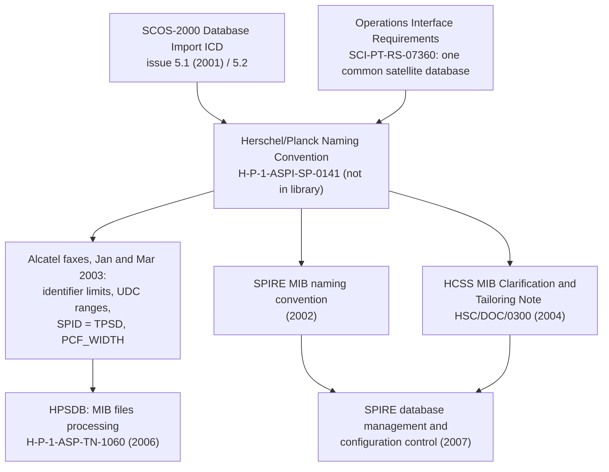
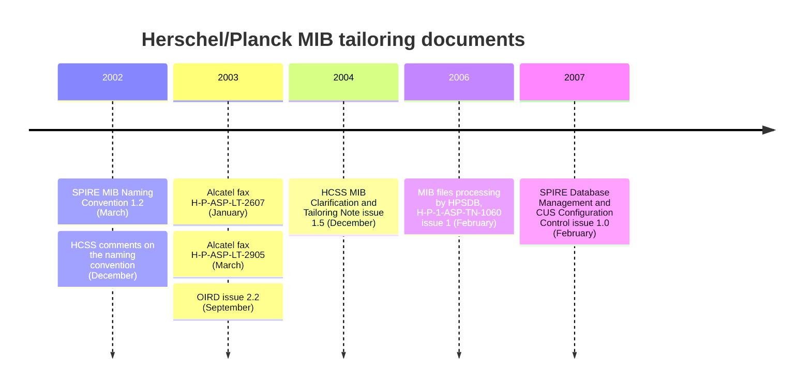
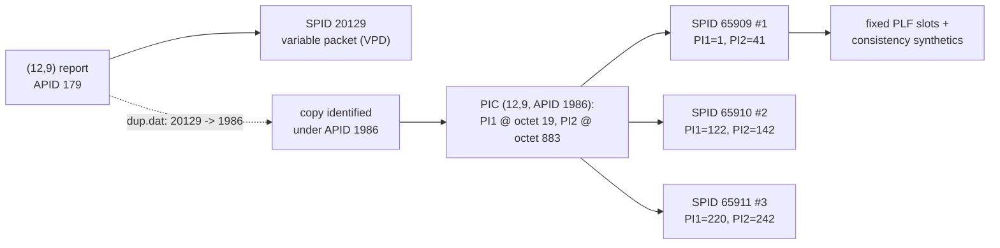

# Mission tailoring of the MIB

The SCOS-2000 Database Import ICD defines a generic [Mission Information Base](index.md) (MIB):
53 tab-separated tables that any mission can fill (51 in the summary of its §3.2, plus the two
printout tables PPF and PPC defined in §3.3.2.7.7–3.3.2.7.8).[^icd-sum][^icd-ppf] No real project uses it untouched. Projects
narrow it, by forbidding options, shortening identifiers and fixing naming rules, so that
databases from many suppliers can be merged. They also widen it with extra files for
information the ICD has no place for. This page collects the tailoring documents in this wiki's
library, most of them from the Herschel/Planck programme, and then examines the extra tables of
the public Solar Orbiter MIB.

## What the ICD itself allows

The ICD leaves three doors open on purpose:

* **Any off-line database.** The ICD imposes no constraint on how the ASCII files are produced.
  Typically a relational database is used, "e.g. MS ACCESS" in issue 7.0, and "ORACLE, MS
  ACCESS" in issue 5.1.[^icd-21][^i51-21]
* **Extra fields at the end.** Fields that a mission needs and that the ICD does not define
  "have to be added at the end of the table". Their length is limited only by the importing
  computer.[^icd-23]
* **Another separator.** A mission may replace the tab separator, provided the importer is
  adjusted.[^icd-23]

The ICD also makes the off-line system responsible for consistency. The importer catches only
the most dangerous problems, and an off-line consistency checker is delivered from release 4.0.[^icd-24]
Everything else, such as names, numbering ranges and which optional features are used, is left
to the mission. That is the space that tailoring documents fill.

## The Herschel/Planck tailoring stack

On Herschel and Planck, the five instrument teams (HIFI, PACS and SPIRE; HFI and LFI) worked
with instrument EGSEs based on SCOS-2000. Their MIBs then had to flow into Alcatel's
Herschel/Planck System Database (HPSDB) and the Central Checkout System (CCS), and, for
Herschel, into the Herschel Common Science System (HCSS). Each step
added rules.[^fax1-ref][^tn1060-scope][^hcss-bg]



Relationships from the reference lists of the documents.[^hcss-rd][^spire-nc-ad][^fax1-ref][^tn1060-ad]



Dates from the documents' title pages and change records.[^spire-nc-ad][^hcss-cr][^fax1-ref][^fax2][^oird-sdb][^tn1060-cr][^spire-db-cr]

### The project requirement: one common satellite database

The Herschel/Planck Operations Interface Requirements Document (OIRD) sets the frame. The prime
contractor and the instrument developers deliver a **Satellite Database** (SDB) that defines all
telemetry, telecommands, command sequences and software parameters, the instrument parts being
provided by the principal investigators. It must be a single common database for system
engineering, AIV and operations, comply with the SCOS-2000 Import ICD issue 5.1 (the OIRD's
AD-8),[^oird-ad8] be internally
consistent and consistent with the flight dynamics database and on-board software, contain no
irrelevant data and no duplications, and record every update down to field level.[^oird-sdb][^oird-sdb2]
Deliveries are scheduled from version 0 (instrument AVM) to a pre-launch update one month before
launch, as Oracle data files, each with a configuration control file and the on-board software
versions it matches.[^oird-sdb2] For naming, the OIRD defers to the project naming convention
H-P-1-ASPI-SP-0141.[^oird-a4]

### Alcatel faxes of 2003: identifier limits and reserved ranges

The Herschel Planck project office of Alcatel Space Industries (Cannes) sent two faxes to the
five instrument teams, copied to ESTEC and ESOC, under the subject "SCOS – Limitation to naming
convention". Their stated aim is to support a "smooth transition" from instrument-level to
module-level testing.[^fax1-ref][^fax2]

**H-P-ASP-LT-2607, 27 January 2003** sets five requirements:[^fax1-req][^fax1-just]

| # | Requirement | Justification given |
|---|---|---|
| 1 | Calibration curve identifiers limited to Number(3) | the ICD (issue 5.1) allows Number(4); the naming convention defines a curve identifier at theoretical element level as "IDIN03F" |
| 2 | Range set identifiers limited to Number(3) | same reasoning |
| 3 | Command verification stage identifiers limited to Number(4) | the ICD allows Number(5); the convention defines "IDIN04F" |
| 4 | Dynamic UDCs allocated in fixed ranges of the single "constant packet" in the PLF | the constant packet is unique, so allocations would overlap at integration |
| 5 | The SPID of the constant packet must support 1,024 octets | every level produces the same archive format, at the cost of disk space at instrument level |

The UDC allocation of requirement 4 partitions the constant packet as follows:[^fax1-just]

| Range | Herschel | Planck |
|---|---|---|
| 0000–0099 | System | System |
| 0100–0199 | SVM | SVM |
| 0200–0299 | PLM | PLM |
| 0300–0399 | HIFI | HFI |
| 0400–0499 | PACS | LFI |
| 0500–0599 | HIFI (sic; SPIRE expected) | not used ("Sorbtion cooler ?") |
| 0600–1023 | spare, allocated by ASP | spare, allocated by ASP |

!!! note "A typo in the source"
    The fax's text layer really assigns 0500–0599 on Herschel to "HIFI" a second time (PDF
    p. 2).[^fax1-just] Since HIFI already holds 0300–0399 and SPIRE is the only Herschel
    instrument without a range, the second entry probably means SPIRE. This is this wiki's
    reading; no corrected version of the fax is in the library.

**H-P-ASP-LT-2905, 27 March 2003** adds two requirements to those of the January fax. This fax
is a scan without a text layer; its content here is summarised from the manual reading recorded
in this wiki's library entry, which this review re-checked against the scanned page images. It
numbers its requirements 5 and 6, so both faxes have a requirement 5.[^fax2]

* **Requirement 5:** in the `pid` table, `PID_SPID` must equal `PID_TPSD`. The justification is
  "only to facilitate the mapping" between the Herschel/Planck System Database (HPSDB) and the
  SCOS "bridge" files:
  different SCOS packets will no longer be able to address the same variable packet structure
  definition.[^fax2]
* **Requirement 6:** in the `pcf` table, the field printed "PCF-WIDTH" "shall not be set to
  'Null'". The justification (where the field is printed "PCF_WIDFT") is that it is
  "(indirectly) redundant with VPD_OFFSET" and that HPSDB will only support `VPD_OFFSET`.[^fax2]

!!! warning "Inference"
    The scan does say "shall not be set to 'Null'"; the manual reading did not invert it. The
    rule nevertheless sits oddly with its own justification and with the HPSDB processing note
    of 2006, which ignores `PCF_WIDTH` on input, forces it to null on output and says only
    `VPD_OFFSET` is used.[^tn1060-pcf] Either the fax itself contains a slip (a rule that the
    field "shall be set to Null" would match its justification), or the project reversed the
    rule between 2003 and 2006. The available sources do not say which.

### SPIRE's MIB naming convention

SPIRE's technical note SPIRE-RAL-NOT-001155 (issue 1.2, 11 March 2002) applies the project
naming convention to the SPIRE MIB, including the parameters of the SPIRE EGSE and test
equipment, which are not delivered with the instrument. It calls the MIB the "Mission
Implementation Base".[^spire-nc-ad]

| Item | ICD fields | Pattern | Convention ref. |
|---|---|---|---|
| Command | `CCF_CNAME`, `CDF_CNAME`, `PTV_CNAME` | `SCiiippp` | 4580 |
| Command parameter | `CPC_PNAME`, `CDF_PNAME` | `SPiiippp` | 5130 |
| Command numerical / textual calibration | `CCA_NUMBR`, `CCS_NUMBR` / `PAF_NUMBR`, `PAS_NUMBR` | `tttnnnrrr` (alternative `sss`) | 5370 |
| Monitor packet | `PID_SPID`, `TPCF_SPID`, `PLF_SPID` | `tttnnnnppp` | 4380 |
| Monitor parameter | `PCF_NAME`, `OCF_NAME`, `OCP_NAME`, `PLF_NAME`, `PTV_PARNAM` | `SMiiippp` | 5130 |
| Numerical, textual, polynomial calibration | `CAF_NUMBR`, `TXF_NUMBR`, `MCF_IDENT` (and detail tables) | `tttnnnrrr` (`sss`) | 5370 |
| Alphanumeric, graphical, scrolling display | `DPF_NUMBE`, `GPF_NUMBE`, `SPF_NUMBE` | `SAiiippp`, `SGiiippp`, `SLiiippp` | 6100, 6110, 6130 |

Patterns from the note.[^spire-nc] The components are:[^spire-nc-id]

* `iii`, the theoretical parameter identifier: first character the subsystem ID, third
  character the parameter unit ID.
* `nnn`/`nnnn`, running numbers from zero; `ttt`, the system element number; `rrr`, the real
  element number; `ppp`, the position identifier; `sss`, an alternative identifier for
  calibration curves in case SCOS-2000 cannot handle 8-character names.
* System element numbers: OBS 480, DPU 490, DCU 500, MCU 510, SCU 520, EGSE 528, test facility
  (TFCS) 529, each with its subsystem letters (for example SCU: `C` calibrator, `H` heater, `K`
  sub-K, `T` temperature).[^spire-nc-id]
* Real element numbers start at 100 (AVM), 300 (QM), 500 (FM) and 700 (FS) and increase by
  one for each new configuration, so a data set records which hardware build it describes.[^spire-nc-real]
* Unit IDs: `A` current, `B` limit, `E` error, `F` status flag, `H` frequency, `K` temperature,
  `L` lower limit, `M` mode, `N` count, `P` position, `R` phase, `S` speed, `T` time, `U` upper
  limit, `V` voltage, `W` power.[^spire-nc-real][^spire-nc-w]

Note that the leading `S` identifies SPIRE. The HCSS comments explain that instrument-related
mnemonics start with `H`, `P` and `S`, and during instrument-level tests with `I`, `O` and `Q`.[^hcss-nc]

### The HCSS MIB Clarification and Tailoring Note

The Herschel Common Science System (HCSS) used the MIB to build instrument commands and to
interpret downlinked data for quick-look and interactive analysis. The HSC note HSC/DOC/0300
(issue 1.5, 21 December 2004), approved by the HSC and the three Herschel instrument teams,
specifies the MIB interface into the HCSS. It clarifies the ICD (issue 5.2) and the naming
convention (issue 2.1), adds Herschel constraints, and lists the checks of the HCSS MIB
ingestion software.[^hcss-cr][^hcss-intro][^hcss-rd]

**Clarifications of the ICD.** Three of them (4.1.4, 4.1.6 and 4.1.7) correspond to Document
Change Requests that ESOC raised against the ICD (DCR 286, 309 and 308):[^hcss-41][^hcss-esoc]

| Point | Clarification |
|---|---|
| 4.1.1 | A line is one record, ended by LF (Unix) or CR LF (Windows). A record has N−1 tabs for N fields. Trailing fields that SCOS-2000 ignores (grey in the ICD) may be left out. |
| 4.1.2 | Mandatory fields must hold a value of the right type, and numeric fields must not be empty or blank. |
| 4.1.3 | A non-mandatory field without a stated default defaults to 0, 0.0 or the empty string. |
| 4.1.4 | The separator must always be present even when the value is empty (DCR-286). |
| 4.1.5 | An out-of-limits condition is raised only strictly below the low or above the high limit, for hard and soft limits. |
| 4.1.6 | `PLF_OFFBY`/`PLF_OFFBI` count from the end of the SCOS-2000 packet header, which equals the start of the TM source packet header with the generic packetiser (DCR-309). |
| 4.1.7 | Bit 0 of `PLF_OFFBI` is the most significant bit (DCR-308). |
| 4.1.8 | Real numbers use the decimal point, not a comma. |

**Naming clarifications.** Of the naming convention, only NMCVT-0100-C (identifiers) and
NMCVT-7600-C (descriptions) affect ingestion. NMCVT-0100-C forbids `I`, `O` and `Q` as leading
characters. NMCVT-7600-C limits descriptions to letters, digits, space, `+`, `-` and `_`, asks for
meaningful text and understandable abbreviations, and forbids an empty short description.[^hcss-42]
For the HCSS the short description must match `[a-zA-Z0-9_]+`, because the scripting language
of the Common Uplink System (CUS) cannot use `+` or `-`. The combination of the first character
of the name and the full description must be unique for commands, command parameters and
monitoring parameters, and `PID_APID` with `PID_DESCR` must be unique for packets.[^hcss-53][^hcss-nc2]

**Constraints for the final interface:**[^hcss-51][^hcss-52]

| Point | Herschel constraint |
|---|---|
| 5.1 | All ICD tables in one directory; synthetic definitions accepted in subdirectory `synthetic`; everything else ignored. An extra two-field table gives each command's duration for the CUS. |
| 5.2.3 | VDF ignored. |
| 5.2.4 | Constants (`PCF_NATUR = C`) ignored; all other natures accepted. |
| 5.2.5 | The SPID is the only key to a parameter's location; a packet is identified by type, subtype, APID and, where relevant, SID; one SPID per packet type is assumed. |
| 5.2.6 | A PID row may not give a SID value greater than 0 when the matching PIC row says no SID (`PIC_PI1_OFF = -1`). |
| 5.2.7 | Except pseudo commands starting with `Z`, every `CCF_PKTID` must have at least 4 PCDF rows (version, type, data field header flag, APID). The note observes that this contradicts the ICD's statement that `PCDF_TCNAME` is unique. |
| 5.2.9 | `CDF_CNAME` + `CDF_PNAME` unique; repeated groups instead of repeated parameters. |
| 5.2.10–11 | Command sequences (CSF, CSS, SDF, CSP) and parameter sets (PST, PSV, CPS, PVS) ignored. |
| 5.2.12–13 | `TXP_FROM` ≤ `TXP_TO`, and textual calibration ranges must not overlap. |

Software version 0.2 was stricter: only `R` parameters, so no synthetics; only `OCF_CODIN`
values `R` and `I`; no variable packets; and for engineering command parameters no raw default
value.[^hcss-63]

**Checks.** Section 7 numbers the checks of the ingestion software from 7.0.1 to 7.0.34 (7.0.6 is
marked "check removed"), and marks those not yet in version 0.2 as "To be implemented", for
example the validation of synthetic and variable packet definitions. Examples: input file
names, field counts per line, field types (with a null value assigned on mismatch),
non-`R` natures flagged with an assumed length of −1, missing calibrations, uniqueness of
`PCF_NAME`, `OCF_NAME`, `CPC_PNAME` and `CCF_CNAME`, the description rules above, TXP range
order and overlap, consistency of numerical and textual de-calibrations, `CPC_RADIX` limited to
`D`, `H` and `O`, and `PID_INTER` allowed only for periodic (3,25) packets.[^hcss-7]

**SPID uniqueness.** Section 10 records an e-mail exchange of September 2002. PACS reported that
all its TC verification packets shared SPID 10006, because the SCOS-2000 version of the time did
not allow a range of SPIDs for packet type 1. ESOC confirmed that all TM packets of type 1 with
a given subtype had to share one SPID, because the Verifier listened only to a predefined list
of SPIDs. Rosetta had implemented a change allowing any SPID for service 1 and CryoSat one
allowing a range of SPIDs, and these were to be merged into release 3.1 by a function that reads
all type-1 SPIDs from `pid.dat`.[^hcss-10] See [Command verification in the MIB](command-verification.md).

### HPSDB: how the system database processed MIB files

Alcatel Alenia Space's note H-P-1-ASP-TN-1060 (issue 1, February 2006) documents how HPSDB
ingests SCOS-2000 (instrument EGSE, ICD 5.1) and CCS MIB files and regenerates them as "bridge
files". Constraints in bold in the note cannot be checked by HPSDB and are the user's
responsibility. The note warns that 100% round-trip compatibility cannot always be reached. For
example, HPSDB allows an N-to-1 relation between TM packets and SPIDs, while the ICD allows N-to-N.[^tn1060-scope]

| Rule | Content |
|---|---|
| G1 object data model | MIB data is wrapped in objects identified by identifier and position; every (object, generic object) pair must be consistent. |
| G2 naming | First letter of a character identifier gives the item type; curves are Number(6) (3 digits theoretical element + 3 free); subsystem letter prefixed and 3-digit position appended at instantiation; generic items use subsystem `G`, number `07`, position `000`. |
| G3–G5 short S2K identifiers | S2K curves Number(3) for specific and `1xxx` for generic curves (`G000xxx000`); verification stages Number(4)/`1xxxx`; range sets Number(3)/`1xxx`. |
| G6 enumerations | Enumerated values limited to the HPSDB sets, possibly narrower than the ICD (e.g. type/subtype pairs from the packet structure ICD, no octal radix). |
| G7 commutation | HPSDB models packets as structures with repetition and super-commutation attributes; a packet can be fixed (PLF), variable (VPD) or both; SPID-to-variable-packet must be one to one. |
| G8 defaults | Defaults are always forced, sometimes with HPSDB values instead of ICD ones (e.g. `PID_CHECK`). |
| G9 commonality | Curves may be shared by TM and TC inside HPSDB; do not use the same identifier for a TM and a TC curve. |
| G10 category flag | 8-bit user-category flag per item (AIT, operations, software, flight dynamics); set to "all except FDD" on loading. |
| G11 common fields | 64-character mnemonic, 256-character long description and configuration data (user, date, reason, source, site, validation dates) per item, not supported by S2K and CCS. |
| G12 TC header | TC packet headers are generic; TCP, PCPC and PCDF are ignored on loading. |
| G13 reserved characters | `<`, `>`, quote, double quote and `&` never used (XML); restricted character set for short descriptions. |
| G14 radix | No octal radix for unsigned integers. |
| G15 ranges | Respect the range allocations of the naming convention (PID numbers, UDC location). |
| G16 instantiation | Last character of the short description, APID, PID, UDC and MISC positions computed from the element's position; keep one character of description spare. |
| G17 descriptions | All descriptions mandatory; an empty one is replaced by the identifier. |
| G18 orphans | Orphan items are not loaded. |
| G19 sorting | Output sorted by the ICD primary key; inputs must be sorted too. |
| G20 derived parameters | Expression files delivered with the MIB files. |

Rules from §4 of the note.[^tn1060-g1][^tn1060-g7][^tn1060-g13] The field-by-field part (§5)
adds, among others: `PCF_WIDTH` ignored and forced to null; `PID_TPSD` forced to the SPID for
variable packets and to −1 otherwise; `PID_VALID` and `PID_TIME` forced to `Y`; the PIC table
taken from generic data, identical on every Herschel/Planck SCOS and CCS system; VPD choice
fields forced to `N`; printout tables not allowed; command sequences and parameter sets "not
supported by CCS"; and CCS-only tables for conditional curves (CUR), groups (GRP, GRPA, GRPK),
SCOE definitions (SCO) and TC/TM distribution (TCD, TMD).[^tn1060-pcf][^tn1060-pid][^tn1060-vpd][^tn1060-seq][^tn1060-ccs]

### The minimum EGSE data set

The SCOS-2000 EGSE delivered to the instrument teams shipped with a minimum MIB, `MIN_EGSE`,
that every mission had to adapt: its own TC packet header in `tcp.dat`, `pcdf.dat` and
`pcpc.dat`, the `ZLOADTT` and `ZBINTC` commands, and the TM header related displays and
parameters. All names in `MIN_EGSE` start with `Z`, and SPIDs 1 to 100 are reserved for the
generic EGSE setup. A `mergeDATA` facility merges `MIN_EGSE` with instrument data sets into a
new MIB directory.[^emcs-min][^emcs-merge] See [SCOS-2000 as EGSE](../scos2000/egse.md).

### Configuration control at SPIRE

SPIRE's note on database management and CUS configuration control (issue 1.0, February 2007)
shows the other half of tailoring, namely how a validated MIB is kept traceable in tests. The
rationale is to know, at any later time, which version of which script produced a given set of
telemetry.[^spire-db-why] The steps for a new test database are: create a Versant database,
create a mission configuration (`config1`), ingest the MIB with `ingestmib` under a user label,
load calibration tables, import the CUS definitions, set the initial observation ID and create
an instrument model for the configuration.[^spire-db-steps] Ingestion runs semantic checks and
writes `mibchecker.log`. Serious problems stop the ingestion, while minor ones are only
logged.[^spire-db-ingest]

Scripts are tagged in CVS as `LABEL_CONFIGN`, for example `AVM_TEST_CONFIG6`. During a test,
changes are tracked only by the database's automatic versions (a CVS version 1.2 becomes 1.2.1
on ingestion), and the results are checked back into CVS afterwards. A new configuration
freezes a snapshot of definitions and calibration tables.[^spire-db-cvs] A calibration table
`TestSetup.txt` with the keys configuration, environment (`moc`, `ilt`, `hsc`, `ist`, `par`),
test type, prime or redundant instrument, thermal condition and debug level lets the same CUS
definitions serve every test environment.[^spire-db-table]

## Solar Orbiter: tables beyond the ICD

The Solar Orbiter MIB releases contain the 53 ICD tables plus extra files that the ICD does not
define. The September 2025 release has six, `ASW_sw_para.dat`, `pcf_glob_det.dat`, `dup.dat`,
`s13a.dat`, `s13p.dat` and `s13t.dat`, and the April 2020 release has the first three. The SWA
instrument database has `pcf_glob_det.dat`, `sw_para.dat` and an empty `ssy.dat`.[^mib-extra][^mib2020][^swa-extra]
No document in the library describes these files, so everything below is deduced from their
contents.

| File | 2020 rows | 2025 rows | Columns | Deduced role |
|---|---|---|---|---|
| `ASW_sw_para.dat` | 85,430 | 105,222 | 3 | long software names and descriptions for MIB identifiers |
| `pcf_glob_det.dat` | 52,417 | 56,631 | 3 | bit position of each "detail" parameter inside a "global" parameter |
| `dup.dat` | 36 | 69 | 2 | packets to be re-identified under a second APID |
| `s13a.dat` | – | 7 | 6 | file attribute (content type) codes |
| `s13p.dat` | – | 11 | 6 | on-board file partitions |
| `s13t.dat` | – | 12 | 7 | file types, linking an attribute and a default partition |

Counts from this wiki's queries.[^mib-extra][^mib2020]

!!! warning "Inference"
    All interpretations in this section are deduced from column contents and cross-table
    matches. The ICD does not define these files, and the Solar Orbiter documents in the library
    do not mention them. They may be consumed by mission-specific tools rather than by the
    SCOS-2000 importer.

### ASW_sw_para: software names and long descriptions

Each row holds an identifier, a software-level name and a description of up to 255
characters. The identifiers are unique and cover every kind of MIB object: 77,565 are
monitoring parameters (`PCF_NAME`), 3,676 command parameters (`CPC_PNAME`), 2,221 commands
(`CCF_CNAME`), 7,665 TM packet mnemonics (`TPCF_NAME`), 208 textual calibrations, 130 command
textual calibrations and 77 range sets. 13,727 identifiers starting with `B` match no ICD table.[^mib-asw]

| Identifier | Second column | Third column (truncated) | Matches |
|---|---|---|---|
| `NAH7Z002` | `NAH7Z002` | "[Clone of NAHD0000] HGA-APME A Mode" | `PCF_NAME` |
| `PCA8B021` | `PTC_GET_N_PARAM` | "Maximum value is (<TC_MAX_DATA_LENGTH>-1)/4" | `CPC_PNAME` |
| `ZAHG0000` | `ZAHG0000` | "This TC sends one 1553 command to the HGA-APME A …" | `CCF_CNAME` |
| `YCA00101` | `TMA_TCACK_ACC_SUCCESS` | "This telemetry is the report generated when a TC is successfully received …" | `TPCF_NAME` |
| `CCDT0001TX` | `AOCS_PROFILE_ID` | "AOCS profiles" | `TXF_NUMBR` |
| `VCD00147` | `Z_IDINT0TO1` | "Integer between 0 and 1" | `PRF_NUMBR` |
| `BCAY0002` | `AOCSCORE_STRUNITA_QUAT_LSB` | (empty) | none |

Real rows from the release.[^mib-asw]

!!! warning "Inference"
    The file looks like the place where Solar Orbiter keeps what the ICD has no field for: the
    long, software-level mnemonic of each item (up to 122 characters in the second column) and
    a long description (up to 255 characters), much like the 64-character mnemonic and
    256-character long description that HPSDB stored for every item but could not export to
    SCOS-2000.[^tn1060-g1] The `B` identifiers, with names such as
    `AOCSCORE_STRUNITA_QUAT_LSB`, look like on-board software constants that have no MIB
    table. The SWA database's `sw_para.dat` holds 2,841 identifiers in a differently filled
    layout (empty second column).[^swa-extra]

### pcf_glob_det: detail parameters inside global parameters

Each of the 56,631 rows names a **global** parameter, a **detail** parameter and a number.
All names are PCF parameters, each detail belongs to exactly one global, and there are 8,704
globals with up to 1,024 details each. A typical example is the 8-bit `NAH0Z000` "APMHA_TM_1
[000]", split into the 3-bit `NAHD0000` "APMHA_Mode" at offset 0 and five 1-bit flags at offsets
3 to 7.[^mib-glob]

| Global | Detail | Offset | Detail description | Detail type |
|---|---|---|---|---|
| `NAH0Z000` (PTC 3, PFC 4) | `NAHD0000` | 0 | APMHA_Mode | 2/3 |
| | `NAHD0001` | 3 | APMHA_Mode trans | 2/1 |
| | `NAHD0002` | 4 | APMHA_SafePos achieved | 2/1 |
| | `NAHD0003`–`NAHD0005` | 5–7 | APMHA_Survnce_ Stat, APMHA_Vind_Elev_Stat, APMHA_Va_Elev_Stat | 2/1 |

The number is a bit offset. In every packet where both a global and one of its details are
located by the PLF (215,859 such pairs), the detail starts exactly that many bits after the
global: in SPID 33500, for instance, `NAH0Z000` and `NAHD0000` both start at octet 67, bit 0,
and `NAHD0001` at octet 67, bit 3.[^mib-glob] 12,074 rows have a global with no PLF entry. Of
the 8,704 globals, 5,124 are octet strings (PTC 7; 1,913 of them 8 octets long) and 3,580 are
unsigned integers (PTC 3), mostly of 8 bits (1,607) or 16 bits (1,464).[^mib-glob]

!!! warning "Inference"
    The table records, as data, the structure that the PLF expresses only implicitly through
    overlapping entries: a raw word is located once as a global parameter, and its fields are
    located again as overlapping detail parameters. Tools can use it to show a word together
    with its decoded fields, or to check that the overlaps are consistent. The ICD allows
    overlapping PLF entries,[^icd-plf] but has no table that ties a field to its container.

### dup: duplicating packets under a pseudo-APID

The 69 rows of `dup.dat` map a SPID to an APID. Every SPID exists in the PID, and every target
APID is one of 41 APIDs between 1953 and 1996 that appear in the PID with their own packet
definitions. The duplicated packets are generic reports: event reports (5,1), (5,2) and (5,3),
memory dumps (6,6), monitoring list reports (12,9), functional monitoring reports (142,11) and
some private services.[^mib-dup]

The ICD offers one piece of the mechanism. Since issue 6.5 (release 4.2) the [PIC](tables/pic.md)
table has an optional field `PIC_APID`, so the position and width of the extra identification
fields PI1 and PI2 can be defined per APID and type/subtype instead of per type/subtype
only.[^icd-pic][^icd-annex65] In the 2025 release 47 PIC rows set `PIC_APID`, and their APIDs are
exactly the 41 `dup` targets.[^mib-dup]

The chain for the AOCS monitoring list report shows how the pieces fit together:[^mib-dup]

1. The spacecraft sends a (12,9) monitoring list report from APID 179. The MIB defines it as
   SPID 20129 "Monitoring List Report", a variable packet (`PID_TPSD = 20129`), with no PI1/PI2.
2. `dup.dat` maps SPID 20129 to APID 1986.
3. For type 12, subtype 9 and APID 1986, the PIC places PI1 at octet 19 (8 bits) and PI2 at
   octet 883 (8 bits).
4. The PID has three (12,9) packets on APID 1986: SPID 65909 "AOCS - Monitoring List Report #1"
   (PI1 = 1, PI2 = 41), SPID 65910 "#2" (122, 142) and SPID 65911 "#3" (220, 242). All are fixed
   packets (`PID_TPSD = -1`).
5. SPID 65909 has 1,275 PLF entries, one fixed slot per expected monitor. PI1 is the ID field
   of the first slot (`NXAS001A`, octet 19), and PI2 the ID field of a later slot (`NXAS041A`,
   octet 883).
6. Synthetic "consistency" parameters check every slot's ID and act as validity parameters for
   the slot's fields (see [Synthetic parameters](synthetic-parameters.md#worked-example-2-consistency-of-instantiated-monitoring-reports)).



Chain reconstructed from `dup`, `pic`, `pid` and `plf`.[^mib-dup]

!!! warning "Inference"
    The likely purpose is to get full telemetry processing for data that the spacecraft sends
    in variable packets. The ICD warns that parameters extracted from variable packets get no
    validity, limit checking or synthetic evaluation.[^icd-pusvar] By having a ground process
    re-identify a copy of each report under a pseudo-APID, the mission can describe the same
    bytes a second time as fixed packets, chosen by monitor IDs, whose parameters are fully
    processed. The release does not say which process makes the copy. The number of mapped
    packets grew from 36 (27 APIDs) in 2020 to 69 (41 APIDs) in 2025.[^mib-dup][^mib2020]

### s13a, s13p and s13t: file transfer definitions

The three `s13` files are new in 2025. `s13p` lists 11 partitions with numeric identifiers 161 to
195, such as 161 "OMM TC Files (A)", 162 "OMM OBCPs (A)", 163 "OMM System Files (A)", 177 "OMM TC
Files (B)" and 193 "SGM-EEPROM CSW TC Files (A)". `s13a` lists 7 codes 0 to 6: PLAIN, OBCP,
DELAYED TC, IMMEDIATE TC, PAYLOAD CONTEXT, INVALID and OTHER. `s13t` lists 12 file types with
codes −2 to 9, such as "TC sequence (CSF type 1)", "Time tagged TC sequence (CSF type 2)",
"Backup MTL (CSF type 3)", "SCOS stack file" and "OBCP". Its sixth column refers to an `s13a`
entry, and its seventh to a default `s13p` partition (TCFA, SYSA, OBCA).[^mib-s13]

The partition numbers match the commanding side of the MIB. The command `ZCD00D09` "Accept First
Uplink Part", a [PUS service 13](../ecss/pus/st13-large-packet-transfer.md) telecommand
(13,9), has the parameters FTS Id, Partition Id, File IDentifier, File size, File Attribute and
the file content. Its Partition Id is decalibrated by `CCDT0192TX` "Partition", whose 11 values
are the same numbers 161 to 195 as in `s13p` (for example 161 `OMM_TC_FILES_A`, 193
`SGMA_TC_FILES`). Its File Attribute uses `CCDT0082TX` "File types": 0 `FT_INVALID`, 1 `FT_OBCP`,
2 `FT_DEL_TCSEQ`, 3 `FT_IMM_TCSEQ`, 4 `FT_PL_CTX`, 5 `FT_PS`, 6 `FT_PLAIN`, 7 `FT_FAT`.[^mib-s13cmd]

!!! warning "Inference"
    The `s13` tables appear to configure a ground tool that uploads files to the on-board mass
    memory with service 13: `s13p` names the target partitions, `s13a` the attribute values, and
    `s13t` the kinds of file to upload with their default attribute and partition. Codes 1 to 4
    of `s13a` match the File Attribute calibration, but codes 0, 5 and 6 do not (`s13a` has 0
    PLAIN, 5 INVALID, 6 OTHER, while the calibration has 0 `FT_INVALID`, 5 `FT_PS`, 6
    `FT_PLAIN`), and the `s13p` description of 164/180 ("OMM Spare") differs from the calibration
    (`OMM_PAYLOAD_A`/`_B`). The meaning of the one-letter flags in the second column (`M`, `B`,
    `N` in `s13p`; `C`, `W` in `s13t`) is not stated in the available sources.

## Patterns across projects

| Pattern | Herschel/Planck | Solar Orbiter |
|---|---|---|
| Narrower identifiers | curve, range set and stage identifiers shortened by one digit (faxes, HPSDB G3–G5) | – |
| Naming conventions | project NMCVT, SPIRE patterns, `Z` pseudo items, `I`/`O`/`Q` reserved | consistent prefixes visible in the data: `N…` monitoring parameters, `Y…` packet mnemonics, `Z…` commands, `P…` command parameters, `A…` sequences, `D…` displays |
| Reserved ranges | UDC packet partitioned per subsystem; SPIDs 1–100 for EGSE | pseudo-APIDs 1953–1996 for re-identified packets |
| Forbidden features | constants, sequences, parameter sets, printouts, octal radix | – |
| Extra information | command durations table (HCSS); HPSDB long mnemonics and descriptions | `ASW_sw_para`, `pcf_glob_det`, `dup`, `s13*` |
| Configuration control | field-level change records (OIRD), CVS tags and database configurations (SPIRE) | release names and `vdf` comments (e.g. `20250916-CSW3.1.2_MAS7.33`) |

Herschel/Planck entries from the documents above; Solar Orbiter entries from the release data
(the naming prefixes are this wiki's observation).[^mib-extra][^mib-vdf]

??? example "SQL used"
    Run against `solo-2025-09-16.sqlite` (and `solo-2020-04-16.sqlite`, `swa-idb.sqlite`). The
    non-ICD tables have generic column names `COL1`…`COLn` in file order. The `pcf_glob_det`
    offset check was done in Python over the same data because the join is slow in SQLite
    without indexes.

    ```sql
    -- sizes
    SELECT count(*) FROM asw_sw_para;  SELECT count(*) FROM pcf_glob_det;  SELECT count(*) FROM dup;
    SELECT * FROM s13a;  SELECT * FROM s13p;  SELECT * FROM s13t;

    -- ASW_sw_para: what the identifiers are
    SELECT count(*), sum(COL1 IN (SELECT PCF_NAME FROM pcf)), sum(COL1 IN (SELECT CPC_NAME FROM cpc)),
           sum(COL1 IN (SELECT CCF_CNAME FROM ccf)), sum(COL1 IN (SELECT TPCF_NAME FROM tpcf)),
           sum(COL1 IN (SELECT PRF_NUMBR FROM prf)), count(DISTINCT COL1)
      FROM asw_sw_para;
    SELECT max(length(COL2)), max(length(COL3)) FROM asw_sw_para;

    -- pcf_glob_det: example and integrity
    SELECT g.COL1, g.COL2, g.COL3, pd.PCF_DESCR, pd.PCF_PTC, pd.PCF_PFC
      FROM pcf_glob_det g JOIN pcf pd ON pd.PCF_NAME = g.COL2 WHERE g.COL1 = 'NAH0Z000';
    SELECT PLF_NAME, PLF_SPID, PLF_OFFBY, PLF_OFFBI FROM plf
     WHERE PLF_NAME IN ('NAH0Z000', 'NAHD0000', 'NAHD0001') AND PLF_SPID = '33500';
    SELECT count(*), count(DISTINCT COL1), count(DISTINCT COL2) FROM pcf_glob_det;

    -- dup and APID-specific PIC rows
    SELECT d.COL1, d.COL2, p.PID_TYPE, p.PID_STYPE, p.PID_APID, p.PID_DESCR
      FROM dup d JOIN pid p ON p.PID_SPID = d.COL1;
    SELECT count(*) FROM pic WHERE PIC_APID <> '';                          -- 47
    SELECT count(DISTINCT d.COL2) FROM dup d
     WHERE EXISTS (SELECT 1 FROM pic WHERE PIC_APID = d.COL2);              -- 41
    SELECT * FROM pic WHERE PIC_APID = '1986';
    SELECT PID_SPID, PID_PI1_VAL, PID_PI2_VAL, PID_DESCR, PID_TPSD FROM pid
     WHERE PID_APID IN ('1986', '179') AND PID_TYPE = '12';

    -- s13 tables against the ST[13] uplink command
    SELECT c.CDF_ELTYPE, c.CDF_BIT, c.CDF_PNAME, p.CPC_DESCR, p.CPC_PAFREF
      FROM cdf c LEFT JOIN cpc p ON p.CPC_NAME = c.CDF_PNAME WHERE c.CDF_CNAME = 'ZCD00D09';
    SELECT * FROM pas WHERE PAS_NUMBR IN ('CCDT0192TX', 'CCDT0082TX');
    ```

## Related pages

* [The MIB](index.md), [MIB data model](data-model.md) and
  [History of the Database Import ICD](icd-history.md).
* [Monitoring in the MIB](monitoring.md) (PID, PIC, PLF, VPD) and
  [Synthetic parameters](synthetic-parameters.md).
* [MIB tooling](tooling.md): the editors and databases that applied these rules.
* [Herschel and Planck](../missions/herschel-planck.md),
  [Herschel/Planck ground segment](../scos2000/herschel-planck-ground.md) and
  [The Solar Orbiter MIB](../missions/solar-orbiter/mib.md).

[^icd-sum]: [SCOS-2000 Database Import ICD, EGOS-MCS-S2K-ICD-0001 issue 7.0](../library/icd-7-0-final.md), §3.2 Summary of the ASCII tables, PDF pp. 30–32.
[^icd-21]: [SCOS-2000 Database Import ICD issue 7.0](../library/icd-7-0-final.md), §2.1 Assumptions and constraints, PDF p. 21.
[^icd-ppf]: [SCOS-2000 Database Import ICD issue 7.0](../library/icd-7-0-final.md), §3.3.2.7.7 ppf and §3.3.2.7.8 ppc, PDF pp. 123–125.
[^oird-ad8]: [Herschel/Planck OIRD issue 2.2](../library/cosmos-operations-interface-requirements.md), §1.3 Applicable documents (AD-8: SCOS-2000 Database Import ICD issue 5.1, Oct. 2001), PDF p. 10.
[^i51-21]: [SCOS-2000 Database Import ICD issue 5.1, S2K-MCS-ICD-0001-TOS-GCI](../library/icd-5-1-tos-gci.md), §2.1 Assumptions and constraints, PDF p. 12.
[^icd-23]: [SCOS-2000 Database Import ICD issue 7.0](../library/icd-7-0-final.md), §2.3 Structure of the ASCII files, PDF p. 22.
[^icd-24]: [SCOS-2000 Database Import ICD issue 7.0](../library/icd-7-0-final.md), §2.4 Checks applied at import time, PDF pp. 22–23.
[^icd-plf]: [SCOS-2000 Database Import ICD issue 7.0](../library/icd-7-0-final.md), §3.3.2.5.1 Parameters location in fixed packets: plf (introduction), PDF p. 97.
[^icd-pic]: [SCOS-2000 Database Import ICD issue 7.0](../library/icd-7-0-final.md), §3.3.2.4.2 pic, field 7 PIC_APID, PDF p. 93.
[^icd-annex65]: [SCOS-2000 Database Import ICD issue 7.0](../library/icd-7-0-final.md), Annex, "Changes applicable as from R4.2 implemented in ICD version 6.5" (PIC_APID), PDF p. 255.
[^icd-pusvar]: [SCOS-2000 Database Import ICD issue 7.0](../library/icd-7-0-final.md), Appendix C §2 Support of PUS data structures, PDF p. 236.
[^oird-sdb]: [Herschel/Planck Operations Interface Requirements Document, SCI-PT-RS-07360 issue 2.2](../library/cosmos-operations-interface-requirements.md), §4.2.1 Satellite Database content requirements SDBC-1 to SDBC-3, PDF p. 40.
[^oird-sdb2]: [Herschel/Planck OIRD issue 2.2](../library/cosmos-operations-interface-requirements.md), SDBC-4 to SDBC-12 and §4.2.2 delivery requirements SDBD-1 to SDBD-5, PDF p. 41.
[^oird-a4]: [Herschel/Planck OIRD issue 2.2](../library/cosmos-operations-interface-requirements.md), Annex A4.1 Satellite Database naming conventions, PDF p. 70.
[^fax1-ref]: [Alcatel Space fax H-P-ASP-LT-2607, "Herschel / Planck - SCOS - Limitation to naming convention", 27 January 2003](../library/alc-scos-fax-2003-01-27.md), header, distribution list and references, PDF p. 1.
[^fax1-req]: [Alcatel Space fax H-P-ASP-LT-2607](../library/alc-scos-fax-2003-01-27.md), Requirements 1–4, PDF p. 1.
[^fax1-just]: [Alcatel Space fax H-P-ASP-LT-2607](../library/alc-scos-fax-2003-01-27.md), UDC allocation, requirement 5, Justification and Document impacts, PDF p. 2.
[^fax2]: [Alcatel Space fax H-P-ASP-LT-2905, 27 March 2003](../library/alc-scos-2003-03-27.md), requirements 5 and 6 (PDF p. 1), justifications and document impacts (PDF p. 2). Scanned document without text layer; content as summarised from a manual reading in the library entry.
[^spire-nc-ad]: [SPIRE MIB Naming Convention, SPIRE-RAL-NOT-001155 issue 1.2](../library/spire-mib-naming-convention-1-2.md), §1 Introduction and §1.1 Documentation, PDF p. 1.
[^spire-nc]: [SPIRE MIB Naming Convention issue 1.2](../library/spire-mib-naming-convention-1-2.md), §2 Naming convention, PDF pp. 1–2.
[^spire-nc-id]: [SPIRE MIB Naming Convention issue 1.2](../library/spire-mib-naming-convention-1-2.md), §2 (component list) and §3.1 System Elements, PDF pp. 2–3.
[^spire-nc-real]: [SPIRE MIB Naming Convention issue 1.2](../library/spire-mib-naming-convention-1-2.md), §3.2–3.5 Position identifiers, real element numbers, alternative IDs and parameter unit IDs, PDF pp. 3–4.
[^spire-nc-w]: [SPIRE MIB Naming Convention issue 1.2](../library/spire-mib-naming-convention-1-2.md), §3.5 (continued), PDF p. 5.
[^hcss-cr]: [HCSS MIB Clarification and Tailoring Note, HSC/DOC/0300 issue 1.5](../library/hcss-mib-clarification-tailoring-note.md), title page and document change record, PDF pp. 1–2.
[^hcss-intro]: [HCSS MIB Clarification and Tailoring Note issue 1.5](../library/hcss-mib-clarification-tailoring-note.md), §1.1–1.3 Overview, purpose and background, PDF pp. 4–5.
[^hcss-bg]: [HCSS MIB Clarification and Tailoring Note issue 1.5](../library/hcss-mib-clarification-tailoring-note.md), §1.3 Background, PDF p. 4.
[^hcss-rd]: [HCSS MIB Clarification and Tailoring Note issue 1.5](../library/hcss-mib-clarification-tailoring-note.md), §2 Referenced documents, PDF p. 6.
[^hcss-41]: [HCSS MIB Clarification and Tailoring Note issue 1.5](../library/hcss-mib-clarification-tailoring-note.md), §4.1 Clarification of [RD-1], points 4.1.1–4.1.8, PDF pp. 9–10.
[^hcss-42]: [HCSS MIB Clarification and Tailoring Note issue 1.5](../library/hcss-mib-clarification-tailoring-note.md), §4.2 Clarification of [RD-2], PDF pp. 10–11.
[^hcss-51]: [HCSS MIB Clarification and Tailoring Note issue 1.5](../library/hcss-mib-clarification-tailoring-note.md), §5.1 Required tables and §5.1.1 Command durations table, PDF p. 12.
[^hcss-52]: [HCSS MIB Clarification and Tailoring Note issue 1.5](../library/hcss-mib-clarification-tailoring-note.md), §5.2 Tailoring of [RD-1], points 5.2.3–5.2.13, PDF pp. 13–14.
[^hcss-53]: [HCSS MIB Clarification and Tailoring Note issue 1.5](../library/hcss-mib-clarification-tailoring-note.md), §5.3 Tailoring of [RD-2], points 5.3.1–5.3.5, PDF p. 14.
[^hcss-63]: [HCSS MIB Clarification and Tailoring Note issue 1.5](../library/hcss-mib-clarification-tailoring-note.md), §6.1 and §6.3 Constraints for version 0.2, PDF pp. 15 and 19.
[^hcss-7]: [HCSS MIB Clarification and Tailoring Note issue 1.5](../library/hcss-mib-clarification-tailoring-note.md), §7 Checks performed by the HCSS MIB software, checks 7.0.1–7.0.34, PDF pp. 20–22.
[^hcss-nc]: [HCSS MIB Clarification and Tailoring Note issue 1.5](../library/hcss-mib-clarification-tailoring-note.md), §8 Comments on [RD-2], PDF pp. 23–24.
[^hcss-nc2]: [HCSS MIB Clarification and Tailoring Note issue 1.5](../library/hcss-mib-clarification-tailoring-note.md), §8 (CUS scripting language and underscore), PDF p. 24.
[^hcss-esoc]: [HCSS MIB Clarification and Tailoring Note issue 1.5](../library/hcss-mib-clarification-tailoring-note.md), §9 ESOC response to comments by HS (DCR 286, 308, 309), PDF pp. 25–27.
[^hcss-10]: [HCSS MIB Clarification and Tailoring Note issue 1.5](../library/hcss-mib-clarification-tailoring-note.md), §10 Discussions on SPID uniqueness, PDF pp. 28–29.
[^tn1060-cr]: [H-P-1-ASP-TN-1060, MIB files processing by HPSDB, issue 1](../library/h-p-1-asp-tn-1060-mib-processing-hpsdb.md), title block and change records, PDF pp. 2–3.
[^tn1060-scope]: [H-P-1-ASP-TN-1060, MIB files processing by HPSDB](../library/h-p-1-asp-tn-1060-mib-processing-hpsdb.md), §1 Scope, PDF p. 7.
[^tn1060-ad]: [H-P-1-ASP-TN-1060, MIB files processing by HPSDB](../library/h-p-1-asp-tn-1060-mib-processing-hpsdb.md), §2 Documents and §3 Acronyms, PDF p. 8.
[^tn1060-g1]: [H-P-1-ASP-TN-1060, MIB files processing by HPSDB](../library/h-p-1-asp-tn-1060-mib-processing-hpsdb.md), §4.1–4.8 (G1–G11), PDF pp. 9–14.
[^tn1060-g7]: [H-P-1-ASP-TN-1060, MIB files processing by HPSDB](../library/h-p-1-asp-tn-1060-mib-processing-hpsdb.md), §4.4 "G7 – Commutation", PDF pp. 11–13.
[^tn1060-g13]: [H-P-1-ASP-TN-1060, MIB files processing by HPSDB](../library/h-p-1-asp-tn-1060-mib-processing-hpsdb.md), §4.9–4.17 (G12–G20), PDF pp. 14–16.
[^tn1060-pcf]: [H-P-1-ASP-TN-1060, MIB files processing by HPSDB](../library/h-p-1-asp-tn-1060-mib-processing-hpsdb.md), §5.2.1 PCF (WIDTH row and note 1), PDF pp. 19 and 21.
[^tn1060-pid]: [H-P-1-ASP-TN-1060, MIB files processing by HPSDB](../library/h-p-1-asp-tn-1060-mib-processing-hpsdb.md), §5.2.9–5.2.10 PID and PIC, PDF pp. 24–26.
[^tn1060-vpd]: [H-P-1-ASP-TN-1060, MIB files processing by HPSDB](../library/h-p-1-asp-tn-1060-mib-processing-hpsdb.md), §5.2.13 VPD and §5.2.20–5.2.21 PPF/PPC, PDF pp. 27–28 and 31.
[^tn1060-seq]: [H-P-1-ASP-TN-1060, MIB files processing by HPSDB](../library/h-p-1-asp-tn-1060-mib-processing-hpsdb.md), §5.3.9–5.3.12 and §5.3.16–5.3.20 (sequences and parameter sets), PDF pp. 36–40.
[^tn1060-ccs]: [H-P-1-ASP-TN-1060, MIB files processing by HPSDB](../library/h-p-1-asp-tn-1060-mib-processing-hpsdb.md), §5.4 Specific CCS data (CUR, GRP, GRPA, GRPK, SCO, TCD, TMD, LGF), PDF pp. 42–45.
[^emcs-min]: [EGSE based on SCOS 2000, EMCS Software User Manual issue 4.0](../library/emcs-sum-4-0.md), §4.1.1 The minimum EGSE data set, PDF pp. 21–22.
[^emcs-merge]: [EGSE based on SCOS 2000, EMCS Software User Manual issue 4.0](../library/emcs-sum-4-0.md), §4.1.2–4.1.3 mergeDATA and setSCOSdata facilities, PDF pp. 22–23.
[^spire-db-cr]: [SPIRE Database Management and CUS Configuration Control, SPIRE-RAL-NOT-002829 issue 1.0](../library/spire-db-management-1-0.md), title page and §1.6 Document change record, PDF pp. 1 and 5.
[^spire-db-why]: [SPIRE Database Management and CUS Configuration Control issue 1.0](../library/spire-db-management-1-0.md), §3.1 Configuration control rationale, PDF p. 15.
[^spire-db-steps]: [SPIRE Database Management and CUS Configuration Control issue 1.0](../library/spire-db-management-1-0.md), §2.1.2 Creating a database, steps 2.1.2.1–2.1.2.10, PDF pp. 6–12.
[^spire-db-ingest]: [SPIRE Database Management and CUS Configuration Control issue 1.0](../library/spire-db-management-1-0.md), §2.1.2.5 Ingesting the MIB into the database, PDF pp. 8–9.
[^spire-db-cvs]: [SPIRE Database Management and CUS Configuration Control issue 1.0](../library/spire-db-management-1-0.md), §3.2.2.3–3.2.2.4 Tags and configuration control after the test is started, PDF pp. 18–19.
[^spire-db-table]: [SPIRE Database Management and CUS Configuration Control issue 1.0](../library/spire-db-management-1-0.md), §3.3 Structure and dependencies of the CUS definitions (TestSetup.txt), PDF pp. 20–23.
[^mib-extra]: [Solar Orbiter MIB release MIB__20250916M25925PFMS001_SOL](../library/mib-20250916m25925pfms001-sol.md), file list of the release archive and tables `asw_sw_para`, `pcf_glob_det`, `dup`, `s13a`, `s13p`, `s13t`; inspection and queries by this wiki.
[^mib2020]: [Solar Orbiter MIB release MIB__20200416M10720PFMS001_SOL](../library/mib-20200416m10720pfms001-sol.md), tables `asw_sw_para`, `pcf_glob_det`, `dup` and `pic`; queries by this wiki.
[^swa-extra]: [Solar Orbiter SWA instrument database (ASCII.zip)](../library/swa-idb-ascii.md), files `pcf_glob_det.dat`, `sw_para.dat`, `ssy.dat`; queries by this wiki.
[^mib-asw]: [Solar Orbiter MIB release MIB__20250916M25925PFMS001_SOL](../library/mib-20250916m25925pfms001-sol.md), table `asw_sw_para` matched against `pcf`, `cpc`, `ccf`, `tpcf`, `txf`, `paf` and `prf`; queries by this wiki.
[^mib-glob]: [Solar Orbiter MIB release MIB__20250916M25925PFMS001_SOL](../library/mib-20250916m25925pfms001-sol.md), table `pcf_glob_det` joined with `pcf` and `plf`; queries and script by this wiki.
[^mib-dup]: [Solar Orbiter MIB release MIB__20250916M25925PFMS001_SOL](../library/mib-20250916m25925pfms001-sol.md), tables `dup`, `pic`, `pid`, `tpcf` and `plf` (SPIDs 20129 and 65909–65911); queries by this wiki.
[^mib-s13]: [Solar Orbiter MIB release MIB__20250916M25925PFMS001_SOL](../library/mib-20250916m25925pfms001-sol.md), tables `s13a`, `s13p` and `s13t`; queries by this wiki.
[^mib-s13cmd]: [Solar Orbiter MIB release MIB__20250916M25925PFMS001_SOL](../library/mib-20250916m25925pfms001-sol.md), `ccf`, `cdf` and `cpc` records of command `ZCD00D09`, and `paf`/`pas` records of `CCDT0192TX` and `CCDT0082TX`; queries by this wiki.
[^mib-vdf]: [Solar Orbiter MIB release MIB__20250916M25925PFMS001_SOL](../library/mib-20250916m25925pfms001-sol.md), table `vdf` and first letters of the names in `pcf` (126,740 of 126,745 start with N), `tpcf` (11,131 of 11,150 with Y), `ccf` (5,441 of 5,454 with Z), `cpc` (5,428 of 7,155 with P), `csf` (all 3,404 with A) and `dpf`; queries by this wiki.
