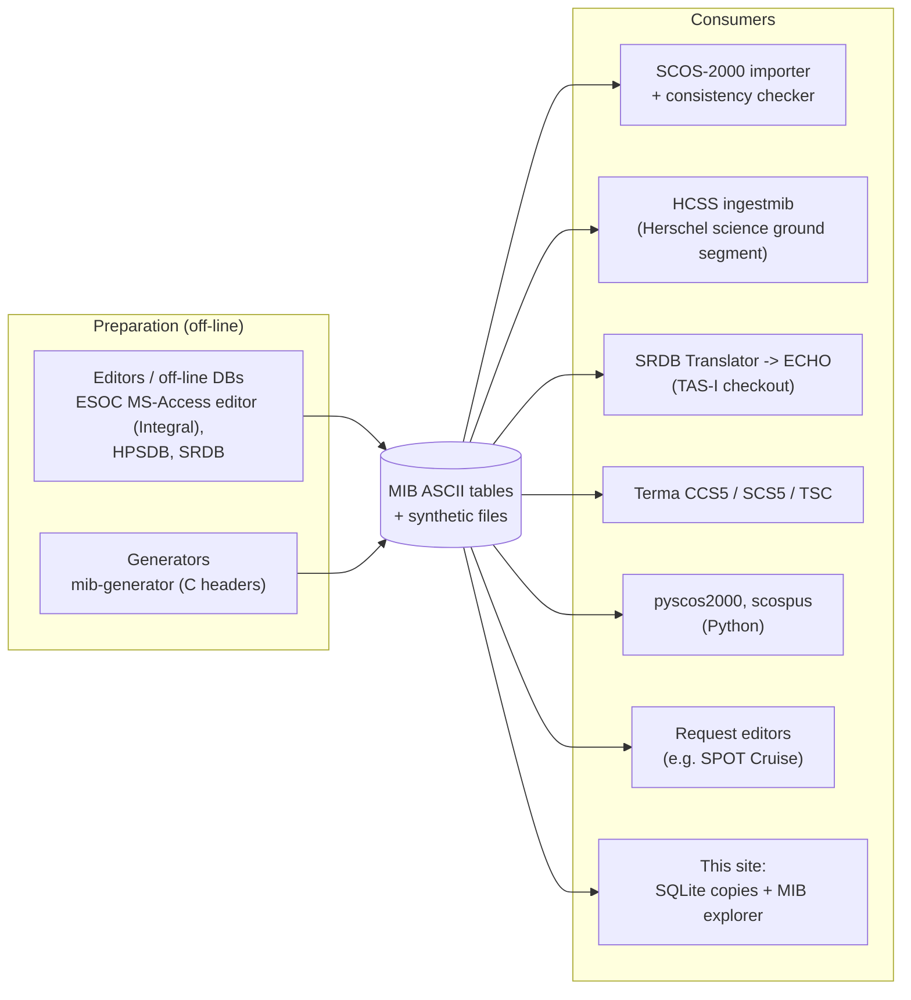

# MIB tooling and open-source libraries

The SCOS-2000 [Mission Information Base](index.md) (MIB) is exchanged as plain ASCII tables,
but nobody maintains 100,000 parameters in a text editor. Around the interface defined by the
Database Import ICD has grown a family of tools: off-line databases and editors that produce
the tables, importers and ingestion programs that check and load them, translators that feed
other control systems, and, more recently, small open-source libraries that read MIBs and the
packets they describe. This page surveys the tools documented in this wiki's library and the
open-source packages published on PyPI, and ends with the scripts that build this site.

Landscape drawn from the sources cited in each section below.

## What the ICD expects of tools

The ICD sets the division of labour. It places no constraint on how the ASCII files are produced,
and expects that a relational database such as MS Access will usually be used.[^icd-21] The
off-line database is responsible for consistency. The SCOS-2000 importer checks only the most
dangerous problems, and from release 4.0 an off-line database consistency checker is delivered
with the main SCOS-2000 releases.[^icd-24]

The importer's own behaviour is precise:[^icd-24b][^icd-25]

* Every field is checked against its declared type and length. A field that is too long is
  truncated with a warning. A mandatory field left null is set to 0 or the empty string, with a
  warning.
* Relational integrity is checked. A record that refers to something missing, such as an unknown
  parameter, is not imported.
* Command and sequence parameter values are checked against their format. Invalid values become
  0, the empty string or `1970.001.00.00.00` for absolute times.
* All messages go to a log file that is overwritten at each import (`/home/sops1/Import.log`).
* Import options are a full import (optionally per domain) and a "check only" run that reports
  without changing any data. From release 5.0, sequences and displays are converted to XML files
  in the FARC instead (see [Display definitions](displays.md)).

The ICD also warns that the import default of a field is not the same thing as the default an
off-line editor may propose.[^icd-def] And it gives one example of logic that belongs in the
off-line "TM/TC database manager", not in SCOS-2000: for housekeeping packets defined on board
with [PUS service 3](../ecss/pus/st03-housekeeping.md), ESA missions typically define the packet
in the database first and generate the service 3 commands from it automatically.[^icd-s3]

## ESOC's MS-Access database editor and the HIFI evaluation

In April 2000, an ESA presentation of SCOS-2000 to the FIRST/Planck projects listed the elements
on offer: SCOS-2000, a router and a Tcl/Tk procedure automation tool reused from PROBA, and, as
additional elements, "Database Editors" based on MS Access from INTEGRAL.[^s2k-2000]

**Requirements.** HIFI wrote down what an instrument team needed from such an editor
(SRON-U/HIFI-SP-2000-2, August 2000). The MIB, "a set of more than 30 ASCII files", configures
SCOS-2000 and must evolve with the instrument during integration.[^hifi-req-intro] The
requirements group into five areas:[^hifi-req]

| Area | Requirements (summary) |
|---|---|
| Data content | All data needed to configure SCOS-2000; one table per SCOS-2000 file. |
| User interface | A datasheet per table with ICD field names and tip texts; complete records visible without scrolling; forms that follow the MIB structure (PCF with checks and calibrations, CPC with range sets and de-calibrations, PID with VPD and PLF, CCF with CDF, PTV and verification, CSF with its sub-tables, packet headers, parameter sets, and display layouts); pull-down menus for foreign keys. |
| Data checking | Unique keys enforced; update cascades so keys can be edited; no unintended delete cascades; validation rules for enumerated fields; mandatory fields enforced; ICD defaults used and never exported blank; a configurable whole-data-set checker; counters maintained or regenerated. |
| Groups of data | Data organised per instrument subsystem, enterable by subsystem engineers without SCOS-2000 knowledge, reportable per subsystem, and swappable when a subsystem model (QM, FM) changes. |
| Tools | Import, append, export and delete sets of SCOS-2000 files; an intuitive entry tool for parameter value sets. |

Its §3.4 names four groups of tables (parameter data, packet data, parameter sets and operator
data), while the table of its Annex A uses five: Operator (the six display tables), Packet,
Packet header, Parameter and Parameter set.[^hifi-req][^hifi-req-annex]

**Evaluation.** HIFI's evaluation report (SRON-U/HIFI/RP/2001-1 issue 2, April 2001) assessed
version 2.0 of the "SCOS-2000 Database Editing Subsystem", which the report also calls the
"Integral MS Access editor", and includes the replies of the editor's author.[^hifi-eval-intro]
The key findings:

| Topic | Finding | Author's reply or status |
|---|---|---|
| Polynomial calibrations (MCF) | No form at first; later a form, but the PCF/PLF form still could not select an MCF curve, and MCF had no primary key. | Not used by INTEGRAL; SCOS-2000 looks up `PCF_CURTX` first in CAF, then in MCF, so MCF numbers must not clash with CAF numbers. |
| Version table (VDF) | Filled automatically at export, but the new record was not exported; order of export and record creation reversed. | Populated at export; requires the PC date format DD/MM/YY. |
| Datasheets | Requirements 3.2.1–3.2.4 not implemented: only forms. | Tables now selectable in table view, considered dangerous for bulk maintenance. |
| Primary key of PID | Built from the first six fields instead of the first five. | Needed for INTEGRAL's satellite database. |
| Validation rules | Initially missing (e.g. `RAWFMT` accepted any value), later enforced. | – |
| Defaults | Empty fields with defaults exported empty. | To be investigated. |
| Consistency checks | Delivered as a separate consistency checker, "an impressive tool". | INTEGRAL database exceeded 870,000 populated fields; checking inside the editor would be too slow. |
| Counters | Maintaining master-detail counts is error-prone; the report questions why they exist. | Mostly useless for SCOS-2000, which uses none of them. |
| Surprises | `(PTC, PFC) = (5, 2)` exported as `(5, 3)`. | INTEGRAL-specific processing, to be removed. |
| Import | Imports replace rather than append; failing records not identified. | Single tables, sets or the whole database can be imported. |
| ICD conformance | `OCP_RLCHK` 6 characters instead of 8; limit values 10 instead of 14; several SPID-type fields cannot hold 10 digits; `css_mandisp`, `gpf_upun`, `spf_upun` wrongly mandatory. | – |

Findings from the report.[^hifi-eval-1][^hifi-eval-2][^hifi-eval-3][^hifi-eval-4] The author's
view of who may edit a database is telling: at ESOC only fully qualified database administrators
with control-system and spacecraft experience edit satellite databases.[^hifi-eval-3] The report
concludes that version 2 had improved greatly and was "a good tool to work with".[^hifi-eval-concl]

## Project databases: HPSDB and the satellite database

For Herschel/Planck, the Operations Interface Requirements Document required a single common
Satellite Database, delivered as Oracle data files with field-level change records.[^oird-sdb]
The Herschel/Planck System Database (HPSDB), documented by Alcatel Alenia Space, loaded
instrument and CCS MIB files and regenerated SCOS-2000 and CCS "bridge files". Its object model, naming, default values
and per-field processing rules are summarised on [Mission tailoring](tailoring.md#hpsdb-how-the-system-database-processed-mib-files).[^tn1060-scope]
Two of its design choices show what an engineering database adds to the bare ICD. Every item
carries a 64-character mnemonic, a 256-character long description and configuration data
(user, date, reason, source, validation dates), none of which SCOS-2000 can import. And an 8-bit
category flag per item selects which users (AIT, operations, software, flight dynamics) see it
when bridge files are generated.[^tn1060-g10]

ESA's SCOS-2000 based EGSE (EMCS, user manual issue 4.0 of 2004) worked the other way round. ESA
had started an Oracle-based repository for its space system model, but it was not available, so
users populated mission data directly in the ASCII files. SCOS-2000 loaded them into its internal MIB database, and the `mergeDATA` and
`setSCOSdata` facilities merged data sets and switched between them.[^emcs-repo][^emcs-merge]

## Ingestion into a science ground segment: HCSS

The Herschel Common Science System read MIBs with its own ingestion software, whose interface
and checks are defined by the HCSS MIB Clarification and Tailoring Note.[^hcss-intro] In practice
(SPIRE, 2007), `ingestmib` reads the directory named by the property `hcss.mib.datadir`, runs
semantic checks, writes `mibchecker.log`, and stores the MIB definitions in a Versant object
database under a user label. Afterwards `cusgui` loads the labelled MIB for the Common Uplink
System.[^spire-ingest] The checks it performs are listed on [Mission tailoring](tailoring.md#the-hcss-mib-clarification-and-tailoring-note).

## SRDB Translator: from SCOS-2000 to ECHO

An undated paper by Intecs and Thales Alenia Space Italia describes the **SRDB Translator**, which
imports a Satellite Reference Database (SRDB) in SCOS-2000 MIB form into ECHO, the TAS-I central
checkout (EGSE) system. The motivation is that SCOS-2000 had become the standard for ESA mission
control and often for EGSE, so the SRDB is "almost always" based on the SCOS-2000 run-time
database, while unit tests and AIV at TAS-I used ECHO and its own database.[^comi-intro] The
paper carries no date. Its most recent reference is ICD issue 6.1 of February 2006,[^comi-ref]
and the copy in the library is hosted on the same ESA Indico event (number 109) as the Terma
paper cited below, which is headed "SESP 2010".[^comi-host]

**Analysis.** The two databases cover similar entities (parameters, calibrations, checks,
packets, commands, verification), both built on PUS, but a one-to-one table mapping is "almost
inapplicable". For every item the authors distinguish data present in both, data present only in
the SRDB (adopted by extending ECHO, or ignored) and data that only ECHO needs (supplied
separately).[^comi-db] Two of their conversion tables:[^comi-rules]

| Topic | SCOS-2000 | ECHO | Rule |
|---|---|---|---|
| Verification checks vs telecommands | separate entities with a mapping table | checks as a detail table of each TC | duplicated for every linked TC |
| Verification stage | any stage of the execution profile | not applicable | stage not imported |
| Verification window | start time and interval in s | maximum time from TC emission in ms | (start + interval) × 1000 |
| Expected value | raw or engineering | engineering only | raw checks discarded |
| Numerical curve identifier | Char(10) | integer 1–9999 | mapping algorithm; original name kept in the description |
| Radix of raw values | decimal, octal, hex | decimal only | converted |
| Points per curve | unlimited | 2 to 1,000 | others not imported or truncated |
| Polynomial curve boundaries | not held | mandatory | ECHO relaxed |
| Logarithmic curves | supported | not handled | ECHO extended |
| Curves per parameter | unlimited | 4 | extended to 99 |

**Implementation.** The translator is a utility of the ECHO Database Manager (MTGP) on MS SQL
Server, compliant with SCOS-2000 ICD issue 6.1. In a first step it loads the SCOS-2000 tables
unchanged into dedicated tables. In a second step stored procedures transform them into ECHO
tables, either directly or as a file for later import, and it can merge the result with EGSE-local
objects. A log lists the outcome per object.[^comi-impl]

**Use and limits.** It was first built for Galileo GIOVE-B (an SRDB delivered as a single MS
Access 2000 file), extended for Sentinel-1, and used for BepiColombo on-board computer and SSMM
databases of about 10,000 records each.[^comi-apps] Because the first step expects exactly the
columns of its ICD issue, BepiColombo databases made to an earlier ICD issue had to be adjusted
to add the missing columns before import, and every project's customisations require new analysis. The authors
call for a standard XML-based exchange language.[^comi-limits][^comi-future] CCSDS defines
such a language, [XTCE](../ccsds/xtce.md); the paper does not mention it.

## Terma CCS5, SCS5 and TSC

Terma's checkout and control products read SCOS-2000 MIBs natively. A 2010 paper explains the
choice: building a new monitoring and control system from scratch was attractive only if users
kept their test language and database interfaces. The MIB interface, it says, "while not
perfectly normalized, and not always perfectly designed, is nevertheless well known, relatively
well described, and well understood".[^armitage]

The 2024 presentation and the data sheet list the MIB-related features:[^terma-std][^terma-ds]

* the SCOS-2000 MIB data model "6.9+…7.2" (data sheet: "ICD 6.9 extended"), with unlimited field
  lengths;
* variable packets and parameters supported globally, deduced parameters in TM and TC,
  configurable length fields, both endianities, `VPD_CHOICE` and dynamic housekeeping definitions;
* different synthetic (derived parameter) languages;
* dropping and loading several databases without restart, with a clean separation of data from
  different suppliers (platform, payloads, instruments, EGSE), and an online MIB browser with
  search, filter and patch features;[^terma-merge]
* all tables accessible from the TOPE procedure language; TC sequence tables not supported (TOPE
  or command stack files are used instead).

!!! note "Terma Data Base Manager"
    A separate Terma product called "Data Base Manager" (DBM) is not described in any document of
    this wiki's library. Its features, licence and version are therefore not stated in the
    available sources.

## Request editors: SPOT Cruise

MIBs are also read by tools that prepare operations requests. Starion's web-based SPOT Cruise
framework at ESAC, built for BepiColombo and adapted for JUICE, edits payload operations requests
(POR/PDOR) in the ESOC command request file (CRF) XML format. It manages MIB updates and checks
every request against the applicable MIB, which the paper expands as "Mission Information
Database".[^spot]

## Open-source libraries

Five small open-source packages on the Python Package Index (PyPI) deal with SCOS-2000 data.
None of them is in this wiki's library. The facts below come from each package's PyPI JSON
record (`https://pypi.org/pypi/<name>/json`), retrieved by this wiki on 2026-11-12, and are
flagged as such.

| Package | Purpose (PyPI summary) | Latest version (date) | First release on PyPI | Licence | Python | Organisation (from metadata) | Source |
|---|---|---|---|---|---|---|---|
| [pyscos2000](https://pypi.org/project/pyscos2000/) | "Python SCOS-2000 parsing and checking" | 0.3.0 (2023-05-04) | 0.1.0 (2023-02-23) | MIT | ≥ 3.6 | IRF (irf.se) | [gitlab.irf.se/irf/pyscos2000](https://gitlab.irf.se/irf/pyscos2000) |
| [scospus](https://pypi.org/project/scospus/) | "PUS packet parsing with SCOS backing" | 0.2.0 (2023-06-13) | 0.1.0 (2023-02-23) | MIT | ≥ 3.6 | IRF (irf.se) | [gitlab.irf.se/irf/scospus](https://gitlab.irf.se/irf/scospus) |
| [SCOSpy](https://pypi.org/project/SCOSpy/) | "Python library to read the SCOS-2000 header" | 0.5.0 (2025-11-20) | 0.2.1 (2020-07-09) | GNU GPL v3 | ≥ 3.11 | INAF (inaf.it) | [github.com/RomoloPoliti-INAF/SCOSpy](https://github.com/RomoloPoliti-INAF/SCOSpy) |
| [mib-generator](https://pypi.org/project/mib-generator/) | "Generator of SCOS 2000 MIB databases." | 0.1.3 (2023-09-11) | 0.1.1 (2023-09-03) | MIT | ≥ 3.10 | individual author | [github.com/vachaj11/MIB-generator](https://github.com/vachaj11/MIB-generator) |
| [edds_process](https://pypi.org/project/edds-process/) | "Package to process data from the EGOS Data Dissemination System (EDDS) of ESA" | 0.11.0 (2026-10-01) | 0.9.1 (2022-11-23) | CeCILL-2.1 | ≥ 3.9, < 4 | Observatoire de Paris (obspm.fr) | [gitlab.obspm.fr/ROC_PUBLIC/edds_process](https://gitlab.obspm.fr/ROC_PUBLIC/edds_process) |

All values from the PyPI JSON API.[^pypi] Dates are the upload times of the first file of each
release. For SCOSpy the licence field reads "GNU GPL ver3" and the classifier "GNU General Public
License v3 (GPLv3)". For edds_process the licence is given only as the SPDX expression
`CECILL-2.1`, the French CeCILL free-software licence, not MIT.[^pypi]

### pyscos2000

pyscos2000 parses and checks the ASCII tables of a SCOS-2000 MIB. Its README shows the basic
use: `pyscos2000.SCOS('./ASCII')` loads a MIB directory of `.dat` files, every table becomes an
attribute (for example `scos.plf`), and its records are in `rows`. The README names no ICD
issue and documents no writer.[^pypi] The library's API documentation (outside the library,
retrieved 2026-11-12) adds the rest:[^irf-doc]

* Its `scos2000` module defines the table schemas, "Based on EGOS-MCS-S2K-ICD-0001 issue
  7.2-FINAL (2019-12-13)" (see [ICD history](icd-history.md#issue-72-2019)), with one class per
  table for 36 tables (`CAFTable` … `VPDTable`, including `CURTable`, `LGFTable` and `DSTTable`)
  and a `ZipArchiveTextReader` for reading the files from a zip archive.
* The same module provides consistency checkers: bit offsets in the range 0–7, field lengths,
  forbidden characters in key columns, CAF entries without the right number of CAP rows, CAP
  rows without a CAF entry, unused CAF, TXF and MCF definitions, the PLF time delay range,
  constants (`PCF_NATUR = C`) without `PCF_PARVAL`, and validity parameter definitions. The
  `checker` module is a framework for writing further checkers.
* A `synthetic` module has classes for synthetic parameter definitions and instances, including
  a `DynamicSyntheticParameter` for `PCF_NATUR = D`.
* A `browser` module is described as a "very simple tool to browse a SCOS-2000 database", with
  `main()` and `parse_args()` entry points.

This wiki takes its SQLite column names from pyscos2000's table schemas, which were introspected
into the file `tools/pyscos2000_schema_icd72.json`. For each of 36 tables the file records the
schema class, its docstring, and per column the name, type, key flag, optionality and default.[^site-schema]
The 17 ICD 7.0 tables that pyscos2000 does not model are the three group tables, the eight
display tables, the verification tables CVS, CVE and CVP, and CPS, PVS and PSM. Six column names
differ from ICD 7.0:[^site-cols]

| Table | Position | pyscos2000 | ICD 7.0 |
|---|---|---|---|
| `ccf` | 21 | `CCF_SUBSCHEDID` | `CCF_SUBSCHED` |
| `cpc` | 1 | `CPC_NAME` | `CPC_PNAME` |
| `cpc` | 15 | `CPC_OBTIP` | `CPC_OBTID` |
| `cpc` | 16 | `CPC_DESCR2` | `CPC_ENDIAN` |
| `css` | 17 | `CSS_STATPTV` | `CSS_STAPTV` |
| `vdf` | 3 | `VDF_DOMAIN` | `VDF_DOMAINID` |

### scospus

scospus parses PUS packets using a SCOS-2000 MIB as its packet description, and depends on
pyscos2000. Its PyPI record carries no README text, so which services it decodes and how it
applies the PLF and VPD are not stated in the sources consulted.[^pypi]

### SCOSpy

SCOSpy decodes the **SCOS-2000 packet header**, the internal header that SCOS-2000 puts in front
of each stored TM or TC packet in its archive (see [Mission archives](../scos2000/archives.md)),
not the CCSDS header. From a hexadecimal string, `SCOS(packet)` returns the common packet header,
a TM or TC packet header and the data. According to the README:[^pypi]

* Common header fields include CTree, AccessF, SimFlag, FilingTime, CreationTime, CreateID, SCID,
  GSID, PSize, PType, Version, FilingFlag, DistFlag, TSPolicy, TQ, StreamID, SeqCounter, SPID and
  MissionID.
* TM packet header fields: TPSD, RouteID, PUSAPID, PUSSSC, PUSService, PUSSubService.
* TC packet header fields include UplinkTime, ExecTime, LUTime, RequestID, the PUS APID,
  sequence count, service, subservice and acknowledgement flags, and source host and type.
* The event packet header is not implemented. Only packet types 1 (TM) and 2 (TC) are supported.
* Lookup tables are built in for BepiColombo (mission ID 816, spacecraft IDs 816 and 817). The
  README shows how to add JUICE (ID 844) by extending two dictionaries.

The presence of `SPID` and `TPSD` in the TM header is what ties archived packets to the MIB: they
are the processing keys from the [PID](tables/pid.md) table (see
[Monitoring in the MIB](monitoring.md)).

### mib-generator

mib-generator builds SCOS-2000 MIB databases from C header files. Its README describes "basic
abilities" for parsing C syntax, interpreting declarations that follow an expected structure of
TM and TC packets, and creating the corresponding MIB. It names neither a mission nor the tables
it writes, and refers to separate online documentation.[^pypi]

!!! warning "Inference"
    Generating the MIB from the on-board software's own C structures is the reverse of the
    "database first" approach that the ICD describes for ESA missions,[^icd-s3] and suits small
    projects whose flight software is the single source of truth.

### edds_process

edds_process handles data from the [EGOS Data Dissemination System](../scos2000/edds.md).
Its `edds_process.response` module parses and creates EDDS XML files of the TmRaw and TcReport
kinds. It depends on `xmltodict`.[^pypi] The corresponding XML types appear in the EDDS user ICD
(for example the complex type `PktTmRaw`); see [EDDS request and data formats](../scos2000/edds-formats.md).[^euicd]
Its contact addresses belong to the Observatoire de Paris domain obspm.fr.[^pypi]

## This site's own build scripts

The pages and explorer of this wiki are built from the same public data with a few scripts in
the repository's `tools/` directory:[^site-tools]

| File | What it does |
|---|---|
| `tools/srcgrep.py` | Lists the source registry and searches the extracted text of each library document, printing PDF page indexes (counted from the form feeds of `pdftotext`) for citations. |
| `tools/check_page.py` | Lints a wiki page: front matter keys, registered source slugs, relative links to planned or known pages, footnote definitions, bit-field JSON, balanced code fences and length. |
| `tools/build_explorer.py` | Reads a directory of MIB ASCII tables (plus the `synthetic` folder and the extra Solar Orbiter tables) and writes the JSON data of the [MIB explorer](../explorer/index.md): indexes of parameters, packets, commands, sequences and calibrations, detail records bucketed by an FNV hash, verification stages, and optionally a diff against an older release. |
| `tools/mib_columns.json` | Column order for all 53 tables: 36 in pyscos2000 order with ICD 7.0 names, 17 from the ICD 7.0 text, plus the list of name differences above. |
| `tools/pyscos2000_schema_icd72.json` | The introspected pyscos2000 schema. |
| `tools/build_pages.py` | Generates the data-driven pages: the library pages, the reference catalogue, the MIB table reference pages, the sources-and-copies page, the glossary and its abbreviation tooltips, and the field descriptions used by the explorer. |
| `tools/build_nav.py` | Writes the explicit navigation into `mkdocs.yml`, taking page titles from the front matter. |
| `tools/plan.json` | The page plan of the wiki. |

The read-only SQLite copies of the Solar Orbiter MIBs used for every query on these pages name
each table after its `.dat` file. They use the pyscos2000 column names where available and
`COL1`…`COLn` in file order for the other tables, and hold the synthetic definitions in a table
`synthetic(NAME, SOURCE)`.[^site-authoring] The script that produced the SQLite files is not
among the repository's tools.

## Choosing a tool

| Need | Tool in the sources |
|---|---|
| Edit a mission MIB with forms and referential integrity | an off-line relational database or editor (ESOC's MS-Access editor in the 2000s; mission databases such as HPSDB) |
| Check a MIB before import | the SCOS-2000 importer's "check only" option and the off-line consistency checker; in Python, pyscos2000's checkers |
| Load a MIB into a non-SCOS checkout system | the SRDB Translator (ECHO), Terma CCS5/TSC |
| Read a MIB in Python | pyscos2000 |
| Decode PUS packets with a MIB | scospus |
| Decode archived SCOS-2000 packet headers | SCOSpy |
| Create a MIB from flight-software C headers | mib-generator |
| Parse EDDS XML deliveries | edds_process |
| Browse the public Solar Orbiter MIB | this site's [MIB explorer](../explorer/index.md#/solo/search/NACSX) |

Rows summarise the sections above.

## Related pages

* [The MIB](index.md), [History of the Database Import ICD](icd-history.md) and
  [MIB data model](data-model.md).
* [Mission tailoring of the MIB](tailoring.md): the rules these tools enforced.
* [SCOS-2000 as EGSE and central checkout](../scos2000/egse.md) and
  [Ancillary systems and EGS-CC](../scos2000/ancillary-and-egs-cc.md).
* [XTCE](../ccsds/xtce.md), the CCSDS exchange format for the same kind of data.

[^icd-21]: [SCOS-2000 Database Import ICD, EGOS-MCS-S2K-ICD-0001 issue 7.0](../library/icd-7-0-final.md), §2.1 Assumptions and constraints, PDF p. 21.
[^icd-24]: [SCOS-2000 Database Import ICD issue 7.0](../library/icd-7-0-final.md), §2.4 Checks applied at import time (first paragraph), PDF p. 22.
[^icd-24b]: [SCOS-2000 Database Import ICD issue 7.0](../library/icd-7-0-final.md), §2.4 Checks applied at import time (continued), PDF p. 23.
[^icd-25]: [SCOS-2000 Database Import ICD issue 7.0](../library/icd-7-0-final.md), §2.5 Import options, PDF pp. 23–24.
[^icd-def]: [SCOS-2000 Database Import ICD issue 7.0](../library/icd-7-0-final.md), §3.3 (reading the table definitions, remark on import defaults), PDF p. 36.
[^icd-s3]: [SCOS-2000 Database Import ICD issue 7.0](../library/icd-7-0-final.md), Appendix C, service 3 housekeeping and diagnostic reporting, PDF p. 238.
[^s2k-2000]: [SCOS-2000 complete presentation, FIRST/PLANCK – SCOS-2000, 18.04.2000](../library/scos2000-complete-presentation-2000.md), slide 26, PDF p. 26.
[^hifi-req-intro]: [HIFI MIB editor requirements specification, SRON-U/HIFI-SP-2000-2 issue 1.0](../library/hifi-mib-editor-requirements.md), §1 Introduction, PDF p. 3.
[^hifi-req]: [HIFI MIB editor requirements specification](../library/hifi-mib-editor-requirements.md), §3 Requirements RQ 3.1.1–3.5.5, PDF pp. 3–7.
[^hifi-req-annex]: [HIFI MIB editor requirements specification](../library/hifi-mib-editor-requirements.md), Annex A File overview, PDF pp. 8–9.
[^hifi-eval-intro]: [HIFI MIB editor evaluation report, SRON-U/HIFI/RP/2001-1 issue 2](../library/hifi-mib-editor-evaluation.md), §1–3.1 Introduction and review method, PDF pp. 2–3.
[^hifi-eval-1]: [HIFI MIB editor evaluation report](../library/hifi-mib-editor-evaluation.md), §3.1.1–3.1.2, Remarks #1–#4, PDF pp. 3–5.
[^hifi-eval-2]: [HIFI MIB editor evaluation report](../library/hifi-mib-editor-evaluation.md), §3.1.3 Data checking, Remarks #5–#14, PDF pp. 5–8.
[^hifi-eval-3]: [HIFI MIB editor evaluation report](../library/hifi-mib-editor-evaluation.md), §3.1.4–3.1.5, Remarks #15–#18, PDF pp. 8–9.
[^hifi-eval-4]: [HIFI MIB editor evaluation report](../library/hifi-mib-editor-evaluation.md), §3.3 Miscellaneous observations, Remarks #22–#26, PDF pp. 9–10.
[^hifi-eval-concl]: [HIFI MIB editor evaluation report](../library/hifi-mib-editor-evaluation.md), §4 Conclusions, PDF p. 11.
[^oird-sdb]: [Herschel/Planck Operations Interface Requirements Document, SCI-PT-RS-07360 issue 2.2](../library/cosmos-operations-interface-requirements.md), §4.2 Satellite Database, SDBC-1 to SDBD-5, PDF pp. 40–41.
[^tn1060-scope]: [H-P-1-ASP-TN-1060, MIB files processing by HPSDB](../library/h-p-1-asp-tn-1060-mib-processing-hpsdb.md), §1 Scope, PDF p. 7.
[^tn1060-g10]: [H-P-1-ASP-TN-1060, MIB files processing by HPSDB](../library/h-p-1-asp-tn-1060-mib-processing-hpsdb.md), §4.7 "G10 Category flag" and §4.8 "G11 – HPSDB common fields", PDF pp. 13–14.
[^emcs-repo]: [EGSE based on SCOS 2000, EMCS Software User Manual issue 4.0](../library/emcs-sum-4-0.md), §1.4.1 The Space System Model (SSM data repository), PDF p. 12.
[^emcs-merge]: [EGSE based on SCOS 2000, EMCS Software User Manual issue 4.0](../library/emcs-sum-4-0.md), §4.1.2–4.1.3 mergeDATA and setSCOSdata facilities, PDF pp. 22–23.
[^hcss-intro]: [HCSS MIB Clarification and Tailoring Note, HSC/DOC/0300 issue 1.5](../library/hcss-mib-clarification-tailoring-note.md), §1 Introduction, PDF pp. 4–5.
[^spire-ingest]: [SPIRE Database Management and CUS Configuration Control, SPIRE-RAL-NOT-002829 issue 1.0](../library/spire-db-management-1-0.md), §2.1.2.5–2.1.2.6, PDF pp. 8–10.
[^comi-intro]: [D. Comi, F. Insinga, R. Sala, "SRDB Translator: A Tool to Transfer Data from S2K to ECHO Databases"](../library/indico-109-comi-2009436.md), Introduction (Motivation, Contribution), PDF p. 1.
[^comi-db]: [Comi et al., SRDB Translator](../library/indico-109-comi-2009436.md), Critical issue: the databases; Analysis (cases 1–3), PDF pp. 2–3.
[^comi-rules]: [Comi et al., SRDB Translator](../library/indico-109-comi-2009436.md), Table 1 "Verification parameter checks conversion rules" and Table 2 "Numerical calibration conversion rules", PDF pp. 3–4.
[^comi-impl]: [Comi et al., SRDB Translator](../library/indico-109-comi-2009436.md), Context environment, Requirements, Main features and SW architecture, PDF pp. 4–6.
[^comi-apps]: [Comi et al., SRDB Translator](../library/indico-109-comi-2009436.md), Applications and Table 3 "BEPI Colombo DB metrics", PDF p. 6.
[^comi-limits]: [Comi et al., SRDB Translator](../library/indico-109-comi-2009436.md), Limits, PDF pp. 6–7.
[^comi-future]: [Comi et al., SRDB Translator](../library/indico-109-comi-2009436.md), Concluding remarks (Future enhancements, Virtualized database), PDF p. 7.
[^armitage]: [A. Armitage, "Right-Sizing Test Tools", SESP 2010](../library/indico-109-armitage-2011926.md), Motivations, PDF p. 2.
[^terma-std]: [Terma, CCS5 and TSC presentation (13 March 2024)](../library/terma-ccs5-tsc-presentation.md), slides "Motivations & History" and "Standards Support", PDF pp. 3 and 7.
[^terma-merge]: [Terma, CCS5 and TSC presentation (13 March 2024)](../library/terma-ccs5-tsc-presentation.md), slide "Merging TMTC Databases", PDF p. 40.
[^terma-ds]: [Terma, data sheet CCS5, SCS5 & TSC](../library/terma-ccs5-datasheet.md), "TMTC data base" and "Automation language", PDF pp. 1–2.
[^spot]: [SpaceOps 2025 paper 0141 (Starion, SPOT Cruise CRF editor framework)](../library/spaceops2025-0141.md), abstract, acronyms and §2–3, PDF pp. 1–4.
[^euicd]: [EDDS User ICD (EGOS-GEN-EDDS-EUICD) v25](../library/euicd-v25.md), table of contents, Annex C "complexType PktTmRaw", PDF p. 9.
[^comi-ref]: [Comi et al., SRDB Translator](../library/indico-109-comi-2009436.md), References [1]–[2], PDF p. 7.
[^comi-host]: Library registry entries of [Comi et al.](../library/indico-109-comi-2009436.md) (source URL under <https://indico.esa.int/event/109/>) and [Armitage, SESP 2010](../library/indico-109-armitage-2011926.md) (same event; header "SESP 2010", PDF p. 1).
[^irf-doc]: Outside the library: pyscos2000 API documentation, <https://irf.developer.irf.se/pyscos2000/> and the module pages `autosummary/pyscos2000/pyscos2000.scos2000.html`, `…checker.html`, `…synthetic.html` and `…browser.html` under it, retrieved 2026-11-12. Not archived in this wiki's library.
[^pypi]: Outside the library: PyPI JSON API records <https://pypi.org/pypi/pyscos2000/json>, <https://pypi.org/pypi/scospus/json>, <https://pypi.org/pypi/scospy/json>, <https://pypi.org/pypi/mib-generator/json> and <https://pypi.org/pypi/edds-process/json> (fields `info.summary`, `info.version`, `info.license`, `info.license_expression`, `info.author_email`, `info.home_page`, `info.project_urls`, `info.requires_python`, `info.requires_dist`, `info.description` and `releases`), retrieved 2026-11-12. Not archived in this wiki's library.
[^site-schema]: This repository, file `tools/pyscos2000_schema_icd72.json`, <https://github.com/feiteira/OPEN-SPACE-INFO/blob/main/tools/pyscos2000_schema_icd72.json>, inspected 2026-11-12.
[^site-cols]: This repository, file `tools/mib_columns.json` (entry `_name_differences_pyscos2000_vs_icd70` and per-table `source`), <https://github.com/feiteira/OPEN-SPACE-INFO/blob/main/tools/mib_columns.json>, inspected 2026-11-12.
[^site-tools]: This repository, directory `tools/` (docstrings and code of `srcgrep.py`, `check_page.py`, `build_explorer.py`, `build_pages.py` and `build_nav.py`), <https://github.com/feiteira/OPEN-SPACE-INFO/tree/main/tools>, inspected 2026-11-12.
[^site-authoring]: This repository, `AUTHORING.md` §6 "Data and safety rules for automated contributors", <https://github.com/feiteira/OPEN-SPACE-INFO/blob/main/AUTHORING.md>, inspected 2026-11-12; checked against the [Solar Orbiter MIB release](../library/mib-20250916m25925pfms001-sol.md) copies used on this page.
