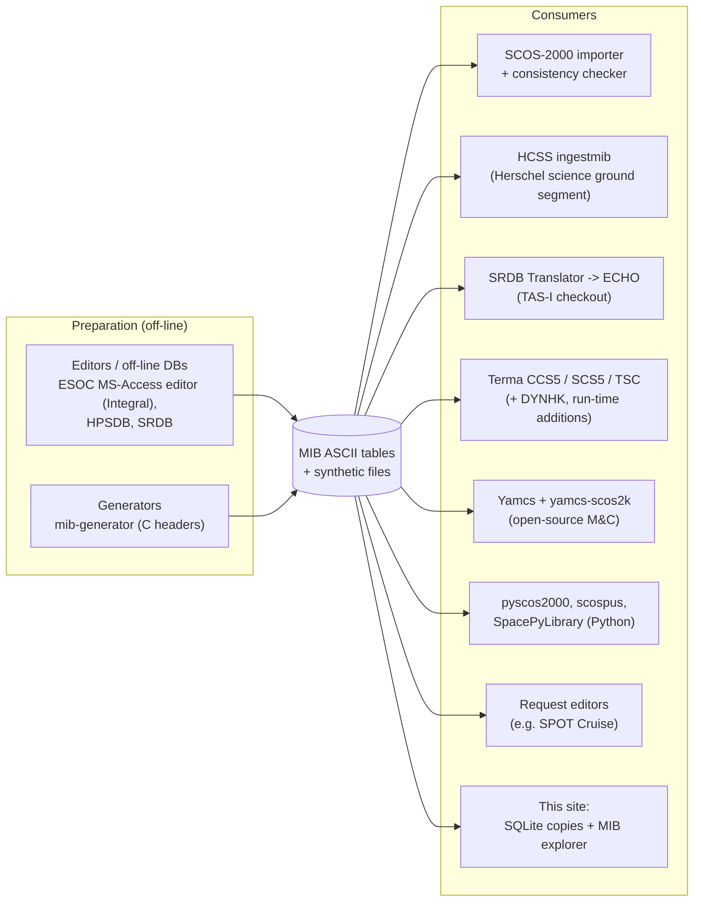

# MIB tooling and open-source libraries

The SCOS-2000 [Mission Information Base](index.md) (MIB) is exchanged as plain ASCII tables,
but nobody maintains 100,000 parameters in a text editor. Around the interface defined by the
Database Import ICD has grown a family of tools: off-line databases and editors that produce
the tables, importers and ingestion programs that check and load them, translators that feed
other control systems, and, more recently, open-source software: a complete mission control
framework (Yamcs) that can load a MIB through a plug-in, and small libraries that read MIBs and
the packets they describe. This page surveys the tools documented in this wiki's library, the
open-source packages published on PyPI and GitHub, and ends with the scripts that build this
site. For how these tools fit into the wider preparation of operations data, see
[Operations preparation](../scos2000/operations-preparation.md).



Landscape drawn from the sources cited in each section below.

## What the ICD expects of tools

The ICD sets the division of labour. It places no constraint on how the ASCII files are produced,
and expects that a relational database such as MS Access will usually be used.[^icd-21] The
off-line database is responsible for consistency. The SCOS-2000 importer checks only the most
dangerous problems, and from release 4.0 an off-line database consistency checker is delivered
with the main SCOS-2000 releases.[^icd-24]

The importer's own behaviour is precise:[^icd-24b][^icd-25]

* Every field is checked against its declared type and length. A field that is too long is
  truncated with a warning. A mandatory field left null is set to 0 or the empty string, with a
  warning.
* Relational integrity is checked. A record that refers to something missing, such as an unknown
  parameter, is not imported.
* Command and sequence parameter values are checked against their format. Invalid values become
  0, the empty string or `1970.001.00.00.00` for absolute times.
* All messages go to a log file that is overwritten at each import (`/home/sops1/Import.log`).
* Import options are a full import (optionally per domain) and a "check only" run that reports
  without changing any data. From release 5.0, sequences and displays are converted to XML files
  in the FARC instead (see [Display definitions](displays.md)).

The ICD also warns that the import default of a field is not the same thing as the default an
off-line editor may propose.[^icd-def] And it gives one example of logic that belongs in the
off-line "TM/TC database manager", not in SCOS-2000: for housekeeping packets defined on board
with [PUS service 3](../ecss/pus/st03-housekeeping.md), ESA missions typically define the packet
in the database first and generate the service 3 commands from it automatically.[^icd-s3]

## ESOC's MS-Access database editor and the HIFI evaluation

In April 2000, an ESA presentation of SCOS-2000 to the FIRST/Planck projects listed the elements
on offer: SCOS-2000, a router and a Tcl/Tk procedure automation tool reused from PROBA, and, as
additional elements, "Database Editors" based on MS Access from INTEGRAL.[^s2k-2000]

**Requirements.** HIFI wrote down what an instrument team needed from such an editor
(SRON-U/HIFI-SP-2000-2, August 2000). The MIB, "a set of more than 30 ASCII files", configures
SCOS-2000 and must evolve with the instrument during integration.[^hifi-req-intro] The
requirements group into five areas:[^hifi-req]

| Area | Requirements (summary) |
|---|---|
| Data content | All data needed to configure SCOS-2000; one table per SCOS-2000 file. |
| User interface | A datasheet per table with ICD field names and tip texts; complete records visible without scrolling; forms that follow the MIB structure (PCF with checks and calibrations, CPC with range sets and de-calibrations, PID with VPD and PLF, CCF with CDF, PTV and verification, CSF with its sub-tables, packet headers, parameter sets, and display layouts); pull-down menus for foreign keys. |
| Data checking | Unique keys enforced; update cascades so keys can be edited; no unintended delete cascades; validation rules for enumerated fields; mandatory fields enforced; ICD defaults used and never exported blank; a configurable whole-data-set checker; counters maintained or regenerated. |
| Groups of data | Data organised per instrument subsystem, enterable by subsystem engineers without SCOS-2000 knowledge, reportable per subsystem, and swappable when a subsystem model (QM, FM) changes. |
| Tools | Import, append, export and delete sets of SCOS-2000 files; an intuitive entry tool for parameter value sets. |

Its §3.4 names four groups of tables (parameter data, packet data, parameter sets and operator
data), while the table of its Annex A uses five: Operator (the six display tables), Packet,
Packet header, Parameter and Parameter set.[^hifi-req][^hifi-req-annex]

**Evaluation.** HIFI's evaluation report (SRON-U/HIFI/RP/2001-1 issue 2, April 2001) assessed
version 2.0 of the "SCOS-2000 Database Editing Subsystem", which the report also calls the
"Integral MS Access editor", and includes the replies of the editor's author.[^hifi-eval-intro]
The key findings:

| Topic | Finding | Author's reply or status |
|---|---|---|
| Polynomial calibrations (MCF) | No form at first; later a form, but the PCF/PLF form still could not select an MCF curve, and MCF had no primary key. | Not used by INTEGRAL; SCOS-2000 looks up `PCF_CURTX` first in CAF, then in MCF, so MCF numbers must not clash with CAF numbers. |
| Version table (VDF) | Filled automatically at export, but the new record was not exported; order of export and record creation reversed. | Populated at export; requires the PC date format DD/MM/YY. |
| Datasheets | Requirements 3.2.1–3.2.4 not implemented: only forms. | Tables now selectable in table view, considered dangerous for bulk maintenance. |
| Primary key of PID | Built from the first six fields instead of the first five. | Needed for INTEGRAL's satellite database. |
| Validation rules | Initially missing (e.g. `RAWFMT` accepted any value), later enforced. | – |
| Defaults | Empty fields with defaults exported empty. | To be investigated. |
| Consistency checks | Delivered as a separate consistency checker, "an impressive tool". | INTEGRAL database exceeded 870,000 populated fields; checking inside the editor would be too slow. |
| Counters | Maintaining master-detail counts is error-prone; the report questions why they exist. | Mostly useless for SCOS-2000, which uses none of them. |
| Surprises | `(PTC, PFC) = (5, 2)` exported as `(5, 3)`. | INTEGRAL-specific processing, to be removed. |
| Import | Imports replace rather than append; failing records not identified. | Single tables, sets or the whole database can be imported. |
| ICD conformance | `OCP_RLCHK` 6 characters instead of 8; limit values 10 instead of 14; several SPID-type fields cannot hold 10 digits; `css_mandisp`, `gpf_upun`, `spf_upun` wrongly mandatory. | – |

Findings from the report.[^hifi-eval-1][^hifi-eval-2][^hifi-eval-3][^hifi-eval-4] The author's
view of who may edit a database is telling: at ESOC only fully qualified database administrators
with control-system and spacecraft experience edit satellite databases.[^hifi-eval-3] The report
concludes that version 2 had improved greatly and was "a good tool to work with".[^hifi-eval-concl]

## Project databases: HPSDB and the satellite database

For Herschel/Planck, the Operations Interface Requirements Document required a single common
Satellite Database, delivered as Oracle data files with field-level change records.[^oird-sdb]
The Herschel/Planck System Database (HPSDB), documented by Alcatel Alenia Space, loaded
instrument and CCS MIB files and regenerated SCOS-2000 and CCS "bridge files". Its object model, naming, default values
and per-field processing rules are summarised on [Mission tailoring](tailoring.md#hpsdb-how-the-system-database-processed-mib-files).[^tn1060-scope]
Two of its design choices show what an engineering database adds to the bare ICD. Every item
carries a 64-character mnemonic, a 256-character long description and configuration data
(user, date, reason, source, validation dates), none of which SCOS-2000 can import. And an 8-bit
category flag per item selects which users (AIT, operations, software, flight dynamics) see it
when bridge files are generated.[^tn1060-g10]

ESA's SCOS-2000 based EGSE (EMCS, user manual issue 4.0 of 2004) worked the other way round. ESA
had started an Oracle-based repository for its space system model, but it was not available, so
users populated mission data directly in the ASCII files. SCOS-2000 loaded them into its internal MIB database, and the `mergeDATA` and
`setSCOSdata` facilities merged data sets and switched between them.[^emcs-repo][^emcs-merge]

## Ingestion into a science ground segment: HCSS

The Herschel Common Science System read MIBs with its own ingestion software, whose interface
and checks are defined by the HCSS MIB Clarification and Tailoring Note.[^hcss-intro] In practice
(SPIRE, 2007), `ingestmib` reads the directory named by the property `hcss.mib.datadir`, runs
semantic checks, writes `mibchecker.log`, and stores the MIB definitions in a Versant object
database under a user label. Afterwards `cusgui` loads the labelled MIB for the Common Uplink
System.[^spire-ingest] The checks it performs are listed on [Mission tailoring](tailoring.md#the-hcss-mib-clarification-and-tailoring-note).

## SRDB Translator: from SCOS-2000 to ECHO

An undated paper by Intecs and Thales Alenia Space Italia describes the **SRDB Translator**, which
imports a Satellite Reference Database (SRDB) in SCOS-2000 MIB form into ECHO, the TAS-I central
checkout (EGSE) system. The motivation is that SCOS-2000 had become the standard for ESA mission
control and often for EGSE, so the SRDB is "almost always" based on the SCOS-2000 run-time
database, while unit tests and AIV at TAS-I used ECHO and its own database.[^comi-intro] The
paper carries no date. Its most recent reference is ICD issue 6.1 of February 2006,[^comi-ref]
and the copy in the library is hosted on the same ESA Indico event (number 109) as the Terma
paper cited below, which is headed "SESP 2010".[^comi-host]

**Analysis.** The two databases cover similar entities (parameters, calibrations, checks,
packets, commands, verification), both built on PUS, but a one-to-one table mapping is "almost
inapplicable". For every item the authors distinguish data present in both, data present only in
the SRDB (adopted by extending ECHO, or ignored) and data that only ECHO needs (supplied
separately).[^comi-db] Two of their conversion tables:[^comi-rules]

| Topic | SCOS-2000 | ECHO | Rule |
|---|---|---|---|
| Verification checks vs telecommands | separate entities with a mapping table | checks as a detail table of each TC | duplicated for every linked TC |
| Verification stage | any stage of the execution profile | not applicable | stage not imported |
| Verification window | start time and interval in s | maximum time from TC emission in ms | (start + interval) × 1000 |
| Expected value | raw or engineering | engineering only | raw checks discarded |
| Numerical curve identifier | Char(10) | integer 1–9999 | mapping algorithm; original name kept in the description |
| Radix of raw values | decimal, octal, hex | decimal only | converted |
| Points per curve | unlimited | 2 to 1,000 | others not imported or truncated |
| Polynomial curve boundaries | not held | mandatory | ECHO relaxed |
| Logarithmic curves | supported | not handled | ECHO extended |
| Curves per parameter | unlimited | 4 | extended to 99 |

**Implementation.** The translator is a utility of the ECHO Database Manager (MTGP) on MS SQL
Server, compliant with SCOS-2000 ICD issue 6.1. In a first step it loads the SCOS-2000 tables
unchanged into dedicated tables. In a second step stored procedures transform them into ECHO
tables, either directly or as a file for later import, and it can merge the result with EGSE-local
objects. A log lists the outcome per object.[^comi-impl]

**Use and limits.** It was first built for Galileo GIOVE-B (an SRDB delivered as a single MS
Access 2000 file), extended for Sentinel-1, and used for BepiColombo on-board computer and SSMM
databases of about 10,000 records each.[^comi-apps] Because the first step expects exactly the
columns of its ICD issue, BepiColombo databases made to an earlier ICD issue had to be adjusted
to add the missing columns before import, and every project's customisations require new analysis. The authors
call for a standard XML-based exchange language.[^comi-limits][^comi-future] CCSDS defines
such a language, [XTCE](../ccsds/xtce.md); the paper does not mention it.

## Terma CCS5, SCS5 and TSC

Terma's checkout and control products read SCOS-2000 MIBs natively. A 2010 paper explains the
choice: building a new monitoring and control system from scratch was attractive only if users
kept their test language and database interfaces. The MIB interface, it says, "while not
perfectly normalized, and not always perfectly designed, is nevertheless well known, relatively
well described, and well understood".[^armitage]

The 2024 presentation and the data sheet list the MIB-related features:[^terma-std][^terma-ds]

* the SCOS-2000 MIB data model "6.9+…7.2" (data sheet: "ICD 6.9 extended"), with unlimited field
  lengths;
* variable packets and parameters supported globally, deduced parameters in TM and TC,
  configurable length fields, both endianities, `VPD_CHOICE` and dynamic housekeeping definitions;
* different synthetic (derived parameter) languages;
* dropping and loading several databases without restart, with a clean separation of data from
  different suppliers (platform, payloads, instruments, EGSE), and an online MIB browser with
  search, filter and patch features;[^terma-merge]
* all tables accessible from the TOPE procedure language; TC sequence tables not supported (TOPE
  or command stack files are used instead).

### Dynamic housekeeping definitions (DYNHK)

The "dynamic housekeeping definitions" in that list are described in a Terma B.V. paper by
P. Kazmirchuk, "Managing Telemetry Definitions on the Fly". The paper shows what a checkout
system can do with a MIB *at run time*.[^kaz-abs] An on-board data pool can hold tens or even
hundreds of thousands of parameters. During integration, engineers use telecommands of
[PUS service 3](../ecss/pus/st03-housekeeping.md) to make the on-board computer generate new
housekeeping or diagnostic packets that no one defined in advance. A central checkout system
(CCS) identifies packets only through its reference database, so without help these packets
arrive as unknown. Until then, engineers had to write static TM definitions by hand.[^kaz-intro]
DYNHK closes that gap. It watches the uplinked service 3 requests and writes the matching MIB
rows itself.

**What CCS5 provides.** CCS5 uses the MIB as its reference-database format and TOPE, a
Tcl-based language, for automated procedures. The paper says both are backward compatible with
SCOS-2000. When a test session starts, CCS5 loads the MIB tables into memory. TOPE can then read
every table and write some tables and columns. CCS5 can also merge several MIBs, for example
from different equipment suppliers, and adds a field "Source" that records which MIB each row
came from.[^kaz-ccs5]

**The PUS requests it reads.** The paper uses the PUS-A names (its reference is
ECSS-E-70-41A): TC(3,1) and TC(3,2) define a new housekeeping or diagnostic report, TC(3,3) and
TC(3,4) clear definitions, TC(3,5) enables generation, and TM(3,25) and TM(3,26) are the
reports. PUS-C keeps these subtype numbers, under names such as "create a housekeeping parameter
report structure" for TC[3,1].[^pusc-s3] The
application data of TC(3,1) and TC(3,2) carries the structure identifier (SID), a collection
interval in units of the default housekeeping scheduling rate, and the list of on-board
parameter IDs with their counters. The SID, together with the APID and the subtype, identifies a
TM packet definition uniquely. The requests therefore carry enough information to build the
definition.[^kaz-s3]

```mermaid
sequenceDiagram
    participant Op as Test operator
    participant CCS as CCS5 (server, clients, IFMGR)
    participant Dyn as DynHkMonitor.tcl (DYNHK)
    participant OBC as On-board computer
    Op->>OBC: TC(3,1) or TC(3,2): SID, interval, parameter IDs
    OBC-->>CCS: completion report (e.g. PUS service 1)
    CCS->>Dyn: verified TC and its parameters
    Dyn->>Dyn: derive PID and VPD rows, allocate a new SPID
    Dyn->>CCS: CCS5::remote: add rows to every in-memory MIB (one atomic call)
    Op->>OBC: TC(3,5) enable report generation
    OBC-->>CCS: TM(3,25) or TM(3,26), processed like a static packet
    Op->>OBC: later TC(3,3) or TC(3,4): clear SID
    Dyn->>CCS: set PID_VALID false; later packets of that SID are archived as unknown
```

*This wiki's drawing of the paper's Fig. 1 workflow and the text around it.*[^kaz-flow]

The component is a TOPE script running on the CCS server console. Its authors had to change the
core C++ modules so that TM packets can be defined without disturbing ongoing monitoring and
control, generate MIB rows from PUS request parameters, and distribute the new definitions to
all workstations in time.[^kaz-ccs5] A redefinition of a SID that already exists disables the old
definition, adds one with a new SPID and logs a message. As a result, SPID and TPSD values are
never reused within a session.[^kaz-flow]

**Mapping to the MIB tables.** CCS5 identifies TM packets in the same steps as SCOS-2000: APID,
then service type and subtype, then the [PIC](tables/pic.md) entry that locates the extra
identification fields PI1 and PI2, then the [PID](tables/pid.md) entry that yields the SPID, and
finally the [PLF](tables/plf.md) and/or [VPD](tables/vpd.md) rows that list the
parameters.[^kaz-match] (See [Monitoring in the MIB](monitoring.md) for the full procedure.) DYNHK
writes VPD rather than PLF rows. The service 3 request lists parameter IDs but no offsets, and VPD
normally packs parameters back to back, which matches the request. VPD also allows
variable-length strings, and CCS5 archives every VPD sample of a packet, so retrieval does not
depend on when the packet was (re)defined.[^kaz-match]

| PID field | Value written by DynHkMonitor |
|---|---|
| `PID_TYPE` | 3 |
| `PID_STYPE` | 25 (housekeeping) or 26 (diagnostic) |
| `PID_APID` | from a configured mapping of TC APID to TM APID |
| `PID_PI1_VAL`, `PID_PI2_VAL` | derived from the SID, as the PIC entry dictates |
| `PID_SPID` | allocated from a configurable offset clear of the static definitions, incremented for each new request |
| `PID_DESCR` | generated text, for example "Dyn HK" followed by the SID |
| `PID_TPSD` | equal to the SPID |
| `PID_DFHSIZE` | derived from PIC: the start reference for variable parameters |
| `PID_TIME` | `Y` (on-board time assumed in the packet header) |
| `PID_INTER` | computed from the collection interval |
| `PID_CHECK` | 1 (packet error control assumed present) |
| other fields | blank, so the ICD defaults apply |
| `PID_VALID` | set to false when TC(3,3) or TC(3,4) clears the SID |

Fields from the paper's "PID Table" section.[^kaz-pid]

In the simple case every parameter is sampled once. Each one gets a VPD row with
`VPD_TPSD` = `PID_TPSD`, `VPD_POS` = 1 to NPAR, and `VPD_NAME` = the [PCF](tables/pcf.md) name
whose `PCF_PID` equals the on-board parameter ID in the request. When the request's NFA indicator
is 1, super-commutated parameters follow. DYNHK then adds a group-repeater row with
`VPD_NAME` "REPEATER", `VPD_GRPSIZE` = NPAR2 (parameters in the group) and `VPD_FIXREP` = NREP
(samples).[^kaz-vpd]

Three gaps between the PUS request and the MIB need configuration. The collection interval comes
in scheduling-rate units, but CCS5 needs milliseconds to expire stale parameters, so a setting
`schedulingRate` supplies the conversion. The TM APID cannot be derived from the TC APID, so a
mapping is configured. And because the MIB ICD does not refer to the SID directly, PIC rows for
the new packets must exist beforehand. CCS5 uses them to split the SID into PI1 and PI2 (or use
it as PI1 alone) and to compute `PID_DFHSIZE`.[^kaz-match][^kaz-pic]

**Persistence.** The added rows live only in memory and are lost when the MIB is reloaded. They
carry the Source value "DYNHK", so they can be saved as separate MIB files and merged into the
next session. Whether that is wise depends on whether the on-board software keeps its dynamic
definitions over a reboot, for example in EEPROM, so both saving and reloading are
optional.[^kaz-persist] The paper ends by noting that PUS-C (2016) has standardised many
service 3 subservices that the implementation then handled under mission-specific
numbers.[^kaz-concl]

!!! warning "Inference: date of the paper"
    The paper carries no date. It calls ECSS-E-ST-70-41C (2016) "published last year" and cites
    ICD issue 6.9 (2010), which suggests 2017. It is hosted on ESA Indico event 180, which also
    hosts a paper by F. Trifin and A. Walsh whose header names the Workshop on Simulation and EGSE
    for Space Programmes (SESP), 28–30 March 2017, at ESA-ESTEC.[^kaz-concl][^kaz-ref][^trifin-hdr]
    That the Kazmirchuk paper was presented at SESP 2017 is this wiki's inference from the shared
    event; the paper itself does not say so.

**The Solar Orbiter MIB for comparison.** The public 2025 Solar Orbiter MIB takes the static
route that DYNHK is meant to complement. It defines 288 TM(3,25) and 89 TM(3,26) packets on 76
APIDs. All 377 are fixed packets (`PID_TPSD` = −1, so their parameters are located through PLF),
with `PID_DFHSIZE` 16, `PID_TIME` `Y` and `PID_CHECK` 0. Their PIC entries place PI1, the SID, at
octet 16 with a width of 8 bits. On the command side the MIB holds 82 TC(3,1) and 77 TC(3,2)
definitions. Thirteen are generic commands whose SID is an editable element: twelve "Define New …
Parameter Report" commands, six per subtype, and the instrument command ZIT00301 "Def New HK Par.
Rep.". The other 146 are predefined report definitions such as "Define HK: AOCS Dynamics FAST",
each with a fixed SID that equals the PI1 value of a TM(3,25) or TM(3,26) packet already in PID.
Example: command [ZCA2Z05B](../explorer/index.md#/solo/command/ZCA2Z05B) (APID 188) fixes SID 77,
and SPID [29530](../explorer/index.md#/solo/packet/29530) "AOCS Dynamics FAST" is TM(3,25) with
PI1 = 77 on APID 180.[^mib]

!!! warning "Inference"
    A DYNHK-style tool on this MIB would need its SPID offset above the existing range (the
    PID table's SPIDs run from 101 to 1,000,006) and could reuse the existing PIC rows for
    (3,25) and (3,26). In ICD terms, `PID_CHECK` 0 means that the packetiser does not check the
    packet error control field, either because the packet has none or because the check is
    disabled. The paper's choice of 1 enables the CRC check. Which of the two applies to Solar
    Orbiter housekeeping packets is not stated in the available sources.[^icd-pidcheck]

??? example "SQL used"
    ```sql
    -- solo-2025-09-16.sqlite
    SELECT PID_STYPE, COUNT(*), SUM(PID_TPSD <> '-1') FROM pid WHERE PID_TYPE='3' GROUP BY 1;
    SELECT PID_DFHSIZE, PID_TIME, PID_CHECK, COUNT(*) FROM pid
      WHERE PID_TYPE='3' AND PID_STYPE IN ('25','26') GROUP BY 1,2,3;
    SELECT COUNT(DISTINCT PID_APID) FROM pid WHERE PID_TYPE='3' AND PID_STYPE IN ('25','26');
    SELECT * FROM pic WHERE PIC_TYPE='3';
    SELECT MIN(CAST(PID_SPID AS INT)), MAX(CAST(PID_SPID AS INT)) FROM pid;
    SELECT CASE WHEN CCF_DESCR LIKE 'Define New%' THEN 'generic' ELSE 'predefined' END,
           CCF_STYPE, COUNT(*)
      FROM ccf WHERE CCF_TYPE='3' AND CCF_STYPE IN ('1','2') GROUP BY 1,2;
    -- element at bit 0 (the SID) of each TC(3,1)/TC(3,2): E = editable, A/F = fixed
    SELECT d.CDF_ELTYPE, COUNT(*) FROM ccf f JOIN cdf d ON d.CDF_CNAME=f.CCF_CNAME
     WHERE f.CCF_TYPE='3' AND f.CCF_STYPE IN ('1','2') AND CAST(d.CDF_BIT AS INT)=0 GROUP BY 1;
    -- each fixed SID (CDF_VALUE, hexadecimal for A, decimal for F) was then looked up in
    -- pid.PID_PI1_VAL with PID_STYPE 25 (for TC(3,1)) or 26 (for TC(3,2)): 146 of 146 found
    SELECT * FROM pid WHERE PID_TYPE='3' AND PID_STYPE='25' AND PID_PI1_VAL='77';
    ```

!!! note "Terma Data Base Manager"
    A separate Terma product called "Data Base Manager" (DBM) is not described in any document of
    this wiki's library. Its features, licence and version are therefore not stated in the
    available sources.

## Yamcs and the yamcs-scos2k MIB loader

**Yamcs** is an open-source mission control framework. Its server manual (release
5.14.1-SNAPSHOT, copyright 2026) is published by Space Applications Services NV/SA, Belgium, with
Aerospace Applications North America in Houston.[^ym-front] GitHub shows the `yamcs/yamcs`
repository under the AGPL-3.0 licence.[^gh-yamcs] Yamcs follows a traditional monitoring and
control model. Parameters arrive in groups, usually binary packets, and are checked against limits
that can depend on context. Commands consist of a name and arguments, are gated by transmission
constraints and significance, and pass through verification stages.[^ym-model] The server is a
single Java process. Data links connect to the target system, preprocessors and postprocessors
handle packet details that the database does not describe (such as checksums), and processors
apply the **Mission Database (MDB)** to turn packets into parameters and commands into
packets.[^ym-arch]

### The Mission Database and its loaders

The MDB uses terminology "very close" to [XTCE](../ccsds/xtce.md): space systems, containers,
parameters, commands and algorithms, with space systems named by UNIX-like paths such as
`/BogusSAT/SC001`.[^ym-mdb] Yamcs builds the MDB at start-up from a configurable **loader tree**
in the instance configuration. Each loader fills one space system and can have sub-loaders for
its children, and loaders of different types can be mixed as long as their content maps onto
Yamcs' internal, XTCE-based model. The result is cached on disk.[^ym-loaders] The manual
documents three built-in loaders:[^ym-xtce][^ym-sheet][^ym-loaders]

| Loader type | Input | Notes |
|---|---|---|
| `xtce` | XTCE XML file(s) (`file` or `fileset`) | tolerant reader: unknown tags ignored, and it "strives to be backward compatible" with XTCE 1.0 and 1.1; the unsupported XTCE features are listed on the [XTCE page](../ccsds/xtce.md#implementations-and-what-they-support) |
| `sheet` | Excel 97-2003 `.xls` workbook (`.xlsx` not supported) | sheets General, ChangeLog, DataTypes, Parameters, DerivedParameters, LocalParameters, Containers, Algorithms, Alarms, Commands, CommandOptions, CommandVerification and Calibration; format versions 5.3 to 7.1 |
| `emptyNode` | none | creates an empty space-system node to hang sub-loaders on |

Two details matter for anyone coming from the MIB. First, in Yamcs a calibrator works in
opposite directions for the two kinds of type: raw to engineering for parameters, engineering to
raw for arguments. A parameter's calibration cannot simply be reused for a command argument,
just as the MIB keeps [CAF](tables/caf.md) and [CCA](tables/cca.md) separate.[^ym-types] Second,
the MDB is normally read-only. Since version 5.8.8, sub-trees can be declared writable, so that
parameters and parameter types can be added at run time and persisted in XTCE form.[^ym-mdb] A
note at the end of the same chapter still says that Yamcs "does not persist TM/TC definitions"
and has no import function. The manual does not reconcile the two statements.[^ym-loaders]

### yamcs-scos2k

The SCOS-2000 loader is a separate plug-in, **yamcs-scos2k**. It is not described in the server
manual beyond one mention, so the facts below come from its GitHub page, retrieved on
2026-11-12.[^gh-scos2k] The repository shows the AGPL-3.0 licence and 96 commits, no published
releases and no description line. The README states that the test MIB comes from another project
and cannot be published, so the tests live in a private repository. It names no ICD issue.

| Item | What the README says |
|---|---|
| Installation | a Maven dependency added to the Yamcs project's `pom.xml` |
| MIB loader | MDB loader type `org.yamcs.scos2k.MibLoader` |
| `path` | directory of the ASCII MIB files |
| `epoch` | time epoch, for example `1970-01-01T00:00:00` |
| `TC.vblParamLengthBytes` | size in bytes of the length tag in front of variable-length strings and octet strings in commands; default 0 |
| `TM.vblParamLengthBytes` | the same for telemetry (example value 1) |
| `TM.typeOffset`, `TM.subTypeOffset` | byte offsets of the PUS service type and subtype in TM packets (example values 7 and 8) |
| Displays | a service `org.yamcs.scos2k.MibDisplayLoader`, with Yamcs' `ParameterListService`, loads the MIB's alphanumeric displays as Yamcs parameter lists. These can be edited at run time but are lost at restart |
| Not supported | delta checks (`OCP_TYPE` = D), event generation (`OCP_TYPE` = E), status consistency checks (`OCP_TYPE` = C with `PCF_USCON` = Y), command-ID arguments (`CPC_CATEG` = A, loaded as a binary argument instead), command stacks |
| Renaming | duplicate command argument names become `arg_<n>`, because neither Yamcs nor XTCE allows duplicates |

The server manual adds one detail. Yamcs' PUS command postprocessor can treat a binary argument
as an **embedded TC packet**. It fills in the packet's length and sequence count and optionally
appends a checksum, as needed for TC(11,4) schedule insertions or TC(22,4) activities. The
manual says yamcs-scos2k marks command parameters of (PTC, PFC) = (12, 1) this way.[^ym-embedded]
PTC 12 is the PUS-C "packet" type, PFC 1 being a TC packet.[^pusc-7313] It is not in the ICD 7.0
type list, which jumps from PTC 11 to PTC 13.[^icd-appa] There, TC packets are carried instead by
command-ID parameters of type (7, 0), which SCOS-2000 encodes from the raw data of a specified
command.[^icd-cmdid] See
[MIB parameter types](parameter-types.md).

!!! warning "Inference: the variable-length options"
    Two sources explain the two `vblParamLengthBytes` options. The ICD says that from
    SCOS-2000 R4.0 the PUS length field in front of variable-length octet and character strings
    in commands can be switched on or off by configuration.[^icd-vbl] The Yamcs manual says that
    for command arguments only it accepts a length tag of 0 bits, which XTCE forbids, "for
    compatibility with other systems (e.g. SCOS-2k)".[^ym-scos2k-str] SCOS-2000 itself does not
    decode variable-length strings in telemetry,[^icd-vbl] so the TM option serves packets that
    SCOS-2000 would need special processing for. A default of 0 bytes in
    the loader therefore matches a SCOS-2000 configuration without the length prefix. The
    example values 7 and 8 for the type and subtype offsets match the PUS TM layout: a 6-octet
    primary header followed by one secondary-header octet before the service type.

**What the unsupported features would skip in the public databases.** The counts below show how
much of each public MIB copy falls into the README's unsupported categories:

| Database | OCP rows | `OCP_TYPE` D | `OCP_TYPE` E | `OCP_TYPE` C | `PCF_USCON` = Y | CPC rows | `CPC_CATEG` A | CSF rows |
|---|---|---|---|---|---|---|---|---|
| Solar Orbiter 2025 | 7,369 | 105 | 0 | 15 | 15 | 7,155 | 2 | 3,404 |
| Solar Orbiter 2020 | 4,686 | 102 | 0 | 13 | 13 | 6,947 | 2 | 2,701 |
| SWA (2021 ASCII set) | 326 | 0 | 0 | 0 | 0 | 531 | 0 | 0 |
| SWA v6.5.0 | 325 | 0 | 0 | 0 | 0 | 538 | 0 | 0 |
| STIX 2.26.38 | 32 | 0 | 0 | 0 | 0 | 669 | 0 | 0 |

Row counts from this wiki's queries.[^mib][^mib2020][^swa][^swa65][^stix]

In the 2025 Solar Orbiter MIB the two command-ID arguments are PCD0B044 "Complete TC packet" and
PCD13013 "TC to send upon event". They are used by 24 commands: one TC(11,4)
([ZCD00B04](../explorer/index.md#/solo/command/ZCD00B04), "Insert Telecommands in Command
Schedule"), one TC(11,132) and 22 TC(19,1) event-action definitions. Both are of type (7, 0), as
the ICD requires.[^mib][^icd-cmdid] The README says yamcs-scos2k loads such arguments as binary
arguments.[^gh-scos2k] The loader's source settles how this relates to the embedded-TC marker: a
`CPC_CATEG` A parameter becomes a plain `BinaryArgumentType`, and only a parameter of PTC 12 with
PFC 1 receives the embedded-TC ancillary data.[^gh-scos2k-src] No command in that MIB has two
editable or fixed elements with the same parameter name, so the `arg_<n>` renaming would not
occur.[^mib]

!!! warning "Inference"
    Loaded with yamcs-scos2k, these 24 Solar Orbiter commands would therefore take their nested
    telecommand as raw bytes, without the automatic length, sequence count and checksum that the
    PUS postprocessor applies to embedded TC packets, and without SCOS-2000's encoding of a named
    command into the argument.

The 15 status
consistency checks belong to parameters such as
[NCDT02A0](../explorer/index.md#/solo/param/NCDT02A0). The instrument databases
([SWA](../missions/solar-orbiter/swa.md), [STIX](../missions/solar-orbiter/stix.md))
use none of the unsupported features.

??? example "SQL used"
    ```sql
    -- run on solo-2025-09-16, solo-2020-04-16, swa-idb, swa-idb-v6.5.0, stix-idb-2.26.38
    SELECT (SELECT COUNT(*) FROM ocp),
           (SELECT COUNT(*) FROM ocp WHERE OCP_TYPE='D'),
           (SELECT COUNT(*) FROM ocp WHERE OCP_TYPE='E'),
           (SELECT COUNT(*) FROM ocp WHERE OCP_TYPE='C'),
           (SELECT COUNT(*) FROM pcf WHERE PCF_USCON='Y'),
           (SELECT COUNT(*) FROM cpc),
           (SELECT COUNT(*) FROM cpc WHERE CPC_CATEG='A'),
           (SELECT COUNT(*) FROM csf);
    -- solo-2025-09-16 only
    SELECT CPC_NAME, CPC_DESCR, CPC_PTC, CPC_PFC FROM cpc WHERE CPC_CATEG='A';
    SELECT f.CCF_TYPE||','||f.CCF_STYPE, COUNT(DISTINCT c.CDF_CNAME)
      FROM cdf c JOIN ccf f ON f.CCF_CNAME=c.CDF_CNAME
     WHERE c.CDF_PNAME IN (SELECT CPC_NAME FROM cpc WHERE CPC_CATEG='A') GROUP BY 1;
    SELECT COUNT(*) FROM (SELECT CDF_CNAME, CDF_PNAME, COUNT(*) n FROM cdf
     WHERE CDF_ELTYPE IN ('E','F') AND CDF_PNAME<>'' GROUP BY 1,2 HAVING n>1);
    SELECT OCP_NAME FROM ocp WHERE OCP_TYPE='C';
    ```

### PUS support in Yamcs

The data links that carry MIB-described packets need Yamcs' PUS preprocessor and postprocessor.
They are configured separately from the MDB:[^ym-pus-tm][^ym-pus-tc]

| Component | Function | Main options (defaults) |
|---|---|---|
| `PusPacketPreprocessor` (TM) | checks and identifies PUS packets per ECSS-E-ST-70-41C and sets the generation time | `errorDetection` (16-SUM, CRC-16-CCIIT with initial value 0xFFFF, ISO-16 or NONE); `timeEncoding` (default CUC from the GPS epoch); `pktTimeOffset` (13); `timePktTimeOffset` for time packets without secondary header (7); `tcoService` and `performTimeCorrelation` for ground-side time correlation |
| `PusCommandPostprocessor` (TC) | sets the CCSDS length and per-APID sequence count, optionally appends a checksum | `errorDetection`; `seqCounterName` for counters shared between links; `pus11` options that wrap a command into TC(11,4) for time-tagged release, with sub-schedule and group IDs; embedded-TC handling |

For time, the manual names three strategies. The third, maintaining a correlation on the ground,
is the one it attributes to the ESA PUS; it is done with Yamcs' time correlation service (see
[Time correlation in SCOS-2000](../scos2000/time-correlation.md)).[^ym-gentime]

## Request editors: SPOT Cruise

MIBs are also read by tools that prepare operations requests. Starion's web-based SPOT Cruise
framework at ESAC, built for BepiColombo and adapted for JUICE, edits payload operations requests
(POR/PDOR) in the ESOC command request file (CRF) XML format. It manages MIB updates and checks
every request against the applicable MIB, which the paper expands as "Mission Information
Database".[^spot]

## Open-source libraries

Five small open-source packages on the Python Package Index (PyPI) deal with SCOS-2000 data. Of
these, only mib-generator has documentation in this wiki's library (its Read the Docs manual,
added in round 2). The facts in the table come from each package's PyPI JSON record
(`https://pypi.org/pypi/<name>/json`), retrieved by this wiki on 2026-11-12, and are flagged as
such. A sixth SCOS-2000 library, SpacePyLibrary, is not on PyPI and is described
[below](#spacepylibrary), followed by generic CCSDS and XTCE packages.

| Package | Purpose (PyPI summary) | Latest version (date) | First release on PyPI | Licence | Python | Organisation (from metadata) | Source |
|---|---|---|---|---|---|---|---|
| [pyscos2000](https://pypi.org/project/pyscos2000/) | "Python SCOS-2000 parsing and checking" | 0.3.0 (2023-05-04) | 0.1.0 (2023-02-23) | MIT | ≥ 3.6 | IRF (irf.se) | [gitlab.irf.se/irf/pyscos2000](https://gitlab.irf.se/irf/pyscos2000) |
| [scospus](https://pypi.org/project/scospus/) | "PUS packet parsing with SCOS backing" | 0.2.0 (2023-06-13) | 0.1.0 (2023-02-23) | MIT | ≥ 3.6 | IRF (irf.se) | [gitlab.irf.se/irf/scospus](https://gitlab.irf.se/irf/scospus) |
| [SCOSpy](https://pypi.org/project/SCOSpy/) | "Python library to read the SCOS-2000 header" | 0.5.0 (2025-11-20) | 0.2.1 (2020-07-09) | GNU GPL v3 | ≥ 3.11 | INAF (inaf.it) | [github.com/RomoloPoliti-INAF/SCOSpy](https://github.com/RomoloPoliti-INAF/SCOSpy) |
| [mib-generator](https://pypi.org/project/mib-generator/) | "Generator of SCOS 2000 MIB databases." | 0.1.3 (2023-09-11) | 0.1.1 (2023-09-03) | MIT | ≥ 3.10 | individual author | [github.com/vachaj11/MIB-generator](https://github.com/vachaj11/MIB-generator) |
| [edds_process](https://pypi.org/project/edds-process/) | "Package to process data from the EGOS Data Dissemination System (EDDS) of ESA" | 0.11.0 (2026-10-01) | 0.9.1 (2022-11-23) | CeCILL-2.1 | ≥ 3.9, < 4 | Observatoire de Paris (obspm.fr) | [gitlab.obspm.fr/ROC_PUBLIC/edds_process](https://gitlab.obspm.fr/ROC_PUBLIC/edds_process) |

All values from the PyPI JSON API.[^pypi] Dates are the upload times of the first file of each
release. For SCOSpy the licence field reads "GNU GPL ver3" and the classifier "GNU General Public
License v3 (GPLv3)". For edds_process the licence is given only as the SPDX expression
`CECILL-2.1`, the French CeCILL free-software licence, not MIT.[^pypi]

### pyscos2000

pyscos2000 parses and checks the ASCII tables of a SCOS-2000 MIB. Its README shows the basic
use: `pyscos2000.SCOS('./ASCII')` loads a MIB directory of `.dat` files, every table becomes an
attribute (for example `scos.plf`), and its records are in `rows`. The README names no ICD
issue and documents no writer.[^pypi] The library's API documentation (outside the library,
retrieved 2026-11-12) adds the rest:[^irf-doc]

* Its `scos2000` module defines the table schemas, "Based on EGOS-MCS-S2K-ICD-0001 issue
  7.2-FINAL (2019-12-13)" (see [ICD history](icd-history.md#issue-72-2019)), with one class per
  table for 36 tables (`CAFTable` … `VPDTable`, including `CURTable`, `LGFTable` and `DSTTable`)
  and a `ZipArchiveTextReader` for reading the files from a zip archive.
* The same module provides consistency checkers: bit offsets in the range 0–7, field lengths,
  forbidden characters in key columns, CAF entries without the right number of CAP rows, CAP
  rows without a CAF entry, unused CAF, TXF and MCF definitions, the PLF time delay range,
  constants (`PCF_NATUR = C`) without `PCF_PARVAL`, and validity parameter definitions. The
  `checker` module is a framework for writing further checkers.
* A `synthetic` module has classes for synthetic parameter definitions and instances, including
  a `DynamicSyntheticParameter` for `PCF_NATUR = D`.
* A `browser` module is described as a "very simple tool to browse a SCOS-2000 database", with
  `main()` and `parse_args()` entry points.

This wiki takes its SQLite column names from pyscos2000's table schemas, which were introspected
into the file `tools/pyscos2000_schema_icd72.json`. For each of 36 tables the file records the
schema class, its docstring, and per column the name, type, key flag, optionality and default.[^site-schema]
The 17 ICD 7.0 tables that pyscos2000 does not model are the three group tables, the eight
display tables, the verification tables CVS, CVE and CVP, and CPS, PVS and PSM. Four column names
are spelled differently from ICD 7.0, and one column is inserted:[^site-cols][^icd70-names]

| Table | Position | pyscos2000 | ICD 7.0 |
|---|---|---|---|
| `cpc` | 1 | `CPC_NAME` | `CPC_PNAME` |
| `cpc` | 15 | `CPC_OBTIP` | `CPC_OBTID` |
| `cpc` | 16 | `CPC_DESCR2` (new; `CPC_ENDIAN` moves to 17) | `CPC_ENDIAN` |
| `css` | 17 | `CSS_STATPTV` | `CSS_STAPTV` |
| `vdf` | 3 | `VDF_DOMAIN` | `VDF_DOMAINID` |

The project file also lists `ccf` field 21 (`CCF_SUBSCHEDID` against "`CCF_SUBSCHED`"), but that
is a text-extraction artefact: the ICD 7.0 field table wraps the name over two lines as
"CCF_SUBSCHED ID", and the ICD's own `csf` description calls the field `CCF_SUBSCHEDID`, the
spelling pyscos2000 also uses.[^icd70-names]

### scospus

scospus parses PUS packets using a SCOS-2000 MIB as its packet description, and depends on
pyscos2000. Its PyPI record carries no README text, so which services it decodes and how it
applies the PLF and VPD are not stated in the sources consulted.[^pypi]

### SCOSpy

SCOSpy decodes the **SCOS-2000 packet header**, the internal header that SCOS-2000 puts in front
of each stored TM or TC packet in its archive (see [Mission archives](../scos2000/archives.md)),
not the CCSDS header. From a hexadecimal string, `SCOS(packet)` returns the common packet header,
a TM or TC packet header and the data. According to the README:[^pypi]

* Common header fields include CTree, AccessF, SimFlag, FilingTime, CreationTime, CreateID, SCID,
  GSID, PSize, PType, Version, FilingFlag, DistFlag, TSPolicy, TQ, StreamID, SeqCounter, SPID and
  MissionID.
* TM packet header fields: TPSD, RouteID, PUSAPID, PUSSSC, PUSService, PUSSubService.
* TC packet header fields include UplinkTime, ExecTime, LUTime, RequestID, the PUS APID,
  sequence count, service, subservice and acknowledgement flags, and source host and type.
* The event packet header is not implemented. Only packet types 1 (TM) and 2 (TC) are supported.
* Lookup tables are built in for BepiColombo (mission ID 816, spacecraft IDs 816 and 817). The
  README shows how to add JUICE (ID 844) by extending two dictionaries.

The presence of `SPID` and `TPSD` in the TM header is what ties archived packets to the MIB: they
are the processing keys from the [PID](tables/pid.md) table (see
[Monitoring in the MIB](monitoring.md)).

### mib-generator

mib-generator builds SCOS-2000 MIB databases from C header files. Its README describes "basic
abilities" for parsing C syntax, interpreting declarations that follow an expected structure of
TM and TC packets, and creating the corresponding MIB. It names neither a mission nor the tables
it writes, and refers to separate online documentation.[^pypi] That documentation ("MIB
Generator, Release 0.1", Josef Vácha, 15 September 2023) fills in the detail. It describes the
tool as a set of Python scripts, run mainly from the terminal as `mib-gen` (with a PySide6 GUI,
`mib-gen-gui`), that assumes one specific formatting of the input C files, and as "under active
development".[^mg-intro][^mg-usage]

**Inputs.** Four C files are expected:[^mg-about]

| File | Expected content |
|---|---|
| TM `.h` | structure of the TM packets, their entries and calibrations |
| TM `.c` | the list of TM packet types: an `apidNum` array mapping APID names to numbers, and a `tmProperties` array giving each packet type its APID, service type and subtype |
| TC `.h` | structure of the commands and of the TC packet headers, decalibrations and verifications |
| TcTm `.h` | definitions shared by TM and TC, such as common identifier structures and enums |

**Annotations.** The generator evaluates `#define` macros and `enum` constants into one
dictionary, then reads C comments of the form `/*{ … }*/` as json5 dictionaries. A comment in
front of a `struct` declares a packet: `pack_type` links it to the type, subtype and APID in the
`.c` file, `spid` and `text_id` give its SPID and MIB name, and `base_par_index` with `prefix`
names its parameters. In the documentation's example, prefix "LWT" and base index 59200 give the
third entry the name LWT59202. Comments on the fields mark the SID (`sid`, with `const_value`),
the SCOS type (`type`, for example `CUCTIME4_3`), a variable-packet role (`vpd`: `fixed`, `count`
or `data`) and a calibration (`cal`). Bit-field widths such as `uint8_t compression:5` are
honoured, and nested structs are expanded in place.[^mg-tm] Calibrations are declared in comments
keyed `mcf` (polynomial coefficients), `lgf` (logarithmic), `text_cal` or an annotated `enum`
(textual) and `num_cal` (point pairs). Commands use `service` and `sub`, `cdf: count|data` for
repeated groups, `min`/`max` for range checks, `default`, `const_value` for fixed areas, `enum`
for a decalibration, and `cvs` for verification stages. Stages are declared in stand-alone
comments (`cvs_def`, `cvs_type`, `cvs_interval`, `default`), and the sample code notes that
`CVS_SOURCE` is always R (report-based) and the start time 0.[^mg-tc]

**Outputs.** The construction classes documented in the API chapters produce rows for 25
tables:[^mg-tables]

| Object | MIB tables |
|---|---|
| TM packet | [pid](tables/pid.md), [pic](tables/pic.md), [tpcf](tables/tpcf.md), [pcf](tables/pcf.md), [plf](tables/plf.md), [cur](tables/cur.md), [vpd](tables/vpd.md) |
| TC header | [tcp](tables/tcp.md), [pcpc](tables/pcpc.md), [pcdf](tables/pcdf.md) |
| TC command | [ccf](tables/ccf.md), [cpc](tables/cpc.md), [cdf](tables/cdf.md), [prf](tables/prf.md), [prv](tables/prv.md), [cvp](tables/cvp.md) |
| Calibrations | [caf](tables/caf.md)/[cap](tables/cap.md), [mcf](tables/mcf.md), [lgf](tables/lgf.md), [txf](tables/txf.md)/[txp](tables/txp.md) |
| Decalibrations | [paf](tables/paf.md)/[pas](tables/pas.md) |
| Verifications | [cvs](tables/cvs.md) |

Before saving the tables as `.dat` files, the generation package checks every value against the
type, length, uniqueness and mandatory flags recorded per column in its `longdata` module.
Repeated rows in unique columns are deleted with a warning. One further check, `mnemon_check`,
enforces unique, non-empty mnemonics in description fields, following "additional mib
specifications by OHB Italia", the only user organisation the documentation names.[^mg-gen] A dedicated filter reduces
the packet list to one PIC row per type and subtype, and warns when packets of the same type and
subtype declare their identification fields at different positions.[^mg-pic] This is the
constraint that the ICD itself places on PIC: all packets of one type and subtype must carry their
extra identification fields at the same position and with the same length.[^icd-picpos] Two simplifications are documented: only one calibration per
parameter (through `PCF_CURTX`, not several CUR rows), and fixed repetitions in VPD, which need a
counter, get an extra "virtual" PCF entry that no packet contains.[^mg-tm-class] Optionally, a
`.docx` document lists the entries of every TM and TC packet in a layout that follows a usual
ICD.[^mg-gen]

!!! warning "Inference"
    Generating the MIB from the on-board software's own C structures is the reverse of the
    "database first" approach that the ICD describes for ESA missions,[^icd-s3] and suits small
    projects whose flight software is the single source of truth. The documented table set has no
    monitoring checks ([ocf](tables/ocf.md)/[ocp](tables/ocp.md)), no version record
    ([vdf](tables/vdf.md)), no sequences and no displays, so those would have to come from
    elsewhere. The documentation states no ICD issue.

### edds_process

edds_process handles data from the [EGOS Data Dissemination System](../scos2000/edds.md).
Its `edds_process.response` module parses and creates EDDS XML files of the TmRaw and TcReport
kinds. It depends on `xmltodict`.[^pypi] The corresponding XML types appear in the EDDS user ICD
(for example the complex type `PktTmRaw`); see [EDDS request and data formats](../scos2000/edds-formats.md).[^euicd]
Its contact addresses belong to the Observatoire de Paris domain obspm.fr.[^pypi]

### SpacePyLibrary

SpacePyLibrary, by Stefan Korner, describes itself as a "Python library for AeroSpace
applications". GitHub shows it under the MIT licence with 364 commits and no published releases.
The `master` branch is for Python 3 and a `python2` branch keeps the Python 2 version. The README
says nothing more, so the description below comes from the directory listing and one source
file, retrieved on 2026-11-12.[^gh-spacepy]

* `SCOS/MIB.py` is headed "SCOS - Mission Database (MIB) handling". It says it partly implements
  `egos-mcs-s2k-icd-0001-version69_signed.pdf`, that is, ICD issue 6.9 (see
  [ICD history](icd-history.md)). It reads nine tables, `pid`, `pic`, `tpcf`, `pcf`, `plf`,
  `vpd`, `ccf`, `cpc` and `cdf`, one record class per table, parsing only selected fields. It
  accepts PIC files both with and without the `PIC_APID` column. Its copyright line reads 2018.[^gh-spacepy-mib]
* Other directories carry ground-segment protocol modules whose names match interfaces described
  on this wiki: `GRND/NCTRS.py` and `NCTRSDU.py` ([NCTRS](../scos2000/nctrs-nis.md)),
  `EGSE/EDEN.py` and `EGSE/CNC.py` ([EGSE interfaces](../scos2000/egse.md)), next to `CCSDS`,
  `PUS`, `SIM` (simulator) and `SCOE` packages.[^gh-spacepy]

!!! warning "Inference"
    The module names suggest a test environment that can act as an NCTRS or EDEN/CnC peer and use
    the MIB to build and decode packets. The repository's documentation (a `.doc`/`.pdf` manual in
    `doc/`) was not read for this page, so these roles are not stated in the available sources.

### Generic CCSDS and XTCE packages

Several open-source tools handle the same packets without a MIB. They describe packets in code,
in CSV or in [XTCE](../ccsds/xtce.md). CCSDS 660.2-G-2 notes only that "many compliant vendor
products and open source tools" exist and advises searching the internet for current
listings.[^gb2-refs] The table below records what each project's own pages said on
2026-11-12:[^pypi2][^gh-generic][^cosmos-xtce]

| Tool | What it does | Version (date) | Licence | Language | Maintainer (from metadata) |
|---|---|---|---|---|---|
| [Yamcs](https://github.com/yamcs/yamcs) | mission control framework; MDB from XTCE, spreadsheets or plug-in loaders such as yamcs-scos2k | manual 5.14.1-SNAPSHOT | AGPL-3.0 | Java | Space Applications Services |
| [yamcs-scos2k](https://github.com/yamcs/yamcs-scos2k) | SCOS-2000 MIB loader and MIB display loader for Yamcs | no releases (96 commits) | AGPL-3.0 | Java (Maven) | Yamcs project |
| [OpenC3 COSMOS](https://github.com/OpenC3/cosmos) | command and control system; imports XTCE 1.0–1.2 and exports XTCE 1.2 through `xtce_converter` | not shown | OpenC3 Builder's License V2 ("based on the Elastic License 2.0, modified by OpenC3, Inc.") | Ruby and Python (repository topics) | OpenC3, Inc. |
| [Space Packet Parser](https://pypi.org/project/space-packet-parser/) | decodes CCSDS telemetry packets from an XTCE definition | 6.2.0 (2026-09-13) | BSD-3-Clause | Python ≥ 3.10 | LASP, University of Colorado |
| [CCSDSPy](https://pypi.org/project/ccsdspy/) | reads fixed- and variable-length CCSDS packets described in code or CSV | 2.1.0 (2026-10-28) | BSD | Python ≥ 3.10 | Daniel da Silva and Steven Christe (author e-mails); the documentation credits "CCSDSPy Developers" |
| [spacepackets](https://pypi.org/project/spacepackets/) | implements Space Packets (133.0-B-2), CDS short time codes, PUS-C TC/TM with PUS-A legacy support, CFDP packets and USLP frames | 0.32.0 (2026-05-03) | Apache-2.0 | Python ≥ 3.9 | Robin Mueller (`us-irs` on GitHub) |
| [xtcetools](https://gitlab.com/dovereem/xtcetools) | software for the OMG Space Domain Task Force's XTCE specification, recommended by the Yamcs manual for validating XTCE files | 1 tag, 357 commits | Apache-2.0 | not stated | individual author |

The Yamcs row also draws on the server manual.[^ym-front] For the PyPI packages the dates are
upload dates of the latest release. The earliest releases on PyPI are 0.0.7 (2017-06-29) for
CCSDSPy, 4.0.1 (2023-03-10) for Space Packet Parser and 0.1.0 (2021-10-01) for spacepackets.[^pypi2]
The GitHub page of COSMOS shows a "License" link without a name. The README names the OpenC3
Builder's License, and `LICENSE.md` describes it as a modified Elastic License 2.0 that forbids
offering the software as a hosted service to third parties and developing competing
products.[^gh-generic]

!!! warning "Inference"
    None of these packages reads a MIB directly. A MIB reaches them only through a conversion to
    XTCE, along the lines of the [mapping on the XTCE page](../ccsds/xtce.md#mapping-xtce-to-the-scos-2000-mib).
    Which XTCE features each consumer supports then matters. For example, the COSMOS converter
    does not yet support SplineCalibrator, which is the natural target of the MIB's CAF/CAP
    curves (see [XTCE implementations](../ccsds/xtce.md#implementations-and-what-they-support)).

## This site's own build scripts

The pages and explorer of this wiki are built from the same public data with a few scripts in
the repository's `tools/` directory:[^site-tools]

| File | What it does |
|---|---|
| `tools/srcgrep.py` | Lists the source registry and searches the extracted text of each library document, printing PDF page indexes (counted from the form feeds of `pdftotext`) for citations. |
| `tools/check_page.py` | Lints a wiki page: front matter keys, registered source slugs, relative links to planned or known pages, footnote definitions, bit-field JSON, balanced code fences and length. |
| `tools/build_explorer.py` | Reads a directory of MIB ASCII tables (plus the `synthetic` folder and the extra Solar Orbiter tables) and writes the JSON data of the [MIB explorer](../explorer/index.md): indexes of parameters, packets, commands, sequences and calibrations, detail records bucketed by an FNV hash, verification stages, and optionally a diff against an older release. |
| `tools/mib_columns.json` | Column order for all 53 tables: 36 in pyscos2000 order with ICD 7.0 names, 17 from the ICD 7.0 text, plus the list of name differences above. |
| `tools/pyscos2000_schema_icd72.json` | The introspected pyscos2000 schema. |
| `tools/build_pages.py` | Generates the data-driven pages: the library pages, the reference catalogue, the MIB table reference pages, the sources-and-copies page, the glossary and its abbreviation tooltips, and the field descriptions used by the explorer. |
| `tools/build_nav.py` | Writes the explicit navigation into `mkdocs.yml`, taking page titles from the front matter. |
| `tools/plan.json` | The page plan of the wiki. |

The read-only SQLite copies of the Solar Orbiter MIBs used for every query on these pages name
each table after its `.dat` file. They use the pyscos2000 column names where available and
`COL1`…`COLn` in file order for the other tables, and hold the synthetic definitions in a table
`synthetic(NAME, SOURCE)`.[^site-authoring] The script that produced the SQLite files is not
among the repository's tools.

## Choosing a tool

| Need | Tool in the sources |
|---|---|
| Edit a mission MIB with forms and referential integrity | an off-line relational database or editor (ESOC's MS-Access editor in the 2000s; mission databases such as HPSDB) |
| Check a MIB before import | the SCOS-2000 importer's "check only" option and the off-line consistency checker; in Python, pyscos2000's checkers |
| Load a MIB into a non-SCOS checkout system | the SRDB Translator (ECHO), Terma CCS5/TSC |
| Recognise housekeeping packets defined on board during a test | Terma CCS5 DYNHK |
| Run an open-source control system on a MIB | Yamcs with the yamcs-scos2k loader (no delta, event or status-consistency checks, no command stacks) |
| Read a MIB in Python | pyscos2000 (ICD 7.2 schemas); SpacePyLibrary (nine tables, ICD 6.9) |
| Decode PUS packets with a MIB | scospus |
| Decode archived SCOS-2000 packet headers | SCOSpy |
| Create a MIB from flight-software C headers | mib-generator |
| Parse EDDS XML deliveries | edds_process |
| Decode CCSDS packets from an XTCE file | Yamcs, OpenC3 COSMOS, Space Packet Parser |
| Decode or build CCSDS/PUS packets described in code | CCSDSPy, spacepackets |
| Browse the public Solar Orbiter MIB | this site's [MIB explorer](../explorer/index.md#/solo/search/NACSX) |

Rows summarise the sections above.

## Related pages

* [The MIB](index.md), [History of the Database Import ICD](icd-history.md) and
  [MIB data model](data-model.md).
* [Mission tailoring of the MIB](tailoring.md): the rules these tools enforced.
* [SCOS-2000 as EGSE and central checkout](../scos2000/egse.md) and
  [Ancillary systems and EGS-CC](../scos2000/ancillary-and-egs-cc.md).
* [XTCE](../ccsds/xtce.md), the CCSDS exchange format for the same kind of data, and the XTCE
  support of Yamcs and COSMOS.
* [Operations preparation](../scos2000/operations-preparation.md), where these tools sit in the
  preparation of operations data.
* [PUS service 3](../ecss/pus/st03-housekeeping.md), the service behind dynamic housekeeping
  definitions, and [MIB parameter types](parameter-types.md).

[^icd-21]: [SCOS-2000 Database Import ICD, EGOS-MCS-S2K-ICD-0001 issue 7.0](../library/icd-7-0-final.md), §2.1 Assumptions and constraints, PDF p. 21.
[^icd-24]: [SCOS-2000 Database Import ICD issue 7.0](../library/icd-7-0-final.md), §2.4 Checks applied at import time (first paragraph), PDF p. 22.
[^icd-24b]: [SCOS-2000 Database Import ICD issue 7.0](../library/icd-7-0-final.md), §2.4 Checks applied at import time (continued), PDF p. 23.
[^icd-25]: [SCOS-2000 Database Import ICD issue 7.0](../library/icd-7-0-final.md), §2.5 Import options, PDF pp. 23–24.
[^icd-def]: [SCOS-2000 Database Import ICD issue 7.0](../library/icd-7-0-final.md), §3.3 (reading the table definitions, remark on import defaults), PDF p. 36.
[^icd-s3]: [SCOS-2000 Database Import ICD issue 7.0](../library/icd-7-0-final.md), Appendix C, service 3 housekeeping and diagnostic reporting, PDF p. 238.
[^s2k-2000]: [SCOS-2000 complete presentation, FIRST/PLANCK – SCOS-2000, 18.04.2000](../library/scos2000-complete-presentation-2000.md), slide 26, PDF p. 26.
[^hifi-req-intro]: [HIFI MIB editor requirements specification, SRON-U/HIFI-SP-2000-2 issue 1.0](../library/hifi-mib-editor-requirements.md), §1 Introduction, PDF p. 3.
[^hifi-req]: [HIFI MIB editor requirements specification](../library/hifi-mib-editor-requirements.md), §3 Requirements RQ 3.1.1–3.5.5, PDF pp. 3–7.
[^hifi-req-annex]: [HIFI MIB editor requirements specification](../library/hifi-mib-editor-requirements.md), Annex A File overview, PDF pp. 8–9.
[^hifi-eval-intro]: [HIFI MIB editor evaluation report, SRON-U/HIFI/RP/2001-1 issue 2](../library/hifi-mib-editor-evaluation.md), §1–3.1 Introduction and review method, PDF pp. 2–3.
[^hifi-eval-1]: [HIFI MIB editor evaluation report](../library/hifi-mib-editor-evaluation.md), §3.1.1–3.1.2, Remarks #1–#4, PDF pp. 3–5.
[^hifi-eval-2]: [HIFI MIB editor evaluation report](../library/hifi-mib-editor-evaluation.md), §3.1.3 Data checking, Remarks #5–#14, PDF pp. 5–8.
[^hifi-eval-3]: [HIFI MIB editor evaluation report](../library/hifi-mib-editor-evaluation.md), §3.1.4–3.1.5, Remarks #15–#18, PDF pp. 8–9.
[^hifi-eval-4]: [HIFI MIB editor evaluation report](../library/hifi-mib-editor-evaluation.md), §3.3 Miscellaneous observations, Remarks #22–#26, PDF pp. 9–10.
[^hifi-eval-concl]: [HIFI MIB editor evaluation report](../library/hifi-mib-editor-evaluation.md), §4 Conclusions, PDF p. 11.
[^oird-sdb]: [Herschel/Planck Operations Interface Requirements Document, SCI-PT-RS-07360 issue 2.2](../library/cosmos-operations-interface-requirements.md), §4.2 Satellite Database, SDBC-1 to SDBD-5, PDF pp. 40–41.
[^tn1060-scope]: [H-P-1-ASP-TN-1060, MIB files processing by HPSDB](../library/h-p-1-asp-tn-1060-mib-processing-hpsdb.md), §1 Scope, PDF p. 7.
[^tn1060-g10]: [H-P-1-ASP-TN-1060, MIB files processing by HPSDB](../library/h-p-1-asp-tn-1060-mib-processing-hpsdb.md), §4.7 "G10 Category flag" and §4.8 "G11 – HPSDB common fields", PDF pp. 13–14.
[^emcs-repo]: [EGSE based on SCOS 2000, EMCS Software User Manual issue 4.0](../library/emcs-sum-4-0.md), §1.4.1 The Space System Model (SSM data repository), PDF p. 12.
[^emcs-merge]: [EGSE based on SCOS 2000, EMCS Software User Manual issue 4.0](../library/emcs-sum-4-0.md), §4.1.2–4.1.3 mergeDATA and setSCOSdata facilities, PDF pp. 22–23.
[^hcss-intro]: [HCSS MIB Clarification and Tailoring Note, HSC/DOC/0300 issue 1.5](../library/hcss-mib-clarification-tailoring-note.md), §1 Introduction, PDF pp. 4–5.
[^spire-ingest]: [SPIRE Database Management and CUS Configuration Control, SPIRE-RAL-NOT-002829 issue 1.0](../library/spire-db-management-1-0.md), §2.1.2.5–2.1.2.6, PDF pp. 8–10.
[^comi-intro]: [D. Comi, F. Insinga, R. Sala, "SRDB Translator: A Tool to Transfer Data from S2K to ECHO Databases"](../library/indico-109-comi-2009436.md), Introduction (Motivation, Contribution), PDF p. 1.
[^comi-db]: [Comi et al., SRDB Translator](../library/indico-109-comi-2009436.md), Critical issue: the databases; Analysis (cases 1–3), PDF pp. 2–3.
[^comi-rules]: [Comi et al., SRDB Translator](../library/indico-109-comi-2009436.md), Table 1 "Verification parameter checks conversion rules" and Table 2 "Numerical calibration conversion rules", PDF pp. 3–4.
[^comi-impl]: [Comi et al., SRDB Translator](../library/indico-109-comi-2009436.md), Context environment, Requirements, Main features and SW architecture, PDF pp. 4–6.
[^comi-apps]: [Comi et al., SRDB Translator](../library/indico-109-comi-2009436.md), Applications and Table 3 "BEPI Colombo DB metrics", PDF p. 6.
[^comi-limits]: [Comi et al., SRDB Translator](../library/indico-109-comi-2009436.md), Limits, PDF pp. 6–7.
[^comi-future]: [Comi et al., SRDB Translator](../library/indico-109-comi-2009436.md), Concluding remarks (Future enhancements, Virtualized database), PDF p. 7.
[^armitage]: [A. Armitage, "Right-Sizing Test Tools", SESP 2010](../library/indico-109-armitage-2011926.md), Motivations, PDF p. 2.
[^terma-std]: [Terma, CCS5 and TSC presentation (13 March 2024)](../library/terma-ccs5-tsc-presentation.md), slides "Motivations & History" and "Standards Support", PDF pp. 3 and 7.
[^terma-merge]: [Terma, CCS5 and TSC presentation (13 March 2024)](../library/terma-ccs5-tsc-presentation.md), slide "Merging TMTC Databases", PDF p. 40.
[^terma-ds]: [Terma, data sheet CCS5, SCS5 & TSC](../library/terma-ccs5-datasheet.md), "TMTC data base" and "Automation language", PDF pp. 1–2.
[^spot]: [SpaceOps 2025 paper 0141 (Starion, SPOT Cruise CRF editor framework)](../library/spaceops2025-0141.md), abstract, acronyms and §2–3, PDF pp. 1–4.
[^euicd]: [EDDS External User ICD, EGOS-GEN-EDDS-ICD-1001 version 24.0 (library file `EGOS-GEN-EDDS-EUICD.v25.pdf`)](../library/euicd-v25.md), table of contents (entry C.64) and Appendix C.64 "complexType PktTmRaw", PDF pp. 9 and 209.
[^comi-ref]: [Comi et al., SRDB Translator](../library/indico-109-comi-2009436.md), References [1]–[2], PDF p. 7.
[^comi-host]: Library registry entries of [Comi et al.](../library/indico-109-comi-2009436.md) (source URL under <https://indico.esa.int/event/109/>) and [Armitage, SESP 2010](../library/indico-109-armitage-2011926.md) (same event; header "SESP 2010", PDF p. 1).
[^irf-doc]: Outside the library: pyscos2000 API documentation, <https://irf.developer.irf.se/pyscos2000/> and the module pages `autosummary/pyscos2000/pyscos2000.scos2000.html`, `…checker.html`, `…synthetic.html` and `…browser.html` under it, retrieved 2026-11-12. Not archived in this wiki's library.
[^pypi]: Outside the library: PyPI JSON API records <https://pypi.org/pypi/pyscos2000/json>, <https://pypi.org/pypi/scospus/json>, <https://pypi.org/pypi/scospy/json>, <https://pypi.org/pypi/mib-generator/json> and <https://pypi.org/pypi/edds-process/json> (fields `info.summary`, `info.version`, `info.license`, `info.license_expression`, `info.author_email`, `info.home_page`, `info.project_urls`, `info.requires_python`, `info.requires_dist`, `info.description` and `releases`), retrieved 2026-11-12. Not archived in this wiki's library.
[^icd70-names]: [SCOS-2000 Database Import ICD, issue 7.0](../library/icd-7-0-final.md), §3.3.1.1 (vdf field 3 `VDF_DOMAINID`, PDF p. 38), §3.3.3.2.1 (ccf field 21, printed "CCF_SUBSCHED ID", PDF p. 140), §3.3.3.2.2 (cpc fields 1 `CPC_PNAME` and 15 `CPC_OBTID`, PDF pp. 143 and 150), §3.3.3.3.1 (csf field 16, referring to `CCF_SUBSCHEDID`, PDF p. 168) and §3.3.3.3.2 (css field 17 `CSS_STAPTV`, PDF p. 178).
[^site-schema]: This repository, file `tools/pyscos2000_schema_icd72.json`, <https://github.com/feiteira/OPEN-SPACE-INFO/blob/main/tools/pyscos2000_schema_icd72.json>, inspected 2026-11-12.
[^site-cols]: This repository, file `tools/mib_columns.json` (entry `_name_differences_pyscos2000_vs_icd70` and per-table `source`), <https://github.com/feiteira/OPEN-SPACE-INFO/blob/main/tools/mib_columns.json>, inspected 2026-11-12.
[^site-tools]: This repository, directory `tools/` (docstrings and code of `srcgrep.py`, `check_page.py`, `build_explorer.py`, `build_pages.py` and `build_nav.py`), <https://github.com/feiteira/OPEN-SPACE-INFO/tree/main/tools>, inspected 2026-11-12.
[^site-authoring]: This repository, `AUTHORING.md` §6 "Data and safety rules for automated contributors", <https://github.com/feiteira/OPEN-SPACE-INFO/blob/main/AUTHORING.md>, inspected 2026-11-12; checked against the [Solar Orbiter MIB release](../library/mib-20250916m25925pfms001-sol.md) copies used on this page.
[^kaz-abs]: [P. Kazmirchuk (Terma B.V.), "Managing Telemetry Definitions on the Fly"](../library/1530-kazmirchuk-paper.md), title block and Abstract, PDF p. 1.
[^kaz-intro]: [Kazmirchuk, Managing Telemetry Definitions on the Fly](../library/1530-kazmirchuk-paper.md), Introduction, PDF p. 1.
[^kaz-s3]: [Kazmirchuk, Managing Telemetry Definitions on the Fly](../library/1530-kazmirchuk-paper.md), "Housekeeping and diagnostic data reporting service", PDF pp. 1–2.
[^kaz-ccs5]: [Kazmirchuk, Managing Telemetry Definitions on the Fly](../library/1530-kazmirchuk-paper.md), "Overview of the dynamic housekeeping implementation in CCS5", PDF p. 2.
[^kaz-flow]: [Kazmirchuk, Managing Telemetry Definitions on the Fly](../library/1530-kazmirchuk-paper.md), "Overview of the dynamic housekeeping implementation in CCS5", steps 1–6 and Fig. 1 "Dynamic housekeeping workflow", PDF pp. 2–3.
[^kaz-persist]: [Kazmirchuk, Managing Telemetry Definitions on the Fly](../library/1530-kazmirchuk-paper.md), end of the CCS5 overview (volatile MIB changes, Source value "DYNHK"), PDF pp. 3–4.
[^kaz-match]: [Kazmirchuk, Managing Telemetry Definitions on the Fly](../library/1530-kazmirchuk-paper.md), "Matching PUS to MIB tables", PDF p. 4.
[^kaz-pic]: [Kazmirchuk, Managing Telemetry Definitions on the Fly](../library/1530-kazmirchuk-paper.md), "PIC Table" and Fig. 2 "Location of SID in a TM packet", PDF pp. 4–5.
[^kaz-pid]: [Kazmirchuk, Managing Telemetry Definitions on the Fly](../library/1530-kazmirchuk-paper.md), "PID Table", PDF p. 5.
[^kaz-vpd]: [Kazmirchuk, Managing Telemetry Definitions on the Fly](../library/1530-kazmirchuk-paper.md), "VPD Table", PDF p. 5.
[^kaz-concl]: [Kazmirchuk, Managing Telemetry Definitions on the Fly](../library/1530-kazmirchuk-paper.md), "Conclusions and future directions", PDF pp. 5–6.
[^kaz-ref]: [Kazmirchuk, Managing Telemetry Definitions on the Fly](../library/1530-kazmirchuk-paper.md), References [1]–[3], PDF p. 6; source URL in the library registry under <https://indico.esa.int/event/180/>.
[^trifin-hdr]: [F. Trifin and A. Walsh, "The Next Generation Mission Operations Preparation Environment at ESOC"](../library/1400-trifin-paper.md), title block (SESP, 28–30 March 2017, ESA-ESTEC, Noordwijk), PDF p. 1; source URL in the library registry under <https://indico.esa.int/event/180/>.
[^icd-pidcheck]: [SCOS-2000 Database Import ICD issue 7.0](../library/icd-7-0-final.md), §3.3.2.4.1 pid, field PID_CHECK, PDF p. 89.
[^icd-picpos]: [SCOS-2000 Database Import ICD issue 7.0](../library/icd-7-0-final.md), §3.3.2.4 Packet recognition (warnings on the position of type, subtype and additional identification fields), PDF p. 82.
[^icd-cmdid]: [SCOS-2000 Database Import ICD issue 7.0](../library/icd-7-0-final.md), §3.3.3.2.2 cpc (parameters of type "Command ID", defined as variable octet strings PTC 7, PFC 0), PDF p. 143.
[^icd-vbl]: [SCOS-2000 Database Import ICD issue 7.0](../library/icd-7-0-final.md), Appendix A, rows PTC 7 / PFC 0 and PTC 8 / PFC 0 (length field configurable from R4.0), PDF pp. 217–218; Appendix C, support of data types, PDF p. 235.
[^pusc-7313]: [ECSS-E-ST-70-41C (PUS-C)](../library/ecss-e-st-70-41c-15april2016.md), §7.3.13 Packet, Table 7-12, PDF p. 437.
[^mib]: [Solar Orbiter MIB release MIB__20250916M25925PFMS001_SOL](../library/mib-20250916m25925pfms001-sol.md), tables pid, pic, ccf, cdf, cpc, ocp, pcf and csf; this wiki's queries (see "SQL used").
[^mib2020]: [Solar Orbiter MIB release MIB__20200416M10720PFMS001_SOL](../library/mib-20200416m10720pfms001-sol.md), tables ocp, pcf, cpc and csf; this wiki's queries.
[^swa]: [SWA instrument database, ASCII set](../library/swa-idb-ascii.md), tables ocp, pcf, cpc and csf; this wiki's queries.
[^swa65]: [SWA instrument database v6.5.0](../library/swa-idb-v6-5-0.md), tables ocp, pcf, cpc and csf; this wiki's queries.
[^stix]: [STIX instrument database v2.26.38](../library/stix-idb-v2-26-38-raw.md), tables ocp, pcf, cpc and csf; this wiki's queries.
[^ym-front]: [Yamcs Server Manual, release 5.14.1-SNAPSHOT](../library/yamcs-server-manual.md), title page and imprint, PDF pp. 1–2.
[^ym-model]: [Yamcs Server Manual](../library/yamcs-server-manual.md), §1.1 Monitoring and Control Model, PDF pp. 15–16.
[^ym-arch]: [Yamcs Server Manual](../library/yamcs-server-manual.md), §1.2 Server Architecture (§1.2.1–1.2.5 and §1.2.11 Extension points), PDF pp. 16–18.
[^ym-mdb]: [Yamcs Server Manual](../library/yamcs-server-manual.md), §3 Mission Database, introduction, PDF p. 28.
[^ym-types]: [Yamcs Server Manual](../library/yamcs-server-manual.md), §3.1 Data Types and §3.1.1 Parameter types vs Argument types, PDF pp. 28–29.
[^ym-xtce]: [Yamcs Server Manual](../library/yamcs-server-manual.md), §3.7.1 XTCE Loader, §3.7.1.1 Configuration and §3.7.1.2 Compatibility, PDF pp. 43–44.
[^ym-sheet]: [Yamcs Server Manual](../library/yamcs-server-manual.md), §3.7.2 Spreadsheet Loader and §3.7.2.1 General Sheet, PDF pp. 45–47.
[^ym-loaders]: [Yamcs Server Manual](../library/yamcs-server-manual.md), §3.7.3 Empty Node and the following text on the loader tree, with the closing note, PDF pp. 61–62.
[^ym-scos2k-str]: [Yamcs Server Manual](../library/yamcs-server-manual.md), §3.7.1.2 Compatibility, "Data Encodings", StringDataEncoding, PDF p. 44.
[^ym-embedded]: [Yamcs Server Manual](../library/yamcs-server-manual.md), §5.3.3 PUS Command Postprocessor, §5.3.3.2.2 Embedded TC packets, PDF pp. 89–90.
[^ym-pus-tm]: [Yamcs Server Manual](../library/yamcs-server-manual.md), §5.2.4 PUS Packet Preprocessor, §5.2.4.2–5.2.4.3.1, PDF pp. 84–85.
[^ym-pus-tc]: [Yamcs Server Manual](../library/yamcs-server-manual.md), §5.3.3 PUS Command Postprocessor, §5.3.3.2 and §5.3.3.2.1 PUS 11 time-based scheduling, PDF pp. 88–89.
[^ym-gentime]: [Yamcs Server Manual](../library/yamcs-server-manual.md), §5.2 Packet Preprocessor, "Generation Time", PDF p. 80.
[^mg-intro]: [MIB Generator documentation, Release 0.1 (J. Vácha, 15 Sep 2023)](../library/mib-generator-documentation-generate-scos-2000-mib-tables-from-c-heade.md), title page and introduction, PDF pp. 1 and 5.
[^mg-about]: [MIB Generator documentation](../library/mib-generator-documentation-generate-scos-2000-mib-tables-from-c-heade.md), Chapter 1 About the script, PDF p. 7.
[^mg-usage]: [MIB Generator documentation](../library/mib-generator-documentation-generate-scos-2000-mib-tables-from-c-heade.md), Chapter 2 Installation and building and Chapter 3 Usage (§3.1–3.5), PDF pp. 9–12.
[^mg-tm]: [MIB Generator documentation](../library/mib-generator-documentation-generate-scos-2000-mib-tables-from-c-heade.md), Chapter 5 C-code samples, §5.1 TM packets, PDF pp. 15–18.
[^mg-tc]: [MIB Generator documentation](../library/mib-generator-documentation-generate-scos-2000-mib-tables-from-c-heade.md), §5.2 TC packets, PDF pp. 18–20.
[^mg-tables]: [MIB Generator documentation](../library/mib-generator-documentation-generate-scos-2000-mib-tables-from-c-heade.md), §8.2 TC_packet module, §8.4 TM_packet module and §8.6 calib module (class attributes per MIB table), PDF pp. 43–49, 51–55 and 59–67.
[^mg-tm-class]: [MIB Generator documentation](../library/mib-generator-documentation-generate-scos-2000-mib-tables-from-c-heade.md), §8.4 TM_packet module, `cur_listdict` and `vpd_listdict`, PDF pp. 54–55; §8.6 calib module, `cur_update` (only the single `PCF_CURTX` case maintained), PDF p. 61.
[^mg-gen]: [MIB Generator documentation](../library/mib-generator-documentation-generate-scos-2000-mib-tables-from-c-heade.md), Chapter 9 generation package (§9.2 gener, §9.3 gener_doc, §9.4 gener_methods) and §10.2 longdata module, PDF pp. 69–74 and 77–78.
[^mg-pic]: [MIB Generator documentation](../library/mib-generator-documentation-generate-scos-2000-mib-tables-from-c-heade.md), §9.4 gener_methods, `pic_filter`, PDF p. 75.
[^gb2-refs]: [CCSDS 660.2-G-2, XML Telemetric and Command Exchange (XTCE), Informational Report](../library/ccsds-660-2-660x2g2.md), §1.3 References (closing remark), PDF p. 9.
[^gh-yamcs]: Outside the library: GitHub repository page <https://github.com/yamcs/yamcs> (description "A framework for mission control", licence sidebar AGPL-3.0), retrieved 2026-11-12. Not archived in this wiki's library.
[^gh-scos2k]: Outside the library: GitHub repository page <https://github.com/yamcs/yamcs-scos2k> (README, licence sidebar AGPL-3.0, commit count, empty releases section), retrieved 2026-11-12. Not archived in this wiki's library.
[^gh-scos2k-src]: Outside the library: source file <https://github.com/yamcs/yamcs-scos2k/blob/master/src/main/java/org/yamcs/scos2k/TcMibLoader.java> (methods `createArgument`, `createArgumentTypeAcateg` and `createArgumentTypeNcateg`; no ICD issue named), read as text and retrieved 2026-11-12. Not archived in this wiki's library.
[^gh-spacepy]: Outside the library: GitHub repository <https://github.com/Stefan-Korner/SpacePyLibrary> (README, licence sidebar MIT, commit count, directory listings of `SCOS/`, `GRND/`, `EGSE/`, `LINK/` and `doc/`), retrieved 2026-11-12. Not archived in this wiki's library.
[^gh-spacepy-mib]: Outside the library: source file <https://github.com/Stefan-Korner/SpacePyLibrary/blob/master/SCOS/MIB.py> (header comment and table names), retrieved 2026-11-12. Not archived in this wiki's library.
[^pypi2]: Outside the library: PyPI JSON API records <https://pypi.org/pypi/spacepackets/json>, <https://pypi.org/pypi/ccsdspy/json> and <https://pypi.org/pypi/space_packet_parser/json> (fields `info.summary`, `info.version`, `info.license`, `info.requires_python`, `info.author_email`, `info.maintainer_email`, `info.project_urls`, `info.description`, classifiers and `releases`), retrieved 2026-11-12. Not archived in this wiki's library.
[^gh-generic]: Outside the library: <https://github.com/OpenC3/cosmos> (README) and <https://github.com/OpenC3/cosmos/blob/main/LICENSE.md>, <https://github.com/lasp/space_packet_parser>, <https://github.com/CCSDSPy/ccsdspy>, <https://docs.ccsdspy.org/en/latest/>, <https://github.com/us-irs/spacepackets-py> and <https://gitlab.com/dovereem/xtcetools>, retrieved 2026-11-12. Not archived in this wiki's library.
[^cosmos-xtce]: Outside the library: OpenC3 COSMOS documentation, "XTCE", <https://docs.openc3.com/docs/meta/xtce>, retrieved 2026-11-12. Not archived in this wiki's library.
[^pusc-s3]: [ECSS-E-ST-70-41C (PUS-C)](../library/ecss-e-st-70-41c-15april2016.md), §8.3.2.1 TC[3,1] create a housekeeping parameter report structure and §8.3.2.3 TC[3,3] delete housekeeping parameter report structures, PDF pp. 456–457.
[^icd-appa]: [SCOS-2000 Database Import ICD issue 7.0](../library/icd-7-0-final.md), Appendix A SCOS-2000 Parameter Types, Table 4 (rows for PTC 11 followed by PTC 13 on PDF pp. 223–224), PDF pp. 214–224.
