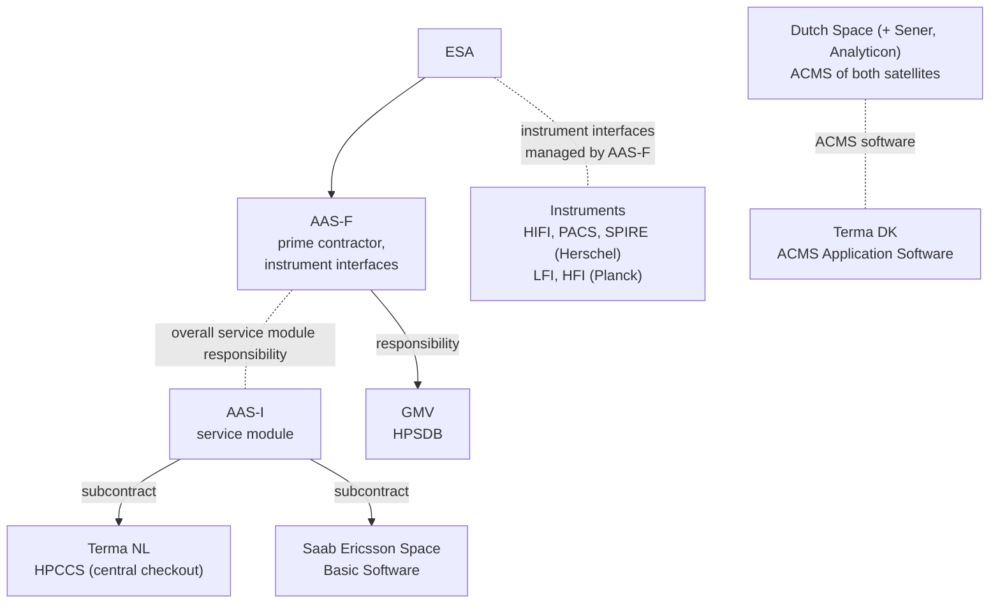
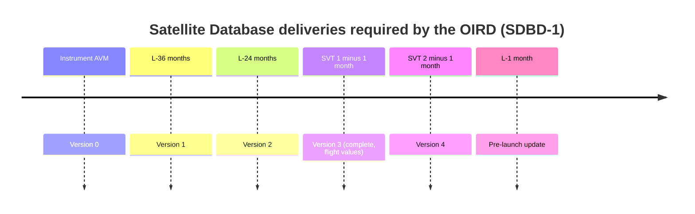
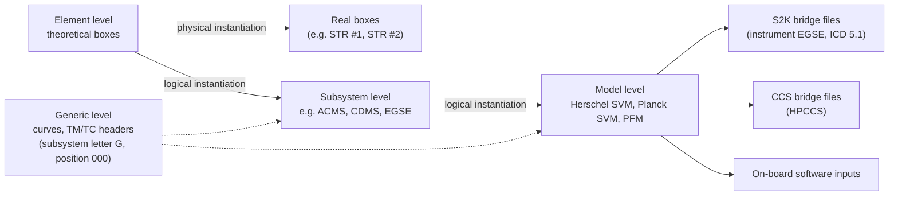
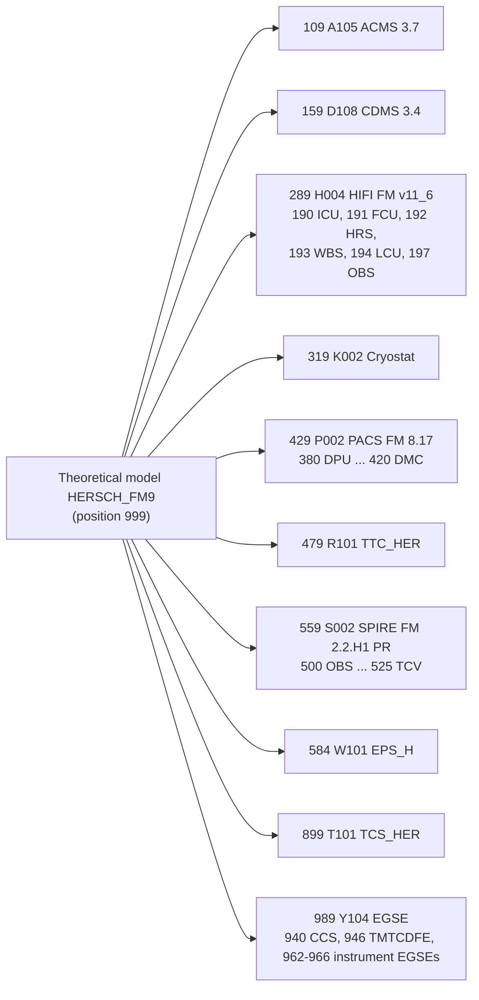
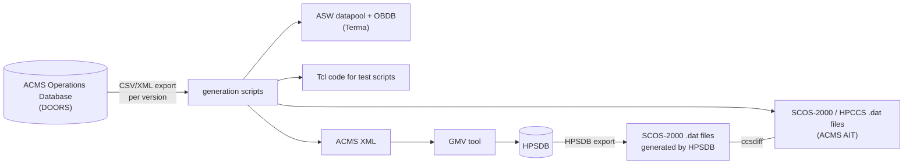
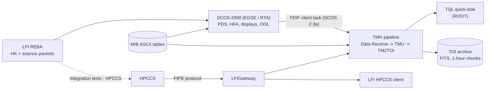

# Herschel and Planck

Herschel and Planck are two very different ESA science satellites that were developed
together: ESA commissioned them jointly under the Horizon 2000 scientific programme, and
commonality between the two missions and between their mission phases was a key design
driver for cost reasons.[^nlr-intro] Herschel is an infrared observatory; Planck measures the
Cosmic Microwave Background with receivers cooled to very low temperatures. Both were to fly
to Lissajous orbits around the second Lagrange point (L2), separate soon after launch and then
operate independently.[^nlr-bg]

For this wiki the pair matters because it is a well-documented example of a project that put
[SCOS-2000](../scos2000/index.md) everywhere: in the ESOC Mission Operations Centre, in the
spacecraft Central Checkout System used for system tests, and in the instrument teams' own
electrical ground support equipment (EGSE) and real-time assessment systems.[^egse-req-common][^lfi-scos]
One system database, the Herschel/Planck System Database (HPSDB), collected the
[MIB](../mib/index.md) data and generated the SCOS-2000 and checkout files for
them.[^nlr-hpsdb][^tn-scope] This page follows the data: the operations
requirements that shaped the packets, the packet structures and the space link, the HPSDB and
its rules for reading and writing MIB files, how a database release was produced and named, the
Herschel science ground segment's tailoring of the MIB, the Planck LFI telemetry chain, and the
EGSE history. The SCOS-2000-centred case study, including the April 2000 decision meeting and
the HCSS telecommand-history interfaces, is on
[Herschel/Planck: SCOS-2000 in a science mission ground segment](../scos2000/herschel-planck-ground.md);
the bit-level layouts of the interface control documents (packets, frames, the EGSE router, the
PIPE protocol and the checkout system's MIB) are on
[Herschel/Planck interface documents](../scos2000/herschel-planck-interfaces.md).

!!! info "What this wiki has, and what it does not have"
    Every document cited on this page is in the [library](../references/index.md), with its
    original URL, the UTC time of copy and a SHA-256 checksum; most were copied on
    2026-11-05 from the Herschel Science Archive (SPIRE internal documents), the ESA Cosmos
    site, arXiv, the NLR report server and the University of Lethbridge SPIRE pages (see
    [Sources and copies](../about/sources-and-copies.md)). The Herschel/Planck MIB itself was
    **not** copied: the HPSDB release zips listed by the Herschel Science Archive refused the
    download with HTTP 403, so this page contains no data-driven analysis of the Herschel
    MIB. Where it shows numbers from SQL queries, they come from the
    [Solar Orbiter MIB](solar-orbiter/mib.md) and are used only for comparison.

    A second round of copies on 2026-11-12 added the Packet Structure ICD (issue 6.0) and the
    Space/Ground ICD (issue 3.2), the EGSE packet router ICD, the EGSE Interface Requirement
    Specification, the CCS External ICD, the HPSDB Software User Manual (version 2.6), the
    HPSDB release note issue 9.0 of one Herschel delivery, a 562-page printed overview of
    the HIFI instrument MIB (issue 139) and Thales Alenia Space's SESP 2015 presentation on the
    HPSDB's successor (from indico.esa.int). These describe the database and print parts of one
    instrument MIB, but they are still not the MIB files: no table of the Herschel/Planck
    database can be queried here.[^rn-intro][^hmib-cover][^sesp-intro]

## The missions at a glance

| Item | What the sources say | Source |
|---|---|---|
| Programme | Joint development of two satellites under ESA's Horizon 2000 scientific programme; commonality between missions and phases is a key driver | [^nlr-intro] |
| Orbit | Lissajous orbits about L2; the two spacecraft separate soon after launch and operate independently | [^nlr-bg] |
| Launch (as planned in 2006) | Ariane 5 ECA, then foreseen for February 2008 (the actual date is not stated in the available sources) | [^nlr-bg] |
| Attitude control | Herschel: highly accurate pointing; Planck: highly stable spinning attitude; many common ACMS units and most of the basic software in common | [^nlr-acms] |
| Daily operations | Ground contact and real-time control for a few hours per day; the telemetry stored during the previous ~24 h is dumped while the next schedule is uplinked | [^oird-concept] |
| Planck LFI telemetry budget | At most 53.5 kbps, because a whole day of packets is stored on board and dumped in the Daily Tele-Communication Period (DTCP) | [^lfi-proc] |
| Telemetry/telecommand standard | ESA Packet Utilisation Standard (PUS); the operations requirements were derived from ECSS-E-70-41 Draft 5.3 (April 2001). The Packet Structure ICD of 2008 states that, being tailored for Herschel/Planck, it supersedes the PUS, and that the space and ground segments support all and only the structures and services it defines | [^oird-scope][^nlr-obsw][^ps-scope] |
| Packets | TC packets at most 248 octets (228 inside a mission timeline command), TM packets at most 1024 octets; only PUS version number 0 is permitted in both headers | [^ps-tc][^ps-tm] |
| Space link | X-band uplink and downlink; telemetry at 500 bps, 5 kbps, 150 kbps or 1.5 Mbps; telemetry spacecraft IDs `0x1E6` (Herschel flight model), `0x1E9` (Planck flight model) and `0x1EA` (avionics model); one transfer frame length of 1115 octets | [^sg-freq][^sg-mod][^sg-scid][^sg-len] |
| Ground stations | Kourou 15 m (LEOP to commissioning), Vilspa 15 m (LEOP), New Norcia 35 m (all phases including routine science) | [^sg-gs][^sg-net] |
| Database format | SCOS-2000 Database Import ICD issue 5.1 (applicable to the spacecraft database); the HCSS note cites issue 5.2; the checkout system read issue 5.1 with the extensions of its own CCS External ICD | [^oird-scope][^hcss-refs][^ccs-scope] |
| Early name | Documents of 2000 call the programme "FIRST/Planck"; from 2001 they say "Herschel/Planck" | [^mom-1][^oird-chg] |

### Who built what

The industrial organisation explains why so many database interfaces existed. Alcatel Alenia
Space France (AAS-F) was prime contractor for both satellites and managed the scientific
instrument interfaces; Alcatel Alenia Space Italia (AAS-I) was responsible for the service
module; a team led by Dutch Space (with Sener and Analyticon) built the Attitude Control and
Measurement System (ACMS) of both satellites. Terma (Denmark) developed the ACMS Application
Software, Saab Ericsson Space the Basic Software, Terma (the Netherlands) the
Herschel/Planck Central Checkout System (HPCCS) and GMV (Spain) the HPSDB.[^nlr-bg] By
2007-2008 the prime's documents carry the name Thales Alenia Space: the pages of PS-ICD issue
6.0 bear a Thales Alenia Space copyright line, and the HPSDB release note of April 2008 names "Thales Alenia
Space - France" as supplier.[^ps-scope][^rn-intro]



The diagram is drawn from the NLR paper's industrial team section and the instruments named
in the HPSDB note's distribution list. Solid arrows are the contract or responsibility
relationships the paper states (ESA commissioning, "under AAS-I subcontract", "under AAS-F
responsibility"); dotted lines are roles without a stated contract, because the paper does not
say who contracted AAS-I, Dutch Space or Terma Denmark.[^nlr-bg][^tn-scope]

## Operations requirements: the OIRD

The *Herschel/Planck Operations Interface Requirements Document* (SCI-PT-RS-07360, issue 2.2,
printed date "31 September 2003", prepared at ESOC by S. J. Dodsworth and S. Matussi) states
what the spacecraft and payloads must provide so that ESOC can operate them, and what must be
delivered to the MOC to prepare operations.[^oird-scope] Its packet chapter is derived from the
PUS (applicable document AD-1, ECSS-E-70/41 Draft 5.3, April 2001); the Space/Ground ICD
(SCI-PT-ICD-07418) and the Packet Structure ICD (PS-ICD, cited as SCI-PT-IF-07527) hold the
detailed frame and packet layouts.[^oird-scope] Both are now in the library, as SGICD issue 3.2
of 1 December 2004 and PS-ICD issue 6.0 of 25 January 2008 (see [below](#the-packet-structure-icd)).
The PS-ICD's own reference is SCI-PT-ICD-07527; for traceability its requirements name their
parent requirements with tags such as `[P:SCI-PT-RS-07360#3.1-PACK-14`, which points to OIRD
requirement PACK-14.[^sg-cover][^ps-cover][^ps-scope]
Requirements
marked "P" apply to spacecraft and payloads, "PO" apply to the spacecraft and may be relevant
to payloads, and unmarked ones apply to the spacecraft only.[^oird-scope] The 2001 revision made
the SCOS-2000 Database Import ICD an applicable document.[^oird-chg]

### Operations concept

Science operations run from an on-board schedule outside ground contact, so the spacecraft
and instruments need on-board monitoring and autonomy; packet telemetry is expected to help
order the daily dump (status first, then events and command verification reports, then
observation data).[^oird-concept] The document insists that operations use the same
telemetry and telecommand database as the EGSE, delivered to the operations implementers in
time.[^oird-concept] The general concepts it fixes are:[^oird-pkt][^oird-obm]

* **Telecommand delivery.** Every command is a telecommand packet sent via the Command and
  Data Management System (CDMS), from ground, the mission timeline or an on-board procedure.
  The APID names the destination; APID plus sequence control identify one command instance;
  type and subtype give its meaning; the acknowledgement field selects the verification
  reports ([ST[01]](../ecss/pus/st01-request-verification.md)).
* **Telemetry collection.** Data are polled from units by the CDMS and kept in mass memory
  until erased by ground command. Packet kinds are housekeeping, science (not processed by the
  CDMS), telecommand reports, event reports and memory dumps.
* **Packetisation by the CDMS** for units that only deliver discrete signals.
* **On-board monitoring** by tables, with an event packet at each transition. The document
  notes this deviates from the PUS, which offers a transition reporting list
  ([ST[12]](../ecss/pus/st12-onboard-monitoring.md)); events can trigger a telecommand
  ([ST[19]](../ecss/pus/st19-event-action.md)).
* **On-board control procedures** (OBCPs) written in a Spacecraft Control Language running in
  the CDMS ([ST[18]](../ecss/pus/st18-onboard-operations-procedure.md); see also
  [ECSS-E-ST-70-01C](../ecss/e-st-70-01c.md#herschel-an-obcp-as-fault-management)).
* **Functions** as permanently available "black boxes" that can be started, stopped or given
  instructions ([ST[08]](../ecss/pus/st08-function-management.md)).
* **One spacecraft time reference** that time-stamps all TM packets, distributed to the
  instruments at power-on and then updated at agreed intervals
  ([ST[09]](../ecss/pus/st09-time-management.md)).

### Which PUS services the instruments had to implement

The OIRD table "Applicable PUS Services" fixes the service set for instruments; the PS-ICD
defines the capability sets, and a mandatory service may in practice need only its minimum
capability set.[^oird-pus]

| Type | Service name (as printed) | For instruments | Wiki page |
|---|---|---|---|
| 1 | Telecommand Verification | Mandatory | [ST[01]](../ecss/pus/st01-request-verification.md) |
| 2 | Device Command Distribution Service | Not applicable | [ST[02]](../ecss/pus/st02-device-access.md) |
| 3 | Housekeeping and Diagnostic Data Reporting | Mandatory | [ST[03]](../ecss/pus/st03-housekeeping.md) |
| 4, 7, 10, 13, 20, 22 | Not used | Not applicable | - |
| 5 | Event Reporting | Mandatory | [ST[05]](../ecss/pus/st05-event-reporting.md) |
| 6 | Memory Management | Mandatory | [ST[06]](../ecss/pus/st06-memory-management.md) |
| 8 | Function Management | Optional | [ST[08]](../ecss/pus/st08-function-management.md) |
| 9 | Time Management Service | Mandatory | [ST[09]](../ecss/pus/st09-time-management.md) |
| 11 | On-board Operations Scheduling Service | Not applicable | [ST[11]](../ecss/pus/st11-time-based-scheduling.md) |
| 12 | On-board Monitoring Service | Not applicable | [ST[12]](../ecss/pus/st12-onboard-monitoring.md) |
| 14 | Packet Transmission Control Service | Mandatory | [ST[14]](../ecss/pus/st14-real-time-forwarding-control.md) |
| 15 | On-board Storage and Retrieval Service | Not applicable | [ST[15]](../ecss/pus/st15-onboard-storage-retrieval.md) |
| 16 | On-board Traffic Management Service | Not applicable | - |
| 17 | Test | Mandatory | [ST[17]](../ecss/pus/st17-test.md) |
| 18 | OBCP Management | Optional | [ST[18]](../ecss/pus/st18-onboard-operations-procedure.md) |
| 19 | Event/Action Service | Not applicable | [ST[19]](../ecss/pus/st19-event-action.md) |
| 21 | Science Data Transfer | Mandatory | - |

Note that the 2001 draft numbering differs from today's PUS-C: service 14 was "Packet
Transmission Control", 16 "On-board Traffic Management", 20 was not used for instruments and
21 "Science Data Transfer"; the section headings elsewhere in the OIRD also list service 20 as
"Information Distribution CDMS - User" and 22 as "Context Saving".[^oird-pus][^oird-toc] The
PS-ICD still used this numbering in issue 6.0 of 2008: its Table 2-1 marks services 4, 7, 10,
13, 20 and 22 as not used, and chapter 5 keeps the headings 16 On-board Traffic Management (for
which no specific packet structures are defined), 20 Information Distribution ("not used", its
requirements deleted) and 22 Context Saving ("not used", its packet structures "not
applicable") next to the defined service 21 Science Data Transfer.[^ps-svc] The
differences between PUS generations are explained on
[PUS-A vs PUS-C](../ecss/pus/pus-a-vs-pus-c.md), and the PS-ICD service by service on
[the interface documents page](../scos2000/herschel-planck-interfaces.md#the-services).

### Packet rules that a database must express

The general packet requirements PACK-0 to PACK-15 translate directly into
[MIB](../mib/monitoring.md) structures; the right-hand column is this wiki's mapping, not part
of the OIRD:[^oird-pack]

| Rule | Requirement (paraphrased) | Where it shows in the MIB |
|---|---|---|
| PACK-0, PACK-13 | APIDs are allocated by the ESA project in the PS-ICD (see [the APID structure](#apids-prime-and-redundant)) | `PID_APID`, `CCF_APID` |
| PACK-1, PACK-2 | Different APIDs per subsystem/instrument for TCs; TM uses the same APID as the TCs to that unit where possible | [pid](../mib/tables/pid.md), [ccf](../mib/tables/ccf.md) |
| PACK-3, PACK-4, PACK-5 | A housekeeping parameter's location follows from APID, type/subtype and Structure ID (SID); SIDs unique within an APID; few SIDs per APID | [pic](../mib/tables/pic.md) / [pid](../mib/tables/pid.md) / [plf](../mib/tables/plf.md) |
| PACK-6, PACK-7 | No sub-commutation; super-commutation only with regular sampling and a known time offset of the first sample | `PLF_NBOCC`, `PLF_LGOCC`, `PLF_TIME`, `PLF_TDOCC` |
| PACK-8 | A parameter has the same structure and interpretation in every packet | one [pcf](../mib/tables/pcf.md) row per parameter |
| PACK-10, PACK-11, PACK-12 | Sampling time implied by APID and SID; the packet time is the start of acquisition; every packet except time and idle packets has a time field | `PID_TIME`, `PLF_TIME` |
| PACK-14 | TCs are validated by the destination at acceptance | [ST[01]](../ecss/pus/st01-request-verification.md) |
| PACK-15 | Herschel instrument data packets carry an Observation Identifier | (instrument-specific) |

Telecommand verification (TCV-0 to TCV-9) asks for a success report for every properly received
command, a failure report with reason for every rejected one, execution reports as requested
by the acknowledgement field, the command source (ground, mission timeline, OBCP) encoded in
the source sequence counter, and execution delays that depend only on the command, so that
ground time-outs can be configured.[^oird-tcv] Compare the stages and time windows that the
MIB's [command verification tables](../mib/command-verification.md) define.

### The Satellite Database requirements

Section 4.2 of the OIRD defines the database that became the HPSDB:[^oird-sdb]

* The prime contractor and the instrument teams deliver a **Satellite Database (SDB)** with
  all telemetry and telecommand data, command sequences, software parameters and commands;
  it is a single common database for system engineering, AIV and operations (SDBC-1, SDBC-2).
* Its content follows the SCOS-2000 Database Import ICD (AD-8, issue 5.1) and Annex 2, is
  internally consistent, consistent with the Flight Dynamics Database and with all on-board
  software, has no duplications and no irrelevant data, and records every update down to
  field level (SDBC-4 to SDBC-12).
* Deliveries: version 0 for the instrument AVM, version 1 at launch minus 36 months, version
  2 at L-24 months, version 3 one month before SVT 1 (complete,
  with flight values), version 4 one month before SVT 2, and a pre-launch update at L-1
  month (SDBD-1). Each delivery carries a configuration control file with field-level
  changes, the spacecraft build standard and the on-board software versions; the database is
  delivered as ORACLE data files (SDBD-2 to SDBD-5).

Annex A2 adds that the SDB is delivered "according to AD-8" together with a Configuration
Control File (version, release date, per-file versions and change tables listing old and new
values, date and initials) and a Spacecraft Configuration File (model EQM or PFM, build
standard, on-board software versions).[^oird-a2] Annex A4 delegates item names to the
Herschel/Planck Naming Convention (H-P-1-ASPI-SP-0141) and names flight procedures
`FCP_<subsystem>_nnnn`, contingency procedures `CRP_<subsystem>_nnnn` and timelines
`TDoyFfNn`.[^oird-a4]



## The Packet Structure ICD

The **Packet Structure ICD** (PS-ICD, SCI-PT-ICD-07527) complements the ESA packet telemetry
and telecommand standards with all mission-specific details of the data exchanged between
on-board applications and their ground counterparts, for both spacecraft and all
instruments; Appendix 9 adds the protocol of the satellite data bus. It is agreed between the
ESA project manager, ESOC and the prime contractor and then controlled by the prime.[^ps-scope]
Issue 1 dates from 1 September 2000 and issue 2 from 12 July 2001; requirement identifiers
came with issue 3 (2002-2003), issue 4 draft 0 of 25 July 2003 was the first after the
document's hand-over to Alcatel Space, and issue 6.0 of 25 January 2008 is the formal release in the library.[^ps-cr1][^ps-cr4][^ps-cr60]
The full specification is read field by field on
[Herschel/Planck interface documents](../scos2000/herschel-planck-interfaces.md#the-packet-structure-icd);
this section keeps what matters for the mission's databases.

### Headers and limits

Both headers follow the ESA packet standards with mission rules.[^ps-tc][^ps-tm][^ps-tm2]

* **Telecommands** are stand-alone packets (sequence flags `0b11`) of at most 248 octets, a packet
  length field whose value (octets in the data field minus 1) is always odd, so that the packet
  is a whole number of 16-bit words, and a 32-bit data field header with a secondary header flag
  of 0, PUS version 0, four acknowledgement bits, type, subtype and a spare octet.
  Commands stored in the mission timeline are encapsulated as variable octet strings in MTL
  telecommands, inserted with TC(11,4), which leaves 228 octets for the embedded packet.[^ps-mtl]
* **The 14-bit TC sequence count** is split: the 3 most significant bits are a *source part*
  that names the generator of the command, the other 11 bits a counter kept by that source for
  each APID, which the receiver never checks for monotony. A verification report must copy the
  full sequence control field to identify the command.
* **Telemetry** packets are at most 1024 octets, with one source sequence count per APID so the
  ground can detect losses; only science packets TM(21,x) may use the grouping flags. The 80-bit
  data field header holds a spare bit, PUS version 0, 4 spare bits, type, subtype, a spare octet
  and a 48-bit CUC time (4 octets coarse, 2 fine).[^ps-time] The data field header flag is 0 only
  in time and idle packets.

| Source part | Generator of the telecommand |
|---|---|
| `0b000` | Ground, highest priority, all sources |
| `0b001` | Failure detection, isolation and recovery (FDIR) telecommands of the CDMU |
| `0b010` | Mission timeline (maintained by ground, executed by the CDMU) |
| `0b011` | On-board control procedures executed by the CDMU |
| `0b100` | Ground, low priority, all sources |
| `0b101` | FDIR telecommands of the attitude control computer (ACC) |
| `0b110` | Other on-board sources of the CDMU |
| `0b111` | Other on-board sources of the ACMS |

The source part is how the mission met OIRD requirement TCV-6 (see
[above](#packet-rules-that-a-database-must-express)).[^ps-tc][^oird-tcv] Its definition was
extended in issue 3.0 of April 2003.[^ps-cr1] In a database release of late 2007 the prime
switched all telecommands from "ground high priority" to "ground low priority" by default,
that is from source `0b000` to `0b100`.[^rn-cr]

!!! warning "Inference"
    Reading the release note's priority change as a change of the default source part is this
    wiki's interpretation: the note does not name the header field, but "ground high priority"
    and "ground low priority" are the PS-ICD's names for the source values `0b000` and `0b100`.

### APIDs, prime and redundant

Appendix 3 of the PS-ICD allocates the APIDs. The most significant bits form a **base APID**
per instrument or subsystem; the four least significant bits separate packet categories and
the prime from the redundant unit, so that part of the packet identification works without
decoding the data field header.[^ps-a3]

| APID (base and offsets) | TC | TM |
|---|---|---|
| 0 | Standard Distribute CPDU commands | Standard spacecraft time source packet |
| 16 (`0x010`) CDMS, 512 (`0x200`) ACMS | All CDMS / ACMS telecommands | Base: all TM except non-essential HK and diagnostics; base + 2: non-essential HK and diagnostics |
| 1024 (`0x400`) HIFI | All HIFI telecommands | 1024 prime and 1025 redundant (essential TM); 1026 prime and 1027 redundant (non-essential HK, diagnostics); 1028-1031 science TM(21,x) |
| 1152 (`0x480`) PACS, 1280 (`0x500`) SPIRE | All PACS / SPIRE telecommands | Same pattern, with further offsets for science and (PACS) diagnostic science TM(21,3) |
| 1408 (`0x580`) HFI, 1536 (`0x600`) LFI, 1664 (`0x680`) SCS | All telecommands of the unit | Same pattern; LFI has no separate redundant APIDs |
| 2016-2046 (`0x7E0`-`0x7FE`) | SCOE / EGSE reserved | SCOE / EGSE reserved |
| 2047 (`0x7FF`) | - | Idle packets |

Source: Table A-3.1.[^ps-a3b] The EGSE range may be used by several groups in parallel during
unit-level tests; the HIFI test equipment interfaces used APIDs 2016-2023 inside it, and in
system tests the CCS, SCOEs, front ends and instrument EGSEs got fixed APIDs 2016-2044 (see
[SCOS-2000 as EGSE](../scos2000/egse.md)).[^ps-a3][^tei-tc][^irs-apid] In real time, telemetry
of the base APID went to ground on virtual channel 0 and that of base + 2 on VC4.[^sg-vc][^ps-a3c]

!!! example "Worked example (real MIB rows): the prime/redundant flag is the last APID bit"
    The HIFI MIB listing of July 2008 places the parameter `HM009190` (`HI_Prime_red`, "Origin
    of the periodic HK-packet") of packet `HIFI_HK_rev_7` at octet 1, bit 7, and the same flag
    of `HIFI_essential_HK` (`HM094190`) at the same position; its textual calibration 249 maps
    0 to `HIFI_prime` and 1 to `HIFI_redundant`.[^hmib-hk][^hmib-txf][^hmib-icu]
    With bit 0 the most significant bit and octet offsets counted from the end of the
    SCOS-2000 packet header, which is the start of the source packet when the generic
    packetiser is used (the HCSS clarifications of the import ICD, DCR 308 and DCR 309), and
    with `Structure_ID` at octet 16 right after the 16 octets of packet and data field
    headers, octet 1 bit 7 is the last bit of the 16-bit packet ID, which is the least
    significant bit of the 11-bit APID.[^hcss-41] The MIB therefore decodes the APID bit that the PS-ICD uses to separate
    1024 (prime) from 1025 (redundant), or 1026 from 1027.[^ps-a3b] A curve of the Herschel
    database printed in the release note of April 2008 (curve 170016) names the same values:
    1024 `HIFI_N`, 1025 `HIFI_R`, and likewise 1152/1153 for PACS and 1280/1281 for SPIRE.[^rn-ncr]

### The space link (Space/Ground ICD)

The Space/Ground ICD (SCI-PT-ICD-07418, issue 3.2) fixes the radio link, the ground stations
and the transfer frames.[^sg-cover] Both spacecraft use X-band up and down with right-hand
circular polarisation (Herschel downlink 8468.5 MHz, Planck 8455.0 MHz).[^sg-freq] Telemetry
follows the packet telemetry standard without source packet segmentation, at 500 bps or 5
kbps (PSK on a 45 884 Hz subcarrier), 150 kbps (SP-L) or 1.5 Mbps (GMSK); ranging cannot run
with high-rate telemetry.[^sg-mod] Every transfer frame is 1115 octets long and carries a CLCW
in its operational control field.[^sg-len][^sg-ocf]

| Virtual channel | Content | Downlink priority |
|---|---|---|
| VC0 | Real-time essential spacecraft HK and critical instrument HK | 1 (also whenever a time packet is due) |
| VC4 | Real-time routine spacecraft and instrument HK | 2 |
| VC2 | Stored spacecraft and instrument HK | 3 |
| VC1 | Real-time science | 4 |
| VC3 | Stored science | 5 |
| VC7 | Idle frames | 6 |

Source: HP-SGICD-STR-TM-030 to -050; VC5 and VC6 are "not required".[^sg-vc] The frame and
segment headers, the CLCW and the MAP identifiers are drawn on
[the interface documents page](../scos2000/herschel-planck-interfaces.md#the-spaceground-icd);
the CCSDS background is on [TM synchronization and channel coding](../ccsds/tm-coding.md) and
[COP-1](../ccsds/cop-1.md).

### The packets as seen by instrument test equipment

Almost two years before the PS-ICD's first formal release (issue 4.0 of 7 November
2003),[^ps-cr40] the HIFI team's *TEI TMTC packet ICD*
(SRON-U/HIFI/SP/2001-011, issue 1.0, 19 December 2001) restated the headers for the packets
exchanged with HIFI's test equipment interfaces (TEI), citing the PS-ICD issue 2.0 draft 2 as
applicable document.[^tei-hdr] Its header layouts are the same as those of PS-ICD issue 6.0
above, which is this wiki's comparison of the two documents.[^tei-tm][^ps-tc][^ps-tm2]

**Telecommand source packet.** The primary header is the usual 48-bit
[Space Packet](../ccsds/space-packet.md) header, but the 14-bit sequence count is split into
a 3-bit **source** field (always `0b000` for these test equipment commands) and an 11-bit
counter, which each source maintains per APID and which wraps to 0.[^tei-hdr] This matches the note
to the OIRD's requirement TCV-6, which places the command source in the source sequence
counter of the packet header.[^oird-tcv]

<div class="bitfield" data-title="Herschel/Planck TC packet primary header as used by the HIFI TEI (48 bits)" data-width="16"
     data-fields='[{"n":"Version","b":3,"v":"000"},{"n":"Type","b":1,"v":"1","d":"1 = telecommand"},{"n":"Header flag","b":1,"v":"1"},{"n":"APID","b":11,"d":"TEI APIDs 2016-2023"},{"n":"Seq. flags","b":2,"v":"11"},{"n":"Source","b":3,"v":"000","d":"Command source; always 000 for the TEI"},{"n":"Sequence counter","b":11,"d":"Per source and APID; wraps to 0"},{"n":"Packet length","b":16,"d":"Octets in the packet data field minus 1"}]'></div>

<div class="bitfield" data-title="TEI TC data field header (32 bits)" data-width="16"
     data-fields='[{"n":"CCSDS sec. hdr flag","b":1,"v":"0"},{"n":"PUS version","b":3,"v":"000","d":"Printed as 0 in the TEI ICD"},{"n":"ACK","b":4,"d":"bit 3 acceptance, bit 2 start, bit 1 progress, bit 0 completion"},{"n":"Packet type","b":8},{"n":"Packet subtype","b":8},{"n":"Spare","b":8,"v":"00000000"}]'></div>

**Telemetry source packet.** The TM primary header has the 2-bit segmentation flags and a
14-bit source sequence counter; its packet length is always odd. The 80-bit data field header
holds a spare bit, a 3-bit PUS version (0), 4 spare bits, type, subtype, a spare octet, and a
48-bit on-board time of 32 bits of coarse seconds and 16 bits of fine sub-seconds; the packet
ends with a 16-bit packet error control field.[^tei-tm]

<div class="bitfield" data-title="TEI TM data field header (80 bits)" data-width="16"
     data-fields='[{"n":"Spare","b":1,"v":"0"},{"n":"PUS version","b":3,"v":"000"},{"n":"Spare","b":4,"v":"0000"},{"n":"Packet type","b":8},{"n":"Packet subtype","b":8},{"n":"Spare","b":8,"v":"00000000"},{"n":"Coarse on-board time (s)","b":32},{"n":"Fine on-board time (sub-seconds)","b":16}]'></div>

The PUS version value 0 is printed in both headers of the TEI ICD, whereas ECSS-E-70-41A
(2003) tells users to set the TC and the TM PUS version to 1, noting in footnotes that version
0 was used by the earlier ESA PUS.[^tei-hdr][^pus-a-dfh] The TEI ICD predates that issue and
follows a PS-ICD draft, so its value 0 matches the earlier ESA PUS convention. The PS-ICD
settles the question for the mission: issue 6.0 of 2008 permits only PUS version number 0, in
the telecommand and in the telemetry data field header alike, five years after ECSS-E-70-41A
had asked for 1.[^ps-tc][^ps-tm2] Every TEI accepts a *Set OBS-ID* command TC(8,4) (function 1, activity
1, a 16-bit structure ID and a 32-bit observation identifier, matching PACK-15) and a
connection test TC(17,1), and reports acceptance with TM(1,1) or TM(1,2); the failure report
carries an 8-bit code (0 illegal APID, 1 bad length, 2 bad checksum, 3 illegal type, 4 illegal
subtype, 5 illegal or inconsistent application data) and an 8-bit parameter.[^tei-tc]

## The Herschel/Planck System Database (HPSDB)

### Why a system database

The HPSDB was procured by AAS-F to keep data consistent between engineering, on-board
software, AIT and flight operations, and to support the commonality between the two
satellites; GMV developed it.[^nlr-hpsdb] It is operated at a central site where final data are
stored and consistency is maintained, with several mirror sites; the system EGSE requirement
GRQT-0002b asks the Central Checkout System to support an HPSDB mirror site.[^nlr-hpsdb][^egse-req-ccs]
Export files from the HPSDB are used to build the on-board software and to produce the
TM/TC definitions in SCOS-2000 format for AIT and operations.[^nlr-hpsdb] Looking back in
2015, Thales Alenia Space summarised the two ESA requirements behind it: **commonality**
(between the two spacecraft, and the same data shared by different users), achieved through
physical instantiation and category flags, and **smooth transition** (reuse of validated data
from one programme phase to the next, up to operations), achieved through logical instantiation
and category flags.[^sesp-intro]

The data model has four levels:[^nlr-hpsdb]

* **Element** - building blocks such as a star tracker or the ASW elements for common,
  Herschel and Planck data;
* **Subsystem** - for example the ACMS or the Central Data Management Subsystem (ground
  support equipment is also modelled as a subsystem), built from element data plus
  subsystem-specific data;
* **Model** - for example the Herschel and Planck service modules or the protoflight models,
  built from subsystems;
* **Generic** - data usable by any other definition, such as ON/OFF curves and TM/TC packet
  headers.

Consistency is enforced by **instantiation** of "boxes": every box exists at least as a
*theoretical* box (design data, e.g. a default reaction-wheel friction coefficient) and as
*real* boxes (measured data for one unit). Logical instantiation builds subsystems from
elements and models from subsystems; physical instantiation creates several real copies of a
theoretical box, for example two real star trackers.[^nlr-hpsdb]



The diagram combines the levels described in the NLR paper with the export targets and the
generic-item naming rules of the HPSDB technical note.[^nlr-hpsdb][^tn-g2]

### The HPSDB as a tool (GMV user manual 2.6)

GMV's *HPSDB Software User Manual* (H-P-1-GMV-MA-20487, version 2.6, 15 September 2005) shows
the system that the instrument teams, the prime and the AIT sites actually used. Version 1.0
dates from 18 July 2003; version 2.0 (January 2004) added the real data part, version 2.2
(September 2004) the mirror sites, the TM/TC verification and the ON/OFF status of real
elements, and version 2.6 the logical instantiation of items and a "where is referenced"
tool.[^um-cover] HPSDB is a web application on Windows 2000 with an Oracle 9i Release 2
database and the Oracle9iAS application server; the central site ran on an HP ProLiant DL380
server and the mirror sites on Dell Precision 650 workstations.[^um-hw]

Data live in three **areas**, and normal changes pass through them:[^um-areas][^um-val]

| Operation | Effect | Who |
|---|---|---|
| Create | New object in the working area | Normal users with the right role |
| Checkout | Copy of a validated object into the working area, to be modified | Normal users |
| Delete | Copy into the working area, marked for deletion | Normal users |
| Validation | Moves the selected boxes from the working to the reference area; replaced copies go to the archive area; deleted objects go straight to the archive | The schema manager only |
| Discard | Removes the working copy | Normal users |

Validation refuses an object whose references point outside the reference area or to objects
not selected or being deleted. A **selection date** decides what a user sees: the current date
(working copies over reference copies, the only mode with write access), the last validation
date (reference area only, read-only) or any past date (the archived reference area of that
date).[^um-val][^um-date] Users have one of nine **roles** (equipment and subsystem
fabricator, engineer or consultant; model engineer or consultant; AIT) and one **category
flag code**: Operations, OB
(on-board software), AIT or All; bridge files can be generated for one user category.[^um-roles][^um-gen]
The category list of the user manual has no flight dynamics entry, unlike the 8-bit flag of
the processing note's rule G10 (AIT, operations, software, flight dynamics).[^tn-g10]

The **central site** holds all valid data and traces their evolution; **mirror sites** (one
was required at the Central Checkout System) may modify only real objects. Sites never talk to
each other: managers exchange XML transfer and log files by hand, named for example
`Export_CENTRAL_EL_DPU_02_12_2004_15_33_50.xml`.[^um-sites][^um-xfer][^egse-req-ccs] Two
operations write straight into the reference area, outside validation: **verification data**
(which test sequence verified a TM parameter or TC, and when, loaded from a tab-separated
file with the same six columns as the CCS "update files", a site taking the place of the
host) and the **ON periods** of real elements; the
verification data of an item are reset whenever the item, its curves or its packet structure
change.[^um-ver][^um-onoff][^ccs-upd]

### How HPSDB reads and writes MIB files (H-P-1-ASP-TN-1060)

The Alcatel Alenia Space note *MIB files processing by HPSDB* (H-P-1-ASP-TN-1060, issue 1,
dated 07/02/2006; draft 1D1 of 02/02/2006 was sent to ESA to close an action from an
instrument database meeting in September 2005) documents how HPSDB ingests and generates two
flavours of [MIB](../mib/index.md) "bridge files": **S2K** files for the instrument EGSE,
which used MIB ICD issue 5.1 and was "version 2.3eP5 based on SCOS 2000 2.3e", and **CCS**
files for the HPCCS central checkout, which had its own external ICD
(H-P-4-TE-ID-8020).[^tn-scope] It lists the constraints that an input file must satisfy so that
HPSDB writes back an identical file. Constraints printed in bold cannot be checked by HPSDB
and remain the user's responsibility; the others are checked at load time.[^tn-scope]

Full round-trip compatibility was not always possible. The note's first example is the
packet-to-SPID relation: HPSDB allows several TM packets to map to one SCOS packet (SPID),
while the MIB ICD allows any-to-any mappings provided that only one is valid at a
time.[^tn-scope] The CCS also had functions that SCOS-2000 then lacked, for example selection
of a calibration by condition, event limits and critical telecommands, and SCOS
configuration files such as `MISCconfig` differed between installations.[^tn-scope]

The note's twenty general rules (G1-G20) are the clearest public statement of what a
system database needs on top of the MIB ICD:[^tn-g2][^tn-g6][^tn-g10][^tn-g13]

| Rule | Topic | What HPSDB does or requires |
|---|---|---|
| G1 | Object data model | Bridge files are extracted per object together with **all** items of the generic object; MIB files must be wrapped in an object identified by its position, defined in configuration files before loading |
| G2-G5 | Naming convention | Identifier structure (see below), with special numeric schemes for S2K curves, verification stages and parameter range sets, whose MIB fields were too short for instantiation |
| G6 | Enumerated fields | Values must be in the ICD set, possibly reduced by the PS-ICD (allowed type/subtype pairs) or by HPSDB (no octal radix) |
| G7 | Commutation | Packets and structures are lists of parameters, structures and (TC only) fixed areas with offsets, start bits, repetition counters and super-commutation attributes; a flag says whether PLF, VPD or both are generated |
| G8 | Default values | ICD defaults are forced even where irrelevant; some are replaced by HPSDB defaults (e.g. `PID_CHECK`, `CAF_RADIX`, `CCA_RADIX`) |
| G9 | Commonality | Discrete and status curves may be shared by TM and TC, so TM and TC curves must not reuse the same identifier |
| G10 | Category flag | Each item has an 8-bit flag, one bit per user type (AIT, operations, software, flight dynamics); loaded MIB items get "all except FDD" |
| G11 | Common fields | 64-character mnemonic, short description (32 characters by default), 256-character long description and configuration data (action, user, date, reason, area, source, site, validation and archive dates) |
| G12 | TC packet header | TC headers are defined generically; `TCP`, `PCPC` and `PCDF` are ignored on input and commands must reference one generic header via `CCF_PKTID` |
| G13 | Reserved characters | Because of XML, `>`, `<`, `'`, `"` and `&` are forbidden; descriptions use letters, digits, space, `+`, `-` and `_` |
| G14 | Radix | No octal (`O`) for unsigned integers; only `D` or `H` |
| G15 | Range allocation | Value ranges (PID numbers, UDC packet locations, ...) are allocated in the naming convention because SCOS did not support "smooth transition" easily |
| G16 | Automatic instantiation | Short description gets a position character appended; APID = element offset + position base; PID, UDC and MISC positions get deltas |
| G17 | Short description | Mandatory in HPSDB; if empty, it is set to the identifier |
| G18 | Orphan items | Not loaded |
| G19 | Sorting | Output sorted by the ICD primary key; inputs must be sorted too |
| G20 | Derived parameters | Expression files must be delivered with the MIB files |

The user manual shows the other side of rule G1. A user zips the SCOS-2000 or CCS bridge files
together with configuration files that place them in the HPSDB object model: `S2K_EL.txt`
lists the real elements with their theoretical element numbers, `S2K_SUB.txt` the subsystem
with its pseudo position and one line per position (with the ACC and CDMU bus controller flags
and the SCOE host and port), `S2K_TM.txt` is a copy of `pid.dat` with a naming convention
identifier prepended to each row, and `S2K_CUR.txt`, `S2K_CVS.txt` and `S2K_PRF.txt` map SCOS
curve, verification stage and range set numbers to generic HPSDB items. Loading creates no box
types or generic items, needs the OL expression files for derived parameters, and "is not a
SCOS bridge file validator".[^um-bridge][^um-cfg] The manual's example loads three HIFI
elements (ICU, FCU and LCU at positions 190, 191 and 194) and two redundant SPIRE real
elements of one theoretical element (positions 196 and 197) into subsystem `H001001`, whose
pseudo position is 289.[^um-ex] The field tables of these files are on
[the interface documents page](../scos2000/herschel-planck-interfaces.md#the-hpsdb-user-manual-and-a-real-delivery).

### The naming convention, with a real example

HPSDB identifiers are built hierarchically. At element level, the first letter of a character
identifier gives the item type and the remaining characters are free. At subsystem or model
level, a subsystem letter is put in front (`Z` for a pseudo subsystem) and a three-digit
position is appended (`999` for the system pseudo position); numeric identifiers get a
two-digit subsystem number in front instead (A = 00 ... Y = 25, 26 for the pseudo subsystem).
Generic items use subsystem letter `G`, subsystem number `07`, position `000` and element
number `000`.[^tn-g2]

Curves are `NUMBER(6)` in HPSDB (three digits of theoretical element number and three free
digits) and unique across curve types. Because the S2K MIB fields were too short, an
instrument S2K file codes a specific curve as a three-digit number matching the three free
digits, and a generic curve as `1xxx`, which stands for the HPSDB generic curve
`G000xxx000`; verification stages and parameter range sets use the same trick (`1xxxx` for
`07xxxx000`, `1xxx` for `GRxxx000`).[^tn-g3] GMV's user manual of 2005 describes a different
mechanism for the generic items, mapping files loaded with the bridge files: in its examples
SCOS curves 900, 901 and 905 are read as the generic curves `000900`, `000901` and `000905`,
verification stage 9000 as the generic stage `079000000` and range set 0 as `GR000000`, and
the files limit SCOS curve numbers to 999 and stage and range set numbers to 9999 "for HPSDB
compliance".[^um-cfg][^um-ex] Which of the two mechanisms the Herschel/Planck deliveries used
is not stated in the available sources. The HIFI MIB of 2008 indeed numbers
its curves with three digits, for example textual curve 249 (`HI_Prime_red`), numerical curves
293 to 301 and command curves 100 (`HRH_switch`) and 134 (`HIF_mxbias_step_V`), as the prime's
fax of January 2003 had required (see [Mission tailoring of the MIB](../mib/tailoring.md)).[^hmib-txf][^hmib-cal]

!!! example "Worked example (real identifiers): `AESMG002` and `AESMG003`"
    The NLR paper gives one pair of real operational identifiers: the ACMS mode telemetry
    parameters in the Herschel and Planck mode status words start with `AESMG`, and the
    Herschel and Planck ASW boxes have numbers `002` and `003`, so the same parameter is
    `AESMG002` on Herschel and `AESMG003` on Planck.[^nlr-arch] Read with the HPSDB rule:
    a five-character subsystem-level name followed by the three-digit position of the box in
    which the element is instantiated.[^tn-g2]

!!! warning "Inference"
    That the leading `A` is the subsystem letter of the ACMS and that `E` is the item-type
    letter of the element identifier is this wiki's reading of the G2 rule; neither source
    spells out the letters of this example. The Herschel release note of 2008 supports the
    first part: the ACMS is subsystem `A105` of the Herschel model, and its position 002 holds
    the element `ACC_A_H_4`, while position 001 holds `ACC_A_C_4`.[^rn-sub] Reading `_H_` as
    Herschel and `_C_` as common, and position 002 as the Herschel ASW box of the NLR example,
    is also this wiki's interpretation; the meaning of `E` is still not stated in the
    available sources.

The SPIRE instrument applied the same naming convention to its own MIB in technical note
SPIRE-RAL-NOT-001155 (issue 1.2, March 2002). Command names follow `SCiiippp`, command
parameters `SPiiippp`, monitoring parameters `SMiiippp`, packets (SPIDs) `tttnnnnppp`,
calibrations `tttnnnrrr`, alphanumeric displays `SAiiippp`, graphic displays `SGiiippp` and
scrolling displays `SLiiippp`, where `iii` is a theoretical parameter identifier, `ttt` a
system element number (for example 480 for `OBS`, 490 for the DPU), `nnn` a
running number, `rrr` a real element number and `ppp` a position.[^spire-nc] The general rules
for project naming conventions are discussed on [Mission tailoring of the MIB](../mib/tailoring.md).

The printed HIFI MIB (issue 139, equivalent to HIFI_ASPI MIB 11.7, 11 July 2008) shows the
same structure in a delivered instrument database, and the Herschel release note supplies the
positions that the names end with:[^hmib-cover][^rn-sub]

| Real identifier | Mnemonic (from the HIFI MIB) | Read as | Position in model `HERSCH_FM9` |
|---|---|---|---|
| `HM009190` | `HI_Prime_red` (monitoring parameter) | `H` + `M` + `009` + `190` | 190 `HIFI_ICU_N` |
| `HM248191` | `HF_AP_2K_IF_CT` (monitoring parameter) | `H` + `M` + `248` + `191` | 191 `HIFI_FCU_N` |
| `HP056191` | `HIF_ch1_mxbias0_V` (command parameter) | `H` + `P` + `056` + `191` | 191 `HIFI_FCU_N` |
| `HP001197` | `HIFI_BB_ID` (command parameter) | `H` + `P` + `001` + `197` | 197 `HIFI_OBS_N` |
| `HD111190` | `HIFI_ptv_input` | `H` + `D` + `111` + `190` | 190 `HIFI_ICU_N` |
| `PC004380` | `DPU_START_AUT_FUN` (called a "PACS command parameter" in the HCSS note) | `P` + `C` + `004` + `380` | 380 `PACS_DPU_N` |

The mnemonics come from the HIFI MIB annex and the HCSS note.[^hmib-icu][^hmib-fcu][^hmib-hk][^hmib-cmdpar][^hmib-cmd][^hcss-com]
The EGSE Interface Requirement Specification confirms the letters for EGSE items: remote
commands are `YC`, their parameters `YP` and remote monitoring parameters `YM`, followed by a
three-character function and the item's position (for example 940 for the CCS).[^irs-names][^irs-names2]
In 2015 Thales Alenia Space listed the item letters of its successor database as `A` TM packet,
`C` curve, `D` synthetic parameter, `G` group, `K` constant and `M` TM parameter.[^sesp-rules]

!!! warning "Inference"
    The split of each name into subsystem letter, item-type letter, three free characters and
    a three-digit position is this wiki's reading of rule G2 applied to the printed names; the
    HIFI documents do not explain their identifiers. That `D` marks derived (synthetic)
    parameters in the HIFI MIB is inferred from the 2015 letter list, which was written for a
    later database, and from names such as `HIFI_ptv_input`. For `PC004380` the reading gives
    a command (`C`), while the HCSS note calls it a command parameter. Two library sources
    favour the command reading without naming `PC004380`: the EGSE IRS uses `C` for remote
    commands and `P` for their parameters, and the user manual's verification-file example
    lists `PC001428` with type `c` (telecommand).[^irs-names2][^um-ver] The short description
    `DPU_START_AUT_FUN` also fits a command, but no source settles it.

### Table by table: examples of HPSDB processing

Chapter 5 of the note goes through every MIB table field by field, stating the input
processing, the HPSDB field, the output processing and the constraint.[^tn-5] Some examples
show how much a system database rewrites:

* **VDF** is not loaded; on output HPSDB computes the version name from the selected date
  (by default the last validation date) and creates several records.[^tn-vdf]
* **PCF** holds all kinds of parameter in one table - TC, TC software, TC header, TM, TM
  software, dynamic and static UDC, saved synthetic, MISC and (CCS only) system
  parameters.[^tn-vdf]
* **PID**: HPSDB splits the MIB table into a TM packet definition and a SCOS packet
  definition, allows only many-to-one links from TM packets to SPIDs (AIT wanted one-to-one),
  forces `PID_TPSD` to the SPID or -1, `PID_TIME` and `PID_VALID` to `Y`, and requires one
  `PID_DFHSIZE` (default 16) per SPID.[^tn-pid]
* **PIC** is never loaded: to support smooth transition it is defined once in the generic
  part of HPSDB, every Herschel/Planck SCOS and CCS user had to implement the same table, and
  it is regenerated from generic data on output.[^tn-pid]
* **Parameter sets** (`PST`, `PSV`, `CPS`, `PVS`, `PSM`): "Not supported by CCS", constraint
  "do not use", although HPSDB can load them.[^tn-ps]
* **Specific CCS data**: the note also processes tables that existed only in the CCS ICD -
  conditional calibration `CUR`, groups `GRP`, `GRPA`, `GRPK`, SCOE definitions `SCO`, TC and
  TM distribution `TCD` and `TMD`, and logarithmic curves `LGF`.[^tn-ccs] That ICD, Terma's
  *CCS External ICD* H-P-4-TE-ID-8020 (issue 1.8, 18 January 2006), declares the import ICD
  issue 5.1 fully applicable to the checkout system except for its listed changes; they are
  analysed on [Mission tailoring of the MIB](../mib/tailoring.md#the-ccs-external-icd-extending-icd-51-for-checkout).[^ccs-cover][^ccs-scope]

### From CCS-only tables to the standard MIB

Several of those CCS-only features came back into SCOS-2000. The change annex of MIB ICD
issue 7.0 lists, for ICD version 6.0, the *Herschel & Planck Check Out System functionalities
repatriation*: curve selection (several calibrations per parameter selected by another
parameter's value), delta limits, enable/inhibit of parameters, packets and named groups,
character curve identifiers (from `NUM(4)` to `CHAR(10)`), wider verification stage
identifiers (`NUM(5)` to `NUM(8)`), character range-set identifiers, the logarithmic curve
`LGF` for platinum thermistors, editable string parameters and automatic length fields for
variable strings.[^icd70-a1] The [cur](../mib/tables/cur.md), [grp](../mib/tables/grp.md),
[grpa](../mib/tables/grpa.md), [grpk](../mib/tables/grpk.md) and [lgf](../mib/tables/lgf.md)
tables of the [ICD history](../mib/icd-history.md) are this heritage; `SCO`, `TCD` and `TMD`
do not appear in the ICD 7.0 text.[^icd70-a1][^icd70-tables]

The features are in active use on a later mission. In the September 2025 Solar Orbiter
release, 907 parameters have conditional calibrations (1 974 `cur` rows), 105 monitoring
checks are delta checks (`OCP_TYPE` = `D`), and 2 monitoring groups with 4 packet-group rows
exist, while `lgf` is empty.[^mib25][^icd70-ocp]

??? example "SQL used (Herschel/Planck heritage features in the Solar Orbiter MIB)"
    ```sql
    -- solo-2025-09-16.sqlite (MIB__20250916M25925PFMS001_SOL)
    SELECT count(*), count(DISTINCT CUR_PNAME) FROM cur;   -- 1974 | 907
    SELECT OCP_TYPE, count(*) FROM ocp GROUP BY 1;         -- C 15, D 105, H 4153, S 3096
    SELECT count(*) FROM grp;  SELECT count(*) FROM grpa;  SELECT count(*) FROM grpk;  -- 2, 0, 4
    SELECT count(*) FROM lgf;                              -- 0
    ```

### A real delivery: HPSDB release note 9.0

The release note H-P-2-ASP-LI-1441 issue 9.0 (7 April 2008, written by the Thales Alenia Space
data base manager and approved by the deputy project manager) documents one delivery of the
Herschel database. It went from the central site, running HPSDB 3.3.1.30, to ASED in
Friedrichshafen for the Herschel IRR, as the theoretical model `HERSCH_FM9` in CCS format with
the "AIT User" filter, and was sent by e-mail on 9 April 2008.[^rn-cover][^rn-intro][^rn-deliv]
Its inputs came from every level of the data model: generic data, the bus profile and the
OBCPs at element level, HIFI, SPIRE, PACS and the cryostat at subsystem level, and the service
module and system data at model level.[^rn-intro]



The tree redraws Figures 1 to 11 of the note.[^rn-model][^rn-sub] The output complied with the
CCS External ICD issue 1.8 and the naming convention H-P-ASPI-SP-0141 (issue printed as "02/02")
and carried an MD5 checksum. The delivery was one zip file holding eight files: the release note
itself, six of its reference documents and the zip generated by HPSDB, whose name follows a
fixed convention:[^rn-files]

| Part of `<Area>_<Box>_<Object>_<MIB type>_<Date>[_<M>].zip` | Values |
|---|---|
| Area | `R` reference area, `A` archive area (both configured), `W` working area (not configured) |
| Box | `TE` theoretical element, `TR` real element, `TS` theoretical subsystem, `TR` real subsystem (as printed), `TM` theoretical model, `RM` real model |
| Object | Unique identifier of the database object |
| MIB type | `C` CCS MIB files, `S` S2K MIB files, `M` MCS MIB files |
| Date | Generation date as `YMMDDHHMN` (one digit for the year) |
| `M` | Optional; marks manual updates |

So `R_TM_HERSCH_FM9_C_804071709.zip` is the reference-area theoretical model `HERSCH_FM9` in
CCS format, generated on 7 April 2008 at 17:09.[^rn-intro][^rn-files] The note's change record
(issues 1.0 of 10 October 2007 to 9.0) reads like the configuration log of the last year before
launch: instrument EGSE data loaded only for HIFI, PACS and the EGSE; new CDMU and ACMS
on-board software versions; OBCP deliveries 6, 7, 8, 10 and 11; HIFI 11.3 and 11.6, SPIRE 2.2 G7 and
2.2 H1 PR; `SCO.DAT` and `TCD.DAT` changed for the flight-model cryo SCOE; a changed TC
sub-schedule; and all telecommands moved to ground low priority by default.[^rn-cr] Open
non-conformances of the instrument EGSE delivery included files not compatible with Windows,
"extra spaces on cpc.dat" and a missing `tpcf.dat`.[^rn-ncrin] The note's TC routing table
sends APID 0 and the APIDs of the CDMS, the ACMS and the three instruments (16, 512, 1024, 1152
and 1280) to the TM/TC front end, and ten EGSE APIDs between 2017 and 2044 to their own
equipment (2020 is the front end's own).[^rn-route]

### The HPSDB after Herschel and Planck

At SESP 2015 Thales Alenia Space presented the **System Reference Data Base (SRDB)**, an
adaptation of HPSDB for the MTG programme. The concept was declared validated by
Herschel/Planck, with one major change for MTG: an object may be attached to a former version
of another object, whereas HPSDB could attach only the most recent version. New requirements
such as resources, an owner flag and lists of aliases were added.[^sesp-intro][^sesp-concl]
The slides restate the HPSDB ideas with small examples: objects and items, pseudo-items with
category flags (each user category sees a consistent view of an object), physical
instantiation with per-unit modification, logical instantiation of elements at positions in a
subsystem, a generic object, the working, reference and archive areas, and object versioning
with automatic or forced attachment.[^sesp-items][^sesp-inst][^sesp-areas] For the
[EGS-CC](../scos2000/ancillary-and-egs-cc.md) the plan was to map the high-level data model
onto the EGS-CC product structure and the items and pseudo-items onto its other packages; in
2015 this was "still to be done".[^sesp-egscc][^sesp-concl]

## The HPSDB MIB releases at the Herschel Science Archive

The Herschel Science Archive keeps a legacy operations area for the spacecraft database. Its
description page (not in this wiki's library) presents the Herschel-Planck Spacecraft
Database as ASCII tables mirroring the SCOS-2000 relational database that define the
telecommand and telemetry packets of the spacecraft and instruments.[^web-hpsdb] According to
this wiki's source survey of 2026-11-05, the page says the MIB reached version 13 and that
changes were added as new structure-ID versions so that version 13 can reprocess all mission
telemetry; it gives as format references the Database Import ICD EGOS-MCS-S2K-ICD-0001 issue
6.6 (2008-08-25) and the HCSS MIB Clarification and Tailoring Note HSC/DOC/0300 issue 1.9
(2007-09-14).[^web-hpsdb]

The data directory lists 15 zips: MOC issues 2 to 13 from July 2009 to October 2011, about
9.5 to 12 MB each with issue 7 present three times, and one earlier and smaller zip from May
2009 (`HPSDB_R_TM_HERSCH_FM1_M_903062241`, 1.8 MB); the newest is
`HPSDB_MOC_HERSCH_CCS_issueMOC13_201110111030.zip`.[^web-hpsdb-data]

!!! warning "Inference"
    Read with the file naming convention of the 2008 release note
    ([above](#a-real-delivery-hpsdb-release-note-90)), the oldest name decodes, after an
    `HPSDB_` prefix, as `R` reference area, `TM` theoretical model, object `HERSCH_FM1`, `M`
    MCS MIB files (the format for the mission control system, where the 2008 note's delivery
    was `C`, CCS files), generated on 6 March 2009 at 22:41.[^rn-files] The MOC issues follow a
    pattern that the release note does not describe: mission, the word `CCS`, an issue label
    `issueMOC13` and a 12-digit timestamp, here 2011-10-11 10:30. Whether `CCS` there means the
    CCS file format, and who produced the MOC issues, is not stated in the available
    sources.[^web-hpsdb-data]

!!! warning "Not verified by this wiki"
    These release facts come from directory listings recorded during the source survey,
    not from library copies. The zip downloads were refused (HTTP 403), so the table list,
    row counts and ICD compliance of the Herschel/Planck MIB are not stated in the available
    sources. Neither issue 6.6 of the ICD nor issue 1.9 of the HCSS note is in the library;
    the library has ICD issues 5.1, 6.7 draft A, 6.9 and 7.0 and HCSS note issue 1.5.

## The HCSS MIB Clarification and Tailoring Note

The Herschel Common Science System (HCSS) is the common software of the Herschel science
ground segment. It uses MIB data to build instrument-related commands and to interpret
downlinked data for clients such as Quick Look Assessment (QLA) and Interactive Analysis (IA);
the MIB itself is produced by an external MIB editor and handed over as ASCII files that the
HCSS MIB ingestion software validates.[^hcss-intro] Note HSC/DOC/0300 defines that interface.
The library copy is issue 1.5 (21 December 2004, prepared by H. Siddiqui, approved by the
Herschel Science Centre and the PACS, HIFI and SPIRE teams); its change record runs from issue
0.1 (14 January 2003) and issue 1.5 moved the applicable ICD to 5.2 and the naming convention
to 2.1.[^hcss-cover] The note says that the ICD and the naming convention "are however found to
be ambiguous in places" and therefore clarifies them, tailors them for Herschel and lists
the checks.[^hcss-intro]

**Clarifications of the ICD** include: one line per record with OS line endings and exactly
N-1 tabs for N fields (trailing grey fields may be omitted); mandatory numeric fields must not
be blank; non-mandatory fields without default are empty (0, 0.0 or empty string); an
out-of-limits condition is raised only strictly below the low or above the high limit;
`PLF_OFFBY`/`PLF_OFFBI` count from the end of the SCOS-2000 packet header, which equals the
start of the source packet when the generic packetiser is used; bit 0 of `PLF_OFFBI` is the
most significant bit; and decimal numbers use a point.[^hcss-41] Three of these came with ESOC
Document Change Requests: DCR 286 (an optional field may be left empty but its separator must
be present), DCR 309 (the `PLF_OFFBY` reference point) and DCR 308 (bit 0 of `PLF_OFFBI` is the
most significant); the note reproduces their text with the e-mail exchange between the
Herschel Science Centre and the SCOS-2000 team of 5 December 2002. The note cites no DCR
for the decimal-point rule.[^hcss-41][^hcss-esoc]

**Herschel constraints** for the final interface include:[^hcss-51][^hcss-52][^hcss-53]

* all ICD tables in one directory, synthetic parameter definitions in `synthetic/`, plus an
  extra two-column **command durations table** used by the HCSS Common Uplink System (CUS);
* `VDF` ignored, constant parameters (`PCF_NATUR` = `C`) ignored;
* a packet is identified by type, subtype, APID and SID, and a unique SPID is assumed for
  every packet type;
* a `PID_PI1_VAL` greater than 0 is not allowed where `PIC_PI1_OFF` = -1;
* every non-`Z` command needs at least four `PCDF` rows (version, type, data field header flag
  and APID), which contradicts the ICD statement that `PCDF_TCNAME` is unique;
* `CDF_CNAME` plus `CDF_PNAME` unique (repeated groups instead of repeated names);
* command sequences (`CSF`, `CSS`, `SDF`, `CSP`) and parameter sets (`PST`, `PSV`, `CPS`,
  `PVS`) ignored;
* `TXP_FROM` not above `TXP_TO`, and no overlapping textual calibration ranges;
* short descriptions restricted to `[a-zA-Z0-9_]+`, and the first character of the name plus
  the description unique for commands, command parameters and parameters, as is APID plus
  `PID_DESCR`.

Section 7 lists the checks, numbered 7.0.1 to 7.0.34 (7.0.6 removed), with their actions, from
file names (7.0.1) to consistency of `CDF_VALUE` with de-calibration curves (7.0.32),
`CPC_RADIX` (7.0.33) and a `PID_INTER` that must be null for every packet other than the
periodic housekeeping report type 3, subtype 25 (7.0.34).[^hcss-checks] Check 7.0.27 is worded
as an error when `TXP_TO` is greater than `TXP_FROM`, the reverse of constraint 5.2.12 (the check itself cites
5.2.13); this wiki reads the constraint, not the check wording, as the intended
rule.

!!! example "Applying some HCSS checks to the Solar Orbiter MIB (illustrative)"
    The HCSS rules were Herschel-specific, so a later mission is not expected to satisfy
    them; running a few of them on the September 2025 Solar Orbiter release shows which are
    generic data-quality checks and which are project choices.[^mib25]

    | HCSS check | Solar Orbiter 2025 result |
    |---|---|
    | 7.0.18, 7.0.20, 7.0.21: `PCF_NAME`, `CPC_PNAME` (`CPC_NAME` in the database), `CCF_CNAME` unique | No duplicates |
    | 7.0.14: every `PLF_SPID` exists in `PID` | Yes |
    | 5.2.6 / 7.0.12: no `PID_PI1_VAL` > 0 where the applicable `PIC_PI1_OFF` is -1 | No violation (APID-specific `pic` rows taken first) |
    | 7.0.15: status parameters (`PCF_CATEG` = `S`) have a textual calibration | 5 of 26 538 do not (for example [NIM01028](../explorer/index.md#/solo/param/NIM01028)) |
    | 7.0.27/7.0.28: `TXP_FROM` ≤ `TXP_TO`, no overlaps | 0 inverted ranges; 1 overlap, a duplicated row of calibration `CYCT0002TM` |
    | 5.3.1: short descriptions match `[a-zA-Z0-9_]+` | 68 789 of 126 745 parameter descriptions contain other characters (52 620 contain a space) |

??? example "SQL used (HCSS-style checks)"
    ```sql
    SELECT count(*) FROM (SELECT PCF_NAME FROM pcf GROUP BY 1 HAVING count(*) > 1);
    SELECT count(*) FROM (SELECT DISTINCT PLF_SPID FROM plf WHERE PLF_SPID NOT IN (SELECT PID_SPID FROM pid));
    SELECT PCF_NAME FROM pcf WHERE PCF_CATEG = 'S' AND coalesce(PCF_CURTX, '') = '';
    SELECT count(*) FROM txp WHERE TXP_FROM + 0 > TXP_TO + 0;
    SELECT a.*, b.* FROM txp a JOIN txp b ON a.TXP_NUMBR = b.TXP_NUMBR AND a.rowid < b.rowid
       AND a.TXP_FROM + 0 <= b.TXP_TO + 0 AND b.TXP_FROM + 0 <= a.TXP_TO + 0;
    -- descriptions with a character outside A-Z, a-z, 0-9 and _ (trim leaves a non-empty rest)
    SELECT count(*) FROM pcf
     WHERE trim(PCF_DESCR, 'ABCDEFGHIJKLMNOPQRSTUVWXYZabcdefghijklmnopqrstuvwxyz0123456789_') <> '';   -- 68789
    SELECT count(*) FROM pcf WHERE PCF_DESCR LIKE '% %';   -- 52620
    -- PIC rule: per pid row, use the APID-specific pic row if present, else the generic one
    WITH eff AS (SELECT p.PID_PI1_VAL v, coalesce(
        (SELECT PIC_PI1_OFF FROM pic c WHERE c.PIC_TYPE = p.PID_TYPE AND c.PIC_STYPE = p.PID_STYPE AND c.PIC_APID = p.PID_APID),
        (SELECT PIC_PI1_OFF FROM pic c WHERE c.PIC_TYPE = p.PID_TYPE AND c.PIC_STYPE = p.PID_STYPE AND coalesce(c.PIC_APID, '') = '')) off
      FROM pid p)
    SELECT count(*) FROM eff WHERE v + 0 > 0 AND off + 0 = -1;   -- 0
    ```

### The SPID uniqueness discussion (2002)

Constraint 5.2.5 assumed one SPID per packet type, but the PACS MIB of 2002 gave every TC
verification packet SPID 10006, because the SCOS-2000 version of the time did not allow a
range of SPIDs for packet type 1. The PACS team argued that this broke the ICD (a SPID must
define the packet structure uniquely, and a parameter may have only one location per packet)
and that SCOS-2000 abused `PCF_VALID` to select the location.[^hcss-spid] ESOC's answer of 23
September 2002 confirmed the limitation - the verifier only "listens" to a predefined list of
SPIDs for report-based verification - and added that Rosetta had implemented any SPID for
service 1 packets and Cryosat a range of SPIDs, with integration of the useful Rosetta and
Cryosat changes planned for SCOS-2000 R3.1 (reading all service-1 SPIDs from `pid.dat`).[^hcss-spid]

The restriction has left no trace in the Solar Orbiter MIB of 2025: its 1 809 service-1
packet definitions on 31 APIDs (29 for each subtype) all have different SPIDs, one for each acceptance or
completion success report and one for each failure code of TM(1,2) and TM(1,8), selected by
a 16-bit identification field at offset 20.[^mib25] See
[command verification in the MIB](../mib/command-verification.md) for how those SPIDs are
used today.

??? example "SQL used (service 1 SPIDs in the Solar Orbiter MIB)"
    ```sql
    SELECT PID_STYPE, count(*), count(DISTINCT PID_SPID), count(DISTINCT PID_APID)
      FROM pid WHERE PID_TYPE = '1' GROUP BY 1;   -- 1: 29/29/29, 2: 274/274/29, 7: 29/29/29, 8: 1477/1477/29
    SELECT count(*), count(DISTINCT PID_SPID), count(DISTINCT PID_APID)
      FROM pid WHERE PID_TYPE = '1';               -- 1809 | 1809 | 31
    SELECT * FROM pic WHERE PIC_TYPE = '1';       -- subtypes 2 and 8: PI1 at offset 20, width 16
    ```

## The ACMS operations database (NLR-TP-2007-240)

The NLR report *Turning requirements into operations - Herschel/Planck ACMS Database
Experience* (April 2007, based on SpaceOps 2006 paper AIAA-2006-590) is a first-hand account
of how a subsystem team produced MIB data for both satellites.[^nlr-intro] The relevant PUS
services for ACMS operations were [service 3](../ecss/pus/st03-housekeeping.md) (generated
by the basic software from a datapool of ASW and BSW parameters),
[service 5](../ecss/pus/st05-event-reporting.md) and
[service 8](../ecss/pus/st08-function-management.md) (most ACMS-specific
commands).[^nlr-obsw] The ASW held an on-board database (OBDB) of more than 3 000 parameters.
Because service 3 can only report datapool parameters, every parameter of interest had to be
in the datapool; a later interface let the ASW define its own 16/32/64-bit datapool entries
and identifiers (DIDs).[^nlr-obsw]

A dedicated database was not planned at first. It became necessary in phase B because the
Word telemetry document could not be kept consistent by hand, the interface was larger than
for other Dutch Space subsystems, SCOS-2000 in the ACMS test equipment needed every TM/TC
detail including operational identifiers, and the HPSDB was not yet mature enough to rely
on.[^nlr-why] The team built it in the DOORS requirements tool, with formal modules for
parameters, parameter types (with their PTC/PFC), units (with HPSDB and SCOS-2000
representations of at most four characters), enumerations, conversions, command
characteristics, TC and TM packet structures, packet identification criteria, packet
identifiers, alphanumeric displays, HPSDB boxes and a change log.[^nlr-arch] The off-the-shelf
SCOS-2000 MS Access database was rejected because it served one mission only, had no
object-level configuration control and could not link ASW data to the ASW
specification.[^nlr-scos]

Each object carries spacecraft (Herschel, Planck or common), software (ASW or BSW) and
first/last version attributes, so that version-specific SCOS-2000 and HPSDB files are
generated from one CSV export; exports are kept under CVS instead of DOORS baselines, and a
`ccsdiff` script compares the `.dat` files generated by HPSDB with those used in ACMS AIT.
GMV provided the tool that converts the ACMS XML into HPSDB XML.[^nlr-ver] The report's five
recommendations - integrate the database with specifications and ICDs, use database
identifiers in tests, keep TM/TC identifiers independent between requirements, software,
test and operations but traceable, version every object, and use inheritance and
instantiation - end with a call to standardise the database design for all space
programmes.[^nlr-rec]

!!! warning "Inference"
    Relating that call to the standardised monitoring and control data definitions of
    [ECSS-E-ST-70-31C](../ecss/e-st-70-31c.md) and to the EGS-CC tailoring data model (see
    [Ancillary systems and EGS-CC](../scos2000/ancillary-and-egs-cc.md)) is this wiki's
    reading; the NLR report does not name either.



## Planck LFI: SCOS-2000 inside an instrument ground segment

The paper *Level 1 on-ground telemetry handling in Planck LFI* (Zacchei et al., JINST 4
T12019, 2009; arXiv:1001.4730) describes the first processing level of the Low Frequency
Instrument's Data Processing Centre (DPC). The Planck science ground segment consists of the
LFI and HFI DPCs, the MOC and the Planck Science Office; Level 1 takes raw telemetry
compliant with the ESA packet telemetry standard and the PUS and produces Time Ordered
Information (TOI) per housekeeping and science parameter.[^lfi-intro]

### What the instrument sends

LFI has 22 radiometers behind 11 feed horns at 30, 44 and 70 GHz; each radiometer gives two
outputs, so there are 44 science channels. A 14-bit ADC in the Data Acquisition Electronics
digitises each output, and the Radiometer Electronics Box Assembly (REBA) runs the on-board
software, builds the HK and science packets and executes telecommands.[^lfi-proc] To stay within
53.5 kbps the REBA offers seven processing types: PType 0 raw samples, 1 co-added samples,
2 and 3 mixing with gain modulation factors and requantisation to 16-bit integers, and 4 to 6
lossless adaptive arithmetic compression of types 0, 2 and 3. Nominally all 44 detectors use
PType 5, and every 15 minutes one detector is additionally processed in PType 1 for
calibration.[^lfi-proc][^lfi-ptype]

Packets follow the ESA packet telemetry and telecommand standards, the CCSDS packet telemetry
recommendations and the PUS: a primary header (type, APID, sequence counter modulo 16384,
length), a fixed secondary header (service type, subtype and a 48-bit CUC on-board time), a
Structure ID, a data segment and a 16-bit CRC; science packets add a **tertiary header**
with detector, phase-switch status, processing type, REBA parameters and number of
samples.[^lfi-pkt] The four fields APID, type, subtype and SID identify the structure of a packet
for the ground software, and the mission defined custom services for science
telemetry.[^lfi-pkt]

| Part | Content | Source |
|---|---|---|
| Primary header | Packet type, APID, sequence count (modulo 16384), packet length | [^lfi-pkt] |
| Secondary header | Service type and subtype; on-board time as 48-bit CUC | [^lfi-pkt] |
| SID | Structure identifier; with APID, type and subtype it selects the layout | [^lfi-pkt] |
| Tertiary header (science only) | Detector ID, phase switch status, processing type, REBA parameters, number of samples | [^lfi-sci] |
| Data segment | Science: up to 980 bytes; HK: parameter fields per the PUS parameter types | [^lfi-sci][^lfi-hk] |
| CRC | 16 bits, specified in the PUS | [^lfi-pkt] |

Housekeeping is periodic (essential every 32 s, for low-gain-antenna periods; fast every 1 s,
with some packets super-commutated into four identical sub-fields so that a packet comes every
4 s; slow every 64 s) or non-periodic (command responses, events and alarms).[^lfi-hk] The
paper notes that the MIB's PLF table gives, besides the offset, the number of occurrences of a
parameter in super-commutated packets, the field `PLF_NBOCC`; that the sub-field spacing goes
into `PLF_LGOCC` follows from the ICD field definitions rather than from the paper.[^lfi-scos][^icd70-plf]

### The Level 1 architecture

Level 1 has three subsystems: a **Real-Time Assessment** system (RTA) based on SCOS-2000; a
**Telemetry Handler** (TMH) built largely by the ISDC team in Geneva by reusing software
from the INTEGRAL ground segment; and a **Telemetry Quick-Look** system (TQL) built on
ROOT.[^lfi-arch] SCOS-2000 receives the telemetry, maintains a local raw packet archive, checks
for missing, damaged or duplicated packets, displays calibrated HK, sends telecommands and
raises out-of-limits alarms; it could not process the compressed science telemetry, which is
why it served mainly as EGSE and HK monitor.[^lfi-scos]

Configuring SCOS-2000 for LFI meant writing the MIB: the paper names
[PID](../mib/tables/pid.md) (APID, type, subtype and SID as the packet's "primary key"),
[PCF](../mib/tables/pcf.md) (parameter ID, description, type and calibration reference) and
[PLF](../mib/tables/plf.md) (parameter offset and number of occurrences for super-commutated
packets), plus out-of-limits values with validity criteria for different test conditions
(e.g. warm or cryogenic), conditional calibrations and displays.[^lfi-scos] The TMH then
reads the same MIB files to extract and calibrate HK parameters, so one database serves both
the SCOS-2000 displays and the scientific pipeline.[^lfi-tmh]



The tailoring followed the SCOS-2000 releases. For instrument-only tests the EGSE ran SCOS
2.3e; its telemetry receiver was modified to replay simulated LFI data, and a task using the
Flight Dynamics Interface (FDIF) let the TMH register as a SCOS client and receive live
packets. From the Planck integration tests onward the EGSE was the HPCCS, which talks to
external equipment through the **Packet Interface Protocol for EGSE (PIPE)**; a new
LFIGateway relayed telemetry from the HPCCS operated by the spacecraft team to the LFI team's
own HPCCS and TMH/TQL.[^lfi-scos] The PIPE format is defined in the prime's EGSE Interface
Requirement Specification (H-P-1-ASPI-IS-0121, issue 4.1, 14 December 2004): every message
starts with a 10-byte header (message ID, virtual channel ID, remaining length, a 4-byte
request ID and the synchronisation word `0xFADE`) followed by a body, which for spacecraft
telecommands and telemetry is the TC packet or the TM source packet, embedded unchanged,[^irs-body] and the CCS distributes telemetry to the instrument stations on their own LAN with
message ID `0x20`; the LFI EGSE was the station with APID 2041.[^irs-cr][^irs-hdr][^irs-ids][^irs-apid]
The protocol is described on [SCOS-2000 as EGSE](../scos2000/egse.md) and field by field on
[the interface documents page](../scos2000/herschel-planck-interfaces.md#pipe-the-ccs-protocol-for-scoes-and-instrument-stations).

The TMH pipeline has three parts: *Data Receive* stores raw packets in a FITS archive and
forwards them to TQL; the *TeleMetry Unscrambler* (TMU) groups HK packets by APID, type,
subtype and SID and science packets by detector and processing type, into hour-long FITS
files of an intermediate archive; and *TM2TOI* produces the final TOI archive, one FITS file
per HK parameter, with raw and calibrated values and quality flags.[^lfi-tmh] Science samples are
then decompressed, dequantised, demixed and converted from ADU to volts using parameters from
the tertiary header and from HK telemetry, and each sample's time is rebuilt from the packet
time, the sample index and the sampling frequency.[^lfi-l1]

## Instrument EGSE: from the 2000 decision to SCOS EGSE 2.3e P5

**The decision.** At an ESOC meeting on 19 April 2000 with all FIRST/Planck instrument teams,
ESA confirmed SCOS-2000 as the baseline for MOC operations and stated that it would support
the product for flight operations and EGSE; the minutes record that "All PI groups unanimously
stated their intention to use SCOS 200 as a basis for EGSE and RTA" (sic).[^mom-1][^mom-concl]
The PROBA experience (SCOS 2 with an ORACLE database, a Delphi router and Tcl/Tk procedures)
was presented as the model, and the database question was left to the prime contractor, with
ORACLE, MS Access (the Integral tool) or custom solutions as options.[^mom-1] The SCOS-2000
presentation of 18 April 2000 proposed reusing PROBA's router and Tcl/Tk procedure tool with
MS Access database editors from Integral.[^pres-offer] The full story is on
[Herschel/Planck: SCOS-2000 in a science mission ground segment](../scos2000/herschel-planck-ground.md)
and [SCOS-2000 as EGSE](../scos2000/egse.md).

**The building blocks.** The Herschel EGSE integration plan (SRON-U/HIFI/PL/2001-1, issue 1,
6 November 2001) lists who delivered each block of the common instrument-level test EGSE
(EGSE-ILT) of HIFI, PACS and SPIRE: SCOS-2000, the OBSM and the MIB editor from ESA, the SCOS
gateway from ESTEC, the test-equipment interface and TM/TC router from HIFI, test control from
PACS and the CDMS simulator from SPIRE; each of the router, test-equipment interface,
CDMS-simulator and test-control tests loads a test MIB into SCOS-2000 as its second step,
right after connecting the subsystems.[^egse-int]

**The router.** The HIFI team's *Herschel EGSE Packet Router ICD* (SRON-G/HIFI/ICD/2001-001,
issue 1.1, 23 October 2001), agreed by the EGSE and ICC managers of the three instruments and
the HSC, specifies the Java router that linked SCOS-2000, the test equipment interfaces, the
HCSS telemetry ingester and the CDMS simulator during instrument level tests. Clients open a
TCP connection, name themselves and subscribe to **packet addresses**: the APID for telemetry,
4096 plus the APID for telecommands. Every message has a 5-octet header (a message type from 1
to 12 and a 4-octet content length), and the same interface was to deliver raw telemetry to the
HCSS in later phases.[^rtr-cover][^rtr-purpose][^rtr-msg][^rtr-data] The router has no
security, handshake or flow control of its own; details are on
[SCOS-2000 as EGSE](../scos2000/egse.md).[^rtr-fail]

**The kernel.** ESA's *EGSE based on SCOS 2000 - The EGSE & Mission Control System*
(TOS-EMG/01-1029, issue 4.0, 2004-03-09) is the user manual of the "SCOS EGSE Release 2.3e P5"
delivered to the Herschel/Planck instrument developers. It explains that the EMCS follows the
PROBA approach with SCOS-2000 in place of SCOS 2, adds a Test and Operations Procedure
Environment (TOPE) in Tcl/Tk pending the ECSS PLUTO language ([ECSS-E-ST-70-32C](../ecss/e-st-70-32c.md)), and introduces a Space System
Model in which every addressable system element has a 16-bit identifier: 0x0000-0x07FF are
on-board application processes (the APIDs), 0x0800 is the spacecraft identifier entry in the
MIB, and higher ranges are reserved for SCOS tasks, front ends and EGSE routers.[^emcs-1][^emcs-ssm]
Its change log records Herschel-specific additions such as the Herschel/Planck TC history/OOL
server, a configurable mission epoch and a time-tagging mode for the Herschel instrument OBT
scenario.[^emcs-chg] For Herschel, SRON developed a Linux-based EGSE router instead of the
Windows router used on PROBA.[^emcs-scoe]

**The system level.** Alcatel's *EGSE General Requirements Specification* (H-P-1-ASPI-SP-0045,
issue 03, 10/06/02) records the baseline that instrument EGSEs and the ESOC flight control
system are both based on SCOS-2000, so that instrument station software, test procedures and
OBCPs move from instrument tests through system tests to commissioning with minimal change.
It requires a Central Checkout System (with a one-server "CCS lite" for PLM and instrument
EGSE) with standard interfaces for on-line and off-line data distribution to instrument EGSE,
pre-transmission checks against the Satellite Database, and support of an HPSDB mirror
site.[^egse-req-common][^egse-req-ccs] Its companion, the EGSE Interface Requirement
Specification, defines the PIPE protocol on two LANs (SCOE/DFE and instrument stations), fixes
the APIDs, host names and naming-convention positions of every EGSE item, and asks each SCOE
subcontractor to supply its remote command and monitoring definitions in a format that can be
loaded into the HPSDB.[^irs-scope][^irs-apid][^irs-names][^irs-db] Terma's CCS External ICD
lists the checkout system's four external interfaces: the two PIPE LANs, a web station, and the
HPSDB, which sends **bridge files** (the MIB) and receives **update files** naming every
telecommand and parameter that a test sequence has validated.[^ccs-over][^ccs-upd]
ESA's 2003 list of SCOS-2000 clients counts both the
Herschel/Planck CCS (on Red Hat 7.2) and the Herschel/Planck instrument EGSE (on SUSE 7.3),
next to the Herschel/Planck MCS.[^peccia-clients] An ESA Bulletin article of 2007 notes that
common tools for spacecraft checkout and operations preparation, promoting a seamless
transition from manufacture to operations, "was exploited recently by Herschel and
Planck".[^merri-hp]

## Related pages

* [Missions](index.md), [Solar Orbiter](solar-orbiter/index.md),
  [Rosetta, Mars Express and Venus Express](rosetta-mex-vex.md),
  [Other missions and SCOS-2000 users](other-missions.md)
* [Herschel/Planck: SCOS-2000 in a science mission ground segment](../scos2000/herschel-planck-ground.md),
  [Herschel/Planck interface documents](../scos2000/herschel-planck-interfaces.md),
  [SCOS-2000 as EGSE and central checkout](../scos2000/egse.md)
* [The MIB](../mib/index.md), [Mission tailoring of the MIB](../mib/tailoring.md),
  [History of the Database Import ICD](../mib/icd-history.md), [MIB tooling](../mib/tooling.md)
* [PUS packet structures](../ecss/pus/packets.md), [Glossary](../glossary.md)
* [The Herschel/Planck X-band link](../ccsds/rf-and-ranging.md#worked-example-the-herschelplanck-x-band-link-real-values),
  [space link identifiers](../ccsds/space-link-identifiers.md),
  [ECSS-E-ST-70-01C on-board control procedures](../ecss/e-st-70-01c.md),
  [ECSS-E-ST-70-32C PLUTO](../ecss/e-st-70-32c.md) and
  [the history of the ESA packet standards](../overview/history.md)

[^nlr-intro]: [NLR-TP-2007-240, Herschel/Planck ACMS Database Experience](../library/nlr-report-e0d9e9a5.md), executive summary and §I Introduction, PDF pp. 1, 3 and 7.
[^nlr-bg]: [NLR-TP-2007-240](../library/nlr-report-e0d9e9a5.md), §II Background: Missions, Industrial team, Programme status, PDF pp. 8-9.
[^nlr-acms]: [NLR-TP-2007-240](../library/nlr-report-e0d9e9a5.md), §II Attitude Control and Measurement System, PDF p. 9.
[^nlr-obsw]: [NLR-TP-2007-240](../library/nlr-report-e0d9e9a5.md), §II.E On-board Software, PDF pp. 10-11.
[^nlr-why]: [NLR-TP-2007-240](../library/nlr-report-e0d9e9a5.md), §III ACMS Operations Database development (introduction), PDF p. 11.
[^nlr-hpsdb]: [NLR-TP-2007-240](../library/nlr-report-e0d9e9a5.md), §III Herschel/Planck System Data Base, PDF pp. 11-12.
[^nlr-scos]: [NLR-TP-2007-240](../library/nlr-report-e0d9e9a5.md), §III SCOS-2000 based ACMS Test Equipment, PDF p. 12.
[^nlr-arch]: [NLR-TP-2007-240](../library/nlr-report-e0d9e9a5.md), §III ACMS Operations Database architecture, Fig. 2 and footnote 7, PDF pp. 12-14.
[^nlr-ver]: [NLR-TP-2007-240](../library/nlr-report-e0d9e9a5.md), §IV Versions and baselines, ACMS Test and Verification activities, Generation of Herschel/Planck System DataBase files, PDF pp. 17-18.
[^nlr-rec]: [NLR-TP-2007-240](../library/nlr-report-e0d9e9a5.md), §V Recommendations and lessons learned, PDF p. 18.
[^oird-scope]: [SCI-PT-RS-07360 Herschel/Planck Operations Interface Requirements Document, issue 2.2](../library/cosmos-operations-interface-requirements.md), cover, approval page and §1.1-1.3, PDF pp. 1-2 and 10.
[^oird-chg]: [SCI-PT-RS-07360 issue 2.2](../library/cosmos-operations-interface-requirements.md), change record (issue 2.0 of 12-7-2001: project name, SCOS 2000 Database Import made applicable), PDF p. 4.
[^oird-toc]: [SCI-PT-RS-07360 issue 2.2](../library/cosmos-operations-interface-requirements.md), section headings §3.13 (Service 16) and §3.17-3.19 (Services 20-22), PDF pp. 35 and 37.
[^oird-concept]: [SCI-PT-RS-07360 issue 2.2](../library/cosmos-operations-interface-requirements.md), §1.5 General Operations Concepts, PDF p. 11.
[^oird-pkt]: [SCI-PT-RS-07360 issue 2.2](../library/cosmos-operations-interface-requirements.md), §1.5.1-1.5.2, PDF pp. 11-12.
[^oird-obm]: [SCI-PT-RS-07360 issue 2.2](../library/cosmos-operations-interface-requirements.md), §1.5.3-1.5.8, PDF pp. 12-14.
[^oird-pus]: [SCI-PT-RS-07360 issue 2.2](../library/cosmos-operations-interface-requirements.md), §3, table "Applicable PUS Services", PDF p. 24.
[^oird-pack]: [SCI-PT-RS-07360 issue 2.2](../library/cosmos-operations-interface-requirements.md), §3.1 General, PACK-0 to PACK-15, PDF pp. 25-26.
[^oird-tcv]: [SCI-PT-RS-07360 issue 2.2](../library/cosmos-operations-interface-requirements.md), §3.2 Telecommand Verification (Service 1), TCV-0 to TCV-9, PDF p. 26.
[^oird-sdb]: [SCI-PT-RS-07360 issue 2.2](../library/cosmos-operations-interface-requirements.md), §4.2 Satellite Database, SDBC-1 to SDBD-6, PDF pp. 40-42.
[^oird-a2]: [SCI-PT-RS-07360 issue 2.2](../library/cosmos-operations-interface-requirements.md), Annex A2 Satellite Database Contents, PDF pp. 60-61.
[^oird-a4]: [SCI-PT-RS-07360 issue 2.2](../library/cosmos-operations-interface-requirements.md), Annex A4 Operational Database Naming Conventions, PDF p. 70.
[^tei-hdr]: [SRON-U/HIFI/SP/2001-011 TEI TMTC packet ICD, issue 1.0](../library/cosmos-tei-tmtc-packet-icd.md), §2.1 and §3.1, Tables 3.1-1 to 3.1-4, PDF pp. 3-4.
[^tei-tm]: [SRON-U/HIFI/SP/2001-011](../library/cosmos-tei-tmtc-packet-icd.md), §3.2, Tables 3.2-1 and 3.2-2, PDF p. 5.
[^tei-tc]: [SRON-U/HIFI/SP/2001-011](../library/cosmos-tei-tmtc-packet-icd.md), §4.1, Tables 1-3, PDF pp. 6-7.
[^pus-a-dfh]: [ECSS-E-70-41A (PUS-A)](../library/ecss-e-70-41a-30jan2003-pus.md), §5.3.3 Packet data field, TC Packet PUS Version Number and footnote 3, PDF p. 44; §5.4.3, TM Source Packet PUS Version Number and footnote 4, PDF p. 48.
[^tn-scope]: [H-P-1-ASP-TN-1060 issue 1, MIB files processing by HPSDB](../library/h-p-1-asp-tn-1060-mib-processing-hpsdb.md), distribution record, change record, §1 Scope, §2 Documents and §3 Acronyms, PDF pp. 2-3 and 7-8.
[^tn-g2]: [H-P-1-ASP-TN-1060](../library/h-p-1-asp-tn-1060-mib-processing-hpsdb.md), §4.1 G1 Object data model and §4.2 G2 Naming convention, PDF pp. 9-10.
[^tn-g3]: [H-P-1-ASP-TN-1060](../library/h-p-1-asp-tn-1060-mib-processing-hpsdb.md), §4.2.1-4.2.3 G3-G5, PDF pp. 10-11.
[^tn-g6]: [H-P-1-ASP-TN-1060](../library/h-p-1-asp-tn-1060-mib-processing-hpsdb.md), §4.3-4.6 G6-G9, PDF pp. 11-13.
[^tn-g10]: [H-P-1-ASP-TN-1060](../library/h-p-1-asp-tn-1060-mib-processing-hpsdb.md), §4.7-4.9 G10-G12, PDF pp. 13-14.
[^tn-g13]: [H-P-1-ASP-TN-1060](../library/h-p-1-asp-tn-1060-mib-processing-hpsdb.md), §4.10-4.17 G13-G20, PDF pp. 14-16.
[^tn-5]: [H-P-1-ASP-TN-1060](../library/h-p-1-asp-tn-1060-mib-processing-hpsdb.md), §5 Field by field presentation (column definitions), PDF p. 17.
[^tn-vdf]: [H-P-1-ASP-TN-1060](../library/h-p-1-asp-tn-1060-mib-processing-hpsdb.md), §5.1.1 VDF and §5.2.1 PCF, PDF p. 18.
[^tn-pid]: [H-P-1-ASP-TN-1060](../library/h-p-1-asp-tn-1060-mib-processing-hpsdb.md), §5.2.9 PID and §5.2.10 PIC, PDF pp. 24-26.
[^tn-ps]: [H-P-1-ASP-TN-1060](../library/h-p-1-asp-tn-1060-mib-processing-hpsdb.md), §5.3.16-5.3.20 PST, PSV, CPS, PVS, PSM, PDF pp. 39-40.
[^tn-ccs]: [H-P-1-ASP-TN-1060](../library/h-p-1-asp-tn-1060-mib-processing-hpsdb.md), §5.4 Specific CCS data, §5.4.1-5.4.8, PDF pp. 42-45.
[^icd70-a1]: [SCOS-2000 Database Import ICD issue 7.0](../library/icd-7-0-final.md), Annex 1, items for ICD version 6.0 "Implement modifications related to Hershel & Planck Check Out System functionalities repatriation", PDF pp. 246-248.
[^icd70-tables]: [ICD issue 7.0](../library/icd-7-0-final.md), table of contents §3.3.2.2.1 cur, §3.3.2.2.7 lgf and §3.3.2.6 Monitoring Groups (grp, grpa, grpk), PDF pp. 9-11.
[^icd70-plf]: [ICD issue 7.0](../library/icd-7-0-final.md), §3.3.2.5.1 Parameters location in fixed packets: plf, fields 5 `PLF_NBOCC` and 6 `PLF_LGOCC`, PDF p. 98.
[^icd70-ocp]: [ICD issue 7.0](../library/icd-7-0-final.md), §3.3.2.3.2 Monitoring checks definition: ocp, field `OCP_TYPE` ('D' = delta check), PDF p. 78.
[^mib25]: [Solar Orbiter MIB release MIB__20250916M25925PFMS001_SOL](../library/mib-20250916m25925pfms001-sol.md), tables `cur`, `ocp`, `grp`, `grpa`, `grpk`, `lgf`, `pcf`, `cpc`, `ccf`, `plf`, `pid`, `pic` and `txp`, queried by this wiki (SQL above).
[^web-hpsdb]: Web page not in this wiki's library: Herschel Science Archive, "Herschel MIB / HPSDB" description page, <https://archives.esac.esa.int/hsa/legacy/operations/moc/sdb/>; content as recorded in this wiki's source survey (`scos2000-docs-index.md`, section 2.3) on 2026-11-05; not re-checked.
[^web-hpsdb-data]: Web directory not in this wiki's library: <https://archives.esac.esa.int/hsa/legacy/operations/moc/sdb/data/>; listing as recorded in this wiki's source survey on 2026-11-05 (the 15 file names re-checked against the live listing on 2026-11-12); the zip downloads returned HTTP 403.
[^hcss-intro]: [HSC/DOC/0300 HCSS MIB Clarification and Tailoring Note, issue 1.5](../library/hcss-mib-clarification-tailoring-note.md), §1.1-1.3, PDF pp. 4-5.
[^hcss-cover]: [HSC/DOC/0300 issue 1.5](../library/hcss-mib-clarification-tailoring-note.md), cover and Document Change Record, PDF pp. 1-2.
[^hcss-refs]: [HSC/DOC/0300 issue 1.5](../library/hcss-mib-clarification-tailoring-note.md), §2 Referenced Documents (RD-1 ICD issue 5.2, RD-2 naming convention issue 2.1, RD-3 OIRD issue 2.1), PDF p. 6.
[^hcss-41]: [HSC/DOC/0300 issue 1.5](../library/hcss-mib-clarification-tailoring-note.md), §4.1 Clarification of [RD-1], points 4.1.1-4.1.8, PDF pp. 9-10.
[^hcss-esoc]: [HSC/DOC/0300 issue 1.5](../library/hcss-mib-clarification-tailoring-note.md), §9 ESOC response to comments by HS (DCR 286, 308, 309), PDF pp. 25-27.
[^hcss-51]: [HSC/DOC/0300 issue 1.5](../library/hcss-mib-clarification-tailoring-note.md), §5.1 Required Tables and §5.1.1 Command durations table, PDF p. 12.
[^hcss-52]: [HSC/DOC/0300 issue 1.5](../library/hcss-mib-clarification-tailoring-note.md), §5.2 Tailoring of [RD-1], points 5.2.3-5.2.13, PDF pp. 13-14.
[^hcss-53]: [HSC/DOC/0300 issue 1.5](../library/hcss-mib-clarification-tailoring-note.md), §5.3 Tailoring of [RD-2], points 5.3.1-5.3.5, PDF p. 14.
[^hcss-checks]: [HSC/DOC/0300 issue 1.5](../library/hcss-mib-clarification-tailoring-note.md), §7 Checks performed by the HCSS MIB software, 7.0.1-7.0.34, PDF pp. 20-22.
[^hcss-spid]: [HSC/DOC/0300 issue 1.5](../library/hcss-mib-clarification-tailoring-note.md), §10 Discussions on SPID Uniqueness, §10.1-10.2, PDF pp. 28-29.
[^lfi-intro]: [Zacchei et al., Level 1 on-ground telemetry handling in Planck LFI (arXiv:1001.4730)](../library/arxiv-1001-4730-planck-lfi-tm.md), abstract and §1 Introduction, PDF pp. 2-4.
[^lfi-proc]: [arXiv:1001.4730](../library/arxiv-1001-4730-planck-lfi-tm.md), §2.1 The on-board processing, PDF pp. 4-6.
[^lfi-ptype]: [arXiv:1001.4730](../library/arxiv-1001-4730-planck-lfi-tm.md), §2.1, processing types and nominal configuration, PDF pp. 6-7.
[^lfi-pkt]: [arXiv:1001.4730](../library/arxiv-1001-4730-planck-lfi-tm.md), §2.1.1 Telemetry Packet Structure, Fig. 2, PDF pp. 7-8.
[^lfi-sci]: [arXiv:1001.4730](../library/arxiv-1001-4730-planck-lfi-tm.md), §2.1.2 Mapping SCI data into packets, PDF pp. 8-9.
[^lfi-hk]: [arXiv:1001.4730](../library/arxiv-1001-4730-planck-lfi-tm.md), §2.1.3 Mapping HK data into packets, PDF pp. 9-10.
[^lfi-arch]: [arXiv:1001.4730](../library/arxiv-1001-4730-planck-lfi-tm.md), §3 The Level 1 software system overview, Fig. 4, PDF pp. 10-11.
[^lfi-scos]: [arXiv:1001.4730](../library/arxiv-1001-4730-planck-lfi-tm.md), §3.1 SCOS in the LFI Level 1, PDF pp. 11-12.
[^lfi-tmh]: [arXiv:1001.4730](../library/arxiv-1001-4730-planck-lfi-tm.md), §3.2 The Telemetry Handler System, PDF pp. 12-14.
[^lfi-l1]: [arXiv:1001.4730](../library/arxiv-1001-4730-planck-lfi-tm.md), §4 The Level 1 scientific data processing, PDF pp. 15-16.
[^mom-1]: [Minutes TOS-OF/2000/318/SJD/HS, SCOS 2000 and FIRST/PLANCK, 19 April 2000](../library/scos2000-and-first-planck-mom.md), points 1-4, PDF pp. 1-2.
[^mom-concl]: [Minutes TOS-OF/2000/318/SJD/HS](../library/scos2000-and-first-planck-mom.md), Conclusion, PDF p. 4.
[^pres-offer]: [SCOS-2000 presentation to FIRST/Planck, 18.04.2000](../library/scos2000-complete-presentation-2000.md), slides "Main elements" and "TOS offer (SW only)", PDF pp. 14 and 26.
[^egse-int]: [SRON-U/HIFI/PL/2001-1 Herschel EGSE integration plan, issue 1](../library/cosmos-herschel-egse-integration-plan.md), §1-3 and §3.1-3.4 (test steps), PDF pp. 3-11.
[^egse-req-common]: [H-P-1-ASPI-SP-0045 EGSE General Requirements Specification, issue 03](../library/h-p-1-aspi-sp-0045-egse-general-req.md), "Commonality/Compatibility between Mission phases" and GRQT-0001, PDF p. 19.
[^egse-req-ccs]: [H-P-1-ASPI-SP-0045 issue 03](../library/h-p-1-aspi-sp-0045-egse-general-req.md), §3.2.4.1 CCS, GRQT-0002a and GRQT-0002b, PDF pp. 28-30.
[^emcs-1]: [TOS-EMG/01-1029 EGSE based on SCOS 2000 (EMCS SUM), issue 4.0](../library/emcs-sum-4-0.md), §1.1 Scope, §1.4 Overview and §1.4.3 TOPE, PDF pp. 7, 9 and 13.
[^emcs-ssm]: [EMCS SUM issue 4.0](../library/emcs-sum-4-0.md), §1.4.1 The Space System Model, SE identifier table, PDF pp. 10-12.
[^emcs-chg]: [EMCS SUM issue 4.0](../library/emcs-sum-4-0.md), change log and change record (issues 1.0 to 4.0), PDF pp. 2-3.
[^emcs-scoe]: [EMCS SUM issue 4.0](../library/emcs-sum-4-0.md), §1.4.4 The SCOE (notes 1-4), PDF p. 14.
[^spire-nc]: [SPIRE-RAL-NOT-001155 SPIRE MIB Naming Convention, issue 1.2](../library/spire-mib-naming-convention-1-2.md), §1 and §2-3.1, PDF pp. 1-2.
[^peccia-clients]: [N. Peccia, SCOS-2000: ESA's Spacecraft Control for the 21st Century, GSAW 2003](../library/gsaw2003-peccia.md), slides "S2K Client missions", PDF pp. 14-15.
[^merri-hp]: [M. Merri et al., Happy Families, ESA Bulletin 130 (2007)](../library/bul130-merri-happy-families.md), PDF p. 7.
[^ps-cover]: [SCI-PT-ICD-07527 Herschel/Planck Packet Structure ICD (PS-ICD), issue 6.0](../library/ad05-sci-pt-icd-07527-6-0-psicd-herschel-planck-packet-structure-interface-control-d.md), page header (reference, date 25 January 2008, issue 6.0) and distribution record, PDF p. 2.
[^ps-scope]: [PS-ICD issue 6.0](../library/ad05-sci-pt-icd-07527-6-0-psicd-herschel-planck-packet-structure-interface-control-d.md), §1.1 Scope, traceability convention and requirement 1000-GEN, PDF p. 39.
[^ps-cr1]: [PS-ICD issue 6.0](../library/ad05-sci-pt-icd-07527-6-0-psicd-herschel-planck-packet-structure-interface-control-d.md), change record, issues 1 (1-9-2000), 2 (12-7-2001), 3 draft 2 (12-11-2002) and 3.0 (2-04-2003, source identifier definition extended), PDF p. 4.
[^ps-cr4]: [PS-ICD issue 6.0](../library/ad05-sci-pt-icd-07527-6-0-psicd-herschel-planck-packet-structure-interface-control-d.md), change record, issue 4 draft 0 of 25-07-2003 ("first one after hand-over of document to Alcatel Space"), PDF p. 7.
[^ps-cr60]: [PS-ICD issue 6.0](../library/ad05-sci-pt-icd-07527-6-0-psicd-herschel-planck-packet-structure-interface-control-d.md), change record, issue 6.0 of 25 January 2008 ("Formal release for application"), PDF p. 32.
[^ps-tc]: [PS-ICD issue 6.0](../library/ad05-sci-pt-icd-07527-6-0-psicd-herschel-planck-packet-structure-interface-control-d.md), §3.1 Telecommand Source Packets, requirements 3000-TC and 3010-TC (sequence flags, source part, packet length, data field header, PUS version 0), PDF pp. 46-49.
[^ps-tm]: [PS-ICD issue 6.0](../library/ad05-sci-pt-icd-07527-6-0-psicd-herschel-planck-packet-structure-interface-control-d.md), §4.1 Telemetry Source Packet, requirement 4000-TM (version, data field header flag, APID, grouping flags, source sequence count, packet length), PDF pp. 50-51.
[^ps-tm2]: [PS-ICD issue 6.0](../library/ad05-sci-pt-icd-07527-6-0-psicd-herschel-planck-packet-structure-interface-control-d.md), §4.1, requirement 4010-TM, TM data field header ("only one PUS version number is permitted: version 0"), PDF p. 52.
[^ps-svc]: [PS-ICD issue 6.0](../library/ad05-sci-pt-icd-07527-6-0-psicd-herschel-planck-packet-structure-interface-control-d.md), §2 Table 2-1 Packet Services (types 4, 7, 10, 13, 20 and 22 "Not Used"), PDF p. 45; §5.4, §5.7, §5.10 and §5.13 ("not used"), §5.16 (no specific packet data structures), §5.20 ("not used", requirements deleted), §5.21 and §5.22 ("not used", structures "not applicable"), PDF pp. 70, 78, 88, 111, 128 and 148-150.
[^ps-a3]: [PS-ICD issue 6.0](../library/ad05-sci-pt-icd-07527-6-0-psicd-herschel-planck-packet-structure-interface-control-d.md), Appendix 3 Application Process ID Assignment, introduction and requirement 1140-A3 c, PDF p. 158.
[^ps-a3b]: [PS-ICD issue 6.0](../library/ad05-sci-pt-icd-07527-6-0-psicd-herschel-planck-packet-structure-interface-control-d.md), Appendix 3, Table A-3.1 Application Process ID Assignment, PDF pp. 159-163.
[^ps-a3c]: [PS-ICD issue 6.0](../library/ad05-sci-pt-icd-07527-6-0-psicd-herschel-planck-packet-structure-interface-control-d.md), Appendix 3, requirement 1180-A3 c and Table A-3.2 Packet Category Assignment (base APID on VC0, base + 2 on VC4, science on VC1), PDF pp. 163-165.
[^sg-cover]: [SCI-PT-ICD-07418 Herschel/Planck Space/Ground ICD, issue 3.2](../library/herschel-planck-space-ground-interface-control-document-sgicd.md), page header (1 December 2004, issue 3.2) and change record, PDF pp. 2-4.
[^sg-freq]: [SGICD issue 3.2](../library/herschel-planck-space-ground-interface-control-document-sgicd.md), §2.1.1 and §2.2.1 Frequencies, requirements HP-SGICD-COM-TM-005 to -010 and the uplink frequency requirements, PDF pp. 11 and 14.
[^sg-mod]: [SGICD issue 3.2](../library/herschel-planck-space-ground-interface-control-document-sgicd.md), §2.1.2-2.1.4, requirements HP-SGICD-COM-TM-015 and -020 (no source packet segmentation, rates and modulation schemes, no ranging with high-rate telemetry), PDF p. 12.
[^sg-scid]: [SGICD issue 3.2](../library/herschel-planck-space-ground-interface-control-document-sgicd.md), §5.2.1.3 Spacecraft ID, requirement HP-SGICD-STR-TM-025, PDF p. 31.
[^sg-len]: [SGICD issue 3.2](../library/herschel-planck-space-ground-interface-control-document-sgicd.md), §5.2.1.1 Transfer Frame Length, requirement HP-SGICD-STR-TM-015, PDF p. 31.
[^sg-ocf]: [SGICD issue 3.2](../library/herschel-planck-space-ground-interface-control-document-sgicd.md), §5.2.1.5 Operational Control Field Flag, requirement HP-SGICD-STR-TM-055, PDF p. 32.
[^sg-vc]: [SGICD issue 3.2](../library/herschel-planck-space-ground-interface-control-document-sgicd.md), §5.2.1.4 Virtual Channel ID, requirements HP-SGICD-STR-TM-030 to -050, PDF pp. 31-32.
[^sg-gs]: [SGICD issue 3.2](../library/herschel-planck-space-ground-interface-control-document-sgicd.md), §4.2.1-4.2.3 Kourou 15 m, Vilspa 15 m and New Norcia 35 m, PDF pp. 24-26.
[^sg-net]: [SGICD issue 3.2](../library/herschel-planck-space-ground-interface-control-document-sgicd.md), §4.3.2 Ground Station Network (station use per mission phase), PDF p. 27.
[^rn-cover]: [H-P-2-ASP-LI-1441 Herschel/Planck HPSDB Release Note, issue 9.0](../library/h-p-2-asp-li-1441-09-herschel-hpsdb-release-note.md), cover page (object HERSCHEL FM, CCS files, AIT filter; written, verified and approved by), PDF p. 1.
[^rn-cr]: [HPSDB Release Note issue 9.0](../library/h-p-2-asp-li-1441-09-herschel-hpsdb-release-note.md), change records of issues 1.0 to 9.0 (DBAMN-H-208 to DBAMN-H-232; DBAMN-H-230 "All TC are switch from ground high priority to ground low priority by default"), PDF pp. 3-4.
[^rn-intro]: [HPSDB Release Note issue 9.0](../library/h-p-2-asp-li-1441-09-herschel-hpsdb-release-note.md), §1 Introduction to §5 Input (from central site HPSDB v 3.3.1.30 to ASED, theoretical model HERSCH_FM9, file type CCS, filter AIT User, reason Herschel IRR; input levels), PDF p. 8.
[^rn-ncrin]: [HPSDB Release Note issue 9.0](../library/h-p-2-asp-li-1441-09-herschel-hpsdb-release-note.md), §5.2.2 HIEGSE (NCR 3666, 3668, 3669), PDF p. 9.
[^rn-route]: [HPSDB Release Note issue 9.0](../library/h-p-2-asp-li-1441-09-herschel-hpsdb-release-note.md), §5.2.11 TM packet routing tmd.dat and §5.2.12 TC packet routing tcd.dat, PDF p. 10.
[^rn-model]: [HPSDB Release Note issue 9.0](../library/h-p-2-asp-li-1441-09-herschel-hpsdb-release-note.md), §7.1.1 Output-File Data, Figure 1 Model HERSCH_FM9, PDF p. 11.
[^rn-sub]: [HPSDB Release Note issue 9.0](../library/h-p-2-asp-li-1441-09-herschel-hpsdb-release-note.md), Figures 2 to 11, theoretical subsystems A105, D108, H004, K002, P002, R101, S002, T101, W101 and Y104 with their element positions, PDF pp. 12-16.
[^rn-files]: [HPSDB Release Note issue 9.0](../library/h-p-2-asp-li-1441-09-herschel-hpsdb-release-note.md), §7.2-7.7 (compliance with AD1 CCS external ICD 01/08 and AD2 naming convention 02/02, HPSDB version, MD5 checksum, delivered files and file naming convention) and §9.1, PDF pp. 16-18.
[^rn-deliv]: [HPSDB Release Note issue 9.0](../library/h-p-2-asp-li-1441-09-herschel-hpsdb-release-note.md), §11 Delivery (sent by e-mail on 09/04/2008), PDF p. 19.
[^rn-ncr]: [HPSDB Release Note issue 9.0](../library/h-p-2-asp-li-1441-09-herschel-hpsdb-release-note.md), §12.1.5, NCR-3998 and curve 170016, PDF p. 21.
[^hmib-cover]: [SRON-U/HIF/UM/2004-001 (Annex), HIFI User Manual Annex MIB 139 (ASPI 11.7) overview](../library/hifi-user-manual-annex-3-mib-139-aspi-11-7-overview.md), cover page (11 July 2008) and §1 ("MIB issue 139, equivalent to HIFI_ASPI MIB 11.7"), PDF pp. 1 and 4.
[^hmib-cmdpar]: [HIFI MIB annex](../library/hifi-user-manual-annex-3-mib-139-aspi-11-7-overview.md), §1.1.1 FCU Command parameters, PDF p. 4.
[^hmib-icu]: [HIFI MIB annex](../library/hifi-user-manual-annex-3-mib-139-aspi-11-7-overview.md), §1.4.1 ICU Monitor parameters (HM009190 HI_Prime_red, raw 0 HIFI_prime, 1 HIFI_redundant; HD111190 HIFI_ptv_input), PDF p. 52.
[^hmib-fcu]: [HIFI MIB annex](../library/hifi-user-manual-annex-3-mib-139-aspi-11-7-overview.md), §1.4.2 FCU Monitor parameters (HM248191 HF_AP_2K_IF_CT), PDF p. 82.
[^hmib-txf]: [HIFI MIB annex](../library/hifi-user-manual-annex-3-mib-139-aspi-11-7-overview.md), §1.5.1 TXF: Textual calibration overview (curve 249 HI_Prime_red), PDF p. 268.
[^hmib-cal]: [HIFI MIB annex](../library/hifi-user-manual-annex-3-mib-139-aspi-11-7-overview.md), §1.2.1 PAF (curve 100 HRH_switch), §1.2.2 CCA (curve 134 HIF_mxbias_step_V) and §1.5.2 CAF (curves 293 to 301), PDF pp. 31, 41 and 282.
[^hmib-cmd]: [HIFI MIB annex](../library/hifi-user-manual-annex-3-mib-139-aspi-11-7-overview.md), §1.7.15 HIFI_Set_OBS_ID (HP001197 HIFI_BB_ID, HP000197 HIFI_OBS_ID), PDF p. 358.
[^hmib-hk]: [HIFI MIB annex](../library/hifi-user-manual-annex-3-mib-139-aspi-11-7-overview.md), §1.8.1 HIFI_HK_rev_7 (HM009190 at octet 1, bit 7; Structure_ID at octet 16) and §1.8.2 HIFI_essential_HK (HM094190 at octet 1, bit 7), PDF pp. 456 and 472.
[^um-cover]: [H-P-1-GMV-MA-20487 HPSDB Software User Manual, version 2.6](../library/h-p-1-gmv-ma-20487-2-6-hpsdb-user-manual.md), cover and document status sheet (versions 1.0 of 18/07/03 to 2.6 of 15/09/05), PDF pp. 1-4.
[^um-hw]: [HPSDB Software User Manual 2.6](../library/h-p-1-gmv-ma-20487-2-6-hpsdb-user-manual.md), §2.1 HW and SW environment, PDF p. 13.
[^um-areas]: [HPSDB Software User Manual 2.6](../library/h-p-1-gmv-ma-20487-2-6-hpsdb-user-manual.md), §3.1.1 HPSDB Areas, PDF pp. 29-30.
[^um-date]: [HPSDB Software User Manual 2.6](../library/h-p-1-gmv-ma-20487-2-6-hpsdb-user-manual.md), §3.2.4 Selection Date, PDF pp. 37-39.
[^um-roles]: [HPSDB Software User Manual 2.6](../library/h-p-1-gmv-ma-20487-2-6-hpsdb-user-manual.md), §3.4.3.1 Create user (roles and category flag codes), PDF pp. 59-60.
[^um-gen]: [HPSDB Software User Manual 2.6](../library/h-p-1-gmv-ma-20487-2-6-hpsdb-user-manual.md), §3.4.5.2 Generate bridge files (file type SCOS or CCS, user category), PDF pp. 76-78.
[^um-val]: [HPSDB Software User Manual 2.6](../library/h-p-1-gmv-ma-20487-2-6-hpsdb-user-manual.md), §3.4.8 Validation, PDF pp. 86-88.
[^um-sites]: [HPSDB Software User Manual 2.6](../library/h-p-1-gmv-ma-20487-2-6-hpsdb-user-manual.md), §3.1.3 HPSDB Central/Mirror Sites, PDF pp. 32-33.
[^um-xfer]: [HPSDB Software User Manual 2.6](../library/h-p-1-gmv-ma-20487-2-6-hpsdb-user-manual.md), §3.4.10.1 Generate Transfer File (file name pattern and example), PDF p. 90.
[^um-ver]: [HPSDB Software User Manual 2.6](../library/h-p-1-gmv-ma-20487-2-6-hpsdb-user-manual.md), §3.5.7 TM parameter and TC items verification, PDF pp. 129-131, and Annex F Data verification file format, PDF p. 201.
[^um-onoff]: [HPSDB Software User Manual 2.6](../library/h-p-1-gmv-ma-20487-2-6-hpsdb-user-manual.md), §3.5.8 Real element ON/OFF status, PDF pp. 131-135, and Annex G, PDF p. 202.
[^um-bridge]: [HPSDB Software User Manual 2.6](../library/h-p-1-gmv-ma-20487-2-6-hpsdb-user-manual.md), §3.4.5.1.1 Functional description and §3.4.5.1.4 Cautions and warnings of bridge file loading, PDF pp. 69 and 75.
[^um-cfg]: [HPSDB Software User Manual 2.6](../library/h-p-1-gmv-ma-20487-2-6-hpsdb-user-manual.md), §3.4.5.1.2 Configuration files description (S2K_EL, S2K_SUB, S2K_TM, S2K_CUR, S2K_CVS, S2K_PRF), PDF pp. 69-73.
[^um-ex]: [HPSDB Software User Manual 2.6](../library/h-p-1-gmv-ma-20487-2-6-hpsdb-user-manual.md), §3.4.5.1.3 Example, PDF pp. 73-75.
[^ccs-cover]: [H-P-4-TE-ID-8020 Herschel Planck Central Checkout System External ICD, issue 1.8](../library/rd19-h-p-4-te-id-8020-1-8-herschel-planck-ccs-external-icd.md), cover and document change record, PDF pp. 1-2.
[^ccs-scope]: [CCS External ICD issue 1.8](../library/rd19-h-p-4-te-id-8020-1-8-herschel-planck-ccs-external-icd.md), §1.2 Scope and §2.1 Applicable documents (AD-002 SCOS-2000 Database Import ICD issue 5.1), PDF p. 7.
[^ccs-over]: [CCS External ICD issue 1.8](../library/rd19-h-p-4-te-id-8020-1-8-herschel-planck-ccs-external-icd.md), §4 Interface Overview (Figure 3.2-1) to §7, PDF pp. 8-9.
[^ccs-upd]: [CCS External ICD issue 1.8](../library/rd19-h-p-4-te-id-8020-1-8-herschel-planck-ccs-external-icd.md), §8 Interface Herschel Plank Update files, PDF p. 9.
[^irs-cr]: [H-P-1-ASPI-IS-0121 EGSE Interface Requirement Specification, issue 4.1](../library/rd03-h-p-1-aspi-is-0121-4-1-egse-interface-requirement-specification.md), change records (issues 01 of 7 November 2001 to 4.1 of 14/12/04), PDF pp. 3-4.
[^irs-scope]: [EGSE IRS issue 4.1](../library/rd03-h-p-1-aspi-is-0121-4-1-egse-interface-requirement-specification.md), §1 Scope, PDF p. 9.
[^irs-hdr]: [EGSE IRS issue 4.1](../library/rd03-h-p-1-aspi-is-0121-4-1-egse-interface-requirement-specification.md), §4.1.3 Byte order to §4.1.5 PIPE Message Header, Tables 1 to 4, PDF pp. 28-30.
[^irs-ids]: [EGSE IRS issue 4.1](../library/rd03-h-p-1-aspi-is-0121-4-1-egse-interface-requirement-specification.md), §4.1.7 Message ID List, Table 11, PDF p. 37.
[^irs-db]: [EGSE IRS issue 4.1](../library/rd03-h-p-1-aspi-is-0121-4-1-egse-interface-requirement-specification.md), §4.12.2 Database, IFRQT-0810 and IFRQT-0820, Tables 16 and 17, PDF pp. 79-81.
[^irs-apid]: [EGSE IRS issue 4.1](../library/rd03-h-p-1-aspi-is-0121-4-1-egse-interface-requirement-specification.md), §4.12.1 Generic Interface Name, Table 15, PDF p. 78.
[^irs-names]: [EGSE IRS issue 4.1](../library/rd03-h-p-1-aspi-is-0121-4-1-egse-interface-requirement-specification.md), §4.12.10 Naming Convention Rules for EGSE items, IFRQT-0888-1 to IFRQT-0888-4, PDF p. 84.
[^irs-names2]: [EGSE IRS issue 4.1](../library/rd03-h-p-1-aspi-is-0121-4-1-egse-interface-requirement-specification.md), IFRQT-0888-5 to IFRQT-0888-15, Tables 18 to 21 (RC, RC parameter, RM packet and RM parameter names), PDF pp. 85-88.
[^rtr-cover]: [SRON-G/HIFI/ICD/2001-001 Herschel EGSE Packet Router ICD, issue 1.1](../library/herschel-egse-packet-router-icd.md), title page (prepared by A. de Jonge; agreed by the HIFI, PACS and SPIRE EGSE and ICC managers and the ESA HSC manager) and document change record, PDF pp. 1-3.
[^rtr-purpose]: [Router ICD issue 1.1](../library/herschel-egse-packet-router-icd.md), §1.1 Purpose, §1.2 Scope and §2 Operational assumptions and constraints, PDF pp. 6-7.
[^rtr-fail]: [Router ICD issue 1.1](../library/herschel-egse-packet-router-icd.md), §5.2 Failure protection, detection and recovery, §5.5 Security and §5.6 Data integrity checks, PDF pp. 8-9.
[^rtr-msg]: [Router ICD issue 1.1](../library/herschel-egse-packet-router-icd.md), §6.1.1 Overall message structure, Tables 1 and 2, PDF pp. 9-10.
[^rtr-data]: [Router ICD issue 1.1](../library/herschel-egse-packet-router-icd.md), §6.1.2 Data-packet structure (packet address), PDF p. 10.
[^sesp-intro]: [Thales Alenia Space, "System Reference Data Base - From H/P to EGS-CC", SESP 2015](../library/02-sesp-2015-from-hpsdb-to-egs-cc-presentation.md), slide "Introduction" (yesterday, today, tomorrow), PDF p. 2.
[^sesp-rules]: [SESP 2015, "SRDB - From H/P to EGS-CC"](../library/02-sesp-2015-from-hpsdb-to-egs-cc-presentation.md), slide "Rules" (item core identifier letters), PDF p. 3.
[^sesp-items]: [SESP 2015, "SRDB - From H/P to EGS-CC"](../library/02-sesp-2015-from-hpsdb-to-egs-cc-presentation.md), slide "Definitions: Object / item / pseudo-item", PDF p. 4.
[^sesp-inst]: [SESP 2015, "SRDB - From H/P to EGS-CC"](../library/02-sesp-2015-from-hpsdb-to-egs-cc-presentation.md), slides "Physical instantiation", "Logical instantiation", "Physical and Logical instantiations" and "Generic object", PDF pp. 5-8.
[^sesp-areas]: [SESP 2015, "SRDB - From H/P to EGS-CC"](../library/02-sesp-2015-from-hpsdb-to-egs-cc-presentation.md), slides "Areas" and "Object versionning", PDF pp. 9-10.
[^sesp-egscc]: [SESP 2015, "SRDB - From H/P to EGS-CC"](../library/02-sesp-2015-from-hpsdb-to-egs-cc-presentation.md), slide "EGS-CC mapping", PDF p. 13.
[^sesp-concl]: [SESP 2015, "SRDB - From H/P to EGS-CC"](../library/02-sesp-2015-from-hpsdb-to-egs-cc-presentation.md), slide "Conclusion", PDF p. 16.
[^hcss-com]: [HSC/DOC/0300 issue 1.5](../library/hcss-mib-clarification-tailoring-note.md), §8 Comments on [RD-2] (PC004380 "the mnemonic for a PACS command parameter", short description DPU_START_AUT_FUN), PDF pp. 23-24.
[^ps-mtl]: [PS-ICD issue 6.0](../library/ad05-sci-pt-icd-07527-6-0-psicd-herschel-planck-packet-structure-interface-control-d.md), §3.1 (note on MTL telecommands, 228 octets) and §5.11.1.3 TC(11,4) Inserting MTL-Telecommands in the Command Schedule, PDF pp. 47 and 91.
[^ps-cr40]: [PS-ICD issue 6.0](../library/ad05-sci-pt-icd-07527-6-0-psicd-herschel-planck-packet-structure-interface-control-d.md), change record, issue 4.0 of 07-Nov-2003 ("Formal release generated by DOORS 5.2 / TREK 3"), PDF p. 19.
[^irs-body]: [EGSE IRS issue 4.1](../library/rd03-h-p-1-aspi-is-0121-4-1-egse-interface-requirement-specification.md), §4.1.1 General (packets transferred "without any changes"), PDF p. 24; §4.1.4 (body "user defined"), IFRQT-0170 (body: TC packet), IFRQT-0500 and IFRQT-0520 (body: TM source packet), PDF pp. 28, 40 and 49-50.
[^ps-time]: [PS-ICD issue 6.0](../library/ad05-sci-pt-icd-07527-6-0-psicd-herschel-planck-packet-structure-interface-control-d.md), Appendix 6, A6-3.8 Time (PTC 9, PFC 17, 6 octets: 4 coarse, 2 fine, CUC without P-field), PDF p. 178.
