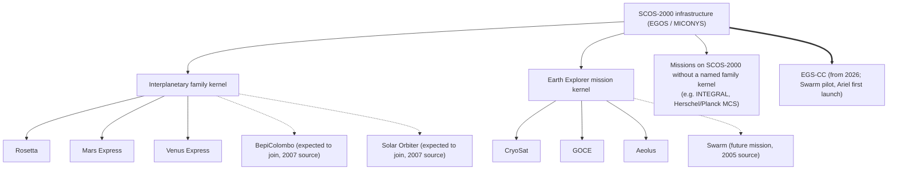

# Missions

The standards and systems described elsewhere in this wiki - [CCSDS](../ccsds/index.md)
packets and frames, the [PUS](../ecss/pus/index.md), [SCOS-2000](../scos2000/index.md) and
its [Mission Information Base](../mib/index.md) - only become concrete in a mission. This
section gathers what the public record says about individual ESA missions: which documents
exist, which data could be copied, and what they reveal about how each mission used the
standards. Every statement is tied to a document in the [library](../references/index.md),
and every library entry records where the file was copied from and when.

Three missions are documented in depth, because their interface documents (and, for one of
them, their real database) are publicly posted:

* **[Solar Orbiter](solar-orbiter/index.md)** - the only mission whose operational MIB is
  publicly available as data; this wiki analyses two releases with SQL and lets you browse
  every parameter, packet and command in the [MIB explorer](../explorer/index.md#/solo/search/SWA).
  The databases of two of its instruments are also publicly posted, analysed on
  [SWA](solar-orbiter/swa.md) and [STIX](solar-orbiter/stix.md), and the instrument-level
  interface documents are on [Solar Orbiter instrument interfaces](solar-orbiter/instrument-interfaces.md).
* **[Herschel and Planck](herschel-planck.md)** - a joint project that put SCOS-2000 into the
  MOC, the central checkout and the instrument EGSE, with a well-documented system database
  (HPSDB) and MIB tailoring notes.
* **[Rosetta, Mars Express and Venus Express](rosetta-mex-vex.md)** - ESOC's interplanetary
  mission family, with a shared mission control system and the data delivery, flight dynamics
  and ground station interface documents that went with it.

A fourth page, **[Other missions and SCOS-2000 users](other-missions.md)**, collects what the
sources say about everything else: the older control systems, INTEGRAL, XMM-Newton, PROBA,
the Earth Explorers, Galileo, the Sentinels, BepiColombo, JUICE and the move to EGS-CC.

## What is available for each mission

| Mission(s) | Operational MIB as data | Database documents | TM/TC and interface documents | Ground segment descriptions | Wiki page |
|---|---|---|---|---|---|
| Solar Orbiter | **Yes**: releases of 2020-04-16 and 2025-09-16, plus instrument databases of SWA (versions 6.3.4 and 6.5.0) and STIX (2.26.38) | MIB ICD issue 7.0 (MOC-applicable); SWA database release notes (v2.0.0 to v6.5.0) | TM-TC and packet structure ICD (SOL.S.ASTR.TN.00079 issue 7), Data Delivery ICD (SOL-ESC-IF-05011), E-FECS ICD, Experiment Interface Document Part A (issue 1, 2007), SWA DPU Communications ICD (issue 8.2, 2019) | EDDS document set (see [EDDS](../scos2000/edds.md)) | [Solar Orbiter](solar-orbiter/index.md), [MIB](solar-orbiter/mib.md), [SWA](solar-orbiter/swa.md), [STIX](solar-orbiter/stix.md), [instrument interfaces](solar-orbiter/instrument-interfaces.md) |
| Herschel, Planck | **No**: listed by the Herschel Science Archive, zip download refused (HTTP 403) | HPSDB processing note (H-P-1-ASP-TN-1060), HCSS tailoring note (HSC/DOC/0300 1.5), SPIRE naming convention | Operations Interface Requirements (SCI-PT-RS-07360), HIFI TEI packet ICD | Planck LFI Level 1 paper, NLR ACMS database report, EGSE requirements and plans | [Herschel and Planck](herschel-planck.md) |
| Rosetta, Mars Express, Venus Express | No | MIB extensions described in the MCS-FDS ICD | DDID issues B5 and C2 with XML schema appendix C3; MCS-FDS ICD (RO-ESC-ID-5003); IFMS-OCC ICD | Mars Express (SP-1291) and Venus Express (SP-1295) data-handling chapters; ESA Bulletin 130 | [Rosetta, MEX, VEX](rosetta-mex-vex.md) |
| BepiColombo, JUICE | No | - | - (Solar Orbiter documents share several BepiColombo references) | SpaceOps 2025 CRF framework paper; SRDB Translator paper; EGOS-CC paper | [Other missions](other-missions.md) |
| INTEGRAL, XMM-Newton, Envisat, PROBA, CryoSat, GOCE, Aeolus, Swarm, Galileo, Sentinels, ... | No | - | - | ESA client lists 2000/2003, GSAW 2005, ESA Bulletin 130, test-tool papers, SpaceOps 2025 EGS-CC paper | [Other missions](other-missions.md) |

The table summarises the library holdings for each mission.[^solo-ddid][^solo-icd][^mib25][^mib20][^swa][^swa65][^stix][^eida][^dpu][^tn1060][^hcss][^oird][^lfi][^nlr][^ddid-c2][^ddid-b5][^appi][^fds][^ifms][^sp1291][^sp1295][^spot][^comi][^egscc][^icd70][^efecs][^spire][^tei][^egse][^pres][^peccia][^armitage][^egoscc]
For the Herschel MIB, the archive page and its directory listing were recorded during this
wiki's source survey on 2026-11-05, but the zips themselves could not be
copied.[^web-hpsdb]

### The Solar Orbiter MIB in numbers

The two Solar Orbiter releases and three instrument database versions (two of SWA, one of STIX)
are the only flight databases in the library. A few counts show their scale (all from this wiki's
own queries):[^mib25][^mib20][^swa][^swa65][^stix]

| Database | VDF name / comment | Parameters (`pcf`) | Packets (`pid`) | Commands (`ccf`) | Sequences (`csf`) | Synthetic parameter files |
|---|---|---|---|---|---|---|
| Solar Orbiter, 2025-09-16 | `25925PFM` / `20250916-CSW3.1.2_MAS7.33` | 126 745 | 11 150 | 5 454 | 3 404 | 1 582 |
| Solar Orbiter, 2020-04-16 | `10720PFM` / `20200416-CSW3.0.3p1_MAS6.51` | 102 104 | 9 027 | 5 238 | 2 701 | 390 |
| SWA instrument database 6.3.4 | last of 70 `vdf` rows (file order): `SWA_6.3.4` ("Released on 29/11/2021") | 2 885 | 609 | 198 | 0 | 0 |
| SWA instrument database 6.5.0 | last of 70 `vdf` rows (file order): `SWA_6.3.3_wa`; versions 6.4.0 to 6.5.0 have no record | 2 885 | 613 | 201 | 0 | 0 |
| STIX instrument database 2.26.38 | `STX_226` / `PFM_applicable` | 681 | 246 | 100 | 0 | 3 |

??? example "SQL used (database sizes)"
    ```sql
    -- run on solo-2025-09-16.sqlite, solo-2020-04-16.sqlite, swa-idb.sqlite,
    -- swa-idb-v6.5.0.sqlite and stix-idb-2.26.38.sqlite
    SELECT * FROM vdf;
    SELECT count(*) FROM pcf;  SELECT count(*) FROM pid;  SELECT count(*) FROM ccf;
    SELECT count(*) FROM csf;  SELECT count(*) FROM synthetic;
    ```

The detailed analysis is on [The Solar Orbiter MIB](solar-orbiter/mib.md),
[Solar Orbiter SWA instrument database](solar-orbiter/swa.md) and
[Solar Orbiter STIX instrument database](solar-orbiter/stix.md); the meaning of each table is on
the [MIB table reference](../mib/tables/index.md). Every instrument parameter and packet of the
SWA 6.5.0 and STIX databases is also in the September 2025 spacecraft release; of their commands,
only the TC(9,129) time command is missing from it ([details](solar-orbiter/mib.md#instrument-databases-inside-the-release)).[^swa65][^stix][^mib25]
The three instrument databases can be browsed in the explorer under
[`swa`](../explorer/index.md#/swa/search/SWA), [`swa65`](../explorer/index.md#/swa65/search/SWA)
and [`stix`](../explorer/index.md#/stix/search/STIX).

## Key documents and where they were copied from

The first set of files was copied by this wiki on 2026-11-05 (UTC) and a second set, marked
below with its date, on 2026-11-12. The table lists the main mission-specific documents; the full provenance (original URL, SHA-256, size) is on each
library page and on [Sources and copies](../about/sources-and-copies.md).

| Document | Mission | Copied from (host) | Copy time (UTC; 2026-11-05 unless dated) |
|---|---|---|---|
| [MIB release MIB__20250916M25925PFMS001_SOL](../library/mib-20250916m25925pfms001-sol.md) | Solar Orbiter | solarorbiter.irap.omp.eu | 14:24:03 |
| [MIB release MIB__20200416M10720PFMS001_SOL](../library/mib-20200416m10720pfms001-sol.md) | Solar Orbiter | solarorbiter.irap.omp.eu | 14:26:42 |
| [SWA instrument database (ASCII.zip)](../library/swa-idb-ascii.md) | Solar Orbiter | solarorbiter.irap.omp.eu | 14:26:47 |
| [SWA instrument database v6.5.0](../library/swa-idb-v6-5-0.md) | Solar Orbiter | solarorbiter.irap.omp.eu | 2026-11-12 17:52:24 |
| [STIX instrument database v2.26.38](../library/stix-idb-v2-26-38-raw.md) | Solar Orbiter | pub099.cs.technik.fhnw.ch | 2026-11-12 17:45:36 |
| [Solar Orbiter DDID SOL-ESC-IF-05011 i1r2](../library/solo-ddid-i1r2.md) | Solar Orbiter | solarorbiter.irap.omp.eu | 14:11:58 |
| [SOL.S.ASTR.TN.00079 issue 7](../library/sol-s-astr-tn-00079-07.md) | Solar Orbiter | solarorbiter.irap.omp.eu | 14:15:48 |
| [SWA DPU Communications ICD SO-SWA-DPU_CD-IC-003 issue 8.2](../library/so-swa-dpu-cd-ic-003-dpu-communications-interface-control-document-issue8-2.md) | Solar Orbiter | solarorbiter.irap.omp.eu | 2026-11-12 17:47:43 |
| [Experiment Interface Document Part A, SOL-EST-IF-0050 issue 1](../library/12-3-solarorbiter-eid-a-issue-1-0-2007-10-09.md) | Solar Orbiter | explorers.larc.nasa.gov | 2026-11-12 17:52:05 |
| [H-P-1-ASP-TN-1060 MIB processing by HPSDB](../library/h-p-1-asp-tn-1060-mib-processing-hpsdb.md) | Herschel/Planck | archives.esac.esa.int | 14:06:30 |
| [HCSS MIB Clarification and Tailoring Note 1.5](../library/hcss-mib-clarification-tailoring-note.md) | Herschel | archives.esac.esa.int | 14:06:21 |
| [Operations Interface Requirements SCI-PT-RS-07360](../library/cosmos-operations-interface-requirements.md) | Herschel/Planck | www.cosmos.esa.int | 14:11:42 |
| [Planck LFI Level 1 telemetry handling](../library/arxiv-1001-4730-planck-lfi-tm.md) | Planck | arxiv.org | 14:06:56 |
| [NLR ACMS database experience](../library/nlr-report-e0d9e9a5.md) | Herschel/Planck | reports.nlr.nl | 14:11:49 |
| [RO/MEX/VEX DDID issue C2](../library/ro-esc-if-5003-ddid-c2.md) | Rosetta/MEX/VEX | pdssbn.astro.umd.edu | 14:12:01 |
| [DDID Appendix I (XML schema) issue C3](../library/ro-esc-if-5003-appendix-i-c3.md) | Rosetta/MEX/VEX | pds-smallbodies.astro.umd.edu | 14:12:03 |
| [RO/MEX DDID issue B5](../library/mex-esc-if-5003-b5.md) | Rosetta/MEX | archives.esac.esa.int | 14:12:08 |
| [MCS-FDS ICD RO-ESC-ID-5003](../library/mex-esc-id-5003-fds-icd.md) | Rosetta/MEX | archives.esac.esa.int | 14:12:19 |
| [IFMS-OCC ICD 11.4.0](../library/ifms-occ-icd-mex.md) | ESTRACK (MEX copy) | archives.esac.esa.int | 14:13:43 |
| [ESA SP-1291 Mars Express data handling](../library/sp-1291-data-handling.md) | Mars Express | sci.esa.int | 14:12:11 |
| [ESA SP-1295 Venus Express data handling](../library/vex-delhaise-web.md) | Venus Express | sci.esa.int | 13:54:41 |

## Mission families and SCOS-2000 generations

ESOC builds mission control systems in layers: generic infrastructure (SCOS-2000), a
**mission family** kernel shared by similar missions, and a thin mission-specific layer
specified only as a "delta".[^merri][^gsaw05] The families named in the sources are
interplanetary (Rosetta, Mars Express, Venus Express, with BepiColombo and Solar Orbiter
expected to join), Earth observation (CryoSat, GOCE, Aeolus and later missions such as
Swarm), observatory and navigation; the sources name members only for the first
two.[^merri][^gsaw05]



The solid lines are memberships stated in the 2005 and 2007 sources, the dotted lines are
missions those sources expected to join; the EGS-CC arrow reflects the 2025 SpaceOps
paper.[^merri][^gsaw05][^egscc] Placing INTEGRAL and the Herschel/Planck MCS outside a named
family is this wiki's simplification, because the sources do not assign them to one.

Sharing a control-system kernel is distinct from sharing spacecraft hardware. For hardware, the
2007 Solar Orbiter Experiment Interface Document retained commonality with BepiColombo,
especially for the high-gain antenna and the solar array, said the attitude control system and
avionics might also be common, and considered re-using elements from Herschel-Planck, Mars
Express or Venus Express.[^eida-com]

## Where the missions show up in the standards pages

The mission pages are the best place to see standards in use. Some cross-references:

* **Packet structures**: Solar Orbiter's APID split into process ID and category
  ([Solar Orbiter](solar-orbiter/index.md)), the Herschel test-equipment packet headers with
  a 3-bit command source in the sequence count ([Herschel and Planck](herschel-planck.md)),
  and a decoded Rosetta telecommand with a verified CRC
  ([Rosetta, MEX, VEX](rosetta-mex-vex.md)); background on
  [Space Packet](../ccsds/space-packet.md) and [PUS packet structures](../ecss/pus/packets.md).
* **PUS service selection**: the Herschel/Planck table of mandatory, optional and not
  applicable services and [How Solar Orbiter uses PUS](solar-orbiter/pus-usage.md); see the
  [PUS message type catalogue](../ecss/pus/message-types.md).
* **Instrument-level definitions**: the Solar Orbiter packet ICD allocates private service
  ranges to each instrument (for example 200-205 to SWA and 236-240 to STIX); the SWA DPU ICD and
  the SWA and STIX instrument databases show how one instrument fills its range and how its
  definitions reappear in the spacecraft MIB - see [SWA](solar-orbiter/swa.md),
  [STIX](solar-orbiter/stix.md) and [instrument interfaces](solar-orbiter/instrument-interfaces.md).[^svc][^dpu]
* **Data delivery**: GDDS for Rosetta/MEX/VEX, EDDS for Solar Orbiter - compare
  [GDDS and mission DDIDs](../scos2000/gdds-and-ddids.md) and [EDDS](../scos2000/edds.md).
* **Time correlation**: the Rosetta/MEX/VEX coefficient packets and time quality flags, and
  the Solar Orbiter time stamps - see [Time correlation in SCOS-2000](../scos2000/time-correlation.md).
* **MIB tailoring and heritage**: Herschel's HPSDB rules and repatriated CCS tables, the
  Rosetta/MEX MIB extensions and CryoSat's command parameter types, all visible in the Solar
  Orbiter release - see [Mission tailoring of the MIB](../mib/tailoring.md) and
  [History of the Database Import ICD](../mib/icd-history.md).

## What is not covered

* The mission identifiers that other missions (for example BepiColombo or JUICE) use in the
  SCOS-2000 packet header are not stated in the available sources; for Solar Orbiter the
  spacecraft and mission ID is 650.[^solo-hdr]
* No MIB of any mission other than Solar Orbiter (and its SWA and STIX instruments) is in the
  library; the databases of the other eight Solar Orbiter instruments are not in it either.
  The Herschel/Planck MIB releases (MOC issues 2 to 13, 2009-2011) are listed online but
  could not be copied.[^web-hpsdb]
* Launch dates, mission status and science results are mentioned only where the cited
  documents state them.

[^solo-ddid]: [Solar Orbiter Data Delivery ICD SOL-ESC-IF-05011, issue 1 rev 2](../library/solo-ddid-i1r2.md), cover and §1, PDF pp. 1 and 7.
[^solo-icd]: [SOL.S.ASTR.TN.00079 issue 7, Solar Orbiter TM-TC and Packet Structure ICD](../library/sol-s-astr-tn-00079-07.md), cover and §1.1, PDF pp. 1 and 11.
[^solo-hdr]: [Solar Orbiter DDID](../library/solo-ddid-i1r2.md), §7.1.1 SCOS-2000 Common Packet Header Structure (S/C ID and Mission ID 650), PDF pp. 20-21.
[^mib25]: [Solar Orbiter MIB release MIB__20250916M25925PFMS001_SOL](../library/mib-20250916m25925pfms001-sol.md), tables `vdf`, `pcf`, `pid`, `ccf`, `csf` and `synthetic`, queried by this wiki (SQL above).
[^mib20]: [Solar Orbiter MIB release MIB__20200416M10720PFMS001_SOL](../library/mib-20200416m10720pfms001-sol.md), same tables, queried by this wiki.
[^swa]: [Solar Orbiter SWA instrument database (ASCII.zip)](../library/swa-idb-ascii.md), same tables, queried by this wiki.
[^tn1060]: [H-P-1-ASP-TN-1060, MIB files processing by HPSDB, issue 1](../library/h-p-1-asp-tn-1060-mib-processing-hpsdb.md), §1 Scope, PDF p. 7.
[^hcss]: [HSC/DOC/0300 HCSS MIB Clarification and Tailoring Note, issue 1.5](../library/hcss-mib-clarification-tailoring-note.md), cover and §1.1, PDF pp. 1 and 4.
[^oird]: [SCI-PT-RS-07360 Herschel/Planck Operations Interface Requirements Document, issue 2.2](../library/cosmos-operations-interface-requirements.md), cover and §1.1, PDF pp. 1 and 10.
[^lfi]: [Zacchei et al., Level 1 on-ground telemetry handling in Planck LFI](../library/arxiv-1001-4730-planck-lfi-tm.md), abstract, PDF p. 2.
[^nlr]: [NLR-TP-2007-240, Herschel/Planck ACMS Database Experience](../library/nlr-report-e0d9e9a5.md), executive summary, PDF p. 1.
[^ddid-c2]: [RO/MEX/VEX-ESC-IF-5003 DDID, issue C2](../library/ro-esc-if-5003-ddid-c2.md), cover and §1.1-1.2, PDF pp. 1 and 25.
[^ddid-b5]: [RO/MEX-ESC-IF-5003 DDID, issue B5](../library/mex-esc-if-5003-b5.md), cover, PDF p. 1.
[^appi]: [DDID Appendix I (XML Schema), issue C3](../library/ro-esc-if-5003-appendix-i-c3.md), cover and §1.1, PDF pp. 1 and 9.
[^fds]: [RO-ESC-ID-5003 FDS-MCS ICD, issue B1](../library/mex-esc-id-5003-fds-icd.md), cover and §1.1, PDF pp. 1 and 9.
[^ifms]: [IFMS-OCC Interface Control Document, issue 11.4.0](../library/ifms-occ-icd-mex.md), cover and §1, PDF pp. 1 and 5.
[^sp1291]: [Zender et al., Spacecraft and Payload Data Handling, ESA SP-1291 (Mars Express)](../library/sp-1291-data-handling.md), PDF pp. 1-3.
[^sp1295]: [Delhaise et al., Spacecraft and Payload Data Handling, ESA SP-1295 (Venus Express)](../library/vex-delhaise-web.md), PDF p. 1.
[^spot]: [de la Fuente et al., Automated Commanding Request Framework, SpaceOps 2025 paper 141](../library/spaceops2025-0141.md), abstract, PDF p. 1.
[^comi]: [Comi et al., SRDB Translator: A Tool to Transfer Data from S2K to ECHO Databases](../library/indico-109-comi-2009436.md), "Applications", PDF p. 6.
[^icd70]: [SCOS-2000 Database Import ICD issue 7.0](../library/icd-7-0-final.md), cover, PDF p. 1.
[^efecs]: [SOL-SGS-ICD-0006 E-FECS ICD, issue 3.0](../library/sol-sgs-icd-0006-efecs-icd-3-0.md), §1, PDF pp. 8-9.
[^spire]: [SPIRE-RAL-NOT-001155 SPIRE MIB Naming Convention, issue 1.2](../library/spire-mib-naming-convention-1-2.md), §1, PDF p. 1.
[^tei]: [SRON-U/HIFI/SP/2001-011 TEI TMTC packet ICD, issue 1.0](../library/cosmos-tei-tmtc-packet-icd.md), §1-2, PDF p. 3.
[^egse]: [H-P-1-ASPI-SP-0045 EGSE General Requirements Specification, issue 03](../library/h-p-1-aspi-sp-0045-egse-general-req.md), PDF p. 19; [SRON-U/HIFI/PL/2001-1 Herschel EGSE integration plan](../library/cosmos-herschel-egse-integration-plan.md), §1-3, PDF p. 3.
[^pres]: [SCOS-2000 presentation to FIRST/Planck, 18.04.2000](../library/scos2000-complete-presentation-2000.md), slides "Utilisation", PDF pp. 6-7.
[^peccia]: [N. Peccia, SCOS-2000, GSAW 2003](../library/gsaw2003-peccia.md), slides "S2K Client missions", PDF pp. 14-15.
[^armitage]: [A. Armitage, Right-Sizing Test Tools, SESP 2010](../library/indico-109-armitage-2011926.md), Introduction, PDF p. 1.
[^egoscc]: [Walsh et al., Developing EGS-CC based applications; the EGOS-CC experience, SESP 2019](../library/airdrive-b8b986f.md), "Programmatics", PDF p. 7.
[^egscc]: [Reggestad and Widegård, Towards EGS-CC at ESOC, SpaceOps 2025 paper 477](../library/spaceops2025-egs-cc.md), §1-2, PDF pp. 2-4.
[^merri]: [Merri et al., Happy Families, ESA Bulletin 130 (2007)](../library/bul130-merri-happy-families.md), sections "Mission Families", "The interplanetary mission family" and "The Earth observation mission family", PDF pp. 4-5.
[^gsaw05]: [Guerrucci et al., Mission Families, GSAW 2005](../library/gsaw2005-guerrucci.md), slides "Mission Families at ESOC" and "The Earth Explorer Mission Family Evolution", PDF pp. 10-11.
[^web-hpsdb]: Web pages not in this wiki's library: <https://archives.esac.esa.int/hsa/legacy/operations/moc/sdb/> and <https://archives.esac.esa.int/hsa/legacy/operations/moc/sdb/data/>; content as recorded in this wiki's source survey on 2026-11-05; the zip downloads returned HTTP 403.
[^swa65]: [Solar Orbiter SWA instrument database v6.5.0](../library/swa-idb-v6-5-0.md), tables `vdf`, `pcf`, `pid`, `ccf`, `csf` and `synthetic`, queried by this wiki on 2026-11-12; release notes `IDB_relNotes.txt` (entries v2.0.0 to v6.5.0).
[^stix]: [Solar Orbiter STIX instrument database v2.26.38](../library/stix-idb-v2-26-38-raw.md), tables `vdf`, `pcf`, `pid`, `ccf`, `csf` and `synthetic`, queried by this wiki on 2026-11-12.
[^eida]: [SOL-EST-IF-0050 Solar Orbiter Experiment Interface Document Part A, issue 1 rev. 0 (9 October 2007)](../library/12-3-solarorbiter-eid-a-issue-1-0-2007-10-09.md), cover and §1.2 Scope, PDF pp. 1 and 10-11.
[^eida-com]: [SOL-EST-IF-0050 EID-A, issue 1](../library/12-3-solarorbiter-eid-a-issue-1-0-2007-10-09.md), §3.3 Spacecraft Main Characteristics (commonality with BepiColombo; possible re-use from Herschel-Planck, Mars Express, Venus Express), PDF p. 18.
[^dpu]: [SO-SWA-DPU_CD-IC-003 SWA DPU Communications ICD, issue 8.2 (7 August 2019)](../library/so-swa-dpu-cd-ic-003-dpu-communications-interface-control-document-issue8-2.md), cover, §5 Table 1 (APIDs) and §6 (Table 2: telecommands of services 3, 5, 6, 9, 17, 20, 21 and 200; §6.2-6.6: services 200 to 204 by software manager), PDF pp. 1, 32-36 and 68-192.
[^svc]: [SOL.S.ASTR.TN.00079 issue 7](../library/sol-s-astr-tn-00079-07.md), §5.1, Table 5.1-1 Solar Orbiter TM/TC Service and Subservice List (instrument private service ranges), PDF p. 39.
