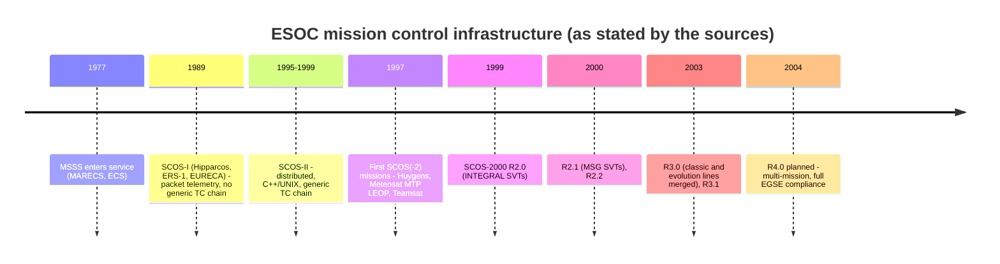
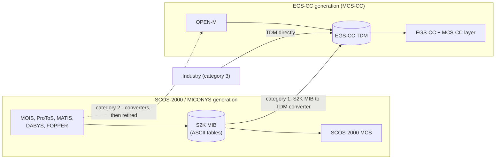

# Other missions and SCOS-2000 users

Most of what this wiki knows about SCOS-2000 and the [MIB](../mib/index.md) comes from three
mission documentation sets: [Solar Orbiter](solar-orbiter/index.md),
[Herschel and Planck](herschel-planck.md) and
[Rosetta, Mars Express and Venus Express](rosetta-mex-vex.md). Many more missions appear in
the library sources, usually in passing: in ESA's own lists of [SCOS-2000](../scos2000/index.md)
users, in conference papers on the mission-family approach, in papers on test tools and
database converters, and in recent papers on payload commanding and on the transition to
EGS-CC. This page collects those statements, mission by mission, and says where each one
comes from. It does not add facts from memory: when a source is silent about something
(launch dates, current status, the content of a mission's database), the page says so.

!!! info "How to read this page"
    Mission lists from 2000 and 2003 describe plans at the time ("development ongoing",
    "in evaluation"); they are historical statements, not confirmations of what was finally
    built. No database (MIB) of any mission on this page is in the library; only the Solar
    Orbiter MIB is publicly available as data, and the queries quoted below run on it.

## Before SCOS-2000: four generations of control systems

ESOC decided in 1974 to develop a reusable mission control infrastructure. The first
generation, the Multi Mission Support System (MSSS; "Multi-Satellite Support System" in the
2007 ESA Bulletin), entered service in 1977 and, when the SCOS-II paper was written, was still
used by the MARECS and ECS missions; the second, SCOS-I, followed in 1989 and supported
Hipparcos, ERS-1 and EURECA.[^scos2-gen][^merri-hist] The third, SCOS-II, was a
distributed client-server system on Unix workstations; its first client missions were to be
Huygens (1997), Artemis (1997) and Envisat (1998).[^scos2-gen][^scos2-ol] SCOS-2000 then
replaced SCOS-II.



The sources do not agree on every date. Peccia's 2003 slides give MSSS as 1984-1996, SCOS-I
"since 1989" (packet telemetry, no generic telecommand chain) and SCOS-II as 1995-1999,
"superceded by SCOS-2000"; the ESA Bulletin of 2001 says work on SCOS started around 1992
and supported its first missions - Huygens, the Meteosat (MTP) LEOP and
Teamsat - in 1997, and the 2000 presentation names the product SCOS-2 up to release R1.4
(until 1998) and SCOS-2000 from release R2.0 (1999).[^peccia-hist][^bul108-hist][^pres-name] The
release dates in the timeline come from the 2000 presentation (R2.0 September 1999 for the
INTEGRAL system validation tests, R2.1 March 2000 for MSG, R2.2 September 2000) and from the
2003 slides (R3.0 January 2003, R3.1 September 2003, R4.0 planned for June
2004).[^pres-rel][^peccia-ver]

## Who used SCOS-2000: ESA's own lists

Two ESA presentations list the client missions. The table merges them; "2000" is the
presentation to the FIRST/Planck instrument teams of 18 April 2000, "2003" Peccia's GSAW
slides of March 2003.[^pres-use][^peccia-clients][^peccia-ext]

| Mission | 2000 list | 2003 list | Notes from the sources |
|---|---|---|---|
| SOHO | past: 1995 (telemetry only) | existing (NASA Goddard) | |
| Huygens, Teamsat, MTP (EUMETSAT) | past: 1997 | existing | Huygens interfaced via the NASA system at JPL |
| INTEGRAL | present: successful SVTs | existing | see below |
| MSG | present: successful SVTs | existing (LEOP system) | Meteosat Second Generation |
| ERS | present: first delivery end 1999, migration from SCOS-1 | - | |
| PROBA | present: MCS + EGSE | existing | see below |
| Rosetta | present: AD phase | development (10-year mission) | [Rosetta, MEX, VEX](rosetta-mex-vex.md) |
| SMART-1 | future | development | experimental propulsion |
| Envisat | future: migration from SCOS-1 | - | |
| XMM | future: MOC + SOC, migration from SCOS-1 | - | |
| Mars Express | future | development | [Rosetta, MEX, VEX](rosetta-mex-vex.md) |
| Venus Express | - | development | [Rosetta, MEX, VEX](rosetta-mex-vex.md) |
| FIRST/Planck (Herschel/Planck) | future: MOC; EGSE + PIs "??" | MCS; CCS (EGSE); instrument EGSE (external users) | [Herschel and Planck](herschel-planck.md) |
| Earth Core Explorers CryoSat, GOCE | future | development | see below |
| ADM (Aeolus) | - | development | |
| Vega launcher EGSE | - | in evaluation | |
| Galileo MCS (34 satellites) | - | in evaluation | |

External users listed in 2003 were Canada (Radarsat 2, telecommunication satellites under
evaluation), DLR-GSOC (GRACE, BIRD), Eutelsat (a new MCS called NEO), the Italian Space
Agency (Cosmos Skynet), the Italian aeronautical research centre (an unmanned space vehicle),
20 European scientific institutes (including the Herschel/Planck instrument EGSE on SUSE 7.3)
and Japanese telecommunication satellites under evaluation.[^peccia-ext] The same slides count
"54 Licenses in 3 years" and explain the licensing model: ESA keeps ownership and grants
non-exclusive, free-of-charge licences to companies of ESA member states, for peaceful use,
with improvements preferably returned to ESA.[^peccia-lic]

## Missions in more detail

### INTEGRAL

INTEGRAL is the first mission the sources tie to a specific SCOS-2000 release: R2.0 of
September 1999 was the release for the INTEGRAL system validation tests.[^pres-rel] Peccia's
slide of an SCOS-2000-based MCS in its ground-segment context uses INTEGRAL as the example:
an INTEGRAL monitoring and control system (IMCS) fed by an operations database (ODB) built
from the satellite database import, an INTEGRAL overall simulator, a mission planning system,
the flight dynamics system, an off-line evaluation system and long history file, and an
INTEGRAL Security Distribution System delivering data and CD-ROMs to the INTEGRAL Science
Operations Centre (ISOC) and the INTEGRAL Science Data Centre (ISDC).[^peccia-integral]

INTEGRAL also left two tools behind. Its MS Access database editor, "compatible with SCOS
2000", was offered to the FIRST/Planck teams in 2000 as a database option.[^mom-db][^pres-offer]
The HIFI team evaluated it in April 2001 as the *SCOS-2000 Database Editing Subsystem,
version 2.0*, "also referred to as the Integral MS Access editor"; the developer's answers in
that report explain INTEGRAL's choices, for example keys on the first six fields because of
the structure of the incoming satellite database, commands with more than 200 parameters, and
consistency checking planned in a separate application.[^hifi-eval] On the science side, the
ISDC in Geneva reused software it had developed for INTEGRAL to build the Planck LFI
telemetry handler and quick-look displays.[^lfi-isdc] [MIB tooling](../mib/tooling.md) covers
database editors in general.

### XMM-Newton, Envisat and ERS: migrations from SCOS-1

The 2000 presentation lists Envisat and XMM (MOC and SOC) as future migrations from SCOS-1,
and ERS as a migration with a first delivery at the end of 1999.[^pres-use] The 2005 GSAW
slides cite software that started as mission developments and was reused widely: the File
Transfer System from XMM and the Mission Planning System from Envisat (and database editors
from CryoSat).[^gsaw05-infra] XMM also shaped the Herschel/Planck requirements: the annex on
the satellite users manual of the Herschel/Planck OIRD "is derived directly from the example of
the XMM mission".[^oird-xmm] The SCOS-II paper also names Envisat as a 1998 client of that
earlier system.[^scos2-ol]

### PROBA

PROBA, a technology satellite with a 32-bit processor, an Earth-observation imager and
experiments in on-board autonomy and planning, used a 2-m antenna at Redu independent of the
ESA network.[^mom-proba] Its common EGSE and mission control system was built on SCOS 2 with an
ORACLE database extended to the SCOE equipment, a router written in Delphi, LabVIEW
applications and a Tcl/Tk procedure language; the router and Tcl/Tk tool were then offered to
the FIRST/Planck teams.[^mom-proba][^pres-offer] The *EGSE & Mission Control System* (EMCS)
delivered to the Herschel/Planck instrument teams states that it is "based on the PROBA
approach, but uses SCOS 2000 in place of SCOS 2", and that the MS-Windows EGSE router
developed by ESTEC for PROBA was not used on Herschel/Planck.[^emcs-proba] See
[SCOS-2000 as EGSE](../scos2000/egse.md).

### SMART-1

SMART-1 appears in both client lists (an experimental propulsion mission due for launch in
2003 in the 2003 list) and, with Rosetta and Mars Express, among the planetary missions for
which ESA decided early to archive data in NASA's Planetary Data System (PDS) format.[^pres-use][^peccia-clients][^mex-pds]

### The Earth Explorer family: CryoSat, GOCE, Aeolus and Swarm

The Earth Explorer missions form ESOC's Earth observation family: low orbits (250-800 km),
often polar, with about 15 short passes of about 10 minutes a day over a single station, and
very similar operational concepts despite different platforms.[^merri-ee] Their on-board time
management illustrates the differences: CryoSat synchronises its time via the French DORIS
payload and ground beacons, GOCE uses an on-board counter kept in step by the ground, and
Aeolus has a GPS receiver in addition to its counter.[^merri-ee] The 2007 article records that
CryoSat, the first Earth Explorer Opportunity mission, was lost in a launch failure in October
2005, that GOCE was foreseen for launch at the end of 2007 and Aeolus in 2008, and lists
CryoSat-2, Swarm, EarthCARE and the GMES Sentinels as future members.[^merri-ee]

For this family ESOC used a three-layer delta approach, inserting an **Earth Explorer Mission
Kernel** between SCOS-2000 and each mission.[^merri-delta] CryoSat was the first mission
specified as a delta against SCOS-2000, GOCE as a delta against CryoSat (which defined the
kernel in practice), and Aeolus as a delta against the kernel.[^gsaw05-ee]

| Requirements at definition phase | Kernel | Mission-specific | Total |
|---|---|---|---|
| CryoSat SRD | 406 | 35 | 441 |
| GOCE SRD | 129 | 62 | 191 |
| Aeolus SRS | 57 | 115 | 172 |
| Total | 592 | 212 | 804 |

The table reproduces the counts on the GSAW 2005 slide.[^gsaw05-req] The same slides list what
each mission contributed to the kernel: CryoSat brought an off-line database editor and
consistency checker, command and parameter identifier extensions, playback telemetry
processing with command verification, a mission planning system, the file transfer system,
handling of bad time quality per virtual channel, configurable on-board software
maintenance, on-board queue dump processing, XML-based ground interface files and the
prime/backup real-time plus off-line archive server architecture; GOCE added planning
enhancements, telemetry gap identification, task parameter files with microsecond times,
automatic telemetry replay and a time correlator; Aeolus added weekly playback consolidation,
OBSM enhancements, orbital coordinates and automatic NIS schedule execution.[^gsaw05-contrib]

CryoSat also changed SCOS-2000 itself. In 2002 ESOC reported that CryoSat had implemented a
range of SPIDs for service 1 report packets (Rosetta had allowed any SPID), to be integrated in
R3.1.[^hcss-spid] The MIB ICD records a "Cryosat special command/sequence parameter types
repatriation" in ICD version 6.0: command or sequence parameters of type **Command ID**
(encoded automatically as the raw data of another command), of type **Parameter ID** (encoded
as a telemetry parameter's on-board identifier) and a default **sub-schedule ID** for
time-tagged commands in the `ccf` and `csf` tables; ICD 6.1 also integrated a sustaining DCR
labelled CRY-OG-655 (DCR 3398) that updated the descriptions of `PID_PI1_VAL` and
`PID_PI2_VAL` - the "CRY" prefix suggests CryoSat, but the annex does not say so.[^icd70-cry][^icd70-61]

The three CryoSat features are used by Solar Orbiter today. In the September 2025 release,
2 command parameters have `CPC_CATEG` = `A` (Command ID: "Complete TC packet" and "TC to send
upon event"), used for example by
[ZCD00B04](../explorer/index.md#/solo/command/ZCD00B04) "Insert Telecommands in Command
Schedule", TC(11,4), and by event-action definitions such as
[ZCS01301](../explorer/index.md#/solo/command/ZCS01301), TC(19,1); 152 parameters have
`CPC_CATEG` = `P` (Parameter ID); and 5 304 of 5 454 commands and all 3 404 sequences give a
sub-schedule ID.[^mib25][^icd70-cpc][^icd70-csf]

??? example "SQL used (CryoSat-heritage features in the Solar Orbiter MIB)"
    ```sql
    -- solo-2025-09-16.sqlite
    SELECT CPC_CATEG, count(*) FROM cpc GROUP BY 1;            -- A 2, P 152, C 327, T 1624, N 4991, '' 59
    SELECT CPC_NAME, CPC_DESCR FROM cpc WHERE CPC_CATEG = 'A';  -- PCD0B044, PCD13013
    SELECT c.CDF_CNAME, f.CCF_DESCR, f.CCF_TYPE, f.CCF_STYPE FROM cdf c JOIN ccf f ON f.CCF_CNAME = c.CDF_CNAME
     WHERE c.CDF_PNAME IN (SELECT CPC_NAME FROM cpc WHERE CPC_CATEG = 'A');
    SELECT count(*), count(nullif(CCF_SUBSCHEDID, '')) FROM ccf;  -- 5454 | 5304
    SELECT count(*), count(nullif(CSF_SUBSCHEDID, '')) FROM csf;  -- 3404 | 3404
    ```

**Swarm**, a constellation of three Earth magnetic field satellites launched in 2013, is the
first mission ESOC is migrating to an EGS-CC-based MCS (see the last section).[^egscc-swarm]

### Galileo

Peccia's 2003 list has a Galileo MCS for 34 satellites "in evaluation".[^peccia-clients] Two
later papers show Galileo using SCOS-2000-format databases in testing. Thales Alenia Space
Italia and Intecs wrote the first version of their *SRDB Translator* for the Galileo GIOVE-B
project, whose satellite reference database was a mission-tailored SCOS-2000 database
delivered as a single MS Access 2000 file and validated with TAS-I's own ECHO checkout
system.[^comi-giove] Terma's CMDVS monitoring and control system, compatible with the SCOS-2000
database and test language, was used at payload or instrument level on Galileo FOC, and a
Galileo FOC thermal monitoring SCOE ran it on a small low-power PC.[^armitage-missions][^armitage-scoe]

### Sentinel-1, Sentinel-2, EarthCARE and SGEO

The Comi paper explains why converters exist at all: SCOS-2000 had become a standard for ESA
mission control centres and in most cases for EGSE, so satellite reference databases were
"almost always" based on the SCOS-2000 run-time database.[^comi-intro] For Sentinel-1, where
TAS-I validated at satellite level and a SCOS-2000 database was an imposed requirement, an
enhanced SRDB Translator let the AIV team keep using ECHO.[^comi-giove][^comi-s1] Terma reports
CMDVS at payload or instrument level on Sentinel-1, Sentinel-2, EarthCARE and SGEO (and
BepiColombo and Galileo FOC).[^armitage-missions] A small trace of Sentinel-2 reached Solar
Orbiter: issue 2 of the Solar Orbiter packet structure ICD updated its APID table "based on SW
donor being Sentinel 2".[^solo-icd-s2]

Terma's paper also gives numbers that matter for anyone building on SCOS-2000 as EGSE: the
SCOS-2000 telecommand chain handled 2 packets per second with checking or 20 without; CMDVS
supports all SCOS-2000 verification stages plus a finalisation stage, with up to 64 stages
configurable by mask; and the MIB interface was described as "not perfectly normalized" but
well known and understood.[^armitage-tc][^armitage-mib]

### BepiColombo

In 2007 ESOC expected BepiColombo (then due for launch to Mercury in 2013) and Solar Orbiter
(2015) to join the interplanetary family of Rosetta, Mars Express and Venus
Express.[^merri-bc] A 2025 paper gives the launch as October 2018, in cooperation with JAXA,
followed by a 7.2-year cruise with nine planetary flybys.[^spot-bc] The documents in this
library show how closely BepiColombo and Solar Orbiter are tied on the ground:

* the Solar Orbiter Data Delivery ICD was tidied up and aligned "with the BepiColombo DDID"
  in its issue 1 revision 2, refers time correlation to a BepiColombo technical note, lists a
  "(Solar Orbiter/BepiColombo) Packetiser ICD" and the "BepiColombo and Solar-Orbiter MCS
  SRS" among its documents, and says that the two missions share the EDDS backup
  server;[^solo-bc-chg][^solo-bc-docs][^solo-bc-edds]
* the Solar Orbiter packet structure ICD, in the definition of the telecommand
  acknowledgement flags, still reads "The bit settings defined for BepiColombo are as
  follows";[^solo-icd-bc]
* TAS-I used the Sentinel-1 version of its SRDB Translator on BepiColombo to
  import SCOS-2000 databases for on-board computer and mass-memory tests; those databases
  followed an earlier ICD issue and needed added columns before import. The paper's metrics
  for the two databases are:[^comi-bc]

| BepiColombo database | OBC | SSMM |
|---|---|---|
| Approximate number of records | 10 000 | 10 000 |
| Parameters | 3 745 | 1 947 |
| TM packets | 521 | 1 921 |
| TM samples | 2 944 | 2 540 |
| TC packets | 399 | 535 |
| TC samples | 427 | 1 445 |

!!! warning "Inference"
    The leftover BepiColombo sentence in the Solar Orbiter ICD and the shared packetiser
    ICD suggest that the Solar Orbiter TM/TC definitions were derived from BepiColombo's.
    The sources state the shared documents, not the derivation.

During the cruise, BepiColombo instrument teams send their commanding requests to the MOC as
Command Request Files (CRFs): Payload Operations Requests (PORs) and Payload Direct Operations
Requests (PDORs). Since launch more than about 1 500 of them were produced with *SPOT Cruise*,
a web tool built at ESAC that checks each request against the applicable MIB, handles MIB
updates and conflicts, and delivers the CRF to ESOC's mission planning and control
systems.[^spot-bc][^spot-features] The paper expands MIB as "Mission Information Database" and
explains the motivation: before this centralised framework, users' own CRF tools often clashed
with the MIB and the ESOC ICDs, causing long exchanges with the flight control
team.[^spot-abstract] When ESOC started developing its EGS-CC based systems, the BepiColombo
simulator was the mission simulator used for parallel test sessions.[^egoscc-bc]

### JUICE

JUICE, launched in April 2023 and due at Jupiter in 2031, adapted the BepiColombo CRF editor
in 2021 as *SPOT JUICE*, without the 3D flyby visualisation, procedure builder and simulation
functions; it supported payload ground testing, near-Earth commissioning, six-monthly
check-outs and the Lunar-Earth gravity assist of August 2024, with more than about 700
requests.[^spot-juice] Hera and Ariel have shown interest in the framework.[^spot-hera] In 2019
the JUICE MCS (J-MCS) was "the first target mission control system to be developed based on
EGOS-CC", with a pilot to demonstrate maturity before a commitment due in September
2019.[^egoscc-juice] Whether that commitment was confirmed for JUICE is not stated in the
available sources; the 2025 SpaceOps paper names Swarm and Ariel as the first EGS-CC
missions.[^egscc-swarm]

### Solar Orbiter

Solar Orbiter has its own pages: [Solar Orbiter](solar-orbiter/index.md),
[the Solar Orbiter MIB](solar-orbiter/mib.md), [its use of PUS](solar-orbiter/pus-usage.md)
and [the SWA instrument database](solar-orbiter/swa.md).

## The EGS-CC era

For decades ESOC has monitored and controlled satellites with SCOS-2000 and complementary
products forming the **MICONYS** (MIssion CONtrol sYStem) suite; the 2025 SpaceOps paper
states that "the signs of obsolescence of SCOS-2000 based solutions can no longer be
ignored".[^egscc-abs] In April 2024 ESOC re-confirmed that the next-generation MCS will be based
on the European Ground Systems Common Core (EGS-CC); the transition is predicted to take at
least 7 years from the first operational use of EGS-CC (in 2026), which puts the end of life
of SCOS no earlier than 2033, driven by the number of missions involved (above
40).[^egscc-intro][^egscc-milestone] Swarm was chosen as the pilot for migrating a flying mission
at no risk, with SCOS-2000 still available in parallel; Ariel (first SVTs in 2027, launch in
2029) is to be the first mission prepared for launch on the new system.[^egscc-swarm]

The migration of tailoring data is planned in three categories:[^egscc-cat]

| Category | Tailoring data | Tools |
|---|---|---|
| 1 (e.g. Swarm) | Native SCOS-2000 MIB, converted on import into the EGS-CC tailoring data model (TDM) | S2K generation tools MOIS, ProToS, MATIS, DABYS, FOPPER; OPEN-M as intermediate; may stay in category 1 |
| 2 (Ariel expected, to be confirmed) | Originally an S2K MIB, fully migrated to EGS-CC formats with converters | OPEN-M replaces MOIS, MATIS preparation, ProToS, FOPPER, DABYS and other MIB tools |
| 3 (new missions) | Delivered by industry directly in EGS-CC TDM format | everything in OPEN-M, also for AIV |

Current work for Swarm covers commanding-chain enhancements (pre-release checks), playback
telemetry, SLE link handling, historical data retrieval, a refurbished time correlation and
on-board queue modelling; file-based operations, on-board software maintenance, security and
PUS-C use cases (with the Generic Operational Interface Requirements) come next, with a fully
operational solution expected in 2027.[^egscc-recent] The ancillary products and the EGS-CC
context are described on [Ancillary systems, MICONYS and the move to EGS-CC](../scos2000/ancillary-and-egs-cc.md);
how a MIB maps to other data models is discussed on [XTCE](../ccsds/xtce.md) and
[ECSS-E-ST-70-31C](../ecss/e-st-70-31c.md).



The diagram is drawn from the category descriptions of the 2025 paper.[^egscc-cat]

## Mission identifiers in SCOS-2000 headers

The SCOS-2000 packet header that ESOC archives and delivers to users carries a spacecraft ID
and an MCS mission ID; for Solar Orbiter both are 650, and the DDID adds that the mission ID
should not be used by external users.[^solo-hdr] The values used by other missions (for
example BepiColombo or JUICE) are not stated in the available sources; this wiki has no
library document that lists them.

## Summary table

| Mission | Family / role | Main library sources | Wiki page |
|---|---|---|---|
| MSSS / SCOS-I / SCOS-II era missions | pre-SCOS-2000 | [^scos2-gen][^scos2-ol][^peccia-hist] | this page |
| SOHO, Huygens, Teamsat, MTP, MSG | early SCOS-2000 clients | [^pres-use][^peccia-clients] | this page |
| INTEGRAL | R2.0 SVTs, MS Access editor, ISDC heritage | [^pres-rel][^hifi-eval][^peccia-integral] | this page |
| XMM-Newton, Envisat, ERS | migrations from SCOS-1 | [^pres-use][^gsaw05-infra] | this page |
| PROBA | SCOS 2 MCS + EGSE, EMCS heritage | [^mom-proba][^emcs-proba] | this page, [SCOS-2000 as EGSE](../scos2000/egse.md) |
| CryoSat, GOCE, Aeolus, Swarm | Earth Explorer family | [^gsaw05-ee][^merri-ee][^icd70-cry][^egscc-swarm] | this page |
| Galileo, Sentinels, EarthCARE, SGEO | SCOS-2000 databases in AIV/EGSE | [^comi-giove][^armitage-missions] | this page |
| Rosetta, Mars Express, Venus Express | interplanetary family | DDIDs, FDS ICD, SP-1291, SP-1295 | [Rosetta, MEX, VEX](rosetta-mex-vex.md) |
| Herschel, Planck | observatory missions, HPSDB | OIRD, HPSDB TN, HCSS note, LFI paper | [Herschel and Planck](herschel-planck.md) |
| BepiColombo, JUICE | interplanetary, CRF tools, EGOS-CC pilot | [^spot-bc][^comi-bc][^egoscc-juice] | this page |
| Solar Orbiter | interplanetary (BepiColombo generation), public MIB | DDID, ICD, MIB releases | [Solar Orbiter](solar-orbiter/index.md) |
| Ariel | first EGS-CC launch mission | [^egscc-swarm] | this page |

[^scos2-gen]: [P. Kaufeler, M. Pecchioli, I. Shurmer, SCOSII: ESA's new generation of mission control systems - the user's perspective (NASA NTRS 19950011122)](../library/ntrs-scos2-new-generation.md), abstract and §1-2.1, PDF p. 1.
[^scos2-ol]: [SCOSII OL: A Dedicated Language for Mission Operations (NASA NTRS 19950011118)](../library/ntrs-scosii-ol.md), introduction (first client missions), PDF pp. 2-3.
[^peccia-hist]: [N. Peccia, SCOS-2000: ESA's Spacecraft Control for the 21st Century, GSAW 2003](../library/gsaw2003-peccia.md), slide "History of ESA control systems", PDF p. 9.
[^peccia-ver]: [GSAW 2003, Peccia](../library/gsaw2003-peccia.md), slide "SCOS-2000 Versions", PDF p. 16.
[^peccia-clients]: [GSAW 2003, Peccia](../library/gsaw2003-peccia.md), slide "S2K Client missions" (ESA), PDF p. 14.
[^peccia-ext]: [GSAW 2003, Peccia](../library/gsaw2003-peccia.md), slide "S2K Client missions" (External Users), PDF p. 15.
[^peccia-lic]: [GSAW 2003, Peccia](../library/gsaw2003-peccia.md), slides "Product Line", PDF pp. 6-7.
[^peccia-integral]: [GSAW 2003, Peccia](../library/gsaw2003-peccia.md), slide "An S2K based MCS in a GS Context", PDF p. 13.
[^bul108-hist]: [ESA Bulletin 108 (2001), chapter 8, SCOS-2000 as an ESA software product](../library/esa-bulletin-108-ch8.md), PDF p. 2.
[^pres-name]: [SCOS-2000 presentation to FIRST/Planck, 18.04.2000](../library/scos2000-complete-presentation-2000.md), slide "Name?", PDF p. 8.
[^pres-rel]: [SCOS-2000 presentation, 18.04.2000](../library/scos2000-complete-presentation-2000.md), slide "Status of Releases", PDF p. 9.
[^pres-use]: [SCOS-2000 presentation, 18.04.2000](../library/scos2000-complete-presentation-2000.md), slides "Utilisation" (past, present, future), PDF pp. 6-7.
[^pres-offer]: [SCOS-2000 presentation, 18.04.2000](../library/scos2000-complete-presentation-2000.md), slide "TOS offer (SW only)", PDF p. 26.
[^mom-db]: [Minutes TOS-OF/2000/318/SJD/HS, SCOS 2000 and FIRST/PLANCK, 19 April 2000](../library/scos2000-and-first-planck-mom.md), point 4, slide 24 discussion, PDF p. 2.
[^mom-proba]: [Minutes TOS-OF/2000/318/SJD/HS](../library/scos2000-and-first-planck-mom.md), point 4 "EGSE and Supporting Elements - PROBA experience", PDF p. 2.
[^emcs-proba]: [TOS-EMG/01-1029 EGSE based on SCOS 2000 (EMCS SUM), issue 4.0](../library/emcs-sum-4-0.md), §1.4 Overview and §1.4.4 The SCOE, PDF pp. 9 and 14.
[^hifi-eval]: [SRON-U/HIFI/RP/2001-1 MIB editor evaluation report, issue 2](../library/hifi-mib-editor-evaluation.md), introduction and remarks with developer answers, PDF pp. 2-7.
[^lfi-isdc]: [Zacchei et al., Level 1 on-ground telemetry handling in Planck LFI (arXiv:1001.4730)](../library/arxiv-1001-4730-planck-lfi-tm.md), §3 and §3.3, PDF pp. 10 and 14.
[^gsaw05-infra]: [D. Guerrucci et al., Mission Families, GSAW 2005](../library/gsaw2005-guerrucci.md), slide "ESOC Software Infrastructure", PDF p. 5.
[^gsaw05-ee]: [GSAW 2005, Guerrucci et al.](../library/gsaw2005-guerrucci.md), slide "The Earth Explorer Mission Family Evolution", PDF p. 11.
[^gsaw05-req]: [GSAW 2005, Guerrucci et al.](../library/gsaw2005-guerrucci.md), slide "The EE Mission Family Requirements Definition", PDF p. 13.
[^gsaw05-contrib]: [GSAW 2005, Guerrucci et al.](../library/gsaw2005-guerrucci.md), slides "Missions contribution to the EE Kernel (1)" and "(2)", PDF pp. 15-16.
[^oird-xmm]: [SCI-PT-RS-07360 Herschel/Planck OIRD, issue 2.2](../library/cosmos-operations-interface-requirements.md), Annex A1 Satellite Users Manual Contents, introduction, PDF p. 45.
[^mex-pds]: [Zender et al., ESA SP-1291 (Mars Express data handling)](../library/sp-1291-data-handling.md), §3.1 Overview, PDF p. 9.
[^merri-hist]: [M. Merri et al., Happy Families, ESA Bulletin 130 (2007)](../library/bul130-merri-happy-families.md), section "Introduction" (MSSS, SCOS, SCOS-2000, EGOS), PDF p. 3.
[^merri-ee]: [M. Merri et al., Happy Families, ESA Bulletin 130 (2007)](../library/bul130-merri-happy-families.md), section "The Earth observation mission family", PDF pp. 5-6.
[^merri-delta]: [ESA Bulletin 130](../library/bul130-merri-happy-families.md), section "The delta approach in practice", PDF p. 7.
[^merri-bc]: [ESA Bulletin 130](../library/bul130-merri-happy-families.md), section "The interplanetary mission family", PDF p. 5.
[^hcss-spid]: [HSC/DOC/0300 HCSS MIB Clarification and Tailoring Note, issue 1.5](../library/hcss-mib-clarification-tailoring-note.md), §10.2 Email from NP to BV, PDF pp. 28-29.
[^icd70-cry]: [SCOS-2000 Database Import ICD issue 7.0](../library/icd-7-0-final.md), Annex 1, "Implement modifications related to Cryosat special command/sequence parameter types repatriation integrated in release 4.0", PDF p. 249.
[^icd70-61]: [ICD issue 7.0](../library/icd-7-0-final.md), Annex 1, "Additional modifications implemented in ICD version 6.1" (CRY-OG-655, DCR 3398), PDF p. 251.
[^icd70-cpc]: [ICD issue 7.0](../library/icd-7-0-final.md), §3.3.3.2.2 Command parameters: cpc, field `CPC_CATEG` ('A' Command ID, 'P' Parameter ID), PDF pp. 143-146.
[^icd70-csf]: [ICD issue 7.0](../library/icd-7-0-final.md), §3.3.3.3.1 Command sequence characteristics: csf, field 16 `CSF_SUBSCHEDID`, PDF p. 168.
[^mib25]: [Solar Orbiter MIB release MIB__20250916M25925PFMS001_SOL](../library/mib-20250916m25925pfms001-sol.md), tables `cpc`, `cdf`, `ccf` and `csf`, queried by this wiki (SQL above).
[^comi-intro]: [D. Comi, F. Insinga, R. Sala, SRDB Translator: A Tool to Transfer Data from S2K to ECHO Databases](../library/indico-109-comi-2009436.md), Introduction (Motivation, Contribution), PDF p. 1.
[^comi-giove]: [Comi et al., SRDB Translator](../library/indico-109-comi-2009436.md), "Applications", PDF p. 6.
[^comi-s1]: [Comi et al., SRDB Translator](../library/indico-109-comi-2009436.md), "Concluding remarks - Benefits", PDF p. 7.
[^comi-bc]: [Comi et al., SRDB Translator](../library/indico-109-comi-2009436.md), "Applications", "Limits" and Table 3 BEPI Colombo DB metrics, PDF p. 6.
[^armitage-missions]: [A. Armitage, Right-Sizing Test Tools, SESP 2010](../library/indico-109-armitage-2011926.md), Introduction, PDF p. 1.
[^armitage-tc]: [Armitage, SESP 2010](../library/indico-109-armitage-2011926.md), "Motivations" and "Adaptable", PDF pp. 1 and 3.
[^armitage-mib]: [Armitage, SESP 2010](../library/indico-109-armitage-2011926.md), "Motivations" (continued), PDF p. 2.
[^armitage-scoe]: [Armitage, SESP 2010](../library/indico-109-armitage-2011926.md), "Possibilities for SCOE and instrument EGSE", PDF p. 4.
[^solo-icd-s2]: [SOL.S.ASTR.TN.00079 issue 7, Solar Orbiter TM-TC and Packet Structure ICD](../library/sol-s-astr-tn-00079-07.md), change record, issue 2 (SOL.S.ASTR.ECO.00025), PDF p. 283.
[^solo-icd-bc]: [SOL.S.ASTR.TN.00079 issue 7](../library/sol-s-astr-tn-00079-07.md), §3.2.2 TC data field header, Ack field (PUS-55), PDF p. 17.
[^solo-bc-chg]: [Solar Orbiter DDID SOL-ESC-IF-05011 issue 1 rev 2](../library/solo-ddid-i1r2.md), document change record (issue 1 rev 2, 26/06/2019), PDF p. 3.
[^solo-bc-docs]: [Solar Orbiter DDID](../library/solo-ddid-i1r2.md), §2 applicable and reference documents (A-3, A-6, A-8, R-14), PDF pp. 7-9.
[^solo-bc-edds]: [Solar Orbiter DDID](../library/solo-ddid-i1r2.md), §4 DDS Interface Characteristics (shared EDDS backup server), PDF p. 13.
[^solo-hdr]: [Solar Orbiter DDID](../library/solo-ddid-i1r2.md), §7.1.1 SCOS-2000 Common Packet Header Structure (S/C ID, Mission ID), PDF pp. 20-21.
[^spot-abstract]: [S. de la Fuente et al., Optimizing Payload Operations Management through an Automated Commanding Request Framework, SpaceOps 2025 paper 141](../library/spaceops2025-0141.md), abstract and acronym list, PDF pp. 1-2.
[^spot-bc]: [SpaceOps 2025 paper 141](../library/spaceops2025-0141.md), §1 Introduction and §2 BepiColombo CRF editor case, PDF pp. 2-4.
[^spot-features]: [SpaceOps 2025 paper 141](../library/spaceops2025-0141.md), §2 (SPOT Cruise features) and §4 Summary of functions, PDF pp. 4 and 6.
[^spot-juice]: [SpaceOps 2025 paper 141](../library/spaceops2025-0141.md), §1 and §3 JUICE CRF editor case, PDF pp. 2 and 5-6.
[^spot-hera]: [SpaceOps 2025 paper 141](../library/spaceops2025-0141.md), §1 Introduction (continued), PDF p. 3.
[^egoscc-juice]: [A. Walsh et al., Developing EGS-CC based applications; the EGOS-CC experience, SESP 2019](../library/airdrive-b8b986f.md), "Programmatics" and "Summary", PDF pp. 7-8.
[^egoscc-bc]: [Walsh et al., SESP 2019](../library/airdrive-b8b986f.md), "Programmatics" (parallel sessions with the BepiColombo simulator), PDF p. 7.
[^egscc-abs]: [V. Reggestad, K. Widegård, Towards EGS-CC at ESOC, SpaceOps 2025 paper 477](../library/spaceops2025-egs-cc.md), abstract and acronyms, PDF p. 1.
[^egscc-intro]: [SpaceOps 2025 paper 477](../library/spaceops2025-egs-cc.md), §1 Introduction, "The Need for Transition", PDF p. 2.
[^egscc-milestone]: [SpaceOps 2025 paper 477](../library/spaceops2025-egs-cc.md), §1 "Major Milestone: Confirmation of EGS-CC", PDF p. 3.
[^egscc-swarm]: [SpaceOps 2025 paper 477](../library/spaceops2025-egs-cc.md), §1 "Focus on SWARM Mission" and §2 Adoption at ESOC, PDF p. 4.
[^egscc-cat]: [SpaceOps 2025 paper 477](../library/spaceops2025-egs-cc.md), §2 "Path towards an EGS-CC TDM based operations", categories 1-3, PDF pp. 4-5.
[^egscc-recent]: [SpaceOps 2025 paper 477](../library/spaceops2025-egs-cc.md), "Recent activities" and "Way Forward", PDF pp. 6-7.
