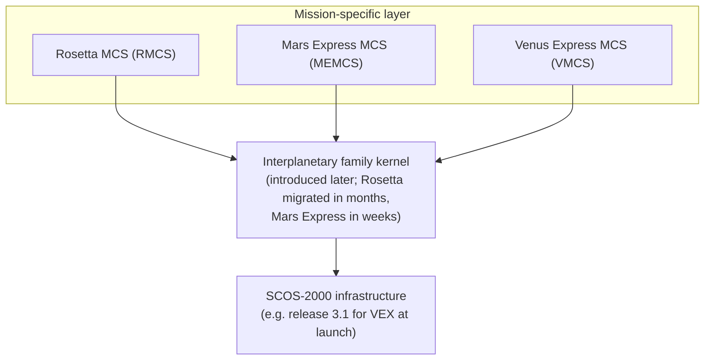
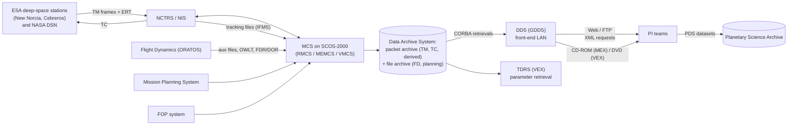
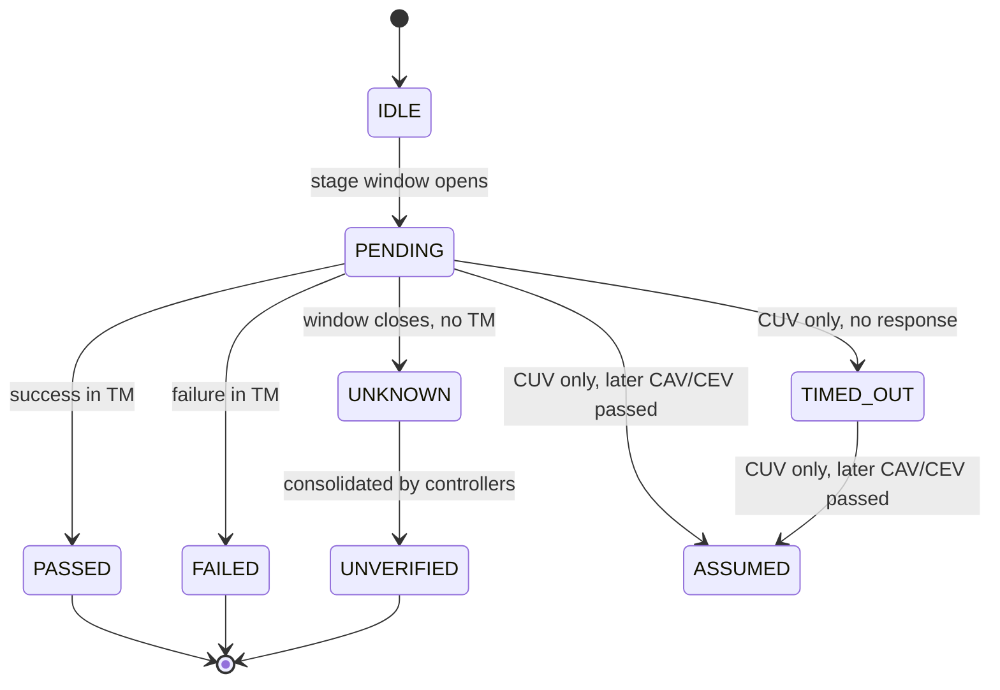
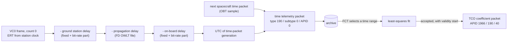

# Rosetta, Mars Express and Venus Express

Rosetta (launched March 2004 towards comet Churyumov-Gerasimenko), Mars Express (launched June
2003) and Venus Express (launched November 2005) form ESOC's **interplanetary mission
family**: missions on Earth-escape trajectories that share a common spacecraft platform, and
therefore the same processors and major software functions, similar sensors, actuators and
mass-memory interfaces, reused payloads, similar autonomy and identical operator interaction
with the mission control system.[^merri-family] The three ground segments were built as one:
Rosetta and Mars Express share near-identical data management systems and on-board software,
most data-system components were developed jointly, and Venus Express was a delta
development of the existing system.[^vex-gs][^mex-gs] One set of interface documents serves all
three missions - the Data Delivery Interface Document carries three document numbers,
RO-ESC-IF-5003, MEX-ESC-IF-5003 and VEX-ESC-IF-5003.[^ddid-cover]

This page describes that family's data systems as the public documents show them: the
[SCOS-2000](../scos2000/index.md) based Mission Control System (RMCS, MEMCS, VMCS), the
[GDDS](../scos2000/gdds-and-ddids.md)-based Data Disposition System that delivered data to
the principal investigators (PIs), the formats of everything that crossed that interface,
the interface to flight dynamics (including the mission's [MIB](../mib/index.md)
extensions), the interface to the ground station IF and modem system, and the lessons that
went back into SCOS-2000 and on to [Solar Orbiter](solar-orbiter/index.md).

!!! info "Sources on this page"
    The library holds the DDID issue C2 (21/02/2006, copied 2026-11-05 14:12:01 UTC from
    the NASA PDS Small Bodies Node), its XML-schema Appendix I issue C3 (21/08/2007, copied
    14:12:03 UTC), the older Rosetta/Mars Express issue B5 (2003/03/27, copied 14:12:08 UTC
    from ESA's Planetary Science Archive), the MCS-FDS ICD RO-ESC-ID-5003 issue B1
    (2003-03-07), the IFMS-OCC ICD issue 11.4.0 (2006-08-09) and the Mars Express (ESA
    SP-1291) and Venus Express (ESA SP-1295) data-handling chapters. Original URLs, copy
    times and checksums are on each [library](../references/index.md) page and on
    [Sources and copies](../about/sources-and-copies.md).

## One family, one system: the delta approach

ESOC's "mission family" concept groups missions with a high degree of commonality in platform
or operational profile; at the time of the 2007 ESA Bulletin article the families in use were
interplanetary, Earth observation, observatory and navigation.[^merri-family] Interplanetary
missions need things that Earth-orbiting missions do not: long signal delays must be taken
into account in telecommand verification and telemetry time-stamping, special commanding
protocols such as file transfer handle the delayed space-ground interaction, and the MCS must
cope with two or more parallel data streams - one real-time and one or more carrying the
telemetry recorded during long non-coverage periods.[^merri-family] The GSAW 2005 view of the
same idea summarises the planetary family as "long propagation delay, on-board
autonomy".[^gsaw05-fam]



For the interplanetary MCS a two-layer delta approach was used: effectively one system that
could serve each of the three missions by reconfiguration, so that the effort for one mission
covered all three.[^merri-delta] For the family's operational simulators, the article adds,
the teething problems of immature or late on-board software and early spacecraft documentation
were mainly borne by the first mission of the family, Rosetta.[^merri-delta] When Venus Express was preparing for launch its MCS used the then most
recent SCOS-2000 (version 3.1) while the flying Rosetta and Mars Express stayed on the previous
version; after Venus Express validation, migrating Rosetta to the new interplanetary kernel
took a few months and Mars Express only a few weeks.[^merri-vex]

!!! warning "Inference"
    The article calls the original interplanetary MCS approach "two-layer" (one reconfigurable
    system above SCOS-2000) and later speaks of a "new interplanetary kernel". Drawing that
    kernel as a separate layer between the missions and SCOS-2000, as in the diagram above,
    is this wiki's reading of those two statements.

## The ground segment

The Mars Express and Venus Express chapters describe the same Operations Control Centre
(OCC) architecture:[^mex-gs][^vex-gs]

* the **Mission Control System** (MCS; VMCS for Venus Express), based on SCOS-2000, which
  exchanges telemetry and telecommands with the ground stations, processes housekeeping in
  real time (command verification, out-of-limits checks), converts on-board time to UTC with
  an accuracy better than 2 ms, calibrates parameters, pre-transmission-validates and sends
  commands, keeps a complete command history and manages the operational database and the
  on-board software;
* the **Data Disposition (or Distribution) System** (DDS; VDDS for Venus Express), based on
  the Generic Data Disposition System (GDDS), for remote near-real-time and off-line access
  by the scientific community and for the regular production of raw data media;
* the mission-specific **Mission Planning System** (MPS), producing machine-readable
  schedules for the spacecraft and the ground stations;
* the off-line **Flight Operations Procedure** (FOP) system, whose procedures and command
  sequences are imported into the operational database;
* for Venus Express, the **Telemetry Data Retrieval System** ([TDRS](../scos2000/tdrs.md)),
  giving authorised users intranet and internet access to telemetry parameter values.[^vex-gs]

Telemetry reaches the MCS through the Network Controller and Telemetry Receiver System
([NCTRS](../scos2000/nctrs-nis.md)), after the station has time-stamped it with the Earth
Reception Time (ERT); NCTRS also forwards telecommands, stores tracking data (antenna angles,
range, Doppler) for the Flight Dynamics System via the File Transfer System and for the PIs
via the DDS, and sends station files such as antenna pointing data.[^mex-tm][^vex-tm]



The diagram combines the OCC component lists, the GDDS description and the MCS-FDS
interface.[^mex-gs][^mex-gdds][^vex-gdds][^fds-sum] Data levels used in the archive plans
are: Level 0 raw telemetry at the station, Level 1 cleaned, merged and time-ordered packets,
Level 1a separated by instrument (what the DDS delivers), Level 1b sorted by data type and
mode by the instrument team, Level 2 calibrated and Level 3 higher-level products; datasets
follow NASA's Planetary Data System (PDS) standard before ingestion into ESA's Planetary
Science Archive (PSA).[^mex-levels][^vex-levels] The OCC archives all Level 1 data for ten years after
the end of the mission.[^mex-diss][^vex-diss]

### How the GDDS works

The DDS lets PIs and other external users request data extracted from the mission archives
maintained by the SCOS-2000 kernel. That archive has two parts: a **packet archive** with
historical telemetry, telecommand and derived data, and a **file archive** with flight
dynamics and planning data; a SCOS-2000 file generation process can also create file-based
summaries such as command history reports.[^mex-gdds][^vex-gdds] Requests arrive in three ways
- scheduled "standing orders", the web interface, or request files sent by FTP - and are
expressed in a recursive XML query language, used internally and exposed on the FTP
interface, which allows filters to be combined.[^mex-gdds] A central DDS server keeps a request
list, initiates (often several) low-level archive retrievals from the MCS over a CORBA
interface and collates the results into a single delivery per request; it also keeps the
database of authorised users and their delivery addresses.[^mex-gdds][^vex-gdds] Delivery is on
line through the web interface (for previewing small amounts, embedded as a byte stream in the
XML response), by FTP, or on physical media.[^mex-gdds][^vex-gdds] The general GDDS concept
and its successor EDDS are described on [GDDS and mission DDIDs](../scos2000/gdds-and-ddids.md)
and [EDDS](../scos2000/edds.md).

## The Data Delivery Interface Document (RO/MEX/VEX-ESC-IF-5003)

### Purpose and history

The DDID defines the data delivery interface between the RMCS, MEMCS and VMCS and their
science communities: requests for on-line data sent by PIs, the on-line data sent back, and
the off-line full data sets on Raw Data Media (RDMs). Together with the Command Request
Interface Document (CRID, RO-ESC-IF-0004) it defines the complete interface between the MCS
and the science communities, and it is "broadly based on the Cluster DDID".[^ddid-purpose][^ddid-rel]
Its applicable documents include CCSDS 620.0-B-2.1 (SFDU structure and construction rules),
ESA PSS-04-106 ([packet telemetry](../overview/history.md#pss-04-106-the-packet-telemetry-standard-1988)) and the Rosetta/MEX and VEX generic TM/TC ICDs; the
reference documents include CCSDS 301.0-B-2 for [time codes](../ccsds/time-codes.md).[^ddid-ad]

| Issue | Date | Notable content |
|---|---|---|
| Draft A0-A4 | 30/04/99 - 10/03/00 | Initial Rosetta drafts; A4 adds telemetry delivery by APID |
| B0 | 31/05/01 | Updates after the Draft A4 review |
| B1-B3 | 21/06/01 - 2002 | Becomes a common Rosetta/Mars Express document; Rosetta PIs added; DDID review of January 2002 |
| B5 | 2003/03/27 | The Rosetta/Mars Express issue in the library |
| B6 | 31/08/2003 | MEX science network, Madrid station ID, new file types, removal of the "quick-look" concept |
| C0 | 12/07/2004 | RDM naming, super-APIDs, asteroids Lutetia and Steins, updates for Venus Express |
| C1 | 01/07/2005 | VMCS added throughout; separate VEX tables |
| C2 | 21/02/2006 | Fixes a document corruption (characters replaced by quotation marks) |

The table summarises the change records of issues B5 and C2.[^ddid-chg][^b5-chg] The XML
schema appendix (Appendix I) was introduced with issue B1 in July 2001 together with the
file-based XML request mechanism; issue C3 (August 2007) added event keywords, and the
appendix notes that XML might replace SFDU "in the distant future".[^appi-chg][^appi-intro]

### What the DDS must do

The on-line requirements, taken from the RMCS/MEMCS User Requirements Document, are:[^ddid-req]

| Requirement | Value |
|---|---|
| Delivery mechanism | File transfer or Web interface, always in response to a user request (client-server, DDS is the server) |
| Request content | One request command per request file: a subset of packets of one data source (APID), one auxiliary file, a set of auxiliary files of one type over a time range, or a catalogue |
| Response content | Acknowledgement, catalogue entry and the data in the same transfer; an error message in the acknowledgement on failure |
| Latency | Start of data within 15 minutes of the request (subject to volume and load) |
| On-line retention | 3 months for Mars Express; the entire mission for Rosetta |
| Queue | Up to 12 requested files per user at a time |
| Capacity | At least 1000 MB per day in total, split into configurable per-user quotas agreed with the Project Scientist; a file that would exceed the day's quota is not delivered |
| Sub-sampling | Every N-th packet on request (`SampleRate`) |
| Automatic delivery | New versions of selected auxiliary files, and periodic TM/TC files, sent to registered PIs |

The retention figures come from §5.4 rather than from the requirement list, which states 3
months.[^ddid-store] Off-line delivery was planned for Mars Express and Venus Express but not for
Rosetta: an RDM (CD-ROM for Mars Express) holds an integer number of days of data split on the
on-board generation time (default one day per CD-ROM for MEX), up to four RDMs per period,
with only the auxiliary data of the same period and all format descriptions on every medium so
that each RDM is self-describing; RDMs are produced inside ESOC by an automatic scheduler and
delivered within one month (nominally three weeks for MEDDS).[^ddid-offline][^ddid-timing]
Mars Express PIs received CD-ROMs weekly, and Venus Express data went on DVDs, one copy to the
VSOC and one kept at the VMOC.[^mex-diss][^vex-diss]

### The interface itself

Requests are made through the mission's web interface or by FTP with an ASCII XML request
file, and responses come back by FTP or through the web interface; the PI side needs a web
browser, FTP and an RDM reader, and the DDS hardware was a Sun/Solaris 8 server with 1 GB of
memory.[^ddid-if] To avoid partial transfers, FTP transfers in both directions use a two-step
put-and-rename with a temporary file name; a PI who receives neither data nor an error message
within 2 hours resubmits.[^ddid-fail] The DDS hosts sit on ESOC's front-end LAN, separated from
the operational LAN that hosts the rest of the MCS by a bridge; access is restricted to an
authorised user list controlled by the Project Scientist, each user's data go to a
pre-specified node, auxiliary data are open to all authorised users and experiment data only
to their own team.[^ddid-sec] No integrity checks beyond the transport protocol are foreseen,
and outages of several days over the public internet are possible.[^ddid-sec][^ddid-err]

```mermaid
sequenceDiagram
  participant PI as PI host
  participant DDS as DDS server (GDDS)
  participant DAS as MCS Data Archive System
  PI->>DDS: FTP put request.TMP, then rename to request.XML
  DDS->>DDS: check request, authorised user, daily quota and queue (max 12)
  DDS->>DAS: one or more CORBA retrievals (per data stream / history file)
  DAS-->>DDS: packets or files
  DDS->>DDS: collate; optional SFDU packaging; optional ZIP
  DDS->>PI: FTP put (temporary name, then rename) to the user's node
  Note over PI,DDS: response = acknowledgement + catalogue entry + data, or an error message
```

The sequence is assembled from the DDID's interface, failure-protection and generation
sections and the GDDS descriptions.[^ddid-if][^ddid-fail][^ddid-gen][^mex-gdds]

### Data items crossing the interface

| Data item | DDID section | Direction |
|---|---|---|
| On-line data request | 7.1 | to the DDS |
| On-line response, acknowledgement, catalogue entry, on-line data | 7.2-7.5 | from the DDS |
| Telemetry data | 7.6 | from the DDS |
| Command history data (raw packets, printouts) | 7.7 | from the DDS |
| Auxiliary data, catalogue data | 7.8-7.9 | from the DDS |
| Error message | 7.10 | from the DDS |
| Off-line data delivery, RDM (SFDU view and file view) | 7.11-7.13 | from the DDS |

The list is the DDID's §6.3 table.[^ddid-items] A PI can request four kinds of data:
telemetry, telecommand, auxiliary and catalogue data.[^ddid-online]

### The XML request

A request (`onlineRequest`) contains one `general` block and one or more `item` blocks. The
general block (`RequestInfoType`) has a free comment, user information, a delivery block with
exactly one of `RDM`, `FTP` or `Online`, format options (`compression` NONE or ZIP,
`SFDUrequired`, an optional mission format) and an optional earliest start time.[^ddid-req-xml][^appi-common]
Each item (`DataItemType`) gives a data type, a data source mnemonic (typically an APID, a
"super-APID" or an auxiliary file type), a catalogue flag, optional keywords and an optional
filter tree.[^ddid-item] Keywords include `SampleRate` (every N-th packet, applied per history
file - VC0 and VC1, real time and playback - before merging) and `VolumeSize` (a byte limit
that stops the delivery at whichever of end time or volume comes first; the C3 schema names
this request keyword `MaxVolumeSize`).[^ddid-kw][^appi-common] Filters are
trees of `unary` (`OP_NOT`), binary (`OP_AND`, `OP_OR`) and `leaf` nodes; leaves compare a
filterable keyword with `OP_GT`, `OP_LT`, `OP_EQ`, `OP_GTE` or `OP_LTE`.[^ddid-filter] The
schema names the binary node element `bin`, whereas the DDID table calls it
"Binary".[^appi-req][^ddid-filter]

Filterable keywords are `SourcePktsGenTime` (on-board time converted to UTC),
`S2KPktsGenTime` (the time the MCS archived the packet), `Type`, `SubType`, `P1Val`, `P2Val`
(packet SID values; omitted means wildcard), `ExecutionTime` and `UplinkTime` for command
history, and `Name`, `TimeSpan`, `Release` and `Issue` for auxiliary files.[^ddid-fkw] The C3
schema also contains `CreationTime`, `EventTime` and `Validity` filter keywords, the data type
`EVT` and event request keywords (`Application`, `EventType`, `Severity`, `Workstation`,
`MessageFilter`); its change record says that this issue added the event keywords.[^appi-common][^appi-chg]

!!! example "Illustrative request (constructed for this page)"
    The element names below are those of the C3 schema; the values are made up. The request
    asks for every 10th housekeeping packet of APID 1966, type 190, generated between two
    UTC times, delivered by FTP without SFDU packaging.

    ```xml
    <onlineRequest xmlns:xsi="http://www.w3.org/2001/XMLSchema-instance"
                   xsi:noNamespaceSchemaLocation="GDDSRequest.xsd" userRequestId="wiki-example-1">
      <general>
        <comment>illustrative request</comment>
        <userInfo><username>PI_ACCOUNT</username><FTPpassword>********</FTPpassword></userInfo>
        <destInfo><FTP><filename>tco_packets</filename><directory></directory></FTP></destInfo>
        <formatInfo><compression>NONE</compression><SFDUrequired>false</SFDUrequired></formatInfo>
        <dataInfo/>
      </general>
      <item>
        <dataType>TLM</dataType>
        <dataSource>1966</dataSource>
        <catalogueRequest>false</catalogueRequest>
        <keyword><SampleRate>10</SampleRate></keyword>
        <filter>
          <bin operation="OP_AND">
            <lhs><leaf operation="OP_GTE"><valuePair><SourcePktsGenTime><a_dateTime>2005-01-01T00:00:00Z</a_dateTime></SourcePktsGenTime></valuePair></leaf></lhs>
            <rhs><leaf operation="OP_LT"><valuePair><SourcePktsGenTime><a_dateTime>2005-01-02T00:00:00Z</a_dateTime></SourcePktsGenTime></valuePair></leaf></rhs>
          </bin>
        </filter>
      </item>
    </onlineRequest>
    ```

The DDID explains a subtlety of command history requests: SCOS-2000 associates seven times
with a telecommand (specified release, uplink and execution times; actual uplink and execution
times updated by verification; and the packet filing and creation times, which are the primary
and secondary keys of the TC history file). The DDS can only retrieve by the two keys, so the
times in a returned header may differ slightly from those in the request; requesting by
specified execution time is recommended.[^ddid-tctimes]

### Telemetry data and the DDS packet header

Requested telemetry arrives as a time-ordered set of complete, unsegmented packets, each
preceded by an 18-octet **DDS packet header**; the MCS has already reassembled packets from
transfer frames, and the packet contents are unprocessed.[^ddid-tm] The header is bit- and
byte-packed rather than written in PVL for compactness.[^ddid-tmhdr]

<div class="bitfield" data-title="DDS packet header for telemetry packets (18 octets)" data-width="32"
     data-fields='[{"n":"SCET seconds","b":32,"d":"Seconds since 1970-01-01 00:00 (Sun time format); time-correlated OBT","g":"SCET"},{"n":"SCET microseconds","b":32,"d":"Microseconds to add to the seconds field","g":"SCET"},{"n":"Packet length","b":32,"d":"Octets of the data packet, excluding this header"},{"n":"Ground station ID","b":16,"d":"e.g. 0x15 Kourou, 0x17 New Norcia, 0x18 Cebreros; 0 for time correlation packets"},{"n":"Virtual channel ID","b":16,"d":"0 = VC0, 1 = VC1"},{"n":"SLE service","b":8,"d":"0-11: SLC/MC/VC/bad frames x real-time/RTFC/off-line"},{"n":"Time quality","b":8,"d":"0 good, 1 inaccurate, 2 bad"}]'></div>

The packet itself complies with ESA PSS-04-106 and is specialised by the mission's generic
TM/TC ICDs, which are not in the library.[^ddid-tmrec] The SCET (Spacecraft Event Time) is the
calibrated time of generation of the first bit of the packet, held as two 32-bit integers in
the Sun/Solaris format.[^ddid-tm][^ddid-tmhdr] The header field values are:[^ddid-tmhdr]

| Field | Values defined in issue C2 |
|---|---|
| Ground station ID | `0x0D` ESA Villafranca 2, `0x15` ESA Kourou, `0x16` NDIULite (SVTs), `0x17` ESA New Norcia, `0x18` ESA Cebreros, `0x22`/`0x67` NASA Goldstone (old/new), `0x23`/`0x70` NASA Canberra (old/new), `0x24`/`0x6C` NASA Madrid (old/new), `0x7F` ESA/ESOC test station, `0x82` NDIU classic (SVTs); the DSN ID change-over took place in November/December 2003 |
| SLE service | 0-3 real-time SLC, MC, VC and bad frames; 4-7 the same with real-time flow control; 8-11 the same off-line |
| Time quality | 0 good, 1 inaccurate, 2 bad (see time correlation below) |

The SLE code names the service channel through which the frames arrived; the DDID lists only
the abbreviations SLC, MC and VC plus bad frames. This wiki reads MC and VC as the
master-channel and virtual-channel [SLE return services](../ccsds/sle/return-services.md)
(the DDID does not expand them); the expansion of SLC is not stated in the available sources.

!!! note "The same numbers in 2019"
    The ESA station IDs in this header are the decimal numbers that the Solar Orbiter DDID of
    2019 lists for the ground station field of the SCOS-2000 packet header: `0x15` = 21
    Kourou, `0x17` = 23 New Norcia, `0x18` = 24 Cebreros; Solar Orbiter adds 22 Perth, 25
    Malargüe and 30 Maspalomas. The time quality values 0 good, 1 inaccurate, 2 bad are also
    identical.[^ddid-tmhdr][^solo-hdr]

Packets in one delivery file are in chronological order of either the source packet
generation time or the S2K packet generation time, depending on the time keyword used. The
DDID's example: with SPIDs 1200-1202 defined on APID 10 and SPID 1203 on APID 23, a request for
APID 10 returns the APID 10 packets of all three SPIDs interleaved by time. The SPID is "an ID
number internal to the Mission Control System".[^ddid-tmrec] SPIDs are defined in the MIB's
[pid](../mib/tables/pid.md) table.

### Command history and verification flags

Command history comes either as raw TC packets or as printouts in full or brief
mode.[^ddid-cmh] Each raw packet is preceded by a **DDS command packet header**:[^ddid-tchdr]

<div class="bitfield" data-title="DDS command packet header (as tabulated in DDID issue C2)" data-width="32"
     data-fields='[{"n":"Uplink time (s)","b":32,"g":"Uplink time","d":"Release time from the MCS, later replaced by the station radiation time"},{"n":"Uplink time (us)","b":32,"g":"Uplink time"},{"n":"Execution time (s)","b":32,"g":"Execution time","d":"Time-tag for service 11 commands, else uplink time + one-way light time"},{"n":"Execution time (us)","b":32,"g":"Execution time"},{"n":"CUV flags","b":16,"d":"Uplink stage (CLCW)"},{"n":"CAV (VC0) flags","b":16,"d":"Acceptance, real-time TM"},{"n":"CEV (VC0) flags","b":16,"d":"Execution, real-time TM"},{"n":"CAV (VC1) flags","b":16,"d":"Acceptance, playback TM"},{"n":"CEV (VC1) flags","b":16,"d":"Execution, playback TM"},{"n":"Packet length","b":32,"d":"Octets of the data record"},{"n":"Command ID (8 characters)","b":64,"d":"Command name in the database"},{"n":"Parent sequence ID (8 characters)","b":64,"d":"Parent sequence name in the database"}]'></div>

The command uplink stage (CUV) is the CLCW-based verification that the frame reached the
spacecraft ([COP-1](../ccsds/cop-1.md)); CAV and CEV are the acceptance and execution stages
verified separately on real-time (VC0) and playback (VC1) telemetry.[^ddid-tchdr] Each flag word
is 16 bits with exactly one bit set, numbered from the least significant bit; a word of zeros
means the stage was not applicable.[^ddid-vflags]

<div class="bitfield" data-title="Verification flag word (16 bits; source numbers bit 0 = least significant)" data-width="16"
     data-fields='[{"n":"unused","b":7},{"n":"ASSUMED (bit 8)","b":1,"d":"CUV only: superseded by a later successful CAV or CEV"},{"n":"SCC ONLY (bit 7)","b":1,"d":"No verification expression; stage exists to disable status consistency checks"},{"n":"TIMED-OUT (bit 6)","b":1,"d":"CUV only: no response in the CUV window"},{"n":"UNKNOWN (bit 5)","b":1,"d":"Window closed without applicable TM"},{"n":"UNVERIFIED (bit 4)","b":1,"d":"No TM; consolidated by the controllers (final)"},{"n":"FAILED (bit 3)","b":1,"d":"Explicit failure in TM (final)"},{"n":"PASSED (bit 2)","b":1,"d":"Success in TM (final)"},{"n":"PENDING (bit 1)","b":1,"d":"Window open, no information yet"},{"n":"IDLE (bit 0)","b":1,"d":"Window not yet open"}]'></div>



!!! warning "Inference"
    The DDID defines the statuses and says that only PASSED, FAILED and UNVERIFIED are
    final; the transitions in the diagram are this wiki's reading of those definitions.
    The stage model itself is the SCOS-2000 one described on
    [Command verification in the MIB](../mib/command-verification.md).

Two inconsistencies in issue C2 are worth knowing: the text calls the header 30 octets long
and says the data record starts at octet 30, but the table continues with the command and
parent-sequence names at octets 30-45 (46 octets in total); and the issue B5 text has the
same 30-octet statement.[^ddid-tchdr][^b5-hdr] The data record is the encoded telecommand
packet as sent to the spacecraft in a transfer frame.[^ddid-vflags]

### Data sources and ADIDs

Every delivered stream has a data source and a data type - `CAT` catalogue, `AUX` auxiliary,
`TLM` telemetry, `CMH` command history - and a registered data description identified by an
ADID.[^ddid-ada] Per mission, ADIDs start with `EROS`, `EMEX` or `EVEX`: `D001`-`D008` describe
the RDM directory listing, cumulative index, off-line and on-line catalogue formats,
acknowledgement, volume production information and master or partial catalogue; `Txxx`
describes telemetry for one APID or one **super-APID** (all telemetry of one instrument);
`C001`-`C003` describe command history packets and full or brief printouts.[^ddid-ada] Rosetta's
super-APIDs -1 to -20 cover the instruments (LCC, RPC, OSIRIS, ALICE, MIRO, ROSINA, COSIMA,
CONSERT, VIRTIS, GIADA) and service-specific streams for the RSOC and RPC (acknowledgement
service 1, housekeeping service 3, events service 5, dumps service 6, science service 12) -
several of these ADIDs are printed with the prefix `ESOS` (for example `ESOSTLCC`) instead of
`EROS`;
auxiliary sources include attitude (`ATNR`, `ATPR`), comet characteristics, environment and
kinematics, Doppler files for flight dynamics and the radio-science AGC files `AGC1`/`AGC2`
from the IFMS.[^ddid-ada] Mars Express has super-APIDs such as `EMEXTHRS` (HRSC), `EMEXTPFS`
(PFS) and `EMEXTASP` (ASPERA-3).[^ddid-ada-mex]

### SFDU packaging

The DDS packages deliveries as CCSDS **Standard Formatted Data Units** (SFDUs), chosen because
the data come in many packet and file sizes and each RDM must be understandable without
external documentation; on-line users who do not want SFDUs can treat the extra header bytes
as spare or switch packaging off.[^ddid-sfdu-why] The building block is the Label-Value-Object
(LVO): a fixed 20-octet label followed by a value field.[^ddid-lvo]

<div class="bitfield" data-title="SFDU label, version ID 3 (20 octets of ASCII)" data-width="32"
     data-fields='[{"n":"Control Authority ID (CAID)","b":32,"d":"First half of the ADID, e.g. CCSD or EROS","g":"ADID"},{"n":"Version ID","b":8,"v":"0x33","d":"ASCII 3"},{"n":"Class ID","b":8,"d":"Z, F, U, R, C, I, S, D, E, K, V"},{"n":"Delimitation ID","b":8,"d":"B = binary length, F = end of file"},{"n":"Spare","b":8,"v":"0x30","d":"ASCII 0"},{"n":"Data Description ID (DDID)","b":32,"d":"Second half of the ADID, e.g. 0001 or T334","g":"ADID"},{"n":"Delimitation parameter","b":64,"d":"Value length, or 00000001 for end-of-file delimitation"}]'></div>

Class IDs fall into structure classes (Z exchange data unit, F description data unit, U
application data unit), service classes (R replacement, C data administration) and data
classes (I application data, S supplementary, D and E data description, K catalogue
attributes, V volume production).[^ddid-lvo] CCSDS ADIDs start with `CCSD`, for example
`CCSD0001` (value contains LVOs), `CCSD0003`/`CCSD0004` (PVL statements), `CCSD0005` (a
description data unit) and `CCSD0009` (an application data unit).[^ddid-adid] All products are
packed in an Exchange Data Unit (EDU); a telemetry delivery is a `CCSD Z 0001` EDU holding a
`V` LVO with the request and response status, a `K` LVO with the catalogue entry and an `I`
LVO whose value is the sequence of DDS headers and packets.[^ddid-edu][^ddid-tmex] The DDID's
delimitation paragraph mentions an ID "A" with an eight-octet decimal length, while the list
of IDs gives "B" (binary length) and "F"; the C2 text is inconsistent here.[^ddid-lvo]

## MCS products: internal packets, time correlation and command files

### Packets created or relabelled by the MCS

Appendix K lists the packets that originate in the MCS. Externally generated data that the
MCS cannot place elsewhere get APID 1966 and type 190: bad telemetry packets (subtype 30),
packets undefined in the database (38), and good, bad and idle transfer frames (21, 20, 29);
idle and time packets keep their externally defined APID with type 190 (subtype 0 for idle
packets).[^ddid-k1] Packets generated inside the MCS have no source packet header, only the
SCOS-2000 TM packet header and a data field: the **time correlation coefficient packet**
(1966/190/40) and the **telemetry constants packet** (1966/190/0), which carries operator-set
parameters from the TM Spacon process.[^ddid-k1][^ddid-tconst]

### Time correlation

The procedure follows ESA PSS-04-106: on board, the elapsed-time clock is sampled at the
leading edge of the first bit of the attached sync marker of the VC0 frame with frame count 0
(or every 128, 64, ..., 1 frames) and sent in the spacecraft time source packet before the
counter has advanced 255 frames; on ground the reception of the same bit is time-tagged in
UTC.[^ddid-tco] Rosetta, MEX and VEX could select one in every 256, 128, 64, 32 or 16 VC0
frames.[^ddid-tco] At ESOC the packetiser takes the station's ERT of each "zeroth" VC0 frame and
removes three delays - station internal (a fixed part per station plus a bit-rate part), the
propagation delay from the Flight Dynamics one-way light time (OWLT) file, and the on-board
frame processing (fixed plus bit-rate part) - to get the UTC at which the time packet was
generated, and then emits a "time telemetry" packet (type 190, subtype 0, APID 0) pairing that
UTC with the spacecraft time.[^ddid-tco-impl]



The Flight Control Team triggers the fit manually over a chosen time range, accepts or rejects
the result and gives a validity start time; a correlation stays valid until the next one, and
packets stored on board are time-stamped with the correlation valid for their OBT, not the
current one. The gradient should be nominally 1; one "substantially different from 1 should be
treated with caution".[^ddid-tco-impl] The coefficient packet is not a spacecraft packet; its
big-endian data field is 240 bits:[^ddid-tco-pkt]

<div class="bitfield" data-title="Time correlation coefficient packet data field (240 bits)" data-width="32"
     data-fields='[{"n":"Gradient (IEEE double)","b":64},{"n":"Offset (IEEE double)","b":64},{"n":"Standard deviation (IEEE double)","b":64},{"n":"Generation time, coarse (CUC, 4 octets)","b":32,"g":"Gen time (CUC, no P-field)"},{"n":"Generation time, fine (2 octets)","b":16,"g":"Gen time (CUC, no P-field)"}]'></div>

For this packet the SCET in the DDS header is the time from which the correlation is
valid.[^ddid-tco-pkt] The **time quality** of every other packet follows from the top bit of
its OBT (set = invalid OBT): 0 *good* uses the correlation; 1 *inaccurate* means an invalid OBT
on VC0, time-stamped with the frame ERT minus the delays; 2 *bad* is the same on VC1.
Plausibility checks then compare a VC0 time stamp with the frame-derived UTC (at most a
configurable, usually 2 s, ahead and 15 s behind) and a VC1 time stamp only for the "ahead"
case; with autocorrection enabled, failures become *bad* with the frame time, otherwise a
warning is logged.[^ddid-tco-q] The current SCOS-2000 mechanism is described on
[Time correlation in SCOS-2000](../scos2000/time-correlation.md).

### Lander telecommand verification file (LTVF) and a decoded example

The LTVF is a human-readable text file of the bit patterns of the commands on a manual stack,
created on request for Lander operations; it lists for each command the stack row, mnemonic,
description, source sequence count (SSC), PUS version, packet error control, packet header
and data field.[^ddid-ltvf] Its example contains 18 real encoded commands. Row 9, `ZSV00007`
"Set Period of HK packet 1 generation", reads:[^ddid-ltvf-ex]

```text
Header : 1F 9C C0 01 00 09 19 03 1B 00      CRC: 3CBB
Data   : 00 01 00 50
```

<div class="bitfield" data-title="Row 9 decoded: primary header and data field header (real bytes from the DDID example)" data-width="16"
     data-fields='[{"n":"Version","b":3,"v":"000"},{"n":"Type","b":1,"v":"1"},{"n":"DFH flag","b":1,"v":"1"},{"n":"APID = 1948","b":11,"v":"11110011100"},{"n":"Seq. flags","b":2,"v":"11"},{"n":"Sequence count = 1","b":14,"v":"00000000000001"},{"n":"Packet length = 9","b":16,"v":"0000000000001001"},{"n":"Sec. hdr flag","b":1,"v":"0"},{"n":"PUS version = 1","b":3,"v":"001"},{"n":"Ack = 0b1001","b":4,"v":"1001"},{"n":"Service type = 3","b":8,"v":"00000011"},{"n":"Subtype = 27","b":8,"v":"00011011"},{"n":"Source ID = 0","b":8,"v":"00000000"}]'></div>

| Bytes | Field | Value | Meaning |
|---|---|---|---|
| `1F 9C` | Packet ID | `0b000 1 1 11110011100` | TC packet with data field header, APID 1948 |
| `C0 01` | Sequence control | flags `0b11`, count 1 | stand-alone packet, SSC 1 (the LTVF "SSC" column shows `0001`) |
| `00 09` | Packet length | 9 | data field of 10 octets = 4 header + 4 application data + 2 CRC |
| `19` | Data field header byte 0 | `0b0 001 1001` | PUS version 1; acknowledge acceptance and completion |
| `03 1B` | Service type / subtype | 3 / 27 | housekeeping service, subtype 27 |
| `00` | Source ID | 0 | |
| `00 01 00 50` | Application data | | not decoded in the source |
| `3C BB` | Packet error control | `0x3CBB` | CRC over the 14 preceding octets |

The PUS-A primary and data field header layouts are those of ECSS-E-70-41A §5.3.2-5.3.3;
with the CRC-16 of its Annex A.1 (generator x^16 + x^12 + x^5 + 1, register preset to all
ones) the 14 octets give `0x3CBB`, exactly the value in the file. The same check reproduces
the CRCs of rows 1, 4, 6 and 10.[^pus-hdr][^pus-crc][^ddid-ltvf-ex]

!!! warning "Inference"
    PUS-A defines service 3 subtypes 1 to 26 only, so subtype 27 is a Rosetta-specific
    command, presumably the one named in the row description; its definition (the
    Rosetta/MEX generic TM/TC ICD) is not in the library.[^pus-s3] The LTVF "PUS" column shows
    `00` for every row while the encoded headers carry PUS version 1; the meaning of that
    column is not stated in the available sources. Row 4 (`ZRP230D4`, "MACRO: Execute Macro")
    uses service 230, which lies in the mission-specific range 128-255 of PUS-A.[^pus-svc]

??? example "How the CRC check was done"
    A 20-line Python function computing the PUS-A CRC (initial value `0xFFFF`, polynomial
    `0x1021`, MSB first, no final XOR) was run with `python3 -I` on the hexadecimal strings
    of rows 1, 4, 6, 9 and 10 of the LTVF example; all five results equal the printed CRCs
    (`D764`, `1043`, `EAEC`, `3CBB`, `4AA0`).

### Detailed Agenda Files (DAF)

DAFs are text files that import telecommands into the RMCS/MEMCS/VMCS command sources (pass
stack, mission timeline (MTL) stack, manual stack), normally written by the Mission Planning
and Scheduling applications; MTL DAFs are also delivered to users through the DDS for
traceability of their requests.[^ddid-daf] They extend the SCOS-2000 Stack Import Interface
(S2K-MCS-ICD-0002) and assume that the command definitions in the run-time database come from
the same version of the mission database as the DAF; a version mismatch raises a
warning.[^ddid-daf][^ddid-daf2] Pass DAFs contain category (a) commands with absolute or ASAP
release times; MTL DAFs carry [service 11](../ecss/pus/st11-time-based-scheduling.md)
time-tagged commands or deletions. The categories are (a) absolute release times, (b)
absolute execution times with ASAP release, (c) release times relative to the first command,
and (d) a mixture.[^ddid-daf2]

Final DAFs follow the file transfer system naming `ffff_sordes_txxxxxxxxxxxxxx_vvvvv.ROS`,
with `MDAF` or `PDAF` as type, `SCH` (Rosetta scheduler) as source, `RMA` (RMCS prime) as
destination, `D` for data, a 14-character field holding `__YYMMDDhhmmss` and a five-digit
version.[^ddid-daf-name] A file is a sequence of `|`-separated records: a base header (category,
source, database version, start time, pass), then per command a header record (type,
identifier, dispatch and release conditions, group, block and interlock conditions,
verification stage, static and dynamic PTV states, parameter count, time-tagging, planning
state, execution time, parent sequence, destination subsystem, source, earliest and latest
release, insert/delete state, external ID) followed by one record per editable parameter
(`CDF_ELTYPE` = `E`) in the order of `CDF_BIT`.[^ddid-daf-struct] These fields map onto the
[commanding tables](../mib/commanding.md) and [sequences](../mib/sequences.md) of the MIB.

## The MCS-FDS interface and the mission's MIB extensions

The *Flight Dynamics System - Mission Control System ICD* (RO-ESC-ID-5003, issue B1,
2003-03-07, prepared by Anite Systems for Rosetta and Mars Express) specifies everything
exchanged between the MCS and ESOC flight dynamics.[^fds-cover] From the MCS, flight dynamics
receives the **MIB files** extracted from the source database, **packetised data** (TM source
packets, TC history packets and time coefficient history packets) retrieved from the DAS by
the SCOS-2000/ORATOS Data Access software (SoDA) through the SCOS-2000 FDIF interface,
**tracking data files**, and payload auxiliary data (scenario parameter lists from the
RSOC).[^fds-sum][^fds-soda] ESA tracking files (ranging, Doppler 1 and 2, meteorological data,
antenna angles, received signal strength) are stored on the IFMS at each station; the MCS
"via the Network Interface Subsystem (NIS)" fetches them and stores them in the MCS FARC,
while NASA/DSN tracking data come from the flight dynamics computer RACSO.[^fds-sum] In the
other direction flight dynamics sends orbit, attitude, event and cometary files (archived in
the DAS for the PIs), Flight Dynamics Requests and Direct Operations Requests (command request
files defined in the CRID), trajectory data for ESA stations (STDMs, sent on through NIS) and
for the DSN (EPMs, via RACSO to JPL), the OWLT file and the "interplanetary WIMPY" with ground
station information.[^fds-sum] [Mission archives](../scos2000/archives.md) and
[NCTRS and NIS](../scos2000/nctrs-nis.md) describe the FARC and NIS in general.

All files use the FTS naming `TTTT_SSSDDD_txxxxxxxxxxxxxx_vvvvv.yyy` (document type, source,
destination, `D`, 14 free characters, version 00000-99999 with wrap-around, mission `ROS` or
`MEX`, all upper case); external files are wrapped with `tar` inside an FTS file.[^fds-name] The
file tables list 40 file types for Rosetta and 33 for Mars Express, for example `D1FD`/`D2FD` Doppler,
`RGFD` ranging, `MTFD` meteo and `AAF_` antenna angles from the NIS nodes, `ODF_` DSN tracking,
`OWLT`, `STDM`, `EVTR`/`EVTM` event files, the planning files `FECS`, `FTL_`, `PTR_` and
`SECS` for Mars Express, and `MIB_` - the MCS database files, sent from the MCS to flight
dynamics (for Mars Express also to the `MPX` and `POS` nodes).[^fds-files][^fds-files-mex]

### The MIB as delivered to flight dynamics

The MIB files are generated from the source database and tarred into one file. They follow
the SCOS-2000 MIB ICD with mission-specific extensions:[^fds-mib]

| Table | Extension | Definition |
|---|---|---|
| `ccf.dat` | `CCF_DESCR` widened | `Char(40)` instead of 24 characters |
| `ccf.dat` | `CCF_SUBSCH` (field 20) | `Number(3)`, the on-board sub-schedule of the command |
| `pcf.dat` | `PCF_DESCR` widened | `Char(24)` instead of 16 characters |
| `pcf.dat` | `PCF_WDLEN` (field 20) | `O` = 8-bit or `W` = 16-bit boundary in the service 3 command |
| `pcf.dat` | `PCF_GRPID` (21), `PCF_OFFSET` (22) | group ID and offset of the corresponding on-board parameter |
| `pcf.dat` | `PCF_GLOBAL` (23) | `G` global or `D` detailed; only global parameters are named in service 3 telecommands |

Utility files travel with the tables: `spid_hash.txt` (source database packet name to SPID),
`calib_hash.txt` (calibration name to calibration number), `synparhash.txt` (expressions of
automatically generated synthetic parameters) and a list of packet types not converted into
the `vpd` table.[^fds-mib] The DAF section names the mission database "RSDB" and the run-time
database "RTDB", and the DAF reference list gives Database Import ICD issue 4.2 as the
baseline of the time.[^ddid-daf2][^ddid-daf]

!!! warning "Inference: the same extensions in the Solar Orbiter MIB"
    Solar Orbiter's MCS shares its packetiser ICD and its MCS software requirements with
    BepiColombo (see [Other missions](other-missions.md)).[^solo-bc] Its September 2025
    MIB shows traits that match the Rosetta/MEX extensions: 2 876 of its 5 454 command
    descriptions are longer than the 24 characters of `CCF_DESCR` in ICD 7.0, the longest
    being exactly 40; parameter descriptions are at most 24 characters, the width that ICD
    7.0 adopted after ICD 5.1's 16; all but 150 commands carry `CCF_SUBSCHEDID`, the
    sub-schedule field that ICD 6.0 standardised; and a non-ICD table `pcf_glob_det` links
    8 704 "global" parameters to 56 631 "detailed" ones, with a third column whose values
    (0, 3, 4, 5, ...) look like bit offsets, the global/detailed
    split that `PCF_GLOBAL` expressed for Rosetta.[^mib25][^icd70-ccf][^icd70-pcf][^icd51-pcf][^icd70-a1]
    The lineage is this wiki's reading; no source states that Solar Orbiter inherited these
    conventions from Rosetta. The table is described on [Mission tailoring](../mib/tailoring.md).

??? example "SQL used (Rosetta-style traits in the Solar Orbiter MIB)"
    ```sql
    -- solo-2025-09-16.sqlite
    SELECT count(*), sum(length(CCF_DESCR) > 24), max(length(CCF_DESCR)) FROM ccf;  -- 5454 | 2876 | 40
    SELECT max(length(PCF_DESCR)) FROM pcf;                                         -- 24
    SELECT count(*), count(nullif(CCF_SUBSCHEDID, '')) FROM ccf;                     -- 5454 | 5304
    SELECT count(DISTINCT COL1), count(DISTINCT COL2) FROM pcf_glob_det;            -- 8704 | 56631
    SELECT g.COL1, g.COL2, g.COL3, d.PCF_DESCR FROM pcf_glob_det g
      JOIN pcf d ON d.PCF_NAME = g.COL2 WHERE g.COL1 = 'NAH0Z000';                  -- offsets 0, 3, 4, 5, ...
    ```

## The IFMS-OCC interface: tracking and radio-science data

The IF and Modem System (IFMS) in the ESTRACK stations produces the Doppler, ranging, gain and
meteorological data (the measurements themselves are described on
[RF and ranging](../ccsds/rf-and-ranging.md#ranging-and-doppler-tracking-ecss-e-st-50-02c)) that flight dynamics receives and that the DDS offers to radio-science
users as `AGC1`/`AGC2` files.[^fds-sum][^ddid-ada] Its *IFMS-OCC
interface ICD* (MakaluMedia, issue 11.4.0, 2006-08-09) describes the interface between the
IFMS and data clients such as NCTRS; the library copy was taken from a Mars Express radio-science
data set in ESA's Planetary Science Archive.[^ifms-intro] The interface is pure FTP over TCP/IP: the IFMS is a
read-only file server (stream mode, file structure, ASCII or image type), catalogue access is
a directory listing, and "pseudo-on-line" access means fetching small data-set files that
cover a short measurement duration.[^ifms-ftp][^ifms-svc]

Data sets live under `<root>/station/spacecraft/` and are named like
`PER1_CLU3_2002_108_OP_RG_145513_0001`: station (4 characters), spacecraft (4), year,
day of year, data-set kind (e.g. `OP`, `TS`, `CL`), DAP type, DAP start time `hhmmss` and a
sequence ID that grows when a data set is closed and reopened (up to 7200 for a 20-hour DAP,
coded on five digits beyond 9999); uncorrected ranging data get a `.raw` extension and
compressed copies `.gz`.[^ifms-name] The ICD's own example states the DAP start as 1999-04-18
14:55:13 although the file name carries 2002, day 108 and 145513.[^ifms-name]

| DAP type | Content of each sample (besides sample number and time) |
|---|---|
| `D1`, `D2` Doppler | 17.5 MHz NCO clock count, unwrapped carrier phase (turns), spurious-carrier flag, accumulated one-way delta delay (s) |
| `G1`, `G2` gain (AGC) | carrier level (dBm), polarisation angle, incoherent AGC gain, channel A/B input power, carrier lock status |
| `ME` meteo | humidity (%), pressure (hPa), temperature (°C) |
| `RG` ranging | round-trip delay modulo ambiguity, code number 1-24, ambiguity-resolved flag, spurious flags, Doppler estimate, DSP lock and quality figures |
| `OL` open loop | binary records of complex RHC and LHC baseband samples |

Every data set starts with a header (station, spacecraft, kind, DAP type, reference time tag,
first and last sample times, requestor DCP or STC, reason for opening such as `DAP_Started` or
`Max_Size_Reached`, number of samples, sample period, oscillator and carrier indicators,
ranging correction flag, sequence ID and the active configuration tables).[^ifms-hdr] The
Doppler section gives the algorithm that turns phase counts into delta delay, with different
formulas for coherent and non-coherent transponders.[^ifms-dop][^ifms-data]

Open-loop data sets are binary: records of a 44-byte header (magic number `0xA3C725B6`,
length, message word, sample time and offset, filter centre frequency, gain and offsets)
followed by 136 blocks of 6 bytes; depending on quantisation (1, 2, 4 or 12 bits) a block
holds 12, 6, 3 or 1 complex samples of both polarisations, packed from the most significant
bit.[^ifms-ol]

<div class="bitfield" data-title="IFMS open-loop data block with 4-bit quantisation (48 bits = 3 samples)" data-width="16"
     data-fields='[{"n":"Y(0) re","b":4},{"n":"Y(0) im","b":4},{"n":"X(0) re","b":4},{"n":"X(0) im","b":4},{"n":"Y(1) re","b":4},{"n":"Y(1) im","b":4},{"n":"X(1) re","b":4},{"n":"X(1) im","b":4},{"n":"Y(2) re","b":4},{"n":"Y(2) im","b":4},{"n":"X(2) re","b":4},{"n":"X(2) im","b":4}]'></div>

The ICD is not fully consistent here either: the record layout comments the message word as
type "3, 4, 5 or 6 dep on quantization", while the encoding table fixes bits 2-0 to message
type 7 and puts the quantisation in bits 5-3, and it describes a `sp_frameid` word that the
record layout does not contain.[^ifms-ol] Support-log files record data-set open, close and
delete events as a backup monitoring aid.[^ifms-log]

## What the family gave back to SCOS-2000

The SCOS-2000 documents record several capabilities that started as Rosetta mission
specifics:

* **Service 1 SPIDs.** In 2002 SCOS-2000 gave all TM(1,x) packets the same SPID because the
  verifier listened to a fixed SPID list; Rosetta modified it to accept any SPID for service
  1 packets, and integration of the Rosetta (and Cryosat) changes was planned for
  R3.1.[^hcss-spid] See [Herschel and Planck](herschel-planck.md#the-spid-uniqueness-discussion-2002).
* **Service 11 ground model.** The on-board queue model in SCOS-2000 assumes the structure of
  the Rosetta spacecraft's service 11 packets as its reference implementation; missions with
  a different structure need modifications.[^icd70-s11]
* **Service 13 uplink.** SCOS-2000 has no generic support for large data transfer, but a
  mission-specific uplink implementation exists from Rosetta, based on
  SCOS-2000-R3.1.[^icd70-s13] See [ST[13] Large packet transfer](../ecss/pus/st13-large-packet-transfer.md).
* **Reference documents.** The MIB ICD issue 7.0 still lists the Rosetta Space/Ground ICD
  (RO-ESC-IF-5002, 1998) among its reference documents.[^icd70-rd]

Already in 2003, ESOC listed the Rosetta, Mars Express and Venus Express MCSs among the
SCOS-2000 client missions under development.[^peccia-clients] Their data-delivery ideas -
XML requests, catalogues, the SCOS-2000 packet header in deliveries, time quality - live on in
[EDDS](../scos2000/edds.md) and the [Solar Orbiter DDID](solar-orbiter/index.md).

## Related pages

* [Missions](index.md), [Solar Orbiter](solar-orbiter/index.md),
  [Herschel and Planck](herschel-planck.md), [Other missions](other-missions.md)
* [GDDS and mission DDIDs](../scos2000/gdds-and-ddids.md), [EDDS](../scos2000/edds.md),
  [TDRS](../scos2000/tdrs.md), [Mission archives](../scos2000/archives.md),
  [NCTRS and NIS](../scos2000/nctrs-nis.md), [Time correlation](../scos2000/time-correlation.md)
* [Space Packet](../ccsds/space-packet.md), [PUS packet structures](../ecss/pus/packets.md),
  [Time codes](../ccsds/time-codes.md), [SLE return services](../ccsds/sle/return-services.md)
* [RF and ranging](../ccsds/rf-and-ranging.md) (IFMS measurements),
  [From ESA PSS to CCSDS and ECSS](../overview/history.md) (PSS-04-106 and PSS-07-101)
* [Glossary](../glossary.md)

[^merri-family]: [M. Merri et al., Happy Families: Cutting the Cost of ESA Mission Ground Software, ESA Bulletin 130 (May 2007)](../library/bul130-merri-happy-families.md), sections "Mission Families" and "The interplanetary mission family", PDF pp. 4-5.
[^merri-delta]: [ESA Bulletin 130](../library/bul130-merri-happy-families.md), sections "The Delta Approach" and "The delta approach in practice", PDF pp. 6-7.
[^merri-vex]: [ESA Bulletin 130](../library/bul130-merri-happy-families.md), section "Benefits for the infrastructure software", PDF pp. 7-8.
[^gsaw05-fam]: [D. Guerrucci et al., Mission Families: a cost effective approach to MCS development, GSAW 2005](../library/gsaw2005-guerrucci.md), slide "Mission Families at ESOC", PDF p. 10.
[^peccia-clients]: [N. Peccia, SCOS-2000, GSAW 2003](../library/gsaw2003-peccia.md), slide "S2K Client missions", PDF p. 14.
[^mex-gs]: [Zender et al., Spacecraft and Payload Data Handling, ESA SP-1291 (Mars Express)](../library/sp-1291-data-handling.md), §2.1 Overview, PDF pp. 5-6.
[^mex-tm]: [ESA SP-1291](../library/sp-1291-data-handling.md), §2.2 Collection of Telemetry Data, PDF p. 6.
[^mex-diss]: [ESA SP-1291](../library/sp-1291-data-handling.md), §2.3 Dissemination of Raw Data, PDF p. 7.
[^mex-gdds]: [ESA SP-1291](../library/sp-1291-data-handling.md), §2.3.1 Dissemination of Mission Raw Data via the Mars Express DDS, PDF pp. 7-9.
[^mex-levels]: [ESA SP-1291](../library/sp-1291-data-handling.md), §1 and Table 1 (data processing levels), §3.1-3.2, PDF pp. 4-5 and 9.
[^vex-gs]: [Delhaise et al., Spacecraft and Payload Data Handling, ESA SP-1295 (Venus Express)](../library/vex-delhaise-web.md), §2.1 Overview, PDF pp. 2-4.
[^vex-tm]: [ESA SP-1295](../library/vex-delhaise-web.md), §2.2 Collection of telemetry, PDF p. 4.
[^vex-diss]: [ESA SP-1295](../library/vex-delhaise-web.md), §2.3 Dissemination of raw data, PDF p. 4.
[^vex-gdds]: [ESA SP-1295](../library/vex-delhaise-web.md), §2.3.1-2.3.2 (DDS and TDRS), PDF pp. 5-6.
[^vex-levels]: [ESA SP-1295](../library/vex-delhaise-web.md), §1 Introduction (levels) and §3.1-3.2, PDF pp. 2 and 7.
[^ddid-cover]: [RO/MEX/VEX-ESC-IF-5003 DDID, issue C2](../library/ro-esc-if-5003-ddid-c2.md), cover and approval page, PDF pp. 1 and 3.
[^ddid-chg]: [DDID issue C2](../library/ro-esc-if-5003-ddid-c2.md), Document Change Records, PDF pp. 9-17.
[^ddid-purpose]: [DDID issue C2](../library/ro-esc-if-5003-ddid-c2.md), §1.1-1.3, PDF p. 25.
[^ddid-ad]: [DDID issue C2](../library/ro-esc-if-5003-ddid-c2.md), §1.6-1.7 Applicable and Reference Documents, PDF pp. 25-27.
[^ddid-req]: [DDID issue C2](../library/ro-esc-if-5003-ddid-c2.md), §3.1-3.2 On-line Data Delivery Requirements, PDF pp. 29-30.
[^ddid-offline]: [DDID issue C2](../library/ro-esc-if-5003-ddid-c2.md), §3.3 Off-line Data Delivery Requirements, PDF pp. 30-31.
[^ddid-sfdu-why]: [DDID issue C2](../library/ro-esc-if-5003-ddid-c2.md), §3.4 Introduction to Standard Formatted Data Units, PDF p. 32.
[^ddid-if]: [DDID issue C2](../library/ro-esc-if-5003-ddid-c2.md), §4.1-4.3 Interface Characteristics and §5.1, PDF pp. 33 and 35.
[^ddid-rel]: [DDID issue C2](../library/ro-esc-if-5003-ddid-c2.md), §4.5 Relationships with other Interfaces, PDF p. 34.
[^ddid-fail]: [DDID issue C2](../library/ro-esc-if-5003-ddid-c2.md), §5.2 Failure Protection, Detection and Recovery Procedures, PDF p. 36.
[^ddid-store]: [DDID issue C2](../library/ro-esc-if-5003-ddid-c2.md), §5.4 Storage and File Detection Requirements, PDF p. 36.
[^ddid-sec]: [DDID issue C2](../library/ro-esc-if-5003-ddid-c2.md), §5.5-5.6 Security Requirements and Data Integrity Checks, PDF p. 36.
[^ddid-err]: [DDID issue C2](../library/ro-esc-if-5003-ddid-c2.md), §5.7-5.8 Backup Requirements and Error Handling, PDF p. 37.
[^ddid-gen]: [DDID issue C2](../library/ro-esc-if-5003-ddid-c2.md), §6.1-6.2 Data Structure and Generation Method, PDF pp. 38-39.
[^ddid-items]: [DDID issue C2](../library/ro-esc-if-5003-ddid-c2.md), §6.3 Data Passed Across the Interface, PDF p. 39.
[^ddid-timing]: [DDID issue C2](../library/ro-esc-if-5003-ddid-c2.md), §6.4-6.5 Size, Frequency, Timing and Synchronisation, PDF pp. 39-40.
[^ddid-req-xml]: [DDID issue C2](../library/ro-esc-if-5003-ddid-c2.md), §7.1.1-7.1.3.11 (request groups), PDF pp. 41-45.
[^ddid-item]: [DDID issue C2](../library/ro-esc-if-5003-ddid-c2.md), §7.1.3.12 DataItemType group, PDF p. 45.
[^ddid-kw]: [DDID issue C2](../library/ro-esc-if-5003-ddid-c2.md), §7.1.3.13-7.1.3.14 RequestKeywordValue and EventValue, PDF pp. 45-47.
[^ddid-filter]: [DDID issue C2](../library/ro-esc-if-5003-ddid-c2.md), §7.1.3.15-7.1.3.18 filter expression groups, PDF pp. 47-48.
[^ddid-fkw]: [DDID issue C2](../library/ro-esc-if-5003-ddid-c2.md), §7.1.3.19 FilterKeywordValue group, PDF pp. 48-50.
[^ddid-tctimes]: [DDID issue C2](../library/ro-esc-if-5003-ddid-c2.md), §7.1.3.19, note (**) on TC execution and uplink time filter keywords, PDF pp. 50-51.
[^ddid-online]: [DDID issue C2](../library/ro-esc-if-5003-ddid-c2.md), §7.5 On-line Data, PDF p. 63.
[^ddid-tm]: [DDID issue C2](../library/ro-esc-if-5003-ddid-c2.md), §7.6.1 Telemetry Data, Data Item Characteristics, PDF p. 64.
[^ddid-tmhdr]: [DDID issue C2](../library/ro-esc-if-5003-ddid-c2.md), §7.6.2 Header Records (DDS packet header, SCET, ground station ID, SLE type, time quality), PDF pp. 64-65.
[^ddid-tmrec]: [DDID issue C2](../library/ro-esc-if-5003-ddid-c2.md), §7.6.3 Data Records (packet ordering example), PDF pp. 65-66.
[^ddid-tmex]: [DDID issue C2](../library/ro-esc-if-5003-ddid-c2.md), §7.6.4 Example, PDF pp. 66-67.
[^ddid-cmh]: [DDID issue C2](../library/ro-esc-if-5003-ddid-c2.md), §7.7.1 Command History Data, PDF p. 68.
[^ddid-tchdr]: [DDID issue C2](../library/ro-esc-if-5003-ddid-c2.md), §7.7.2.2 Header Records (DDS command packet header), PDF pp. 68-69.
[^ddid-vflags]: [DDID issue C2](../library/ro-esc-if-5003-ddid-c2.md), §7.7.2.2 Verification Flags and §7.7.2.3 Data Records, PDF p. 70.
[^ddid-ada]: [DDID issue C2](../library/ro-esc-if-5003-ddid-c2.md), §8 Appendix A: Data Streams Available and ADIDs, PDF pp. 101-103.
[^ddid-ada-mex]: [DDID issue C2](../library/ro-esc-if-5003-ddid-c2.md), §8 Appendix A, Mars Express super-APIDs, PDF p. 114.
[^ddid-lvo]: [DDID issue C2](../library/ro-esc-if-5003-ddid-c2.md), §13.1-13.2 Appendix F, SFDU concept and the Label-Value-Object, PDF pp. 120-122.
[^ddid-adid]: [DDID issue C2](../library/ro-esc-if-5003-ddid-c2.md), §13.3 Overview of CCSDS Defined ADIDs, PDF p. 122.
[^ddid-edu]: [DDID issue C2](../library/ro-esc-if-5003-ddid-c2.md), §13.4-13.4.2.1 SFDU Structuring and Exchange Data Unit, PDF pp. 122-123.
[^ddid-k1]: [DDID issue C2](../library/ro-esc-if-5003-ddid-c2.md), §18.1.1-18.1.2 Appendix K, MCS telemetry packets, PDF pp. 134-135.
[^ddid-tco]: [DDID issue C2](../library/ro-esc-if-5003-ddid-c2.md), §18.1.2.1-18.1.2.1.2 Time Correlation Coefficient Packets and procedures, PDF p. 135.
[^ddid-tco-impl]: [DDID issue C2](../library/ro-esc-if-5003-ddid-c2.md), §18.1.2.1.2 Rosetta/MEX/VEX Implementation, PDF pp. 135-136.
[^ddid-tco-pkt]: [DDID issue C2](../library/ro-esc-if-5003-ddid-c2.md), §18.1.2.1.3 Time Correlation Packet Structure, PDF pp. 136-137.
[^ddid-tco-q]: [DDID issue C2](../library/ro-esc-if-5003-ddid-c2.md), §18.1.2.1.4 Meanings of Time Quality Flag, PDF pp. 137-138.
[^ddid-tconst]: [DDID issue C2](../library/ro-esc-if-5003-ddid-c2.md), §18.1.2.2 Telemetry Constants Packet, PDF p. 138.
[^ddid-ltvf]: [DDID issue C2](../library/ro-esc-if-5003-ddid-c2.md), §18.2.1-18.2.2.4 Lander Telecommand Verification File, PDF pp. 138-139.
[^ddid-ltvf-ex]: [DDID issue C2](../library/ro-esc-if-5003-ddid-c2.md), §18.2.3 LTVF File Example (18 commands), PDF pp. 139-140.
[^ddid-daf]: [DDID issue C2](../library/ro-esc-if-5003-ddid-c2.md), §18.3.1.1-18.3.1.3 DAF purpose, scope and references, PDF p. 141.
[^ddid-daf2]: [DDID issue C2](../library/ro-esc-if-5003-ddid-c2.md), §18.3.2.1-18.3.2.2 DAF file types, categories, assumptions and constraints, PDF pp. 141-142.
[^ddid-daf-name]: [DDID issue C2](../library/ro-esc-if-5003-ddid-c2.md), §18.3.2.3 Files Location and Naming Convention, PDF pp. 143-144.
[^ddid-daf-struct]: [DDID issue C2](../library/ro-esc-if-5003-ddid-c2.md), §18.3.2.4 Structure of the DAF Files, PDF pp. 144-145.
[^b5-chg]: [RO/MEX-ESC-IF-5003 DDID, issue B5](../library/mex-esc-if-5003-b5.md), cover and Document Change Record, PDF pp. 1 and 9-10.
[^b5-hdr]: [DDID issue B5](../library/mex-esc-if-5003-b5.md), §7.6.2 and §7.7.2.2 Header Records (18-octet TM header, "30-octet" command header), PDF pp. 62 and 66.
[^appi-chg]: [DDID Appendix I (XML Schema), issue C3](../library/ro-esc-if-5003-appendix-i-c3.md), cover and Document Change Record, PDF pp. 1 and 5.
[^appi-intro]: [DDID Appendix I, issue C3](../library/ro-esc-if-5003-appendix-i-c3.md), §1.1-1.5 and table of contents (GDDSCommon, GDDSMission, MissionDataDef, GDDSCatalogue, GDDSRequest, GDDSAcknowledgement), PDF pp. 7 and 9.
[^appi-common]: [DDID Appendix I, issue C3](../library/ro-esc-if-5003-appendix-i-c3.md), §2.1-2.3 GDDSCommon.xsd, GDDSMission.xsd and MissionDataDef.xsd definitions, PDF pp. 10-20.
[^appi-req]: [DDID Appendix I, issue C3](../library/ro-esc-if-5003-appendix-i-c3.md), §2.5 GDDSRequest.xsd definition, PDF pp. 21-23.
[^fds-cover]: [RO-ESC-ID-5003 FDS-MCS ICD, issue B1](../library/mex-esc-id-5003-fds-icd.md), cover and approval page, PDF pp. 1 and 3.
[^fds-sum]: [RO-ESC-ID-5003 issue B1](../library/mex-esc-id-5003-fds-icd.md), §1.1-1.3.2 Purpose, Scope and Summary (data from MCS to FDS and from FDS to MCS), PDF pp. 9-12.
[^fds-soda]: [RO-ESC-ID-5003 issue B1](../library/mex-esc-id-5003-fds-icd.md), §5.1 Interface Utility Software and §7.5 Packetised Data, PDF pp. 21 and 28.
[^fds-name]: [RO-ESC-ID-5003 issue B1](../library/mex-esc-id-5003-fds-icd.md), §5.3 File Naming Convention, PDF pp. 21-22.
[^fds-files]: [RO-ESC-ID-5003 issue B1](../library/mex-esc-id-5003-fds-icd.md), §6.3-6.3.2 Rosetta files, PDF pp. 24-25.
[^fds-files-mex]: [RO-ESC-ID-5003 issue B1](../library/mex-esc-id-5003-fds-icd.md), §6.3.4 Mars Express files, PDF pp. 26-27.
[^fds-mib]: [RO-ESC-ID-5003 issue B1](../library/mex-esc-id-5003-fds-icd.md), §7.7 Mission Information Base (ccf.dat, pcf.dat, utility files), PDF pp. 29-30.
[^ifms-intro]: [IFMS-OCC Interface Control Document, issue 11.4.0](../library/ifms-occ-icd-mex.md), cover, change history and §1-2, PDF pp. 1-2 and 5.
[^ifms-ftp]: [IFMS-OCC ICD issue 11.4.0](../library/ifms-occ-icd-mex.md), §3 Protocols supporting the interface, PDF pp. 6-7.
[^ifms-svc]: [IFMS-OCC ICD issue 11.4.0](../library/ifms-occ-icd-mex.md), §4 Services supported on the interface, PDF pp. 7-8.
[^ifms-name]: [IFMS-OCC ICD issue 11.4.0](../library/ifms-occ-icd-mex.md), §5.1-5.3 File-system structure, file naming and format, PDF pp. 8-10.
[^ifms-hdr]: [IFMS-OCC ICD issue 11.4.0](../library/ifms-occ-icd-mex.md), §6.1-6.2 Overview and header information, Table 1, PDF pp. 11-12.
[^ifms-dop]: [IFMS-OCC ICD issue 11.4.0](../library/ifms-occ-icd-mex.md), §6.3 Doppler data, Table 2 and delta-delay algorithm, PDF pp. 13-14.
[^ifms-data]: [IFMS-OCC ICD issue 11.4.0](../library/ifms-occ-icd-mex.md), §6.4-6.6 Gain, meteorological and ranging data, Tables 2-4, PDF pp. 14-15.
[^ifms-ol]: [IFMS-OCC ICD issue 11.4.0](../library/ifms-occ-icd-mex.md), §6.7 Open-Loop data (record structure and sp_* encoding), PDF pp. 15-16.
[^ifms-log]: [IFMS-OCC ICD issue 11.4.0](../library/ifms-occ-icd-mex.md), §7 IFMS Support-Log files, PDF p. 17.
[^pus-hdr]: [ECSS-E-70-41A (PUS-A)](../library/ecss-e-70-41a-30jan2003-pus.md), §5.3.2 Packet header and §5.3.3 Packet data field, PDF pp. 43-44.
[^pus-svc]: [ECSS-E-70-41A](../library/ecss-e-70-41a-30jan2003-pus.md), §5.3.3, service type and subtype ranges, PDF p. 45.
[^pus-s3]: [ECSS-E-70-41A](../library/ecss-e-70-41a-30jan2003-pus.md), §8 Housekeeping and diagnostic data reporting service, requests and reports (3,1) to (3,26), PDF pp. 64-69.
[^pus-crc]: [ECSS-E-70-41A](../library/ecss-e-70-41a-30jan2003-pus.md), Annex A.1 Specification of the cyclic redundancy code, PDF pp. 207-210.
[^hcss-spid]: [HSC/DOC/0300 HCSS MIB Clarification and Tailoring Note, issue 1.5](../library/hcss-mib-clarification-tailoring-note.md), §10.2 Email from NP to BV (23 September 2002), PDF pp. 28-29.
[^icd70-s11]: [SCOS-2000 Database Import ICD issue 7.0](../library/icd-7-0-final.md), Appendix C §3.9 Service 11 (features, limitations, constraints), PDF pp. 240-241.
[^icd70-s13]: [ICD issue 7.0](../library/icd-7-0-final.md), Appendix C §3.11 Service 13: Large Data Transfer Service, PDF p. 242.
[^icd70-rd]: [ICD issue 7.0](../library/icd-7-0-final.md), §1 reference documents, RD-7, PDF p. 19.
[^icd70-ccf]: [ICD issue 7.0](../library/icd-7-0-final.md), §3.3.3.2.1 Command characteristics: ccf, field 2 `CCF_DESCR` Char(24), PDF p. 133.
[^icd70-pcf]: [ICD issue 7.0](../library/icd-7-0-final.md), §3.3.2.1.1 Monitoring parameters characteristics: pcf, field 2 `PCF_DESCR` Char(24), PDF p. 41.
[^icd51-pcf]: [SCOS-2000 Database Import ICD issue 5.1](../library/icd-5-1-tos-gci.md), §3.3.2.1.1 pcf, field 2 `PCF_DESCR` Char(16), PDF p. 23.
[^icd70-a1]: [ICD issue 7.0](../library/icd-7-0-final.md), Annex 1, "Cryosat special command/sequence parameter types repatriation" (sub-schedule ID in CCF and CSF), PDF p. 249.
[^solo-bc]: [Solar Orbiter DDID SOL-ESC-IF-05011 issue 1 rev 2](../library/solo-ddid-i1r2.md), §2 applicable and reference documents (A-3 Solar Orbiter/BepiColombo Packetiser ICD BC-ESC-IF-22002, R-14 BepiColombo and Solar-Orbiter MCS SRS BC-ESC-RS-22002), PDF pp. 7-9.
[^solo-hdr]: [Solar Orbiter DDID SOL-ESC-IF-05011 issue 1 rev 2](../library/solo-ddid-i1r2.md), §7.1.1 SCOS-2000 Common Packet Header Structure (G/S ID, time quality), PDF pp. 20-21.
[^mib25]: [Solar Orbiter MIB release MIB__20250916M25925PFMS001_SOL](../library/mib-20250916m25925pfms001-sol.md), tables `ccf`, `pcf` and `pcf_glob_det`, queried by this wiki (SQL above).
