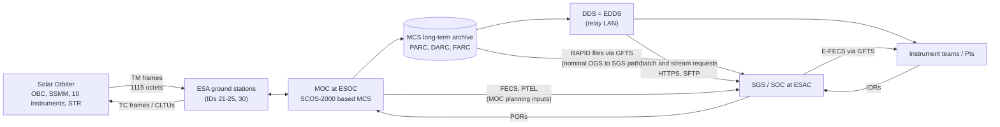
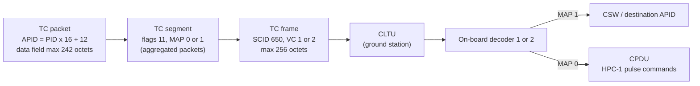
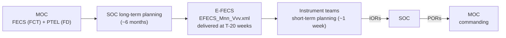
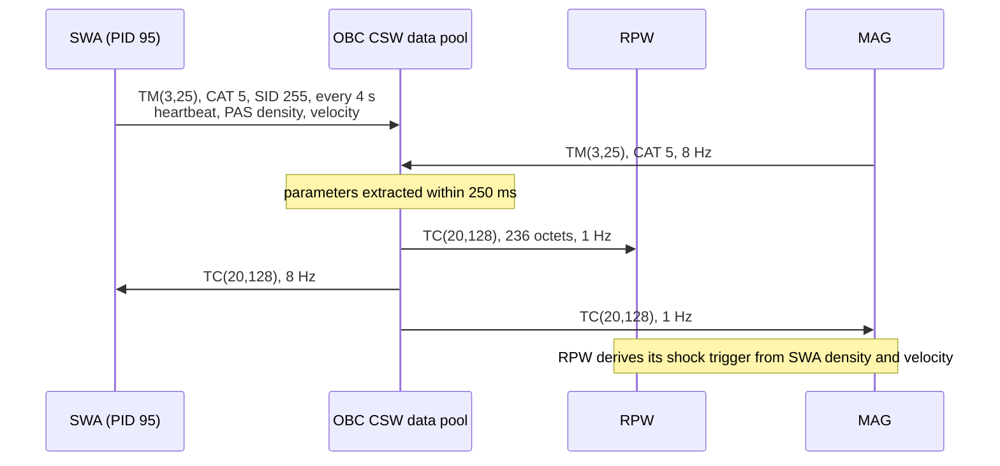
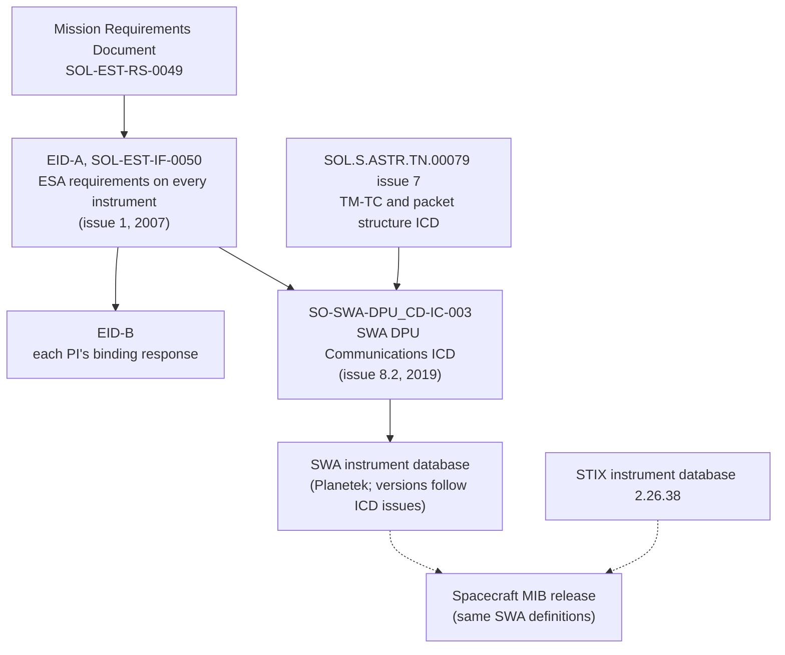

# Solar Orbiter

Solar Orbiter is the ESA mission whose ground data systems are documented best in the public
record that this wiki draws on. Its Mission Operations Centre (MOC) is ESOC and its Science
Operations Centre (SOC) is ESAC.[^efecs-acr] A set of interface documents, a training
presentation and more than a hundred releases of the operational
[Mission Information Base](../../mib/index.md) were posted on the document server of the
SWA/PAS team at IRAP (solarorbiter.irap.omp.eu), from where this wiki copied
them.[^reg-irap][^irap] Together they describe the whole chain: how on-board applications format
telemetry (TM) and telecommand (TC) packets, how the packets travel in frames, how the
[SCOS-2000](../../scos2000/index.md)-based Mission Control System (MCS) archives them, how
external users get them through the [EDDS](../../scos2000/edds.md), and how the science
planning interface constrains instrument commanding.

This page is the entry point. The data-driven pages are:

* [The Solar Orbiter MIB](mib.md) - row counts, subsystems, APIDs, calibrations, synthetic
  parameters, commands and the 2020-to-2025 evolution of the real database.
* [How Solar Orbiter uses PUS](pus-usage.md) - every standard and private service found in
  the MIB, mapped to the [PUS](../../ecss/pus/index.md) pages.
* [Solar Orbiter SWA instrument database](swa.md) - the two copied SWA instrument database
  versions (6.3.4 and 6.5.0), their release notes and how they relate to the spacecraft MIB.
* [Solar Orbiter STIX instrument database](stix.md) - the same analysis for the STIX instrument
  database 2.26.38.
* [Solar Orbiter instrument interfaces: SWA DPU ICD and EID-A](instrument-interfaces.md) - what
  ESA required of every instrument in 2007 and how one instrument, SWA, defined its packets and
  services.
* The [Solar Orbiter simulator](../../simulator/index.md), which flies the spacecraft along its JPL Horizons
  trajectory and generates, decodes and checks real MIB housekeeping packets and telecommands.
* The [MIB explorer](../../explorer/index.md#/solo/search/SWA), where every parameter,
  packet, command and sequence of the September 2025 release can be browsed, with separate views
  of the [SWA 6.5.0](../../explorer/index.md#/swa65/search/SWA) and
  [STIX](../../explorer/index.md#/stix/search/STIX) instrument databases.

## The mission at a glance

| Item | Value | Source |
|---|---|---|
| CCSDS [spacecraft identifier](../../ccsds/space-link-identifiers.md) | `0x28A` (650), the same for TM and TC, for the flight model, the ETB and the OBC-DM | [^icd-tcf][^icd-tmf] |
| Packet standard | ECSS-E-70-41A (PUS-A, 2003), applicable document AD1 | [^icd-ad] |
| TC packet data field | at most 242 octets: 4 data field header + 236 application data + 2 packet error control | [^icd-tcpkt] |
| TM source packet | at most 4112 octets; data field at most 4106 octets (10 header + 4096 source data) | [^icd-tm][^icd-tmdfh] |
| TM transfer frame | fixed length of 1115 octets (8920 bits), CLCW in every frame, 4-octet frame secondary header | [^icd-tmf] |
| TC transfer frame | at most 256 octets; two virtual channels (VC1, VC2) addressing the two on-board decoders | [^icd-tcf] |
| Packet time stamp | CUC with 4 octets of coarse and 2 octets of fine time | [^icd-tmdfh] |
| MCS mission identifier | 650 in the SCOS-2000 packet header | [^ddid-711] |
| Ground station IDs in the archive | 21 Kourou, 22 Perth, 23 New Norcia, 24 Cebreros, 25 Malargüe, 30 Maspalomas; 201 reference test station (ESOC), 202 NDIU Lite, 203 NDIU IFMS | [^ddid-711] |
| Latest MIB release copied | `MIB__20250916M25925PFMS001_SOL` (VDF `25925PFM`, comment `20250916-CSW3.1.2_MAS7.33`) | [^mib25] |
| Instrument to platform data link | SpaceWire (ECSS-E-50-12), two independent links per instrument routed separately, SpaceWire time codes received by every instrument (EID-A, 2007) | [^eida-dh] |
| Instrument databases copied | SWA 6.3.4 and 6.5.0 (IRAP), STIX 2.26.38 | [^reg-irap][^reg-r2] |

## Who does what: the ground segment

The documents name three groups of actors. The **Operational Ground Segment (OGS)** at ESOC
runs the MCS, its long-term archive (LTA) and the Data Dissemination System (DDS). The
**Science Ground Segment (SGS)** with the SOC at ESAC plans science operations. The
instrument teams, led by **Principal Investigators (PIs)**, design their instrument
operations and need their data back.[^ddid-acr][^efecs-acr] The DDS gives the SGS and the PIs
controlled access to the archive, while a second, push-based path forwards every archived
packet to the SGS as RAPID files.[^ddid-2] In the other direction, the SOC turns the MOC's
planning products into a planning skeleton for the instrument teams, the E-FECS, and collects
their Instrument Operations Requests (IORs), which it forwards to the MOC as Payload
Operations Requests (PORs).[^efecs-1][^efecs-acr]

The split goes back to the instrument requirements of 2007. Issue 1 of the Experiment Interface
Document Part A (EID-A) already placed the MOC and the communications infrastructure under
ESA/ESOC, archived housekeeping and raw payload data at the MOC, and had the SOC generate the
payload operations requests that the MOC implements and distribute the data to the PIs. It listed
the MOC tasks relevant to science: overall mission planning, supplying each PI in near real time
with the raw data of their instrument plus spacecraft housekeeping and auxiliary data, giving the
SOC a subset, checking a set of payload parameters for out-of-limit values in near real time, and
notifying payload anomalies.[^eida-gs] Its baseline ground station was New Norcia, with Cebreros
as backup;[^eida-com] the DDID of 2019 lists six ESA stations (see the table above).[^ddid-711]



The diagram combines the data flows of the DDID and the planning relationships of the E-FECS
ICD.[^ddid-2][^ddid-61][^efecs-1] The data flows are covered on the
[EDDS](../../scos2000/edds.md), [mission archives](../../scos2000/archives.md) and
[GDDS and DDIDs](../../scos2000/gdds-and-ddids.md) pages; the ground station gateway is on
[NCTRS, NIS and the ground station interface](../../scos2000/nctrs-nis.md).

## The space-ground interface: SOL.S.ASTR.TN.00079

**What it is.** SOL.S.ASTR.TN.00079 issue 7 is the *Solar Orbiter TM-TC and Packet Structure
Interface Control Document*, written by the prime contractor Airbus Defence and Space Ltd
(copyright 2014) in response to ESA's Statement of Work and Operations Interface Requirements
Document (OIRD), on the basis of ESA's *Solar Orbiter Generic Frame and Packet Structure*
(SO-ESC-RS-05002).[^icd-scope][^icd-ad] It is the baseline definition of all application-level
data structures exchanged between the on-board computer, the solid-state mass memory, the 10
payload instruments and the star trackers, and of the same structures in their ground peer
entities.[^icd-scope] It was exported from the PUS module of the prime's DOORS requirements
database, which is why the text carries object identifiers such as `PUS-31`.[^icd-conf] Its
396 pages cover the TC and TM packet and frame layers (chapters 3 and 4), every tailored PUS
service (chapter 5) and annexes on time and idle packets, the CRC, APID and source/destination
allocation, failure and event identifiers, housekeeping structure identifiers and the on-board
parameter identifier.[^icd-sum]

Its rules on PUS are strict: changing the definition of a standard service, or using it in a
non-standard way, is forbidden; any user-specific packet must be defined as a private service
in a range assigned to the user, and private services are documented in each unit's own
TM/TC ICD rather than here.[^icd-scope] The services themselves are analysed on
[How Solar Orbiter uses PUS](pus-usage.md).

### Application process identifiers

Solar Orbiter gives structure to the 11-bit [APID](../../ccsds/space-packet.md): its 7 most
significant bits are a **process ID** (PID) that names the on-board application, and its 4 least
significant bits are a **packet category** (CAT). For telecommands the category is always
12; for telemetry it says what kind of packet the process is emitting.[^icd-tcpkt][^icd-tm]

<div class="bitfield" data-title="Solar Orbiter APID (11 bits)" data-width="16"
     data-fields='[{"n":"Process ID (PID)","b":7,"d":"Application process: 10-16 OBC CSW, 30-32 SSMM, 40/41 star trackers, 50-104 instruments, 112-127 EGSE"},{"n":"Packet category (CAT)","b":4,"d":"TC: always 12. TM: 0 time, 1 verification, 2 HPTM, 3 tables, 4 routine HK, 5 functional cyclic, 6 functional non-cyclic, 7 events, 8 diagnostic, 9 dump, 10 file transfer, 11 context, 12 science, 15 idle"}]'></div>

| CAT | TM meaning (Annex 8) |
|---|---|
| 0 | Time packet, service 9 only |
| 1 | TC verification, service 1 only |
| 2 | High Priority TM (HPTM) housekeeping, platform only |
| 3 | Table generation: variable-length tabular reports |
| 4 | Routine, cyclic HK, TM(3,25) of the default service 3 |
| 5 | Functional cyclic: private TM(3,25) produced on ground request |
| 6 | Functional non-cyclic: private report packets on ground request |
| 7 | Events: service 5 and TM(17,2) |
| 8 | Diagnostic: TM(3,26) or private diagnostic packets |
| 9 | Memory dump, service 6 only |
| 10 | File transfer, service 13 only |
| 11 | Context, service 22 only |
| 12 | Private science (service 21) for TM; all telecommands |
| 13 / 14 / 15 | Spare / reserved for OCC and EGSE / idle packets |

The category table and the process ID table are Figures 13.1-1 and 13.1-2 of the
ICD.[^icd-cat] The process IDs are allocated as follows: 0 time; 2 the OBC hardware (CPDU
high-priority commands, HPTM); 10 to 16 the Central Software (CSW) applications - 10 data
management, 11 AOCS, 12 payload, 13 platform, 14 system control, 15 OBCP, 16 thermal; 30 to 32
the SSMM; 40 and 41 star trackers A and B; 49 payload broadcast; then instrument ranges EPD 50-56
and 100, EUI 57-62, MAG 63-66, METIS 67-71, PHI 72-74, RPW 75-81, SOLOHI 82-84, SPICE 85-89 and
101-104, STIX 90-94, SWA 95-99; 112 to 127 EGSE.[^icd-cat] For example the AOCS application
(PID 11) sends its events on APID 11 × 16 + 7 = 183, and every command for it goes to APID
11 × 16 + 12 = 188; both appear in the real MIB (see
[the APID catalogue](mib.md#apids-and-packets)).[^mib25]

### Telecommand path

A TC packet carries the PUS-A data field header with PUS version 1, the acknowledgement flags
(only acceptance and completion are used), service type, subtype and an 8-bit source ID. The
sequence count is kept per APID and source ID but is not checked on board, and the packet is
protected by a 16-bit CRC.[^icd-tcpkt][^icd-tcdfh][^mib25] The bit-level layout and the way
SCOS-2000 builds it from the MIB are on [PUS packet structures](../../ecss/pus/packets.md).
Reserved ground source IDs distinguish the mission timeline (110), TC sequences (111),
recovery actions (112), the back-up mission timeline (113) and direct commands (120); the CSW
uses 11 (AOCS), 14 (system control) and 15 (OBCP) for commands it generates itself.[^icd-src]

Packets travel in **TC segments** whose header carries 2 sequence flags, always `0b11` because
Solar Orbiter never segments packets, and a 6-bit MAP ID: 0 for CPDU commands, TC(2,3), and 1
for all other commands.[^icd-seg] To raise the uplink throughput, several complete packets are
aggregated in one segment; each packet's start is found from the length of the previous
one.[^icd-agg] In the MIB, the MAP ID 0 path is used by the 125 HPC-1 commands: they have the
header `HPC1_TC` without a secondary header, go to APID 44 (process 2, category 12) and are
flagged high priority (`CCF_HIPRI` = `Y`) with `CCF_MAPID` = 0, the field that SCOS-2000 uses
to force the MAP ID of high-priority commands. The TC(2,3) commands, which the ICD's MAP ID
text names as the CPDU commands, are in the MIB ordinary PUS commands to the CSW on APID 172,
mostly named "HPC-3 ..." (see
[service 2](pus-usage.md#service-2-device-command-distribution)).[^mib25][^i70-mapid]

<div class="bitfield" data-title="Solar Orbiter TC segment header (8 bits)" data-width="8"
     data-fields='[{"n":"Sequence flags","b":2,"v":"11","d":"No segmentation on Solar Orbiter"},{"n":"MAP ID","b":6,"d":"0 = CPDU (TC(2,3), HPC-1); 1 = normal commands"}]'></div>

The CPDU (Command Pulse Distribution Unit) inside the OBC can switch vital units on and off
without the CSW. Commands sent to it from the ground are HPC-1 commands; the reconfiguration
module can use the same lines (HPC-2), and the CSW can write CPDU registers to produce the same
pulses (HPC-3).[^icd-seg] The segment is the data field of a **TC transfer frame**
([CCSDS 232.0](../../ccsds/tc-sdlp.md)) with version `0b00`, the usual bypass and control
command flags giving AD, BD and BC frames under [COP-1](../../ccsds/cop-1.md), spacecraft ID
650 and a maximum length of 256 octets, so that only the low 8 bits of the 10-bit frame length
field are ever used.[^icd-tcf] The frames are then encoded into CLTUs (see
[TC synchronization and channel coding](../../ccsds/tc-coding-cltu.md)); the ICD lists
ECSS-E-ST-50-04C as a reference for this layer.[^icd-ad]



### Telemetry path

All on-board TM uses packet version `0b000`; the data field header flag is 1 except in the
standard time packet. APID 0 is reserved for the time packet and APID 2047 (all ones) for
idle packets.[^icd-tm] The grouping flags may mark the first, continuation and last packets of
a multi-packet answer (memory dumps, report of service definitions) but each packet stays a
self-standing PUS packet; the source sequence count is kept per APID and destination ID and
the ground must alarm on every discontinuity.[^icd-tm] The 10-octet data field header holds the
PUS version (1), service type and subtype, the destination ID and a 6-octet CUC time; its exact
octet layout is a figure without text in the ICD and is reconstructed on
[PUS packet structures](../../ecss/pus/packets.md).[^icd-tmdfh] The destination ID is the
command's source ID copied back for solicited TM, the receiving process for packets meant for
another on-board process, and `0b00000000` (ground) otherwise, always for categories 2, 3, 4, 8
and 9; the time packet has no data field header and therefore no destination ID.[^icd-dst]

Packets are carried in **TM transfer frames** of exactly 1115 octets
([CCSDS 132.0](../../ccsds/tm-sdlp.md)): version `0b00`, spacecraft ID 650, an operational
control field with a CLCW in every frame, a frame secondary header in every frame, a
synchronisation flag of 0 with packet order flag 0 and segment length identifier `0b11`, and
a first header pointer of all ones when no packet starts in the frame, or `0b11111111110` in
idle frames on VC7. A frame error control word is present in every frame.[^icd-tmf] Packets
longer than the 1099-octet frame data field are spread over several frames.[^icd-tm]

<div class="bitfield" data-title="Solar Orbiter TM frame secondary header (32 bits)" data-width="32"
     data-fields='[{"n":"Secondary header ID","b":8,"v":"00000011","d":"Version and header length"},{"n":"VC frame count extension","b":24,"d":"24 additional bits of the virtual channel frame count"}]'></div>

| Priority | Virtual channel | Content | Sent when ready and none available on |
|---|---|---|---|
| 1 | VC4 | Real-time high-priority TM | - |
| 2 | VC0 | Real-time TM, and the time packet when due | VC4 |
| 3 | VC5 | Critical event log (playback) | VC4, VC0 |
| 4 | VC1 | Playback from the OBC mass memory | VC4, VC0, VC5 |
| 5 | VC2 | Playback from the SSMM | VC4, VC0, VC5, VC1 |
| 6 | VC3 | Playback from the SSMM | VC4, VC0, VC5, VC1, VC2 |
| 7 | VC7 | Idle frames only | all of the above |

The priority scheme is from §4.3 of the ICD. The ICD lists VC5 before VC0, but its conditions
("when ready and no VC4 or VC0 available" for VC5, "no VC4 available" for VC0) put VC0 above
VC5, which is the order used in the table. Only VC2 and VC3 may carry compressed packets;
VC0, VC1, VC4 and VC5 never do.[^icd-vc] On the ground, the MCS stream identifiers 1000 to 1003
correspond to the on-line VC0 (real-time non-science), VC1 (playback non-science), VC2
(science) and VC3 (file transfer), which suggests how the VCs are used in flight.[^ddid-711]

### Time, idle packets and the CRC

The standard spacecraft time packet has APID 0, no data field header and 8 octets of data. Its
time refers to the leading edge of the first bit of the attached synchronisation marker of the
VC0 frame whose virtual channel frame count is 0; ground uses it to correlate on-board time
with UTC.[^icd-time] See [Time correlation in SCOS-2000](../../scos2000/time-correlation.md)
and [CCSDS time codes](../../ccsds/time-codes.md).

<div class="bitfield" data-title="Solar Orbiter time packet data field (64 bits)" data-width="16"
     data-fields='[{"n":"S-field: unused","b":4,"v":"0000"},{"n":"S-field: rate","b":4,"d":"Generation frequency of the time packet"},{"n":"P-field","b":8,"v":"00101110","d":"CUC with 4 coarse and 2 fine octets"},{"n":"T-field: coarse time","b":32,"d":"Spacecraft elapsed time, seconds"},{"n":"T-field: fine time","b":16,"d":"Binary sub-seconds"}]'></div>

Idle packets have APID 2047, no data field header and random filler data.[^icd-idle] The packet
error control uses the CCITT polynomial $x^{16}+x^{12}+x^5+1$ with the register preset to all
ones, computed over the whole packet except the CRC itself. The ICD gives test vectors, for
example `00 00` gives `0x1D0F` and `AB CD EF 01` gives `0x04A2` (real values from the
source).[^icd-crc]

## Data delivery: the DDID and the EDDS

**What it is.** The *Solar Orbiter Data Delivery Interface Control Document* (DDID),
SOL-ESC-IF-05011 issue 1 revision 2 of 26 June 2019, prepared by the Solar Orbiter data systems
manager's team in ESA's operations directorate (OPS-GDS), is the mission-specific complement to the generic EDDS External User ICD (EGOS-GEN-EDDS-ICD-1001); the two are meant to
be read together.[^ddid-obj] It specifies the request and delivery mechanisms and the data
products of the Solar Orbiter DDS, which is an instance of the generic EGOS Data Dissemination
System, for all mission phases.[^ddid-obj]

### Services and access control

The DDS offers an HTTPS web interface and an EDDS client application for requesting TM
packets and parameters, TC history, spacecraft and MCS events, auxiliary files and catalogue
information. Requests are XML documents, either **batch** requests that return a complete data
set as a file, or **stream** requests for near-real-time data; they can be saved, scheduled, or
dropped as XML files on the server via SFTP. Responses are pushed to the user's SFTP server or
kept for download.[^ddid-2][^ddid-62] Users can also subscribe to auxiliary files as they arrive
in the file archive.[^ddid-2] The DDS server runs in cold redundancy - only one of the prime and
backup servers is up at a time, and a switch-over needs the user to point the client at the
other machine - with an availability requirement of at least 95% over a month.[^ddid-4][^ddid-58]

Each account can be restricted by APID, SPID, parameter name, file name or file type, by data
volume over a period, by a relative time range (for example only the last 12 months) and by an
access period; accounts may create sub-users within their own rights.[^ddid-3][^ddid-63][^ddid-9] During
cruise, most users were expected to fetch only their own payload data plus some housekeeping,
while near the Sun the SGS would retrieve the full data set and redistribute it.[^ddid-63]

### Where the data come from

The DDS reads the MCS long-term archive: packets, events and TC data from the packet archive
(PARC), auxiliary files and TM files from the file archive (FARC), and parameters from the
parameter archive (DARC). Spacecraft TM is available as soon as it is stored, normally within
seconds of reception at the ground station.[^ddid-61] See
[Mission archives: PARC, DARC and FARC](../../scos2000/archives.md).

| Data type | Archive | Notes |
|---|---|---|
| TM, TC and event packets, packet statistics | PARC | includes MCS-generated packets such as time correlation packets |
| TM parameters, parameter statistics | DARC | |
| Command history, TM gap and other reports | PARC | |
| Auxiliary files, TM files, archive catalogues | FARC | |

The table condenses §6.2 of the DDID.[^ddid-62] Among the auxiliary file types is the MIB
itself (archive file type `MIB`), alongside flight dynamics products (attitude, orbit, events,
one-way light time, HGA blockage) and planning files.[^ddid-841]

### The SCOS-2000 packet as delivered

Raw packet requests return the **SCOS-2000 packet** (also called the TDEV packet): a common
header, a TM-, TC- or event-specific header, then the packet data. For spacecraft TM the
packet data is the complete, unstripped source packet starting with the CCSDS version number;
all DDS data are big-endian and times are 4 octets of seconds since 1 January 1970 (leap
seconds not counted) plus 4 octets of microseconds.[^ddid-7][^ddid-71] The
[EDDS request and data formats](../../scos2000/edds-formats.md) page covers the generic
formats; the Solar Orbiter values are these:

<div class="bitfield" data-title="SCOS-2000 common packet header as used by Solar Orbiter (480 bits)" data-width="32"
     data-fields='[{"n":"C-Tree","b":16,"d":"Legacy field kept for compatibility"},{"n":"Access flag","b":8,"d":"0 inserted, 1 update"},{"n":"Spare","b":6},{"n":"Sim flag","b":2,"d":"0 spacecraft, 1 simulated"},{"n":"Filing time (s)","b":32,"d":"Primary retrieval key; SCET when timestamp=2 and quality=0; TC release time"},{"n":"Filing time (us)","b":32},{"n":"Creation time (s)","b":32,"d":"Reception/storage time; TC estimated execution time"},{"n":"Creation time (us)","b":32},{"n":"Create ID","b":32},{"n":"S/C ID","b":16,"v":"650"},{"n":"G/S ID","b":16,"d":"21 Kourou ... 30 Maspalomas"},{"n":"Size","b":32,"d":"Whole SCOS-2000 packet incl. headers"},{"n":"Type","b":4,"d":"1 TM, 2 TC, 3 event"},{"n":"Version","b":4,"v":"5"},{"n":"Spare","b":2},{"n":"Filing flag","b":1},{"n":"Dist flag","b":1},{"n":"Timestamp","b":2,"d":"0 creation time, 1 frame time (ERT minus delay), 2 correlated SCET"},{"n":"Time quality","b":2,"d":"0 good, 1 inaccurate, 2 bad"},{"n":"Stream ID","b":16,"d":"1000-1003 on-line VC0-VC3; 65535 internal"},{"n":"Seq counter","b":32,"d":"MCS gap-detection counter"},{"n":"Filing key = SPID","b":32,"d":"Maps to the MIB packet definition"},{"n":"Retr key 1","b":16},{"n":"Retr key 2","b":16},{"n":"Mission ID","b":16,"v":"650"},{"n":"Context ID","b":16,"v":"0"},{"n":"Domain ID","b":16,"v":"0"},{"n":"DB Rel","b":16,"d":"VDF_RELEASE of the MIB used"},{"n":"DB Iss","b":16,"d":"VDF_ISSUE of the MIB used"},{"n":"Spare","b":16}]'></div>

The field list and values are from §7.1.1 of the DDID.[^ddid-711] Two fields tie every archived
packet to a MIB release: the filing key is the [SPID](../../mib/tables/pid.md) and `DB Rel` /
`DB Iss` record the `VDF_RELEASE` and `VDF_ISSUE` of the [vdf](../../mib/tables/vdf.md) table in
force when the packet was archived.[^ddid-711] For the September 2025 MIB those are 25925 and
733.[^mib25]

<div class="bitfield" data-title="SCOS-2000 TM packet header (128 bits)" data-width="32"
     data-fields='[{"n":"Validity","b":32,"d":"Not used"},{"n":"TPSD","b":32,"d":"PID_TPSD of variable packets"},{"n":"Route ID: unused","b":8},{"n":"Data unit type","b":4,"d":"0 frame, 1 source packet, 2 internal MCS packet"},{"n":"Qualifier","b":4,"d":"e.g. 0 good, 1 bad, 2 idle, 4 service 9 time packet"},{"n":"PUS APID","b":16},{"n":"PUS SSC","b":16},{"n":"PUS type","b":8},{"n":"PUS subtype","b":8}]'></div>

The TM header and the RouteID codes are from §7.1.2.[^ddid-712] The TC header instead holds the
uplink, execution and last-update times, MCS request identifiers, the PUS APID, sequence
count, type, subtype and acknowledgement flags, an uplink flag that records whether the
command passed pre-transmission verification (PTV), and the command source; its "command details"
body is produced by overlaying a C++ class on 32-bit aligned memory, so fields are padded to
32-bit boundaries.[^ddid-713][^ddid-714] The MCS also archives, for each command, a second TC
packet with SPID 200 holding its static PTV and verification details from the MIB; external
users ignore it. Released commands are filed with SPID 100.[^ddid-71][^ddid-711]

!!! warning "Inference"
    The common header adds up to 480 bits (60 octets) and the TM header to 128 bits
    (16 octets), 76 octets in all. The SCOS-2000 ICD gives 76 octets as the TM packet header
    size of SCOS-2000 packet header version 4,[^i70-tpcf] while the DDID states version 5 for
    Solar Orbiter. The equality of the sizes is this wiki's arithmetic; whether version 5 has
    the same size is not stated in the available sources.

When frames are missing while the MCS assembles a long packet, it files the part built so far
as a "bad" source packet (data unit type 1, qualifier 1) and the following frames as
individual good frames, so users can still recover the data.[^ddid-73]

### Internal packets and time correlation

The archive also contains MCS-internal packets on **APID 1966**, which external users filter
out, except the time correlation packets:[^ddid-81][^ddid-811]

| SPID | Type, subtype | Content |
|---|---|---|
| 66810 | - | File transfer model meta-data |
| 66980 / 66981 / 66982 | - | Good / bad / idle mini transfer frame |
| 66983, 66985, 66999 | - | Bad TM packets, missing packet detection, TM packet with no assigned SPID |
| 66830, 66831, 66832 | - | Dynamic UDCs, TC Spacon and MISC configuration packets |
| 66840 | (164,1) | Time correlation report |
| 66841 | (164,2) | Time couple (OBT of a time packet with its ground times) |
| 66842 | (164,3) | Time correlation coefficients |
| 66850 | - | Releaser TM packet including ground station response |

The real MIB defines all 14 of these on APID 1966 with private types 160, 161, 162, 164 and
165 (type 164 for the three time correlation packets), plus four packets the DDID does not
list: three "MATIS" packets of type 166 (SPIDs 101-103) and "Saved Synthetics" (SPID 66838,
type 251) - 18 in all (see
[explorer: APID 1966](../../explorer/index.md#/solo/apid/1966)).[^mib25]

### TM files, the command history and RAPID files

Telemetry downlinked through Solar Orbiter's service 13 file transfer arrives as **TM files**:
plain concatenations of TM packets, stored in the FARC as file type "DLPP Files" and named
`<PS_ID>_<file_reconstruction_timestamp>`, for example `13_2014.336.13.54.07.057`. Their
transaction history is recorded in event packets with SPID 4000 (transaction ID, packet store
ID, status, FDUs received and expected, retransmissions, times, file name, injection kind and
time).[^ddid-842] The command history report carries additional "Science Kernel" custom
fields (in the XML response, `CustomField` elements with name, type and value), among them the
service 13 file ID and file attribute (`PLAIN`, `OBCP`, `TC_DELAYED`,
`TC_IMMEDIATE` or `PAYLOAD_CONTEXT`) of commands uplinked inside files.[^ddid-831]

The nominal OGS-to-SGS path is not the DDS but **RAPID** (Raw Archive Packet Interceptor
Dumper) files: the MCS writes every SCOS-2000 packet it archives into one of three open
files (TM, TC, events), closes them every 50 seconds and lets the Generic File Transfer
System (GFTS) forward them to the SGS: one GFTS instance moves them from the MCS long-term
archive across the operational LAN (OPSLAN) firewall to the DDS server on the relay LAN, and a
second one across the ESOC corporate firewall and the SGS firewall. Packets appear in reception
order, so re-dumped or recalled data arrive out of generation order, and a TC packet is
re-sent whole every time its verification status changes. Two weeks of RAPID files are kept
for recovery.[^ddid-10][^ddid-55] Files are named
`PARC_<Type>_<FirstPacketTime>__<LastPacketTime>`.[^ddid-104]

| RAPID record field | Octets | Meaning |
|---|---|---|
| ID | 8 | Record structure version, 1 |
| ST, ET | 8 + 8 | First and last time of a delete range (not used) |
| AT | 8 | Action time: microseconds since 1970 when the packet was inserted or updated |
| DS | 8 | Size of the packet field |
| TYPE | 4 | 0 insert, 1 update (a TC packet), 2 delete (ignored) |
| SM | 4 | Sync marker `0x1ACFFC1D` |
| NS, FS, FIL | 4 + 4 + 0 | Unused, filter size (0), filter (absent) |
| PACKET | DS | The SCOS-2000 packet |

Each record is preceded by a 32-bit length.[^ddid-104] The sync marker has the same value as
the CCSDS attached sync marker of TM frames (see [TM coding](../../ccsds/tm-coding.md)).

### The EDDS/DDID training presentation

*EDDS / DDID - Presentation & Demo* is an 80-slide ESA training deck first given on
28 September 2017 by the BepiColombo mission data systems manager and the EDDS technical
officer, updated for Solar Orbiter in January 2019; its file name gives the reference
SOL-ESC-PRS-22100 issue 1 revision 0 of 2019-01-30, which is not printed on the
slides.[^demo-1] It explains to external users how the DDID complements the EDDS External User
ICD (then issue 15.0 of February 2018), that EDDS gives controlled access to mission data for
users without MCS access by reading PARC, DARC, FARC and the file system, and that it keeps
the interfaces of its predecessors GDDS and TDRS.[^demo-5][^demo-10] The deck still gives the
DDID reference as BC-ESC-IF-05011, issue 1.0 of 2013-09-10, with issue 1.2 expected in
mid-2019; the issue in the library is SOL-ESC-IF-05011 issue 1 revision 2 of 26 June
2019.[^demo-5][^ddid-obj] It also stresses what
EDDS is not: a data warehouse or an analysis tool.[^demo-11] See [TDRS](../../scos2000/tdrs.md)
and [GDDS](../../scos2000/gdds-and-ddids.md).

## Planning: the E-FECS ICD

**What it is.** SOL-SGS-ICD-0006 issue 3.0 (5 October 2021), issued at ESAC, defines the
**E-FECS** (Enhanced Flight Events and Communication Skeleton), the XML "planning skeleton"
through which the SOC tells the instrument teams the global planning constraints before they
prepare their IORs in short-term planning (STP).[^efecs-1][^efecs-acr] The MOC provides the
FECS (from its flight control team) and the PTEL (from flight dynamics); after long-term
planning (LTP) the SOC produces the E-FECS, mostly by adding windows to those inputs. It is used
in cruise and in the nominal and extended mission phases.[^efecs-1]



The flow follows §1 and §3 of the ICD.[^efecs-1][^efecs-12][^efecs-3] Several of its rules
touch TM/TC directly:

* **Time format.** Every event time uses the CCSDS ASCII time code B day-of-year form
  `YYYY-DDDThh:mm:ssZ`, with no sub-seconds and a mandatory `Z`; because the legacy planning
  systems ignore leap seconds, a window containing one may last a second
  longer.[^efecs-21] See [CCSDS time codes](../../ccsds/time-codes.md).
* **Passes.** Any low-latency data written to SpaceWire before the start of a `PASS` event is
  downlinked in that pass (special cases aside). Pass events carry the station, the frame-level
  downlink rate, the modulation, whether ranging is on, and a "MIB code" for the transponder
  configuration.[^efecs-pass] The transponder's parameters and commands in the MIB are described on
  [RF and ranging](../../ccsds/rf-and-ranging.md#solar-orbiters-deep-space-transponder-in-the-mib).
* **Routing maintenance.** During `ENG_WIN` windows TM and TC routing to and from the
  instruments is suspended or not guaranteed because of SSMM/SpaceWire maintenance, so no
  planned instrument TCs may be submitted.[^efecs-eng]
* **TAC windows.** For turn-around calibrations the SOC re-routes all of an instrument's
  science APIDs (other than low-latency data) to a small shared store for prompt downlink;
  instrument teams wait 15 seconds after the window starts for the routing commands to
  complete.[^efecs-tac]
* **Packet store resizing.** Resizing SSMM packet stores loses data unless the stores are
  empty, and needs a short window without SSMM memory operations; how to plan this was still
  an open issue.[^efecs-55]

E-FECS files are delivered through GFTS at about T-20 weeks for each six-month period and are
named `EFECS_M[nn]_V[vv].xml`, with `B` instead of `V` for a backup plan.[^efecs-3]

## On-board inter-instrument communication

**What it is.** SOL-SGS-TN-0007 issue 2.0 (7 October 2016), issued at ESAC for the Science Ground
Segment, records how the instrument teams agreed to exchange real-time information on board so that
they can react autonomously to solar events, for example by triggering coordinated burst
modes.[^tn7-1] Instruments never talk to each other directly. Each sends an inter-instrument
communication (IIC) housekeeping packet TM(3,25) to the OBC, with category 5, its own process ID
(different from the one used for its other HK) and a structure ID; the OBC copies the
parameters into its data pool within a nominal 250 ms.[^tn7-2] Up to 8 times a second the OBC
assembles a TC(20,128) carrying 36 octets of platform data and up to 200 octets of instrument
data and distributes it; TC(20,1) and TC(20,2) start and stop distribution per instrument, with
a period from one CSW cycle (125 ms) to 65 535 cycles (about 8191 s; 0 requests a one-shot
distribution). The nominal maximum end-to-end delay is 500 ms.
The same TC(20,128) also acts as the OBC heartbeat that lets instruments go safe if the
spacecraft enters Survival Mode.[^tn7-2][^tn7-23]



The cadences in the diagram are the agreed ones: MAG generates at 8 Hz, SWA at 0.25 Hz and
the other participants at 1 Hz (SPICE does not participate); all instruments receive
TC(20,128) at 1 Hz except SWA at 8 Hz.[^tn7-3] Each instrument's IIC data starts with a
4-octet heartbeat copied from the OBT coarse time.[^tn7-3] The 236-octet TC(20,128) data field
is split into fixed allocations, spares included:[^tn7-61]

| Octets | Owner | Size |
|---|---|---|
| 1-36 | Spacecraft (thruster and solar array flags, AOCS mode, roll, wheel speeds) | 36 |
| 37-66 | EPD | 30 |
| 67-89 | EUI | 23 |
| 90-109 | MAG | 20 |
| 110-129 | METIS | 20 |
| 130-143 | PHI | 14 |
| 144-176 | RPW | 33 |
| 177-190 | SOLOHI | 14 |
| 191-206 | STIX | 16 |
| 207-222 | SWA | 16 |
| 223-236 | SPICE (all spare) | 14 |

The platform content is described in chapter 4 of the note, with several fields still marked
TBC.[^tn7-4] The instrument side of the SWA contribution - a TM(3,25) with SID 255 every
4 seconds carrying the heartbeat, the PAS proton density and the three velocity components - is
defined again in §9 of the SWA DPU Communications ICD.[^dpu-9] The SWA IIC packet can be followed field by field in the real SWA database on
[Solar Orbiter SWA instrument database](swa.md#the-iic-packet-in-the-database), and the service
20 usage on [How Solar Orbiter uses PUS](pus-usage.md#service-20-information-distribution).

## Instrument interfaces and instrument databases

The library holds two layers of instrument documents - ESA's requirements on all instruments
(the EID-A) and one instrument's own interface control document (the SWA DPU ICD), which the SWA
instrument database follows - plus the databases of two instruments.[^eida-12][^dpu-docs][^rn]



The solid arrows are stated in the documents: the EID-A places itself under the Mission
Requirements Document and next to EID-B, the DPU ICD lists the EID-A (as SOL-EST-RCD-0050
issue 5) as an applicable document and the packet structure ICD issue 7 as a reference, and the
IDB release notes align IDB versions with DPU ICD issues.[^eida-12][^dpu-docs][^rn] The dotted
arrows are this wiki's inference from comparing the databases (see the Inference notes on the
[SWA](swa.md#how-the-idb-relates-to-the-spacecraft-mib) and
[STIX](stix.md#how-the-idb-relates-to-the-spacecraft-mib) pages).

### EID-A: what ESA asked of the instruments in 2007

**What it is.** The *Solar Orbiter Experiment Interface Document - Part A*, SOL-EST-IF-0050
issue 1 revision 0 of 9 October 2007, was prepared at ESTEC by the Solar Orbiter team. The EID is
first released with the instrument Announcement of Opportunity; Part A states the technical and
programmatic requirements that every PI must meet, Part B is each PI's response and becomes the
sole binding agreement between the project office and that PI, and both are placed under
configuration control once signed.[^eida-12] The copy in the library was taken from the host
explorers.larc.nasa.gov.[^reg-r2] It was written before the payload was selected: its resource
table lists potential instruments named VIM, EUS, COR, HI/WFC and DPD next to SWA, RPW, MAG, EPD,
EUI and STIX, and it allocates the payload 180 kg, 180 W and 100 kbps in all, against maximum
data rates of, for example, 14 000 bps for SWA and 200 bps for STIX.[^eida-res]

Its TM/TC-relevant requirements are few but basic:

| Topic | EID-A issue 1 requirement | Where it ended up |
|---|---|---|
| Data handling | the spacecraft Data Management System provides instrument command and control, command timeline management, packetised science data acquisition, mass memory storage and transmission, and health monitoring of instruments that are off; the bus is SpaceWire (ECSS-E-50-12) and each instrument uses a dual cold-redundant SpaceWire interface for TM and TC packets[^eida-dhs] | the SWA DPU talks to the OBC over SpaceWire, with TC, TM and time-code services in its EXOS layer[^dpu-4] |
| Links and time | SpaceWire link interface compliant up to the packet and network levels; two independent lines per instrument, addressed and routed separately; every instrument shall receive SpaceWire time codes; digital telemetry "TBW"[^eida-dh] | in the SWA DPU, time-code management is implemented in the DPM FPGA and reported through EXOS[^dpu-4] |
| Fault handling | no automatic reconfiguration after a failure; go to a safe mode, send TM records of the fault to the DMS, recover only by ground telecommand[^eida-ft] | the inter-instrument TC(20,128) doubles as the OBC heartbeat that lets instruments go safe when the spacecraft enters Survival Mode[^tn7-2] |
| On-board software | ECSS-E-40; boot software in PROM with access to all functions; an event report before any forced processor reset and on overload, arithmetic overflow, illegal instruction, data bus error, EDAC-detected memory corruption and checksum error; a single telecommand to enable software, after checking the upload; all ground communication with software functions through dedicated TC and TM source packets[^eida-sw] | the SWA DPU boot software resides in PROM and cannot be patched[^dpu-4] |
| EGSE | the instrument station exchanges TM with the Central Checkout Equipment over a TCP/IP LAN at source packet level, using an EGSE protocol to be defined by the contractor; the CCE commands the instrument and monitors its housekeeping[^eida-egse] | see [SCOS-2000 as EGSE](../../scos2000/egse.md) |

The PUS is not mentioned in issue 1, and its operations chapter is mostly placeholders: mission
operations, inputs to the satellite database, on-board software maintenance, inputs to the
planning system and command request handling are all "TBW".[^eida-ops] In the library, the PUS
tailoring is covered by the later packet structure ICD and planning by the E-FECS ICD; how
instrument definitions enter the satellite database is visible only in the data. The DPU ICD cites issue 5 of the EID-A,
which is not in the library.[^dpu-docs]

### The SWA DPU Communications ICD

**What it is.** SO-SWA-DPU_CD-IC-003 issue 8.2 (7 August 2019) is the communications interface
control document of the SWA Data Processing Unit, written by the Italian DPU team under an ASI
contract in the format of Annex E of ECSS-E-ST-40C. Over 403 pages it gives the DPU software
architecture, the APID allocation of every SWA telemetry type, the format and error codes of every
telecommand the DPU accepts (PUS services 3, 5, 6, 9, 17, 20, 21 and the private services 200 to
204), the housekeeping, asynchronous, inter-instrument and science packets, the internal protocols
with the four sensors, and the code tables for events and for the failure reports TM(1,2)
("TARF") and TM(1,8) ("TECF").[^dpu-cover][^dpu-toc][^dpu-5]
It references ECSS-E-70-41A (PUS-A) and SOL.S.ASTR.TN.00079 issue 7, the packet structure ICD
described above.[^dpu-docs] Its change record runs from issue 1 (27 June 2014) to 8.2, and the
SWA IDB release notes follow most of its issues; the comparison of the ICD, the IDB and the MIB is
on [Solar Orbiter SWA instrument database](swa.md), and the document itself is presented on
[Solar Orbiter instrument interfaces](instrument-interfaces.md).[^dpu-dcr][^rn]

### The instrument databases

The databases of two instruments are publicly posted in MIB format, and this wiki copied three
versions:

| Database | Version record (`vdf`, last row) | Parameters | Packets / APIDs | Commands | In the 2025 spacecraft MIB |
|---|---|---:|---:|---:|---|
| [SWA 6.3.4](swa.md) (`ASCII.zip`) | `SWA_6.3.4` (70 rows) | 2 885 | 609 / 15 | 198 | all parameters and packets, 197 commands |
| [SWA 6.5.0](swa.md) | `SWA_6.3.3_wa` (70 rows; 6.4.x and 6.5.0 not recorded) | 2 885 | 613 / 15 | 201 | all parameters and packets, 200 commands |
| [STIX 2.26.38](stix.md) | `STX_226`, "PFM_applicable" (1 row) | 681 | 246 / 9 | 100 | all parameters and packets, 99 commands |

The counts and comparisons are this wiki's queries.[^swa][^swa65][^stix][^mib25] In both
instruments the only command of the IDB missing from the 2025 MIB is the TC(9,129) time
synchronisation command (`ZIA58057`, `ZIX09129`), which the spacecraft release dropped for every
instrument (see [How Solar Orbiter uses PUS](pus-usage.md#service-9-time-management)).[^swa65][^stix][^mib25]
Browse them in the explorer as [SWA 6.5.0](../../explorer/index.md#/swa65/apid/1585) and
[STIX](../../explorer/index.md#/stix/apid/1447).

??? example "SQL used (instrument databases against the 2025 MIB)"
    ```sql
    -- run on swa-idb.sqlite, swa-idb-v6.5.0.sqlite and stix-idb-2.26.38.sqlite
    ATTACH 'file:solo-2025-09-16.sqlite?mode=ro' AS m;
    SELECT VDF_NAME, VDF_COMMENT FROM main.vdf ORDER BY rowid DESC LIMIT 1;
    SELECT count(*), sum(PCF_NAME IN (SELECT PCF_NAME FROM m.pcf)) FROM main.pcf;
    SELECT count(*), count(DISTINCT PID_APID), sum(PID_SPID IN (SELECT PID_SPID FROM m.pid)) FROM main.pid;
    SELECT count(*), sum(CCF_CNAME IN (SELECT CCF_CNAME FROM m.ccf)) FROM main.ccf;
    SELECT CCF_CNAME, CCF_TYPE, CCF_STYPE FROM main.ccf WHERE CCF_CNAME NOT IN (SELECT CCF_CNAME FROM m.ccf);
    ```

## The MIB releases

The SWA/PAS team's server at IRAP hosts the Solar Orbiter MIB as a directory of 111 dated
releases (April 2020 to September 2025), each a zip named like
`MIB__20250916M25925PFMS001_SOL.zip`, plus `latest/` and `previous/` sets, SWA instrument
database versions and the ICD.[^irap] This wiki copied two releases and two SWA databases from
there, and the STIX database from a separate server:

| Library item | Original file | Copied (UTC) | SHA-256 (first 16 hex) |
|---|---|---|---|
| [MIB__20250916M25925PFMS001_SOL](../../library/mib-20250916m25925pfms001-sol.md) | `MIBs/MIB__20250916M25925PFMS001_SOL.zip` (6 187 063 bytes) | 2026-11-05 14:24:03 | `c8ef0ea254d48b76` |
| [MIB__20200416M10720PFMS001_SOL](../../library/mib-20200416m10720pfms001-sol.md) | `MIBs/MIB__20200416M10720PFMS001_SOL.zip` (4 735 907 bytes) | 2026-11-05 14:26:42 | `a524903135d0a62c` |
| [SWA IDB (ASCII.zip)](../../library/swa-idb-ascii.md) | `ASCII.zip` (142 018 bytes) | 2026-11-05 14:26:47 | `aad3e32da477e39c` |
| [SWA IDB v6.5.0](../../library/swa-idb-v6-5-0.md) | `SWA_IDB_v6.5.0.zip` (115 876 bytes) | 2026-11-12 17:52:24 | `9f63f211dc1890df` |
| [STIX IDB v2.26.38](../../library/stix-idb-v2-26-38-raw.md) | `v2.26.38.raw.zip` on pub099.cs.technik.fhnw.ch (70 526 bytes) | 2026-11-12 17:45:36 | `4b627929a521831b` |

The copy times, sizes and hashes are those of this wiki's source registry.[^reg-irap][^reg-r2] The
release format follows the [SCOS-2000 Database Import ICD](../../mib/icd-history.md), issue 7.0
of which sits on the same server as the "MOC-applicable" ICD.[^reg-icd] What the releases
contain, how they are named and how they changed between 2020 and 2025 is the subject of
[The Solar Orbiter MIB](mib.md).

## The documents behind this page

| Document | Reference, issue, date | Author | Library page (copy time, UTC) |
|---|---|---|---|
| Solar Orbiter TM-TC and Packet Structure ICD | SOL.S.ASTR.TN.00079, issue 7 (copyright 2014) | Airbus Defence and Space Ltd | [sol-s-astr-tn-00079-07](../../library/sol-s-astr-tn-00079-07.md) (2026-11-05 14:15:48) |
| Solar Orbiter Data Delivery ICD (DDID) | SOL-ESC-IF-05011, issue 1 rev. 2, 2019-06-26 | ESA (OPS-GDS) | [solo-ddid-i1r2](../../library/solo-ddid-i1r2.md) (2026-11-05 14:11:58) |
| EDDS / DDID - Presentation & Demo | SOL-ESC-PRS-22100 (file name), 2017, updated 2019 | ESA mission data systems and EDDS staff | [sol-esc-prs-22100-edds-ddid-demo](../../library/sol-esc-prs-22100-edds-ddid-demo.md) (2026-11-05 14:18:24) |
| E-FECS ICD | SOL-SGS-ICD-0006, issue 3.0, 2021-10-05 | ESA, ESAC (C. Watson) | [sol-sgs-icd-0006-efecs-icd-3-0](../../library/sol-sgs-icd-0006-efecs-icd-3-0.md) (2026-11-05 14:13:08) |
| On-board Inter-instrument Communication via Services 3 and 20 | SOL-SGS-TN-0007, issue 2.0, 2016-10-07 | ESA, ESAC (L. Sanchez) | [sol-sgs-tn-0007-s20-2-0](../../library/sol-sgs-tn-0007-s20-2-0.md) (2026-11-05 14:12:56) |
| SCOS-2000 Database Import ICD | EGOS-MCS-S2K-ICD-0001, issue 7.0, 2017-08-11 | ESA/ESOC | [icd-7-0-final](../../library/icd-7-0-final.md) (2026-11-05 13:53:46) |
| Experiment Interface Document Part A | SOL-EST-IF-0050, issue 1 rev. 0, 2007-10-09 | ESA, ESTEC (Solar Orbiter Team) | [12-3-solarorbiter-eid-a-issue-1-0-2007-10-09](../../library/12-3-solarorbiter-eid-a-issue-1-0-2007-10-09.md) (2026-11-12 17:52:05) |
| SWA DPU Communications ICD | SO-SWA-DPU_CD-IC-003, issue 8.2, 2019-08-07 | SWA DPU Team | [so-swa-dpu-cd-ic-003-dpu-communications-interface-control-document-issue8-2](../../library/so-swa-dpu-cd-ic-003-dpu-communications-interface-control-document-issue8-2.md) (2026-11-12 17:47:43) |

All but the EID-A (from explorers.larc.nasa.gov) were retrieved from solarorbiter.irap.omp.eu; the
copy times are those of the source registry.[^reg-irap][^reg-icd][^reg-r2] The issue cited by SOL-SGS-TN-0007 for the packet structure ICD
is issue 6, one issue older than the copy in the library.[^tn7-1] The full catalogue is on
[References](../../references/index.md); acronyms are in the [glossary](../../glossary.md).

## Related pages

* [The Solar Orbiter MIB](mib.md), [How Solar Orbiter uses PUS](pus-usage.md),
  [Solar Orbiter SWA instrument database](swa.md), [Solar Orbiter STIX instrument database](stix.md),
  [Solar Orbiter instrument interfaces](instrument-interfaces.md)
* [Worked example: decoding a real Solar Orbiter TM packet](../../overview/worked-example-tm.md)
  and [building a real TC](../../overview/worked-example-tc.md)
* [PUS packet structures](../../ecss/pus/packets.md), [PUS-A vs PUS-C](../../ecss/pus/pus-a-vs-pus-c.md)
* [EDDS](../../scos2000/edds.md), [EDDS formats](../../scos2000/edds-formats.md),
  [archives](../../scos2000/archives.md), [time correlation](../../scos2000/time-correlation.md)
* [Space link identifiers](../../ccsds/space-link-identifiers.md#identifiers-in-the-solar-orbiter-database)
  (SCID 650, VCIDs, APIDs), [COP-1](../../ccsds/cop-1.md), [security in CCSDS space links](../../ccsds/security.md#in-the-solar-orbiter-mib)
  and [RF and ranging](../../ccsds/rf-and-ranging.md#solar-orbiters-deep-space-transponder-in-the-mib)
* [NCTRS, NIS and the ground station interface](../../scos2000/nctrs-nis.md),
  [SLE FSP](../../ccsds/sle/fsp.md#fsp-in-esas-ground-segment-and-the-solar-orbiter-mib) and
  [SLE service management](../../ccsds/sle/service-management.md#service-agreement-and-package-identifiers-in-the-solar-orbiter-mib)
* [ECSS-E-ST-70-01C on-board control procedures](../../ecss/e-st-70-01c.md#solar-orbiter-an-obcp-system-in-flight)
* [Missions](../index.md), [Herschel and Planck](../herschel-planck.md)

[^efecs-acr]: [SOL-SGS-ICD-0006 E-FECS ICD, issue 3.0](../../library/sol-sgs-icd-0006-efecs-icd-3-0.md), §1.5 Acronyms (MOC = ESOC, SOC = ESAC, E-FECS, IOR, POR, LLD, TAC), PDF pp. 11-12.
[^efecs-1]: [SOL-SGS-ICD-0006 E-FECS ICD, issue 3.0](../../library/sol-sgs-icd-0006-efecs-icd-3-0.md), cover page, §1 and §1.1, PDF pp. 1 and 8-9.
[^efecs-12]: [SOL-SGS-ICD-0006 E-FECS ICD, issue 3.0](../../library/sol-sgs-icd-0006-efecs-icd-3-0.md), §1.2, PDF p. 10.
[^efecs-21]: [SOL-SGS-ICD-0006 E-FECS ICD, issue 3.0](../../library/sol-sgs-icd-0006-efecs-icd-3-0.md), §2.1, PDF pp. 13-14.
[^efecs-pass]: [SOL-SGS-ICD-0006 E-FECS ICD, issue 3.0](../../library/sol-sgs-icd-0006-efecs-icd-3-0.md), §2.3.11, PDF pp. 21-22.
[^efecs-eng]: [SOL-SGS-ICD-0006 E-FECS ICD, issue 3.0](../../library/sol-sgs-icd-0006-efecs-icd-3-0.md), §2.3.19, PDF p. 28.
[^efecs-tac]: [SOL-SGS-ICD-0006 E-FECS ICD, issue 3.0](../../library/sol-sgs-icd-0006-efecs-icd-3-0.md), §2.4.8, PDF pp. 40-41.
[^efecs-3]: [SOL-SGS-ICD-0006 E-FECS ICD, issue 3.0](../../library/sol-sgs-icd-0006-efecs-icd-3-0.md), §3.1-3.3.1, PDF pp. 44-45.
[^efecs-55]: [SOL-SGS-ICD-0006 E-FECS ICD, issue 3.0](../../library/sol-sgs-icd-0006-efecs-icd-3-0.md), §5.5, PDF p. 48.
[^icd-scope]: [SOL.S.ASTR.TN.00079 issue 7, Solar Orbiter TM-TC and Packet Structure ICD](../../library/sol-s-astr-tn-00079-07.md), §1.1 Scope and Purpose and cover page, PDF pp. 1 and 11.
[^icd-conf]: [SOL.S.ASTR.TN.00079 issue 7](../../library/sol-s-astr-tn-00079-07.md), §1.2 Document Configuration, PDF p. 12.
[^icd-ad]: [SOL.S.ASTR.TN.00079 issue 7](../../library/sol-s-astr-tn-00079-07.md), §2 Documents (AD1-AD4, RD1-RD10), PDF p. 13.
[^icd-sum]: [SOL.S.ASTR.TN.00079 issue 7](../../library/sol-s-astr-tn-00079-07.md), §5.1 Summary, Table 5.1-1, and annexes 1-11, PDF pp. 31-40 and 262-282.
[^icd-tcpkt]: [SOL.S.ASTR.TN.00079 issue 7](../../library/sol-s-astr-tn-00079-07.md), §3.2.1.1-3.2.1.3 (PUS-24 to PUS-43), PDF pp. 15-16.
[^icd-tcdfh]: [SOL.S.ASTR.TN.00079 issue 7](../../library/sol-s-astr-tn-00079-07.md), §3.2.2.1-3.2.2.3 (PUS-49 to PUS-83), PDF pp. 16-17.
[^icd-seg]: [SOL.S.ASTR.TN.00079 issue 7](../../library/sol-s-astr-tn-00079-07.md), §3.3-3.3.1.1 (PUS-86 to PUS-95 and the CPDU telecommand paragraphs), PDF pp. 18-19.
[^icd-agg]: [SOL.S.ASTR.TN.00079 issue 7](../../library/sol-s-astr-tn-00079-07.md), §3.3.2 (PUS-108), PDF p. 19.
[^icd-tcf]: [SOL.S.ASTR.TN.00079 issue 7](../../library/sol-s-astr-tn-00079-07.md), §3.4 Telecommand Frame (PUS-113 to PUS-169), PDF pp. 20-22.
[^icd-tm]: [SOL.S.ASTR.TN.00079 issue 7](../../library/sol-s-astr-tn-00079-07.md), §4.1-4.2.1.2 (PUS-176 to PUS-208), PDF pp. 23-25.
[^icd-tmdfh]: [SOL.S.ASTR.TN.00079 issue 7](../../library/sol-s-astr-tn-00079-07.md), §4.2.1.3-4.2.2.1 (PUS-211 to PUS-233), PDF pp. 25-26.
[^icd-tmf]: [SOL.S.ASTR.TN.00079 issue 7](../../library/sol-s-astr-tn-00079-07.md), §4.3 Telemetry Frame (PUS-240 to PUS-5784), PDF pp. 27-30.
[^icd-vc]: [SOL.S.ASTR.TN.00079 issue 7](../../library/sol-s-astr-tn-00079-07.md), §4.3, virtual channel notes and priority scheme (PUS-248 to PUS-264), PDF p. 28.
[^icd-time]: [SOL.S.ASTR.TN.00079 issue 7](../../library/sol-s-astr-tn-00079-07.md), §9.1 (Annex 4) Standard Spacecraft Time Source Packet, PDF pp. 265-266.
[^icd-idle]: [SOL.S.ASTR.TN.00079 issue 7](../../library/sol-s-astr-tn-00079-07.md), §10.1 (Annex 5) Idle Packet Structure, PDF p. 267.
[^icd-crc]: [SOL.S.ASTR.TN.00079 issue 7](../../library/sol-s-astr-tn-00079-07.md), §11.1 (Annex 6) CRC Checksum Algorithms, Figure 11.1-1, PDF pp. 268-269.
[^icd-cat]: [SOL.S.ASTR.TN.00079 issue 7](../../library/sol-s-astr-tn-00079-07.md), §13.1 (Annex 8), Figures 13.1-1 and 13.1-2, PDF pp. 272-274.
[^icd-src]: [SOL.S.ASTR.TN.00079 issue 7](../../library/sol-s-astr-tn-00079-07.md), §13.2 Source ID, PDF pp. 275-276.
[^icd-dst]: [SOL.S.ASTR.TN.00079 issue 7](../../library/sol-s-astr-tn-00079-07.md), §13.3 Destination ID and the notes after Figure 13.3-1, PDF pp. 276-277.
[^ddid-obj]: [SOL-ESC-IF-05011 Solar Orbiter DDID, issue 1 rev. 2](../../library/solo-ddid-i1r2.md), cover and approval pages and §1.1-1.2, PDF pp. 1-2 and 7.
[^ddid-acr]: [Solar Orbiter DDID](../../library/solo-ddid-i1r2.md), §1.4 Acronyms (DDS, EDDS, GFTS, LTA, MCS, OGS, PI, RAPID, SGS), PDF pp. 9-10.
[^ddid-2]: [Solar Orbiter DDID](../../library/solo-ddid-i1r2.md), §2 Data Exchange Summary, PDF p. 11.
[^ddid-3]: [Solar Orbiter DDID](../../library/solo-ddid-i1r2.md), §3.2 Constraints, PDF p. 12.
[^ddid-4]: [Solar Orbiter DDID](../../library/solo-ddid-i1r2.md), §4 DDS Interface Characteristics, PDF p. 13.
[^ddid-55]: [Solar Orbiter DDID](../../library/solo-ddid-i1r2.md), §5.5 Storage Requirements, PDF p. 14.
[^ddid-58]: [Solar Orbiter DDID](../../library/solo-ddid-i1r2.md), §5.8 Backup Requirements, PDF p. 15.
[^ddid-61]: [Solar Orbiter DDID](../../library/solo-ddid-i1r2.md), §6.1 Generation Method, PDF p. 16.
[^ddid-62]: [Solar Orbiter DDID](../../library/solo-ddid-i1r2.md), §6.2-6.2.2, PDF pp. 16-17.
[^ddid-63]: [Solar Orbiter DDID](../../library/solo-ddid-i1r2.md), §6.3 Size and Frequency of Transfers, PDF p. 17.
[^ddid-7]: [Solar Orbiter DDID](../../library/solo-ddid-i1r2.md), §7 Data Definition, PDF p. 18.
[^ddid-71]: [Solar Orbiter DDID](../../library/solo-ddid-i1r2.md), §7.1 SCOS-2000 Packet Format Definition, PDF pp. 18-19.
[^ddid-711]: [Solar Orbiter DDID](../../library/solo-ddid-i1r2.md), §7.1.1 SCOS-2000 Common Packet Header Structure, PDF pp. 20-22.
[^ddid-712]: [Solar Orbiter DDID](../../library/solo-ddid-i1r2.md), §7.1.2 SCOS-2000 TM Packet Header Structure, PDF p. 23.
[^ddid-713]: [Solar Orbiter DDID](../../library/solo-ddid-i1r2.md), SCOS-2000 TC Packet Header Structure (numbered 7.1.3 in the table of contents), PDF p. 24.
[^ddid-714]: [Solar Orbiter DDID](../../library/solo-ddid-i1r2.md), §7.1.4 Command Details Data, PDF p. 25.
[^ddid-73]: [Solar Orbiter DDID](../../library/solo-ddid-i1r2.md), §7.3 Missing Frames and Bad Packets, PDF p. 25.
[^ddid-81]: [Solar Orbiter DDID](../../library/solo-ddid-i1r2.md), §8.1 Packetised Data, PDF p. 26.
[^ddid-811]: [Solar Orbiter DDID](../../library/solo-ddid-i1r2.md), §8.1.1-8.1.3, PDF p. 27.
[^ddid-831]: [Solar Orbiter DDID](../../library/solo-ddid-i1r2.md), §8.3.1 Command History Report, PDF p. 28.
[^ddid-841]: [Solar Orbiter DDID](../../library/solo-ddid-i1r2.md), §8.4.1 Auxiliary File Types, PDF p. 29.
[^ddid-842]: [Solar Orbiter DDID](../../library/solo-ddid-i1r2.md), §8.4.2-8.4.2.4 TM Files, PDF pp. 29-31.
[^ddid-9]: [Solar Orbiter DDID](../../library/solo-ddid-i1r2.md), §9 DDS User Information, PDF p. 32.
[^ddid-10]: [Solar Orbiter DDID](../../library/solo-ddid-i1r2.md), §10-10.2 RAPID File Exchange (GFTS path across the OPSLAN, ESOC corporate and SGS firewalls; 50-second files), PDF pp. 33-34.
[^ddid-104]: [Solar Orbiter DDID](../../library/solo-ddid-i1r2.md), §10.4-10.5 RAPID file naming and format, PDF pp. 34-35.
[^demo-1]: [EDDS / DDID - Presentation & Demo](../../library/sol-esc-prs-22100-edds-ddid-demo.md), slides 1-2 (PowerPoint file; slide numbers, no PDF pages).
[^demo-5]: [EDDS / DDID - Presentation & Demo](../../library/sol-esc-prs-22100-edds-ddid-demo.md), slide 5.
[^demo-10]: [EDDS / DDID - Presentation & Demo](../../library/sol-esc-prs-22100-edds-ddid-demo.md), slide 10.
[^demo-11]: [EDDS / DDID - Presentation & Demo](../../library/sol-esc-prs-22100-edds-ddid-demo.md), slide 11.
[^tn7-1]: [SOL-SGS-TN-0007 issue 2.0, Inter-instrument Communication via Services 3 and 20](../../library/sol-sgs-tn-0007-s20-2-0.md), cover page and §1.1-1.2 (RD 01 = SOL.S.ASTR.TN.00079 issue 6), PDF pp. 1 and 5.
[^tn7-2]: [SOL-SGS-TN-0007 issue 2.0](../../library/sol-sgs-tn-0007-s20-2-0.md), §2-2.2, PDF p. 6.
[^tn7-23]: [SOL-SGS-TN-0007 issue 2.0](../../library/sol-sgs-tn-0007-s20-2-0.md), §2.3, PDF p. 7.
[^tn7-3]: [SOL-SGS-TN-0007 issue 2.0](../../library/sol-sgs-tn-0007-s20-2-0.md), §3.1-3.3, PDF pp. 8-9.
[^tn7-4]: [SOL-SGS-TN-0007 issue 2.0](../../library/sol-sgs-tn-0007-s20-2-0.md), §4 Parameters requested from the platform, PDF pp. 10-11.
[^tn7-61]: [SOL-SGS-TN-0007 issue 2.0](../../library/sol-sgs-tn-0007-s20-2-0.md), §6.1-6.2, PDF p. 25.
[^mib25]: [Solar Orbiter MIB release MIB__20250916M25925PFMS001_SOL](../../library/mib-20250916m25925pfms001-sol.md), tables `vdf`, `pid` (APIDs 183 and 1966), `ccf` (APIDs 44, 172 and 188; `CCF_HIPRI`, `CCF_MAPID`) and `pcdf` (TC header `NOM_TC`, 8-bit source ID), and `pcf`, `pid` and `ccf` for the comparison with the instrument databases, queried by this wiki on 2026-11-12.
[^i70-tpcf]: [SCOS-2000 Database Import ICD, issue 7.0](../../library/icd-7-0-final.md), §3.3.2.4.3, field `TPCF_SIZE`, PDF p. 95.
[^i70-mapid]: [SCOS-2000 Database Import ICD, issue 7.0](../../library/icd-7-0-final.md), §3.3.3.2.1 fields `CCF_HIPRI` and `CCF_MAPID`, PDF p. 139.
[^reg-irap]: This wiki's source registry (`data/sources.json`) entries for the library items [mib-20250916m25925pfms001-sol](../../library/mib-20250916m25925pfms001-sol.md), [mib-20200416m10720pfms001-sol](../../library/mib-20200416m10720pfms001-sol.md), [swa-idb-ascii](../../library/swa-idb-ascii.md), [sol-s-astr-tn-00079-07](../../library/sol-s-astr-tn-00079-07.md), [solo-ddid-i1r2](../../library/solo-ddid-i1r2.md), [sol-esc-prs-22100-edds-ddid-demo](../../library/sol-esc-prs-22100-edds-ddid-demo.md), [sol-sgs-icd-0006-efecs-icd-3-0](../../library/sol-sgs-icd-0006-efecs-icd-3-0.md) and [sol-sgs-tn-0007-s20-2-0](../../library/sol-sgs-tn-0007-s20-2-0.md) (original URL on solarorbiter.irap.omp.eu, copy time, size, SHA-256).
[^reg-icd]: Source registry entry for [icd-7-0-final](../../library/icd-7-0-final.md), original URL `https://solarorbiter.irap.omp.eu/documents/MOC/MOC-applicable%20MIB%20egos-mcs-s2k-icd-0001-version7.0-FINAL.pdf`, copied 2026-11-05 13:53:46 UTC.
[^irap]: Web directory listing <https://solarorbiter.irap.omp.eu/MIB/> and <https://solarorbiter.irap.omp.eu/MIB/MIBs/> (not a library item), as surveyed for this project on 2026-11-05: 111 release zips from April 2020 to September 2025, `latest/`, `previous/`, SWA_IDB versions and `docs/`. Not re-checked on 2026-11-12.
[^eida-12]: [SOL-EST-IF-0050 Solar Orbiter Experiment Interface Document Part A, issue 1 rev. 0](../../library/12-3-solarorbiter-eid-a-issue-1-0-2007-10-09.md), cover and approval page, §1.2 Scope and §1.3 Document Concept & Architecture (Figure 1), PDF pp. 1-2 and 10-12.
[^eida-res]: [SOL-EST-IF-0050 EID-A, issue 1](../../library/12-3-solarorbiter-eid-a-issue-1-0-2007-10-09.md), §3.3.3, Table 2 Spacecraft Payload Allocations and Table 3 Maximum Resource Allocations for Potential Instruments, PDF pp. 20-21.
[^eida-gs]: [SOL-EST-IF-0050 EID-A, issue 1](../../library/12-3-solarorbiter-eid-a-issue-1-0-2007-10-09.md), §3.2.1 Ground Segment and §5.3.1.1 Operational Ground Segment, PDF pp. 17 and 87-88.
[^eida-com]: [SOL-EST-IF-0050 EID-A, issue 1](../../library/12-3-solarorbiter-eid-a-issue-1-0-2007-10-09.md), §3.3.1 Communications, PDF p. 18.
[^eida-dhs]: [SOL-EST-IF-0050 EID-A, issue 1](../../library/12-3-solarorbiter-eid-a-issue-1-0-2007-10-09.md), §3.5 Satellite Data Handling Architecture, PDF p. 30.
[^eida-dh]: [SOL-EST-IF-0050 EID-A, issue 1](../../library/12-3-solarorbiter-eid-a-issue-1-0-2007-10-09.md), §4.8.2.1-4.8.2.4 Data Handling Electrical Interface Design, PDF p. 70.
[^eida-ft]: [SOL-EST-IF-0050 EID-A, issue 1](../../library/12-3-solarorbiter-eid-a-issue-1-0-2007-10-09.md), §4.2.4 Fault Tolerance, PDF pp. 35-36.
[^eida-sw]: [SOL-EST-IF-0050 EID-A, issue 1](../../library/12-3-solarorbiter-eid-a-issue-1-0-2007-10-09.md), §4.9.1 Software Design Requirements (requirements 1-18), PDF pp. 71-72.
[^eida-egse]: [SOL-EST-IF-0050 EID-A, issue 1](../../library/12-3-solarorbiter-eid-a-issue-1-0-2007-10-09.md), §8.7.1.5 Ground Support Equipment (requirements 5-8), PDF p. 188.
[^eida-ops]: [SOL-EST-IF-0050 EID-A, issue 1](../../library/12-3-solarorbiter-eid-a-issue-1-0-2007-10-09.md), §5.3.2-5.3.6 (sections marked TBW, including 5.3.3.2 Inputs to Satellite Database), PDF pp. 88-90.
[^dpu-cover]: [SO-SWA-DPU_CD-IC-003 SWA DPU Communications ICD, issue 8.2](../../library/so-swa-dpu-cd-ic-003-dpu-communications-interface-control-document-issue8-2.md), cover page and §1.1-1.2 (DRD Annex E to ECSS-E-ST-40C, ASI contract 2013-055-1.0), PDF pp. 1 and 18.
[^dpu-toc]: [SO-SWA-DPU_CD-IC-003 issue 8.2](../../library/so-swa-dpu-cd-ic-003-dpu-communications-interface-control-document-issue8-2.md), Table of Content, PDF pp. 11-16.
[^dpu-docs]: [SO-SWA-DPU_CD-IC-003 issue 8.2](../../library/so-swa-dpu-cd-ic-003-dpu-communications-interface-control-document-issue8-2.md), §2.1 Applicable Documents (AD[2] SOL-EST-RCD-0050 EID-A issue 5) and §2.2 Reference Documents (RD[1] ECSS-E-70-41A, RD[3] SOL.S.ASTR.TN.00079 issue 7), PDF p. 19.
[^dpu-dcr]: [SO-SWA-DPU_CD-IC-003 issue 8.2](../../library/so-swa-dpu-cd-ic-003-dpu-communications-interface-control-document-issue8-2.md), Document Change Record, issues 1 (27/06/2014) to 8.2 (07/08/2019), PDF pp. 3-10.
[^dpu-4]: [SO-SWA-DPU_CD-IC-003 issue 8.2](../../library/so-swa-dpu-cd-ic-003-dpu-communications-interface-control-document-issue8-2.md), §4-4.1.2 DPU Software Overview (EXOS SpaceWire services towards the OBDH, boot software in PROM), PDF pp. 25-30.
[^dpu-5]: [SO-SWA-DPU_CD-IC-003 issue 8.2](../../library/so-swa-dpu-cd-ic-003-dpu-communications-interface-control-document-issue8-2.md), §5 Service Implementation, Table 1 (TARS, TARF, TECS, TECF on TM(1,1), (1,2), (1,7), (1,8)), PDF pp. 32-35.
[^dpu-9]: [SO-SWA-DPU_CD-IC-003 issue 8.2](../../library/so-swa-dpu-cd-ic-003-dpu-communications-interface-control-document-issue8-2.md), §9 SWA DPU Inter Process Communication Contribution (S20), PDF pp. 303-304.
[^rn]: [SWA IDB v6.5.0](../../library/swa-idb-v6-5-0.md), file `IDB_relNotes.txt` (Planetek Italia release notes, entries 2.0.0 to 6.5.0, many of them naming the DPU ICD issue they follow); a plain-text file without page numbers.
[^swa]: [Solar Orbiter SWA instrument database 6.3.4 (ASCII.zip)](../../library/swa-idb-ascii.md), tables `vdf`, `pcf`, `pid`, `ccf`, queried by this wiki on 2026-11-12.
[^swa65]: [Solar Orbiter SWA instrument database v6.5.0](../../library/swa-idb-v6-5-0.md), tables `vdf`, `pcf`, `pid`, `ccf`, queried by this wiki on 2026-11-12.
[^stix]: [Solar Orbiter STIX instrument database v2.26.38](../../library/stix-idb-v2-26-38-raw.md), tables `vdf`, `pcf`, `pid`, `ccf`, queried by this wiki on 2026-11-12.
[^reg-r2]: Source registry (`data/sources.json`) entries for [12-3-solarorbiter-eid-a-issue-1-0-2007-10-09](../../library/12-3-solarorbiter-eid-a-issue-1-0-2007-10-09.md) (explorers.larc.nasa.gov), [so-swa-dpu-cd-ic-003-dpu-communications-interface-control-document-issue8-2](../../library/so-swa-dpu-cd-ic-003-dpu-communications-interface-control-document-issue8-2.md) and [swa-idb-v6-5-0](../../library/swa-idb-v6-5-0.md) (solarorbiter.irap.omp.eu), and [stix-idb-v2-26-38-raw](../../library/stix-idb-v2-26-38-raw.md) (`https://pub099.cs.technik.fhnw.ch/data/idb/v2.26.38.raw.zip`): original URL, copy time, size and SHA-256.
