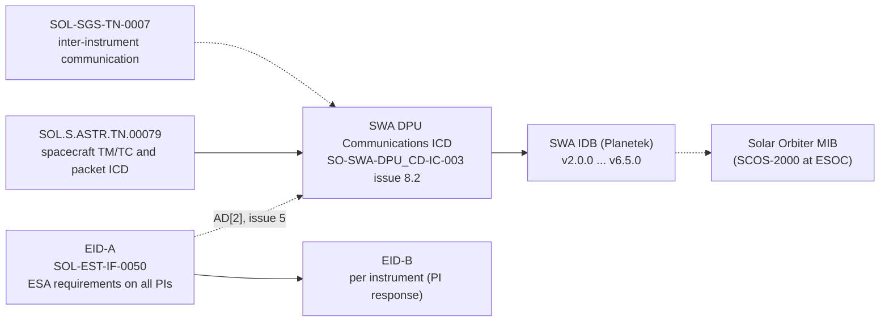
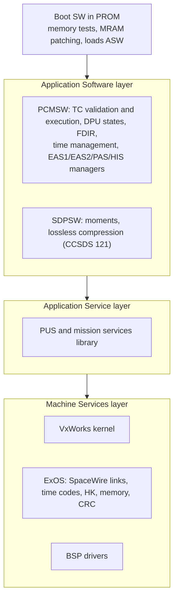
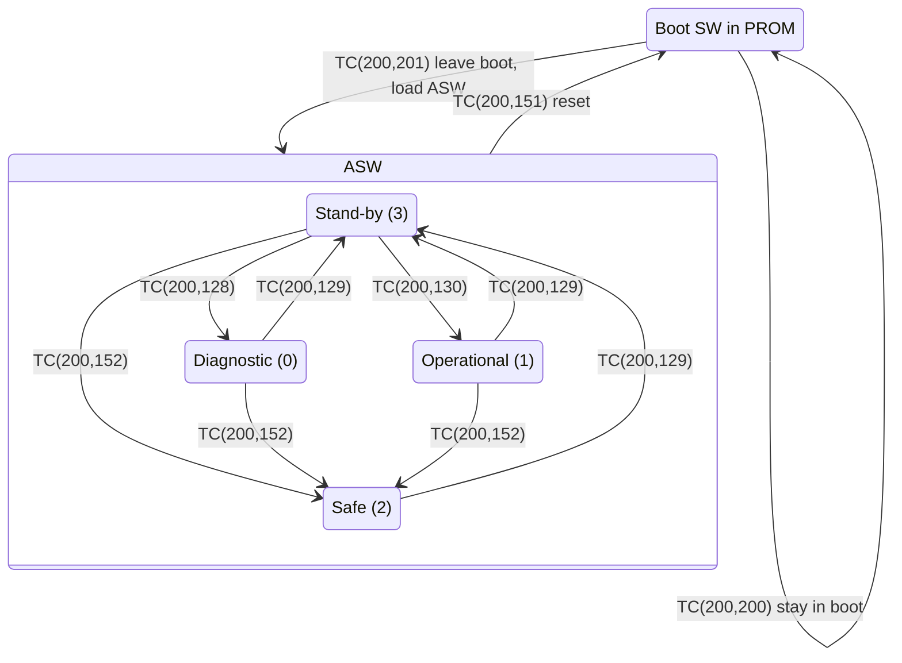

# Solar Orbiter instrument interfaces: SWA DPU ICD and EID-A

A science instrument reaches the ground through a chain of interface documents. ESA's
**Experiment Interface Document (EID)** Part A states what every Solar Orbiter instrument must
comply with, and each Principal Investigator answers with a Part B.[^e-12] The spacecraft prime
contractor's TM/TC and packet structure ICD, SOL.S.ASTR.TN.00079, fixes the packet formats,
APIDs and PUS services on board (see [Solar Orbiter](index.md#the-space-ground-interface-solsastrtn00079)).[^icd-ref]
Each instrument then documents its own packets and commands: for **SWA** (the "Solar Wind
Analyzer" in the EID-A acronym list) this is the **DPU Communications Interface Control
Document** SO-SWA-DPU_CD-IC-003, and the same content is delivered in machine form as the SWA
**instrument database (IDB)**, which ends up in the spacecraft [MIB](mib.md).[^e-acr][^s-front][^swa65]
This page covers the three round-2 sources of that chain - EID-A issue 1.0, the SWA ICD issue
8.2 and the SWA IDB v6.5.0 with its release notes - and checks the ICD against the data. The
database itself is analysed on [Solar Orbiter SWA instrument database](swa.md); the STIX
equivalent is [STIX instrument database](stix.md).



The solid arrows show which document each one cites: the SWA ICD lists the EID-A (issue 5) as
applicable and the packet ICD issue 7 and ECSS-E-70-41A as references, and the IDB release notes
tie many IDB versions to ICD issues.[^s-2][^relnotes] The EID-B is named by the EID-A but is not
in the library.[^e-12] The dotted arrows are this wiki's reading: the SWA ICD does not list
SOL-SGS-TN-0007, but its S20 packet implements the note's SWA allocation (the note's SWA table in
turn names SO-SWA-DPU_CD-IC-003 "Issue 2_draft" as its reference), and the route from IDB
to MIB is not documented (see the Inference at the end of the page).[^s-2][^tn7-swa]

!!! info "The three sources"
    | Library item | Document | Origin |
    |---|---|---|
    | [12-3-solarorbiter-eid-a-issue-1-0-2007-10-09](../../library/12-3-solarorbiter-eid-a-issue-1-0-2007-10-09.md) | Solar Orbiter Experiment Interface Document - Part A, SOL-EST-IF-0050, issue 1 revision 0, 9 October 2007, 200 pages | copied 2026-11-12 from `explorers.larc.nasa.gov` |
    | [so-swa-dpu-cd-ic-003-...-issue8-2](../../library/so-swa-dpu-cd-ic-003-dpu-communications-interface-control-document-issue8-2.md) | SWA DPU Communications Interface Control Document, SO-SWA-DPU_CD-IC-003, issue 8.2, 07/08/2019, 403 pages | copied 2026-11-12 from `solarorbiter.irap.omp.eu/documents/ICD/` |
    | [swa-idb-v6-5-0](../../library/swa-idb-v6-5-0.md) | SWA IDB v6.5.0: 56 `.dat` files and `IDB_relNotes.txt` | copied 2026-11-12 from `solarorbiter.irap.omp.eu/MIB/SWA_IDB_v6.5.0.zip` (115 876 bytes) |

    Titles, issues and dates are from the documents' cover pages; hosts, sizes and copy dates
    from this wiki's source registry.[^e-cover][^s-front][^reg]

## The Experiment Interface Document, Part A (2007)

### What the document is

The EID-A was to be released with the instrument Announcement of Opportunity; its background
section notes that ESA's Science Programme Committee was to decide in November 2007 whether and
how to proceed with the mission.[^e-12] It exists to make the PIs design, build and verify their
instruments within the spacecraft's constraints and the prime contractor build a spacecraft into
which they can be integrated. Part A holds the technical and programmatic requirements common to
all PIs; Part B, written by each PI, becomes the only binding agreement between the ESA project
office and that PI, and both parts become applicable documents to the prime contractor.[^e-12]
Once signed they are under configuration control: changes go through an Engineering Change
Request, deviations through a Request for Waiver, each numbered for example `ECR/XYZ/0100`, and
the receiving party's board must decide within 4 weeks.[^e-86] The copy in the library is issue
1.0, signed on 9 October 2007; the SWA ICD lists the EID-A as applicable document AD[2] under
the reference SOL-EST-RCD-0050 at issue 5, which is not in the library.[^e-cover][^s-2]

The 2007 instrument list shows how early this issue is: its resource table (Table 3) lists eleven
potential instruments with mass, power and data rate, among them SWA (then "Solar Wind Plasma
Analyzer", 16.5 kg nominal, 14 W, 14 000 bit/s) and STIX (4.4 kg, 4 W, 200 bit/s), against a
payload allocation of 180 kg, 180 W and 100 kbit/s that the listed total of 106 100 bit/s
exceeds.[^e-res] The flown payload named in the packet ICD (EPD, MAG, RPW, SWA, SPICE, PHI, EUI,
METIS, STIX, SoloHI) differs from that 2007 list.[^icd-cat]

### Data handling requirements

The data handling chapter is short. The on-board data handling system - the Data Management
System (DMS), combining the functions of a Command and Data Management Unit and the attitude
control computer - is the instruments' gateway to ground and provides instrument command and
control, command timeline management, packetized science data acquisition, mass-memory storage
and transmission, and health and safety monitoring while instruments are off.[^e-35] The bus
architecture is SpaceWire to ECSS-E-50-12, and each instrument must use a dual cold-redundant
SpaceWire interface "for transmission of TM and reception of TC packets".[^e-35] The detailed
requirements are:[^e-482]

| Clause | Requirement |
|---|---|
| 4.8.2.1 | A SpaceWire link interface (cables and connectors, LVDS drivers, codec, FIFO) compliant up to the packet and network levels of the SpaceWire standard |
| 4.8.2.1 (1) | Instruments receive SpaceWire **time codes** according to ECSS-E-50-12 |
| 4.8.2.3 (2) | Two independent SpaceWire lines per instrument, addressed and routed separately to the spacecraft data handling system |
| 4.8.2.2, 4.8.2.4 | Monitoring and synchronisation interfaces "TBD"; digital telemetry "TBW" |

A SpaceWire Remote Terminal Controller ASIC under ESA development could implement the remote
terminal, but it is a PI-provided item (targets: about 50 MIPS, under 500 mW and 100 g).[^e-35]

### Software and fault-handling requirements that shape TM/TC

The requirements of section 4.9.1 that most directly shape telemetry and telecommands are:[^e-49]

* all on-board software complies with ECSS-E-40, with separate memory areas for code, fixed
  constants and variable parameters, a minimum boot software in PROM from which every function,
  including EEPROM updates, is reachable, and modules that can be changed without moving others;
* software resource usage (memory, CPU, I/O) should be telemetered, uploaded software must be
  checkable before it is enabled, and enabling should take a single telecommand;
* any communication between ground and an on-board software function uses telecommand and
  telemetry source packets designed for the purpose;
* an **event report** is generated before a forced processor reset, and on processor overload,
  unexpected arithmetic overflow, illegal instruction, data bus error, memory corruption detected
  by EDAC, and checksum error.

Fault tolerance relies on redundancy; after a failure an instrument must not reconfigure itself
to continue but go to a safe mode, send telemetry records of the fault to the DMS and wait for a
ground telecommand to recover; and instrument computers must reset and resume from a defined
mode after power cycling.[^e-424][^e-481] The SWA ICD's safe mode, boot software and event list
(below) can be compared with these clauses.

### Operations, database and ground equipment

The operational chapter assigns the MOC and communications to ESA/ESOC, archiving at the MOC,
and the SOC to produce payload operations requests and distribute data to the PIs; the MOC
supplies raw instrument data with housekeeping and auxiliary data and performs near-real-time
out-of-limit checks on a set of payload parameters.[^e-321][^e-5] The PI defines the instrument
modes, supplies a user manual, **inputs to the database** and to the Flight Operations Plan, and
maintains the software to end of mission.[^e-5][^e-823] Most operational subsections are still
empty: "Inputs to Satellite Database", on-board software maintenance, command request handling
and the mission products are all "TBW" in issue 1.0.[^e-5] On-board software is delivered with
each model, either resident in non-volatile memory or loadable through the spacecraft
telecommand uplink.[^e-87] The instrument EGSE must integrate into the system EGSE; its
Instrument Station talks to the Central Checkout Equipment (CCE) over a TCP/IP LAN, exchanging
telemetry "at Source Packet level", and the CCE commands the instrument and monitors its
housekeeping.[^e-87]

### What EID-A issue 1.0 does not specify

The document's normative references are the mission requirements document, engineering
standards of the ECSS-E-10, -20 and -30 series, SpaceWire (ECSS-E-50-12), software (ECSS-E-40),
product assurance standards (ECSS-Q, ESA PSS) and a materials handbook; the PUS (ECSS-E-70-41) is
not among them, and the document does not mention it anywhere.[^e-9]
Issue 1.0 therefore says nothing about packet structure, APIDs, PUS services, time formats,
verification or the database format: those come from the spacecraft packet ICD, whose PUS
services, Annex 8 APID scheme and Annex 9 failure and event IDs the SWA ICD and IDB follow
(see [How Solar Orbiter uses PUS](pus-usage.md)).[^icd-cat][^icd-fid] Whether the later issue 5
cited by SWA adds such requirements is not stated in the available sources.

## The SWA DPU Communications ICD (issue 8.2, 2019)

### Purpose and history

The ICD gives the communication interface of the SWA Data Processing Unit (DPU) using the
method of Annex E to ECSS-E-ST-40C, as deliverable EN-019 of the Italian Space Agency (ASI)
contract 2013-055-1.0 (as printed in §1.1-1.2); it was prepared, checked and approved by the DPU team
and its distribution list includes ASI, MSSL, IAPS, TSD, SITAEL, Leonardo and Planetek.[^s-11][^s-front]
Its change record runs from issue 1 (27/06/2014) to 8.2 (07/08/2019):[^s-front]

| Issue | Date | Main changes |
|---|---|---|
| 1 | 27/06/2014 | first issue |
| 2 | 31/07/2015 | ICDR RIDs: science TM (S21), inter-process contribution (S20), HK for OBC FDIR, TC handling policy |
| 3 | 11/12/2015 | HK optimisation, SIDs 1, 2, 3, 11-15, safe state TCs, event/TARF/TECF auxiliary data sections |
| 4 - 4.7 | 08/06/2016 - 2017 (4.6: 21/04/2017) | burst and engineering modes, time offset TC(200,163), IIC test TM and TC (4.2), memory IDs, **service 12 monitoring remapped to service 200** (4.4), boot report renamed FSW start-up report, debug TM(200,248), 3-bit DPU state with a transition state |
| 5.0 - 6.2 | 2017 - 31/07/2018 | event and recovery codes, monitoring ID lists, unused TECF codes deleted (6.1), per-APID SSID table, parameter data aligned to length |
| 7.0 - 7.1 | 08/03/2019 - 13/03/2019 | macro state in HK, ExOS low-level error codes, TC(203,160) |
| 8.0 - 8.2 | 30/04/2019 - 07/08/2019 | EAS engineering SIDs, PAS engineering PIDs, "minor editorial fixing" |

The applicable documents are the ASI contract annex, the EID-A (issue 5), the SWA science
operations requirements and the DPU flight software requirements and design documents; the
reference documents are ECSS-E-70-41A (PUS), ECSS-E-ST-40C, the packet ICD SOL.S.ASTR.TN.00079
issue 7, the SpaceWire application protocol SOL.S.ASTR.RS.00038, and the HIS, EAS and PAS sensor
documents from their teams.[^s-2] All open points (TBC, TBD, TBW) are closed in issue 8.2.[^s-16]

### SWA and its DPU

SWA has four units: two Electron Analyser Systems (EAS1, EAS2) for electron velocity
distributions and moments, a Proton Alpha Sensor (PAS) for the major solar wind ions, and a Heavy
Ion Sensor (HIS) for charge states of oxygen and iron and minor ions; all are connected to the
DPU by SpaceWire at 10 Mbit/s.[^s-3] The DPU provides power, control, temporary storage,
communication and computation; its hardware is a rigid-flex backplane with six SpaceWire
splitters, two Data Processing Modules (each a communication and science processing board plus a
CPU board) and two Power Conditioning and Distribution Modules.[^s-3] Its software provides TC
reception, science and HK telemetry, sensor control (all sensors are switched by the DPU except
HIS, powered by a dedicated spacecraft line, although Table 7 also lists DPU commands
TC(200,153)/(200,154) to switch HIS on and off), buffering of 5 minutes of high-resolution EAS and
PAS data for triggered transmission, moment calculation and compression, time synchronisation,
and inter-instrument exchange through PUS service 20.[^s-4]



The layers and components are those of the ICD's sections 4 and 4.1; everything runs on a LEON2
CPU.[^s-4][^s-41] The boot software checks the memories and EDAC, initialises SpaceWire, copies
the software from MRAM to RAM and starts it; it cannot be patched.[^s-41] Compression is lossless
and CCSDS 121 compliant; moments of order 0 to 2 (and 3 for EAS) are computed, and in normal mode
compression runs in the deterministic time slots while triggered-mode work runs as a separate
low-priority task.[^s-41]

### Packet formats

The ICD refers to the packet ICD for the packet formats and to the SpaceWire application
protocol for the transport, and draws each packet as a grid of 16-bit words.[^s-5] Every
telecommand starts with the same five words - version, type, data field header flag, PID 95 and
category; sequence flags and count; packet length; secondary header flag, PUS version 1, ack
flags and service type; subtype and source ID - and ends with the packet error control word.[^s-t2]
The SWA IDB's TC header `NOM_TC` gives the exact bit positions:[^swa65]

<div class="bitfield" data-title="SWA TC header: ICD field names, bit positions from the IDB pcdf NOM_TC (80 bits)" data-width="16"
     data-fields='[{"n":"VN","b":3,"v":"000"},{"n":"TY","b":1,"v":"1"},{"n":"DF","b":1,"v":"1"},{"n":"PID = 95","b":7,"v":"1011111","g":"APID 1532"},{"n":"PKT = 12","b":4,"v":"1100","g":"APID 1532"},{"n":"SF","b":2,"v":"11"},{"n":"PSC","b":14,"d":"Sequence count, set by SCOS-2000"},{"n":"PL","b":16,"d":"Packet length"},{"n":"SHF","b":1,"v":"0"},{"n":"PVN","b":3,"v":"001"},{"n":"ACK","b":4,"d":"CCF_ACK = 9 for all 201 commands"},{"n":"ST","b":8},{"n":"SS","b":8},{"n":"SI","b":8,"v":"01111000","d":"Fixed 0x78 = 120"}]'></div>

The ICD names the fields `VN`, `TY`, `DF`, `PID`, `PKT`, `SF`, `PSC`, `PL`, `SHF`, `PVN`, `ACK`,
`ST`, `SS`, `SI` and `PEC`; the IDB fixes the source ID to `0x78` (120), the value the packet ICD
reserves for ground direct commands, and asks for acceptance and completion reports
(`CCF_ACK` = 9) on all 201 commands.[^s-t2][^swa65][^icd-src] The IDB treats `PID` and `PKT`
as one 11-bit APID element, 95 x 16 + 12 = 1532.[^swa65][^icd-ref]

Telemetry uses a 10-octet data field header drawn as secondary header flag, PUS version `001`,
four spare bits and the service type; subtype and destination ID; and three words of on-board
time (`OBRT`).[^s-8][^s-9] The field widths follow from the printed values (3-bit `001`, 4-bit
`0000`) in a 16-bit word, and agree with the 10-octet data field header and the 6-octet CUC time
(4 octets coarse, 2 fine) of the packet ICD and with the 16-octet header length
(`PID_DFHSIZE` = 16) of every SWA packet in the IDB.[^icd-tmhdr][^swa65]

<div class="bitfield" data-title="SWA TM data field header as drawn in the ICD (80 bits)" data-width="16"
     data-fields='[{"n":"SFH","b":1},{"n":"PVN","b":3,"v":"001"},{"n":"Spare","b":4,"v":"0000"},{"n":"ST","b":8},{"n":"SS","b":8},{"n":"DI","b":8,"d":"Destination ID"},{"n":"OBRT","b":48,"d":"On-board time, 3 words"}]'></div>

### APIDs: the ICD table and the database

The ICD's Table 1 assigns each kind of telemetry a PID and packet category; the IDB places the
packets as follows:[^s-5][^swa65]

| ICD Table 1 content | ICD PID / CAT (APID) | SWA IDB v6.5.0 |
|---|---|---|
| HK for S20, TM(3,25) SID 255 (PAS quick-look moments) | 95 / 5 (1525) | 1525: `SWA_TM_II_INFO` |
| Low-latency TM(21,3)/(21,6): EAS quick-look strahl, PAS moments 215 and calibration 214, HIS 132-134 | 95 / 12 (1532) | 1532: 9 packets |
| HK normal TM(3,25): DPU 11 and 16, EAS 1 and 2, HIS 100 and 101, PAS 3 | 96 / 4 (1540) | 1540: these 7 plus boot-software HK SID 20 |
| HK diagnostic TM(3,26): DPU 4-10, 12, 13 | 96 / 8 (1544) | 1544: 9 packets |
| Science normal: EAS 3D, partial moments, engineering; PAS distributions and engineering; HIS | 96 / 12 (1548) | 1548: 45 packets |
| Optional burst and trigger data | 97 / 12 (1564) | 1564: 25 packets |
| HK ground monitoring TM(3,25) | 98 / 4 (1572) | 1572: SID 15 and `SWA_TM_HIS_ALIVE` (SID 102) |
| Science core burst | 98 / 12 (1580) | 1580: 13 packets |
| TM(1,1), (1,2), (1,7), (1,8) | 99 / 1 (1585) | 1585: 175 packets |
| HK for OBC action TM(3,25) | 99 / 4 (1588) | 1588: SID 14 |
| Events TM(5,1)-(5,4) | 99 / 7 (1591) | 1591: 248 events **and TM(17,2)** |
| Memory dump (6,6) and checksum (6,10), TM(17,2), TM(200,249)-(200,253), TM(201/202/203,200) | 99 / 9 (1593) | dumps on **1545 (96 / 9)**; private reports on **1542 (96 / 6)** and again, with other SPIDs, on 1593 |
| EAS engineering low-latency, modes 3 and 4 | 99 / 12 (1596) | 1596: 4 packets |

The differences in the last rows bring the database closer to Annex 8 of the packet ICD, which
reserves category 7 for service 5 and TM(17,2), category 9 for service 6 dumps and category 6 for
private report packets produced on ground request.[^icd-cat] The release notes record the steps:
TM(17,2) "CAT set to 7" in IDB 2.3.0, "Fixed some APID according to ICD v8.3" in 6.3.3, and in
6.3.3_wa nine report packets re-added "with APID = 1593 (as in v6.2.1)".[^relnotes] An ICD issue
8.3 is not in the library. The 2021 IDB already has the dumps on 1545 and the reports on 1542
and 1593; their earlier placement in the April 2020 MIB is traced on
[SWA](swa.md#how-the-idb-relates-to-the-spacecraft-mib).[^swa21]

??? example "SQL used (APIDs and header)"
    ```sql
    -- swa-idb-v6.5.0.sqlite
    SELECT PID_APID, count(*), group_concat(DISTINCT PID_TYPE || '/' || PID_STYPE)
      FROM pid GROUP BY 1 ORDER BY CAST(PID_APID AS INT);
    SELECT PID_APID, PID_SPID, PID_TYPE || '/' || PID_STYPE, PID_DESCR
      FROM pid WHERE PID_APID IN ('1542', '1593') ORDER BY 1, 3;
    SELECT * FROM pcdf;  SELECT CCF_ACK, count(*) FROM ccf GROUP BY 1;
    ```

### Telecommands by manager

The flight software routes each TC to a manager; the ICD lists them in Tables 2 to 8, and the
IDB v6.5.0 defines 201 commands, all on APID 1532:[^s-t2][^s-t3][^s-t4][^s-t5][^s-t6][^s-t7][^swa65]

| Manager (ICD table) | Service type | Subtypes in the ICD | IDB commands |
|---|---|---|---:|
| PUS manager (Table 2) | 3, 5, 6, 9, 17, 21 | 3: 5, 6, 129; 5: 5, 6; 6: 2, 5, 9, 129; 9: 129; 17: 1; 21: 1, 2 | 13 |
| PUS manager, on-board monitoring (Table 2) | 200 | 170-176 | 7 |
| PUS manager, inter-instrument data | 20 | 128 (received from the OBC) | - |
| DPU manager (Table 3) | 200 | 128-149, 151, 152, 200-203 | 28 |
| Sensor manager (Table 4) | 200 | 160-165 | 7 (two variants of 162) |
| HIS manager (Table 7) | 200 | 153-155 | 4 (with 156) |
| EAS1 / EAS2 managers (Table 5) | 201 / 202 | 129-173 except 151 and 163 | 44 / 44 (with 174) |
| PAS manager (Table 6) | 203 | 128-160 | 33 |
| HIS internal (Table 8) | 204 (also HIS's own TC(6,2), (6,5), (6,9), (9,129), (20,128)) | 27 subtypes from 128 to 181 | 21 (not 134, 139, 140, 142, 151, 177) |

This confirms what the database alone only suggested (see [SWA](swa.md#apids-and-packets)): type 200 belongs to the DPU and its
general functions, 201 to EAS1, 202 to EAS2, 203 to PAS and 204 to HIS, all inside the range
200-205 that the packet ICD reserves for SWA.[^s-t5][^s-t6][^s-t7][^icd-svc] The IDB adds three
commands the ICD does not have - TC(201,174) and TC(202,174) "set EAS summation" and a second
TC(200,162) - and still contains TC(200,156) "DPU stop the HIS macro execution", whose removal
issue 4.3 records.[^swa65][^relnotes][^s-front]

#### PUS manager: services 3, 5, 6, 9, 17, 21

* **Service 3.** TC(3,5)/(3,6) enable or disable one HK packet by its SID (1-15; types HK or
  DIAG), TC(3,129) changes its period in 125 ms time slices, which must be a multiple of 8 (one
  second); bad SIDs and rates fail execution with codes `0xA8D9` and `0xA8DA`.[^s-s3]
* **Service 5.** TC(5,5)/(5,6) enable or disable a list of event IDs, given in decimal from
  43500 (`EvntOk`) to 43564 (`DPUSwWarning`), for example 43526 `RpwTriggerOccurred`, 43547
  `dpuSafeState`, 43550 `thrustFire`.[^s-s5]
* **Service 6.** Load, dump and check by absolute address, and abort dump TC(6,129). Memory IDs
  are `0x8000` RAM (start `0x40000000`, 8 MiB), `0x8001`/`0x8003` MRAM 1 and 2 (`0x10000000`,
  2 MiB), `0x8002` PROM (`0x00000000`, 128 KiB) and `0x8040`-`0x8080` HIS memories; dumps are
  sent as TM(6,6) of at most 1 024 octets at 1 Hz, using the grouping flags when several packets
  are needed.[^s-s6][^s-8] The packet ICD allocates memory IDs `0x80--`/`0x81--` to SWA.[^icd-mem]
* **Service 9.** TC(9,129) "accept time synchronisation" carries the spacecraft SCET coarse and
  fine time; an internal error gives `0xA868`.[^s-s9] The 2025 spacecraft MIB no longer has this
  command (`ZIA58057`), although IDB v6.5.0 does.[^mib25][^swa65]
* **Service 17 and 21.** Connection test TC(17,1) answered by TM(17,2); TC(21,1)/(21,2) start
  and stop all science packets.[^s-s17]

#### On-board monitoring on service 200

Issue 4.4 moved the parameter monitoring from service 12 to the private service 200 "according
on FDIR agreement".[^s-front] Seven TCs manage a list of **monitoring items**: enable and disable
items or the whole function (TC(200,170)/(200,171), up to 215 items per TC, `N` = 0 meaning the
service level), configure items (TC(200,172), up to 7 per TC, only while the item is disabled),
report the configuration as TM(200,249) (TC(200,173)), and enable, disable or reset the counters
of the **error-event handler** (TC(200,174)-(200,176)).[^s-mon] One configuration entry holds:[^s-mon]

| Field | Meaning |
|---|---|
| `monId`, `monStatus` | item identifier (69 named items 0-68, for example 0 `EAS2POWER_MI`, 8 `TC20MISSING`, 9 `TIMECODEMISSING`, 10 `THFIREFLAG_MI`, then spares) and enable flag |
| `parType`, `filter` | parameter type (for example 0 = `PAR_WORD`, unsigned 16 bits) and the filter value used to confirm a failure |
| `parId` | 32-bit parameter identifier, for example `0x00030013` `HK_I_PLUS_28V_PRI`, `0x00060000` `MissingTc20` |
| two `validityParId` | 32-bit identifiers of validity parameters (`0x000A0000` EAS1 HK valid ... `0x000A0007`) |
| `lowThreshold`, `highThreshold` | limits |
| `lowEventId`, `highEventId` | error event raised below or above the limit for more than `filter` samples, from a list such as 3 `ReqSWASafeEvnt`, 4 `RequestSWAOffEvnt`, 16 `MissingTc20Evnt`, 18 `ThFireTc20Evnt`, 24 `HisAlivenessEvnt`, or `0xFF` none |

Having been moved from service 12, this is the instrument-level counterpart of PUS
[ST[12] on-board monitoring](../../ecss/pus/st12-onboard-monitoring.md); the error-event
handler resembles, in this wiki's reading, an event-to-action list as in
[ST[19]](../../ecss/pus/st19-event-action.md).[^s-front] The items
`TC20MISSING`, `THFIREFLAG_MI` and `SASTEERING_MI` watch the OBC's TC(20,128), which SOL-SGS-TN-0007
defines both as a heartbeat letting instruments go safe if the spacecraft enters survival mode
and as the carrier of the platform's thruster-firing and solar-array-steering flags.[^s-mon][^tn7-hb]

!!! warning "Inference"
    The ICD does not state whether the event IDs 0-26 of the error-event handler trigger the
    macros of section 12 (for example `DPUSafeM`) or the OBC-side requests of SID 14. The names
    (`ReqSWASafeEvnt`, `RequestSWAOffEvnt`) suggest requests to the spacecraft, which SID 14
    below implements with OBCP flags; this link is this wiki's reading.

#### DPU manager: states, configuration and macros

The DPU manager runs the instrument's state machine. Each mode command starts a DPU "CCSDS
macro" - `DPUDiagM`, `DPUStbyM`, `DPUOps` or `DPUSafeM` - and fails acceptance with `0xA7FF` when
the current state does not allow it or `0xA805` while a safe transition is running.[^s-t3][^s-modes][^s-safe][^s-12]



The preconditions are the ICD's: diagnostic and operational only from stand-by, safe only from
operational, stand-by or diagnostic; stand-by has no stated precondition (its only acceptance
failure is a safe transition in progress), and the reset reboots the software by stopping the
watchdog refresh.[^s-modes][^s-safe] The numbers are the
3-bit `DPU currentStatus` of SID 11, which also has value 4 for a transition in progress.[^s-t9]
The state the ASW starts in is not stated in the available sources. TC(200,202) selects which
flight software copy the boot software loads next (0 nominal, 1 patchable).[^s-safe]

The other DPU manager commands manage **configuration parameters** (modify, report as
TM(200,250), accept into flash, discard, apply to MRAM, re-initialise the science processing),
**macros** (modify, report as TM(200,251), accept, discard), science compression, RPW trigger
handling (freezing the rolling buffers), the "book keeping" algorithm, IIC test generation, the
boot report TM(200,252), the error log TM(200,253) and a debug register access answered by
TM(200,248).[^s-t3][^s-8] Section 12 lists the macros: 23 sensor macros (EAS power, run, idle,
pre-amplifier, dump; PAS power, configuration and cyclograms), 12 HIS macros and 6 DPU macros -
`DPUTFFMacro` (16), `DPUOps` (17), `DPUStbyM` (18), `DPUSafeM` (19), `DPUDiagM` (20) and
`DPUSASteer` (21). A macro holds at most 16 TCs of at most 64 octets each, drawn from a list of
TC instances (for example `0x0E` `SetE1Off`, an instance of TC(201,132), or `0x26` `DisTcProc`,
TC(200,165) with value 7), and its content can be modified with service 6.[^s-12] The step list
is not fully consistent with the TC tables: it maps `PasPwrOffFast` (`0x14`) to TC(200,154), which
Table 7 names "Switch off HIS", and maps both `SetPas` (`0x13`) and `PasPwrOff` (`0x1C`) to
TC(203,138), which Table 6 names "PAS FastPower OFF"; which mapping is intended is not stated in
the available sources.[^s-12][^s-t6][^s-t7]

#### Sensor, EAS, PAS and HIS managers

The sensor manager puts all sensors into burst mode at the next 4-second boundary (TC(200,160),
durations in 0.125 s steps), puts both EAS into science mode, sets the product **cadence**
(TC(200,162): EAS 10 s, 100 s or 400 s; PAS and HIS nominal or low), shifts science timing
against the SCET by -299 to +299 (TC(200,163)), stops macros, and enables or disables commanding
of individual sensors (TC(200,165)).[^s-t4] The EAS managers hold 43 commands each, mostly
register, table and high-voltage settings (dither, notch, deflection and hemisphere tables, MCP
high voltage, eight engineering modes 2-9, strahl selection, pre-amplifiers); the PAS manager's
33 commands cover calibration and engineering modes, high-voltage ramps, sequence and
configuration tables, start and stop science and stand-by.[^s-t5][^s-t6] HIS commands TC(204,x)
are passed through: the DPU routes them unchanged and HIS validates them itself.[^s-t7][^s-11int]

### Verification: TARF and TECF codes

Each TC description lists its **TARF** (acceptance failure, reported in TM(1,2)) and **TECF**
(execution failure, TM(1,8)) error codes; sections 14 and 15 tabulate them with the auxiliary
data each failure report carries.[^s-14] The IDB defines one packet per code; for the TARF codes:[^swa65]

| ICD TARF | Code | IDB TM(1,2) |
|---|---|---|
| `TcApidError`, `TcLenError`, `TcPecError` (with received and computed checksum), `NotValidSrvType`, `NotValidSrvSubtype`, `TcSfError` | 0, 1, 2, 3, 4, 6 | SPIDs 58001-58006, codes 0-4 and 6 |
| `TcTyError`, `TcVnError`, `TcDfError`, `TcPkcError`, `TcShfError`, `TcPusVerError` | `0xA7F8`-`0xA7FD` | 58007-58011 and 58013 (58012 is TM(1,7)) |
| `TcNotPlausible`, `DpuNotPlausibleTcError` | both `0xA7FF` in the ICD | `0xA7FE` and `0xA7FF` |
| `Eas1/Eas2/Pas/HisNotPlausibleTcError`, `TcReceivedWhileNotSynch`, `DpuSafeOnGoing` | `0xA800`-`0xA805` | 58016-58020, 58190 |

The low codes are the standard failure IDs of the packet ICD (0 illegal APID to 6 illegal
segment sequence flag) and the others lie in SWA's block 43000-43999 (`0xA7F8` = 43000).[^icd-fid]
The ICD gives `TcNotPlausible` the same code as `DpuNotPlausibleTcError`; the IDB resolves the
clash with `0xA7FE`.[^s-14][^swa65] The 153 TM(1,8) packets run up to `0xA901` `SafeEntMacroErr`.[^swa65]
On the ground every SWA command uses the same two verification stages, acceptance `58901` and
completion `58907`, both report-based with a 20-second interval (see
[Command verification in the MIB](../../mib/command-verification.md)).[^swa65]

### Housekeeping and diagnostic telemetry

Table 9 lists 19 cyclic packets: SIDs 1-3 sensor HK (EAS1, EAS2, PAS), 4-10 and 12-13 DPU
diagnostics (TC counters, validity, hardware diagnostics, maximum manager durations, FDIR status
and monitoring values, derived parameters, TM and error counters), 11 DPU HK, 14 OBC FDIR, 15
ground monitoring, 16 IIC test, 100 and 101 HIS boot and HK, and 20 boot-software HK.[^s-t9] The
ICD gives offsets from the start of the source data; the IDB's `plf` offsets are 16 octets larger
because they count from the packet start.[^s-t9][^swa65] Octet 4 of SID 11 (IDB octet 20,
container `NIAG0703`) holds the DPU manager state:[^s-t9][^swa65]

<div class="bitfield" data-title="SWA SID 11 octet 4: DPU manager status (IDB NIAG0703)" data-width="8"
     data-fields='[{"n":"currentStatus","b":3,"d":"NIAD0703: 0 Diag, 1 Ops, 2 Safe, 3 StdBy, 4 Transition"},{"n":"managerStatus","b":1,"d":"NIAD0704: 0 READY, 1 BUSY"},{"n":"tcQueueState","b":1,"d":"NIAD0705: TC received not yet analysed"},{"n":"rebootRequest","b":1,"d":"NIAD0706"},{"n":"compressionReq","b":1,"d":"NIAD0707"},{"n":"rpwTrigger","b":1,"d":"NIAD0708"}]'></div>

The IDB's textual calibration of `NIAD0703`, `CIAT0017TM`, covers only 0 DIAG, 1 OPS, 2 SAFE and
3 STBY: it has no text for the raw value 4 (transition, added in ICD issue 4.4).[^swa65][^s-front]

**SID 14** (APID 1588, category 4 on PID 99) is the packet the spacecraft watches for SWA
FDIR.[^s-5][^s-713] Its first data octets carry a 2-bit DPU mode and boot flag, then four
request flags; the ICD defines the action for each: run OBCP 1 `REC_SWA1` (switch SWA off by its
LCL), OBCP 2 `REC_SWA2` (SWA safe), OBCP 3 `REC_SWA3` (safe, then off) or OBCP 4 `REC_SWA4`
(reset SWA); a 16-bit "OBCP #5 request" word asks for HIS to be switched off.[^s-713]

<div class="bitfield" data-title="SWA SID 14 octets 4-5 (IDB octets 20-21, NIAG2100 and NIAG2103)" data-width="16"
     data-fields='[{"n":"DPU mode","b":2,"d":"NIAD2100: 0 Diag, 1 Ops, 2 Safe, 3 StBy"},{"n":"Boot flag","b":1,"d":"NIAD2101: 1 = boot"},{"n":"Spare","b":5},{"n":"REC_SWA1","b":1,"d":"OBCP 1: switch off SWA via LCL"},{"n":"REC_SWA2","b":1,"d":"OBCP 2: SWA safe"},{"n":"REC_SWA3","b":1,"d":"OBCP 3: safe then switch off"},{"n":"REC_SWA4","b":1,"d":"OBCP 4: reset SWA"},{"n":"Spares","b":4}]'></div>

The rest of SID 14 holds the DC-DC current, the two thermistors (A checked by the OBC, B not),
the HIS switch-off request and two DPU power-good flags; the IDB packet `YIA58211` is 34 octets
with exactly these fields.[^s-713][^swa65] Browse it as
[packet 58211](../../explorer/index.md#/swa65/packet/58211). SID 16 echoes samples of the
received TC(20,128) - reception time, MAG heartbeat and field components - to test the
inter-instrument link.[^s-713]

??? example "SQL used (HK layouts)"
    ```sql
    SELECT l.PLF_OFFBY, l.PLF_OFFBI, c.PCF_NAME, c.PCF_DESCR, c.PCF_PTC || '/' || c.PCF_PFC, c.PCF_CURTX
      FROM plf l JOIN pcf c ON c.PCF_NAME = l.PLF_NAME
     WHERE l.PLF_SPID IN ('58200', '58211') ORDER BY l.PLF_SPID, CAST(PLF_OFFBY AS INT);
    SELECT g.COL2, g.COL3, c.PCF_DESCR, c.PCF_CURTX FROM pcf_glob_det g
      JOIN pcf c ON c.PCF_NAME = g.COL2 WHERE g.COL1 IN ('NIAG0703', 'NIAG2100', 'NIAG2103');
    SELECT * FROM txp WHERE TXP_NUMBR = 'CIAT0017TM';
    ```

### Asynchronous reports, events and the S20 contribution

Reports produced on request are TM(200,248) debug data, (200,249) monitoring configuration,
(200,250) configuration parameters (a count followed by identifier, length and data per
parameter, for example `0x0002` `RebootCnt`), (200,251) macro content, (200,252) FSW start-up
report, (200,253) error log, and (201,200), (202,200), (203,200) EAS1, EAS2 and PAS parameter
dumps; the ICD gives all of them PID 99 and category 9.[^s-8][^s-5] Section 13 lists the events
with their auxiliary data, codes from `0xA9ED` (`TcAcqError`) upwards.[^s-13] In the IDB the SWA
event IDs run from 43501 to 43999 (`0xA9ED`-`0xABDF`) in all four severities: SWA numbers its
events inside its 43000-43999 block (Table 14.3-1 allocates these ranges for both failure and
event IDs) rather than by the severity ranges that the packet ICD defines
for the central software (and makes optional for others).[^swa65][^icd-eid]

Every 4 seconds the DPU sends the TM(3,25) with PID 95, category 5 and SID 255 for distribution to
other instruments: the heartbeat (coarse OBRT), the PAS proton density and the three solar wind
velocity components, then spares, with a packet length field of `0x1A`.[^s-9] The bit layout and
its agreement with SOL-SGS-TN-0007 and the IDB are on
[SWA](swa.md#the-iic-packet-in-the-database).[^tn7-swa]

### Science telemetry and sensor protocols

Science products use service 21. An EAS 3D product, generated every 100 s in normal mode, is one
TM(21,3) with SID, SID counter, SCET, the EAS mode, validity flags for the whole set, each of the
16 elevations and each energy, and the compression information, followed by TM(21,6) packets
(grouping flags first, continuation, last) carrying up to 2 045 words of compressed data.[^s-10]
PIDs 96, 97 and 98 distinguish normal science, optional burst or RPW-frozen data and core burst;
HIS science packets are passed through unchanged.[^s-10] The IDB has 96 such packets (54 TM(21,3)
and 42 TM(21,6) on the science APIDs 1532, 1548, 1564, 1580 and 1596).[^swa65] Table 10 of the ICD
lists the six HIS science products (pulse-height analysis, alpha and heavy matrix rates, alpha and
heavy velocity distributions, rates) as TM(21,5), whereas the IDB defines no TM(21,5) packet and
carries HIS science as TM(21,3) and TM(21,6) with SSIDs 128-134 and 191 (for example
[SPID 58808](../../explorer/index.md#/swa65/packet/58808) `SWA_TM_SCI_HIS_PHA_NORM`, TM(21,6) on
APID 1548).[^s-10][^swa65]

Inside SWA the DPU talks to EAS and PAS with a simple register protocol over SpaceWire, not with
PUS packets. Each EAS command starts with a header octet:[^s-11int]

<div class="bitfield" data-title="EAS command header octet (DPU to EAS)" data-width="8"
     data-fields='[{"n":"Type","b":2,"d":"00 enable, 01 reserved (FPGA to DPU), 10 memory access, 11 go"},{"n":"R/W","b":1,"d":"0 write, 1 read"},{"n":"Reserved","b":5,"v":"00000","d":"Instrument ID in responses"}]'></div>

followed by a 16-bit address, a 16-bit length and data in 24-bit units, the EAS internal bus
width.[^s-11int] A command that could damage the instrument is sent as an **enable** packet
followed immediately by a **go** packet with identical address and data; any other packet in
between clears the enable and the go is rejected.[^s-11int] HIS, in contrast, speaks CCSDS: the
DPU forwards TCs to it and its TM to the spacecraft, and on receiving a HIS TM(5,3) it forwards
the packet and powers HIS off at once.[^s-11int]

## The SWA IDB v6.5.0 and its release notes

### What was copied

The zip holds 56 `.dat` files (32 non-empty) dated 2025-06-17 10:56, an empty `synthetic/`
folder dated 2015-10-02 and `IDB_relNotes.txt` dated 2025-06-17 11:01; unlike the 2021 `ASCII.zip`
it has no `__MACOSX` entries.[^swa65] The files use CR LF line ends and the same issue-5.1 field
counts (19 for `pcf`, 13 for `cpc`).[^swa65] It is browsable as the `swa65` explorer, for example
[APID 1593](../../explorer/index.md#/swa65/apid/1593).

### Release notes

The notes, written at Planetek Italia, list the IDB versions from 2.0.0 (08/03/2016,
"released with EGSE SW spacePTS v2.0") to 6.5.0 (17/06/2025).[^relnotes] Many entries name the ICD
issue they implement, often within days of it:[^relnotes][^s-front]

| IDB version | Date | ICD issue (date) |
|---|---|---|
| 2.1.0, 2.2.0 | 10/06/2016, 16/06/2016 | 4 (08/06/2016) |
| 2.3.0 | 19/07/2016 | 4.1 (25/07/2016 in the ICD record) |
| 2.4.4 | 31/08/2016 | 4.2 (30/08/2016) |
| 2.6.0 | 04/11/2016 | 4.3 (21/10/2016) |
| 3.0.0 | 14/03/2017 | 4.4 (10/03/2017) |
| 3.1.0 | 30/03/2017 | 4.5 (30/03/2017) |
| 4.0.0 | 26/06/2017 | 5.0 |
| 5.0.0 | 22/12/2017 | 6.0 (27/11/2017) |
| 5.2.0, 5.3.0 | 23/05/2018, 14/11/2018 | 6.1 (21/02/2018), 6.2 (31/07/2018) |
| 5.4.0, 5.4.1 | 11/03/2019, 13/03/2019 | 7.0 (08/03/2019), 7.1 (13/03/2019) |
| 6.0.0, 6.2.0 | 30/04/2019, 17/06/2019 | 8.0 (30/04/2019), 8.1 (17/06/2019) |
| 6.3.3 | 11/10/2021 | 8.2 for three packets, 8.3 for APIDs |

The other entries record database work - remarks from MSSL and from review lists, HIS updates
from the HIS team's spreadsheets, calibration and limit changes, errors found with a tool called
PDIT, and an "AIRBUS issue" fixed in 4.0.3.[^relnotes] After the 2021 versions come 6.4.0-6.4.5
(2022-2023: a textual calibration, `mcf` and `ocf`, the cadence command TC(200,162), `ocp`), 6.4.6
(11/06/2025: commands `ZIA58951` and `ZIA58952`, textual calibration `CIAT0066TM`) and 6.5.0
(17/06/2025: SPIDs 58730-58733).[^relnotes]

### From the 2021 set to v6.5.0, and to the 2025 MIB

Comparing the copied 2021 `ASCII.zip` (last version 6.3.4) with v6.5.0 confirms the notes:[^swa65][^swa21]

| Change | Data | Release note |
|---|---|---|
| 4 packets added | TM(1,8) on APID 1585: 58730 `SWA_EAS1_BAD_SUM`, 58731 `SWA_EAS2_BAD_SUM`, 58732 `SWA_EAS1_OFF_ENT_ERR`, 58733 `SWA_EAS2_OFF_ENT_ERR` (failure IDs 43149-43152) | 6.5.0 |
| 3 commands added | `ZIA58950` `SWA_TC_SENS_CADENCE` TC(200,162) with 9 parameters (beside the 5-parameter `ZIA58728`) and its new command text tables `CIAT0070TC`-`CIAT0075TC`; `ZIA58951`/`ZIA58952` set EAS1/EAS2 summation TC(201/202,174) | 6.4.2-6.4.5 (cadence TC), 6.4.6 |
| text of failure IDs 43149/43150 | `Eas1FOffEntErr`/`Eas2FOffEntErr` become `Eas1BadSum`/`Eas2BadSum` in `CIAT0066TM` | 6.4.6 |
| limits | `NIA05128`-`NIA05131` switch their `ocf` from raw to calibrated values; 7 parameters get new hard limits; the 90-450 check moves from `NIA05131` to `NIA05130` (whose raw 6000-6500 range goes), leaving `NIA05131` with an `ocf` record but no `ocp` row | 6.4.1 ("MCF and OCF Updated"), 6.4.4 (`ocp` for `NIA05131`); no note names the other `ocp` changes |
| calibrations | `CIAP0002TM`, `CIAP0003TM`, `CIAP0005TM` polynomials; command text table `CIAT0068TC` (used by `ZIA58728`); the unused command text table `CIAT0069TC` (`SENS_EN`) is removed | 6.4.1 (MCF), 6.4.0; no note for `CIAT0069TC` |
| unchanged | all 2 885 parameters (description, type, calibration, unit), the 70 `vdf` names | - |

The four new failure IDs, `0xA88D`-`0xA890`, are among the codes that ICD issue 6.1 lists as
"not used" and deletes, and that IDB 5.1.0 removed as TM(1,8) packets in 2018: the values have
been reused for the new summation errors.[^s-front][^relnotes][^swa65] Against the 2025 spacecraft
MIB, v6.5.0 is almost a match: all 613 packets, all 6 535 `plf` entries, all 2 885 parameters
(description, type, calibration) and all 1 054 `pas` values are present and equal, and the 80
polynomials differ only in number formatting. The exceptions are the time command `ZIA58057` and
the unused textual calibration `CAAT0008TM` (absent from the MIB); 243 parameter units (237 of them
units that only the IDB gives, such as `V` or `mA`); 13 of the 538 command parameters, Boolean
(PTC 1) in the IDB but enumerated (PTC 2, PFC 1) in the MIB (nine of them already so in the April
2020 release, which lacks the other four, the sensor flags `PIA60091`-`PIA60094` of `ZIA58950`);
the variable layouts of two compressed EAS burst packets, 58726 and 58889, where the MIB inserts
10 bit-field entries (`NIAD4626`-`NIAD4635`, overlapping their container words through offsets of
-8) so that 36 of the IDB's 481 `vpd` entries move (the notes of 6.3.2 and 6.3.3 record fixes to
exactly these packets); applicability criteria that the MIB adds to four of the 325 limit checks;
and the verification of `ZIA58950`, which the MIB maps to stages 11 and 17 (report-based, 20 s,
used by some 2 200 other, mostly platform, commands) instead of SWA's 58901 and 58907.[^swa65][^mib25][^mib20][^relnotes] Browse
[ZIA58951](../../explorer/index.md#/swa65/command/ZIA58951) and
[packet 58730](../../explorer/index.md#/swa65/packet/58730).

!!! warning "The version record was not updated"
    The `vdf` of v6.5.0 holds the same 70 names as the 2021 set, ending at 6.3.x, with no record
    for 6.4.0-6.5.0; and its order differs, the last record being `SWA_6.3.3_wa` instead of
    `SWA_6.3.4`.[^swa65][^swa21] SCOS-2000 takes the database version name from the last `vdf`
    record imported, and `VDF_NAME` holds 8 characters, an over-long field being truncated with
    a warning.[^i70-vdf][^i70-ascii] This wiki's deduction from those rules: an import of v6.5.0
    that reads the file in order would name the database after `SWA_6.3.3_wa`, truncated to
    `SWA_6.3.`, not after 6.5.0 (see also [SWA](swa.md#versions-the-vdf-table-as-a-release-history)).

??? example "SQL used (v6.5.0 against the 2021 set and the 2025 MIB)"
    ```sql
    -- swa-idb-v6.5.0.sqlite
    ATTACH 'file:swa-idb.sqlite?mode=ro' AS a;
    ATTACH 'file:solo-2025-09-16.sqlite?mode=ro' AS m;
    SELECT PID_SPID, PID_APID, PID_TYPE, PID_STYPE, PID_PI1_VAL, PID_DESCR
      FROM main.pid WHERE PID_SPID NOT IN (SELECT PID_SPID FROM a.pid);          -- 58730-58733
    SELECT CCF_CNAME, CCF_DESCR FROM main.ccf WHERE CCF_CNAME NOT IN (SELECT CCF_CNAME FROM a.ccf);
    SELECT rowid, VDF_NAME FROM main.vdf ORDER BY rowid DESC LIMIT 3;          -- ... SWA_6.3.3_wa
    SELECT x.TXP_FROM, y.TXP_ALTXT, x.TXP_ALTXT FROM main.txp x JOIN a.txp y
        ON x.TXP_NUMBR = y.TXP_NUMBR AND x.TXP_FROM = y.TXP_FROM WHERE x.TXP_ALTXT <> y.TXP_ALTXT;
    SELECT count(*), sum(PID_SPID IN (SELECT PID_SPID FROM m.pid)) FROM main.pid;     -- 613 | 613
    SELECT count(*) FROM main.plf x JOIN m.plf y ON x.PLF_NAME = y.PLF_NAME AND x.PLF_SPID = y.PLF_SPID
       AND x.PLF_OFFBY = y.PLF_OFFBY AND x.PLF_OFFBI = y.PLF_OFFBI;              -- 6535
    SELECT CCF_CNAME FROM main.ccf WHERE CCF_CNAME NOT IN (SELECT CCF_CNAME FROM m.ccf);  -- ZIA58057
    SELECT a.VPD_TPSD, count(*) FROM main.vpd a WHERE NOT EXISTS (SELECT 1 FROM m.vpd b
     WHERE a.VPD_TPSD = b.VPD_TPSD AND a.VPD_POS = b.VPD_POS AND a.VPD_NAME = b.VPD_NAME
       AND a.VPD_GRPSIZE = b.VPD_GRPSIZE AND a.VPD_OFFSET = b.VPD_OFFSET) GROUP BY 1;  -- 58726, 58889
    SELECT x.OCP_NAME, y.OCP_RLCHK, y.OCP_VALPAR FROM main.ocp x JOIN m.ocp y
        ON y.OCP_NAME = x.OCP_NAME AND y.OCP_POS = x.OCP_POS
     WHERE ifnull(y.OCP_RLCHK, '') <> ifnull(x.OCP_RLCHK, '');                       -- 4 rows
    SELECT PID_PI1_VAL, printf('0x%X', CAST(PID_PI1_VAL AS INT)), PID_DESCR
      FROM main.pid WHERE PID_TYPE = '1' AND PID_STYPE = '2' ORDER BY CAST(PID_PI1_VAL AS INT);
    SELECT x.CPC_NAME, x.CPC_PTC || '/' || x.CPC_PFC, y.CPC_PTC || '/' || y.CPC_PFC FROM main.cpc x
      JOIN m.cpc y ON y.CPC_NAME = x.CPC_NAME WHERE x.CPC_PTC <> y.CPC_PTC;          -- 13 rows, 1/0 -> 2/1
    SELECT count(*) FROM main.pcf x JOIN m.pcf y ON y.PCF_NAME = x.PCF_NAME
     WHERE ifnull(x.PCF_UNIT, '') <> ifnull(y.PCF_UNIT, '');                       -- 243
    SELECT * FROM m.cvp WHERE CVP_TASK = 'ZIA58950';                               -- stages 11, 17
    SELECT x.OCF_NAME, y.OCF_INTER, x.OCF_INTER FROM main.ocf x JOIN a.ocf y ON y.OCF_NAME = x.OCF_NAME
     WHERE x.OCF_INTER <> y.OCF_INTER;                                             -- NIA05128-NIA05131
    ```

## How the pieces fit

| Question | EID-A 1.0 | SWA ICD 8.2 | SWA IDB / MIB |
|---|---|---|---|
| Physical link | dual SpaceWire, time codes | SpaceWire to OBDH and to each sensor | - |
| Packet format | "TM and TC packets" | PUS-A style headers per the packet ICD | `NOM_TC`, `PID_DFHSIZE` 16 |
| APIDs | - | Table 1 | 15 APIDs, partly moved to Annex 8 categories |
| Commands | single TC to enable software | Tables 2-8, 7 managers | 201 commands, `CCF_ACK` 9 |
| Faults | safe mode, event reports | events, TARF/TECF, monitoring on service 200, SID 14 OBCP requests | TM(1,2)/(1,8) per code, `ocp` limits |
| Database | "Inputs to Satellite Database: TBW" | - | IDB versions tied to ICD issues |

The table summarises the sections above.[^e-482][^e-49][^e-5][^s-5][^s-t2][^swa65]

!!! warning "Inference"
    The documents show a division of labour: ESA's EID-A sets the physical interface and the
    behaviour (safe mode, event reports), the prime contractor's packet ICD sets the PUS layer,
    the instrument team's ICD maps the instrument onto it, and Planetek's IDB transcribes the
    ICD into MIB tables that the spacecraft MIB absorbs. The release notes' habit of citing ICD
    issues, and the near-identity of IDB v6.5.0 and the 2025 MIB, support this; the formal
    delivery route from IDB to MIB is not described in the available sources.

## Related pages

* [Solar Orbiter](index.md), [The Solar Orbiter MIB](mib.md),
  [How Solar Orbiter uses PUS](pus-usage.md), [SWA instrument database](swa.md),
  [STIX instrument database](stix.md)
* [PUS packet structures](../../ecss/pus/packets.md),
  [ST[01] Request verification](../../ecss/pus/st01-request-verification.md),
  [ST[03] Housekeeping](../../ecss/pus/st03-housekeeping.md),
  [ST[05] Event reporting](../../ecss/pus/st05-event-reporting.md),
  [ST[06] Memory management](../../ecss/pus/st06-memory-management.md)
* [The MIB](../../mib/index.md), [Commanding in the MIB](../../mib/commanding.md),
  [Mission tailoring of the MIB](../../mib/tailoring.md),
  [SCOS-2000 as EGSE and central checkout](../../scos2000/egse.md)
* Explorer: [SWA v6.5.0 search "EAS1"](../../explorer/index.md#/swa65/search/EAS1),
  [`NIAD0703` DPU state](../../explorer/index.md#/swa65/param/NIAD0703),
  [`ZIA58725` enter safe](../../explorer/index.md#/swa65/command/ZIA58725)

[^e-cover]: [Solar Orbiter Experiment Interface Document Part A, issue 1.0](../../library/12-3-solarorbiter-eid-a-issue-1-0-2007-10-09.md), cover and approval page (SOL-EST-IF-0050, issue 1 revision 0, 9 October 2007), PDF pp. 1-2.
[^e-12]: [EID-A issue 1.0](../../library/12-3-solarorbiter-eid-a-issue-1-0-2007-10-09.md), §1.1-1.3 Background, Scope (EID-A and EID-B), Document Concept and Figure 1, PDF pp. 10-12.
[^e-321]: [EID-A issue 1.0](../../library/12-3-solarorbiter-eid-a-issue-1-0-2007-10-09.md), §3.2.1 Ground Segment, PDF p. 17.
[^e-res]: [EID-A issue 1.0](../../library/12-3-solarorbiter-eid-a-issue-1-0-2007-10-09.md), §3.3.3 Payload resources, Table 2 Spacecraft Payload Allocations and Table 3 Maximum Resource Allocations for Potential Instruments, PDF pp. 20-21.
[^e-35]: [EID-A issue 1.0](../../library/12-3-solarorbiter-eid-a-issue-1-0-2007-10-09.md), §3.5 Satellite Data Handling Architecture and §3.5.1 Remote Terminal, PDF pp. 30-31.
[^e-424]: [EID-A issue 1.0](../../library/12-3-solarorbiter-eid-a-issue-1-0-2007-10-09.md), §4.2.4 Fault Tolerance, items 1-5, PDF pp. 35-36.
[^e-481]: [EID-A issue 1.0](../../library/12-3-solarorbiter-eid-a-issue-1-0-2007-10-09.md), §4.8.1.3 Instrument Power Supply, voltage fluctuations item 2, PDF p. 68.
[^e-482]: [EID-A issue 1.0](../../library/12-3-solarorbiter-eid-a-issue-1-0-2007-10-09.md), §4.8.2.1-4.8.2.4 Data Handling Electrical Interface Design, PDF p. 70.
[^e-49]: [EID-A issue 1.0](../../library/12-3-solarorbiter-eid-a-issue-1-0-2007-10-09.md), §4.9.1 Software Design Requirements, items 1-18, PDF pp. 71-72.
[^e-5]: [EID-A issue 1.0](../../library/12-3-solarorbiter-eid-a-issue-1-0-2007-10-09.md), §5.1-5.3.6 Operational Requirements (instrument modes, MOC tasks, TBW subsections), PDF pp. 87-90.
[^e-823]: [EID-A issue 1.0](../../library/12-3-solarorbiter-eid-a-issue-1-0-2007-10-09.md), §8.2.3.4-8.2.3.8 PI responsibilities (software, operations: "Inputs to the data-base"), PDF pp. 173-174.
[^e-86]: [EID-A issue 1.0](../../library/12-3-solarorbiter-eid-a-issue-1-0-2007-10-09.md), §8.6.2.3 EID Configuration Control (ECR, RFW, numbering, 4 weeks), PDF pp. 184-186.
[^e-87]: [EID-A issue 1.0](../../library/12-3-solarorbiter-eid-a-issue-1-0-2007-10-09.md), §8.7.1.4 On-Board Software, §8.7.1.5 Ground Support Equipment (CCE, LAN, source packet level), §8.7.2 deliverables to the ground segment, PDF pp. 187-189.
[^e-9]: [EID-A issue 1.0](../../library/12-3-solarorbiter-eid-a-issue-1-0-2007-10-09.md), §9.1 Normative References NR1-NR29, PDF pp. 192-193.
[^e-acr]: [EID-A issue 1.0](../../library/12-3-solarorbiter-eid-a-issue-1-0-2007-10-09.md), §10 Acronyms (CCE, DMS, SWA "Solar Wind Analyzer", STIX), PDF pp. 195-199.
[^s-front]: [SWA DPU Communications ICD, SO-SWA-DPU_CD-IC-003 issue 8.2](../../library/so-swa-dpu-cd-ic-003-dpu-communications-interface-control-document-issue8-2.md), cover, distribution list and Document Change Record (issues 1 to 8.2), PDF pp. 1-10.
[^s-11]: [SWA DPU ICD issue 8.2](../../library/so-swa-dpu-cd-ic-003-dpu-communications-interface-control-document-issue8-2.md), §1.1 Purpose and §1.2 Scope, PDF p. 18.
[^s-2]: [SWA DPU ICD issue 8.2](../../library/so-swa-dpu-cd-ic-003-dpu-communications-interface-control-document-issue8-2.md), §2.1 Applicable Documents (AD[2] SOL-EST-RCD-0050 issue 5), §2.2 Reference Documents (RD[1] ECSS-E-70-41A, RD[3] SOL.S.ASTR.TN.00079 issue 7, RD[4] SOL.S.ASTR.RS.00038), §2.3 Acronyms, PDF pp. 19-22.
[^s-3]: [SWA DPU ICD issue 8.2](../../library/so-swa-dpu-cd-ic-003-dpu-communications-interface-control-document-issue8-2.md), §3 SWA Instrument Overview, Figures 1-2, PDF pp. 23-24.
[^s-4]: [SWA DPU ICD issue 8.2](../../library/so-swa-dpu-cd-ic-003-dpu-communications-interface-control-document-issue8-2.md), §4 DPU Software Overview and §4.1 architecture, Figures 3-4, PDF pp. 25-28.
[^s-41]: [SWA DPU ICD issue 8.2](../../library/so-swa-dpu-cd-ic-003-dpu-communications-interface-control-document-issue8-2.md), §4.1.1-4.1.4 boot SW, ExOS, PCMSW and SDPSW (compression, moments), PDF pp. 29-32.
[^s-5]: [SWA DPU ICD issue 8.2](../../library/so-swa-dpu-cd-ic-003-dpu-communications-interface-control-document-issue8-2.md), §5 Service Implementation, Figures 5-7 and Table 1 SWA DPU APID characterization, PDF pp. 32-35.
[^s-t2]: [SWA DPU ICD issue 8.2](../../library/so-swa-dpu-cd-ic-003-dpu-communications-interface-control-document-issue8-2.md), §6.1 Table 2 PUS Manager Handled Telecommands and the TC format grids of §6.1.1, PDF pp. 35-37.
[^s-s3]: [SWA DPU ICD issue 8.2](../../library/so-swa-dpu-cd-ic-003-dpu-communications-interface-control-document-issue8-2.md), §6.1.1 Service 3 TCs (SID list, rate in 125 ms slices, TECF A8D9 and A8DA), PDF pp. 36-40.
[^s-s5]: [SWA DPU ICD issue 8.2](../../library/so-swa-dpu-cd-ic-003-dpu-communications-interface-control-document-issue8-2.md), §6.1.2 Service 5 TCs (event identifiers 43500-43564), PDF pp. 40-44.
[^s-s6]: [SWA DPU ICD issue 8.2](../../library/so-swa-dpu-cd-ic-003-dpu-communications-interface-control-document-issue8-2.md), §6.1.3 Service 6 TCs (memory IDs, valid address ranges, dump of 1024 bytes at 1 Hz, abort dump), PDF pp. 44-49.
[^s-s9]: [SWA DPU ICD issue 8.2](../../library/so-swa-dpu-cd-ic-003-dpu-communications-interface-control-document-issue8-2.md), §6.1.4 Service 9 Accept Time Synchronisation, PDF pp. 49-50.
[^s-mon]: [SWA DPU ICD issue 8.2](../../library/so-swa-dpu-cd-ic-003-dpu-communications-interface-control-document-issue8-2.md), §6.1.5 Onboard Parameter Monitoring TCs mapped on service 200, TC(200,170)-(200,176), PDF pp. 50-67.
[^s-s17]: [SWA DPU ICD issue 8.2](../../library/so-swa-dpu-cd-ic-003-dpu-communications-interface-control-document-issue8-2.md), §6.1.6 Service 17 and §6.1.7 Service 21 TCs, PDF pp. 67-68.
[^s-t3]: [SWA DPU ICD issue 8.2](../../library/so-swa-dpu-cd-ic-003-dpu-communications-interface-control-document-issue8-2.md), §6.2 Table 3 DPU Manager Handled Telecommands, PDF pp. 68-70.
[^s-modes]: [SWA DPU ICD issue 8.2](../../library/so-swa-dpu-cd-ic-003-dpu-communications-interface-control-document-issue8-2.md), §6.2.1-6.2.3 Enter the Diagnostic, Standby and Operational modes (preconditions, TARF A7FF and A805, TECF A85C-A861), PDF pp. 70-72.
[^s-safe]: [SWA DPU ICD issue 8.2](../../library/so-swa-dpu-cd-ic-003-dpu-communications-interface-control-document-issue8-2.md), §6.2.22-6.2.26 Enter Safe, Reset SWA, Select FSW Copy, Stay in Boot, Leave Boot, PDF pp. 92-96.
[^s-t4]: [SWA DPU ICD issue 8.2](../../library/so-swa-dpu-cd-ic-003-dpu-communications-interface-control-document-issue8-2.md), §6.3 Table 4 Sensor Manager TCs and §6.3.1-6.3.6 (burst, EAS science, cadence, time offset, macro stop, sensor TC command control), PDF pp. 99-104.
[^s-t5]: [SWA DPU ICD issue 8.2](../../library/so-swa-dpu-cd-ic-003-dpu-communications-interface-control-document-issue8-2.md), §6.4 Table 5 EAS1/2 Managers Handled Telecommands, PDF pp. 105-107.
[^s-t6]: [SWA DPU ICD issue 8.2](../../library/so-swa-dpu-cd-ic-003-dpu-communications-interface-control-document-issue8-2.md), §6.5 Table 6 PAS Manager Handled Telecommands, PDF pp. 151-153.
[^s-t7]: [SWA DPU ICD issue 8.2](../../library/so-swa-dpu-cd-ic-003-dpu-communications-interface-control-document-issue8-2.md), §6.6 Table 7 HIS Manager and Table 8 HIS Internal Handled Telecommands, PDF pp. 188-192.
[^s-t9]: [SWA DPU ICD issue 8.2](../../library/so-swa-dpu-cd-ic-003-dpu-communications-interface-control-document-issue8-2.md), §7 Table 9 Housekeeping/Diagnostic Cyclic TM Packets and §7.1 SID 11 layout (octet 4 DPU status), PDF pp. 192-194.
[^s-713]: [SWA DPU ICD issue 8.2](../../library/so-swa-dpu-cd-ic-003-dpu-communications-interface-control-document-issue8-2.md), §7.13 SWA DPU H/K Parameters for OBC FDIR (SID 14, OBCP requests) and §7.14 IIC TM Data (SID 16), PDF pp. 242-243.
[^s-8]: [SWA DPU ICD issue 8.2](../../library/so-swa-dpu-cd-ic-003-dpu-communications-interface-control-document-issue8-2.md), §8.1 Configuration Parameters Report, §8.7-8.8 Service 6 dump and checksum reports, §8.10 Debug CMD report (PID 99, CAT 9), PDF pp. 281-282, 295-296 and 302-303.
[^s-9]: [SWA DPU ICD issue 8.2](../../library/so-swa-dpu-cd-ic-003-dpu-communications-interface-control-document-issue8-2.md), §9 SWA DPU Inter Process Communication Contribution (S20), PDF pp. 303-304.
[^s-10]: [SWA DPU ICD issue 8.2](../../library/so-swa-dpu-cd-ic-003-dpu-communications-interface-control-document-issue8-2.md), §10.1.1.1 EAS 3D science product (first and remaining packets), PDF pp. 304-306, and §10.2.2 and §10.3 Table 10 (PIDs 96-98, HIS pass-through), PDF pp. 343-344.
[^s-11int]: [SWA DPU ICD issue 8.2](../../library/so-swa-dpu-cd-ic-003-dpu-communications-interface-control-document-issue8-2.md), §11.1.1 Command from DPU to EAS (header, enable and go commands), PDF pp. 345-346, §11.2 PAS Internal Communication, PDF p. 355, and §11.3 HIS Internal Communication, PDF p. 364.
[^s-12]: [SWA DPU ICD issue 8.2](../../library/so-swa-dpu-cd-ic-003-dpu-communications-interface-control-document-issue8-2.md), §12 Macro Definition (sensor, HIS and DPU macros; 16 TCs of 64 bytes), PDF pp. 365-367.
[^s-13]: [SWA DPU ICD issue 8.2](../../library/so-swa-dpu-cd-ic-003-dpu-communications-interface-control-document-issue8-2.md), §13 Event Definition, PDF p. 368.
[^s-14]: [SWA DPU ICD issue 8.2](../../library/so-swa-dpu-cd-ic-003-dpu-communications-interface-control-document-issue8-2.md), §14 TARF Definition and §15 TECF Definition, PDF pp. 390-391.
[^s-16]: [SWA DPU ICD issue 8.2](../../library/so-swa-dpu-cd-ic-003-dpu-communications-interface-control-document-issue8-2.md), §16 Configuration Parameter and §17.1 List of Open Points (0 TBC, 0 TBD, 0 TBW), PDF pp. 402-403.
[^relnotes]: [SWA IDB v6.5.0](../../library/swa-idb-v6-5-0.md), `IDB_relNotes.txt` (Planetek Italia, versions 2.0.0 to 6.5.0), read by this wiki on 2026-11-12.
[^swa65]: [SWA IDB v6.5.0](../../library/swa-idb-v6-5-0.md), all tables and the zip directory, queried by this wiki on 2026-11-12 (SQLite `swa-idb-v6.5.0.sqlite`).
[^swa21]: [Solar Orbiter SWA instrument database (ASCII.zip)](../../library/swa-idb-ascii.md), tables `vdf`, `pid`, `ccf`, `txp`, `ocp`, `mcf`, `pas`, queried by this wiki on 2026-11-12.
[^mib25]: [Solar Orbiter MIB release MIB__20250916M25925PFMS001_SOL](../../library/mib-20250916m25925pfms001-sol.md), tables `pid`, `plf`, `pcf`, `ccf`, `cdf`, `cpc`, `vpd`, `ocp`, `mcf`, `pas`, `txf`, `txp`, `cvs`, `cvp`, queried by this wiki on 2026-11-12.
[^mib20]: [Solar Orbiter MIB release MIB__20200416M10720PFMS001_SOL](../../library/mib-20200416m10720pfms001-sol.md), table `cpc`, queried by this wiki on 2026-11-12.
[^reg]: This wiki's source registry (`data/sources.json`), entries for the three library items: original URL, host, copy time, size and SHA-256.
[^icd-ref]: [SOL.S.ASTR.TN.00079 issue 7, Solar Orbiter TM-TC and Packet Structure ICD](../../library/sol-s-astr-tn-00079-07.md), §3.2.1.1 TC Packet ID (7-bit process ID, 4-bit category), PDF p. 15.
[^icd-cat]: [SOL.S.ASTR.TN.00079 issue 7](../../library/sol-s-astr-tn-00079-07.md), §13.1 (Annex 8), Figures 13.1-1 (packet categories) and 13.1-2 (process IDs, payload instruments, SWA 95 to 99), PDF pp. 272-274.
[^icd-svc]: [SOL.S.ASTR.TN.00079 issue 7](../../library/sol-s-astr-tn-00079-07.md), §5.1 Table 5.1-1 ("Service 200-205: SWA Private Services"), PDF p. 39.
[^icd-tmhdr]: [SOL.S.ASTR.TN.00079 issue 7](../../library/sol-s-astr-tn-00079-07.md), §4.2.1.3 TM Packet Length (10-octet data field header) and §4.2.2.1 TM Data Field Header (CUC time, 4 octets coarse and 2 octets fine), PDF pp. 25-26.
[^icd-src]: [SOL.S.ASTR.TN.00079 issue 7](../../library/sol-s-astr-tn-00079-07.md), §13.2 Source ID (direct commands: 120), PDF pp. 275-276.
[^icd-fid]: [SOL.S.ASTR.TN.00079 issue 7](../../library/sol-s-astr-tn-00079-07.md), §14.1 Standard Failure ID and §14.3 failure ID ranges (SWA 43000 to 43999), PDF pp. 278-280.
[^icd-eid]: [SOL.S.ASTR.TN.00079 issue 7](../../library/sol-s-astr-tn-00079-07.md), §14.2 Standard Event ID, Figure 14.2-1 (applicable to CSW, optional to other SW), PDF p. 279.
[^icd-mem]: [SOL.S.ASTR.TN.00079 issue 7](../../library/sol-s-astr-tn-00079-07.md), §5.7 Figure 5.7-1 Memory ID allocation (SWA `0x80--`/`0x81--`), PDF p. 79.
[^tn7-hb]: [SOL-SGS-TN-0007 issue 2.0, Inter-instrument Communication via Services 3 and 20](../../library/sol-sgs-tn-0007-s20-2-0.md), §2 Overview (Service 20 as OBC heartbeat) and §4 Parameters requested from the platform (thruster firing and solar array steering flags), PDF pp. 6 and 10.
[^tn7-swa]: [SOL-SGS-TN-0007 issue 2.0, Inter-instrument Communication via Services 3 and 20](../../library/sol-sgs-tn-0007-s20-2-0.md), §5.9-5.9.3 SWA (PID 95, CAT 5, SID 255, 0.25 Hz), PDF pp. 22-23.
[^i70-vdf]: [SCOS-2000 Database Import ICD, issue 7.0](../../library/icd-7-0-final.md), §3.3.1.1 Database version: vdf (the last imported record determines the version name; `VDF_NAME` Char(8)), PDF pp. 37-38.
[^i70-ascii]: [SCOS-2000 Database Import ICD, issue 7.0](../../library/icd-7-0-final.md), §2.4 Checks applied at import time (an imported field longer than its allocated length is truncated with a warning), PDF p. 23.
