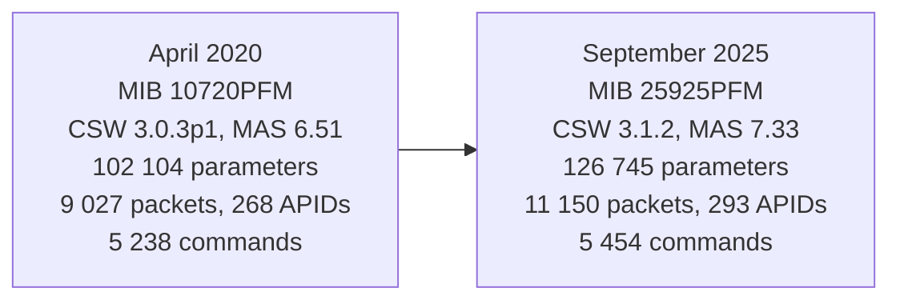

# The Solar Orbiter MIB

The Solar Orbiter [Mission Information Base](../../mib/index.md) is the set of ASCII tables
that tells the [SCOS-2000](../../scos2000/index.md) mission control system how to recognise
every telemetry packet of the spacecraft, how to extract and calibrate every parameter, how to
check limits, and how to encode, verify and sequence every telecommand. It follows the
*SCOS-2000 Database Import ICD* (EGOS-MCS-S2K-ICD-0001), whose issue 7.0 is published next to
the MIB as the "MOC-applicable" issue.[^reg-icd][^i70-intro] Because more than a hundred
operational releases were posted publicly, it is the only flight MIB this wiki can analyse
row by row.

Every number on this page comes from this wiki's own SQL queries on two releases:

* **2025-09-16**, `MIB__20250916M25925PFMS001_SOL`, the newest release
  ([library page](../../library/mib-20250916m25925pfms001-sol.md)), and
* **2020-04-16**, `MIB__20200416M10720PFMS001_SOL`, the oldest
  ([library page](../../library/mib-20200416m10720pfms001-sol.md)).

Both were loaded into read-only SQLite databases with one table per `.dat` file, using the
ICD 7.2 column names where known. The queries are shown in collapsed "SQL used" blocks. The
tables themselves are explained on the [MIB data model](../../mib/data-model.md) and the
per-table pages such as [pcf](../../mib/tables/pcf.md); every parameter, packet and command can
be opened in the [MIB explorer](../../explorer/index.md#/solo/search/NIA).

## Where the releases come from

The SWA/PAS team's server at IRAP lists 111 dated release zips, from April 2020 to September
2025, in `MIB/MIBs/`, each also unpacked as a folder, plus `latest/` and `previous/` sets; the
listing carries no description or terms of use.[^irap] This wiki copied the first and last
releases on 2026-11-05:

| Release | Zip size | Copied (UTC) | SHA-256 |
|---|---:|---|---|
| `MIB__20250916M25925PFMS001_SOL` | 6 187 063 bytes | 2026-11-05 14:24:03 | `c8ef0ea254d48b763333993b8710b6fc3d1db519e2d6c9629122c0f81cb13690` |
| `MIB__20200416M10720PFMS001_SOL` | 4 735 907 bytes | 2026-11-05 14:26:42 | `a524903135d0a62c8aec3f83f58483b4f996e6c0fe966eb12c7e18cda2fb0ec7` |

The original URLs are `https://solarorbiter.irap.omp.eu/MIB/MIBs/<release>.zip`.[^reg-mib]
The SWA instrument database posted on the same server is analysed separately on
[Solar Orbiter SWA instrument database](swa.md).

### Decoding the release name

The [vdf](../../mib/tables/vdf.md) table of each release has a single record. The ICD defines
`VDF_NAME` (Char(8)) as the database version name, `VDF_COMMENT` as a free comment and
`VDF_RELEASE` and `VDF_ISSUE` as release and issue numbers; the name is shown on displays and
checked, for example, when a saved command stack is reloaded.[^i70-vdf]

| Field | 2020-04-16 | 2025-09-16 |
|---|---|---|
| `VDF_NAME` | `10720PFM` | `25925PFM` |
| `VDF_COMMENT` | `20200416-CSW3.0.3p1_MAS6.51` | `20250916-CSW3.1.2_MAS7.33` |
| `VDF_DOMAINID` | 0 | 0 |
| `VDF_RELEASE` | 10720 | 25925 |
| `VDF_ISSUE` | 651 | 733 |

These values are in the archive too: the SCOS-2000 packet header that the MCS files with every
packet has `DB Rel` and `DB Iss` fields recording the `VDF_RELEASE` and `VDF_ISSUE` in force
when the packet was archived.[^ddid-dbrel][^mib25]

```text
MIB__ 20250916 M 259 25 PFM S001 _SOL
      |        | |   |  |   |    '-- mission (Solar Orbiter)
      |        | |   |  |   '------- not explained in the available sources
      |        | |   |  '----------- VDF_NAME suffix (meaning not stated)
      |        | |   '-------------- two-digit year (25)
      |        | '------------------ day of year (259 = 16 September 2025)
      |        '-------------------- literal "M"
      '----------------------------- release date YYYYMMDD
```

!!! warning "Inference"
    The decoding above is this wiki's reading of the two releases, not a documented
    convention. The three digits after `M` equal the day of year of the date (259 for
    2025-09-16, 107 for 2020-04-16), which the project's survey also observed on the IRAP
    listing;[^irap] the next two digits equal the two-digit year; and the five digits together
    are `VDF_RELEASE` (25925, 10720) and the first five characters of `VDF_NAME`. The comment
    names a Central Software (CSW) version - CSW being the OBC software of the
    ICD[^icd-acr] - and a "MAS" version whose number matches `VDF_ISSUE` (7.33 / 733,
    6.51 / 651). The meanings of `PFM`, `S001` and `MAS` are not stated in the available
    sources.

## Files and row counts

The 2025 release contains 59 `.dat` files - the 53 ICD tables, three mission files
(`ASW_sw_para`, `pcf_glob_det`, `dup`) and three more mission files `s13a`, `s13p` and `s13t`
dated June 2021 - and a `synthetic/` directory with 1 582 OL expression files; the 2020
release has the first 56 files and 390 synthetic files.[^mib25][^mib20] The ICD names each ASCII file
after its table in lower case with the extension `.dat`, and each dynamic synthetic parameter is
an extension-less file named after the parameter.[^i70-22] Records are TAB-separated, one per line,
as the ICD specifies; the `pcf` file uses all 23 fields of ICD 7.0, whose importer accepts 19 to
23.[^mib25][^i70-23][^i70-pcf]

| Family | Table | 2020-04-16 | 2025-09-16 | Change |
|---|---|---:|---:|---:|
| Parameters | [pcf](../../mib/tables/pcf.md) | 102 104 | 126 745 | +24.1% |
| Packets | [pid](../../mib/tables/pid.md) / [tpcf](../../mib/tables/tpcf.md) | 9 027 | 11 150 | +23.5% |
| | [pic](../../mib/tables/pic.md) | 228 | 256 | +12.3% |
| | [plf](../../mib/tables/plf.md) | 326 492 | 400 792 | +22.8% |
| | [vpd](../../mib/tables/vpd.md) | 18 770 | 19 863 | +5.8% |
| Calibration | [cur](../../mib/tables/cur.md) | 1 586 | 1 974 | +24.5% |
| | [caf](../../mib/tables/caf.md) / [cap](../../mib/tables/cap.md) | 676 / 7 753 | 679 / 7 830 | +0.4% / +1.0% |
| | [txf](../../mib/tables/txf.md) / [txp](../../mib/tables/txp.md) | 955 / 31 904 | 1 003 / 35 032 | +5.0% / +9.8% |
| | [mcf](../../mib/tables/mcf.md) / [lgf](../../mib/tables/lgf.md) | 226 / 0 | 229 / 0 | +1.3% |
| Checks | [ocf](../../mib/tables/ocf.md) / [ocp](../../mib/tables/ocp.md) | 3 304 / 4 686 | 5 338 / 7 369 | +61.6% / +57.3% |
| Synthetics | `synthetic/` files | 390 | 1 582 | x4.1 |
| Commands | [ccf](../../mib/tables/ccf.md) | 5 238 | 5 454 | +4.1% |
| | [cdf](../../mib/tables/cdf.md) / [cpc](../../mib/tables/cpc.md) | 44 944 / 6 947 | 47 609 / 7 155 | +5.9% / +3.0% |
| | [prf](../../mib/tables/prf.md) / [prv](../../mib/tables/prv.md) | 531 / 631 | 565 / 1 072 | +6.4% / +69.9% |
| | [paf](../../mib/tables/paf.md) / [pas](../../mib/tables/pas.md) | 605 / 9 741 | 624 / 11 834 | +3.1% / +21.5% |
| | [cca](../../mib/tables/cca.md) / [ccs](../../mib/tables/ccs.md) | 100 / 1 233 | 99 / 1 226 | -1.0% / -0.6% |
| | [ptv](../../mib/tables/ptv.md) | 0 | 5 | new |
| TC headers | [tcp](../../mib/tables/tcp.md) / [pcpc](../../mib/tables/pcpc.md) / [pcdf](../../mib/tables/pcdf.md) | 4 / 6 / 20 | 4 / 7 / 20 | |
| Verification | [cvs](../../mib/tables/cvs.md) / [cve](../../mib/tables/cve.md) / [cvp](../../mib/tables/cvp.md) | 206 / 171 / 10 277 | 206 / 171 / 10 697 | +4.1% (cvp) |
| Sequences | [csf](../../mib/tables/csf.md) | 2 701 | 3 404 | +26.0% |
| | [css](../../mib/tables/css.md) / [sdf](../../mib/tables/sdf.md) / [csp](../../mib/tables/csp.md) | 9 089 / 30 985 / 5 598 | 13 879 / 50 014 / 10 981 | +52.7% / +61.4% / +96.2% |
| Displays | [dpf](../../mib/tables/dpf.md) / [dpc](../../mib/tables/dpc.md), [spf](../../mib/tables/spf.md) / [spc](../../mib/tables/spc.md) | 33 / 626, 1 / 5 | 33 / 626, 1 / 5 | unchanged |
| Groups | [grp](../../mib/tables/grp.md) / [grpk](../../mib/tables/grpk.md) | 1 / 4 | 2 / 4 | |
| Routing | [dst](../../mib/tables/dst.md) | 1 | 1 | |
| Mission files | `ASW_sw_para` / `pcf_glob_det` / `dup` | 85 430 / 52 417 / 36 | 105 222 / 56 631 / 69 | +23.2% / +8.0% / +91.7% |
| Version | [vdf](../../mib/tables/vdf.md) | 1 | 1 | |

The tables `lgf`, `gpf`/`gpc`, `ppf`/`ppc`, `grpa`, the parameter-set tables
[pst](../../mib/tables/pst.md), [psv](../../mib/tables/psv.md), [cps](../../mib/tables/cps.md),
[pvs](../../mib/tables/pvs.md) and [psm](../../mib/tables/psm.md) are empty in both
releases.[^mib25][^mib20]

The numbers show where the work went in five years of flight: telemetry decoding grew by about
a quarter, ground monitoring checks by 60%, the number of sequences by a quarter and their
content (elements, element values, formal parameters) by half to almost double, while the
command catalogue itself grew only 4%.

??? example "SQL used (versions and row counts)"
    ```sql
    -- solo-2025-09-16.sqlite and solo-2020-04-16.sqlite
    SELECT * FROM vdf;
    SELECT count(*) FROM pcf;      -- repeated for every table
    SELECT count(*) FROM synthetic;
    ```

## Parameters

### Nature, type and calibration category

Of the 126 745 monitoring parameters of 2025, 125 161 are raw telemetry (`PCF_NATUR` = `R`),
1 582 are dynamic OL synthetics (`D`) and 2 are saved synthetics (`S`); the ICD defines these
natures, plus `P` (SPEL), `H` (hard-coded) and `C` (constant), which Solar Orbiter does not
use.[^mib25][^i70-natur] By calibration category, 100 087 are numerical (`N`), 26 538 status
(`S`, textual calibration) and 120 text strings (`T`), the categories defined for
`PCF_CATEG`.[^mib25][^i70-categ] The most common types are PTC 3 unsigned integers (50 341),
PTC 5 reals (29 718) and PTC 2 enumerations (29 443); see
[MIB parameter types](../../mib/parameter-types.md) for the full breakdown.[^mib25]

107 791 parameters are placed in fixed packets by `plf` and 2 720 in variable packets by
`vpd`. 15 067 raw parameters appear in neither; 11 945 of those are listed in the
mission-specific `ASW_sw_para` file and 10 786 are "detail" entries of `pcf_glob_det` (see
[mission-specific files](#mission-specific-files)).[^mib25]

### Subsystems

`PCF_SUBSYS` is defined by the ICD only as the name of the group to which the parameter
belongs, a future filtering aid.[^i70-subsys] Solar Orbiter fills it with numbers for
software subsystems and instruments and with unit names for platform equipment. Counting, for
each value, the APIDs of the packets in which its parameters are placed shows what each number
stands for:[^mib25][^icd-pid]

| `PCF_SUBSYS` | 2020 | 2025 | Packets mostly on process ID (APID ÷ 16) | Reading |
|---|---:|---:|---|---|
| 2 | 28 842 | 29 152 | 11, and ground APIDs 1953-1983 | AOCS |
| 1 | 20 579 | 22 607 | 10, 14, 13, 16, ground APIDs | Data management (DMS) and OBC software |
| (blank) | 3 329 | 18 610 | 124, 13, 14 | on-board monitoring definitions, RIU, ground |
| 6 | 16 155 | 16 934 | 16, 13 | thermal control and platform |
| 4 | 2 955 | 7 560 | 30-33 and ground APIDs | SSMM |
| 101 | 3 713 | 3 723 | 63-66 | MAG |
| 8 | 3 549 | 3 569 | 14 | system control |
| 102 | 2 887 | 3 400 | 57-60 | EUI |
| 106 | 3 067 | 3 067 | 75-81 | RPW |
| 109 | 2 886 | 2 881 | 95-99 | SWA |
| `PCDU_A`, `PCDU_B` | 1 687, 1 675 | 2 224, 1 675 | 13, 14 | PCDU A and B (EPS units managed by the platform application) |
| 107 | 1 725 | 1 740 | 82-84 | SOLOHI |
| 7 | 1 385 | 1 467 | 14, 12 | payload application |
| 108 | 1 032 | 1 033 | 85-89 | SPICE |
| 5 | 858 | 860 | 11, 40, 41 | star trackers |
| 104 | 767 | 824 | 72-74 | PHI |
| 103 | 685 | 685 | 50-55, 100 | EPD |
| 105 | 665 | 683 | 90, 94 | STIX |
| `RIU` | 414 | 638 | 13 | RIU (gives access to FSS, CPS, I-boom and thermistors) |
| 110 | 577 | 620 | 67-69 | METIS |
| others | | 2 793 | | 25 equipment names (`OBC`, `APMH_A/B`, `APMM_A/B`, `DEU_A/B`, `SADE_A/B`, eight `IMU_xx`, `RW_1`-`RW_4`, `DST_1/2`, `EGSE_GEN`, `Z_STD_DE`) and the numbers 250 and 3 |

!!! warning "Inference"
    The "Reading" column is deduced by matching the process IDs of the packets to the
    Annex 8 process allocation of the Solar Orbiter packet structure ICD (10 DMS, 11 AOCS,
    12 payload, 13 platform, 14 system control, 16 thermal; 30-32 SSMM; 40/41 star trackers;
    instruments 50-104).[^icd-cat] The MIB itself does not name the subsystem numbers.
    Instrument subsystems 101-110 are not in alphabetical order (MAG, EUI, EPD, PHI, STIX,
    RPW, SOLOHI, SPICE, SWA, METIS).

### Name prefixes

Parameter names have at most 8 characters (126 502 have 8, 243 have 7); 126 740 of them begin
with `N` (the remaining five are four `ZZP...` fillers and one `DUM...` "ALWAYS_VALID").[^mib25]
Commands begin with `Z` (5 441 of 5 454), sequences with `A` (all 3 404), packet mnemonics in
`tpcf` with `Y` (11 131 of 11 150), calibrations almost always with `C` (all numerical and
polynomial ones; all textual ones but `AYMODELE` and `PARAMIDTM`) and command parameters mostly
with `P` or `R`.[^mib25] The second and
third letters group the parameters:

| Prefix | 2020 | 2025 | Examples and owner |
|---|---:|---:|---|
| `NCA` | 29 132 | 29 563 | AOCS (`MeasTaccwrtIRFSC`) |
| `NCF` | 14 946 | 15 228 | platform application |
| `NCD` | 11 353 | 13 414 | data management (`OBCHP_PTM_TC_Packet_ID`) |
| `NSM` | 2 955 | 7 568 | SSMM |
| `NCX` | 6 458 | 6 490 | SGM group contents in TM(132,2) reports on ground APID 1955 |
| `NPW` | 3 410 | 3 962 | PCDU |
| `NCS` | 3 851 | 3 928 | system control |
| `NXF`, `NXT`, `NXA`, `NXL`, `NXS` | 0 | 13 713 | on-board monitoring definitions per CSW process (new) |
| `NIM` | 3 737 | 3 747 | MAG |
| `NTC` | 2 936 | 3 667 | thermal control |
| `NRU` | 2 462 | 3 356 | RIU |
| `NIU` | 2 887 | 3 400 | EUI |
| `NIW` | 3 067 | 3 067 | RPW |
| `NIA` | 2 887 | 2 882 | SWA |
| `NIH` | 1 725 | 1 748 | SOLOHI |
| `NCL` | 1 395 | 1 479 | payload application |
| `NIC` | 1 032 | 1 033 | SPICE |
| `NST` | 862 | 862 | star trackers |
| `NIP` | 767 | 820 | PHI |
| `NMU` | 808 | 808 | IMUs |
| `NID` | 690 | 690 | EPD |
| `NIX` | 666 | 687 | STIX |
| `NIT` | 577 | 620 | METIS |
| `NAH`, `NAM` | 535, 526 | 535, 526 | APME-H (HGA) and APME-M (MGA) units |
| `NDM`, `NDS` | 414, 306 | 414, 309 | DEU and DST units |
| `NYG`, `NYN`, `NYC`, `NYM`, `NYP` | 197, 0, 0, 0, 118 | 198, 172, 158, 156, 118 | ground and EGSE (`ERT sec`, `LMS_NNO`, `LMS_CEB`, `LMS_MLG`, `PSS`) |

!!! warning "Inference"
    Solar Orbiter's naming convention is not documented in the library sources. The pattern
    is consistent with: first letter = object kind (`N` monitoring parameter, `Z` command,
    `A` sequence, `Y` packet, `C` calibration, `P` command parameter); second letter = owner
    family (`C` central software, `I` instrument, `S` SSMM/STR/SADE, `P` PCDU, `R` RIU and
    wheels, `A` antenna mechanisms, `D` DEU/transponder, `M` IMU, `T` thermal, `X` derived
    monitoring definitions, `Y` ground); third letter = application or instrument. The
    instrument letters are `M` MAG, `U` EUI, `D` EPD, `P` PHI, `X` STIX, `W` RPW, `H` SOLOHI,
    `C` SPICE, `A` SWA and `T` METIS, the same letters as in the commands (`ZIA...` goes to
    the SWA APID 1532, `ZIT...` to METIS APID 1084). Other ESA projects used different
    conventions, for example SPIRE's `SM`/`SC` prefixes.[^spire]

??? example "SQL used (parameters)"
    ```sql
    SELECT PCF_NATUR, count(*) FROM pcf GROUP BY 1;
    SELECT PCF_CATEG, count(*) FROM pcf GROUP BY 1;
    SELECT PCF_PTC, count(*) FROM pcf GROUP BY 1 ORDER BY 2 DESC;
    SELECT count(*) FROM pcf WHERE PCF_NATUR = 'R'
       AND PCF_NAME NOT IN (SELECT PLF_NAME FROM plf)
       AND PCF_NAME NOT IN (SELECT VPD_NAME FROM vpd);          -- 15067
    -- subsystem counts in both releases
    ATTACH 'solo-2020-04-16.sqlite' AS o;
    SELECT a.s, n25, coalesce(n20, 0)
      FROM (SELECT PCF_SUBSYS s, count(*) n25 FROM main.pcf GROUP BY 1) a
      LEFT JOIN (SELECT PCF_SUBSYS s2, count(*) n20 FROM o.pcf GROUP BY 1) b ON a.s = b.s2
     ORDER BY n25 DESC;
    -- which on-board process the parameters of each subsystem are packed by
    SELECT c.PCF_SUBSYS, CAST(p.PID_APID AS INT) >> 4 AS proc, count(*)
      FROM pcf c JOIN plf l ON l.PLF_NAME = c.PCF_NAME JOIN pid p ON p.PID_SPID = l.PLF_SPID
     GROUP BY 1, 2 ORDER BY 1, 3 DESC;
    -- name prefixes
    SELECT substr(PCF_NAME, 1, 3), count(*) FROM pcf GROUP BY 1 ORDER BY 2 DESC;
    SELECT length(PCF_NAME), count(*) FROM pcf GROUP BY 1;                -- 7: 243, 8: 126502
    SELECT substr(CCF_CNAME, 1, 1), count(*) FROM ccf GROUP BY 1;
    ```

## APIDs and packets

The 2025 release defines 11 150 packets (SPIDs) on 293 distinct APIDs, with 193 distinct
type/subtype pairs across 66 service types; the 2020 release had 9 027 packets on 268
APIDs.[^mib25][^mib20] The packetiser recognises a packet by its APID, type, subtype and up to
two extra identification fields located by [pic](../../mib/tables/pic.md), and looks up the SPID
in `pid`; APIDs 0 to 2047 are for spacecraft packets and 2048 and above for packets generated on
the ground.[^icd-pid][^icd-pic] Solar Orbiter's APID is a 7-bit process ID followed by a 4-bit
packet category ([see the mission page](index.md#application-process-identifiers)), so every APID
can be decoded:[^icd-cat]

| Component (process IDs) | APIDs 2020 | APIDs 2025 | Packets 2020 | Packets 2025 |
|---|---:|---:|---:|---:|
| OBC Central Software (10-16) | 44 | 44 | 3 143 | 3 358 |
| EGSE process range 112-127 (ground-defined APIDs 1937-1996, plus the idle-packet APID 2047) | 31 | 45 | 1 854 | 2 438 |
| EUI (57-62) | 14 | 18 | 783 | 2 055 |
| SWA (95-99) | 13 | 15 | 600 | 613 |
| SPICE (85-89, 101-104) | 21 | 21 | 451 | 451 |
| EPD (50-56, 100) | 20 | 20 | 319 | 319 |
| RPW (75-81) | 28 | 28 | 287 | 287 |
| SOLOHI (82-84) | 21 | 21 | 284 | 284 |
| SSMM (30-32, plus APID 533 "SSMM FDIR TM" on process 33, a spare in Annex 8) | 19 | 19 | 244 | 260 |
| METIS (67-71) | 11 | 11 | 259 | 260 |
| STIX (90-94) | 9 | 9 | 246 | 246 |
| Star trackers (40, 41) | 12 | 12 | 244 | 244 |
| MAG (63-66) | 11 | 11 | 196 | 207 |
| PHI (72-74) | 11 | 10 | 112 | 117 |
| OBC hardware, time, frames (0, 2) | 3 | 3 | 5 | 5 |
| Non-spacecraft APIDs 2048-2065 | 0 | 6 | 0 | 6 |

By packet category (for on-board APIDs below 1792), events dominate: category 7 holds 5 694
packet definitions on 27 APIDs, category 1 (verification) 1 804 on 31 APIDs, category 12
(science) 334 on 45 APIDs, category 9 (dumps) 259 and category 4 (routine HK) 162 on 37
APIDs.[^mib25] The many event and verification definitions are a consequence of the PID key:
each event identifier or failure code gets its own SPID, so one report type becomes hundreds of
packets (see [How Solar Orbiter uses PUS](pus-usage.md)).

### Special APIDs

| APID | Packets | What it is |
|---|---:|---|
| 0 | 1 | TM(9,2) "Time Report", the [time packet](index.md#time-idle-packets-and-the-crc) ([explorer](../../explorer/index.md#/solo/packet/9999)) |
| 1 | 3 | good, bad and idle complete transfer frames (frame-level pseudo-packets) |
| 34 | 1 | `OBC_HPTM_packet`, process 2 category 2 |
| 1966 | 18 | MCS-internal packets, types 160-166, 251 ([explorer](../../explorer/index.md#/solo/apid/1966)) |
| 1953-1996 (except 1966) | 2 403 | ground "virtual" APIDs carrying re-identified copies of dumps, events and monitoring reports |
| 2047 | 1 | idle packet |
| 2048-2065 | 6 | `LMS_NNO`, `LMS_CEB`, `LMS_MLG` low/high frequency packets, no data field header |

The time, idle, frame and internal packets match the DDID and the packet structure
ICD.[^ddid-int][^icd-tm][^mib25] The 2048-2065 range is the one the ICD reserves for packets
not generated by the spacecraft.[^icd-pid] The station codes NNO, CEB and MLG match the New
Norcia, Cebreros and Malargüe stations of the DDID's ground station list, but what "LMS" means
is not stated in the available sources.[^ddid-gs]

The virtual APIDs 1953 to 1996 are the most interesting. Their PIC rules add a second
identification field: for example events TM(5,1) on APID 1975 are split by an 8-bit field at
octet 18, giving 12 packets "LEOP_AS_Step_1_Executed" to "Step_12"; TM(12,9) monitoring list
reports on APIDs 1986-1990 are split into parts #1 to #3 by an 8-bit field at octet 19 and a
second 8-bit field deep inside the packet (octet 883 to 2755 depending on the APID); TM(6,6) dumps on 1961, 1965,
1976 and 1977 by a 32-bit field at octet 18.[^mib25] The mission file `dup.dat` lists 69 (SPID, APID) pairs whose SPIDs
are ordinary packets of real APIDs - for instance SPID 10153 (event 2753 on APID 231) is paired
with APID 1975.[^mib25]

!!! warning "Inference"
    `dup.dat` appears to tell a mission-specific ground process to duplicate selected
    packets onto a virtual APID, where the PIC and PID tables then decode them with a finer
    identification than the spacecraft's APID allows. This explains why APID 1975 holds 12
    variants of one LEOP event and why APIDs 1986-1990 and 1992-1996 hold per-application
    monitoring list and functional monitoring status reports (1991 carries star tracker 2 mode
    transition events). Neither `dup.dat` nor this mechanism is described in the ICD or the DDID.

### Packet sizes

The ICD defines `TPCF_SIZE` as the total size of the SCOS-2000 packet, recommending the source
packet length plus the SCOS-2000 header (64 or 76 octets depending on the header version),
and 0 for truly variable packets.[^i70-tpcf] The time packet has `TPCF_SIZE` = 14, exactly 6
octets of primary header plus the 8 data octets of Annex 4,[^mib25][^icd-time] and the SWA
inter-instrument packet has 33, its source packet length (see
[the SWA page](swa.md#the-iic-packet-in-the-database)).

!!! warning "Inference"
    These values suggest that Solar Orbiter fills `TPCF_SIZE` with the source packet length
    rather than with the SCOS-2000 packet size that the ICD recommends. The field is not used
    by SCOS-2000 itself, and the mission's convention is not stated in the available sources.

Across the release, 2 325 packets have size 0, 7 487 are at
most 64 octets, 329 between 65 and 256, 936 between 257 and 1 024, 67 between 1 025 and 4 112,
and 6 above:[^mib25]

| SPID | APID | Packet | `TPCF_SIZE` | `plf` entries |
|---|---:|---|---:|---:|
| 64902-64907 | 1940 | TM(3,25) "PSS HK Packet 2" to "7" | 4 136 | 31 each |
| 65037 | 1955 | TM(132,2) "SGM-R Grp 18 AOCS_PROFILE_SSE p1" | 4 112 | 983 |
| 65866 | 1955 | TM(132,2) "SA Nominal Steering Profile part 1" | 4 112 | 1 026 |
| 65909 | 1986 | TM(12,9) "AOCS - Monitoring List Report #1" | 4 099 | 1 275 |
| 80028 | 483 | TM(142,7) "SSMM Router Configuration Report" | 1 084 | 3 816 (the most of any packet) |

Six EGSE packets on APID 1940 (process 121, in the EGSE range) are larger than the
4 112-octet maximum that the ICD sets for on-board TM; the largest spacecraft packets reach that
maximum exactly.[^icd-tm][^mib25] See [SSMM router report](../../explorer/index.md#/solo/packet/80028)
and [AOCS monitoring list](../../explorer/index.md#/solo/packet/65909) in the explorer.

??? example "SQL used (APIDs and packets)"
    ```sql
    SELECT count(*), count(DISTINCT PID_APID), count(DISTINCT PID_TYPE || '/' || PID_STYPE),
           count(DISTINCT PID_TYPE) FROM pid;                         -- 11150 | 293 | 193 | 66
    -- decode APID = process ID * 16 + category
    SELECT CAST(PID_APID AS INT) >> 4 AS proc, count(DISTINCT PID_APID), count(*)
      FROM pid GROUP BY 1 ORDER BY 1;
    SELECT CAST(PID_APID AS INT) & 15 AS cat, count(DISTINCT PID_APID), count(*)
      FROM pid WHERE CAST(PID_APID AS INT) < 1792 GROUP BY 1;
    SELECT * FROM pic ORDER BY CAST(PIC_TYPE AS INT), CAST(PIC_STYPE AS INT), PIC_APID;
    SELECT d.COL1, d.COL2, p.PID_APID, p.PID_TYPE, p.PID_STYPE, p.PID_PI1_VAL, p.PID_DESCR
      FROM dup d LEFT JOIN pid p ON p.PID_SPID = d.COL1;
    -- sizes
    SELECT t.TPCF_SPID, t.TPCF_SIZE, p.PID_APID, p.PID_TYPE, p.PID_STYPE, p.PID_DESCR,
           (SELECT count(*) FROM plf WHERE PLF_SPID = t.TPCF_SPID)
      FROM tpcf t JOIN pid p ON p.PID_SPID = t.TPCF_SPID
     ORDER BY CAST(TPCF_SIZE AS INT) DESC LIMIT 15;
    SELECT PLF_SPID, count(*) n FROM plf GROUP BY 1 ORDER BY n DESC LIMIT 3;
    ```

## Calibrations and checks

| Item | 2020 | 2025 | Used by parameters (2025) |
|---|---:|---:|---|
| Numerical calibrations (`caf`) | 676 | 679 | 227 distinct curves, 3 433 parameters |
| Textual calibrations (`txf`) | 955 | 1 003 | 968 distinct, 26 533 parameters |
| Polynomial calibrations (`mcf`) | 226 | 229 | 226 distinct, 970 parameters |
| Logarithmic calibrations (`lgf`) | 0 | 0 | - |
| Conditional calibration rules (`cur`) | 1 586 | 1 974 | for 907 parameters |
| Checked parameters (`ocf`) | 3 304 | 5 338 | - |
| Checks (`ocp`) | 4 686 | 7 369 | 4 153 `H`, 3 096 `S`, 105 `D`, 15 `C` |

All 26 538 status parameters but five have a textual calibration, as the ICD requires of
`PCF_CATEG` = `S`; numerical parameters reference `caf` or `mcf` identifiers in
`PCF_CURTX`.[^mib25][^i70-curtx] Of the 679 numerical curves, 612 have an unsigned raw format,
66 signed integer and 1 real.[^mib25] The most used calibrations are the textual
`CCDT0006TM` "Boolean" (3 865 parameters,
[explorer](../../explorer/index.md#/solo/calib/txt/CCDT0006TM)), `CCDT0004TX` "Event ID list"
(2 439) and `PARAMIDTM` "Parameter ID" (1 627), and the numerical `CTC4Z106TC` "Temp ANY
YSI-44907" thermistor curve (593 parameters,
[explorer](../../explorer/index.md#/solo/calib/num/CTC4Z106TC)).[^mib25] The check types are
explained on [Monitoring checks](../../mib/monitoring-checks.md) and the curve types on
[Calibration in the MIB](../../mib/calibration.md).

??? example "SQL used (calibrations and checks)"
    ```sql
    SELECT PCF_CATEG, count(*), sum(PCF_CURTX <> ''),
           sum(PCF_CURTX IN (SELECT CAF_NUMBR FROM caf)),
           sum(PCF_CURTX IN (SELECT TXF_NUMBR FROM txf)),
           sum(PCF_CURTX IN (SELECT MCF_IDENT FROM mcf))
      FROM pcf GROUP BY 1;
    SELECT count(DISTINCT CUR_PNAME), count(*) FROM cur;
    SELECT OCP_TYPE, count(*) FROM ocp GROUP BY 1;
    SELECT CAF_ENGFMT, CAF_RAWFMT, count(*) FROM caf GROUP BY 1, 2;
    SELECT PCF_CURTX, count(*) FROM pcf WHERE PCF_CATEG = 'S' GROUP BY 1 ORDER BY 2 DESC LIMIT 3;
    ```

## Synthetic parameters

The `synthetic` directory holds one OL file per dynamic synthetic parameter, read by the
importer from the directory configured for OL expressions.[^i70-synth] The 2025 release has
1 582 files, one for each `D` parameter, against 390 in 2020: 1 195 were added, 3 removed and
75 changed.[^mib25][^mib20] The expressions average 482 characters; the longest, for
[`NYGSX003`](../../explorer/index.md#/solo/param/NYGSX003) "Spacecraft Downlink Acti...", has
3 995. Their outputs are mostly Booleans (PTC 1, 1 097), enumerations (PTC 2, 208), reals
(119) and unsigned integers (85).[^mib25]

Most of the growth is in the `NX*` family: 996 synthetics (283 `NXF`, 266 `NXA`, 223 `NXT`, 158
`NXL`, 66 `NXS`), all but one of which (`NXAD4423` "PAS_MODE_CHECK") are "consistency" flags. The comment at the top of, for example,
[`NXFF001D`](../../explorer/index.md#/solo/param/NXFF001D) "PID13_F001_CONSISTENCY" says that
it checks whether the monitors reported in the generic service 142 packet of process 13 were
parsed in the intended order, returning 1 when the parsed and intended monitoring IDs
match.[^mib25] Simpler examples are the `NCSSZ...` validity formulas, which return 1 when either
of two power-status parameters of an instrument reads "ON".[^mib25] The OL language is described
on [Synthetic parameters and the OL language](../../mib/synthetic-parameters.md).

??? example "SQL used (synthetics)"
    ```sql
    SELECT count(*), avg(length(SOURCE)), max(length(SOURCE)) FROM synthetic;
    SELECT substr(NAME, 1, 3), count(*) FROM synthetic GROUP BY 1 ORDER BY 2 DESC;
    SELECT p.PCF_PTC, count(*) FROM synthetic s JOIN pcf p ON p.PCF_NAME = s.NAME GROUP BY 1;
    ATTACH 'solo-2020-04-16.sqlite' AS o;
    SELECT count(*) FROM main.synthetic WHERE NAME NOT IN (SELECT NAME FROM o.synthetic);  -- 1195
    SELECT count(*) FROM main.synthetic s JOIN o.synthetic t ON s.NAME = t.NAME
     WHERE s.SOURCE <> t.SOURCE;                                                         -- 75
    ```

## Commands

The 5 454 commands of 2025 use four header layouts: `NOM_TC` for 5 318 normal PUS commands,
`HPC1_TC` for 125 CPDU commands without secondary header, `NO_HDR` for 5 on-board control
directives - the COP-1 control frames `UNLOCK` and `SETVR` (`CCF_CTYPE` = `F`) and the control
segments `RESET`, `REIN_TTR` and `TC_ONLY` (`CCF_CTYPE` = `R`) - and `NOS2KHDR` for 6 ground link
and session control commands of type 251 ("GENERIC OPEN TC LINK", "OPEN SESSION", ...); the layouts are dissected on
[PUS packet structures](../../ecss/pus/packets.md).[^mib25][^i70-ctype] Each command's APID decodes like the
TM APIDs, always with category 12:[^icd-tcpkt]

| APID | Process | Destination | Commands 2020 | 2025 | Name prefix |
|---:|---:|---|---:|---:|---|
| 172 | 10 | CSW data management (incl. hardware commands via service 2) | 1 935 | 1 971 | `ZCS`, `ZCD`, `ZPW`, `ZRU`, `ZMU`, ... |
| 236 | 14 | CSW system control | 946 | 966 | `ZCS` |
| 188 | 11 | CSW AOCS | 424 | 454 | `ZCA` |
| 1532 | 95 | SWA | 198 | 200 | `ZIA` |
| 1164 | 72 | PHI | 186 | 199 | `ZIP` |
| 492, 508, 524 | 30-32 | SSMM, SSMM A, SSMM B | 125 | 210 | `ZSM` |
| 44 | 2 | CPDU (HPC-1, MAP ID 0) | 125 | 125 | `ZBC` |
| 1020 | 63 | MAG | 113 | 126 | `ZIM` |
| 1084 | 67 | METIS | 125 | 126 | `ZIT` |
| 924 | 57 | EUI | 121 | 122 | `ZIU` |
| 220 | 13 | CSW platform | 113 | 118 | `ZCF` |
| 1324 | 82 | SOLOHI | 102 | 102 | `ZIH` |
| 1452 | 90 | STIX | 99 | 98 | `ZIX` |
| 652, 668 | 40, 41 | star trackers 1 and 2 | 98 | 98 | `ZST` |
| 1372 | 85 | SPICE | 92 | 91 | `ZIC` |
| 268 | 16 | CSW thermal | 74 | 84 | `ZTC` |
| 204 | 12 | CSW payload | 76 | 78 | `ZCL` |
| 812, 876, 796 | 50, 54, 49 | EPD; payload broadcast | 123 | 123 | `ZID` |
| 1212-1308 | 75-81 | RPW (7 APIDs) | 138 | 138 | `ZIW` |
| 1948 | 121 | EGSE "PSS" | 14 | 14 | `ZYP` |
| 1964 | 122 | ground link and session control (service 251, `NOS2KHDR`) | 6 | 6 | `EGENRTCC`, `ESESIONO`, ... |
| (none) | - | frame-level directives | 5 | 5 | `UNLOCK`, `SETVR`, `RESET`, ... |

`CCF_SUBSYS`, the "identifier of the subsystem which the command belongs to",[^i70-ccfsub] uses
the same numbers as `PCF_SUBSYS`: 1 (1 971 commands), 8 (976), 2 (447), 4 (210), the
instruments 101-110, 5 (98, the star tracker commands), 6 (199) and 7 (78); 150 commands have
no subsystem.[^mib25] Command sequences (3 404)
all start with `A`; the second letter groups them (`AI` instrument 1 474, `AD` data management
875, `AA` AOCS 331, `AT` thermal 304, ...). The largest is
[`AIPF981A`](../../explorer/index.md#/solo/sequence/AIPF981A) "PHI copy cal data" with 312
elements, followed by [`ASYF100K`](../../explorer/index.md#/solo/sequence/ASYF100K) "TM MODE
Any to SAFE" with 310.[^mib25] Sequences and their tables are on
[Command sequences and parameter sets](../../mib/sequences.md).

??? example "SQL used (commands and sequences)"
    ```sql
    SELECT CCF_PKTID, CCF_CTYPE, count(*) FROM ccf GROUP BY 1, 2;
    ATTACH 'solo-2020-04-16.sqlite' AS o;
    SELECT CCF_APID, CAST(CCF_APID AS INT) >> 4, count(*),
           (SELECT count(*) FROM o.ccf b WHERE b.CCF_APID = a.CCF_APID)
      FROM main.ccf a GROUP BY CCF_APID ORDER BY CAST(CCF_APID AS INT);
    SELECT CCF_APID, substr(CCF_CNAME, 1, 3), count(*) FROM ccf GROUP BY 1, 2;
    SELECT CCF_SUBSYS, count(*) FROM ccf GROUP BY 1 ORDER BY 2 DESC;
    SELECT CCF_CNAME, CCF_DESCR, CCF_CTYPE FROM ccf WHERE CCF_PKTID = 'NO_HDR';
    SELECT substr(CSF_NAME, 1, 2), count(*) FROM csf GROUP BY 1 ORDER BY 2 DESC;
    SELECT CSF_NAME, CSF_DESC, CSF_ELEMS FROM csf ORDER BY CAST(CSF_ELEMS AS INT) DESC LIMIT 5;
    ```

## Mission-specific files

Six files of the release are not ICD tables.[^mib25] Their columns have no names in the
release, so the descriptions below are read from the data.

| File | Rows 2025 | Content observed |
|---|---:|---|
| `ASW_sw_para.dat` | 105 222 | a name and an on-board software symbol (always filled); the names are 77 565 monitoring parameters (e.g. `NIA00102`), 7 665 packet mnemonics, 3 676 command parameters, 2 221 commands and 14 095 names found in no MIB table (13 727 starting with `B`, e.g. `BCAY0000` - `SSEA_SEGMENTS_END_TIME_C`); third column mostly empty, `a`, or a comment such as "padding field of sSE segments" |
| `pcf_glob_det.dat` | 56 631 | a "global" parameter, a "detail" parameter and a number: e.g. `NAH0Z000` "APMHA_TM_1 [000]" with details `NAHD0000` "APMHA_Mode" (0), `NAHD0001` "APMHA_Mode trans" (3), ...; 8 704 globals, all names present in `pcf` |
| `dup.dat` | 69 | (SPID, virtual APID) pairs, see [Special APIDs](#special-apids) |
| `s13a.dat` | 7 | file attributes: `PLAIN`, `OBCP`, `DEL` "DELAYED TC", `IMM` "IMMEDIATE TC", `PAYLOAD` "PAYLOAD CONTEXT", `INVALID`, `OTHER` |
| `s13p.dat` | 11 | memory partitions with numbers 161-195: `TCFA` "OMM TC Files (A)", `OBCA` "OMM OBCPs (A)", `SYSA` "OMM System Files (A)", ..., `CSWA` "SGM-EEPROM CSW TC Files (A)" |
| `s13t.dat` | 12 | file types: `OBCP`, `SCOS0`-`SCOS3` "SCOS stack file", `CSF0`-`CSF3` (mixed, plain, time-tagged and backup-MTL TC sequences), `PLAIN`, `ALL`, `UNKNOWN` |

!!! warning "Inference"
    `ASW_sw_para` most likely maps MIB names (and other on-board items) to the application
    software's symbol table,
    which would explain why 11 945 parameters that sit in no packet are still defined: they
    are data-pool variables reachable by dump or parameter-management services.
    `pcf_glob_det` appears to relate a whole word to the bit-field parameters inside it, the
    number being a bit position. The `s13*` files describe service 13 file uploads: the
    attribute names match the `s13ObFileAttribute` values that the DDID lists for commands
    uplinked as files (PLAIN, OBCP, TC_DELAYED, TC_IMMEDIATE, PAYLOAD_CONTEXT),[^ddid-s13]
    the numbers 1, 2, 3 and 6 match the service 13 file attributes OBCP, delayed TC sequence,
    immediate TC sequence and "Other" of the packet structure ICD,[^icd-s13] and the CSF types
    match SCOS-2000 sequence files. None of these files is described in the
    ICD or the DDID.

??? example "SQL used (mission-specific files)"
    ```sql
    SELECT * FROM asw_sw_para LIMIT 5;
    SELECT COL3, count(*) FROM asw_sw_para GROUP BY 1 ORDER BY 2 DESC LIMIT 5;
    SELECT sum(COL1 IN (SELECT PCF_NAME FROM pcf)), sum(COL1 IN (SELECT TPCF_NAME FROM tpcf)),
           sum(COL1 IN (SELECT CPC_NAME FROM cpc)), sum(COL1 IN (SELECT CCF_CNAME FROM ccf)),
           count(*) FROM asw_sw_para;                     -- 77565 | 7665 | 3676 | 2221 | 105222
    SELECT a.COL1, a.COL2, a.COL3, p.PCF_DESCR, q.PCF_DESCR
      FROM pcf_glob_det a JOIN pcf p ON p.PCF_NAME = a.COL1 JOIN pcf q ON q.PCF_NAME = a.COL2 LIMIT 6;
    SELECT count(DISTINCT COL1), count(DISTINCT COL2) FROM pcf_glob_det;
    SELECT * FROM s13a; SELECT * FROM s13p; SELECT * FROM s13t;
    WITH o AS (SELECT PCF_NAME n FROM pcf WHERE PCF_NATUR = 'R'
                 AND PCF_NAME NOT IN (SELECT PLF_NAME FROM plf)
                 AND PCF_NAME NOT IN (SELECT VPD_NAME FROM vpd))
    SELECT count(*), sum(n IN (SELECT COL1 FROM asw_sw_para)),
           sum(n IN (SELECT COL2 FROM pcf_glob_det)) FROM o;          -- 15067 | 11945 | 10786
    ```

## From 2020 to 2025: what changed

Comparing names and keys between the two releases:[^mib25][^mib20]

| Object (key) | Added | Removed | Changed | Net |
|---|---:|---:|---:|---:|
| Parameters (`PCF_NAME`) | 24 801 | 160 | 407 descriptions, 506 type/calibration/unit definitions | +24 641 |
| Packets (`PID_SPID`) | 2 135 | 12 | 568 key or description changes | +2 123 |
| APIDs | 26 | 1 | | +25 |
| Commands (`CCF_CNAME`) | 239 | 23 | 260 description/APID/type/parameter-count changes | +216 |
| Sequences (`CSF_NAME`) | 790 | 87 | | +703 |
| Synthetic files | 1 195 | 3 | 75 expressions | +1 192 |



Where the growth went:

* **On-board monitoring decoded on ground.** 13 713 new `NX*` parameters and 996 consistency
  synthetics decode the TM(12,9) monitoring list reports and TM(142,11) functional monitoring
  status reports of each CSW application, placed on ten new virtual APIDs, 1986-1990 and
  1992-1996 (AOCS, payload, platform, system and thermal).[^mib25]
* **SSMM.** 4 616 new `NSM` parameters, mostly in the SSMM router configuration report and in
  dumps of SSMM memory controller registers on new APIDs 1980-1983.[^mib25]
* **EUI events.** Two new event APIDs (951 and 967) with 620 event packets each, plus new
  report APIDs 934 and 950 (category 6); packets of type 5 make up 1 496 of the 2 135 new packets.[^mib25]
* **Dumps and SGM.** 416 new TM(131,x) and 94 new TM(141,x) packets (snapshot, OBDB and direct
  read reports).[^mib25]
* **SWA reports.** New APIDs 1542 and 1545, to which the 2025 release moves (with their
  SPIDs) nine SWA parameter and debug reports and 54 memory dump and check packets that the
  2020 release had on APID 1593; nine new report packets of the same names replace them on 1593
  (see [the SWA page](swa.md#how-the-idb-relates-to-the-spacecraft-mib)).[^mib25][^mib20]
* **Ground packets.** Six non-spacecraft `LMS_` packets on APIDs 2048-2065 and their 486
  `NYN`/`NYC`/`NYM` parameters.[^mib25]
* **Commands.** 88 new SSMM commands, 44 new data management, 30 AOCS and 22 system control
  commands.[^mib25]

What disappeared is small but telling. Among the 12 removed packets, APID 1163 (PHI context
data, TM(22,2)) is gone, and so are two SADE recovery events, two PHI events, an SGM error event,
two thermal snapshot events, an SGM group report on APID 1955, an SSMM direct read report and two
EUI reports.[^mib25] Among the 23 removed
commands are the four TC(9,128) "Set OBT" variants and every TC(9,129) "Accept time update"
command of the instruments and the SSMM (EPD, MAG, METIS, PHI, EUI, STIX, SPICE, SWA, SSMM,
SSMM A and B).[^mib25] The time services are discussed on
[How Solar Orbiter uses PUS](pus-usage.md#service-9-time-management).

??? example "SQL used (2020-2025 differences)"
    ```sql
    -- run on solo-2025-09-16.sqlite
    ATTACH 'solo-2020-04-16.sqlite' AS o;
    SELECT count(*) FROM main.pcf WHERE PCF_NAME NOT IN (SELECT PCF_NAME FROM o.pcf);   -- 24801
    SELECT count(*) FROM o.pcf WHERE PCF_NAME NOT IN (SELECT PCF_NAME FROM main.pcf);   -- 160
    SELECT count(*) FROM main.pid WHERE PID_SPID NOT IN (SELECT PID_SPID FROM o.pid);   -- 2135
    SELECT count(*) FROM o.pid WHERE PID_SPID NOT IN (SELECT PID_SPID FROM main.pid);   -- 12
    SELECT count(*) FROM main.ccf WHERE CCF_CNAME NOT IN (SELECT CCF_CNAME FROM o.ccf); -- 239
    SELECT count(*) FROM o.ccf WHERE CCF_CNAME NOT IN (SELECT CCF_CNAME FROM main.ccf); -- 23
    SELECT count(*) FROM main.csf WHERE CSF_NAME NOT IN (SELECT CSF_NAME FROM o.csf);   -- 790
    SELECT count(*) FROM o.csf WHERE CSF_NAME NOT IN (SELECT CSF_NAME FROM main.csf);   -- 87
    SELECT count(*) FROM main.pcf a JOIN o.pcf b ON a.PCF_NAME = b.PCF_NAME
     WHERE a.PCF_DESCR <> b.PCF_DESCR;                                               -- 407
    SELECT count(*) FROM main.pcf a JOIN o.pcf b ON a.PCF_NAME = b.PCF_NAME
     WHERE a.PCF_PTC <> b.PCF_PTC OR a.PCF_PFC <> b.PCF_PFC OR a.PCF_CURTX <> b.PCF_CURTX
        OR a.PCF_CATEG <> b.PCF_CATEG OR a.PCF_UNIT <> b.PCF_UNIT;                    -- 506
    SELECT substr(PCF_NAME, 1, 3), count(*) FROM main.pcf
     WHERE PCF_NAME NOT IN (SELECT PCF_NAME FROM o.pcf) GROUP BY 1 ORDER BY 2 DESC;
    SELECT PID_APID, count(*), min(PID_DESCR) FROM main.pid
     WHERE PID_APID NOT IN (SELECT PID_APID FROM o.pid) GROUP BY 1;
    SELECT CCF_CNAME, CCF_APID, CCF_TYPE, CCF_STYPE, CCF_DESCR FROM o.ccf
     WHERE CCF_CNAME NOT IN (SELECT CCF_CNAME FROM main.ccf);
    ```

## Quality notes

* **Referential integrity is good.** All 400 792 `plf` records point to an existing packet,
  and all but one (`NYM0796V` in SPID 66028) to an existing parameter; every `pcf_glob_det`
  name and every `dup` SPID exists.[^mib25]
* **Field limits are exceeded in places.** 2 876 command descriptions exceed the ICD's
  Char(24) `CCF_DESCR`, and the `pcdf` element type `O` used for the source ID is not in the
  ICD's list; both are discussed on [The MIB](../../mib/index.md) and
  [Mission tailoring of the MIB](../../mib/tailoring.md).[^mib25]
* **MAP IDs are set only where they matter.** The 125 HPC-1 commands are high priority
  (`CCF_HIPRI` = `Y`) with `CCF_MAPID` = 0, as SCOS-2000 expects for commands whose MAP ID is
  forced; 128 ordinary commands carry `CCF_MAPID` = 1 and 77 EPD "SIS" commands the value 54,
  although the field is meant for high-priority commands and the packet structure ICD defines
  only MAP IDs 0 and 1.[^mib25][^i70-mapid][^icd-map]
* **Spare and test content stays.** Test commands of maximum length, PSS EGSE packets and the
  `DUM` "ALWAYS_VALID" parameter are kept in the flight database.[^mib25]

??? example "SQL used (quality notes)"
    ```sql
    SELECT count(*), sum(PLF_SPID IN (SELECT PID_SPID FROM pid)),
           sum(PLF_NAME IN (SELECT PCF_NAME FROM pcf)) FROM plf;     -- 400792 | 400792 | 400791
    SELECT PLF_NAME, PLF_SPID FROM plf WHERE PLF_NAME NOT IN (SELECT PCF_NAME FROM pcf);
    SELECT sum(length(CCF_DESCR) > 24), max(length(CCF_DESCR)) FROM ccf;           -- 2876 | 40
    SELECT PCDF_TCNAME, PCDF_DESC, PCDF_TYPE FROM pcdf WHERE PCDF_TYPE = 'O';
    SELECT CCF_HIPRI, CCF_MAPID, CCF_PKTID, count(*) FROM ccf GROUP BY 1, 2, 3;
    ```

## Interesting entries in the explorer

| Entry | Why look at it |
|---|---|
| [Packet 9999](../../explorer/index.md#/solo/packet/9999) | TM(9,2) time packet on APID 0, no data field header |
| [Packet 80028](../../explorer/index.md#/solo/packet/80028) | the packet with the most parameters (3 816) |
| [APID 1975](../../explorer/index.md#/solo/apid/1975) | a virtual APID: 12 variants of one LEOP auto-sequence event |
| [APID 1966](../../explorer/index.md#/solo/apid/1966) | MCS-internal packets including time correlation |
| [Parameter NXFF001D](../../explorer/index.md#/solo/param/NXFF001D) | a consistency synthetic for functional monitoring |
| [Parameter NIA01553](../../explorer/index.md#/solo/param/NIA01553) | SWA proton density shared with other instruments |
| [Command ZCD00B04](../../explorer/index.md#/solo/command/ZCD00B04) | TC(11,4) insert into the command schedule |
| [Command ZIA58950](../../explorer/index.md#/solo/command/ZIA58950) | an SWA command added after 2021 |
| [Sequence ASYF100K](../../explorer/index.md#/solo/sequence/ASYF100K) | the spacecraft "Any to SAFE" TM mode sequence |
| [Calibration CCDT0006TM](../../explorer/index.md#/solo/calib/txt/CCDT0006TM) | the most widely used textual calibration |
| [2020 release](../../explorer/index.md#/solo2020/search/NSM) | the same data for April 2020 |

## Related pages

* [Solar Orbiter](index.md), [How Solar Orbiter uses PUS](pus-usage.md),
  [Solar Orbiter SWA instrument database](swa.md)
* [The MIB](../../mib/index.md), [MIB data model](../../mib/data-model.md),
  [Monitoring in the MIB](../../mib/monitoring.md), [Commanding in the MIB](../../mib/commanding.md),
  [History of the ICD](../../mib/icd-history.md), [MIB tooling](../../mib/tooling.md)

[^reg-icd]: Source registry entry for [SCOS-2000 Database Import ICD issue 7.0](../../library/icd-7-0-final.md): original URL `https://solarorbiter.irap.omp.eu/documents/MOC/MOC-applicable%20MIB%20egos-mcs-s2k-icd-0001-version7.0-FINAL.pdf`, copied 2026-11-05 13:53:46 UTC.
[^i70-intro]: [SCOS-2000 Database Import ICD, issue 7.0](../../library/icd-7-0-final.md), §1.1 Purpose and Scope (ASCII files imported into the SCOS-2000 run-time database), PDF p. 15.
[^i70-23]: [SCOS-2000 Database Import ICD, issue 7.0](../../library/icd-7-0-final.md), §2.3 Structure of the ASCII files (one record per line, Unix format, TAB field separator), PDF p. 22.
[^i70-ctype]: [SCOS-2000 Database Import ICD, issue 7.0](../../library/icd-7-0-final.md), §3.3.3.2.1 field `CCF_CTYPE` ('R' control segment, 'F' control frame), PDF p. 134.
[^i70-mapid]: [SCOS-2000 Database Import ICD, issue 7.0](../../library/icd-7-0-final.md), §3.3.3.2.1 fields `CCF_HIPRI` and `CCF_MAPID` (MAP ID used for high-priority commands), PDF p. 139.
[^icd-map]: [SOL.S.ASTR.TN.00079 issue 7](../../library/sol-s-astr-tn-00079-07.md), §3.3.1 TC Segment Header (MAP ID 0 CPDU, 1 normal), PDF p. 18.
[^irap]: Web directory listings <https://solarorbiter.irap.omp.eu/MIB/> and <https://solarorbiter.irap.omp.eu/MIB/MIBs/> (not library items), as surveyed for this project on 2026-11-05; not re-checked on 2026-11-12.
[^reg-mib]: Source registry entries (`data/sources.json`) of [mib-20250916m25925pfms001-sol](../../library/mib-20250916m25925pfms001-sol.md) and [mib-20200416m10720pfms001-sol](../../library/mib-20200416m10720pfms001-sol.md): original URL, copy time, size and SHA-256.
[^i70-vdf]: [SCOS-2000 Database Import ICD, issue 7.0](../../library/icd-7-0-final.md), §3.3.1.1 Database version: vdf, PDF pp. 37-38.
[^ddid-dbrel]: [Solar Orbiter DDID, SOL-ESC-IF-05011 issue 1 rev. 2](../../library/solo-ddid-i1r2.md), §7.1.1, fields DB Rel and DB Iss, PDF pp. 21-22.
[^mib25]: [Solar Orbiter MIB release MIB__20250916M25925PFMS001_SOL](../../library/mib-20250916m25925pfms001-sol.md), tables `vdf`, `pcf`, `plf`, `vpd`, `pid`, `pic`, `tpcf`, `caf`, `txf`, `mcf`, `cur`, `ocf`, `ocp`, `ccf`, `csf`, `pcdf`, `synthetic` and the mission files `ASW_sw_para`, `pcf_glob_det`, `dup`, `s13a`, `s13p`, `s13t`, queried by this wiki on 2026-11-12.
[^mib20]: [Solar Orbiter MIB release MIB__20200416M10720PFMS001_SOL](../../library/mib-20200416m10720pfms001-sol.md), the same tables, queried by this wiki on 2026-11-12.
[^icd-acr]: [SOL.S.ASTR.TN.00079 issue 7, Solar Orbiter TM-TC and Packet Structure ICD](../../library/sol-s-astr-tn-00079-07.md), §12.1 (Annex 7.1) Acronyms, PDF p. 270.
[^i70-22]: [SCOS-2000 Database Import ICD, issue 7.0](../../library/icd-7-0-final.md), §2.2 Location and naming convention of the ASCII files, PDF pp. 21-22.
[^i70-pcf]: [SCOS-2000 Database Import ICD, issue 7.0](../../library/icd-7-0-final.md), §3.3.2.1.1 (note on fields 20-23), PDF p. 40.
[^i70-natur]: [SCOS-2000 Database Import ICD, issue 7.0](../../library/icd-7-0-final.md), §3.3.2.1.1 field `PCF_NATUR`, PDF pp. 48-49.
[^i70-categ]: [SCOS-2000 Database Import ICD, issue 7.0](../../library/icd-7-0-final.md), §3.3.2.1.1 field `PCF_CATEG`, PDF p. 47.
[^i70-curtx]: [SCOS-2000 Database Import ICD, issue 7.0](../../library/icd-7-0-final.md), §3.3.2.1.1 field `PCF_CURTX`, PDF p. 49.
[^i70-subsys]: [SCOS-2000 Database Import ICD, issue 7.0](../../library/icd-7-0-final.md), §3.3.2.1.1 field `PCF_SUBSYS`, PDF p. 52.
[^i70-synth]: [SCOS-2000 Database Import ICD, issue 7.0](../../library/icd-7-0-final.md), §3.3.2.1.2 Synthetic parameters, PDF pp. 55-56.
[^i70-tpcf]: [SCOS-2000 Database Import ICD, issue 7.0](../../library/icd-7-0-final.md), §3.3.2.4.3 field `TPCF_SIZE`, PDF pp. 95-96.
[^i70-ccfsub]: [SCOS-2000 Database Import ICD, issue 7.0](../../library/icd-7-0-final.md), §3.3.3.2.1 field `CCF_SUBSYS`, PDF p. 138.
[^icd-pid]: [SCOS-2000 Database Import ICD, issue 7.0](../../library/icd-7-0-final.md), §3.3.2.4-3.3.2.4.1 (packet identification, `PID_APID` ranges), PDF pp. 82-84.
[^icd-pic]: [SCOS-2000 Database Import ICD, issue 7.0](../../library/icd-7-0-final.md), §3.3.2.4.2 Packets identification criteria: pic, PDF pp. 91-93.
[^icd-cat]: [SOL.S.ASTR.TN.00079 issue 7](../../library/sol-s-astr-tn-00079-07.md), §13.1 (Annex 8) Application Process ID Assignment, Figures 13.1-1 and 13.1-2, PDF pp. 272-274.
[^icd-tcpkt]: [SOL.S.ASTR.TN.00079 issue 7](../../library/sol-s-astr-tn-00079-07.md), §3.2.1.1 TC Packet ID (PUS-31), PDF p. 15.
[^icd-tm]: [SOL.S.ASTR.TN.00079 issue 7](../../library/sol-s-astr-tn-00079-07.md), §4.1-4.2.1.1 (maximum TM packet 4112 octets; APIDs 0 and 2047), PDF pp. 23-25.
[^icd-time]: [SOL.S.ASTR.TN.00079 issue 7](../../library/sol-s-astr-tn-00079-07.md), §9.1 (Annex 4), packet length C = 7, PDF pp. 265-266.
[^ddid-int]: [Solar Orbiter DDID](../../library/solo-ddid-i1r2.md), §8.1 Packetised Data (APID 0 time packets, APID 1966 internal packets), PDF p. 26.
[^ddid-gs]: [Solar Orbiter DDID](../../library/solo-ddid-i1r2.md), §7.1.1, field G/S ID, PDF p. 20.
[^ddid-s13]: [Solar Orbiter DDID](../../library/solo-ddid-i1r2.md), §8.3.1 Command History Report (custom fields `s13ObFileId`, `s13ObFileAttribute`), PDF p. 28.
[^icd-s13]: [SOL.S.ASTR.TN.00079 issue 7](../../library/sol-s-astr-tn-00079-07.md), §5.14 Service 13: Large Data Transfer, file attribute table, PDF pp. 132-133.
[^spire]: [SPIRE MIB Naming Convention, issue 1.2](../../library/spire-mib-naming-convention-1-2.md), §2 Naming convention, PDF pp. 1-2.
