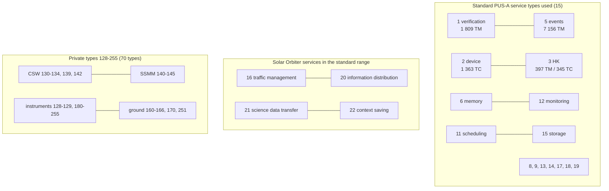

# How Solar Orbiter uses PUS

The [Packet Utilization Standard](../../ecss/pus/index.md) (PUS) defines services - families of
requests and reports identified by a service type and subtype - that a mission picks and
tailors. Solar Orbiter's tailoring is written down in its space-ground packet structure ICD,
SOL.S.ASTR.TN.00079,[^icd-sum] and implemented, packet by packet, in its SCOS-2000
[Mission Information Base](mib.md). This page reads the two side by side: the
[pid](../../mib/tables/pid.md) table gives every telemetry (TM) packet definition with its
type and subtype, and the [ccf](../../mib/tables/ccf.md) table every telecommand (TC). All
counts are from this wiki's queries on the September 2025 release (and, where stated, the April
2020 release), shown in the "SQL used" blocks.[^mib25][^mib20]

## Which PUS: A or C?

Solar Orbiter uses **PUS-A**, ECSS-E-70-41A of 30 January 2003. The question can be settled
from both the documents and the MIB:

| Evidence | What it shows |
|---|---|
| The packet structure ICD's applicable document AD1 is ECSS-E-70-41A, and all application-level structures are "according to" it | the standard is PUS-A[^icd-ad][^icd-scope] |
| TC and TM data field headers carry PUS version 1 (`0b001`) | PUS-A requires version 1; PUS-C requires version 2[^icd-tcdfh][^icd-tmdfh][^a-ver][^c-ver] |
| The MIB TC header `NOM_TC` has a fixed 1-bit "Secondary Header Flag" = 0 at bit 48 and a fixed 3-bit "PUS Version" = 1 at bit 49 | the PUS-A TC data field header layout, not PUS-C's 4-bit version field[^mib25][^a-tcdfh] |
| The TC source ID is 8 bits (`DFH_SRC` at bit 72) and the TM destination ID 8 bits | PUS-A field sizes; PUS-C uses 16-bit source and destination IDs[^mib25][^icd-dest][^c-hdr] |
| `PID_DFHSIZE` = 16 for 11 138 of the 11 150 packets: 6 octets of primary header + 10 octets of data field header | the ICD's 10-octet TM data field header with optional PUS-A fields[^mib25][^icd-tmdfh] |
| Services 4, 7 and 10 are not used; 16 and 20-22 have Solar Orbiter's own meanings | consistent with PUS-A's service list, where 7, 10 and 16 are "not used" and 20-22 do not exist[^icd-sum40][^a-table2] |

<div class="bitfield" data-title="Solar Orbiter TC data field header (NOM_TC, 32 bits)" data-width="8"
     data-fields='[{"n":"CCSDS sec. hdr flag","b":1,"v":"0"},{"n":"PUS version","b":3,"v":"001"},{"n":"Ack","b":4,"d":"bit 3 acceptance, bit 0 completion; start and progress bits 0"},{"n":"Service type","b":8},{"n":"Service subtype","b":8},{"n":"Source ID","b":8,"d":"110 MTL, 111 TC sequences, 112 recovery, 113 backup MTL, 120 direct"}]'></div>

The header is taken from the MIB's `pcdf` table and agrees with the ICD.[^mib25][^icd-tcdfh]
The packet layouts, including the TM header reconstruction, are on
[PUS packet structures](../../ecss/pus/packets.md); the differences between the issues are on
[PUS-A vs PUS-C](../../ecss/pus/pus-a-vs-pus-c.md).

The ICD forbids non-standard use of standard services and requires user-specific packets to
be private services; services are marked mandatory, optional or reserved for a user, and for
optional ones the minimum capability sets of ECSS-E-70-41A apply.[^icd-scope][^icd-sum] PUS-A
itself reserves service types 0-127 for the standard and leaves 128-255 to missions, and within
a standard service leaves subtypes 128-255 to missions.[^a-ranges] Solar Orbiter uses both
freedoms heavily, as the counts below show.

## How the MIB sees a PUS packet

SCOS-2000 identifies a TM packet by APID, type and subtype plus up to two extra identification
fields whose position and width are given per type/subtype (and optionally per APID) in
[pic](../../mib/tables/pic.md); each distinct key gets its own SPID.[^i70-pid][^i70-pic] The
Solar Orbiter PIC rules for the standard reports are:[^mib25]

| Report | 1st field (octet, bits) | Meaning of the field |
|---|---|---|
| TM(1,2), TM(1,8) | 20, 16 | failure code, after the 4 octets of TC packet ID and sequence control |
| TM(3,25), TM(3,26) | 16, 8 | structure ID (SID) |
| TM(5,1) to TM(5,4) | 16, 16 | event ID; on virtual APIDs a 2nd field at octet 18 (19 for TM(5,1) on APID 1974) |
| TM(6,6) | 16, 16 | memory ID; on virtual APIDs a 2nd 32-bit field at octet 18 |
| TM(21,3), TM(21,5), TM(21,6) | 16, 8 | science structure ID (SSID) |
| TM(12,9) on APIDs 1986-1990 | 19, 8 | with a 2nd 8-bit field deep inside the packet |

Octet 16 is the first octet after the 6-octet primary header and the 10-octet data field
header. The consequence is that one PUS report type becomes many database packets: every event
ID and every failure code has its own SPID, with its own parameter layout. That is why services 1
and 5 account for 8 965 of the 11 150 packet definitions.[^mib25]

On the TC side, each command's `CCF_ACK` sets the acknowledgement flags. The ICD allows only
`0000`, `0001` (acceptance), `1000` (completion) and `1001` (both);[^icd-s1] the MIB uses 9
(`1001`) for 5 225 commands, 1 for 78 and 0 for 21 (130 have no value: commands without a PUS
header).[^mib25] Verification is covered on
[Command verification in the MIB](../../mib/command-verification.md).

??? example "SQL used (PUS version and identification)"
    ```sql
    -- solo-2025-09-16.sqlite (MIB__20250916M25925PFMS001_SOL)
    SELECT * FROM pcdf WHERE PCDF_TCNAME = 'NOM_TC' ORDER BY CAST(PCDF_BIT AS INT);
    SELECT PID_DFHSIZE, PID_TIME, count(*) FROM pid GROUP BY 1, 2;
    SELECT * FROM pic ORDER BY CAST(PIC_TYPE AS INT), CAST(PIC_STYPE AS INT);
    SELECT CCF_ACK, count(*) FROM ccf GROUP BY 1;
    ```

## The standard services at a glance

| Type | Solar Orbiter name (ICD) | PUS-C page | TM defs 2020 / 2025 | TC defs 2020 / 2025 | Subtypes in the MIB (TM; TC) |
|---|---|---|---:|---:|---|
| 1 | TC Verification | [ST[01]](../../ecss/pus/st01-request-verification.md) | 1 788 / 1 809 | - | 1, 2, 7, 8; - |
| 2 | Device Command Distribution | [ST[02]](../../ecss/pus/st02-device-access.md) | 1 / 1 | 1 363 / 1 363 | 129; 3, 128, 130 |
| 3 | Housekeeping and Diagnostic Data Reporting | [ST[03]](../../ecss/pus/st03-housekeeping.md) | 375 / 397 | 331 / 345 | 10, 12, 25, 26, 134; 1-9, 11, 128-131, 136, 138, 139 |
| 4 | (not used) | [ST[04]](../../ecss/pus/st04-parameter-statistics.md) | - | - | - |
| 5 | Event Reporting | [ST[05]](../../ecss/pus/st05-event-reporting.md) | 5 667 / 7 156 | 35 / 35 | 1-4, 130, 132, 134; 5, 6, 128, 129, 131, 133 |
| 6 | Memory Management | [ST[06]](../../ecss/pus/st06-memory-management.md) | 298 / 309 | 211 / 221 | 6, 10; 2, 5, 9, 128-131, 140 |
| 8 | Function Management | [ST[08]](../../ecss/pus/st08-function-management.md) | 1 / 1 | 66 / 69 | 145; 1, 140-144 |
| 9 | Time Management | [ST[09]](../../ecss/pus/st09-time-management.md) | 1 / 1 | 19 / 4 | 2; 1, 130, 131 |
| 11 | On-Board Operations Scheduling | [ST[11]](../../ecss/pus/st11-time-based-scheduling.md) | 3 / 3 | 29 / 33 | 10, 13, 19; 1-9, 11, 12, 14-18, 132 |
| 12 | On-Board Monitoring | [ST[12]](../../ecss/pus/st12-onboard-monitoring.md) | 19 / 32 | 247 / 254 | 9, 11, 12; 1-8, 10 |
| 13 | Large Data Transfer | [ST[13]](../../ecss/pus/st13-large-packet-transfer.md) | 9 / 9 | 28 / 28 | 14-16, 130, 140, 149-152; 9-11, 13, 128, 129, 131-139, 141-148, 153 |
| 14 | Packet Forwarding Control | [ST[14]](../../ecss/pus/st14-real-time-forwarding-control.md) | 4 / 4 | 12 / 12 | 8, 12, 129, 131; 1, 2, 5-7, 9-11, 13, 14, 128, 130 |
| 15 | On-Board Storage and Retrieval | [ST[15]](../../ecss/pus/st15-onboard-storage-retrieval.md) | 7 / 7 | 47 / 47 | 6, 13, 134, 141, 152, 155, 156; 32 subtypes |
| 16 | On-Board Traffic Management | (reserved in PUS-C) | - | 5 / 5 | -; 1-5 |
| 17 | Test | [ST[17]](../../ecss/pus/st17-test.md) | 17 / 17 | 27 / 27 | 2; 1, 3, 128 |
| 18 | On-Board Control Procedures | [ST[18]](../../ecss/pus/st18-onboard-operations-procedure.md) | 2 / 2 | 32 / 46 | 9, 144; 5-8, 140-142 |
| 19 | Event-Action | [ST[19]](../../ecss/pus/st19-event-action.md) | 2 / 2 | 37 / 48 | 7, 131; 1-6, 130 |
| 20 | Information Distribution | (PUS-C ST[20] is parameter management) | - | 16 / 17 | -; 1, 2, 128 |
| 21 | Science Data Transfer | (PUS-C ST[21] is request sequencing) | 311 / 334 | 33 / 33 | 3, 5, 6, 7; 1, 2, 128 |
| 22 | Context Saving | (PUS-C ST[22] is position-based scheduling) | 2 / 1 | 6 / 6 | 2; 1, 3, 4, 5 |

The service names are those of the ICD's Table 5.1-1;[^icd-sum] the PUS-C correspondences
follow PUS-C's Table 4-1;[^c-table41] the counts are TM packet definitions (SPIDs) and commands
with the nominal PUS header `NOM_TC`.[^mib25][^mib20] The individual message types are
catalogued on [PUS message types](../../ecss/pus/message-types.md).

??? example "SQL used (services per release)"
    ```sql
    -- run on solo-2025-09-16.sqlite
    ATTACH 'solo-2020-04-16.sqlite' AS o;
    WITH t AS (
      SELECT CAST(PID_TYPE AS INT) t, 'TM25' k FROM main.pid
      UNION ALL SELECT CAST(PID_TYPE AS INT), 'TM20' FROM o.pid
      UNION ALL SELECT CAST(CCF_TYPE AS INT), 'TC25' FROM main.ccf WHERE CCF_PKTID = 'NOM_TC'
      UNION ALL SELECT CAST(CCF_TYPE AS INT), 'TC20' FROM o.ccf WHERE CCF_PKTID = 'NOM_TC')
    SELECT t, sum(k = 'TM20'), sum(k = 'TM25'), sum(k = 'TC20'), sum(k = 'TC25')
      FROM t GROUP BY t ORDER BY t;
    -- subtypes and spread over APIDs
    SELECT CAST(PID_TYPE AS INT) t, CAST(PID_STYPE AS INT) s, count(*), count(DISTINCT PID_APID)
      FROM pid GROUP BY t, s ORDER BY t, s;
    SELECT CAST(CCF_TYPE AS INT) t, CAST(CCF_STYPE AS INT) s, count(*), count(DISTINCT CCF_APID),
           min(CCF_DESCR)
      FROM ccf WHERE CCF_PKTID = 'NOM_TC' GROUP BY t, s ORDER BY t, s;
    ```

## Service by service

### Service 1: TC verification

Every on-board unit implements acceptance success and failure (1,1 and 1,2) and execution
success and failure (1,7 and 1,8); start and progress reports are not used.[^icd-sum][^icd-s1]
The CSW applies static acceptance checks to every TC independently of the acknowledgement flags:
header constants, a packet length between 5 and 241, the length against the received octets,
the CRC, the process ID and the category 12.[^icd-s1] In the MIB, service 1 reports sit on 31
category-1 APIDs: 29 of them have exactly one 1,1 and one 1,7 packet, while the 274 failure-code
packets of type 1,2 and 1 477 of type 1,8 are spread over all 31 (SOLOHI's APIDs 1329 and 1345
have failure reports only).[^mib25] Failure codes follow Annex 9: standard codes
0 to 7 (illegal APID, length, CRC, type, subtype, application data, segment flags, MAP ID), then
ranges per user - SSMM 1000-1999, star trackers 2000-2999, OBCPs 4000-9999, CSW 10000-39999,
EPD 40000s, MAG 41000s, RPW 42000s, SWA 43000s, SPICE 44000s, PHI 45000s, EUI 46000s, METIS
47000s, STIX 48000s, SoloHi 49000s.[^icd-fid] The units' codes in the MIB agree: SSMM failure
codes run from 1000 to 1090, star tracker codes 2500-2655, EPD 40000-40717, MAG 41100-41822,
RPW 42000-42005, SWA 43000-43265, SPICE 44000-44099, PHI 45011-45827, EUI 46700-46800, METIS
47000-47719, STIX 48000-48463 and SOLOHI 49000-49004.[^mib25] The CSW (processes 10-16) is the
exception: besides codes in its 10000-39999 range it defines codes 256-277 for its own
acceptance checks (for example 256 "Illegal CCSDS packet version number") and 175 distinct codes
between 509 and 4881, which Annex 9 assigns to the reserved standard range, to spares, to the
SSMM, to the star trackers and to OBCPs.[^mib25][^icd-fid]

### Service 2: device command distribution

TC(2,3) carries CPDU commands, TC(2,128) MIL-STD-1553 commands with the TM(2,129) answer, and
TC(2,130) a SpaceWire packet.[^icd-sum] Service 2 is by far the largest TC service: 1 257
TC(2,128) bus commands (for example "DEU A Arm Pinpuller") and 105 TC(2,3) CPDU commands, all to
the data management APID 172, plus one TC(2,130).[^mib25] Apart from the generic "Distribute
CPDU commands", the MIB names the TC(2,3) commands "HPC-3 ..." (for example "HPC-3 IMU 1 Channel
1 On"), the pulses that the CSW produces by writing CPDU registers. The ground-to-CPDU HPC-1
commands are a separate set: 125 commands to APID 44 (process 2) with the `HPC1_TC` header, no
secondary header and `CCF_MAPID` = 0, none of which shares a description with a TC(2,3)
command.[^mib25][^icd-seg] See [ST[02] Device access](../../ecss/pus/st02-device-access.md).

### Service 3: housekeeping and diagnostic reporting

The routine HK report TM(3,25) is mandatory for all units; the CSW also implements the PUS-A
definition, clearing, enabling, disabling and reporting subtypes 1-12, a diagnostic report
TM(3,26), and private subtypes 128-139 (report definitions in summary form, update periods,
collection intervals, one-shot request, adding parameters to a definition, snapshot anomaly
report).[^icd-sum] The MIB has 288 TM(3,25) definitions on 62 APIDs and 89 TM(3,26) on 14
APIDs, and 345 service 3 commands.[^mib25]

Structure IDs follow a pattern per category. For the CSW, Annex 10 allocates SIDs 1-127 to
TM(3,25) and 128-255 to TM(3,26), in blocks (1-10 general status, 11-30 mode, 31-60 equipment,
61-90 specific requests, 101-104 ESOC, 105-127 ancillary data; 128-137, 138-157, ... for
diagnostics).[^icd-sid] In the MIB the data management application, for instance, reports
15 SIDs between 1 and 16 on its HPTM APID 162 (category 2), the same reports as SIDs 77-92 on
its routine HK APID 164 (category 4), SIDs 153-156 on its functional cyclic APID 165 (category 5)
and diagnostic SIDs 193-194 on APID 168 (category 8); the AOCS follows the same pattern (HPTM
SIDs between 1 and 21, routine 77-97, functional cyclic 153-159 and 191-192, diagnostic
193-223, 228-229 and 251-255). Every one of the 68 CSW HPTM TM(3,25) definitions has a routine
HK counterpart on the APID two higher with a SID 76 higher, and in 67 cases the two share the
same description.[^mib25]

!!! warning "Inference"
    The MIB's CSW SIDs do not follow the Annex 10 blocks: the routine HK SIDs 77-102 run across
    the "specific data request" (61-90), spare (91-100) and ESOC (101-104) blocks, and the
    category 5 TM(3,25) SIDs 153-159 and 188-192 fall in the range that Annex 10 reserves for
    TM(3,26). The offset of 76 between HPTM and routine HK SIDs is this wiki's observation from
    the data; the rule behind it is not stated in the available sources.

### Service 5: event reporting

Events are the largest TM service: 7 156 definitions on 50 APIDs - 1 374 normal/progress
(5,1), 1 159 low severity (5,2), 2 911 medium severity (5,3) and 1 698 high severity (5,4)
reports, plus the CSW's private event log subtypes 130, 132 and 134.[^mib25][^icd-sum] Annex 9
encodes the severity in the two most significant bits of the 16-bit event ID (5,1 from
`0x0000`, 5,2 from `0x4000`, 5,3 from `0x8000`, 5,4 from `0xC000`) and splits each quarter into
boot software, general and specific application, unexpected error, monitoring, OBCP and ESOC
ranges.[^icd-eid] All 2 308 CSW event definitions (processes 10-16) obey the severity rule;
the instruments' events follow it less consistently (5 499 of all 7 142 events of subtypes 1-4
obey it).[^mib25]
The busiest event APIDs are the thermal control events (APID 263, 699 definitions), the three EUI
event APIDs (620 each) and the AOCS events (APID 183, 436).[^mib25]

### Service 6: memory management

Load (6,2), dump (6,5/6,6) and check (6,9/6,10) by absolute address are mandatory for all
units; private subtypes add pre-loaded RAM patches, abort dump, enabling and disabling the SSMM
EEPROM patch, and load with mask.[^icd-sum] The
MIB has 289 TM(6,6) dump and 20 TM(6,10) check report definitions and 221 commands; dumps are
identified by a 16-bit memory ID at octet 16.[^mib25]

### Service 8: function management

The CSW's TC(8,1) "Perform Function" is used by 64 commands (for example "1553 Failure
Recovery"); private subtypes 140-144 enable or disable functions and their auto-reset and
report their status in TM(8,145).[^mib25][^icd-sum]

### Service 9: time management

The OBC keeps the on-board time as CUC with 4 octets of seconds and 2 of sub-seconds from a
zero reference of 1 January 2000; TM(9,2) reports it (without data field header, on APID 0),
TC(9,1) changes its rate, TC(9,128) sets the OBT, and TC(9,130)/(9,131) start and stop time
synchronisation of a user, which makes the CSW send TC(9,129) "accept time update" packets to
that user.[^icd-s9][^icd-s9b] The 2020 MIB defined 19 service 9 commands, including four
TC(9,128) variants and eleven TC(9,129) commands addressed to the SSMM and the instruments; the
2025 release keeps only TC(9,1), two TC(9,130) and one TC(9,131).[^mib20][^mib25]

!!! warning "Inference"
    Since the ICD says that TC(9,129) is generated by the CSW, not sent from the ground, its
    removal from the ground command database is consistent with its definition; why the
    TC(9,128) "Set OBT" commands were also removed is not stated in the available sources.

Time correlation itself is done on ground with the MCS packets TM(164,1) to TM(164,3) on APID
1966, described on [Solar Orbiter](index.md#internal-packets-and-time-correlation) and
[Time correlation in SCOS-2000](../../scos2000/time-correlation.md).[^ddid-tco]

### Service 11: on-board operations scheduling

The CSW implements the PUS-A time-based schedule almost completely: enable, disable and reset
release, insert, delete (also over a time period), time-shift, detailed and summary reports
(9-17) and schedule status 18/19.[^icd-sum] The MIB adds a private TC(11,132) "Insert Backup
MTL Telecommands" (two commands to APID 172), which Table 5.1-1 of the ICD does not
list.[^mib25][^icd-sum] The insert command `ZCD00B04`
([explorer](../../explorer/index.md#/solo/command/ZCD00B04)) is dissected on
[PUS packet structures](../../ecss/pus/packets.md) and in the
[TC worked example](../../overview/worked-example-tc.md).

### Service 12: on-board monitoring

Enable, disable, change maximum report delay, clear, add, delete, modify and report the
monitoring list, and report the out-of-limit list, with the check transition report
TM(12,12).[^icd-sum] The 254 commands are dominated by TC(12,5) "add parameter" (114 variants by
parameter type) and TC(12,7) "modify checking information" (83).[^mib25] The 32 TM definitions
include 19 TM(12,9) monitoring list reports, 13 of them on the virtual APIDs 1986-1990 that the
ground uses to decode each CSW application's list (see [The Solar Orbiter MIB](mib.md#special-apids)).[^mib25]
Ground and on-board checks are compared on
[Monitoring checks](../../mib/monitoring-checks.md).

### Service 13: large data transfer

Solar Orbiter's service 13 uplinks files from the ground to the CSW (first, intermediate and last
parts, abort, acknowledgement, unsuccessful part and abort reports, TC(13,9) to TM(13,16)) and
downlinks files from the SSMM with a private protocol of file transfer sessions and "low-level
file transfer" (LLFT) subtypes 128-153.[^icd-sum][^icd-s13] Each uplinked file has an attribute:
1 OBCP, 2 TC sequence for delayed execution, 3 TC sequence for immediate execution, 6 other and 7
internal, with 4 and 5 unused.[^icd-s13] The MIB has 28 service 13 commands on APIDs 172 and 492
(SSMM) and 9 report definitions.[^mib25] Downlinked files reach users as "DLPP" TM files in the
file archive.[^ddid-tmf] The MIB's mission file `s13a.dat` lists the attribute values 0 `PLAIN`,
1 `OBCP`, 2 `DELAYED TC`, 3 `IMMEDIATE TC`, 4 `PAYLOAD CONTEXT`, 5 `INVALID` and 6
`OTHER`, so it gives meanings to 0, 4 and 5, which the ICD leaves undefined or marks
unused, and has no entry for the ICD's 7.[^mib25][^icd-s13] Service 13 is a PUS-A large data transfer, not the PUS-C
[ST[13]](../../ecss/pus/st13-large-packet-transfer.md) or [ST[23]](../../ecss/pus/st23-file-management.md).

### Service 14: packet forwarding control

Twelve commands enable and disable the forwarding of TM source packets, housekeeping,
diagnostic and event packets, and report the forwarding status (TM(14,8), (14,12), (14,129),
(14,131)).[^icd-sum][^mib25]

### Service 15: on-board storage and retrieval

The CSW and the SSMM both implement service 15, with the SSMM adding creation, resizing,
deletion, renaming, listing and copying of packet stores, cyclic/non-cyclic modes, default
virtual channel and priority, and the CSW adding SID-based storage selection and the storage
routing table - subtypes 128 to 156.[^icd-sum] All 47 commands go to APIDs 172 and
492.[^mib25] The E-FECS notes that resizing SSMM packet stores loses data unless the stores are
empty.[^efecs] See [ST[15]](../../ecss/pus/st15-onboard-storage-retrieval.md).

### Service 16: on-board traffic management

A Solar Orbiter service in a type number that PUS-A marks "not used": five commands set the
MIL-STD-1553 bus configuration and switch buses or remote-terminal channels between nominal and
redundant; the ICD says they are not meant for nominal flight operations but for investigation
or recovery after bus FDIR.[^icd-s16][^a-table2][^mib25]

### Service 17: test

TC(17,1) and the TM(17,2) connection test report are mandatory for all units; the CSW adds
TC(17,3) to request a connection test of another unit, and TC(17,128) is a test command of
maximum length.[^icd-sum] 18 units have a TC(17,1) in the MIB and 17 have a TM(17,2).[^mib25]

### Service 18: on-board control procedures

Suspend, resume, communicate parameters, report the OBCP list and private load-and-start,
stop-and-delete and OBCP HK subtypes; TM(18,144) carries OBCP telemetry.[^icd-sum] The 38
TC(18,140) "Load and start OBCP" variants account for most of the 46 commands, which grew from 32
in 2020.[^mib25][^mib20]

### Service 19: event-action

Add, delete and clear event detection entries, enable and disable actions, and report the list
or a single entry (TC(19,130)/TM(19,131)).[^icd-sum] The 48 commands are on three APIDs, with
25 TC(19,1) "Add Event" variants.[^mib25]

### Service 20: information distribution

Not PUS-C's parameter management: Solar Orbiter's service 20 distributes inter-instrument data
and the OBC heartbeat. TC(20,1) and TC(20,2) start and stop distribution to a user, and the
single TC(20,128) carries all the data.[^icd-s20][^tn7] The MIB has the CSW's TC(20,1) per
instrument (ten "Start Information Distribution ..." commands to APID 172, plus a generic
"... for User" one) and one TC(20,2), and five
TC(20,128) definitions on APID 796 - process 49, "payload broadcast" in Annex 8 - for EPD, MAG,
PHI and STIX.[^mib25][^icd-cat] The instruments' contributions arrive as category 5 TM(3,25)
packets, compared with the 2016 agreement below.

| Instrument | IIC packet in SOL-SGS-TN-0007 (2016) | Category 5 TM(3,25) in the 2025 MIB |
|---|---|---|
| EPD | PID 100, SID 100 | APID 1605 (PID 100), SID 100 |
| EUI | PID 57, SID 10 | APID 933 (PID 58), SID 10 "EUI_HK_IIM" |
| MAG | PID 65, SID 20 | APID 1045 (PID 65), SID 20 |
| METIS | PID 69, SID 20 | APID 1109 (PID 69), SID 20 "SID 20 - IIC" |
| PHI | PID 74, SID 6 | APID 1189 (PID 74), SIDs 2 "heartbeat" and 8 |
| RPW | PID 81, SID 6 | APID 1269 (PID 79), SID 6 "shared with other SolO instruments" |
| SOLOHI | PID 84, SID 5 | APID 1349 (PID 84), SID 80 "OBC InterInstrument Packet" |
| STIX | PID 94, SID 4 | APID 1509 (PID 94), SID 4 |
| SWA | PID 95, SID 255 | APID 1525 (PID 95), SID 255 "SWA_TM_II_INFO" |
| SPICE | PID 88, SID 7 (not participating) | APID 1653 (PID 103), SID 7 "SPICE Heartbeat HK Report" |

The 2016 values are from the note's packet tables;[^tn7-pid] the 2025 values are this wiki's
query.[^mib25] The parameters of these packets match the field lists of the note - for example
EUI's `FlareCloseToHRI` and `OffLimb` flags, RPW's `RPW_S20_SBM1_FLAG`, PHI's mean and RMS
jitter, SOLOHI's power-off request and door-armed flags, SWA's density and velocity - so they
are the IIC packets even where the numbers differ.[^mib25][^tn7-pid] Five instruments match
exactly; EUI, RPW and SPICE use other process IDs and PHI and SOLOHI other SIDs. A twelfth
category 5 TM(3,25), SOLOHI's APID 1317 SID 17 "OBC HK Combo Status Packet (Diagnostic)", has
no counterpart in the note.[^mib25]

!!! warning "Inference"
    The differing process IDs and SIDs suggest that the IIC agreements were revised after
    issue 2.0 of the note; neither the revision nor its reason is in the available sources.

### Service 21: science data transfer

A Solar Orbiter service for moving instrument science to the SSMM: TC(21,1) and TC(21,2) start
and stop the transfer, TC(21,128) resets the output buffer, and the data come in TM(21,3) (fixed
length with SSID), TM(21,4) (fixed, no SSID), TM(21,5) (variable stream with SSID) or TM(21,6)
(variable with structure and SSID).[^icd-s21] The MIB has 105 TM(21,3), 72 TM(21,5) and 151
TM(21,6) definitions on 45 science APIDs (category 12), and 6 TM(21,7) definitions for SPICE,
a subtype that the ICD does not define.[^mib25]

### Service 22: context saving

Instruments save their operational context as a file in the OBC mass memory (OMM), where the
ground can also reach it with service 133, and get it back on request: the ground asks the CSW
to save a context (22,5), the CSW requests it from the instrument (22,1), which answers with a
context report (22,2) within 5 seconds; on a retrieval request (22,4) the CSW sends the context
back in up to 18 TC(22,3) segments.[^icd-s22] Only STIX's context report remains in 2025; PHI's
TM(22,2) on APID 1163 was removed after 2020.[^mib25][^mib20]

## Mission-specific services 128-255

The ICD assigns private service ranges per user.[^icd-sum] The MIB shows which are actually
populated:

| Types | Owner (ICD) | TM defs | TC defs | Examples from the MIB |
|---|---|---:|---:|---|
| 128-129 | EPD | 9 | 92 | TC(128,1) "Trigger trans", 129,224 "Command Echo ASW", SIS macro commands |
| 130 | CSW TM extraction | 1 | 3 | define, delete, report TM extraction descriptors |
| 131 | CSW device management / private function management | 693 | 875 | 875 TC(131,1) uploads such as "AGP Segment 0 Part 1 Upload"; PCDU snapshots and OBDB dumps |
| 132 | CSW SGM management | 71 | 246 | SGM group read/write; 239 TC(132,3) e.g. "BUMTL set CRCs and file selection in SGM" |
| 133 | CSW file management | 2 | 6 | copy, delete, modify, report file; verify checksum |
| 134 | CSW TC sequencer | 0 | 13 | start/abort sequence, "Execute Loss-of-UL FDIR TC File" |
| 139 | CSW data-pool (parameter) management | 26 | 234 | 217 TC(139,1) "change value" variants, e.g. "Set value of (1-byte integer) parameters"; TM(139,3) |
| 140-141 | SSMM mode transition, direct commanding | 95 | 95 | SSMM BIT/INIT/OPERA modes; 67 direct register reads |
| 142 | CSW functional monitoring / SSMM redundancy | 18 | 59 | add/delete/protect FMON; router configuration report |
| 143-145 | SSMM memory arrays, reboot, BIT reports | 4 | 13 | test/configure/scrub memory modules |
| 150-157 | star trackers | 18 | 70 | "STR1 AAD Mode"; TM(156,x) attitude data |
| 160-166 | (ground: MCS-internal packets on APID 1966) | 17 | 0 | time correlation TM(164,1-3), mini frames, MATIS |
| 170 | (EGSE "PSS", APID 1948) | 0 | 5 | "PSS Set HK Parameter OFF" |
| 180-184 | RPW | 7 | 93 | `DPU_BOOT_DAS`, LFR calibration commands |
| 200-205 | SWA | 18 | 188 | `SWA_TC_EAS1_CLEAR_RAM`, parameter reports |
| 206-218 | EUI | 18 | 110 | `EUI_ChangeModeBasic`, table dumps |
| 226-230 | MAG | 2 | 117 | "Activate FIB", EEPROM table of contents |
| 231-235 | PHI | 28 | 161 | `acquireFPAImages`, file system |
| 236-240 | STIX | 14 | 85 | ASIC readouts, TM corridor limits |
| 241-245 | METIS | 3 | 80 | HVU configuration, acquisition |
| 246-250 | SoloHI | 7 | 98 | `CCFREEHEADERS`; TM(247,x), TM(248,1) |
| 251 | (ground: link and session control, saved synthetics) | 1 | 6 (`NOS2KHDR`) | `GENERIC OPEN TC LINK` on APID 1964 |
| 252-255 | SPICE (ICD range 251-255) | 2 | 82 | only type 255 is used, e.g. `CLR_LATCHED` |

The owners are those of Table 5.1-1;[^icd-sum] types 160-166 are the MCS packets of the
DDID;[^ddid-int] the counts are from the 2025 MIB.[^mib25] The CSW's private services carry
much of the operational load: TC(131,1) alone accounts for 875 commands.

!!! warning "Inference"
    Several Solar Orbiter private services do jobs that PUS-C later standardised:
    139 data-pool management resembles PUS-C [ST[20]](../../ecss/pus/st20-onboard-parameter-management.md),
    133 file management [ST[23]](../../ecss/pus/st23-file-management.md), 134 TC sequencer
    [ST[21]](../../ecss/pus/st21-request-sequencing.md), and 142 functional monitoring the
    functional monitoring subservice of PUS-C [ST[12]](../../ecss/pus/st12-onboard-monitoring.md).[^c-fmon]
    The similarity is functional; the packet layouts are Solar Orbiter's own and are not
    claimed to match PUS-C. Type 251 is used both by ground packets (on APIDs 1964 and 1966,
    process 122 in the EGSE range) and, according to the ICD, by SPICE; since SPICE's process
    IDs are 85-89 and 101-104, the two uses do not collide in practice (and SPICE's MIB entries
    use only type 255).

??? example "SQL used (private services and IIC packets)"
    ```sql
    SELECT CAST(CCF_TYPE AS INT) t, count(*), count(DISTINCT CCF_STYPE), group_concat(DISTINCT CCF_APID),
           min(CCF_DESCR)
      FROM ccf WHERE CCF_PKTID = 'NOM_TC' AND CAST(CCF_TYPE AS INT) > 22 GROUP BY t ORDER BY t;
    SELECT CAST(PID_TYPE AS INT) t, count(*) FROM pid WHERE CAST(PID_TYPE AS INT) > 22
     GROUP BY t ORDER BY t;
    -- category 5 TM(3,25) = candidate inter-instrument communication packets
    SELECT PID_APID, CAST(PID_APID AS INT) >> 4 AS pid, PID_PI1_VAL AS sid, PID_DESCR
      FROM pid WHERE PID_TYPE = '3' AND PID_STYPE = '25' AND (CAST(PID_APID AS INT) & 15) = 5;
    SELECT l.PLF_OFFBY, p.PCF_NAME, p.PCF_DESCR FROM plf l JOIN pcf p ON p.PCF_NAME = l.PLF_NAME
     WHERE l.PLF_SPID IN ('51010', '55082', '56358', '53008') ORDER BY l.PLF_SPID, CAST(l.PLF_OFFBY AS INT);
    SELECT CCF_CNAME, CCF_DESCR, CCF_APID, CCF_STYPE FROM ccf WHERE CCF_TYPE = '20';
    -- failure codes per process, outside the standard 0-500 range
    SELECT CAST(PID_APID AS INT) >> 4 p, min(CAST(PID_PI1_VAL AS INT)), max(CAST(PID_PI1_VAL AS INT))
      FROM pid WHERE PID_TYPE = '1' AND PID_STYPE IN ('2', '8') AND CAST(PID_PI1_VAL AS INT) > 500
     GROUP BY p;
    -- HPTM (category 2) and routine HK (category 4) twins
    SELECT count(*) FROM pid a JOIN pid b ON CAST(b.PID_APID AS INT) = CAST(a.PID_APID AS INT) + 2
       AND CAST(b.PID_PI1_VAL AS INT) = CAST(a.PID_PI1_VAL AS INT) + 76 AND b.PID_TYPE = '3' AND b.PID_STYPE = '25'
     WHERE a.PID_TYPE = '3' AND a.PID_STYPE = '25' AND CAST(a.PID_APID AS INT) & 15 = 2;   -- 68
    -- event severity encoded in the two top bits of the event ID
    SELECT PID_STYPE, count(*), sum((CAST(PID_PI1_VAL AS INT) >> 14) = CAST(PID_STYPE AS INT) - 1)
      FROM pid WHERE PID_TYPE = '5' AND PID_STYPE IN ('1','2','3','4')
       AND (CAST(PID_APID AS INT) >> 4) BETWEEN 10 AND 16 GROUP BY 1;
    -- removed time commands
    ATTACH 'solo-2020-04-16.sqlite' AS o;
    SELECT CCF_CNAME, CCF_APID, CCF_TYPE, CCF_STYPE, CCF_DESCR FROM o.ccf
     WHERE CCF_TYPE = '9' AND CCF_CNAME NOT IN (SELECT CCF_CNAME FROM main.ccf);
    ```

## Summary



Of the 90 service types that occur in TM definitions or nominal commands, one is type 0
(packets without data field header), 15 are PUS-A standard services, 4 are Solar Orbiter
services numbered in the standard range (16, 20, 21, 22) and 70 are private; services 4, 7 and
10 are absent, exactly as the ICD says.[^mib25][^icd-sum40]

## Related pages

* [Solar Orbiter](index.md), [The Solar Orbiter MIB](mib.md),
  [Solar Orbiter SWA instrument database](swa.md)
* [PUS overview](../../ecss/pus/index.md), [PUS packet structures](../../ecss/pus/packets.md),
  [PUS-A vs PUS-C](../../ecss/pus/pus-a-vs-pus-c.md), [message types](../../ecss/pus/message-types.md)
* [Commanding in the MIB](../../mib/commanding.md), [Monitoring in the MIB](../../mib/monitoring.md)

[^icd-sum]: [SOL.S.ASTR.TN.00079 issue 7, Solar Orbiter TM-TC and Packet Structure ICD](../../library/sol-s-astr-tn-00079-07.md), §5.1 Summary, Table 5.1-1 (service and subservice list, mnemonics R/M/O/X), PDF pp. 31-39.
[^icd-sum40]: [SOL.S.ASTR.TN.00079 issue 7](../../library/sol-s-astr-tn-00079-07.md), §5.1, note after Table 5.1-1 ("Services 4, 7 and 10 are not used at all"), PDF p. 40.
[^icd-ad]: [SOL.S.ASTR.TN.00079 issue 7](../../library/sol-s-astr-tn-00079-07.md), §2.1 Applicable Documents (AD1 ECSS-E-70-41A), PDF p. 13.
[^icd-scope]: [SOL.S.ASTR.TN.00079 issue 7](../../library/sol-s-astr-tn-00079-07.md), §1.1 Scope and Purpose, PDF p. 11.
[^icd-tcdfh]: [SOL.S.ASTR.TN.00079 issue 7](../../library/sol-s-astr-tn-00079-07.md), §3.2.2.1 TC Data Field Header (PUS-51 to PUS-66), PDF pp. 16-17.
[^icd-tmdfh]: [SOL.S.ASTR.TN.00079 issue 7](../../library/sol-s-astr-tn-00079-07.md), §4.2.1.3-4.2.2.1 (10-octet data field header, PUS version 1), PDF pp. 25-26.
[^icd-dest]: [SOL.S.ASTR.TN.00079 issue 7](../../library/sol-s-astr-tn-00079-07.md), §13.3 Destination ID ("00000000" = ground), PDF p. 276.
[^icd-s1]: [SOL.S.ASTR.TN.00079 issue 7](../../library/sol-s-astr-tn-00079-07.md), §5.2 Service 1: Telecommand Verification, PDF p. 40.
[^icd-fid]: [SOL.S.ASTR.TN.00079 issue 7](../../library/sol-s-astr-tn-00079-07.md), §14.1 and §14.3 (Annex 9) failure ID allocation, Table 14.3-1, PDF pp. 278-280.
[^icd-eid]: [SOL.S.ASTR.TN.00079 issue 7](../../library/sol-s-astr-tn-00079-07.md), §14.2 Standard Event ID, Figure 14.2-1, PDF p. 279.
[^icd-sid]: [SOL.S.ASTR.TN.00079 issue 7](../../library/sol-s-astr-tn-00079-07.md), §15.1 (Annex 10) Service 3 SID Assignment, Tables 15.1-1 and 15.1-2, PDF p. 281.
[^icd-seg]: [SOL.S.ASTR.TN.00079 issue 7](../../library/sol-s-astr-tn-00079-07.md), §3.3.1-3.3.1.1 (MAP ID 0 for CPDU, HPC-1), PDF pp. 18-19.
[^icd-s9]: [SOL.S.ASTR.TN.00079 issue 7](../../library/sol-s-astr-tn-00079-07.md), §5.10 Service 9: Time Management and §5.10.1-5.10.3, PDF pp. 95-97.
[^icd-s9b]: [SOL.S.ASTR.TN.00079 issue 7](../../library/sol-s-astr-tn-00079-07.md), §5.10.4-5.10.6 (TC(9,129) generated by the CSW; TC(9,130), TC(9,131)), PDF pp. 97-99.
[^icd-s13]: [SOL.S.ASTR.TN.00079 issue 7](../../library/sol-s-astr-tn-00079-07.md), §5.14 Service 13: Large Data Transfer (objective, description, file attributes), PDF pp. 132-133.
[^icd-s16]: [SOL.S.ASTR.TN.00079 issue 7](../../library/sol-s-astr-tn-00079-07.md), §5.17 Service 16: Onboard Traffic Management, PDF p. 196.
[^icd-s20]: [SOL.S.ASTR.TN.00079 issue 7](../../library/sol-s-astr-tn-00079-07.md), §5.21 Service 20: Information Distribution and TC(20,128) remarks, PDF pp. 216-220.
[^icd-s21]: [SOL.S.ASTR.TN.00079 issue 7](../../library/sol-s-astr-tn-00079-07.md), §5.22-5.22.6 Service 21: Science Data Transfer, PDF pp. 220-224.
[^icd-s22]: [SOL.S.ASTR.TN.00079 issue 7](../../library/sol-s-astr-tn-00079-07.md), §5.23 Service 22: Context Saving and §5.23.1 TC(22,1), PDF pp. 224-226.
[^icd-cat]: [SOL.S.ASTR.TN.00079 issue 7](../../library/sol-s-astr-tn-00079-07.md), §13.1 (Annex 8), Figure 13.1-2 Process ID Allocation (49 = payload broadcast), PDF pp. 273-274.
[^a-ver]: [ECSS-E-70-41A (PUS-A)](../../library/ecss-e-70-41a-30jan2003-pus.md), §5.3.3 and §5.4.3, TC and TM packet PUS version number ("version 1"), PDF pp. 44 and 48.
[^a-tcdfh]: [ECSS-E-70-41A (PUS-A)](../../library/ecss-e-70-41a-30jan2003-pus.md), §5.3.3 Packet data field (CCSDS secondary header flag, PUS version, Ack, type, subtype, source ID), PDF p. 44.
[^a-ranges]: [ECSS-E-70-41A (PUS-A)](../../library/ecss-e-70-41a-30jan2003-pus.md), §5.3.3 and §5.4.3 (service types 0-127 reserved, 128-255 mission-specific; subtypes likewise), PDF pp. 45 and 48.
[^a-table2]: [ECSS-E-70-41A (PUS-A)](../../library/ecss-e-70-41a-30jan2003-pus.md), §5.5 Standard services, Table 2, PDF p. 50.
[^c-ver]: [ECSS-E-ST-70-41C (PUS-C)](../../library/ecss-e-st-70-41c-15april2016.md), §7.4.3.1c and §7.4.4.1c (PUS version number 2), PDF pp. 439 and 442.
[^c-hdr]: [ECSS-E-ST-70-41C (PUS-C)](../../library/ecss-e-st-70-41c-15april2016.md), §7.4.3.1 Figure 7-7 (TM secondary header, 16-bit destination ID) and §7.4.4.1 Figure 7-9 (TC secondary header, 16-bit source ID), PDF pp. 439 and 442.
[^c-table41]: [ECSS-E-ST-70-41C (PUS-C)](../../library/ecss-e-st-70-41c-15april2016.md), §4.2.3.2, Table 4-1 The standardized service types, PDF pp. 23-24.
[^c-fmon]: [ECSS-E-ST-70-41C (PUS-C)](../../library/ecss-e-st-70-41c-15april2016.md), §6.12.1.3 Functional monitoring subservice, PDF p. 198.
[^i70-pid]: [SCOS-2000 Database Import ICD, issue 7.0](../../library/icd-7-0-final.md), §3.3.2.4-3.3.2.4.1 (packetiser key APID/type/subtype/PI1/PI2, one SPID per key), PDF pp. 82-83.
[^i70-pic]: [SCOS-2000 Database Import ICD, issue 7.0](../../library/icd-7-0-final.md), §3.3.2.4.2 Packets identification criteria: pic, PDF pp. 91-93.
[^ddid-tco]: [Solar Orbiter DDID, SOL-ESC-IF-05011 issue 1 rev. 2](../../library/solo-ddid-i1r2.md), §8.1.1-8.1.3 time correlation packets, PDF p. 27.
[^ddid-tmf]: [Solar Orbiter DDID](../../library/solo-ddid-i1r2.md), §8.4.2 TM Files, PDF pp. 29-31.
[^ddid-int]: [Solar Orbiter DDID](../../library/solo-ddid-i1r2.md), §8.1 Packetised Data (MCS-internal packets on APID 1966), PDF p. 26.
[^tn7]: [SOL-SGS-TN-0007 issue 2.0, Inter-instrument Communication via Services 3 and 20](../../library/sol-sgs-tn-0007-s20-2-0.md), §2-2.3, PDF pp. 6-7.
[^tn7-pid]: [SOL-SGS-TN-0007 issue 2.0](../../library/sol-sgs-tn-0007-s20-2-0.md), §5.1.3-5.10.3 IIC TM(3,25) data field structures (PID, CAT, SID per instrument), PDF pp. 12-23.
[^efecs]: [SOL-SGS-ICD-0006 E-FECS ICD, issue 3.0](../../library/sol-sgs-icd-0006-efecs-icd-3-0.md), §5.5 Implementation of packet store resizing opportunities, PDF p. 48.
[^mib25]: [Solar Orbiter MIB release MIB__20250916M25925PFMS001_SOL](../../library/mib-20250916m25925pfms001-sol.md), tables `pid`, `pic`, `ccf`, `pcdf` and `s13a`, queried by this wiki on 2026-11-12.
[^mib20]: [Solar Orbiter MIB release MIB__20200416M10720PFMS001_SOL](../../library/mib-20200416m10720pfms001-sol.md), tables `pid` and `ccf`, queried by this wiki on 2026-11-12.
