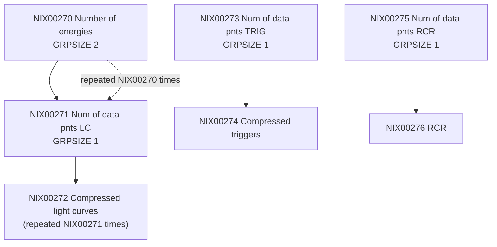
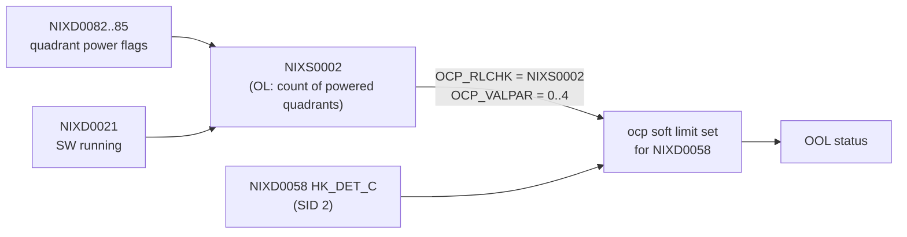
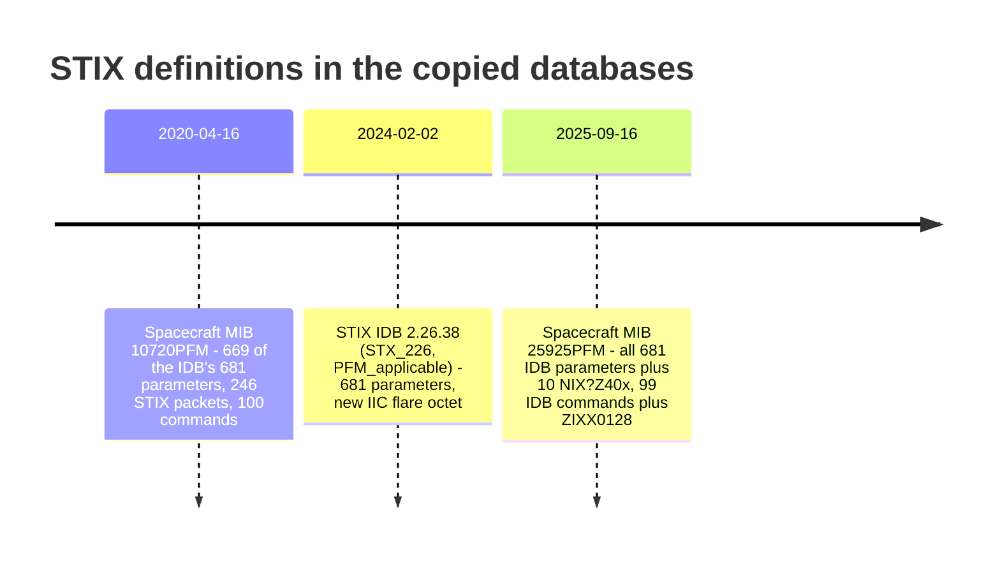

# Solar Orbiter STIX instrument database

STIX is one of the ten Solar Orbiter instruments named in the spacecraft packet ICD; the
Experiment Interface Document expands the acronym as "Spectrometer Telescope Imaging
X-rays".[^eida-acr][^icd-cat] On board it is the application owning **process IDs 90 to 94** and the private **services 236 to 240** of the
spacecraft packet ICD.[^icd-cat][^icd-svc] Its **instrument database (IDB)** - the
instrument's packets, parameters, calibrations and commands written as SCOS-2000
[MIB](../../mib/index.md) tables - is published on a server at FHNW
(`pub099.cs.technik.fhnw.ch`), from which this wiki copied release **2.26.38**.[^reg] An
instrument database uses the same tables as the spacecraft [Solar Orbiter MIB](mib.md); this page analyses
every non-empty table of the copy and checks, row by row, how much of it is in the two copied
spacecraft MIB releases. The same data can be browsed in the
[STIX explorer](../../explorer/index.md#/stix/). The companion page for the SWA
instrument is [Solar Orbiter SWA instrument database](swa.md); the documents that define what an
instrument must provide are on [Solar Orbiter instrument interfaces](instrument-interfaces.md).

!!! info "What was copied"
    | Item | Value |
    |---|---|
    | Library item | [stix-idb-v2-26-38-raw](../../library/stix-idb-v2-26-38-raw.md) |
    | Original URL | `https://pub099.cs.technik.fhnw.ch/data/idb/v2.26.38.raw.zip` |
    | Copied | 2026-11-12 17:45:36 UTC |
    | Size, SHA-256 | 70 526 bytes, `4b627929a521831bcba45c66b24dcec07fdb177ffb008e22442c88dc5261fabf` |
    | Contents | folder `v2.26.38/STIX-IDB-2.26.38/idb/` with 56 `.dat` files (26 non-empty) and a `synthetic/` folder with 3 files; 62 zip entries, all dated 2024-02-02 12:59 or 13:00 |
    | Version record | `STX_226`, comment `PFM_applicable`, domain 105, release 2, issue 26 |
    | Explorer key | `stix`, for example [packet 54103](../../explorer/index.md#/stix/packet/54103) |

    The URL, time, size and hash come from this wiki's source registry;[^reg] the contents, dates
    and the version record were read from the zip directory and the files.[^stix] The `.dat` files
    are TAB-separated with Windows (CR LF) line ends, like the copied SWA databases and unlike the
    Unix format the ICD specifies.[^stix][^i70-ascii]

## Version: one vdf record

The [vdf](../../mib/tables/vdf.md) table names the database version. The ICD defines
`VDF_NAME` as up to 8 characters, a 32-character comment, and a domain identifier, release and
issue number, all three optional; when several records exist, the last one imported names the
database, and the importer cross-checks the domain identifier against its own domain
option.[^i70-vdf] The STIX IDB has exactly one record:[^stix]

| Field | Value | Remark |
|---|---|---|
| `VDF_NAME` | `STX_226` | 7 characters: release 2, issue 26 |
| `VDF_COMMENT` | `PFM_applicable` | the spacecraft MIB release names also carry `PFM` |
| `VDF_DOMAINID` | 105 | same number as the `PCF_SUBSYS` of 673 of the 681 parameters |
| `VDF_RELEASE` / `VDF_ISSUE` | 2 / 26 | |

The third number of the release name, 38, appears only in the folder and zip names; it is not
stated in the available sources what it counts. The two spacecraft MIB releases copied by this
wiki use domain 0 in their `vdf` (`25925PFM` and `10720PFM`).[^mib25][^mib20] Unlike the SWA IDB,
which keeps its 70-version history in `vdf` (see [SWA](swa.md#versions-the-vdf-table-as-a-release-history)),
the STIX file carries no history.

## What the IDB contains

| Family | Table | STIX IDB | Same key in 2025 MIB |
|---|---|---:|---:|
| Version | [vdf](../../mib/tables/vdf.md) | 1 | - |
| Parameters | [pcf](../../mib/tables/pcf.md) | 681 | 681 |
| Packets | [pid](../../mib/tables/pid.md) / [tpcf](../../mib/tables/tpcf.md) / [pic](../../mib/tables/pic.md) | 246 / 246 / 29 | 246 / 246 (177 with the same size) / - |
| Packet layout | [plf](../../mib/tables/plf.md) / [vpd](../../mib/tables/vpd.md) | 927 / 774 | 926 / 452 identical |
| Numerical calibration | [caf](../../mib/tables/caf.md) / [cap](../../mib/tables/cap.md) | 14 / 75 | 14 / 75 |
| Textual calibration | [txf](../../mib/tables/txf.md) / [txp](../../mib/tables/txp.md) | 81 / 379 | 80 (73 identical) / 377 identical |
| Polynomial calibration | [mcf](../../mib/tables/mcf.md) | 7 | 7 |
| Monitoring checks | [ocf](../../mib/tables/ocf.md) / [ocp](../../mib/tables/ocp.md) | 14 / 32 | 14 / 32 identical |
| Synthetic parameters | `synthetic/` files | 3 | 3, identical source |
| Commands | [ccf](../../mib/tables/ccf.md) / [cdf](../../mib/tables/cdf.md) / [cpc](../../mib/tables/cpc.md) | 100 / 1 377 / 669 | 99 / 1 373 identical / 669 |
| Command text calibration | [paf](../../mib/tables/paf.md) / [pas](../../mib/tables/pas.md) | 43 / 149 | 43 (40 identical) / 149 identical |
| TC header | [tcp](../../mib/tables/tcp.md) / [pcpc](../../mib/tables/pcpc.md) / [pcdf](../../mib/tables/pcdf.md) | 1 / 6 / 13 | - |
| Verification | [cvs](../../mib/tables/cvs.md) / [cvp](../../mib/tables/cvp.md) | 4 / 200 | 4 / 198 |
| Mission files | `sw_para` / `pcf_glob_det` | 1 468 / 213 | 1 464 in `ASW_sw_para` / 213 |
| Empty | sequences, parameter sets, `cur`, `lgf`, `cve`, `cca`/`ccs`, `prf`/`prv`, `ptv`, `dst`, all displays and groups, `ssy` | 0 | - |

The counts are from this wiki's queries; "same key" counts rows of the 2025 release with the
same name or SPID, "identical" counts rows equal in every compared field.[^stix][^mib25] The STIX
database has no displays, groups, command sequences, parameter sets or range checks: it defines
the instrument's data and commands only.

### Which ICD issue the files follow

Counting TAB-separated fields per record, `pcf` has 19 fields, `cpc` 13, `ccf` 21, `pic` 6,
`cvs` 6 and `caf` 7.[^stix] Nineteen `pcf` and thirteen `cpc` fields are the layouts of the
Database Import ICD issue 5.1,[^i51] which issue 7.0 still accepts because fields 20 to 23 of
`pcf` are optional.[^i70-pcf] The optional `PIC_APID`, `CVS_UNCERTAINTY` and `CAF_INTER` fields
of issue 7.0 are therefore absent.[^i70-pic][^i70-cvs][^i70-caf] The SWA databases show the same
field counts (see [SWA](swa.md#which-icd-issue-the-files-follow)). See
[History of the Database Import ICD](../../mib/icd-history.md).

??? example "SQL used (contents and version)"
    ```sql
    -- stix-idb-2.26.38.sqlite
    SELECT * FROM vdf;                         -- STX_226 | PFM_applicable | 105 | 2 | 26
    SELECT count(*) FROM pcf;                  -- repeated for every table
    SELECT PCF_SUBSYS, count(*) FROM pcf GROUP BY 1;   -- 105: 673, empty: 8
    -- run with ATTACH 'file:solo-2025-09-16.sqlite?mode=ro' AS m
    SELECT count(*), sum(PCF_NAME IN (SELECT PCF_NAME FROM m.pcf)) FROM main.pcf;   -- 681 | 681
    ```
    Field counts were taken from the `.dat` files inside the zip with a TAB count per line.

## APIDs and packet categories

On Solar Orbiter the 11-bit APID is the 7-bit process ID followed by a 4-bit packet category,
so APID = PID x 16 + CAT.[^icd-tcpkt][^icd-cat] The IDB uses nine telemetry APIDs:[^stix]

| APID | PID / CAT | Category meaning (Annex 8) | Packets | PUS types |
|---:|---|---|---:|---|
| 1441 | 90 / 1 | TC verification | 106 | TM(1,1), (1,2), (1,7), (1,8) |
| 1444 | 90 / 4 | routine housekeeping | 2 | TM(3,25) SIDs 1 and 2 |
| 1447 | 90 / 7 | event generation | 84 | TM(5,1)-(5,4), TM(17,2) |
| 1448 | 90 / 8 | diagnostic | 14 | private services 236-239 |
| 1449 | 90 / 9 | dump | 20 | TM(6,6), TM(6,10) |
| 1451 | 90 / 11 | context | 1 | TM(22,2) |
| 1468 | 91 / 12 | private science | 10 | TM(21,6) X-ray and spectrogram |
| 1500 | 93 / 12 | private science | 8 | TM(21,6) quick-look and calibration |
| 1509 | 94 / 5 | functional cyclic | 1 | TM(3,25) SID 4 (inter-instrument data) |

Every packet sits in a category that Annex 8 of the packet ICD allows for its service: 1
for service 1, 4 for routine TM(3,25), 5 for inter-instrument TM(3,25), 7 for events and
TM(17,2), 8 for the private reports ("private diagnostic packets produced upon Ground request"),
9 for dumps, 11 for service 22 and 12 for science.[^icd-cat][^icd-pi-cat] Annex 8 also offers
category 6 for private fixed-length report packets produced on ground request; STIX does not use
it, while SWA moved its private reports there (see
[Solar Orbiter instrument interfaces](instrument-interfaces.md#apids-the-icd-table-and-the-database)).[^icd-cat][^stix] Process ID 92 is not used;
telecommands go to APID 1452 (PID 90, CAT 12) and one command to APID 796, process 49,
the OBC "payload broadcast" process (see [Commands](#commands)).[^stix][^icd-cat] All 246 packets
have `PID_DFHSIZE` = 16 (the 6-octet packet header plus the 10-octet data field header of Solar
Orbiter telemetry), a packet time field (`PID_TIME` = `Y`), no CRC check (`PID_CHECK` = 0) and no
SCOS-2000 event generation (`PID_EVENT` = `N`); 45 are variable packets with a `vpd`
structure.[^stix][^i70-pid][^icd-tmhdr]

??? example "SQL used (APIDs)"
    ```sql
    SELECT PID_APID, CAST(PID_APID AS INT) >> 4 AS pid, CAST(PID_APID AS INT) & 15 AS cat,
           count(*), group_concat(DISTINCT PID_TYPE || '/' || PID_STYPE)
      FROM pid GROUP BY 1 ORDER BY CAST(PID_APID AS INT);
    SELECT PID_DFHSIZE, PID_TIME, PID_CHECK, PID_TPSD <> '-1', count(*) FROM pid GROUP BY 1, 2, 3, 4;
    ```

## Packet catalogue by PUS type and subtype

SCOS-2000 identifies a packet by APID, type, subtype and up to two extra fields whose position
the [pic](../../mib/tables/pic.md) table gives per type and subtype; each combination has one
`pid` row and one SPID.[^i70-pic][^i70-pid] The STIX `pic` rows place the first identification
field at octet 20 (16 bits, the failure code) for TM(1,2) and TM(1,8), at octet 16 (8 bits, the
SID or SSID) for TM(3,25) and TM(21,6), and at octet 16 (16 bits) for events and memory dumps;
octet 16 is the first octet after the headers.[^stix] The 246 SPIDs run from 54001 to 54365:[^stix]

| Type, subtype | Packets | Identification field | What the packets are |
|---|---:|---|---|
| TM(1,1) / TM(1,7) | 1 / 1 | - | acceptance success, completion success |
| TM(1,2) | 12 | failure ID | acceptance failures: the 8 standard IDs 0-7 and 48000, 48001, 48003, 48023 |
| TM(1,8) | 92 | failure ID | completion failures 48005 to 48463 |
| TM(3,25) | 3 | SID | SID 1 and 2 housekeeping (APID 1444), SID 4 inter-instrument data (APID 1509) |
| TM(5,1) / (5,2) / (5,3) / (5,4) | 25 / 29 / 26 / 3 | event ID | information, warning, error and high-severity events |
| TM(6,6) / TM(6,10) | 19 / 1 | memory ID (TM(6,6) only) | memory dumps per memory, memory check |
| TM(17,2) | 1 | - | connection test report |
| TM(21,6) | 18 | SSID | science data, see below |
| TM(22,2) | 1 | - | context report |
| TM(236,16), (236,19) | 2 | - | subsystem configuration report, FDIR parameter report |
| TM(237,12), (237,20) | 2 | - | start-up software (SuSW) and application software (ASW) parameter reports |
| TM(238,3), (238,7) | 2 | - | archive memory user data selections, filesystem check report |
| TM(239,3), (239,6), (239,8), (239,10), (239,12), (239,14), (239,18), (239,21) | 8 | - | ASIC temperature, on-demand ASIC ADC readout, ASIC baseline, channel dark current, threshold scan, ASIC ADC read, ASIC register read, stored attenuator data |

The private service types 236-239 are all within the range 236-240 that the packet ICD reserves for
STIX; service 240 is not used.[^icd-svc][^stix] The `pic` table also defines TM(239,16), for which
no packet exists.[^stix] Each failure code and each event ID is its own packet, which is why
service 1 (106 packets) and service 5 (83) make up 189 of the 246 definitions; the general mechanism is explained
on [How Solar Orbiter uses PUS](pus-usage.md#how-the-mib-sees-a-pus-packet).

### Failure codes and event IDs against the mission allocation

Annex 9 of the packet ICD reserves failure IDs 0 to 500 for standard codes (0 illegal APID, 1
incomplete or invalid length, 2 wrong CRC, 3 illegal type, 4 illegal subtype, 5 illegal or
inconsistent data, 6 illegal segment sequence flag, 7 illegal MAP ID) and gives STIX the
block 48000 to 48999.[^icd-fid] STIX follows this: its TM(1,2) packets use the eight standard
codes and its own codes start at 48000 (for example 48018 "Invalid HK data report period in
TC(3,129)", 48035 "No Timecode within 2s after TC(9,129)").[^stix] One description differs from
the allocation: STIX's code 7 reads "Illegal segment sequence flag", the meaning the annex gives
to code 6, where the annex assigns 7 to an illegal MAP ID.[^stix][^icd-fid]

For events the annex splits the 16-bit event ID by severity, the first two bits giving the
report subtype (`0x0000`-`0x3FFF` for TM(5,1), `0x4000` for (5,2), `0x8000` for (5,3), `0xC000`
for (5,4)), and each quarter into boot software, general application, specific application,
"unexpected SW and HW errors", monitoring, OBCP and ESOC ranges; the annex makes this
applicable to the central software and optional for other software.[^icd-eid] All 83 STIX event
IDs respect both the severity bits and the ranges:[^stix]

| Subtype | IDs | Boot SW | General application | Unexpected SW/HW errors | Monitoring |
|---|---|---:|---:|---:|---:|
| TM(5,1) | `0x0001`-`0x14A3` | 4 | 6 | 14 | 1 (`0x14A3` "FDIR protection enabled") |
| TM(5,2) | `0x4001`-`0x5446` | 2 | - | 27 | - |
| TM(5,3) | `0x8001`-`0x9450` | 2 | 3 | 21 | - |
| TM(5,4) | `0xC001`-`0xD421` | 1 | - | 2 | - |

The three high-severity events are requests to the spacecraft: execute a nominal sequence
(`0xC001`), power down immediately (`0xD420`) and power cycle after an SDRAM initialisation
time-out (`0xD421`).[^stix]

??? example "SQL used (catalogue, failure and event IDs)"
    ```sql
    SELECT PID_TYPE, PID_STYPE, count(*) FROM pid GROUP BY 1, 2
     ORDER BY CAST(PID_TYPE AS INT), CAST(PID_STYPE AS INT);
    SELECT * FROM pic ORDER BY CAST(PIC_TYPE AS INT), CAST(PIC_STYPE AS INT);
    SELECT PID_SPID, PID_PI1_VAL, PID_DESCR FROM pid WHERE PID_TYPE = '1' ORDER BY 2;
    SELECT PID_STYPE, CASE
             WHEN (v & 16383) BETWEEN 1 AND 31 THEN 'boot'
             WHEN (v & 16383) BETWEEN 32 AND 1055 THEN 'general'
             WHEN (v & 16383) BETWEEN 5152 AND 5279 THEN 'unexpected'
             WHEN (v & 16383) BETWEEN 5280 AND 13471 THEN 'monitoring' END, count(*)
      FROM (SELECT PID_STYPE, CAST(PID_PI1_VAL AS INT) v FROM pid WHERE PID_TYPE = '5')
     GROUP BY 1, 2;
    ```

### Housekeeping and the inter-instrument packet

SID 1 (SPID 54101) and SID 2 (SPID 54102) carry the instrument housekeeping: software running
(ASW or SuSW), instrument mode, DPU temperatures, currents and voltages, CPU load, SpaceWire
counters and FDIR status (with per-channel FDIR masks and TC/TM counters in SID 1); SID 2 adds
detector quadrant temperatures, high-voltage and attenuator status, aspect-system photodiode
voltages and filesystem statistics.[^stix] SID 2 also reports `NIXD0077` "TC(20,128) seq cnt"
(octet 88), which follows the packet ICD's recommendation that payloads report the sequence
count of the last TC(20,128) they received.[^stix][^icd-s20] Their `plf` layouts end at octet 59 (last parameter, 16
bits, at octet 57) and octet 109 (32 bits at octet 105), but their `tpcf` sizes are 46 and 105;
the 2025 spacecraft MIB has 59 and 109.[^stix][^mib25] The ICD defines `TPCF_SIZE` as the total
SCOS-2000 packet length (recommended to include the 64- or 76-byte SCOS-2000 packet header), not
imported into the run-time database nor used by any SCOS-2000 process, so the mismatch does not
affect telemetry processing; if a mission uses the field to configure its history files, a size
smaller than the real packet still files correctly, only more slowly.[^i70-tpcf]

SID 4 is the STIX contribution to on-board inter-instrument communication. The note
SOL-SGS-TN-0007 asks STIX for a TM(3,25) with PID 94, CAT 5 and SID 4 at 1 Hz, carrying 16 octets
for distribution: a 4-octet heartbeat copied from the OBT coarse time, thermal and non-thermal
flare indices and a location status in one octet, signed Z and Y flare locations in arcminutes,
a 4-octet flare duration, a 4-octet attenuator motion flag and a spare octet.[^tn7-stix] The
IDB packet `YIX54103` (SPID 54103, APID 1509, 33 octets) implements exactly this layout:[^stix]

<div class="bitfield" data-title="STIX SID 4 inter-instrument data (SPID 54103, APID 1509): source data after the 16 header octets, 136 bits" data-width="16"
     data-fields='[{"n":"SID (NIX00020)","b":8,"v":"00000100","d":"Octet 16, PTC 3 PFC 4"},{"n":"Heartbeat (NIX00059)","b":32,"d":"Octet 17, PTC 3 PFC 14: OBT coarse time"},{"n":"Thermal flare idx (NIXD0505)","b":3,"d":"Octet 21 bit 0, PTC 2 PFC 3, text CIXT0061TM"},{"n":"Non-thermal idx (NIXD0506)","b":2,"d":"Octet 21 bit 3, text CIXT0060TM"},{"n":"Location status (NIXD0507)","b":2,"d":"Octet 21 bit 5, text CIXT0059TM"},{"n":"Spare","b":1,"d":"Not defined in the IDB; spare in TN-0007"},{"n":"Z location (NIX00283)","b":8,"d":"Octet 22, PTC 4 PFC 4: signed, arcmin"},{"n":"Y location (NIX00284)","b":8,"d":"Octet 23, PTC 4 PFC 4: signed, arcmin"},{"n":"Flare duration (NIX00063)","b":32,"d":"Octet 24, PTC 3 PFC 14: seconds since flare start"},{"n":"Attenuator motion flag (NIXD0064)","b":32,"d":"Octet 28, PTC 3 PFC 14, text CAAT0033TM False/True"},{"n":"Filler (ZZPAD008)","b":8,"d":"Octet 32"}]'></div>

The octet offsets, bit offsets and types are the `plf` and `pcf` entries; octet 21 is also
defined as the 8-bit container `NIXG0021`.[^stix] In the SCOS-2000 code table PTC 4 PFC 4 is an
8-bit signed integer and PTC 3 PFC 14 a 32-bit unsigned integer.[^i70-ptc] The OBC copies these
16 octets into octets 191 to 206 of the TC(20,128) it distributes to the instruments.[^tn7-61]

The packet changed between the copied releases. In the April 2020 spacecraft MIB the flare
octet held the location status at bit 1, the non-thermal index at bit 3 and a 3-bit thermal
index at bit 5 (`NIXD0059`-`NIXD0061`), the attenuator flag was a single bit at octet 28 and a
32-bit filler followed at octet 29; the IDB moves the thermal index to bits 0-2, the location
status to bits 5-6, makes the motion flag a 32-bit word, and introduces the new names
`NIXD0505`-`NIXD0507` and `NIXG0021`, so it now matches the TN-0007 byte table.[^mib20][^stix][^tn7-stix]
The old names stay in the IDB: `NIXG0020` and `NIXD0059`-`NIXD0061` (now described as "QL") are
the flare fields of the quick-look packet 54122 "Flare flag and location".[^stix]
The 2025 MIB keeps the IDB layout but omits the final `ZZPAD008` entry; the packet size stays
33 octets in all three databases.[^mib25][^mib20] Browse it as
[packet 54103](../../explorer/index.md#/stix/packet/54103).

### Memory dumps and memory IDs

Each of the 19 TM(6,6) packets is identified by its memory ID: `0xD000`-`0xD004` and
`0xD011`/`0xD012`/`0xD021`/`0xD022` for the main unit's EEPROM, SRAM, SDRAM, two flash memories
and four application-software image slots, the same values with `0xD1` for the redundant unit,
and `0xDF00` for full memory access.[^stix] The packet ICD allocates the memory IDs `0xD0--` and
`0xD1--` to STIX, and its basic rules, for cross-access between redundant units, give unit B the
unit A ID plus 256 (most significant byte 1), which is the main/redundant pattern seen
here.[^icd-mem] The same 19 values form the textual calibration
`CIXT0014TM` "Memory ID".[^stix]

### Science packets

All STIX science travels as TM(21,6), the variable-length science packet with a structure
identifier (SSID) in its first octet followed by fixed parameters and counted repeating
blocks.[^icd-s21] The 18 SSIDs split over two APIDs:[^stix]

| APID | SSIDs | Products |
|---|---|---|
| 1468 (PID 91) | 10-14, 20-24 | X-ray levels L0 to L3 and spectrogram, each "auto" (10-14) and "user" requested (20-24) |
| 1500 (PID 93) | 30-34, 41-43 | quick-look summed light curves, background monitor, detector-specific spectra, variance, flare flag and location, background spectrum for calibration, aspect, TM management status and flare list |

These packets are defined in `vpd`, which lists the parameters in order and lets a parameter
repeat the next `VPD_GRPSIZE` entries a number of times equal to its own value; groups may be
nested, and `VPD_OFFSET` moves a parameter's start relative to the end of the previous one, a
negative offset making two parameters overlap.[^i70-vpd] STIX uses both features. The
quick-look light-curve packet (SPID 54118) starts with SSID, SCET coarse and fine time,
integration duration and detector mask, then the 16-bit `NIXG0404` "SSID global 3" immediately
followed by `NIXD0407` "Pixel mask 1" with offset -12, so the 12-bit mask is read from the last
12 bits (bits 4 to 15) of the word just read; later, "Number of energies" (`NIX00270`) repeats a 2-entry group
whose first entry, "Num of data pnts LC", itself repeats the compressed light-curve values.[^stix]



The diagram shows positions 18-24 of SPID 54118 as defined in `vpd`.[^stix] Of the 45 variable
packets, 38 have `TPCF_SIZE` 0 and 7 have 19, although the ICD recommends 0 for truly variable
packets; three fixed packets (54127, 54138, 54292) also have size 0.[^stix][^i70-tpcf]

??? example "SQL used (housekeeping, IIC, dumps, science)"
    ```sql
    SELECT l.PLF_NAME, c.PCF_DESCR, l.PLF_OFFBY, l.PLF_OFFBI, c.PCF_PTC, c.PCF_PFC, c.PCF_CURTX
      FROM plf l JOIN pcf c ON c.PCF_NAME = l.PLF_NAME
     WHERE l.PLF_SPID = '54103' ORDER BY CAST(PLF_OFFBY AS INT), CAST(PLF_OFFBI AS INT);
    -- same query on solo-2020-04-16.sqlite and solo-2025-09-16.sqlite for the comparison
    SELECT PID_SPID, printf('0x%04X', CAST(PID_PI1_VAL AS INT)), PID_DESCR
      FROM pid WHERE PID_TYPE = '6' ORDER BY CAST(PID_PI1_VAL AS INT);
    SELECT PID_APID, PID_PI1_VAL, PID_DESCR FROM pid WHERE PID_TYPE = '21';
    SELECT v.*, p.PCF_DESCR FROM vpd v JOIN pcf p ON p.PCF_NAME = v.VPD_NAME
     WHERE VPD_TPSD = '54118' ORDER BY CAST(VPD_POS AS INT);
    SELECT p.PID_TPSD <> '-1', t.TPCF_SIZE, count(*) FROM tpcf t JOIN pid p ON p.PID_SPID = t.TPCF_SPID
     GROUP BY 1, 2;
    ```

## Parameters

The 681 parameters are named by the Solar Orbiter convention: `N` for a monitoring parameter, a
second letter `I` for instrument and `X` for STIX, as on the spacecraft MIB's
[name prefix table](mib.md#name-prefixes).[^mib25] Within the IDB:[^stix]

| Prefix | Count | Meaning in the data |
|---|---:|---|
| `NIX0` | 397 | ordinary parameters (counters, temperatures, science fields) |
| `NIXD` | 214 | "detail" fields: bits or bit groups of a larger word |
| `NIXG` | 63 | "global" container words |
| `NIXS` | 3 | synthetic parameters (`PCF_NATUR` = `D`) |
| `ZZPA` | 4 | fillers `ZZPAD008`, `ZZPAD016`, `ZZPAD024`, `ZZPAD032` |

The mission file `pcf_glob_det` relates 62 global words to 213
details in three columns. In every one of the 92 rows where both parameters appear in the same
fixed packet, the third column equals the detail's bit position measured from the start of its
global word, (detail octet - global octet) x 8 + detail bit - global bit; for example `NIXG0001`
holds `NIXD0304` "EDAC reason for reboot" at bit 0, `NIXD0302` "WDT reason for reboot" at bit 2
and `NIXD0303` "Currently running IDPU" at bit 7.[^stix] Only `NIXD0064` is not a detail, and
only `NIXG0064` is not a global; both belong to the 1-bit attenuator flag of the 2020 layout.[^stix][^mib20]

| PTC / PFC | Type (SCOS-2000 table) | Parameters |
|---|---|---:|
| 3 / 4, 3 / 12, 3 / 14 | 8-, 16-, 32-bit unsigned | 162, 134, 101 |
| 3 / 8, 3 / 2, 3 / 6, 3 / 13, 3 / 1, 3 / 0, 3 / 10 | 12-, 6-, 10-, 24-, 5-, 4-, 14-bit unsigned | 40, 33, 24, 20, 13, 2, 1 |
| 2 / 1 to 2 / 32 | enumerated, 1 to 32 bits | 124 |
| 1 / 0 | Boolean, 1 bit | 18 |
| 4 / 4 | 8-bit signed | 4 |
| 7 / 6, 7 / 12 | fixed 6- and 12-octet strings | 3, 1 |
| 9 / 17 | absolute time, CUC 6 octets | 1 |

The type names are those of the ICD's Appendix A.[^i70-ptc][^stix] 576 parameters are numerical
and 105 status (`PCF_CATEG`), 678 are raw telemetry and 3 synthetic; 157 have a
calibration, 23 have the unit `V`, 20 `degC`, 6 `mA`; none uses a validity parameter
(`PCF_VALID` is empty everywhere).[^stix] Seventeen parameters appear in no packet: the three
synthetics, three fillers, the unused globals `NIXG0013` and `NIXG0064`, and nine others such as
`NIX00060` "Flare Message" and `NIX00309` "Flare strength".[^stix]

Explore, for example, [`NIXD0058` HK_DET_C](../../explorer/index.md#/stix/param/NIXD0058) or
[`NIX00059` heartbeat](../../explorer/index.md#/stix/param/NIX00059).

??? example "SQL used (parameters)"
    ```sql
    SELECT substr(PCF_NAME, 1, 4), count(*) FROM pcf GROUP BY 1 ORDER BY 2 DESC;
    SELECT PCF_PTC, PCF_PFC, count(*) FROM pcf GROUP BY 1, 2 ORDER BY 3 DESC;
    SELECT PCF_CATEG, PCF_NATUR, count(*) FROM pcf GROUP BY 1, 2;
    -- bit offset check of pcf_glob_det (92 of 92 rows match)
    SELECT count(*), sum(EXISTS (SELECT 1 FROM plf a JOIN plf b ON a.PLF_SPID = b.PLF_SPID
             WHERE a.PLF_NAME = g.COL1 AND b.PLF_NAME = g.COL2
               AND (CAST(b.PLF_OFFBY AS INT) - CAST(a.PLF_OFFBY AS INT)) * 8
                   + CAST(b.PLF_OFFBI AS INT) - CAST(a.PLF_OFFBI AS INT) = CAST(g.COL3 AS INT)))
      FROM pcf_glob_det g
     WHERE EXISTS (SELECT 1 FROM plf a JOIN plf b ON a.PLF_SPID = b.PLF_SPID
                    WHERE a.PLF_NAME = g.COL1 AND b.PLF_NAME = g.COL2);
    SELECT PCF_NAME, PCF_DESCR FROM pcf
     WHERE PCF_NAME NOT IN (SELECT PLF_NAME FROM plf) AND PCF_NAME NOT IN (SELECT VPD_NAME FROM vpd);
    ```

## Calibrations

| Kind | Tables | Definitions | Parameters using them | Examples |
|---|---|---:|---:|---|
| Numerical (interpolated curves) | `caf` / `cap` | 14 / 75 points | 42 | `CIXP0024TM` "Temperature Sensors" (degC, used by 20 parameters), `CIXP0025TM` "PSU DPU 1V5 Current" (mA) |
| Polynomial | `mcf` | 7 | 10 | `CIX00035TM` HK_DPU_1V5_V with A1 = 0.000735043, `CIX00040TM` "Scaling by 15.2588", `CIX00041TM` "CPU scaling" (A1 = 4) |
| Textual, STIX-specific | `txf` / `txp` | 45 `CIXT...` | 68 | `CIXT0023TM` instrument mode, `CIXT0120TM` SSID names |
| Textual, generic | `txf` / `txp` | 36 `CAAT...` | 37 | `CAAT0001TM` Off_On, `CAAT0021TM` Still_Moving, `CAAT0033TM` False_True |

The figures are from the IDB.[^stix] The 36 `CAAT` textual calibrations are not STIX-specific:
the 2025 spacecraft MIB has 36 of them and uses them for parameters of many subsystems (1 096 `NRU`
parameters alone); the IDB has the same set except that it contains `CAAT0008TM`, which no
STIX parameter uses and the 2025 MIB lacks, and lacks `CAAT1008TM` "OBCP_boolean".[^stix][^mib25]
How the ICD defines these tables is on [Calibration in the MIB](../../mib/calibration.md).

The textual calibrations give the instrument's state model:[^stix]

| Calibration | Values |
|---|---|
| `CIXT0023TM` instrument mode | 0 LIKELY_BOOT, 1 BOOT, 2 SAFE, 3 MAINTENANCE, 4 CONFIGURATION, 5 NOMINAL |
| `CIXT0024TM` mode transition reason | 0 TC_TRANSITION, 1 AUTO_NOMINAL, 2 AUTO_FAILURE |
| `CIXT0021TM` software running | 0 ASW, 1 SuSW |
| `CIXT0057TM` StartASW state machine | 0 INIT, 1 BOOTVALID, 2 BOOTINVALID, 3 AUTOLOAD, 4 AUTOEXECUTE, 5 IDLE, 6 LOAD, 7 EXE, 8 SAVE, 9 EXECUTEASW |
| `CIXT0208TM` system ID | 1 IDPU, 2 DETECTORS, 3 ASPECT SYSTEM, 4 ATTENUATOR, 5 PSU |

The available sources list these modes, reasons and states but not the transitions allowed
between them.

## Monitoring checks and the three synthetic parameters

Fourteen housekeeping parameters - DPU, SpaceWire, detector and attenuator currents and the DPU,
reference, SpaceWire link, high and attenuator voltages - have [monitoring checks](../../mib/monitoring-checks.md),
all on raw values (`OCF_INTER` = `U`, `OCF_CODIN` = `I`) and all to be confirmed by one sample
(`OCF_NBCHCK` = 1).[^stix] An `ocp` check applies only when its applicability parameter
(`OCP_RLCHK`) is valid and equals `OCP_VALPAR`; checks are tried in order and the search stops at
the first applicable check or soft/hard pair, unless the system is configured to apply all of
them.[^i70-ocp] STIX uses this to change limits with the instrument configuration, and the three
**synthetic parameters** exist only to provide those applicability values. Each is a dynamic OL
parameter (`PCF_NATUR` = `D`), whose source is an ASCII file named after the parameter in the
`synthetic/` folder, evaluated by SCOS-2000 when a contributing parameter changes.[^i70-synth][^stix]

| Synthetic | Description | Returns (from `CIXTS00xTM`) | Computed from |
|---|---|---|---|
| [`NIXS0001`](../../explorer/index.md#/stix/param/NIXS0001) | DPU_SPW_C criter | 0 ASW_SpW_Off, 1 ASW_Single_SpW, 2 ASW_Both_SpW, 3 SuSW_Limits | 3 if `NIXD0021` (software running) is 1 (SuSW), else the sum of the two SpaceWire power flags `NIXD0080` + `NIXD0081` |
| [`NIXS0002`](../../explorer/index.md#/stix/param/NIXS0002) | DPU_DET_C criter | 0 NOT_POWERED, 1Q, 2Q, 3Q, 4Q | 0 in SuSW, else the number of powered detector quadrants `NIXD0082`-`NIXD0085` |
| [`NIXS0003`](../../explorer/index.md#/stix/param/NIXS0003) | ATT_C criteria | 0, 1 or 2 motors | 0 in SuSW, else the number of moving attenuator motors `NIXD0088` + `NIXD0089` |

The OL files use `if ... then ... else ... endif`, `return(...)`, local variables
(`VAR_spw := NIXD0081.raw+NIXD0080.raw;`) and the `.raw` view of parameters.[^stix] All three
return 8-bit enumerated values with a textual calibration.[^stix] See
[Synthetic parameters and the OL language](../../mib/synthetic-parameters.md).

The limits of the detector current `NIXD0058` (HK_DET_C, mA) then follow the number of
powered quadrants:[^stix]

| `OCP_POS` | Type | Raw low | Raw high | Applies when |
|---:|---|---:|---:|---|
| 1 | soft | 0 | 80 | `NIXS0002` = 0 (not powered) |
| 2 | soft | 0 | 188 | `NIXS0002` = 1 |
| 3 | soft | 19 | 310 | `NIXS0002` = 2 |
| 4 | soft | 39 | 433 | `NIXS0002` = 3 |
| 5 | soft | 59 | 555 | `NIXS0002` = 4 |
| 6 | hard | 0 | 546 | always (no applicability parameter) |



The same pattern selects the SpaceWire current limits of `NIXD0030` by `NIXS0001` (positions
1-4) and the attenuator current limits of `NIXD0075` by `NIXS0003`, while the DPU 1.5 V current
`NIXD0029` switches its limits directly on `NIXD0021` (ASW or SuSW) and the SpaceWire link
voltages `NIXD0031`/`NIXD0032` on the link power flags.[^stix]

!!! warning "Inference"
    By the ICD's stop-at-first rule, the hard check at position 6 of `NIXD0058` is reached only
    when none of the five soft checks applies, which happens only if `NIXS0002` is invalid or
    outside 0-4, because a soft check followed by a soft check with a different criterion is
    not a soft/hard pair.[^i70-ocp] The same holds for the trailing hard checks of `NIXD0029`
    and `NIXD0030`. For `NIXD0075` the order is soft (0 motors), soft (1 motor), hard (no
    criterion), soft (2 motors): with two motors moving, the search would stop at the hard check
    and the 2-motor soft limits (raw 28-870) would never be used. Whether ESOC configures
    SCOS-2000 to apply all applicable checks (the global option the ICD mentions) is not stated
    in the available sources. Note also that for four quadrants the hard high limit of
    `NIXD0058` (546) is below the soft one (555).

??? example "SQL used (checks and synthetics)"
    ```sql
    SELECT o.*, p.PCF_DESCR, p.PCF_UNIT FROM ocf o JOIN pcf p ON p.PCF_NAME = o.OCF_NAME;
    SELECT * FROM ocp ORDER BY OCP_NAME, CAST(OCP_POS AS INT);
    SELECT * FROM synthetic;                       -- the three OL sources
    SELECT * FROM txp WHERE TXP_NUMBR LIKE 'CIXTS%';
    ```

## Commands

### The TC packet header

The IDB defines one TC header, `NOM_TC` "STANDARD TC PKT", whose 13 [pcdf](../../mib/tables/pcdf.md)
elements give the packet header and the 4-octet PUS data field header bit by bit:[^stix]

<div class="bitfield" data-title="STIX NOM_TC header (pcdf), 80 bits" data-width="16"
     data-fields='[{"n":"Version","b":3,"v":"000","d":"F, fixed 0"},{"n":"Type","b":1,"v":"1","d":"F, fixed 1 (TC)"},{"n":"DFH flag","b":1,"v":"1","d":"F, fixed 1"},{"n":"APID","b":11,"d":"A: from CCF_APID (1452 or 796)"},{"n":"Seg. flags","b":2,"v":"11","d":"F, fixed 3 (stand-alone)"},{"n":"Sequence count","b":14,"d":"P: set by SCOS-2000 (SSC)"},{"n":"Packet length","b":16,"d":"P: set by SCOS-2000 (LENGTH)"},{"n":"CCSDS SHF","b":1,"v":"0","d":"F, fixed 0"},{"n":"PUS version","b":3,"v":"001","d":"F, fixed 1"},{"n":"Ack","b":4,"d":"K: from CCF_ACK (9 for all STIX commands)"},{"n":"Service type","b":8,"d":"T: from CCF_TYPE"},{"n":"Service subtype","b":8,"d":"S: from CCF_STYPE"},{"n":"Source ID","b":8,"v":"00000000","d":"F, fixed 0"}]'></div>

The element types `F`, `A`, `P`, `K`, `T` and `S` mean a fixed value, the command's APID, a
value set by the command subsystem, and the acknowledgement flags, type and subtype taken from
`ccf`.[^i70-pcdf] The layout is the spacecraft ICD's: 3-bit version 0, type 1, header flag 1, a
14-bit count and stand-alone sequence flags `0b11`, a non-CCSDS secondary header with PUS version
1, and acknowledgement bits for acceptance (least significant) and completion (most
significant).[^icd-tcpkt][^icd-tcdfh] `CCF_ACK` = 9 = `0b1001` asks for both reports for every
STIX command.[^stix][^i70-ack] The STIX header fixes the source ID to 0, whereas the packet ICD
reserves ground source IDs 110-113, 120 (direct commands) and the spares 121-122, and the SWA IDB fixes 120; the 2025
spacecraft MIB's own `NOM_TC` uses an element of type `O` for it, a type that the ICD issue 7.0
list (`F`, `A`, `T`, `S`, `K`, `P`) does not define.[^stix][^icd-src][^mib25][^i70-pcdf]

### Commands by service

| Service | Commands | Subtypes | Examples |
|---|---:|---|---|
| 3 housekeeping | 3 | 5, 6, 129 | enable/disable HK report, update HK period |
| 6 memory management | 4 | 2 (two variants), 5, 9 | `ZIX0602A`/`ZIX0602B` load memory, dump, check |
| 9 time | 1 | 129 | `ZIX09129` accept time synchronisation (one 9/17 time parameter) |
| 17 test | 1 | 1 | connection test |
| 20 information distribution | 1 | 128 | `ZIX20128` on APID 796 |
| 21 science transfer | 3 | 1, 2, 128 | enable/disable transfer to the SSMM (32-bit SSID mask), reset output buffer |
| 22 context | 2 | 1, 3 | request context, accept context |
| 236 instrument management | 25 | 1-15, 17, 18, 20 | mode transition, warm reset, ASW image load/execute/save, subsystem power, eight configuration variants of TC(236,6), FDIR |
| 237 parameters and data processing | 41 | 1-11, 13-19 | SuSW/ASW parameter load and report, calibration accumulation, 24 look-up-table uploads TC(237,7), QL, rate-control and compression parameters |
| 238 archive memory | 7 | 1, 2, 4, 5, 6, 8, 10 | select data for download, free data, filesystem check, aspect burst data |
| 239 detectors | 12 | 1, 2, 4, 5, 7, 9, 11, 13, 15, 17, 19, 20 | ASIC reset, temperature, baseline, dark current, threshold scan, test pulses, register read/write |

The names given to services 236-239 in the first column summarise the IDB command descriptions;
the packet ICD calls 236-240 only "STIX Private Services".[^stix][^icd-svc]
All 100 commands are named `ZIX` + five characters and belong to subsystem 105; none is flagged
critical (`CCF_CRITICAL` is `N` for 96 and empty for 4).[^stix] Ninety-nine go to APID 1452; `ZIX20128` alone goes to APID 796, PID 49 with
category 12, which the packet ICD names the OBC payload broadcast process and the process
addressed by TC(20,128).[^stix][^icd-cat][^icd-s20] Its 11 elements describe the whole 236-octet
data field that the OBC sends, in TN-0007 order: platform data (36 octets), EPD (30), EUI (23),
MAG (20), METIS (20), PHI (14), RPW (33), SoloHI (14), STIX (16, at bit 1520), SWA (16) and
SPICE (14).[^stix][^tn7-61] Like every STIX command, `ZIX20128` has `CCF_ACK` 9 and the fixed
source ID 0 of `NOM_TC`, whereas the packet ICD describes the on-board TC(20,128) with Ack = 0 (no
TM(1,1) or TM(1,7) from the payloads) and source ID 14 (system control); the 2025 MIB also keeps
`CCF_ACK` 9.[^stix][^icd-s20][^mib25]

The 669 command parameters (all `PIX...`) are 585 unsigned integers (PTC 3), 71 enumerated, 11
fixed octet strings, one signed integer and one CUC time; 24 have a textual
calibration through [paf](../../mib/tables/paf.md)/[pas](../../mib/tables/pas.md) and the rest are
numerical without calibration; there are no range checks.[^stix] For TC(236,1) "Mode transition",
`PIX00080` "Operation mode" offers BOOT (1), SAFE (2), MAINTENANCE (3), CONFIGURATION (4),
NOMINAL (5) and ILLEGAL_MODE (6), and `PIX00081` MANUAL_NOMINAL (0) or AUTO_NOMINAL (1); the
largest commands are the QL and compression parameter updates TC(237,9) and TC(237,11), with
112 and 106 elements.[^stix]

!!! example "Worked example: TC(236,1) to NOMINAL, manual (illustrative bytes)"
    Using the IDB definitions - APID 1452, `NOM_TC`, `CCF_ACK` 9, sequence count 0 chosen for
    the example, application data `PIX00080` = 5 and `PIX00081` = 0 - the packet is
    `1D AC C0 00 00 07 19 EC 01 00 05 00 92 D3`: `0x1DAC` = version 0, TC, header flag, APID
    1452; `0xC000` = stand-alone, count 0; length 7 (8 octets of data field minus one); `0x19`
    = PUS version 1 with ack `0b1001`; type 236 (`0xEC`), subtype 1, source ID 0; mode 5,
    transition 0; and the CRC-16 `0x92D3`, computed with the spacecraft ICD's CCITT algorithm
    (which gives `0x1D0F` for `00 00`, as the ICD's test vector).[^stix][^icd-crc]
    These bytes are constructed for explanation, not taken from a real command history.
    Browse the command as [ZIX36001](../../explorer/index.md#/stix/command/ZIX36001).

### Verification stages

Four [cvs](../../mib/tables/cvs.md) stages, all report-based (`CVS_SOURCE` = `R`) and opening
immediately (`CVS_START` 0), cover all 100 commands through 200 [cvp](../../mib/tables/cvp.md)
rows - one acceptance and one completion stage each:[^stix]

| `CVS_ID` | Stage | `CVS_INTERVAL` | Used by |
|---:|---|---:|---|
| 54001 | acceptance | 20 s | all 100 commands |
| 54002 | completion | 60 s | 82 commands |
| 54003 | completion | 1 800 s | `ZIX36003` load ASW image to RAM, `ZIX36014` execute ASW image |
| 54004 | completion | 9 999 s | 16 long operations: memory loads, mode transition, self-test, ASW save, RAM test, calibration accumulation, LUT apply, TM corridor limit, freeing archive data, threshold scan, test pulses, ASIC register read/write |

`CVS_START` and `CVS_INTERVAL` are in seconds, the interval being the sampling interval from
which SCOS-2000 computes the verification window; `CVS_SPID` is filled although the ICD allows it
only for parameter-based stages (`CVS_SOURCE` = `V`) and calls it irrelevant for report-based ones.[^i70-cvs][^stix] See
[Command verification in the MIB](../../mib/command-verification.md) and
[stage 54004 in the explorer](../../explorer/index.md#/stix/verif/54004).

??? example "SQL used (commands)"
    ```sql
    SELECT * FROM tcp; SELECT * FROM pcpc; SELECT * FROM pcdf;
    SELECT CCF_TYPE, count(*), group_concat(DISTINCT CCF_STYPE) FROM ccf GROUP BY 1;
    SELECT CCF_APID, CCF_ACK, count(*) FROM ccf GROUP BY 1, 2;
    SELECT d.*, p.CPC_DESCR, p.CPC_PTC, p.CPC_PFC, p.CPC_PAFREF FROM cdf d
      LEFT JOIN cpc p ON p.CPC_NAME = d.CDF_PNAME
     WHERE CDF_CNAME IN ('ZIX36001', 'ZIX20128') ORDER BY CDF_CNAME, CAST(CDF_BIT AS INT);
    SELECT * FROM pas WHERE PAS_NUMBR IN ('CIXT0080TC', 'CIXT0081TC');
    SELECT * FROM cvs; SELECT CVP_CVSID, count(*) FROM cvp GROUP BY 1;
    ```

## Mission-specific files

Two files are not ICD tables. `pcf_glob_det` is described above. `sw_para` has 1 468 rows of
three columns: a name, an always empty second column and a description. 653 names are
monitoring parameters, 485 command parameters (`PIX`), 226 packet mnemonics (`YIX`, the
`TPCF_NAME` values) and 100 commands; four rows hold 8-character text fragments ("(1...inv",
"0...not", "The auto", "This rep") rather than names.[^stix] The spacecraft release has the file
as `ASW_sw_para`, with the same three columns; 1 464 of the 1 468 STIX names are in it (all but
the four fragments).[^mib25] Twenty-four `NIX` parameters are not listed in `sw_para`.[^stix]

## How the IDB relates to the spacecraft MIB

Comparing names and definitions with the two copied spacecraft releases:[^stix][^mib25][^mib20]

| Object | STIX IDB | In 2020 MIB | In 2025 MIB | Notes on 2025 |
|---|---:|---:|---:|---|
| Parameters (`PCF_NAME`) | 681 | 669 | 681 | description, PTC/PFC, category, nature, calibration and subsystem identical for all 681; 10 units differ (IDB has `S`, `%` or `V`, MIB none); `PCF_DARC` = 1 added for 300 |
| Packets (`PID_SPID`) | 246 | 246 | 246 | APID, type, subtype, identification value, description and `PID_TPSD` identical; `TPCF_SIZE` differs for 69 (for example SID 1 46 → 59, TM(1,1) 22 → 20, seven variable science packets 19 → 0), while the 2020 sizes equal the IDB's |
| Fixed layout (`plf`) | 927 | 915 identical | 926 identical | only `ZZPAD008` of SPID 54103 missing |
| Variable layout (`vpd`) | 774 | 709 identical | 452 identical | 13 science packets have one extra entry each in 2025, which shifts the `VPD_POS` of every later entry |
| Commands (`CCF_CNAME`) | 100 | 100 | 99 | `ZIX09129` absent; `ZIXX0128` added |
| Command elements (`cdf`) | 1 377 | 1 370 identical | 1 373 identical | `ZIX20128` reordered |
| Checks, calibrations, synthetics, verification | 14 / 32, 14 + 7 + 81, 3, 4 / 200 | 32 `ocp` identical, synthetics identical | `ocp` identical, 80 `txf`, synthetics identical, 198 `cvp` | |
| `pcf_glob_det` | 213 | 202 identical (of 204 `NIX` rows) | 213 identical | 2025 has 5 more rows |

The STIX names all carry over, which answers the question whether the instrument's parameters
are in the spacecraft MIB: every one of the 681 is there with the same type and calibration.[^mib25]
The differences are few and specific:

* **New in the IDB since April 2020:** twelve parameters - the IIC flare octet `NIXG0021` with
  `NIXD0505`-`NIXD0507`, the rotating-buffer fill level and file statistics `NIXD0501`-`NIXD0504`
  in SID 2, `NIXD0500`
  "SpW failure source", `NIXD0448` "Bit reduction", `NIXD0449` "Flare in progress" and `NIX00490`
  "Averaging value Asp TC" - and the reworked SID 4 layout described above; the 2020 parameter
  `NIX00441` "Delta time in 0.1 sec" is gone.[^stix][^mib20]
* **Changed after the IDB, in 2025:** the 1-bit `NIXD0448` "Bit reduction", which the IDB places
  only in the calibration background packet 54124 (offset -13 after the 16-bit `NIXG0404` "SSID
  global 3" word, that is bit 3 of the word), is inserted the same way into 13 more science packets (54110-54118, 54120,
  54121, 54142, 54143); the following pixel mask `NIXD0407` changes its offset from -12 to 0 and
  so keeps its position; ten parameters `NIXDZ401`-`NIXDZ405` "Pixel mask n detail" and
  `NIXGZ401`-`NIXGZ405` "SSID global 3.n" are added to `pcf` and `pcf_glob_det` but used in no
  packet.[^mib25][^stix]
* **TC(20,128):** the 2025 `ZIX20128` places SPICE after SoloHI at bit 1520 and STIX and SWA
  after it, an order that differs from TN-0007, while a new `ZIXX0128` "STIX Information
  Distribution Aligned", described as duplicated from `ZIX20128`, keeps the IDB and TN-0007 order
  (STIX at 1520, SWA at 1648, SPICE at 1776).[^mib25][^stix][^tn7-61]
* **Removed by 2025:** `ZIX09129`, TC(9,129) accept time synchronisation, as for the other
  instruments' TC(9,129) commands (see
  [How Solar Orbiter uses PUS](pus-usage.md#service-9-time-management)).[^mib25]



!!! warning "Inference"
    The pattern - every IDB parameter and packet in the 2025 spacecraft MIB with identical
    definitions (apart from 10 units and 69 `tpcf` sizes), 2020 differences that the IDB resolves towards TN-0007, and 2025 additions
    (DARC flags, the bit-reduction field, the aligned TC(20,128), corrected record counts) absent from the IDB - suggests
    that the spacecraft MIB imports the STIX team's database and that ESA or the STIX team
    applied later changes on the MIB side. The 2.26.38 copy may also not be the latest IDB; the
    import process is not described in the available sources. The parallel analysis for SWA
    reaches the same conclusion (see [SWA](swa.md#how-the-idb-relates-to-the-spacecraft-mib)).

??? example "SQL used (comparison with the spacecraft MIB)"
    ```sql
    -- run on stix-idb-2.26.38.sqlite
    ATTACH 'file:solo-2025-09-16.sqlite?mode=ro' AS m;
    ATTACH 'file:solo-2020-04-16.sqlite?mode=ro' AS o;
    SELECT count(*), sum(PCF_NAME IN (SELECT PCF_NAME FROM m.pcf)),
           sum(PCF_NAME IN (SELECT PCF_NAME FROM o.pcf)) FROM main.pcf;         -- 681 | 681 | 669
    SELECT count(*), sum(a.PCF_DESCR = b.PCF_DESCR), sum(a.PCF_PTC = b.PCF_PTC AND a.PCF_PFC = b.PCF_PFC),
           sum(ifnull(a.PCF_UNIT, '') = ifnull(b.PCF_UNIT, ''))
      FROM main.pcf a JOIN m.pcf b ON a.PCF_NAME = b.PCF_NAME;                 -- 681 | 681 | 681 | 671
    SELECT count(*) FROM main.plf a JOIN m.plf b ON a.PLF_NAME = b.PLF_NAME AND a.PLF_SPID = b.PLF_SPID
       AND a.PLF_OFFBY = b.PLF_OFFBY AND a.PLF_OFFBI = b.PLF_OFFBI;            -- 926
    SELECT count(*) FROM main.vpd a JOIN m.vpd b ON a.VPD_TPSD = b.VPD_TPSD AND a.VPD_POS = b.VPD_POS
       AND a.VPD_NAME = b.VPD_NAME AND a.VPD_GRPSIZE = b.VPD_GRPSIZE AND a.VPD_OFFSET = b.VPD_OFFSET;  -- 452
    SELECT VPD_TPSD, count(*) FROM m.vpd WHERE VPD_NAME = 'NIXD0448' GROUP BY 1;   -- 14 packets
    SELECT PCF_NAME, PCF_DESCR FROM m.pcf WHERE PCF_NAME LIKE 'NIX%'
       AND PCF_NAME NOT IN (SELECT PCF_NAME FROM main.pcf);                     -- NIXDZ40x, NIXGZ40x
    SELECT CCF_CNAME FROM main.ccf WHERE CCF_CNAME NOT IN (SELECT CCF_CNAME FROM m.ccf);   -- ZIX09129
    SELECT count(*), sum(a.TPCF_SIZE <> b.TPCF_SIZE) FROM main.tpcf a JOIN m.tpcf b
        ON a.TPCF_SPID = b.TPCF_SPID;                                           -- 246 | 69 (0 against o.tpcf)
    SELECT count(*) FROM main.pcf_glob_det a JOIN o.pcf_glob_det b
        ON a.COL1 = b.COL1 AND a.COL2 = b.COL2 AND a.COL3 = b.COL3;             -- 202
    SELECT CDF_CNAME, CDF_BIT, CDF_ELLEN, CDF_PNAME FROM m.cdf
     WHERE CDF_CNAME IN ('ZIX20128', 'ZIXX0128') ORDER BY 1, CAST(CDF_BIT AS INT);
    ```

## Quality notes

The following inconsistencies are visible in the data (this wiki's queries):[^stix]

* `CIXP0024TM` declares 13 curve points (`CAF_NCURVE`) but has 14 `cap` rows, and six textual
  calibrations (`CIXT0025TM`, `CIXT0340TM`, `CIXT0359TM`, `CIXT0401TM`, `CIXT1168TM`,
  `CIXTS001TM`) declare a `TXF_NALIAS` different from their `txp` row count, as do two command
  text calibrations with `PAF_NALIAS` (`CIXT0032TC` declares 11 and has 8 `pas` rows, `CIXT0080TC`
  declares 5 and has 6); the ICD defines all three fields as the number of rows in the companion
  table.[^i70-caf][^i70-txf][^i70-paf]
* Six commands have a `CCF_NPARS` different from their number of `cdf` elements: `ZIX20128`
  (declares 0, has 11), `ZIX37009` (115, 112), `ZIX37010` (7, 66), `ZIX37011` (116, 106),
  `ZIX38006` (2, 3) and `ZIX39015` (7, 10); `ZIX17001` leaves the field empty and has no elements.
  The ICD offers the field for exactly this consistency check.[^i70-npars]
* SPID 54292 "Error - SDRAM init pattern memory test" has the `TPCF_NAME` `YIX54929`, not the
  `YIX54292` the naming pattern of the other 245 packets would give.
* The 2025 spacecraft MIB has every one of these counts consistent: `CIXP0024TM` declares 14
  points, the six `TXF_NALIAS` and two `PAF_NALIAS` values equal their row counts, and the six
  commands' `CCF_NPARS` equal their `cdf` elements (`ZIX17001` has 0). It keeps `YIX54929`.[^mib25]
* The `tpcf` sizes of variable packets mix 0 and 19 (see above), the sizes of HK SID 1 (46) and
  SID 2 (105) are shorter than their `plf` layouts (59 and 109 octets), and `pic` defines a
  TM(239,16) with no packet.[^i70-tpcf]

## Explorer entry points

* APIDs: [1441 verification](../../explorer/index.md#/stix/apid/1441),
  [1447 events](../../explorer/index.md#/stix/apid/1447),
  [1468 science](../../explorer/index.md#/stix/apid/1468),
  [1509 inter-instrument](../../explorer/index.md#/stix/apid/1509)
* Packets: [54102 HK SID 2](../../explorer/index.md#/stix/packet/54102),
  [54118 QL light curves](../../explorer/index.md#/stix/packet/54118),
  [54310 request immediate power down](../../explorer/index.md#/stix/packet/54310)
* Calibrations: [CIXP0024TM temperatures](../../explorer/index.md#/stix/calib/num/CIXP0024TM),
  [CIXTS002TM quadrant criteria](../../explorer/index.md#/stix/calib/txt/CIXTS002TM),
  [CIX00038TM scaling by 0.1](../../explorer/index.md#/stix/calib/poly/CIX00038TM)
* Commands: [ZIX20128 information distribution](../../explorer/index.md#/stix/command/ZIX20128),
  [command search "ASIC"](../../explorer/index.md#/stix/search/commands/ASIC)
* The same names in the spacecraft MIB:
  [NIXD0058 in solo](../../explorer/index.md#/solo/param/NIXD0058),
  [ZIXX0128 in solo](../../explorer/index.md#/solo/command/ZIXX0128)

## Related pages

* [Solar Orbiter](index.md), [The Solar Orbiter MIB](mib.md),
  [How Solar Orbiter uses PUS](pus-usage.md), [SWA instrument database](swa.md),
  [Instrument interfaces: SWA DPU ICD and EID-A](instrument-interfaces.md)
* [The MIB](../../mib/index.md), [MIB data model](../../mib/data-model.md),
  [Monitoring in the MIB](../../mib/monitoring.md),
  [MIB parameter types](../../mib/parameter-types.md),
  [Mission tailoring of the MIB](../../mib/tailoring.md), [MIB tooling](../../mib/tooling.md)
* [PUS packet structures](../../ecss/pus/packets.md),
  [ST[05] Event reporting](../../ecss/pus/st05-event-reporting.md),
  [ST[06] Memory management](../../ecss/pus/st06-memory-management.md)

[^eida-acr]: [Solar Orbiter EID-A, issue 1.0](../../library/12-3-solarorbiter-eid-a-issue-1-0-2007-10-09.md), §10 Acronyms ("STIX Spectrometer Telescope Imaging X-rays"), PDF p. 199.
[^reg]: This wiki's source registry (`data/sources.json`), entry [stix-idb-v2-26-38-raw](../../library/stix-idb-v2-26-38-raw.md): original URL, copy time, size and SHA-256.
[^stix]: [STIX instrument database v2.26.38](../../library/stix-idb-v2-26-38-raw.md), all tables, the `synthetic/` files and the zip directory, queried and inspected by this wiki on 2026-11-12 (SQLite `stix-idb-2.26.38.sqlite`).
[^mib25]: [Solar Orbiter MIB release MIB__20250916M25925PFMS001_SOL](../../library/mib-20250916m25925pfms001-sol.md), tables `vdf`, `pcf`, `pid`, `tpcf`, `plf`, `vpd`, `caf`, `cap`, `ccf`, `cdf`, `txf`, `txp`, `paf`, `pas`, `ocp`, `cvp`, `pcdf`, `synthetic`, `ASW_sw_para`, `pcf_glob_det`, queried by this wiki on 2026-11-12.
[^mib20]: [Solar Orbiter MIB release MIB__20200416M10720PFMS001_SOL](../../library/mib-20200416m10720pfms001-sol.md), tables `vdf`, `pcf`, `pid`, `tpcf`, `plf`, `vpd`, `ccf`, `cdf`, `ocp`, `synthetic`, `pcf_glob_det`, queried by this wiki on 2026-11-12.
[^icd-cat]: [SOL.S.ASTR.TN.00079 issue 7, Solar Orbiter TM-TC and Packet Structure ICD](../../library/sol-s-astr-tn-00079-07.md), §13.1 (Annex 8), Figures 13.1-1 (packet categories) and 13.1-2 (process IDs: 49 payload broadcast, 90 to 94 STIX), PDF pp. 272-274.
[^icd-pi-cat]: [SOL.S.ASTR.TN.00079 issue 7](../../library/sol-s-astr-tn-00079-07.md), §13.1, note PUS-14184 on the categories PIs must use (TM(3,25) CAT 4, IIC CAT 5, service 1 CAT 1, service 5 CAT 7, service 22 CAT 11), PDF p. 275.
[^icd-svc]: [SOL.S.ASTR.TN.00079 issue 7](../../library/sol-s-astr-tn-00079-07.md), §5.1 Table 5.1-1 Solar Orbiter TM/TC Service and Subservice List ("Service 236 to Service 240: STIX Private Services"), PDF p. 39.
[^icd-tcpkt]: [SOL.S.ASTR.TN.00079 issue 7](../../library/sol-s-astr-tn-00079-07.md), §3.2.1.1-3.2.1.3 TC packet ID, sequence control and length (PID 7 bits, category 4 bits), PDF pp. 15-16.
[^icd-tcdfh]: [SOL.S.ASTR.TN.00079 issue 7](../../library/sol-s-astr-tn-00079-07.md), §3.2.2.1-3.2.2.3 TC data field header (Ack bit settings) and packet error control, PDF pp. 16-17.
[^icd-tmhdr]: [SOL.S.ASTR.TN.00079 issue 7](../../library/sol-s-astr-tn-00079-07.md), §4.2.1.3 TM Packet Length (data field of at most 4106 octets including the 10-octet data field header) and §4.2.2.1 TM Data Field Header (CUC time with 4 octets coarse and 2 octets fine), PDF pp. 25-26.
[^icd-src]: [SOL.S.ASTR.TN.00079 issue 7](../../library/sol-s-astr-tn-00079-07.md), §13.2 Source ID, PDF pp. 275-276.
[^icd-fid]: [SOL.S.ASTR.TN.00079 issue 7](../../library/sol-s-astr-tn-00079-07.md), §14.1 Standard Failure ID (Figure 14.1-1) and §14.3 failure ID ranges per APID (STIX 48000 to 48999), PDF pp. 278-280.
[^icd-eid]: [SOL.S.ASTR.TN.00079 issue 7](../../library/sol-s-astr-tn-00079-07.md), §14.2 Standard Event ID, Figure 14.2-1 Event ID allocation, PDF p. 279.
[^icd-mem]: [SOL.S.ASTR.TN.00079 issue 7](../../library/sol-s-astr-tn-00079-07.md), §5.7 Figure 5.7-1 Memory ID allocation (payload, STIX `0xD0--`/`0xD1--`) and Figure 5.7-2 Memory ID basic rules, PDF pp. 79-80.
[^icd-s21]: [SOL.S.ASTR.TN.00079 issue 7](../../library/sol-s-astr-tn-00079-07.md), §5.22.6 TM (21,6) Science Data Transfer (variable length, with structure and SSID), PDF pp. 223-224.
[^icd-s20]: [SOL.S.ASTR.TN.00079 issue 7](../../library/sol-s-astr-tn-00079-07.md), §5.21 Service 20 and §5.21.3 TC (20,128) (APID 796, process ID 49 payload broadcast, Ack = 0, source ID 14, recommendation to report the last received sequence count), PDF pp. 216-218.
[^icd-crc]: [SOL.S.ASTR.TN.00079 issue 7](../../library/sol-s-astr-tn-00079-07.md), §11.1 (Annex 6) CRC Checksum Algorithms, PDF pp. 268-269.
[^tn7-stix]: [SOL-SGS-TN-0007 issue 2.0, Inter-instrument Communication via Services 3 and 20](../../library/sol-sgs-tn-0007-s20-2-0.md), §5.8.1-5.8.3 STIX (PID 94, CAT 5, SID 4; 1 Hz; byte table), PDF pp. 21-22.
[^tn7-61]: [SOL-SGS-TN-0007 issue 2.0](../../library/sol-sgs-tn-0007-s20-2-0.md), §6.1-6.2 TC(20,128) data field allocations and overview (STIX octets 191-206, 236 octets in total), PDF p. 25.
[^i70-ascii]: [SCOS-2000 Database Import ICD, issue 7.0](../../library/icd-7-0-final.md), §2.1-2.4 (ASCII files in Unix format), PDF pp. 21-23.
[^i70-vdf]: [SCOS-2000 Database Import ICD, issue 7.0](../../library/icd-7-0-final.md), §3.3.1.1 Database version: vdf, PDF pp. 37-38.
[^i70-pcf]: [SCOS-2000 Database Import ICD, issue 7.0](../../library/icd-7-0-final.md), §3.3.2.1.1 (note: fields 20-23 of the PCF are optional), PDF p. 40.
[^i51]: [SCOS-2000 Database Import ICD, issue 5.1](../../library/icd-5-1-tos-gci.md), §3.3.2.1.1 pcf (field 19 `PCF_SPTYPE` is the last) and §3.3.3.2.2 cpc (field 13 `CPC_DEFVAL` is the last), PDF pp. 28 and 69-70.
[^i70-pic]: [SCOS-2000 Database Import ICD, issue 7.0](../../library/icd-7-0-final.md), §3.3.2.4.2 Packets identification criteria: pic (optional field 7 `PIC_APID`), PDF pp. 91-93.
[^i70-cvs]: [SCOS-2000 Database Import ICD, issue 7.0](../../library/icd-7-0-final.md), §3.3.3.4.1 Verification stages file: cvs (`CVS_START`, `CVS_INTERVAL` Number(5) in seconds; `CVS_SPID` only for `V`, irrelevant for `R`; optional `CVS_UNCERTAINTY`), PDF pp. 192-194.
[^i70-caf]: [SCOS-2000 Database Import ICD, issue 7.0](../../library/icd-7-0-final.md), §3.3.2.2.2 Numerical calibrations: caf (`CAF_NCURVE` number of points in CAP; field 8 `CAF_INTER`), PDF p. 67.
[^i70-txf]: [SCOS-2000 Database Import ICD, issue 7.0](../../library/icd-7-0-final.md), §3.3.2.2.4 Textual calibrations: txf (`TXF_NALIAS` number of TXP records), PDF p. 69.
[^i70-paf]: [SCOS-2000 Database Import ICD, issue 7.0](../../library/icd-7-0-final.md), §3.3.3.6.3 Textual (de-)calibrations: paf (`PAF_NALIAS` number of PAS records), PDF pp. 208-209.
[^i70-pid]: [SCOS-2000 Database Import ICD, issue 7.0](../../library/icd-7-0-final.md), §3.3.2.4.1 Packets identification: pid (`PID_PI1_VAL`, `PID_TPSD`, `PID_DFHSIZE`, `PID_TIME`, `PID_EVENT`), PDF pp. 82-90.
[^i70-tpcf]: [SCOS-2000 Database Import ICD, issue 7.0](../../library/icd-7-0-final.md), §3.3.2.4.3 Telemetry packets characteristics: tpcf (`TPCF_SIZE`: not used by SCOS-2000 processes; 0 for truly variable packets, else the exact size; effect of a too small size on filing), PDF pp. 95-96.
[^i70-vpd]: [SCOS-2000 Database Import ICD, issue 7.0](../../library/icd-7-0-final.md), §3.3.2.5.2 Variable packet definition: vpd (`VPD_GRPSIZE`, nested groups, `VPD_OFFSET` gaps and overlaps), PDF pp. 99-101 and 105.
[^i70-ptc]: [SCOS-2000 Database Import ICD, issue 7.0](../../library/icd-7-0-final.md), Appendix A, Table 4 "Parameter Type and Format Codes supported by SCOS-2000", PDF pp. 214-221.
[^i70-ocp]: [SCOS-2000 Database Import ICD, issue 7.0](../../library/icd-7-0-final.md), §3.3.2.3.1 ocf (`OCF_INTER`, `OCF_CODIN`) and §3.3.2.3.2 ocp (applicability criteria, stop at the first applicable check or soft/hard pair, `BEHV_STOP_FIRST_SET`), PDF pp. 72-78.
[^i70-synth]: [SCOS-2000 Database Import ICD, issue 7.0](../../library/icd-7-0-final.md), §3.3.2.1.2 Synthetic parameters (dynamic OL parameters, one file per parameter), PDF pp. 55-56.
[^i70-pcdf]: [SCOS-2000 Database Import ICD, issue 7.0](../../library/icd-7-0-final.md), §3.3.3.1.3 Packet headers definition: pcdf (`PCDF_TYPE` F, A, T, S, K, P), PDF pp. 129-131.
[^i70-ack]: [SCOS-2000 Database Import ICD, issue 7.0](../../library/icd-7-0-final.md), §3.3.3.2.1 ccf, field 20 `CCF_ACK` (decimal value of the whole Ack field), PDF p. 140.
[^i70-npars]: [SCOS-2000 Database Import ICD, issue 7.0](../../library/icd-7-0-final.md), §3.3.3.2.1 ccf, field 10 `CCF_NPARS` (number of elements, for consistency checking against CDF), PDF p. 136.
