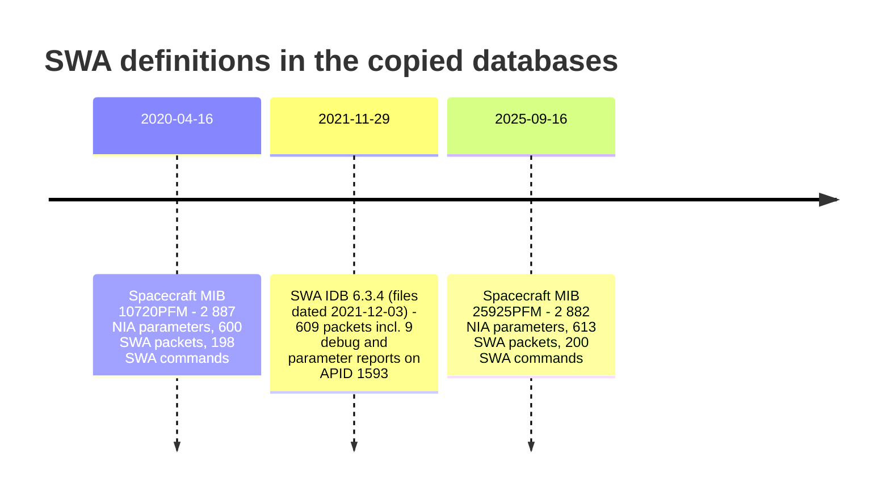

# Solar Orbiter SWA instrument database

SWA is one of the ten Solar Orbiter instruments; the library documents use only the acronym
(this wiki's page plan calls it the Solar Wind Analyser), and they name its sensors EAS and PAS
in passing.[^tn7-swa][^efecs-eas] Its team at IRAP hosts the server from which this wiki copied
the Solar Orbiter [MIB](mib.md), and the same server carries an **instrument database (IDB)**
for SWA in the format of SCOS-2000 [MIB](../../mib/index.md) tables.[^reg] An instrument
database describes one instrument's packets, parameters, calibrations and commands in the same
tables as the spacecraft MIB. This page analyses the copied IDB and checks, by name and by
content, how much of it is in the spacecraft database; how the instrument definitions reach the
spacecraft MIB is not described in the available sources (see the Inference note at the end).

!!! info "What was copied"
    | Item | Value |
    |---|---|
    | Library item | [swa-idb-ascii](../../library/swa-idb-ascii.md) |
    | Original URL | `https://solarorbiter.irap.omp.eu/MIB/ASCII.zip` |
    | Copied | 2026-11-05 14:26:47 UTC |
    | Size, SHA-256 | 142 018 bytes, `aad3e32da477e39cc47d7872a2538eacb37c0559f45a3dc6ec1a6c6fa501dbdb` |
    | Contents | folder `ASCII/` with 56 `.dat` files (32 non-empty) dated 2021-12-03 and an empty `synthetic/` folder; 59 `__MACOSX` resource entries (56 dated 2021-12-03, the two folder entries 2021-12-13, one 2015-10-02) |
    | Last version record | `SWA_6.3.4`, "Released on 29/11/2021" |

    The registry values are from this wiki's source registry;[^reg] the contents and dates are
    from the zip directory and the files themselves.[^swa] The `__MACOSX` entries show the
    archive was made on a Macintosh; the `.dat` files use Windows (CR LF) line ends, unlike the
    spacecraft MIB files and the Unix format that the ICD specifies.[^swa][^mib25][^i70-ascii]

## Versions: the vdf table as a release history

The ICD's [vdf](../../mib/tables/vdf.md) table normally holds a single record naming the
database version; if several are present, the last one imported sets the name.[^i70-vdf] The
SWA IDB instead keeps all 70 versions it has been through, each with a release date in the
comment and the major and minor numbers in `VDF_RELEASE` and `VDF_ISSUE`:[^swa]

| Versions | Records | Dates (from `VDF_COMMENT`) |
|---|---:|---|
| `SWA_00.2`, `SWA_00.3` | 2 | "Received from MSSL", "SWA Mandatory test" |
| `SWA_1.0` | 1 | 02/10/2015 |
| `SWA_2.0.0` to `SWA_2.7.4` | 27 | 08/03/2016 to 07/03/2017 |
| `SWA_3.0.0` to `SWA_3.4.0` | 12 | 14/03/2017 to 26/05/2017 |
| `SWA_4.0.0` to `SWA_4.2.1` | 9 | 26/06/2017 to 28/11/2017 |
| `SWA_5.0.0` to `SWA_5.4.1` | 7 | 22/12/2017 to 13/03/2019 |
| `SWA_6.0.0` to `SWA_6.3.4` | 12 | 30/04/2019 to 29/11/2021, including `6.3.4_beta` (30/11/2021) and `6.3.3_wa` |

The records are not in chronological order inside each minor version (for example `SWA_2.3.2`
precedes `SWA_2.3.1` and `SWA_2.3.0`), and `SWA_6.3.4_beta`, dated a day after `SWA_6.3.4`,
is filed before `SWA_6.3.0`; by the ICD rule the effective name is the last record,
`SWA_6.3.4`.[^swa][^i70-vdf] 67 of the 70 names are longer than the Char(8) of `VDF_NAME`, the
longest having 14 characters; the ICD's importer truncates an over-long field and issues a
warning.[^swa][^i70-vdf][^i70-ascii]

### Release notes

The IRAP directory also holds later SWA IDB versions (`SWA_IDB_v5.1`, `v6.0.1`, `v6.3.3_wa`,
`v6.3.4_beta2`, `v6.4.6`, `v6.5.0`) and a release-notes file `IDB_relNotes.txt`, which the
project's survey describes as notes from Planetek Italia running from v2.0.0 (March 2016) to
v6.5.0 (2025-06-17).[^irap] These were **not copied** into the library, so their content is not
used here; they can be found at <https://solarorbiter.irap.omp.eu/MIB/>.

## What the IDB contains

| Family | Table | SWA IDB | SWA share of the 2025 spacecraft MIB |
|---|---|---:|---:|
| Version | `vdf` | 70 | 1 (spacecraft) |
| Parameters | [pcf](../../mib/tables/pcf.md) | 2 885 | 2 882 `NIA` parameters |
| Packets | [pid](../../mib/tables/pid.md) / [tpcf](../../mib/tables/tpcf.md) | 609 / 609 | 613 on SWA APIDs |
| | [pic](../../mib/tables/pic.md) | 24 | - |
| | [plf](../../mib/tables/plf.md) / [vpd](../../mib/tables/vpd.md) | 6 507 / 481 | - |
| Calibration | [caf](../../mib/tables/caf.md) / [cap](../../mib/tables/cap.md) | 1 / 8 | - |
| | [txf](../../mib/tables/txf.md) / [txp](../../mib/tables/txp.md) | 128 / 1 460 | - |
| | [mcf](../../mib/tables/mcf.md) | 80 | - |
| Checks | [ocf](../../mib/tables/ocf.md) / [ocp](../../mib/tables/ocp.md) | 206 / 326 | - |
| Commands | [ccf](../../mib/tables/ccf.md) / [cdf](../../mib/tables/cdf.md) / [cpc](../../mib/tables/cpc.md) | 198 / 1 173 / 531 | 200 commands on APID 1532 |
| | [cca](../../mib/tables/cca.md) / [ccs](../../mib/tables/ccs.md), [paf](../../mib/tables/paf.md) / [pas](../../mib/tables/pas.md) | 3 / 15, 75 / 1 041 | - |
| TC header | [tcp](../../mib/tables/tcp.md) / [pcpc](../../mib/tables/pcpc.md) / [pcdf](../../mib/tables/pcdf.md) | 1 / 6 / 13 | - |
| Verification | [cvs](../../mib/tables/cvs.md) / [cvp](../../mib/tables/cvp.md) | 2 / 396 | - |
| Groups, displays | `grp` / `grpk` / `dpf` / `dpc` | 2 / 4 / 1 / 1 | - |
| Mission files | `sw_para` / `pcf_glob_det` | 2 841 / 855 | - |
| Empty | sequences, `cur`, `lgf`, `cve`, `prf`/`prv`, `ptv`, `dst`, graphic and scrolling displays, parameter sets, `ssy`, synthetics | 0 | - |

The counts are from this wiki's queries.[^swa][^mib25] Three files differ from the spacecraft
release: `sw_para.dat` replaces `ASW_sw_para.dat`, an empty `ssy.dat` (not an ICD table) is
present, and the `s13*` and `dup` files are absent.[^swa][^mib25] The test-like entries are
telling: the only display `DQQA1234` is described as "This is a test", and the group `GRPPAR`
as "Example for Parameters".[^swa]

### Which ICD issue the files follow

Counting TAB-separated fields per record, the IDB's `pcf` has 19 fields, `cpc` 13 and `ccf` 21,
against 23, 15 and 21 in the 2025 spacecraft MIB.[^swa][^mib25] Nineteen `pcf` fields and
thirteen `cpc` fields are the issue 5.1 layouts,[^i51] which the 7.0 importer still accepts
for `pcf` (fields 20-23 are optional for backward compatibility).[^i70-pcf] The effect is visible in the merged data: the spacecraft MIB sets
`PCF_DARC` = 1 for 335 of the 2 885 SWA parameters, a field the IDB does not have.[^mib25] See
[History of the Database Import ICD](../../mib/icd-history.md).

??? example "SQL used (contents)"
    ```sql
    -- swa-idb.sqlite (SWA IDB, ASCII.zip)
    SELECT rowid, * FROM vdf;
    SELECT sum(length(VDF_NAME) > 8), max(length(VDF_NAME)) FROM vdf;      -- 67 | 14
    SELECT count(*) FROM pcf;                                             -- repeated per table
    SELECT * FROM dpf; SELECT * FROM grp;
    ```
    Field counts were taken from the `.dat` files with a TAB field count per line.

## APIDs and packets

Annex 8 of the packet structure ICD gives SWA the process IDs 95 to 99; the APID is the process
ID times 16 plus the packet category.[^icd-cat] The IDB defines 609 packets on 15 APIDs:[^swa]

| APID | PID / CAT | Category meaning | Packets | Types |
|---:|---|---|---:|---|
| 1525 | 95 / 5 | functional cyclic | 1 | TM(3,25) SID 255 `SWA_TM_II_INFO` |
| 1532 | 95 / 12 | science (and TC APID) | 9 | TM(21,3), TM(21,6) |
| 1540 | 96 / 4 | routine HK | 8 | TM(3,25): DPU, EAS1, EAS2, PAS, HIS, boot SW, IIC data |
| 1542 | 96 / 6 | functional non-cyclic | 9 | private 200-203 reports |
| 1544 | 96 / 8 | diagnostic | 9 | TM(3,26) |
| 1545 | 96 / 9 | dump | 54 | TM(6,6), TM(6,10) |
| 1548 | 96 / 12 | science | 45 | TM(21,3), TM(21,6) |
| 1564 | 97 / 12 | science | 25 | TM(21,3), TM(21,6) |
| 1572 | 98 / 4 | routine HK | 2 | `SWA_TM_GROUND_MONITORING`, `SWA_TM_HIS_ALIVE` |
| 1580 | 98 / 12 | science | 13 | TM(21,3), TM(21,6) |
| 1585 | 99 / 1 | verification | 171 | TM(1,1), (1,2), (1,7), (1,8) |
| 1588 | 99 / 4 | routine HK | 1 | `SWA_TM_OBC_FDIR_HK` |
| 1591 | 99 / 7 | events | 249 | TM(5,1)-(5,4), TM(17,2) |
| 1593 | 99 / 9 | dump | 9 | private 200-203 reports |
| 1596 | 99 / 12 | science | 4 | TM(21,3) |

The category meanings are those of Annex 8.[^icd-cat] Every packet has `PID_DFHSIZE` = 16 with
a time field and no CRC check, like the spacecraft packets, and 88 are variable packets with a
`VPD` structure.[^swa] Events and verification reports dominate again: 199 low-severity TM(5,2)
and 149 TM(1,8) failure definitions, because each event ID and failure code is a separate
packet (see [How Solar Orbiter uses PUS](pus-usage.md#how-the-mib-sees-a-pus-packet)).[^swa]

The housekeeping structure IDs are: TM(3,25) SIDs 1 EAS1, 2 EAS2, 3 PAS, 11 DPU, 14 OBC FDIR,
15 ground monitoring, 16 IIC data, 20 boot software, 100 HIS boot, 101 HIS, 102 HIS alive and
255 inter-instrument information; TM(3,26) SIDs 4-10, 12 and 13 for DPU counters, validity,
hardware diagnostics, FDIR and derived parameters.[^swa]

!!! warning "Inference"
    The packet and command names suggest that `EAS1`, `EAS2`, `PAS` and `HIS` are SWA's
    sensors and `DPU` its data processing unit, and that the private service types split along
    them: type 200 for the DPU and general functions, 201 EAS1, 202 EAS2, 203 PAS and 204 HIS
    (`SWA_TC_EAS1_CLEAR_RAM` is type 201, `SWA_TC_PAS_CALIBRATION_MODE` type 203,
    `SWA_TC_HIS_AC_LINK` type 204). The library sources do not expand these names.

## Parameters

All 2 885 parameters are raw telemetry; 2 881 are named `NIA...` with `PCF_SUBSYS` = 109, and four
`ZZPAD008` to `ZZPAD032` are 8-, 16-, 24- and 32-bit fillers.[^swa] By name, 1 697 are `NIA0...`, 855 `NIAD...`, 286 `NIAG...` and
43 `NIA1...`; by description, 384 start with `HIS`, 218 with `EAS1`, 217 with `EAS2`, 72 with
`PAS` and 33 with `DPU`.[^swa] Types: 1 155 are 16-bit unsigned (PTC 3, PFC 12), 667 Booleans,
499 8-bit, 263 32-bit and 100 24-bit unsigned integers; 2 365 have a numerical and 520 a status
category.[^swa] The 855 `NIAD` parameters are exactly the "detail" side of the 855 rows of
`pcf_glob_det`, which relate them to 166 container words.[^swa] 1 055 parameters appear in no
`plf` or `vpd` entry; 206 have ground monitoring checks (158 hard, 168 soft limits in `ocp`).[^swa]

The `sw_para` file lists 2 841 names - 1 758 monitoring parameters, 471 packet mnemonics
(`YIA...`), 428 command parameters and 184 commands - with an empty second column, where the
spacecraft release's `ASW_sw_para` gives an on-board software symbol; the third column holds
the letter `a` in 2 463 rows and otherwise a field name or a comment (for example
`SWA_TC_HIS_MODE: change mode`). All 2 841 names are also in `ASW_sw_para`.[^swa][^mib25]

## Commands

The IDB has 198 commands, all named `ZIA58...` and all with `CCF_ACK` = 9 (acceptance and
completion reports): 45 of type 200, 43 each of types 201 and 202, 33 of 203, 21 of 204, and
13 standard ones - memory management (4), housekeeping (3), event enable/disable (2), science
transfer enable/disable (2), time (1, TC(9,129)) and connection test (1).[^swa] Its single
TC header `NOM_TC` has the same layout as the spacecraft one, but the 8-bit source ID is a
fixed value `0x78` (120) - the ground source ID that the packet structure ICD reserves for
direct commands - where the 2025 spacecraft MIB uses the element type `O`.[^swa][^icd-src][^mib25]
Two verification stages are defined: `58901` (acceptance) and `58907` (completion), both
report-based (`CVS_SOURCE` = `R`) with a start offset of 0 and an interval of 20 seconds; each
of the 198 commands uses both, which makes the 396 `cvp` rows.[^swa] See [Command verification in the MIB](../../mib/command-verification.md).

??? example "SQL used (APIDs, parameters, commands)"
    ```sql
    SELECT PID_APID, CAST(PID_APID AS INT) >> 4, CAST(PID_APID AS INT) & 15, count(*),
           group_concat(DISTINCT PID_TYPE || '/' || PID_STYPE)
      FROM pid GROUP BY 1 ORDER BY CAST(PID_APID AS INT);
    SELECT PID_APID, PID_STYPE, PID_PI1_VAL, PID_DESCR FROM pid WHERE PID_TYPE = '3';
    SELECT substr(PCF_NAME, 1, 4), count(*) FROM pcf GROUP BY 1 ORDER BY 2 DESC;
    SELECT PCF_PTC, PCF_PFC, count(*) FROM pcf GROUP BY 1, 2 ORDER BY 3 DESC;
    SELECT CCF_TYPE, count(*) FROM ccf GROUP BY 1 ORDER BY 2 DESC;
    SELECT CCF_ACK, count(*) FROM ccf GROUP BY 1;
    SELECT * FROM tcp; SELECT * FROM pcdf; SELECT * FROM cvs;
    ```

## The IIC packet in the database

The inter-instrument communication note SOL-SGS-TN-0007 specifies SWA's contribution as a
TM(3,25) with process ID 95, category 5 and SID 255, generated every 4 seconds, carrying 16 octets
for distribution: a 4-octet heartbeat copied from the OBT coarse time, the PAS proton density
(2 octets), the three solar wind velocity components (2 octets each) and 4 spare octets.[^tn7-swa]
The IDB's packet `SWA_TM_II_INFO` (SPID 58907) on APID 1525 implements exactly that:[^swa]

<div class="bitfield" data-title="SWA_TM_II_INFO source data (SPID 58907, APID 1525), 136 bits after the 16-octet headers" data-width="16"
     data-fields='[{"n":"HK_SID (NIA00700)","b":8,"v":"11111111","d":"SID 255, octet 16; not copied into the OBC data pool"},{"n":"HEART_BEAT (NIA01552)","b":32,"d":"Octet 17, PTC 3 PFC 14: copy of the OBT coarse time"},{"n":"DENSITY (NIA01553)","b":16,"d":"Octet 21, PTC 3 PFC 12: PAS proton density"},{"n":"Vx (NIA01554)","b":16,"d":"Octet 23"},{"n":"Vy (NIA01555)","b":16,"d":"Octet 25"},{"n":"Vz (NIA01556)","b":16,"d":"Octet 27"},{"n":"SPARE (NIA02000)","b":16,"d":"Octet 29"},{"n":"SPARE (NIA02001)","b":16,"d":"Octet 31"}]'></div>

The offsets and types are the `plf` and `pcf` entries of the IDB; the packet's `TPCF_SIZE` of 33
octets is 16 octets of headers, 1 octet of SID and the 16 octets of distributed data.[^swa] The
types follow the SCOS-2000 code table, in which PTC 3 PFC 12 is a 16-bit and PFC 14 a 32-bit
unsigned integer.[^i70-ptc] The SID is not placed in the OBC data pool, and the OBC copies the 16
octets into octets 207 to 222 of the TC(20,128) it distributes to all instruments - to SWA itself
at 8 Hz.[^tn7-2][^tn7-61] The same packet exists with the same SPID and layout in the 2025
spacecraft MIB; browse it as
[SPID 58907 in the SWA explorer](../../explorer/index.md#/swa/packet/58907) or
[`NIA01553` in the spacecraft MIB](../../explorer/index.md#/solo/param/NIA01553).[^mib25]

## How the IDB relates to the spacecraft MIB

Comparing names and definitions with the two copied spacecraft releases:[^swa][^mib25][^mib20]

| Object | In the IDB | Also in 2020 MIB | Also in 2025 MIB | Notes |
|---|---:|---:|---:|---|
| Parameters (`PCF_NAME`) | 2 885 | 2 885 | 2 885 | description, PTC, PFC, category, nature and calibration identical in 2025; 243 have a different unit, 237 of them a unit only in the IDB |
| Packets (`PID_SPID`) | 609 | 600 | 609 | identical keys and descriptions in 2025; `plf`: all 6 507 entries identical in 2025 |
| Commands (`CCF_CNAME`) | 198 | 198 | 197 | 7 commands have a different parameter count in 2025 |
| Command elements (`cdf`) | 1 173 | - | 1 138 identical | |
| Textual calibrations, checked parameters | 128, 206 | - | 127, 205 | one of each not carried over |
| `pcf_glob_det`, `sw_para` rows | 855, 2 841 | - | all 855, all 2 841 | |

The spacecraft MIB has the SWA definitions, with the subsystem number 109 and the `NIA` /
`ZIA` prefixes, but none of the IDB's version history.[^mib25]



The differences place the IDB between the two spacecraft releases:

* **Changed after April 2020, as in the IDB:** the 63 packets that the 2020 MIB had on APID
  1593 (category 9) - nine private reports of types 200-203 and 54 TM(6,6)/TM(6,10) dumps and
  checks - sit in the IDB (and in 2025), with the same SPIDs, on the new APIDs 1542 (category 6)
  and 1545 (category 9), and APID 1593 holds nine new packets with the same names and new SPIDs 58191-58199:
  `SWA_TM_DEBUG_CMD_REPORT`, `SWA_TM_MON_CONF_REPORT`, `SWA_TM_PARAM_REPORT`,
  `SWA_TM_MACRO_REPORT`, `SWA_TM_FSW_STARTUP_REPORT`, `SWA_TM_ERROR_LOG_REPORT` and the EAS1,
  EAS2 and PAS parameter reports (types 200-203).[^swa][^mib20][^mib25]
* **Added after the IDB, present in 2025:** four failure reports TM(1,8) on APID 1585
  (`SWA_EAS1_BAD_SUM`, `SWA_EAS2_BAD_SUM`, `SWA_EAS1_OFF_ENT_ERR`, `SWA_EAS2_OFF_ENT_ERR`) and three
  commands (`ZIA58950` `SWA_TC_SENS_CADENCE` TC(200,162),
  [explorer](../../explorer/index.md#/solo/command/ZIA58950); `ZIA58951` and `ZIA58952` for the EAS1
  and EAS2 summation).[^mib25][^mib20]
* **Only in the spacecraft MIBs:** the dynamic synthetic parameter `NIASX001` "PAS_IN_SCIENCE",
  present in both 2020 and 2025 (the IDB has no synthetics), and five `NIAD416x` SpaceWire-link
  parameters of the 2020 release that neither the IDB nor the 2025 release has.[^mib20][^mib25][^swa]
* **In the IDB but removed by 2025:** `ZIA58057` `SWA_TC_ACC_TIME`, the TC(9,129) "accept time"
  command, which the 2025 MIB dropped together with the other instruments' TC(9,129) commands
  (see [How Solar Orbiter uses PUS](pus-usage.md#service-9-time-management)).[^mib25]

!!! warning "Inference"
    The pattern - every IDB parameter and packet, and all commands but one, present in the 2025
    spacecraft MIB with the same names, numbers and layouts, and later additions present in
    2025 but not in the IDB -
    indicates that the spacecraft MIB imports the SWA definitions from the instrument team's
    database, with ESA adding mission-level fields (for example `PCF_DARC`) and later changes.
    The merging process itself is not described in the available sources.

??? example "SQL used (comparison with the spacecraft MIB)"
    ```sql
    -- run on swa-idb.sqlite
    ATTACH 'solo-2025-09-16.sqlite' AS m;
    ATTACH 'solo-2020-04-16.sqlite' AS o;
    SELECT count(*), sum(PCF_NAME IN (SELECT PCF_NAME FROM m.pcf)),
           sum(PCF_NAME IN (SELECT PCF_NAME FROM o.pcf)) FROM main.pcf;          -- 2885 | 2885 | 2885
    SELECT count(*) FROM main.pcf a JOIN m.pcf b ON a.PCF_NAME = b.PCF_NAME
     WHERE a.PCF_DESCR = b.PCF_DESCR AND a.PCF_PTC = b.PCF_PTC AND a.PCF_PFC = b.PCF_PFC;   -- 2885
    SELECT sum(a.PCF_UNIT <> b.PCF_UNIT) FROM main.pcf a JOIN m.pcf b ON a.PCF_NAME = b.PCF_NAME;  -- 243
    SELECT count(*), sum(PID_SPID IN (SELECT PID_SPID FROM m.pid)),
           sum(PID_SPID IN (SELECT PID_SPID FROM o.pid)) FROM main.pid;          -- 609 | 609 | 600
    SELECT count(*) FROM main.plf a JOIN m.plf b ON a.PLF_NAME = b.PLF_NAME AND a.PLF_SPID = b.PLF_SPID
       AND a.PLF_OFFBY = b.PLF_OFFBY AND a.PLF_OFFBI = b.PLF_OFFBI;              -- 6507
    SELECT count(*), sum(CCF_CNAME IN (SELECT CCF_CNAME FROM m.ccf)),
           sum(CCF_CNAME IN (SELECT CCF_CNAME FROM o.ccf)) FROM main.ccf;        -- 198 | 197 | 198
    SELECT PID_SPID, PID_APID, PID_TYPE, PID_STYPE, PID_DESCR FROM m.pid
     WHERE CAST(PID_APID AS INT) >> 4 BETWEEN 95 AND 99 AND PID_SPID NOT IN (SELECT PID_SPID FROM main.pid);
    SELECT PID_SPID, PID_DESCR FROM main.pid WHERE PID_SPID NOT IN (SELECT PID_SPID FROM o.pid);
    SELECT a.PID_APID, b.PID_APID, count(*) FROM main.pid a JOIN o.pid b ON b.PID_SPID = a.PID_SPID
     WHERE a.PID_APID <> b.PID_APID GROUP BY 1, 2;                         -- 1542|1593|9, 1545|1593|54
    SELECT PCF_NAME, PCF_DESCR FROM o.pcf WHERE PCF_NAME LIKE 'NIA%'
       AND PCF_NAME NOT IN (SELECT PCF_NAME FROM main.pcf);                -- NIAD4161-4165, NIASX001
    SELECT CCF_CNAME, CCF_DESCR, CCF_TYPE, CCF_STYPE FROM m.ccf
     WHERE CCF_APID = '1532' AND CCF_CNAME NOT IN (SELECT CCF_CNAME FROM main.ccf);
    SELECT l.PLF_NAME, c.PCF_DESCR, l.PLF_OFFBY, c.PCF_PTC, c.PCF_PFC
      FROM plf l JOIN pcf c ON c.PCF_NAME = l.PLF_NAME WHERE l.PLF_SPID = '58907'
     ORDER BY CAST(PLF_OFFBY AS INT);
    ```

## Related pages

* [Solar Orbiter](index.md), [The Solar Orbiter MIB](mib.md),
  [How Solar Orbiter uses PUS](pus-usage.md)
* [The MIB](../../mib/index.md), [Mission tailoring of the MIB](../../mib/tailoring.md),
  [MIB tooling](../../mib/tooling.md)
* The SWA explorer: [APID 1525](../../explorer/index.md#/swa/apid/1525),
  [parameter NIA01553](../../explorer/index.md#/swa/param/NIA01553),
  [search "EAS1"](../../explorer/index.md#/swa/search/EAS1)

[^tn7-swa]: [SOL-SGS-TN-0007 issue 2.0, Inter-instrument Communication via Services 3 and 20](../../library/sol-sgs-tn-0007-s20-2-0.md), §5.9-5.9.3 SWA (PID 95, CAT 5, SID 255; PAS proton density, velocity, 0.25 Hz), PDF pp. 22-23.
[^efecs-eas]: [SOL-SGS-ICD-0006 E-FECS ICD, issue 3.0](../../library/sol-sgs-icd-0006-efecs-icd-3-0.md), §2.3.1 (light-sensitive sensors "SWA-EAS"), PDF p. 14.
[^reg]: This wiki's source registry (`data/sources.json`), entry [swa-idb-ascii](../../library/swa-idb-ascii.md): original URL, copy time, size and SHA-256.
[^swa]: [Solar Orbiter SWA instrument database (ASCII.zip)](../../library/swa-idb-ascii.md), all tables and the `.dat` files and zip directory, queried and inspected by this wiki on 2026-11-12.
[^mib25]: [Solar Orbiter MIB release MIB__20250916M25925PFMS001_SOL](../../library/mib-20250916m25925pfms001-sol.md), tables `pcf`, `pid`, `plf`, `ccf`, `cdf`, `txf`, `ocf`, `pcdf`, `synthetic`, `ASW_sw_para`, `pcf_glob_det`, queried by this wiki on 2026-11-12.
[^mib20]: [Solar Orbiter MIB release MIB__20200416M10720PFMS001_SOL](../../library/mib-20200416m10720pfms001-sol.md), tables `pcf`, `pid`, `ccf`, queried by this wiki on 2026-11-12.
[^i70-vdf]: [SCOS-2000 Database Import ICD, issue 7.0](../../library/icd-7-0-final.md), §3.3.1.1 Database version: vdf (`VDF_NAME` Char(8); last record imported sets the name), PDF pp. 37-38.
[^i70-pcf]: [SCOS-2000 Database Import ICD, issue 7.0](../../library/icd-7-0-final.md), §3.3.2.1.1 (note on fields 20-23), PDF p. 40.
[^i70-ascii]: [SCOS-2000 Database Import ICD, issue 7.0](../../library/icd-7-0-final.md), §2.1-2.4 (ASCII files in Unix format; an over-long field is truncated with a warning), PDF pp. 21-23.
[^i51]: [SCOS-2000 Database Import ICD, issue 5.1](../../library/icd-5-1-tos-gci.md), §3.3.2.1.1 pcf (fields 1-19, `PCF_NAME` to `PCF_SPTYPE`) and §3.3.3.2.2 cpc (fields 1-13), PDF pp. 23-28 and 67-70.
[^i70-ptc]: [SCOS-2000 Database Import ICD, issue 7.0](../../library/icd-7-0-final.md), Appendix A, Table 4 "Parameter Type and Format Codes supported by SCOS-2000", PDF pp. 214-224.
[^icd-cat]: [SOL.S.ASTR.TN.00079 issue 7, Solar Orbiter TM-TC and Packet Structure ICD](../../library/sol-s-astr-tn-00079-07.md), §13.1 (Annex 8), Figures 13.1-1 and 13.1-2 (SWA process IDs 95 to 99), PDF pp. 272-274.
[^icd-src]: [SOL.S.ASTR.TN.00079 issue 7](../../library/sol-s-astr-tn-00079-07.md), §13.2 Source ID (direct commands: 120), PDF pp. 275-276.
[^tn7-2]: [SOL-SGS-TN-0007 issue 2.0](../../library/sol-sgs-tn-0007-s20-2-0.md), §2.2 (SID not placed in the data pool) and §3.2 (SWA receives TC(20,128) at 8 Hz), PDF pp. 6 and 8.
[^tn7-61]: [SOL-SGS-TN-0007 issue 2.0](../../library/sol-sgs-tn-0007-s20-2-0.md), §6.2-6.3 TC(20,128) data field, SWA section octets 207-222, PDF pp. 25 and 30.
[^irap]: Web directory listing <https://solarorbiter.irap.omp.eu/MIB/> (not a library item), as surveyed for this project on 2026-11-05: SWA_IDB version folders and `IDB_relNotes.txt` in `SWA_IDB_v6.5.0/`. The release notes were not copied and not read for this page.
