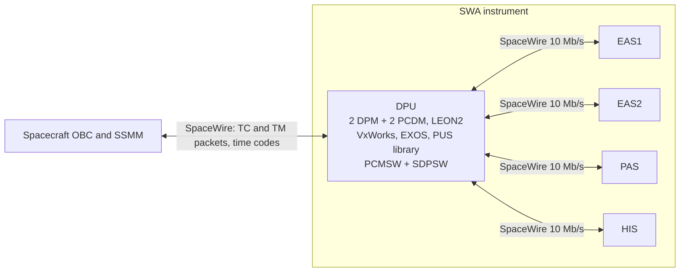
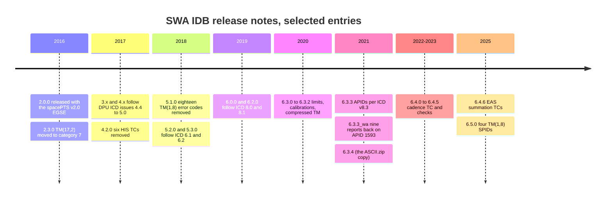
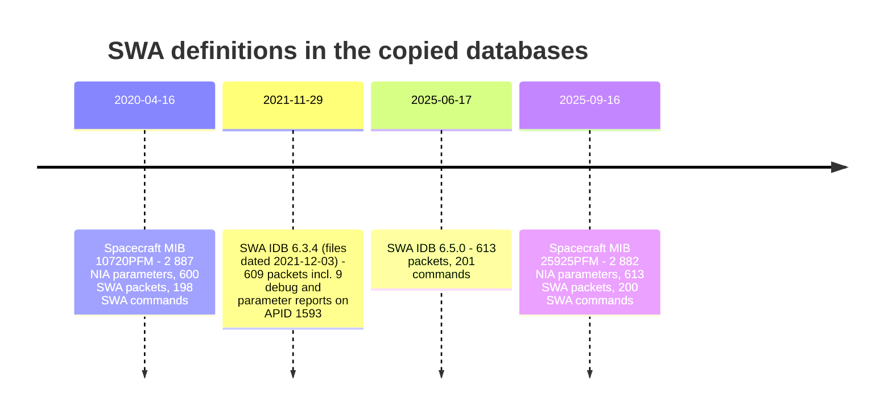

# Solar Orbiter SWA instrument database

SWA, the Solar Wind Analyser, is one of the ten Solar Orbiter instruments. Its Data Processing
Unit (DPU) interface document describes a suite of four sensors - two Electron Analyser Systems
(**EAS1** and **EAS2**), a Proton Alpha Sensor (**PAS**) and a Heavy Ion Sensor (**HIS**) - each
connected to the **DPU** by a 10 Mb/s SpaceWire link.[^dpu-3][^dpu-acr] The 2007 Experiment
Interface Document lists the same instrument as the "Solar Wind Plasma Analyzer"[^eida-res], and
planning documents refer to the sensors individually, for example the light-sensitive
"SWA-EAS".[^efecs-eas] The SWA/PAS team at IRAP (the DPU ICD cites IRAP documents for the PAS
unit and its interface to the DPU)[^dpu-rd] hosts the server from which this wiki copied the
Solar Orbiter [MIB](mib.md), and the same server carries the SWA **instrument database (IDB)**:
the instrument's packets, parameters, calibrations and commands written as SCOS-2000
[MIB](../../mib/index.md) tables, with release notes from Planetek Italia.[^reg][^rn]

This page analyses two copied IDB versions - **6.3.4** (the file `ASCII.zip`) and **6.5.0** -
reads the release notes against the data and against the SWA DPU Communications ICD, and checks,
by name and by content, how much of each version is in the spacecraft database. The interface
documents themselves are presented on
[Solar Orbiter instrument interfaces](instrument-interfaces.md); the STIX instrument database is
analysed the same way on [Solar Orbiter STIX instrument database](stix.md).

!!! info "What was copied"
    | Item | SWA IDB 6.3.4 (`ASCII.zip`) | SWA IDB 6.5.0 |
    |---|---|---|
    | Library item | [swa-idb-ascii](../../library/swa-idb-ascii.md) | [swa-idb-v6-5-0](../../library/swa-idb-v6-5-0.md) |
    | Original URL | `https://solarorbiter.irap.omp.eu/MIB/ASCII.zip` | `https://solarorbiter.irap.omp.eu/MIB/SWA_IDB_v6.5.0.zip` |
    | Copied (UTC) | 2026-11-05 14:26:47 | 2026-11-12 17:52:24 |
    | Size | 142 018 bytes | 115 876 bytes |
    | SHA-256 | `aad3e32da477e39cc47d7872a2538eacb37c0559f45a3dc6ec1a6c6fa501dbdb` | `9f63f211dc1890df42d754c40dedb394af80f032a68b05c677e3b8ba1d9f5eaa` |
    | Contents | folder `ASCII/` with 56 `.dat` files (32 non-empty) dated 2021-12-03 and an empty `synthetic/` folder; 59 `__MACOSX` resource entries (56 dated 2021-12-03, the two folder entries 2021-12-13, one 2015-10-02) | folder `SWA_IDB_v6.5.0/ASCII/` with 56 `.dat` files (32 non-empty) dated 2025-06-17, an empty `synthetic/` folder dated 2015-10-02, and the release notes `IDB_relNotes.txt` (2025-06-17); no `__MACOSX` entries |
    | Last `vdf` record (file order) | `SWA_6.3.4`, "Released on 29/11/2021" | `SWA_6.3.3_wa`, "Released on 04/11/2021" |
    | Explorer | [`swa`](../../explorer/index.md#/swa/search/SWA) | [`swa65`](../../explorer/index.md#/swa65/search/SWA) |

    The URLs, times, sizes and hashes are from this wiki's source registry;[^reg][^reg65] the
    contents and dates are from the zip directories and the files themselves.[^swa][^swa65] The
    `__MACOSX` entries of the older zip show it was made on a Macintosh. In both versions the
    `.dat` files use Windows (CR LF) line ends, unlike the spacecraft MIB files and the Unix
    format that the ICD specifies.[^swa][^swa65][^mib25][^i70-ascii]

## The instrument behind the database

The DPU is, in the words of its ICD, the "heart" of SWA: it provides power, control, temporary
storage, communication and computing for the suite. Its hardware is a backplane with six
SpaceWire splitters, two Data Processing Modules (each a communication and science data
processing board plus a CPU board) and two Power Conditioning and Distribution Modules (PCDM),
which also receive the spacecraft's high-power pulse commands and collect housekeeping.[^dpu-3]
The application software receives telecommands, sends housekeeping, event and (when enabled)
science telemetry, commands and powers the sensor heads (except HIS, which the spacecraft powers
on a dedicated line), keeps five minutes of high-resolution EAS1, EAS2 and PAS data for
transmission when an event trigger arrives, computes moments and compresses data, maintains time
synchronisation, and exchanges data with the other instruments through PUS service 20.[^dpu-4]



The diagram follows §3 and §4 of the DPU ICD.[^dpu-3][^dpu-4] The software has three layers:
the application software (the process control and TM/TC software PCMSW, and the science data
processing software SDPSW), an application service layer with the PUS library, and a machine
services layer with the VxWorks real-time kernel, the extended operating system EXOS and the
board support package, all on a LEON2 processor. A boot software in PROM, which cannot be patched,
tests the memories and loads the application from MRAM. The SDPSW compresses distributions
losslessly with a CCSDS 121 compliant algorithm and computes the moments of order 0 (number
density), 1 (number flux density vector), 2 (moment flux density tensor, as the ICD calls it) and, for EAS only,
3 (energy flux density vector).[^dpu-4]

### Which software component owns which service

The DPU ICD groups the telecommands by the software component that handles them. This explains
the private service types that the IDB uses:[^dpu-61][^dpu-62][^dpu-63][^dpu-64][^dpu-65][^dpu-66]

| Component (ICD table) | Service types | Examples |
|---|---|---|
| PUS manager (Table 2) | standard 3, 5, 6, 9, 17, 20, 21; private 200 subtypes 170-173 for parameter monitoring and 174-176 for the error/event handler | TC(3,5) enable HK, TC(6,5) dump memory, TC(9,129) accept time update, TC(20,128) inter-instrument data, TC(200,170) enable monitoring |
| DPU manager (Table 3) | 200 | TC(200,128) enter diagnostic mode, TC(200,133) modify configuration parameters, TC(200,136) enable/disable IIC test |
| Sensor manager (Table 4) | 200, subtypes 160-165 | TC(200,160) all sensors to burst mode, TC(200,162) cadence mode, TC(200,163) time offset |
| EAS1 / EAS2 managers (Table 5) | 201 / 202 | TC(201/202,131) switch on EAS, TC(201/202,164-171) engineering modes 2-9 |
| PAS manager (Table 6) | 203 | TC(203,128) calibration mode, TC(203,157) start science |
| HIS manager (Table 7) | 200, subtypes 153-155 | switch HIS on and off, start a HIS macro |
| HIS internal TCs (Table 8) | 204 | TC(204,135) HIS high voltage, TC(204,180) emergency HV ramp-down |

The spacecraft packet ICD reserves services 200 to 205 for SWA's private services, so all of these
stay within the allocation.[^icd-svc] The ICD's TC and TM data field headers are the spacecraft
ones (PUS version 1, 8-bit source or destination ID, 48-bit CUC time):[^dpu-5]

<div class="bitfield" data-title="SWA TM packet data field header, DPU ICD Figure 7 (80 bits)" data-width="16"
     data-fields='[{"n":"Spare","b":1,"v":"0"},{"n":"PUS version","b":3,"v":"001"},{"n":"Spare","b":4,"v":"0000"},{"n":"Service type","b":8},{"n":"Service subtype","b":8},{"n":"Destination ID","b":8},{"n":"S/C time (CUC)","b":48,"d":"48-bit CUC time"}]'></div>

Together with the 6-octet primary header this is the 16-octet header that every IDB packet
declares (`PID_DFHSIZE` = 16).[^dpu-5][^swa65] The header layout is discussed for the whole
spacecraft on [PUS packet structures](../../ecss/pus/packets.md).

## Versions: the vdf table as a release history

The ICD's [vdf](../../mib/tables/vdf.md) table normally holds a single record naming the
database version; if several are present, the last one imported sets the name.[^i70-vdf] The
SWA IDB instead keeps all the versions it has been through, each with a release date in the
comment and the major and minor numbers in `VDF_RELEASE` and `VDF_ISSUE`. Version 6.3.4 has 70
records:[^swa]

| Versions | Records | Dates (from `VDF_COMMENT`) |
|---|---:|---|
| `SWA_00.2`, `SWA_00.3` | 2 | "Received from MSSL", "SWA Mandatory test" |
| `SWA_1.0` | 1 | 02/10/2015 |
| `SWA_2.0.0` to `SWA_2.7.4` | 27 | 08/03/2016 to 07/03/2017 |
| `SWA_3.0.0` to `SWA_3.4.0` | 12 | 14/03/2017 to 26/05/2017 |
| `SWA_4.0.0` to `SWA_4.2.1` | 9 | 26/06/2017 to 28/11/2017 |
| `SWA_5.0.0` to `SWA_5.4.1` | 7 | 22/12/2017 to 13/03/2019 |
| `SWA_6.0.0` to `SWA_6.3.4` | 12 | 30/04/2019 to 29/11/2021, including `6.3.4_beta` (30/11/2021) and `6.3.3_wa` |

MSSL, the source of the first version, is the Mullard Space Science Laboratory in the DPU ICD's
acronym list.[^dpu-acr] The records are not in chronological order inside each minor version (for
example `SWA_2.3.2` precedes `SWA_2.3.1` and `SWA_2.3.0`), and `SWA_6.3.4_beta`, dated a day after
`SWA_6.3.4`, is filed before `SWA_6.3.0`; by the ICD rule the effective name is the last record,
`SWA_6.3.4`.[^swa][^i70-vdf] 67 of the 70 names are longer than the Char(8) of `VDF_NAME`, the
longest having 14 characters; the ICD's importer truncates an over-long field and issues a
warning.[^swa][^i70-vdf][^i70-ascii]

**Version 6.5.0 does not record itself.** Its `vdf` file holds the same 70 records with the same
names and comments, but `SWA_6.3.4` has moved up next to `SWA_6.3.4_beta`, before `SWA_6.3.0`,
so the last record is now `SWA_6.3.3_wa`; none of the eight versions 6.4.0 to 6.5.0 has a record.[^swa65]

!!! warning "Inference"
    Imported by the ICD rule, the 6.5.0 files would name the database after `SWA_6.3.3_wa` (and,
    truncated to 8 characters, `SWA_6.3.`), not 6.5.0. The folder name and the release notes are
    then the only places where the version appears. Whether the instrument team or the MOC
    renames the database on import is not stated in the available sources.

### The release notes

`IDB_relNotes.txt`, inside the 6.5.0 zip, is headed "SWA IDB RELEASE NOTES", names Planetek
Italia srl and one author, and carries a header date of 13/06/2016. It has 75 entries, from
2.0.0 (08/03/2016, "IDB version released with EGSE SW spacePTS v2.0") to 6.5.0 (17/06/2025),
each with the version, date, change description and author.[^rn] The IRAP directory also lists
other SWA IDB versions (`SWA_IDB_v5.1`, `v6.0.1`, `v6.3.3_wa`, `v6.3.4_beta2`, `v6.4.6`), which
were not copied.[^irap]

!!! warning "Inference"
    The DPU ICD lists Planetek ("PK") among its acronyms, has a Planetek address in its
    distribution list and carries the Planetek Italia logo in its page header next to those of
    TSD Space, Leonardo and SITAEL.[^dpu-acr] This suggests that the IDB maintainer is part of the
    DPU team, but neither the ICD nor the release notes says so.

Compared with the `vdf` records, the notes have no entries for the three earliest versions
(00.2, 00.3 and 1.0), the `vdf` has none for 6.4.0 to 6.5.0, and three dates differ: 2.1.0
(notes 10/06/2016, `vdf` 09/06/2016), 5.1.0 (21/02/2018 against 12/02/2018) and 6.3.4_beta
(03/12/2021 against 30/11/2021).[^rn][^swa65]

The notes tie most major steps to an issue of the SWA DPU Communications ICD
(SO-SWA-DPU_CD-IC-003), whose own change record gives the issue dates:[^rn][^dpu-dcr]

| IDB version (date) | Aligned with DPU ICD issue | ICD issue date |
|---|---|---|
| 2.1.0 (10/06/2016), 2.2.0 (16/06/2016) | 4 | 08/06/2016 |
| 2.3.0 (19/07/2016) | 4.1 | 25/07/2016 |
| 2.4.4 (31/08/2016) | 4.2 | 30/08/2016 |
| 2.6.0 (04/11/2016) | 4.3 | 21/10/2016 |
| 3.0.0 (14/03/2017) | 4.4 | 10/03/2017 |
| 3.1.0 (30/03/2017) | 4.5 | 30/03/2017 |
| 4.0.0 (26/06/2017) | 5.0 | not dated in the change record |
| 5.0.0 (22/12/2017) | 6.0 | 27/11/2017 |
| 5.2.0 (23/05/2018) | 6.1 | 21/02/2018 |
| 5.3.0 (14/11/2018) | 6.2 | 31/07/2018 |
| 5.4.0 (11/03/2019), 5.4.1 (13/03/2019) | 7.0, 7.1 | 08/03/2019, 13/03/2019 |
| 6.0.0 (30/04/2019) | 8.0 | 30/04/2019 |
| 6.2.0 (17/06/2019) | 8.1 | 17/06/2019 |
| 6.3.3 (11/10/2021) | "ICD v8.2" for three packets, "ICD v8.3" for APIDs | 8.2: 07/08/2019; 8.3: not in the library |

The IDB 2.3.0 entry claims alignment with ICD issue 4.1 six days before the date that the ICD
gives that issue. Issue 8.2, the copy in the library, changed only editorial matters.[^rn][^dpu-dcr]
Other entries record remarks from MSSL and from Airbus, fixes found with a tool named "PDIT
v1.0", HIS definitions taken from a HIS spreadsheet and the HIS telemetry ICD, calibration
updates and individual packet and command fixes.[^rn]



The timeline condenses the 75 entries.[^rn]

### What changed from 6.3.4 to 6.5.0

The eight release-note entries after 6.3.4 can be checked against the two copied versions
row by row:[^rn][^swa][^swa65]

| Release note (date) | What the data show, 6.3.4 to 6.5.0 |
|---|---|
| 6.4.0 (14/02/2022) "CIAT0068TC Updated" | the command calibration `CIAT0068TC` (`SENS_RATE_2`, PAS and HIS rates of `ZIA58728`) gains the value 0 `NOTHING` beside 1 `NOMINAL_CADENCE` and 2 `LOW_CADENCE`; the notes record that 6.3.3 had added it and 6.3.4_beta reverted it |
| 6.4.1 (04/05/2022) "MCF and OCF Updated" | three polynomial curves change slope: `CIAP0002TM` (`PCDM_EAS2`) 0.149066 to 0.19062938, `CIAP0003TM` (`PCDM_EAS1`) 0.151137 to 0.19062938, `CIAP0005TM` (`PCDM_PAS`) 0.283553 to 0.45487188, used by the mA currents `NIA00832`, `NIA00833`, `NIA00835`; four `ocf` records `NIA05128`-`NIA05131` switch from raw integer limits (`U`/`I`) to calibrated real limits (`C`/`R`) |
| 6.4.2, 6.4.3 (03-04/2023) "Updated TC(200,162) SELECT CADENCE TC" | see 6.4.5 |
| 6.4.4 (05/05/2023) "Updated OCP table with NIA05131" | nine `ocp` rows differ: eight limit ranges change (for example the high-voltage monitors `NIA05122`/`NIA05126` from 0-40 to 1900-2200, and `NIA05130` from 6000-6500 to the 90-450 that 6.3.4 had on `NIA05131`), and `NIA05131` keeps its `ocf` record but has no `ocp` row. With only two versions copied, which of 6.4.1 and 6.4.4 made each limit change cannot be told |
| 6.4.5 (05/06/2023) "ZIA58728 moved to ZIA58950", "ZIA58728 restored to v6.4.1" | both commands exist: `ZIA58728` `SWA_TC_SENS_CADENCE_MODE` unchanged and the new `ZIA58950` `SWA_TC_SENS_CADENCE`, both TC(200,162); six new command parameters and six new command calibrations (`CIAT0070TC` to `CIAT0075TC`); `CIAT0069TC` (`SENS_EN`) removed |
| 6.4.6 (11/06/2025) "Add ZIA58951 and ZIA58952", "Update CIAT0066TM in txp file" | `ZIA58951`/`ZIA58952` `SWA_TC_SET_EAS1/2_SUMMATION`, TC(201,174)/TC(202,174), one 16-bit parameter `PIA60860`; failure codes 43149 and 43150 of the textual calibration `CIAT0066TM` renamed from `Eas1FOffEntErr`/`Eas2FOffEntErr` to `Eas1BadSum`/`Eas2BadSum` |
| 6.5.0 (17/06/2025) "Add SPIDs 58730, 58731, 58732, 58733 in PID table" | four TM(1,8) failure reports on APID 1585 with 7 `plf` entries each (28 `plf` rows) |

Nothing else differs: `pcf`, `pcf_glob_det`, `txf`, `vpd`, `pic` and the TC header tables are
identical, and the remaining row-count changes (`cdf` +11, `cpc` +7, `cvp` +6, `sw_para` +1) are
the entries of the three new commands.[^swa][^swa65] The `ocf` change matters: the ICD defines
`OCF_INTER` = `C` as limits expressed in engineering (calibrated) values and `OCF_CODIN` = `R` as
real values, so the new ranges are in calibrated units.[^i70-ocf]

!!! warning "Inference"
    The copy called 6.3.4 on this page appears to hold the 6.3.4_beta state. Its `CIAT0068TC` lacks
    the value 0 `NOTHING`, which the notes say 6.3.3 added and only 6.3.4_beta removed (the 6.3.4
    entry itself reverts only `PIA60352` and `PIA60357`), and its `.dat` files are dated
    2021-12-03, the date that the notes give 6.3.4_beta.[^rn][^swa] Because the `SWA_6.3.4_beta`
    record is filed before `SWA_6.3.0`, the ICD rule still names the database `SWA_6.3.4`.

??? example "SQL used (versions and the 6.3.4 to 6.5.0 differences)"
    ```sql
    -- swa-idb-v6.5.0.sqlite, with the 6.3.4 copy attached
    ATTACH 'file:swa-idb.sqlite?mode=ro' AS o;
    SELECT rowid, VDF_NAME, VDF_COMMENT FROM main.vdf ORDER BY rowid DESC LIMIT 8;   -- last: SWA_6.3.3_wa
    SELECT PID_SPID, PID_APID, PID_TYPE, PID_STYPE, PID_PI1_VAL, PID_DESCR
      FROM main.pid WHERE PID_SPID NOT IN (SELECT PID_SPID FROM o.pid);            -- 58730-58733
    SELECT CCF_CNAME, CCF_DESCR, CCF_TYPE, CCF_STYPE, CCF_NPARS
      FROM main.ccf WHERE CCF_CNAME NOT IN (SELECT CCF_CNAME FROM o.ccf);           -- ZIA58950-58952
    SELECT * FROM main.ocf EXCEPT SELECT * FROM o.ocf;
    SELECT * FROM main.ocp EXCEPT SELECT * FROM o.ocp;  SELECT * FROM o.ocp EXCEPT SELECT * FROM main.ocp;
    SELECT * FROM main.txp EXCEPT SELECT * FROM o.txp;
    SELECT * FROM main.paf EXCEPT SELECT * FROM o.paf;  SELECT * FROM o.paf EXCEPT SELECT * FROM main.paf;
    SELECT a.MCF_IDENT, b.MCF_POL2, a.MCF_POL2 FROM main.mcf a JOIN o.mcf b USING (MCF_IDENT)
     WHERE a.MCF_POL2 IS NOT b.MCF_POL2;
    SELECT count(*) FROM main.pcf a JOIN o.pcf b USING (PCF_NAME)
     WHERE a.PCF_DESCR IS NOT b.PCF_DESCR OR a.PCF_PTC IS NOT b.PCF_PTC OR a.PCF_PFC IS NOT b.PCF_PFC
        OR a.PCF_CURTX IS NOT b.PCF_CURTX OR a.PCF_UNIT IS NOT b.PCF_UNIT;           -- 0
    ```
    The release-note entries were compared with the `vdf` records by a script that parses the
    version and date of each entry.

## What the IDB contains

| Family | Table | IDB 6.3.4 | IDB 6.5.0 | SWA share of the 2025 spacecraft MIB |
|---|---|---:|---:|---:|
| Version | `vdf` | 70 | 70 | 1 (spacecraft) |
| Parameters | [pcf](../../mib/tables/pcf.md) | 2 885 | 2 885 | 2 882 `NIA` parameters |
| Packets | [pid](../../mib/tables/pid.md) / [tpcf](../../mib/tables/tpcf.md) | 609 / 609 | 613 / 613 | 613 on SWA APIDs |
| | [pic](../../mib/tables/pic.md) | 24 | 24 | - |
| | [plf](../../mib/tables/plf.md) / [vpd](../../mib/tables/vpd.md) | 6 507 / 481 | 6 535 / 481 | - |
| Calibration | [caf](../../mib/tables/caf.md) / [cap](../../mib/tables/cap.md) | 1 / 8 | 1 / 8 | - |
| | [txf](../../mib/tables/txf.md) / [txp](../../mib/tables/txp.md) | 128 / 1 460 | 128 / 1 460 | - |
| | [mcf](../../mib/tables/mcf.md) | 80 | 80 | - |
| Checks | [ocf](../../mib/tables/ocf.md) / [ocp](../../mib/tables/ocp.md) | 206 / 326 | 206 / 325 | - |
| Commands | [ccf](../../mib/tables/ccf.md) / [cdf](../../mib/tables/cdf.md) / [cpc](../../mib/tables/cpc.md) | 198 / 1 173 / 531 | 201 / 1 184 / 538 | 200 commands on APID 1532 |
| | [cca](../../mib/tables/cca.md) / [ccs](../../mib/tables/ccs.md), [paf](../../mib/tables/paf.md) / [pas](../../mib/tables/pas.md) | 3 / 15, 75 / 1 041 | 3 / 15, 80 / 1 054 | - |
| TC header | [tcp](../../mib/tables/tcp.md) / [pcpc](../../mib/tables/pcpc.md) / [pcdf](../../mib/tables/pcdf.md) | 1 / 6 / 13 | 1 / 6 / 13 | - |
| Verification | [cvs](../../mib/tables/cvs.md) / [cvp](../../mib/tables/cvp.md) | 2 / 396 | 2 / 402 | - |
| Groups, displays | `grp` / `grpk` / `dpf` / `dpc` | 2 / 4 / 1 / 1 | 2 / 4 / 1 / 1 | - |
| Mission files | `sw_para` / `pcf_glob_det` | 2 841 / 855 | 2 842 / 855 | - |
| Empty | sequences, `cur`, `lgf`, `cve`, `prf`/`prv`, `ptv`, `dst`, graphic and scrolling displays, parameter sets, `ssy`, synthetics | 0 | 0 | - |

The counts are from this wiki's queries.[^swa][^swa65][^mib25] Three files differ from the
spacecraft release: `sw_para.dat` replaces `ASW_sw_para.dat`, an empty `ssy.dat` (not an ICD
table) is present, and the `s13*` and `dup` files are absent.[^swa][^mib25] The test-like entries
are telling: the only display `DQQA1234` is described as "This is a test", and the group `GRPPAR`
as "Example for Parameters".[^swa]

### Which ICD issue the files follow

Counting TAB-separated fields per record, the IDB's `pcf` has 19 fields, `cpc` 13 and `ccf` 21 in
both versions, against 23, 15 and 21 in the 2025 spacecraft MIB.[^swa][^swa65][^mib25] Nineteen
`pcf` fields and thirteen `cpc` fields are the issue 5.1 layouts,[^i51] which the 7.0 importer
still accepts for `pcf` (fields 20-23 are optional for backward compatibility).[^i70-pcf] The
effect is visible in the merged data: the spacecraft MIB sets `PCF_DARC` = 1 for 335 of the
2 885 SWA parameters, a field the IDB does not have.[^mib25] The STIX instrument database uses the
same field counts (see [STIX](stix.md#which-icd-issue-the-files-follow)); see also
[History of the Database Import ICD](../../mib/icd-history.md).

??? example "SQL used (contents)"
    ```sql
    -- swa-idb.sqlite (6.3.4) and swa-idb-v6.5.0.sqlite (6.5.0)
    SELECT rowid, * FROM vdf;
    SELECT sum(length(VDF_NAME) > 8), max(length(VDF_NAME)) FROM vdf;      -- 67 | 14
    SELECT count(*) FROM pcf;                                             -- repeated per table
    SELECT * FROM dpf; SELECT * FROM grp;
    ```
    Field counts were taken from the `.dat` files with a TAB field count per line.

## APIDs and packets

Annex 8 of the packet structure ICD gives SWA the process IDs 95 to 99; the APID is the process
ID times 16 plus the packet category.[^icd-cat] Both IDB versions use 15 APIDs; the DPU ICD's
Table 1 assigns the SWA telemetry to 13 process ID and category pairs:[^swa][^swa65][^dpu-5]

| APID | PID / CAT | Category meaning | 6.3.4 | 6.5.0 | Types in the IDB | DPU ICD issue 8.2, Table 1 |
|---:|---|---|---:|---:|---|---|
| 1525 | 95 / 5 | functional cyclic | 1 | 1 | TM(3,25) SID 255 `SWA_TM_II_INFO` | HK for service 20 (PAS quick-look moments), SID 255 |
| 1532 | 95 / 12 | science (and TC APID) | 9 | 9 | TM(21,3), TM(21,6) | low-latency data: EAS quick-look SIDs 8, 9, 38, 39; PAS moments 215; PAS calibration 214; HIS 132-134 |
| 1540 | 96 / 4 | routine HK | 8 | 8 | TM(3,25): DPU, EAS1, EAS2, PAS, HIS, boot SW, IIC data | normal HK: DPU 11, 16; EAS 1, 2; HIS 100, 101; PAS 3 |
| 1542 | 96 / 6 | functional non-cyclic | 9 | 9 | private 200-203 reports | not listed |
| 1544 | 96 / 8 | diagnostic | 9 | 9 | TM(3,26) | diagnostic HK: DPU 4-10, 12, 13 |
| 1545 | 96 / 9 | dump | 54 | 54 | TM(6,6), TM(6,10) | not listed |
| 1548 | 96 / 12 | science | 45 | 45 | TM(21,3), TM(21,6) | normal science: EAS engineering, 3D and partial moments; PAS distributions and engineering; HIS normal mode |
| 1564 | 97 / 12 | science | 25 | 25 | TM(21,3), TM(21,6) | optional burst and trigger data |
| 1572 | 98 / 4 | routine HK | 2 | 2 | `SWA_TM_GROUND_MONITORING`, `SWA_TM_HIS_ALIVE` | ground monitoring HK |
| 1580 | 98 / 12 | science | 13 | 13 | TM(21,3), TM(21,6) | core burst: EAS 4, PAS 208-213, HIS 128-131, 191 |
| 1585 | 99 / 1 | verification | 171 | 175 | TM(1,1), (1,2), (1,7), (1,8) | TARS (1,1), TARF (1,2), TECS (1,7), TECF (1,8) |
| 1588 | 99 / 4 | routine HK | 1 | 1 | `SWA_TM_OBC_FDIR_HK` | HK for OBC action |
| 1591 | 99 / 7 | events | 249 | 249 | TM(5,1)-(5,4), TM(17,2) | events TM(5,1)-(5,4) |
| 1593 | 99 / 9 | dump | 9 | 9 | private 200-203 reports | memory dump and checksum, TM(17,2), reports (200,249)-(200,253) and (201/202/203,200) |
| 1596 | 99 / 12 | science | 4 | 4 | TM(21,3) | EAS engineering product (low latency), engineering modes 3 and 4 |

The category meanings are those of Annex 8.[^icd-cat] Every packet has `PID_DFHSIZE` = 16 with
a time field and no CRC check, like the spacecraft packets, and 88 are variable packets with a
`VPD` structure.[^swa][^swa65] Events and verification reports dominate: 199 low-severity TM(5,2)
and 149 (6.3.4) or 153 (6.5.0) TM(1,8) failure definitions, because each event ID and failure
code is a separate packet (see
[How Solar Orbiter uses PUS](pus-usage.md#how-the-mib-sees-a-pus-packet)).[^swa][^swa65]

Two differences between the IDB and ICD issue 8.2 are documented in the release notes:

* **TM(17,2).** The ICD lists the connection test report in the category 9 group of APID 1593,
  while the IDB has it (`SWA_TM_CT_REP`, SPID 58061) on the event APID 1591; IDB 2.3.0 (July 2016)
  had already set its category to 7, the category that the spacecraft packet ICD assigns to
  service 5 and TM(17,2).[^dpu-5][^rn][^icd-cat][^swa65]
* **The 1542 and 1545 APIDs.** ICD 8.2 puts the memory dumps and the private reports on 99/9
  (APID 1593). IDB 6.3.3 (11/10/2021) "fixed some APID according to ICD v8.3", moving them to
  1542 and 1545, and 6.3.3_wa (04/11/2021) added nine report packets, SPIDs 58191-58199, back on
  APID 1593 "as in v6.2.1", which is why the IDB carries each private report twice.[^rn][^swa]
  Issue 8.3 is not in the library.

The housekeeping structure IDs are: TM(3,25) SIDs 1 EAS1, 2 EAS2, 3 PAS, 11 DPU, 14 OBC FDIR,
15 ground monitoring, 16 IIC data, 20 boot software, 100 HIS boot, 101 HIS, 102 HIS alive and
255 inter-instrument information; TM(3,26) SIDs 4-10, 12 and 13 for DPU counters, validity,
hardware diagnostics, FDIR and derived parameters.[^swa] The DPU ICD's Table 9 lists the same
SIDs 1 to 16, 20, 100 and 101 with their identifiers (for example `DpuHkSsid` for SID 11 and
`IIC_TEST_HK` for SID 16) and marks 4-10, 12 and 13 as diagnostic; SIDs 102 and 255 are not in
that table.[^dpu-7]

## Parameters

All 2 885 parameters are raw telemetry; 2 881 are named `NIA...` with `PCF_SUBSYS` = 109, and four
`ZZPAD008` to `ZZPAD032` are 8-, 16-, 24- and 32-bit fillers.[^swa] By name, 1 697 are `NIA0...`,
855 `NIAD...`, 286 `NIAG...` and 43 `NIA1...`; by description, 384 start with `HIS`, 218 with
`EAS1`, 217 with `EAS2`, 72 with `PAS` and 33 with `DPU`.[^swa] Types: 1 155 are 16-bit unsigned
(PTC 3, PFC 12), 667 Booleans, 499 8-bit, 263 32-bit and 100 24-bit unsigned integers; 2 365 have
a numerical and 520 a status category.[^swa] The 855 `NIAD` parameters are exactly the "detail"
side of the 855 rows of `pcf_glob_det`, which relate them to 166 container words.[^swa] 1 055
parameters appear in no `plf` or `vpd` entry; 206 have ground monitoring checks (158 hard, 168
soft limits in `ocp` in 6.3.4).[^swa] The `pcf` table of 6.5.0 is identical to that of 6.3.4,
row for row.[^swa65]

The `sw_para` file lists 2 841 names - 1 758 monitoring parameters, 471 packet mnemonics
(`YIA...`), 428 command parameters and 184 commands - with an empty second column, where the
spacecraft release's `ASW_sw_para` gives an on-board software symbol; the third column holds
the letter `a` in 2 463 rows and otherwise a field name or a comment (for example
`SWA_TC_HIS_MODE: change mode`). All 2 841 names are also in `ASW_sw_para`.[^swa][^mib25] Version
6.5.0 adds one row, `ZIA58950`.[^swa65]

## Commands

The 6.3.4 IDB has 198 commands, all named `ZIA58...` and all with `CCF_ACK` = 9 (acceptance and
completion reports): 45 of type 200, 43 each of types 201 and 202, 33 of 203, 21 of 204, and
13 standard ones - memory management (4), housekeeping (3), event enable/disable (2), science
transfer enable/disable (2), time (1, TC(9,129)) and connection test (1).[^swa] Version 6.5.0
has 201: one more of type 200 and one more each of 201 and 202.[^swa65] The DPU ICD's HIS
internal table lists 27 type-204 commands; the IDB has 21 of those subtypes, and the release
notes record six HIS commands removed in IDB 4.2.0 (August 2017).[^dpu-66][^swa65][^rn]

The single TC header `NOM_TC` has the same layout as the spacecraft one, but the 8-bit source ID
is a fixed value `0x78` (120) - the ground source ID that the packet structure ICD reserves for
direct commands - where the 2025 spacecraft MIB uses the element type `O`.[^swa][^icd-src][^mib25]
Two verification stages are defined: `58901` (acceptance) and `58907` (completion), both
report-based (`CVS_SOURCE` = `R`) with a start offset of 0 and an interval of 20 seconds; every
command uses both, which makes the 396 (6.3.4) and 402 (6.5.0) `cvp` rows.[^swa][^swa65] See
[Command verification in the MIB](../../mib/command-verification.md).

### Worked example: the cadence command, from ICD to IDB

TC(200,162) "Sensor Cadence Mode" changes how often each sensor generates its science products.
ICD issue 8.2 defines one 16-bit application data word: 8 spare bits, then a 2-bit rate for EAS1,
EAS2, PAS and HIS. For EAS the values are `0b00` 10 s (high cadence), `0b01` 100 s (nominal) and
`0b10` 400 s (low); for PAS and HIS only nominal and low are defined.[^dpu-633] The IDB command
`ZIA58728` `SWA_TC_SENS_CADENCE_MODE` encodes exactly this layout:[^swa65]

<div class="bitfield" data-title="ZIA58728 SWA_TC_SENS_CADENCE_MODE, TC(200,162) application data (16 bits)" data-width="16"
     data-fields='[{"n":"Spare","b":8,"v":"00000000"},{"n":"EAS1_RATE (PIA60096)","b":2,"d":"CIAT0045TC: 0 HIGH, 1 NOMINAL, 2 LOW"},{"n":"EAS2_RATE (PIA60097)","b":2,"d":"CIAT0045TC"},{"n":"PAS_RATE (PIA60099)","b":2,"d":"CIAT0068TC: 0 NOTHING, 1 NOMINAL, 2 LOW"},{"n":"HIS_RATE (PIA60098)","b":2,"d":"CIAT0068TC"}]'></div>

The command added in 6.4.5, `ZIA58950` `SWA_TC_SENS_CADENCE`, keeps the same type, subtype and
rate positions but uses four of the spare bits as per-sensor "ignore" flags, and it gives PAS
four rates:[^swa65]

<div class="bitfield" data-title="ZIA58950 SWA_TC_SENS_CADENCE, TC(200,162) application data (16 bits)" data-width="16"
     data-fields='[{"n":"Spare","b":4,"v":"0000"},{"n":"E1","b":1,"d":"PIA60091, CIAT0071TC: 0 USE_EAS1_R, 1 IGNORE"},{"n":"E2","b":1,"d":"PIA60092"},{"n":"P","b":1,"d":"PIA60093"},{"n":"H","b":1,"d":"PIA60094"},{"n":"EAS1_RATE (PIA60096)","b":2,"d":"CIAT0045TC: 0 HIGH, 1 NOMINAL, 2 LOW"},{"n":"EAS2_RATE (PIA60097)","b":2,"d":"CIAT0045TC"},{"n":"PAS_RATE (PIA60081)","b":2,"d":"CIAT0075TC: 0 HIGH, 1 NOMINAL, 2 LOW, 3 MEDIUM"},{"n":"HIS_RATE (PIA60080)","b":2,"d":"CIAT0070TC: 1 NOMINAL, 2 LOW"}]'></div>

The element positions (`CDF_BIT`) and lengths above are the IDB's `cdf` rows; the value names are
its `pas` rows.[^swa65] Neither the ignore flags nor the high and medium PAS
cadences appear in ICD issue 8.2, so they come from a later definition that is not in the
library.[^dpu-633] The same is true of the EAS summation commands TC(201,174) and TC(202,174): the
EAS manager table of issue 8.2 ends at subtype 173.[^dpu-64][^swa65] Browse the two commands as
[ZIA58728](../../explorer/index.md#/swa65/command/ZIA58728) and
[ZIA58950](../../explorer/index.md#/swa65/command/ZIA58950).

### Four failure codes that came back

TM(1,8) reports a telecommand's execution failure; each failure code is its own packet in the
IDB, identified by the 16-bit failure ID at octet 20 (`PIC` rule for TM(1,8)). The four packets
added in 6.5.0 have this layout (28 octets, `TPCF_SIZE` 28):[^swa65]

<div class="bitfield" data-title="SWA TM(1,8) source data after the 16-octet headers, e.g. SPID 58730 (96 bits)" data-width="16"
     data-fields='[{"n":"TC_PKT_ID (NIA00400)","b":16,"d":"Packet ID of the failed telecommand"},{"n":"TC_PKT_SEQ_CNT (NIA00401)","b":16},{"n":"FAILURE_ID (NIA00402)","b":16,"d":"Identification field: 43149-43152 for SPIDs 58730-58733"},{"n":"TC_PKT_TYPE (NIA00403)","b":8},{"n":"TC_PKT_SUBTYPE (NIA00404)","b":8},{"n":"ERROR_ID (NIA01601)","b":16},{"n":"STEP_CNT (NIA01607)","b":16}]'></div>

| SPID | Failure ID | Hex | Packet name | `CIAT0066TM` text |
|---:|---:|---|---|---|
| 58730 | 43149 | `0xA88D` | `SWA_EAS1_BAD_SUM` | `Eas1BadSum` |
| 58731 | 43150 | `0xA88E` | `SWA_EAS2_BAD_SUM` | `Eas2BadSum` |
| 58732 | 43151 | `0xA88F` | `SWA_EAS1_OFF_ENT_ERR` | `Eas1FOffEntMEr` |
| 58733 | 43152 | `0xA890` | `SWA_EAS2_OFF_ENT_ERR` | `Eas2FOffEntMEr` |

These four codes have a history. DPU ICD issue 6.1 (21/02/2018) deleted eighteen "not used"
execution failure codes, among them `0xA88D` to `0xA890`, and IDB 5.1.0 of the same date removed
the corresponding TM(1,8) packets; the TECF table of issue 8.2 accordingly jumps from `0xA88C`
to the next code.[^dpu-dcr][^dpu-15][^rn] IDB 6.5.0 brings the four values back as SPIDs
58730-58733, two of them with new names (`BAD_SUM`); the notes do not say whether this is
related to the EAS summation commands added in 6.4.6.[^rn][^swa65] See
[APID 1585 in the 6.5.0 explorer](../../explorer/index.md#/swa65/apid/1585).

??? example "SQL used (APIDs, parameters, commands)"
    ```sql
    SELECT PID_APID, CAST(PID_APID AS INT) >> 4, CAST(PID_APID AS INT) & 15, count(*),
           group_concat(DISTINCT PID_TYPE || '/' || PID_STYPE)
      FROM pid GROUP BY 1 ORDER BY CAST(PID_APID AS INT);
    SELECT PID_APID, PID_STYPE, PID_PI1_VAL, PID_DESCR FROM pid WHERE PID_TYPE = '3';
    SELECT substr(PCF_NAME, 1, 4), count(*) FROM pcf GROUP BY 1 ORDER BY 2 DESC;
    SELECT PCF_PTC, PCF_PFC, count(*) FROM pcf GROUP BY 1, 2 ORDER BY 3 DESC;
    SELECT CCF_TYPE, count(*) FROM ccf GROUP BY 1 ORDER BY 2 DESC;
    SELECT CCF_ACK, count(*) FROM ccf GROUP BY 1;
    SELECT * FROM tcp; SELECT * FROM pcdf; SELECT * FROM cvs;
    -- 6.5.0: cadence commands and the new TM(1,8) packets
    SELECT CDF_CNAME, CDF_ELTYPE, CDF_ELLEN, CDF_BIT, CDF_PNAME, CDF_VALUE, c.CPC_DESCR
      FROM cdf LEFT JOIN cpc c ON c.CPC_NAME = CDF_PNAME
     WHERE CDF_CNAME IN ('ZIA58728', 'ZIA58950') ORDER BY 1, CAST(CDF_BIT AS INT);
    SELECT * FROM pas WHERE PAS_NUMBR IN ('CIAT0045TC', 'CIAT0068TC', 'CIAT0070TC', 'CIAT0071TC', 'CIAT0075TC');
    SELECT l.PLF_NAME, c.PCF_DESCR, l.PLF_OFFBY, c.PCF_PTC, c.PCF_PFC
      FROM plf l JOIN pcf c ON c.PCF_NAME = l.PLF_NAME WHERE l.PLF_SPID = '58730'
     ORDER BY CAST(PLF_OFFBY AS INT);
    SELECT CCF_STYPE FROM ccf WHERE CCF_TYPE = '204' ORDER BY CAST(CCF_STYPE AS INT);   -- 21 subtypes
    ```

## The IIC packet in the database

The inter-instrument communication note SOL-SGS-TN-0007 specifies SWA's contribution as a
TM(3,25) with process ID 95, category 5 and SID 255, generated every 4 seconds, carrying 16 octets
for distribution: a 4-octet heartbeat copied from the OBT coarse time, the PAS proton density
(2 octets), the three solar wind velocity components (2 octets each) and 4 spare octets.[^tn7-swa]
Section 9 of the DPU ICD defines the same packet from the instrument side: generated once every
4 seconds, packet length field `0x1A`, the heartbeat being the coarse time field of the on-board
time, the density the order-0 PAS moment and Vx, Vy, Vz the order-1 PAS moments, all 16-bit
values.[^dpu-9] The IDB's packet `SWA_TM_II_INFO` (SPID 58907) on APID 1525 implements exactly
that:[^swa]

<div class="bitfield" data-title="SWA_TM_II_INFO source data (SPID 58907, APID 1525), 136 bits after the 16-octet headers" data-width="16"
     data-fields='[{"n":"HK_SID (NIA00700)","b":8,"v":"11111111","d":"SID 255, octet 16; not copied into the OBC data pool"},{"n":"HEART_BEAT (NIA01552)","b":32,"d":"Octet 17, PTC 3 PFC 14: copy of the OBT coarse time"},{"n":"DENSITY (NIA01553)","b":16,"d":"Octet 21, PTC 3 PFC 12: PAS proton density"},{"n":"Vx (NIA01554)","b":16,"d":"Octet 23"},{"n":"Vy (NIA01555)","b":16,"d":"Octet 25"},{"n":"Vz (NIA01556)","b":16,"d":"Octet 27"},{"n":"SPARE (NIA02000)","b":16,"d":"Octet 29"},{"n":"SPARE (NIA02001)","b":16,"d":"Octet 31"}]'></div>

The offsets and types are the `plf` and `pcf` entries of the IDB; the packet's `TPCF_SIZE` of 33
octets is 16 octets of headers, 1 octet of SID and the 16 octets of distributed data.[^swa] The
ICD's length field agrees: a packet data length of `0x1A` = 26 means 27 octets after the 6-octet
primary header, 33 in all. The types follow the SCOS-2000 code table, in which PTC 3 PFC 12 is a
16-bit and PFC 14 a 32-bit unsigned integer.[^i70-ptc] The SID is not placed in the OBC data pool,
and the OBC copies the 16 octets into octets 207 to 222 of the TC(20,128) it distributes to all
instruments - to SWA itself at 8 Hz.[^tn7-2][^tn7-61] The same packet exists with the same SPID
and layout in the 2025 spacecraft MIB; browse it as
[SPID 58907 in the SWA explorer](../../explorer/index.md#/swa/packet/58907) or
[`NIA01553` in the spacecraft MIB](../../explorer/index.md#/solo/param/NIA01553).[^mib25]

## How the IDB relates to the spacecraft MIB

Comparing names and definitions with the two copied spacecraft releases:[^swa][^swa65][^mib25][^mib20]

| Object | IDB 6.3.4 | IDB 6.5.0 | Also in 2020 MIB (from 6.3.4) | Also in 2025 MIB (from 6.5.0) | Notes on 2025 |
|---|---:|---:|---:|---:|---|
| Parameters (`PCF_NAME`) | 2 885 | 2 885 | 2 885 | 2 885 | description, PTC, PFC and calibration identical; 243 have a different unit, 237 of them a unit only in the IDB |
| Packets (`PID_SPID`) | 609 | 613 | 600 | 613 | APID, type, subtype, identification value and description identical for all 613 |
| Fixed layout (`plf`) | 6 507 | 6 535 | - | 6 535 | identical name, SPID and offsets |
| Commands (`CCF_CNAME`) | 198 | 201 | 198 | 200 | `ZIA58057` TC(9,129) absent; 7 commands have a different parameter count |
| Command elements (`cdf`) | 1 173 | 1 184 | - | 1 147 identical | |
| Polynomial calibrations (`mcf`) | 80 | 80 | - | 80 numerically equal | 6.3.4: 77 |
| Checks (`ocp`) | 326 | 325 | - | 325 with the same limits | 6.3.4: 317; 4 checks get an applicability condition in 2025 |
| Textual calibrations (`txp`) | 1 460 | 1 460 | - | 1 458 identical | |
| `pcf_glob_det`, `sw_para` rows | 855, 2 841 | 855, 2 842 | - | all 855; 2 841 names in `ASW_sw_para` | the new `ZIA58950` is not in `ASW_sw_para` |

The spacecraft MIB has the SWA definitions, with the subsystem number 109 and the `NIA` /
`ZIA` prefixes, but none of the IDB's version history.[^mib25] Version 6.5.0 is much closer to the
2025 release than 6.3.4: every SWA packet and every SWA command of the 2025 MIB is in 6.5.0, and
the polynomial curves, limits and failure-code texts changed in 6.4.x and 6.5.0 are the values
found in the 2025 MIB.[^swa][^swa65][^mib25]



The differences place 6.3.4 between the two spacecraft releases and 6.5.0 just before the
September 2025 one:

* **Changed after April 2020, as in the IDB:** the 63 packets that the 2020 MIB had on APID
  1593 (category 9) - nine private reports of types 200-203 and 54 TM(6,6)/TM(6,10) dumps and
  checks - sit in both IDB versions (and in 2025), with the same SPIDs, on the new APIDs 1542
  (category 6) and 1545 (category 9), and APID 1593 holds nine new packets with the same names and
  new SPIDs 58191-58199: `SWA_TM_DEBUG_CMD_REPORT`, `SWA_TM_MON_CONF_REPORT`,
  `SWA_TM_PARAM_REPORT`, `SWA_TM_MACRO_REPORT`, `SWA_TM_FSW_STARTUP_REPORT`,
  `SWA_TM_ERROR_LOG_REPORT` and the EAS1, EAS2 and PAS parameter reports (types 200-203). The
  release notes date the move to 6.3.3 and the copies to 6.3.3_wa (see
  [APIDs and packets](#apids-and-packets)).[^swa][^mib20][^mib25][^rn]
* **Added after 6.3.4, in 6.5.0 and in 2025:** the four failure reports TM(1,8) on APID 1585
  (`SWA_EAS1_BAD_SUM`, `SWA_EAS2_BAD_SUM`, `SWA_EAS1_OFF_ENT_ERR`, `SWA_EAS2_OFF_ENT_ERR`) and the
  three commands `ZIA58950` `SWA_TC_SENS_CADENCE` TC(200,162)
  ([explorer](../../explorer/index.md#/solo/command/ZIA58950)), `ZIA58951` and `ZIA58952` for the
  EAS1 and EAS2 summation.[^swa65][^mib25][^mib20]
* **Changed on the spacecraft side only:** in 2025, `ZIA58950` is verified with the spacecraft
  stages 11 and 17 instead of the IDB's 58901 and 58907 (both pairs are report-based acceptance
  and completion stages with a 20-second interval). Four limit checks get an applicability
  condition - the ICD's `OCP_RLCHK`/`OCP_VALPAR` pair, which enables a check only when another
  parameter has a given value: `NIA05120` `EAS1_3_3_VD_V_MON` when `NIAD4410` `EAS1_STATE` is 2
  (`RUNNING`), `NIA05124` `EAS2_3_3_VD_V_MON` when `NIAD4420` `EAS2_MODE` is 2 (`BWOSCIENCE`),
  `NIA05130` `HK_I_P28V_PRI` when `NIAD4422` `PAS_STATE` is 2 (`RUNNING`), and `NIA05128`
  `V-MON-C` when the synthetic `NXAD4423` `PAS_MODE_CHECK` is 0. `NIA05128` also needs 3 consecutive violating samples instead of 1
  (`OCF_NBCHCK`), and the `ocf` record of `NIA05131`, which has no checks in 6.5.0, is
  dropped.[^swa65][^mib25][^i70-ocf]
* **Only in the spacecraft MIBs:** the dynamic synthetic parameter `NIASX001` "PAS_IN_SCIENCE",
  present in both 2020 and 2025 (the IDB has no synthetics), and five `NIAD416x` SpaceWire-link
  parameters of the 2020 release that neither IDB version nor the 2025 release has.[^mib20][^mib25][^swa]
* **In both IDBs but removed by 2025:** `ZIA58057` `SWA_TC_ACC_TIME`, the TC(9,129) "accept time"
  command, which the 2025 MIB dropped together with the other instruments' TC(9,129) commands
  (see [How Solar Orbiter uses PUS](pus-usage.md#service-9-time-management)). The DPU ICD still
  lists TC(9,129) "Accept Time update" as a PUS manager command, and IDB 6.5.0 still defines it,
  so the removal is a spacecraft-database decision.[^dpu-61][^dpu-614][^swa65][^mib25]

!!! warning "Inference"
    The pattern - every 6.5.0 parameter, packet and layout present in the 2025 spacecraft MIB
    three months later with the same names, numbers and values, all commands but one, and
    mission-level additions (DARC flags, applicability conditions, spacecraft verification
    stages, the dropped TC(9,129)) only on the spacecraft side - indicates that the spacecraft
    MIB imports the SWA definitions from the instrument team's database and that ESA or the
    spacecraft team adds mission-level fields and decisions. The merging process itself is not
    described in the available sources: the 2007 Experiment Interface Document Part A leaves its
    section "Inputs to Satellite Database" to be written (TBW).[^eida-db] The STIX database shows
    the same pattern (see [STIX](stix.md#how-the-idb-relates-to-the-spacecraft-mib)).

??? example "SQL used (comparison with the spacecraft MIB)"
    ```sql
    -- run on swa-idb.sqlite (6.3.4); repeat on swa-idb-v6.5.0.sqlite
    ATTACH 'file:solo-2025-09-16.sqlite?mode=ro' AS m;
    ATTACH 'file:solo-2020-04-16.sqlite?mode=ro' AS o;
    SELECT count(*), sum(PCF_NAME IN (SELECT PCF_NAME FROM m.pcf)),
           sum(PCF_NAME IN (SELECT PCF_NAME FROM o.pcf)) FROM main.pcf;          -- 2885 | 2885 | 2885
    SELECT count(*) FROM main.pcf a JOIN m.pcf b ON a.PCF_NAME = b.PCF_NAME
     WHERE a.PCF_DESCR = b.PCF_DESCR AND a.PCF_PTC = b.PCF_PTC AND a.PCF_PFC = b.PCF_PFC;   -- 2885
    SELECT sum(a.PCF_UNIT <> b.PCF_UNIT) FROM main.pcf a JOIN m.pcf b ON a.PCF_NAME = b.PCF_NAME;  -- 243
    SELECT count(*), sum(PID_SPID IN (SELECT PID_SPID FROM m.pid)),
           sum(PID_SPID IN (SELECT PID_SPID FROM o.pid)) FROM main.pid;          -- 609 | 609 | 600 (6.3.4)
    SELECT count(*) FROM main.pid a JOIN m.pid b USING (PID_SPID)
     WHERE a.PID_APID = b.PID_APID AND a.PID_TYPE = b.PID_TYPE AND a.PID_STYPE = b.PID_STYPE
       AND a.PID_DESCR = b.PID_DESCR AND a.PID_PI1_VAL IS b.PID_PI1_VAL;         -- 613 (6.5.0)
    SELECT count(*) FROM main.plf a JOIN m.plf b ON a.PLF_NAME = b.PLF_NAME AND a.PLF_SPID = b.PLF_SPID
       AND a.PLF_OFFBY = b.PLF_OFFBY AND a.PLF_OFFBI = b.PLF_OFFBI;              -- 6507 / 6535
    SELECT count(*), sum(CCF_CNAME IN (SELECT CCF_CNAME FROM m.ccf)),
           sum(CCF_CNAME IN (SELECT CCF_CNAME FROM o.ccf)) FROM main.ccf;        -- 198 | 197 | 198 (6.3.4)
    SELECT CCF_CNAME FROM m.ccf WHERE CCF_APID = '1532'
       AND CCF_CNAME NOT IN (SELECT CCF_CNAME FROM main.ccf);                    -- none for 6.5.0
    SELECT count(*) FROM main.mcf a JOIN m.mcf b USING (MCF_IDENT)
     WHERE CAST(a.MCF_POL1 AS REAL) = CAST(b.MCF_POL1 AS REAL) AND CAST(a.MCF_POL2 AS REAL) = CAST(b.MCF_POL2 AS REAL)
       AND CAST(a.MCF_POL3 AS REAL) = CAST(b.MCF_POL3 AS REAL);                 -- 77 / 80
    SELECT count(*) FROM (SELECT OCP_NAME, OCP_POS, OCP_TYPE, OCP_LVALU, OCP_HVALU FROM main.ocp
                INTERSECT SELECT OCP_NAME, OCP_POS, OCP_TYPE, OCP_LVALU, OCP_HVALU FROM m.ocp);  -- 317 / 325
    SELECT * FROM main.ocp EXCEPT SELECT * FROM m.ocp;                          -- 4 rows without VALPAR
    SELECT * FROM main.ocf EXCEPT SELECT * FROM m.ocf;                          -- NIA05128, NIA05131
    SELECT * FROM m.cvp WHERE CVP_TASK = 'ZIA58950';                            -- stages 11, 17
    SELECT COL1 FROM main.sw_para WHERE COL1 NOT IN (SELECT COL1 FROM m.asw_sw_para);   -- ZIA58950 (6.5.0)
    SELECT PID_SPID, PID_APID, PID_DESCR FROM main.pid WHERE PID_SPID NOT IN (SELECT PID_SPID FROM o.pid);
    SELECT a.PID_APID, b.PID_APID, count(*) FROM main.pid a JOIN o.pid b ON b.PID_SPID = a.PID_SPID
     WHERE a.PID_APID <> b.PID_APID GROUP BY 1, 2;                         -- 1542|1593|9, 1545|1593|54
    SELECT PCF_NAME, PCF_DESCR FROM o.pcf WHERE PCF_NAME LIKE 'NIA%'
       AND PCF_NAME NOT IN (SELECT PCF_NAME FROM main.pcf);                -- NIAD4161-4165, NIASX001
    SELECT l.PLF_NAME, c.PCF_DESCR, l.PLF_OFFBY, c.PCF_PTC, c.PCF_PFC
      FROM plf l JOIN pcf c ON c.PCF_NAME = l.PLF_NAME WHERE l.PLF_SPID = '58907'
     ORDER BY CAST(PLF_OFFBY AS INT);
    ```

## Related pages

* [Solar Orbiter](index.md), [The Solar Orbiter MIB](mib.md),
  [How Solar Orbiter uses PUS](pus-usage.md), [Solar Orbiter STIX instrument database](stix.md),
  [Solar Orbiter instrument interfaces: SWA DPU ICD and EID-A](instrument-interfaces.md)
* [The MIB](../../mib/index.md), [Mission tailoring of the MIB](../../mib/tailoring.md),
  [MIB tooling](../../mib/tooling.md), [Monitoring checks](../../mib/monitoring-checks.md)
* The SWA explorers: [APID 1525](../../explorer/index.md#/swa/apid/1525),
  [parameter NIA01553](../../explorer/index.md#/swa/param/NIA01553),
  [search "EAS1"](../../explorer/index.md#/swa/search/EAS1); version 6.5.0:
  [packet 58730](../../explorer/index.md#/swa65/packet/58730),
  [command ZIA58951](../../explorer/index.md#/swa65/command/ZIA58951),
  [search "HIS"](../../explorer/index.md#/swa65/search/HIS)

[^tn7-swa]: [SOL-SGS-TN-0007 issue 2.0, Inter-instrument Communication via Services 3 and 20](../../library/sol-sgs-tn-0007-s20-2-0.md), §5.9-5.9.3 SWA (PID 95, CAT 5, SID 255; PAS proton density, velocity, 0.25 Hz), PDF pp. 22-23.
[^efecs-eas]: [SOL-SGS-ICD-0006 E-FECS ICD, issue 3.0](../../library/sol-sgs-icd-0006-efecs-icd-3-0.md), §2.3.1 (light-sensitive sensors "SWA-EAS"), PDF p. 14.
[^reg]: This wiki's source registry (`data/sources.json`), entry [swa-idb-ascii](../../library/swa-idb-ascii.md): original URL, copy time, size and SHA-256.
[^reg65]: Source registry entry [swa-idb-v6-5-0](../../library/swa-idb-v6-5-0.md): original URL, copy time, size and SHA-256.
[^swa]: [Solar Orbiter SWA instrument database 6.3.4 (ASCII.zip)](../../library/swa-idb-ascii.md), all tables and the `.dat` files and zip directory, queried and inspected by this wiki on 2026-11-12.
[^swa65]: [Solar Orbiter SWA instrument database v6.5.0](../../library/swa-idb-v6-5-0.md), all tables (SQLite `swa-idb-v6.5.0.sqlite`), the `.dat` files and the zip directory, queried and inspected by this wiki on 2026-11-12.
[^rn]: [SWA IDB v6.5.0](../../library/swa-idb-v6-5-0.md), file `IDB_relNotes.txt` "SWA IDB RELEASE NOTES" (Planetek Italia srl), header and entries 2.0.0 to 6.5.0; a plain-text file without page numbers.
[^mib25]: [Solar Orbiter MIB release MIB__20250916M25925PFMS001_SOL](../../library/mib-20250916m25925pfms001-sol.md), tables `pcf`, `pid`, `plf`, `ccf`, `cdf`, `cvp`, `mcf`, `txf`, `txp`, `ocf`, `ocp`, `pcdf`, `synthetic`, `ASW_sw_para`, `pcf_glob_det`, queried by this wiki on 2026-11-12.
[^mib20]: [Solar Orbiter MIB release MIB__20200416M10720PFMS001_SOL](../../library/mib-20200416m10720pfms001-sol.md), tables `pcf`, `pid`, `ccf`, queried by this wiki on 2026-11-12.
[^dpu-acr]: [SO-SWA-DPU_CD-IC-003 DPU Communications ICD, issue 8.2](../../library/so-swa-dpu-cd-ic-003-dpu-communications-interface-control-document-issue8-2.md), §2.3 Acronyms (DPU, EAS, HIS, MSSL, PAS, PK Planetek, SWA), distribution list and page header (company logos, on every page, for example PDF p. 33), PDF pp. 2, 19-22 and 33.
[^dpu-rd]: [SO-SWA-DPU_CD-IC-003 issue 8.2](../../library/so-swa-dpu-cd-ic-003-dpu-communications-interface-control-document-issue8-2.md), §2.2 Reference Documents (RD[9] PAS Unit Specifications SWA-SP-22300-IRAP-059-GEN, RD[10] PAS-DPU Interface Specification SWA-SP-22440-IRAP-590-GEN), PDF p. 19.
[^dpu-3]: [SO-SWA-DPU_CD-IC-003 issue 8.2](../../library/so-swa-dpu-cd-ic-003-dpu-communications-interface-control-document-issue8-2.md), §3 SWA Instrument Overview (four units, SpaceWire at 10 Mb/s, DPU hardware), PDF pp. 23-24.
[^dpu-4]: [SO-SWA-DPU_CD-IC-003 issue 8.2](../../library/so-swa-dpu-cd-ic-003-dpu-communications-interface-control-document-issue8-2.md), §4-4.1.4 DPU Software Overview, architecture, boot, EXOS, PCMSW and SDPSW (compression and moments), PDF pp. 25-32.
[^dpu-5]: [SO-SWA-DPU_CD-IC-003 issue 8.2](../../library/so-swa-dpu-cd-ic-003-dpu-communications-interface-control-document-issue8-2.md), §5 Service Implementation, Figures 6-7 and Table 1 SWA DPU APID characterization, PDF pp. 32-35.
[^dpu-61]: [SO-SWA-DPU_CD-IC-003 issue 8.2](../../library/so-swa-dpu-cd-ic-003-dpu-communications-interface-control-document-issue8-2.md), §6.1 PUS Manager TCs, Table 2, PDF pp. 35-36.
[^dpu-62]: [SO-SWA-DPU_CD-IC-003 issue 8.2](../../library/so-swa-dpu-cd-ic-003-dpu-communications-interface-control-document-issue8-2.md), §6.2 DPU Manager TCs, Table 3, PDF pp. 68-70.
[^dpu-63]: [SO-SWA-DPU_CD-IC-003 issue 8.2](../../library/so-swa-dpu-cd-ic-003-dpu-communications-interface-control-document-issue8-2.md), §6.3 Sensor Manager TCs, Table 4, PDF p. 99.
[^dpu-633]: [SO-SWA-DPU_CD-IC-003 issue 8.2](../../library/so-swa-dpu-cd-ic-003-dpu-communications-interface-control-document-issue8-2.md), §6.3.3 Sensor Cadence Mode, TC(200,162) format and values, PDF pp. 101-102.
[^dpu-64]: [SO-SWA-DPU_CD-IC-003 issue 8.2](../../library/so-swa-dpu-cd-ic-003-dpu-communications-interface-control-document-issue8-2.md), §6.4 EAS1/EAS2 Manager TCs, Table 5 (subtypes 129 to 173), PDF pp. 105-107.
[^dpu-65]: [SO-SWA-DPU_CD-IC-003 issue 8.2](../../library/so-swa-dpu-cd-ic-003-dpu-communications-interface-control-document-issue8-2.md), §6.5 PAS Manager TCs, Table 6, PDF pp. 151-153.
[^dpu-66]: [SO-SWA-DPU_CD-IC-003 issue 8.2](../../library/so-swa-dpu-cd-ic-003-dpu-communications-interface-control-document-issue8-2.md), §6.6 HIS Manager TCs, Tables 7 and 8 (27 HIS internal TCs of type 204), PDF pp. 188-192.
[^dpu-614]: [SO-SWA-DPU_CD-IC-003 issue 8.2](../../library/so-swa-dpu-cd-ic-003-dpu-communications-interface-control-document-issue8-2.md), §6.1.4.1 Accept Time Synchronisation, PDF pp. 49-50.
[^dpu-7]: [SO-SWA-DPU_CD-IC-003 issue 8.2](../../library/so-swa-dpu-cd-ic-003-dpu-communications-interface-control-document-issue8-2.md), §7, Table 9 SWA DPU Housekeeping/Diagnostic Cyclic TM Packets, PDF pp. 192-193.
[^dpu-9]: [SO-SWA-DPU_CD-IC-003 issue 8.2](../../library/so-swa-dpu-cd-ic-003-dpu-communications-interface-control-document-issue8-2.md), §9 SWA DPU Inter Process Communication Contribution (S20), PDF pp. 303-304.
[^dpu-15]: [SO-SWA-DPU_CD-IC-003 issue 8.2](../../library/so-swa-dpu-cd-ic-003-dpu-communications-interface-control-document-issue8-2.md), §15 TECF Definition (codes `0xA889` to `0xA88C`), PDF pp. 391-392.
[^dpu-dcr]: [SO-SWA-DPU_CD-IC-003 issue 8.2](../../library/so-swa-dpu-cd-ic-003-dpu-communications-interface-control-document-issue8-2.md), Document Change Record, issues 1 (27/06/2014) to 8.2 (07/08/2019); issue 6.1 deletion of codes `0xA88D`-`0xA890` on PDF p. 8; PDF pp. 3-10.
[^eida-res]: [SOL-EST-IF-0050 Solar Orbiter Experiment Interface Document Part A, issue 1 rev. 0](../../library/12-3-solarorbiter-eid-a-issue-1-0-2007-10-09.md), §3.3.3, Table 3 Maximum Resource Allocations for Potential Instruments, PDF p. 21.
[^eida-db]: [SOL-EST-IF-0050 EID-A, issue 1 rev. 0](../../library/12-3-solarorbiter-eid-a-issue-1-0-2007-10-09.md), §5.3.3.2 Inputs to Satellite Database ("TBW"), PDF p. 89.
[^i70-vdf]: [SCOS-2000 Database Import ICD, issue 7.0](../../library/icd-7-0-final.md), §3.3.1.1 Database version: vdf (`VDF_NAME` Char(8); last record imported sets the name), PDF pp. 37-38.
[^i70-pcf]: [SCOS-2000 Database Import ICD, issue 7.0](../../library/icd-7-0-final.md), §3.3.2.1.1 (note on fields 20-23), PDF p. 40.
[^i70-ascii]: [SCOS-2000 Database Import ICD, issue 7.0](../../library/icd-7-0-final.md), §2.1-2.4 (ASCII files in Unix format; an over-long field is truncated with a warning), PDF pp. 21-23.
[^i70-ocf]: [SCOS-2000 Database Import ICD, issue 7.0](../../library/icd-7-0-final.md), §3.3.2.3.1 Monitoring checks: ocf (`OCF_NBCHCK`, `OCF_INTER`, `OCF_CODIN`) and §3.3.2.3.2 ocp (applicability `OCP_RLCHK` = `OCP_VALPAR`), PDF pp. 72-75.
[^i51]: [SCOS-2000 Database Import ICD, issue 5.1](../../library/icd-5-1-tos-gci.md), §3.3.2.1.1 pcf (fields 1-19, `PCF_NAME` to `PCF_SPTYPE`) and §3.3.3.2.2 cpc (fields 1-13), PDF pp. 23-28 and 67-70.
[^i70-ptc]: [SCOS-2000 Database Import ICD, issue 7.0](../../library/icd-7-0-final.md), Appendix A, Table 4 "Parameter Type and Format Codes supported by SCOS-2000", PDF pp. 214-224.
[^icd-cat]: [SOL.S.ASTR.TN.00079 issue 7, Solar Orbiter TM-TC and Packet Structure ICD](../../library/sol-s-astr-tn-00079-07.md), §13.1 (Annex 8), Figures 13.1-1 and 13.1-2 (SWA process IDs 95 to 99; category 7 = service 5 and TM(17,2)), PDF pp. 272-274.
[^icd-svc]: [SOL.S.ASTR.TN.00079 issue 7](../../library/sol-s-astr-tn-00079-07.md), §5.1, Table 5.1-1 Solar Orbiter TM/TC Service and Subservice List ("Service 200-205: SWA Private Services"), PDF p. 39.
[^icd-src]: [SOL.S.ASTR.TN.00079 issue 7](../../library/sol-s-astr-tn-00079-07.md), §13.2 Source ID (direct commands: 120), PDF pp. 275-276.
[^tn7-2]: [SOL-SGS-TN-0007 issue 2.0](../../library/sol-sgs-tn-0007-s20-2-0.md), §2.2 (SID not placed in the data pool) and §3.2 (SWA receives TC(20,128) at 8 Hz), PDF pp. 6 and 8.
[^tn7-61]: [SOL-SGS-TN-0007 issue 2.0](../../library/sol-sgs-tn-0007-s20-2-0.md), §6.2-6.3 TC(20,128) data field, SWA section octets 207-222, PDF pp. 25 and 30.
[^irap]: Web directory listing <https://solarorbiter.irap.omp.eu/MIB/> (not a library item), as surveyed for this project on 2026-11-05 and re-checked on 2026-11-12 (folders `SWA_IDB_v5.1`, `v6.0.1`, `v6.3.3_wa`, `v6.3.4_beta2`, `v6.4.6`, `v6.5.0`): SWA_IDB version folders and `IDB_relNotes.txt` in `SWA_IDB_v6.5.0/`; the v6.5.0 zip was copied on 2026-11-12, the other versions were not.
