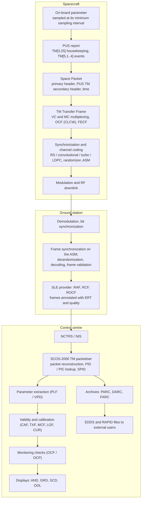
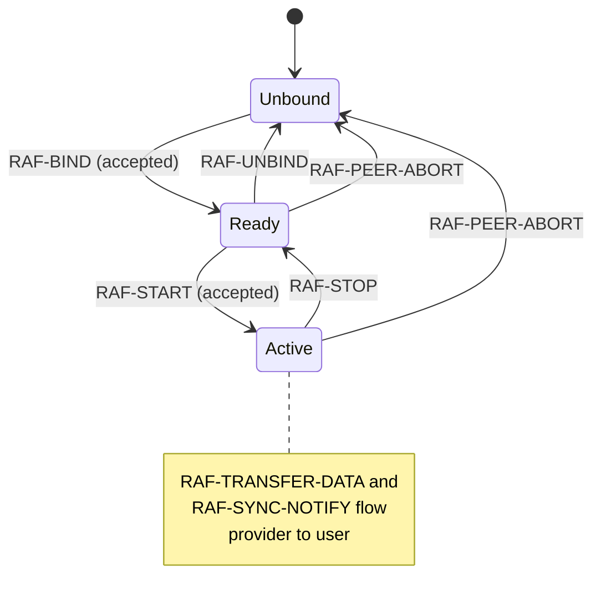
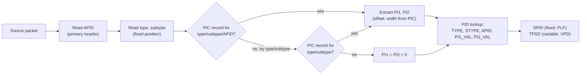
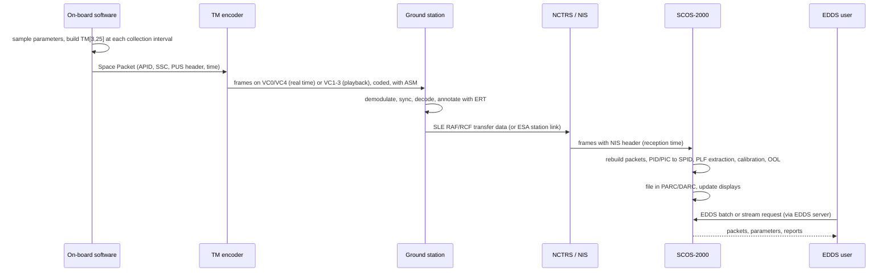

# Downlink: from on-board parameter to operator display

A temperature measured on board a spacecraft passes through about a dozen transformations
before an operator sees it as a number with a unit and a colour on a screen. The on-board
software samples it and places it in a **PUS housekeeping report**. The report travels in a
**Space Packet**, the packet is cut into fixed-length **TM transfer frames**, and the frames are
protected by **channel coding** and modulated onto a radio carrier. On the ground the station
recovers the frames and forwards them over **Space Link Extension (SLE)** services. At ESOC,
**NCTRS** hands them to the **SCOS-2000** mission control system, which rebuilds the packets,
identifies them with the [MIB](../mib/index.md), extracts and calibrates the parameter, checks
its limits, archives it, displays it, and makes it available to external users through **EDDS**.
This page walks through each stage in transmission order. It says what each layer adds and why,
and it links to the page that covers that layer in full. Real values from the public
[Solar Orbiter](../missions/solar-orbiter/index.md) documentation and MIB are used throughout.
The return path for commands is described on [Uplink](uplink.md), and the overall picture is on
[How it all fits together](index.md).

!!! info "At a glance"
    | Stage | Data unit | Governing document | Detailed page |
    |---|---|---|---|
    | Sampling, reporting | on-board parameter, TM[3,25] / TM[5,x] report | ECSS-E-ST-70-41C (PUS-C); Solar Orbiter uses ECSS-E-70-41A (PUS-A)[^pus-sp][^sol-dfh][^sol-svc] | [ST[03]](../ecss/pus/st03-housekeeping.md), [ST[05]](../ecss/pus/st05-event-reporting.md) |
    | Packetisation | Space Packet (6-octet primary header + PUS TM secondary header) | CCSDS 133.0-B-2[^spp-ph] | [Space Packet](../ccsds/space-packet.md), [PUS packets](../ecss/pus/packets.md) |
    | Framing | TM Transfer Frame (fixed length, 6-octet header, optional OCF and FECF) | CCSDS 132.0-B-3[^tm-frame] | [TM SDLP](../ccsds/tm-sdlp.md), [AOS](../ccsds/aos.md) |
    | Coding, sync | codeblock or codeword plus ASM = CADU | CCSDS 131.0-B-5[^tmc-cadu] | [TM coding](../ccsds/tm-coding.md) |
    | Ground transfer | RAF / RCF / ROCF SLE-SDU (annotated frame) | CCSDS 911.1, 911.2, 911.5[^raf-ovw][^rcf-ovw][^rocf-ovw] | [SLE return services](../ccsds/sle/return-services.md) |
    | Control centre entry | transfer frame with a NIS header (reception time) | ESOC infrastructure[^sp1291-nctrs][^tn1030-tco] | [NCTRS and NIS](../scos2000/nctrs-nis.md) |
    | Processing | SCOS-2000 TM packet (SPID), parameter sample | SCOS-2000 Database Import ICD 7.0[^icd-pid] | [MIB monitoring](../mib/monitoring.md) |
    | Dissemination | EDDS batch or stream response | EDDS ICDs, Solar Orbiter DDID[^ddid-sum] | [EDDS](../scos2000/edds.md) |

## The layer picture



*Redrawn by this wiki from the sources cited in each section below.*

Each layer adds a header, a trailer or both, and the ground removes them in reverse order. The
table below shows the main data units and the fields that the next stage relies on.

| Data unit | Created by | Key fields the next stage uses | Section |
|---|---|---|---|
| Parameter sample | on-board application process | parameter identifier, sampling interval[^pus-param] | [1](#1-sampling-an-on-board-parameter) |
| PUS report | housekeeping or event reporting subservice | report structure ID (SID) or event definition ID[^pus-hk-report][^pus-ev] | [2](#2-housekeeping-and-event-reports) |
| Space Packet | application process | APID, packet type, sequence count, length, service type/subtype, time[^spp-ph][^pus-tmsh] | [3](#3-the-pus-tm-secondary-header-and-the-time-stamp), [4](#4-the-space-packet-primary-header) |
| TM Transfer Frame | on-board telemetry encoder | SCID, VCID, frame counts, first header pointer, OCF, FECF[^tm-ph][^tm-dfs] | [5](#5-into-transfer-frames-virtual-channels-and-the-master-channel) |
| CADU | synchronization and channel coding sublayer | ASM, codeblock or codeword[^tmc-cadu] | [6](#6-channel-coding-and-the-attached-sync-marker) |
| SLE-SDU | ground station (SLE complex) | frame plus ERT, antenna ID, quality, continuity[^raf-fg] | [9](#9-sle-return-services-to-the-control-centre) |
| SCOS-2000 TM packet | SCOS-2000 packetiser | 64- or 76-octet SCOS-2000 header (SPID, times, stream), then the full source packet[^ddid-s2kpkt][^icd-tpcf] | [11](#11-packet-identification-in-scos-2000) |

## 1. Sampling an on-board parameter

An **on-board parameter** is anything the spacecraft can read: a sensor measurement or a
software variable held in memory. Each has exactly one on-board parameter identifier, unique
across the whole spacecraft. Each is also associated with an **on-board parameter minimum
sampling interval**, which is shared by groups of parameters (PUS gives 125 ms for a platform
and 500 ms for a payload as an example). All parameters accessed by one application process use
the same minimum sampling interval, and that interval is the unit in which the housekeeping and
monitoring services express their own time intervals.[^pus-param]

On the ground, the same quantity is a **monitoring parameter** in the MIB `pcf` table (see
[pcf](../mib/tables/pcf.md)), identified by an 8-character name such as `NRW01300`, with a raw
type (PTC/PFC), an optional validity condition, a calibration and a description. The link
between the ground name and the on-board identifier is not made by the name: the ground finds
the value by its *position* in a known packet (section [12](#12-parameter-extraction-plf-and-vpd)).
The MIB does carry the on-board identifier in `PCF_PID`, which must be unique and which
SCOS-2000 uses to recognise values delivered in PUS-compatible variable packets; for `NRW01300`
it holds `185585667`.[^icd-pcfpid][^mib-ex] PUS parameter types are explained on
[PUS parameter types](../ecss/pus/parameter-types.md) and their SCOS-2000 encoding on
[MIB parameter types](../mib/parameter-types.md).

## 2. Housekeeping and event reports

### ST[03] housekeeping

The **housekeeping service** gives visibility of on-board parameters assembled into report
structures. It has a housekeeping reporting subservice for nominal operations, a diagnostic
reporting subservice for contingency investigations, and a parameter functional reporting
configuration subservice that switches whole sets of reports on and off, for example at a mode
change.[^pus-hk-scope] Each **housekeeping parameter report structure** consists of:[^pus-hk-struct]

| Element | Meaning |
|---|---|
| Report structure identifier (the SID) | Unique within the application process that hosts the subservice. |
| Collection interval | How often a report is generated, in units of the minimum sampling interval. |
| Simply commutated parameters | An ordered list; each appears once per report. |
| Super commutated parameter sets | Each set has a repetition number and an ordered list of parameters; each parameter is sampled that many times per collection interval at a sub-period of interval / repetition number. |
| Periodic generation action status | Enabled or disabled, if the subservice can manage periodic generation. |

When periodic generation is enabled, the subservice emits one **TM[3,25] housekeeping parameter
report** per collection interval. Each report contains exactly one notification: the SID
followed by the sampled values in the declared order, with super-commutated samples interleaved
set by set (value 1 of A, value 1 of B, value 2 of A, value 2 of B).[^pus-hk-report] The packet
format is therefore just the SID followed by a "deduced" list of parameter values, whose layout
the ground must already know.[^pus-325] Generation is switched on by TC[3,5] and off by
TC[3,6].[^pus-hk-enable] The diagnostic equivalent is TM[3,26].[^pus-325]

!!! note "Why the ground needs the MIB"
    Nothing in a TM[3,25] packet says which parameter sits at which position. The ground can only
    interpret the report if its database describes the same structure as the on-board
    definition. The SCOS-2000 ICD makes the consequence explicit: a new report structure created
    on board with ST[03] cannot be processed until its packet definition has been added to the
    database, and ESA missions typically define the packet in the database first and generate the
    ST[03] commands from that definition.[^icd-s3]

### ST[05] event reporting

The **event reporting service** reports occurrences of operational significance that other
services do not already report: failures and anomalies (including those found by FDIR),
progress of activities, built-in test results and normal payload events.[^pus-ev] Each event
definition has an identifier, unique within its application process, optional auxiliary data,
and one of four severity levels. The severity is coded in the message subtype, which makes
detection and routing on the ground easier.[^pus-ev]

| Report | Severity | Source data |
|---|---|---|
| TM[5,1] informative event report | informative | event definition ID + auxiliary data (deduced)[^pus-ev-fmt] |
| TM[5,2] low severity anomaly report | low | same structure |
| TM[5,3] medium severity anomaly report | medium | same structure |
| TM[5,4] high severity anomaly report | high | same structure |

### What Solar Orbiter does

Solar Orbiter tailors the 2003 PUS-A issue (ECSS-E-70-41A). Its packet ICD lists TM(3,25)
"Housekeeping Parameter Report" and TM(5,1) to TM(5,4) as mandatory, with the event subtypes
named "Normal / Progress Report" and "Error / Anomaly Report" of low, medium and high severity,
and adds mission-specific subtypes such as TC(3,129) "Update HK Report Generation
Period".[^sol-svc] In the 2025-09-16 MIB release, 288 SPIDs are TM(3,25) packets, 7,156 are
ST[05] packets and 1,809 are ST[01] verification packets, out of 11,150 packet
definitions.[^mib-pid]

## 3. The PUS TM secondary header and the time stamp

PUS carries its messages in CCSDS Space Packets. A **telemetry packet** carries a report from an
on-board application process to the ground; a **telecommand packet** carries a request the other
way.[^pus-pkt] Every PUS telemetry packet except the spacecraft time packets has a **TM packet
secondary header** (PUS-C name) or **data field header** (PUS-A name).[^pus-tmsh][^pusa-tmph]

=== "PUS-C (ECSS-E-ST-70-41C, 2016)"

    <div class="bitfield" data-title="PUS-C TM packet secondary header (fixed part, 56 bits, before the time field)" data-width="32"
         data-fields='[{"n":"PUS version","b":4,"v":"0010","d":"TM packet PUS version number, set to 2"},{"n":"S/C time ref. status","b":4,"d":"Status of the on-board time reference used to time-tag the packet, 0 if not supported"},{"n":"Service type ID","b":8,"g":"Message type ID"},{"n":"Message subtype ID","b":8,"g":"Message type ID"},{"n":"Message type counter","b":16,"d":"Per destination and message type, 0 if not supported"},{"n":"Destination ID","b":16,"d":"Application process user identifier of the addressee"}]'></div>

    | Field | Bits | Values | Meaning |
    |---|---|---|---|
    | TM packet PUS version number | 4 | 2 | Version 0 was the ESA PUS (PSS-07-101), version 1 is ECSS-E-70-41A.[^pus-tmsh] |
    | Spacecraft time reference status | 4 | 0 if not supported | Status of the on-board time reference used for the time tag.[^pus-tmsh] |
    | Message type ID | 8 + 8 | service type, message subtype | Identifies the report, for example 3 and 25.[^pus-tmsh] |
    | Message type counter | 16 | 0 if not supported | Count of generated messages of that type per destination.[^pus-tmsh] |
    | Destination ID | 16 | application process user ID | The addressee of the report.[^pus-tmsh] |
    | Time | absolute time, PFC declared by the mission | | The time tag of the report.[^pus-tmsh] |
    | Spare | optional | | Pads the header to an integral number of words.[^pus-tmsh] |

    The user data field that follows holds the source data (structure deduced from the message
    type), an optional spare field that pads the packet to the mission's padding word size, and an
    optional 16-bit **packet error control** field. Whether TM packets are checksummed, and with the
    ISO 16-bit checksum or the 16-bit CRC, is a mission tailoring choice.[^pus-tmud]

=== "PUS-A (ECSS-E-70-41A, 2003), used by Solar Orbiter"

    The PUS-A data field header starts with a spare bit (formerly the CCSDS secondary header
    flag), a 3-bit PUS version set to 1 and 4 spare bits, followed by the service type and
    subtype (8 bits each), an optional packet sub-counter, an optional destination ID, an
    optional time field in CUC or CDS format, and optional spare bits.[^pusa-tmdfh]

    <div class="bitfield" data-title="Solar Orbiter TM data field header (80 bits, PUS-A)" data-width="16"
         data-fields='[{"n":"Spare","b":1,"v":"0"},{"n":"PUS version","b":3,"v":"001"},{"n":"Spare","b":4,"v":"0000"},{"n":"Service type","b":8},{"n":"Service subtype","b":8},{"n":"Destination ID","b":8,"d":"00000000 = ground for HK, table, diagnostic and dump categories"},{"n":"Time: coarse","b":32,"g":"CUC 4+2","d":"Unsegmented binary count of seconds"},{"n":"Time: fine","b":16,"g":"CUC 4+2","d":"Binary fraction of a second"}]'></div>

    Solar Orbiter sets the PUS version to 1 and all spares to zero, and stamps each packet with
    the time at which its generation started, in CUC with 4 octets of coarse time and 2 octets
    of fine time.[^sol-dfh] A destination ID is used: solicited telemetry copies the command's
    source ID, while housekeeping, table, diagnostic and dump packets always carry `0x00`
    (ground).[^sol-dest] The packet data field is at most 4,106 octets: 4,096 octets of source
    data plus the 10-octet data field header.[^sol-tmph]

!!! warning "Inference"
    The Solar Orbiter header figure is an image that is not part of the extracted text. The field
    order shown is the PUS-A order, and the sizes are deduced from the 10-octet total, the 8-bit
    destination ID and the 6-octet time. This leaves no room for the optional packet
    sub-counter. The MIB agrees: 11,138 of its 11,150 packet definitions, every spacecraft PUS
    packet among them, have `PID_DFHSIZE` = 16 (6 + 10 octets), and the PIC places the
    housekeeping SID at octet 16. The other 12 are the time report on APID 0 (no data field
    header, 6), three complete-frame packets on APID 1 and eight control-system packets on
    APID 1966.[^mib-pic] The sibling page [Worked example: decoding a real Solar Orbiter telemetry packet](worked-example-tm.md)
    reaches the same conclusion.

### The time field

The **CCSDS Unsegmented Time Code (CUC)** is a binary count of basic time units (normally
seconds) from an epoch, optionally followed by octets of binary fraction. Its optional P-field
says, in octet 1, whether the field is extended (bit 0), which epoch is used (bits 1 to 3:
`001` for the 1958 January 1 TAI epoch, `010` for an agency-defined epoch), how many coarse
octets there are minus one (bits 4 to 5), and how many fine octets there are (bits 6 to
7).[^cuc] The PUS secondary header does not carry a P-field. PUS-C instead requires the
format (PFC) of the time field to be declared when the mission's time service is
specified.[^pus-tmsh] Solar Orbiter's standard
spacecraft time source packet is the exception that carries an explicit P-field, `0b00101110`
(agency epoch, 4 coarse and 2 fine octets). It has APID 0, no data field header, and an 8-octet
data field. Its time refers to the leading edge of the first bit of the attached sync marker of
the VC 0 frame whose virtual channel frame count is 0.[^sol-time][^cuc]

<div class="bitfield" data-title="CUC T-field with 4 coarse and 2 fine octets (Solar Orbiter)" data-width="16"
     data-fields='[{"n":"Coarse time (seconds)","b":32},{"n":"Fine time (2^-16 s units)","b":16}]'></div>

The on-board time in the packet is not UTC. The ground converts it with a **time correlation**
built from such time packets: the frame's Earth reception time (from the NIS header) minus the
ground delay, propagation delay and on-board radiation delay gives the frame transmission time,
which is paired with the latched on-board time.[^tn1030-tco] Mars Express quotes an accuracy below
2 ms for this conversion.[^sp1291-mcs] See [Time correlation in SCOS-2000](../scos2000/time-correlation.md)
and [Time code formats](../ccsds/time-codes.md).

## 4. The Space Packet primary header

The **Space Packet Protocol** defines a fixed 6-octet primary header followed by a packet data
field of 1 to 65,536 octets.[^spp-ph][^spp-len]

<div class="bitfield" data-title="Space Packet primary header (48 bits)" data-width="16"
     data-fields='[{"n":"Version","b":3,"v":"000","g":"Packet ID"},{"n":"Type","b":1,"v":"0","g":"Packet ID","d":"0 = telemetry"},{"n":"Sec. hdr flag","b":1,"g":"Packet ID"},{"n":"APID","b":11,"g":"Packet ID"},{"n":"Sequence flags","b":2,"g":"Sequence control"},{"n":"Packet sequence count","b":14,"g":"Sequence control"},{"n":"Packet data length","b":16,"d":"Octets in the packet data field minus one"}]'></div>

| Field | Bits | Values | Meaning and rationale |
|---|---|---|---|
| Packet version number | 3 | `0b000` | Identifies a Version 1 CCSDS packet.[^spp-ph] |
| Packet type | 1 | `0` TM, `1` TC | Separates reports from requests.[^spp-ph] |
| Secondary header flag | 1 | `1` if present | Static per APID for a mission phase; always 0 for idle packets.[^spp-ph] |
| APID | 11 | 0 to 2047; 2047 = idle | Names the managed data path. In PUS it identifies the source application process of a TM packet.[^spp-ph][^pus-sp] |
| Sequence flags | 2 | `0b11` = unsegmented | PUS uses `0b11` (stand-alone) for all its packets.[^spp-psc][^pus-sp] |
| Packet sequence count | 14 | modulo 16,384 | Counted per APID, so the ground can detect missing packets and restore order.[^spp-psc] |
| Packet data length | 16 | C = octets - 1 | The packet is 6 octets longer than the data field.[^spp-len][^pus-sp] |

Solar Orbiter structures its 11-bit APID as a 7-bit **process ID** (the source application)
followed by a 4-bit **packet category**. APID 0 is reserved for the time packet and the all-ones
APID for idle packets.[^sol-tmph] The categories include 1 for TC verification, 2 for HPTM
housekeeping (platform only), 4 for routine housekeeping, 7 for events, 9 for dumps, 10 for
file transfer and 12 for private science or telecommand.[^sol-apid] Solar Orbiter keeps a source
sequence count per APID *and* destination ID, raises a ground alarm on every discontinuity, and
uses the sequence flags as **grouping flags** for multi-packet answers (for example a memory
dump), while each packet stays self-contained.[^sol-tmph]

!!! example "Worked example (values from the MIB; sequence count illustrative)"
    The RW1 bearing temperature used later on this page travels in the packet with APID 178.
    In binary, 178 is `0b00010110010`: process ID `0b0001011` = 11 (the AOCS application in
    the Solar Orbiter PID table) and category `0b0010` = 2.[^mib-ex][^sol-apid] The first two
    octets of the primary header are therefore `0x08B2` (version 0, type 0, secondary header
    flag 1, APID 178). With stand-alone flags and an illustrative count of 0x0123, the next two
    octets are `0xC123`.

Full detail: [Space Packet Protocol](../ccsds/space-packet.md) and
[PUS packet structures](../ecss/pus/packets.md).

## 5. Into transfer frames: virtual channels and the master channel

Packets have variable length, but the weak, noisy space link needs **fixed-length** protocol
data units so that the receiver can synchronise simply and robustly. The **TM Space Data Link
Protocol** therefore defines the **TM Transfer Frame**, whose length is fixed per physical
channel and mission phase.[^tm-feat][^tm-frame] One physical channel is shared among several data
streams by **virtual channels** (VCs).[^tm-feat] Frames are addressed by three identifiers. The
transfer frame version number (TFVN) plus the spacecraft ID (SCID) form the **master channel
ID** (MCID), and the MCID plus the VCID form the global VCID.[^tm-addr] For a single spacecraft
the master channel is usually the whole physical channel.[^tm-addr][^pus-link]

| Component | Size | Presence |
|---|---|---|
| Transfer frame primary header | 6 octets | mandatory |
| Transfer frame secondary header | up to 64 octets | optional |
| Transfer frame data field | integral number of octets | mandatory |
| Operational control field (OCF) | 4 octets | optional |
| Frame error control field (FECF) | 2 octets | optional |

*Source: CCSDS 132.0-B-3 §4.1.1.*[^tm-frame]

<div class="bitfield" data-title="TM Transfer Frame primary header (48 bits)" data-width="16"
     data-fields='[{"n":"TFVN","b":2,"v":"00","g":"Master channel ID"},{"n":"Spacecraft ID","b":10,"g":"Master channel ID"},{"n":"VCID","b":3},{"n":"OCF flag","b":1},{"n":"Master channel frame count","b":8,"d":"Modulo 256 per master channel"},{"n":"Virtual channel frame count","b":8,"d":"Modulo 256 per virtual channel"},{"n":"Sec. hdr flag","b":1,"g":"Data field status"},{"n":"Sync flag","b":1,"g":"Data field status"},{"n":"Packet order","b":1,"g":"Data field status"},{"n":"Segment length ID","b":2,"v":"11","g":"Data field status"},{"n":"First header pointer","b":11,"g":"Data field status","d":"Offset of the first packet header in the data field; 11111111111 = none starts here; 11111111110 = only idle data"}]'></div>

| Field | Bits | Values | Meaning and rationale |
|---|---|---|---|
| TFVN | 2 | `0b00` | TM version 1. TC frames share the value; they are told apart by the ASM or start sequence.[^tm-ph] |
| Spacecraft ID | 10 | SANA-assigned | Static for all mission phases.[^tm-ph] |
| VCID | 3 | 0 to 7 | No numbering constraint.[^tm-ph] |
| OCF flag | 1 | `1` = OCF present | Static per master or virtual channel.[^tm-ph] |
| Master channel frame count | 8 | mod 256 | Lets the receiver check completeness of the master channel.[^tm-ph] |
| Virtual channel frame count | 8 | mod 256 | Per-VC accountability, needed to extract packets systematically.[^tm-ph] |
| Secondary header flag | 1 | | Signals the frame secondary header.[^tm-dfs] |
| Synchronization flag | 1 | `0` packets, `1` VCA_SDU | Static per VC.[^tm-dfs] |
| Packet order flag | 1 | `0` | Reserved when the sync flag is 0.[^tm-dfs] |
| Segment length ID | 2 | `0b11` | Legacy field, fixed when the sync flag is 0.[^tm-dfs] |
| First header pointer | 11 | offset; `0x7FF`; `0x7FE` | Lets the receiver find packet boundaries even after losing a frame.[^tm-dfs] |

**How packets enter frames.** For each VC, the *packet processing function* concatenates packets
into the fixed-length data field. A packet that does not fit is split, and the rest continues in
the next frame of the same VC. The first header pointer marks the first packet header that
starts in each frame, and idle packets fill the space when no data is ready. The *virtual channel
generation function* adds the header and a per-VC frame count. The *virtual channel
multiplexing function* interleaves VCs in an order set by the project, and it inserts an
**only-idle-data (OID)** frame when nothing is ready, so that the stream stays continuous. The
*master channel generation function* adds the master channel frame count and any
master-channel OCF or secondary header. The *all frames generation function* computes the
FECF.[^tm-send] The FECF is a 16-bit CRC with generator
$G(X) = X^{16} + X^{12} + X^5 + 1$ and an all-ones preset.[^tm-fecf]

**The operational control field.** The 4-octet OCF carries real-time reports. When its type flag
(bit 0) is 0 it holds a Type-1 report, the **CLCW** of [COP-1](../ccsds/cop-1.md), which is
how the spacecraft acknowledges telecommand frames. When the flag is 1 it holds a Type-2 report
(project-specific or an SDLS frame security report). The spacecraft must send OCF-carrying VCs
often enough for the COP not to time out.[^tm-ocf] The CLCW layout is defined by the TC Space
Data Link Protocol.[^clcw]

<div class="bitfield" data-title="CLCW carried in the OCF (32 bits)" data-width="32"
     data-fields='[{"n":"Type","b":1,"v":"0"},{"n":"Version","b":2,"v":"00"},{"n":"Status","b":3},{"n":"COP","b":2,"v":"01"},{"n":"TC VCID","b":6},{"n":"Spare","b":2},{"n":"No RF","b":1},{"n":"No bit lock","b":1},{"n":"Lockout","b":1},{"n":"Wait","b":1},{"n":"Retransmit","b":1},{"n":"FARM-B count","b":2},{"n":"Spare","b":1},{"n":"Report value N(R)","b":8}]'></div>

### Solar Orbiter frames

| Item | Solar Orbiter value |
|---|---|
| Frame length | 1,115 octets (8,920 bits) before encoding, the only allowed length[^sol-frame] |
| SCID | `0x28A` = 650[^sol-frame] |
| OCF | present in every frame, always a CLCW (type flag 0)[^sol-frame2] |
| Frame secondary header | in every frame: ID octet `0b00000011` (version 0, length 4 - 1 = 3) and 3 octets that extend the VC frame count by 24 bits[^sol-frame2] |
| Synchronization flag, packet order, segment length ID | 0, 0, `0b11`[^sol-frame2] |
| FECF | inserted in every frame[^sol-frame2] |
| Downlink priority | VC4 real-time high priority first. VC0 real-time (also used when the time packet is due) goes when VC4 is not ready. VC5 critical event log goes only when neither VC4 nor VC0 is ready, although the ICD lists it before VC0. Then come VC1 playback from the OBC mass memory, VC2 and VC3 playback from the SSMM, and VC7 with idle frames only[^sol-vc] |

The ICD gives the frame data field as a constant 1,099 octets, which matches 1,115 - 6 - 4 - 4 - 2
for the primary header, secondary header, OCF and FECF. The longest TM source packet is 4,112 octets
(6 + 4,106), and packets longer than one data field are split across frames.[^sol-tmov][^sol-tmph]
A maximum-size packet therefore spans four or five frames, depending on where it starts. Every
frame that holds only a continuation of it carries the first header pointer `0x7FF`. The
four-or-five count is this wiki's arithmetic.

The ground keeps the VC separation. In the Solar Orbiter MCS, the stream ID of each archived
packet records its VC: 1000 for VC0 real-time non-science, 1001 for VC1 playback non-science,
1002 for VC2 science and 1003 for VC3 file transfer when online, with 2000 and above for the
offline equivalents.[^ddid-common]

!!! note "AOS frames instead of TM frames"
    Missions with higher rates or more channels may use the **AOS Space Data Link Protocol**.
    Its frame has a 6- or 8-octet primary header with TFVN `0b01`, an 8-bit SCID, a 6-bit VCID
    (so up to 64 VCs), a 24-bit VC frame count, a signalling octet and an optional 16-bit header
    error control. An optional insert zone may follow, and the same 4-octet OCF and 2-octet FECF
    trailer are available.[^aos-frame][^pus-link] Issue 5 of the AOS book (October 2025) widens the
    spacecraft ID to 10 bits by adding two bits elsewhere in the header; missions built to issue 4
    or earlier keep the 8-bit field.[^aos5-scid] See [AOS](../ccsds/aos.md) and, for the newer
    unified protocol, [USLP](../ccsds/uslp.md). Every identifier field of these frames is listed
    on [space link identifiers](../ccsds/space-link-identifiers.md).

## 6. Channel coding and the attached sync marker

Between the data link protocol and the physical layer sits the **synchronization and channel
coding sublayer**. It provides error-control coding (including frame validation), frame
synchronization and pseudo-randomization.[^tmc-arch] At the sending end, the frames are first
Reed-Solomon, turbo or LDPC encoded (optional), then randomized (optional), then preceded by an
**attached sync marker (ASM)**, and finally convolutionally encoded (optional) into channel
symbols.[^tmc-org]

| Code | Main property |
|---|---|
| Convolutional (basic or punctured) | Inner code. The punctured rates expand the bandwidth less.[^tmc-codes] |
| Reed-Solomon (255, 255 - 2E), E = 16 or 8 | Burst-error correction with interleaving depth I. Also validates the frame with a very low undetected error rate.[^tmc-rs] |
| Concatenated (RS outer, convolutional inner) | More coding gain than either alone.[^tmc-codes] |
| Turbo, LDPC | Even greater coding gain.[^tmc-codes] |

**Frame validation.** The receiver must know whether each decoded frame can be used. Reed-Solomon
and LDPC decoders give that answer themselves. Otherwise the FECF of the TM, AOS or USLP frame is
used.[^tmc-codes]

**The ASM and the CADU.** Synchronization is acquired by recognising the regularly spaced ASM,
which is placed between frames (uncoded or convolutional), between RS codeblocks, or between
turbo and LDPC codewords. The ASM plus the frame, codeblock or codeword is the **channel access
data unit (CADU)**.[^tmc-cadu] The 32-bit ASM used for uncoded, convolutional, Reed-Solomon,
concatenated and rate-7/8 LDPC data is `0x1ACFFC1D`. Turbo and the other LDPC rates use longer
markers, such as the 64-bit `0x034776C7272895B0`.[^tmc-asm]

<div class="bitfield" data-title="CADU for Reed-Solomon or concatenated coding" data-width="32"
     data-fields='[{"n":"ASM 0x1ACFFC1D","b":32,"v":"00011010110011111111110000011101","d":"Not randomized, not part of the RS codeblock"},{"n":"Randomized RS codeblock: transfer frame + 2E x I check symbols","b":32,"d":"Length depends on frame length, E and interleaving depth I; drawn shortened"}]'></div>

**Why randomize.** The receiver's symbol synchronizer needs enough bit transitions, the spectrum
must be free of strong lines, and codeword synchronization must not be fooled by repetitive
patterns. Problems have been seen on real links when the randomizer was not used. The
pseudo-randomizer XORs each frame, codeblock or codeword (but not the ASM) with a 131,071-bit
sequence from $h(x) = x^{17} + x^{14} + 1$, seeded with `11000111000111000`. A legacy 255-bit
sequence from $h(x) = x^8 + x^7 + x^5 + x^3 + 1$ is still allowed. Its use is fixed per
physical channel and is not signalled in the data.[^tmc-rand] Issue 6 of the book (April 2026),
also in the library, makes the pseudo-randomizer mandatory.[^tmc6-rand]

!!! note "Solar Orbiter coding"
    The coding scheme, interleaving depth and randomizer choice of the Solar Orbiter downlink
    are not stated in the available sources. The packet ICD fixes the frame layout but not the
    coding sublayer.[^sol-frame]

Full detail: [TM synchronization and channel coding](../ccsds/tm-coding.md).

## 7. Modulation

The channel symbols modulate an RF carrier. ECSS selects the space-link modulation to minimise
occupied bandwidth and the channel coding to minimise transmitted power, and it defines the
permissible schemes in ECSS-E-ST-50-05.[^e50-space] That standard covers frequency bands,
spectral and power constraints and the allowed modulations, among them GMSK, filtered OQPSK and
SRRC-4D 8PSK TCM. Where a ranging service is needed, the modulation choice must also stay
compatible with ECSS-E-ST-50-02.[^hb-rf][^hb-rf2] On the CCSDS side the same ground is covered by
the omnibus Radio Frequency and Modulation Systems book, CCSDS 401.0.[^g4-phys]

The Solar Orbiter MIB shows the options of the spacecraft's deep-space transponder as data: its
housekeeping report "PLF DST HK" ([SPID 33793](../explorer/index.md#/solo/packet/33793)) carries a
telemetry modulation scheme parameter whose textual calibration allows `GMSK` or `SPL`, and a
telecommand bit rate between 7.8125 and 4000 bit/s.[^mib-dst] Bands, modulations, ranging and the
transponder telemetry are explained on [radio frequency, modulation and ranging](../ccsds/rf-and-ranging.md).

## 8. At the ground station

The receiving end runs the coding sublayer in reverse. It performs convolutional decoding (if
used), frame synchronization on the ASM, derandomization, and then Reed-Solomon, turbo or LDPC
decoding. It delivers frames to the data link protocol sublayer.[^tmc-org] The SLE standards
describe the same chain from the station's point of view. The return space link processing
function steers the antenna, acquires the carrier and demodulates the symbol stream. It
synchronizes at node, codeblock and frame level, removes the randomization, decodes, checks the
FECF and recovers the frames.[^raf-fg] A frame counts as acquired when the ASMs before and after
it are found with the same polarity and the correct number of bits between them.[^raf-fg]

Each frame is then **annotated**. The annotation gives its Earth reception time (ERT), the
antenna that acquired it, whether it contains detected uncorrectable errors, and its continuity
with the previous frame.[^raf-fg] A frame counts as "good" when all its RS or LDPC codewords are
valid or, without RS or LDPC, when its FECF checks. For a good RS frame the check symbols are
removed before delivery, and an erred frame is delivered whole.[^raf-fg][^raf-prod]

The receiving side of the TM SDLP then demultiplexes frames by VCID and discards frames with an
invalid VCID. It can flag a gap in a VC frame count, and it uses the first header pointer and
the packet length fields to extract packets, assembling a packet that spans frames from the
start of the next frame on the same VC. Idle packets and OID frames are discarded.[^tm-recv] The
ESA sources place this packet reconstruction in the SCOS-2000 packetiser at the control centre
([section 11](#11-packet-identification-in-scos-2000)): the MCS builds packets out of the
received frames.[^gsaw03-mon][^ddid-bad]

## 9. SLE return services to the control centre

**Space Link Extension** carries the station's output to the user's control centre over
terrestrial networks, with standard operations, so that any agency's station can support any
mission. Three return services matter here:

| Service | Delivers | Typical use |
|---|---|---|
| **RAF**, return all frames | all frames of one physical channel, annotated[^raf-ovw] | complete frame stream |
| **RCF**, return channel frames | all frames of one master channel or one virtual channel[^rcf-ovw] | one spacecraft or one VC |
| **ROCF**, return operational control fields | all or a subset of the OCFs of one master or virtual channel[^rocf-ovw] | CLCWs for commanding |

A service instance is scheduled in a **service package**. Its *production* parameters (carrier
frequency, modulation, bit rate, coding, session times) can only be changed by service
management. Its *provision* parameters (provision period, delivery mode, quality of service)
belong to the individual instance.[^raf-sm][^raf-sched] How agreements and packages are
negotiated is on [SLE service management](../ccsds/sle/service-management.md). The RAF operations are BIND, UNBIND,
START, STOP, TRANSFER-DATA, SYNC-NOTIFY, SCHEDULE-STATUS-REPORT, STATUS-REPORT, GET-PARAMETER and
PEER-ABORT. The provider moves through the states unbound, ready and active, and frames flow
only in the active state.[^raf-ops]



*Provider states after CCSDS 911.1-B-5 §2.6.4.2; transitions simplified by this wiki.*[^raf-ops]

**Delivery modes.** *Online timely* delivery may discard data in blocks when the link cannot keep
up, so that the user does not receive data past the point of usefulness. *Online complete*
delivery keeps everything in an online frame buffer. *Offline* delivery serves frames stored
during the pass some time after it ends.[^raf-sm][^raf-buf] In every mode, frames and
notifications are packed into a transfer buffer that is released when it is full or when a
release timer set to the **latency limit** expires.[^raf-buf] SLE-PDUs are mapped onto TCP/IP by a
separate CCSDS standard. See [SLE concept](../ccsds/sle/index.md),
[SLE return services](../ccsds/sle/return-services.md) and
[SLE over TCP/IP](../ccsds/sle/isp1-and-api.md).[^raf-tech]

## 10. NCTRS and NIS: into the control centre

At ESOC the mission control system does not talk to stations directly. The **NCTRS** interfaces
the MCS with the ground station network and uses SLE for non-ESA stations.[^gsaw05-nctrs] For
Mars Express it receives the telemetry that the station has already checked and time-stamped
with the ERT, and passes the housekeeping and science telemetry to the MCS for processing and
archiving. It also collects tracking data and moves files such as station schedules.[^sp1291-nctrs]
DLR's mobile control centre runs GECCOS, which is derived from SCOS-2000. It reaches stations
through what the DLR paper calls the bespoke NCTRS protocol, and an SLE switch board translates
that protocol to standard SLE.[^dlr-nctrs]

The SCOS-2000 time correlation note describes telemetry frames arriving at the MCS with a
**NIS header** that holds the UTC reception time of the frame.[^tn1030-tco] On the MCS side, the
SCOS-2000 TM packetiser rebuilds packets from frames, extracts the CLCW, and runs quality and
continuity checks.[^gsaw03-mon] Solar Orbiter's archive keeps the ID of the receiving station
with each packet: 21 Kourou, 22 Perth, 23 New Norcia, 24 Cebreros, 25 Malargüe, 30 Maspalomas,
plus test identifiers.[^ddid-common] The GDDS binary format even keeps an "SLE service Id" field
that records over which SLE service and channel type the data was received.[^ddid-fmt] The
names and acronyms of these systems vary between sources. The NCTRS, for example, is the
"Network Control and TM/TC Router System" in a 2005 ESA presentation and the "Network Controller
and Telemetry Receiver System" in the Mars Express data handling paper.[^gsaw05-nctrs][^sp1291-nctrs]
See [NCTRS, NIS and the ground station interface](../scos2000/nctrs-nis.md).

## 11. Packet identification in SCOS-2000

SCOS-2000 must decide what each packet *is* before it can extract anything. The packetiser first
reads the **APID** from the primary header. It then reads the **type and subtype** from the
packet, at a position configured once for the whole spacecraft (a constraint on the on-board
design). If the PIC table requires it, it also reads up to two **additional identification
fields** from the application data. With this key it looks up the **PID** table, which gives the
**SPID** (SCOS-2000 packet ID) and the **TPSD**, and it files and distributes the resulting
SCOS-2000 TM packet.[^icd-pid]



*After the precedence rules of ICD issue 7.0 §3.3.2.4.2.*[^icd-pic]

| Table | Role on the downlink | Reference page |
|---|---|---|
| [pid](../mib/tables/pid.md) | Maps the key (type, subtype, APID, PI1, PI2) to a SPID and TPSD. It also gives the start offset for variable-packet decoding (`PID_DFHSIZE`), whether the packet carries a time field (`PID_TIME`) and whether its packet error control is checked (`PID_CHECK`). Each different packet must have its own SPID since R5.0, and SPIDs already in the archive must not be reassigned.[^icd-pid] | [MIB monitoring](../mib/monitoring.md) |
| [pic](../mib/tables/pic.md) | Says where PI1 and PI2 sit (byte offset from the start of the source packet, width in bits), per type/subtype and optionally per APID. -1 means not used.[^icd-pic] | |
| [tpcf](../mib/tables/tpcf.md) | Packet mnemonic and size for history files.[^icd-tpcf] | |

In the Solar Orbiter MIB the PIC gives the TM(3,25) and TM(3,26) SID at octet 16 with a width of
8 bits. TM(5,1) to TM(5,4) take a 16-bit event ID at octet 16, sometimes with a second field at
octet 18 or 19 for selected APIDs. TM(1,2) and TM(1,8) take a 16-bit failure code at octet 20,
just after the 4-octet request ID.[^mib-pic] The release defines 11,150 packets over 293 APIDs,
of which 2,063 use a variable-packet TPSD.[^mib-pid] The MCS's own packets use APID 1966, for
example the time couple packet (SPID 66841) and the time correlation coefficient packet
(SPID 66842), both of type 164.[^ddid-tco][^mib-pid]

**What is archived.** Each SCOS-2000 packet has a common header followed by a type-specific
header, and then the complete, unstripped source packet. For Solar Orbiter these headers hold:[^ddid-s2kpkt][^ddid-common][^ddid-tmhdr]

| Header field | Content (Solar Orbiter) |
|---|---|
| Filing time | Primary retrieval key; for TM, set by the timestamp policy: 0 = reception, 1 = ERT minus propagation delay, 2 = correlated on-board generation time, with a time quality of good, inaccurate or bad |
| Creation time | When the SCOS-2000 packet was created, roughly the reception time |
| S/C ID, G/S ID | 650, and the receiving ground station |
| Stream ID | MCS data stream, which maps to the VC for TM |
| Filing key | The SPID |
| DB release and issue | MIB version used when the packet was archived (`VDF_RELEASE`, `VDF_ISSUE`) |
| Route ID | Data unit type and qualifier: TM frame good, bad or idle; TM source packet good, bad, idle, unknown or time packet; internal packets such as CLCW |
| PUS APID, SSC, service type, subtype | Copied from the source packet |

Adding up the field sizes listed in the Solar Orbiter DDID gives a 60-octet common header and a
16-octet TM header, 76 octets in total, which matches the size the ICD gives for header version
4. The DDID itself gives the structure version as 5. Both totals are this wiki's
arithmetic.[^ddid-common][^ddid-tmhdr][^icd-tpcf]

When frames are missing in the middle of a long packet, the MCS files the part rebuilt up to the
gap as a "bad" packet. It then files the following frames as individual frame packets until the
next packet header appears.[^ddid-bad]

## 12. Parameter extraction: PLF and VPD

For **fixed** packets, each row of the [plf](../mib/tables/plf.md) table places one parameter in
one SPID. It gives the byte offset from the start of the source packet (`PLF_OFFBY`), the start
bit within that byte with bit 0 the leftmost (`PLF_OFFBI`), and for super-commutated parameters
the number of occurrences, the bit distance between them and their time spacing. It also gives a
time offset that corrects each sample's time stamp relative to the packet time.[^icd-proc][^icd-plf]
The width comes from the parameter's PTC/PFC in `pcf`. Overlaps and gaps are allowed, but a
parameter may appear only once per packet.[^icd-plf]

For **variable** packets, the [vpd](../mib/tables/vpd.md) table describes the structure with
repeated groups and choices. It is referenced through the TPSD, with offsets counted from the end
of the data field header (`PID_DFHSIZE`).[^icd-proc] Values from variable packets cannot take
part in full TM processing: validity, monitoring checks, verification and synthetic parameters.
This is because their time reference is only known once the packet is opened. Variable packets
are therefore meant for special reports rather than regular housekeeping.[^icd-pusvar] SCOS-2000
also time-stamps each housekeeping sample from the packet time plus a static database offset, so
the offsets must be known in advance.[^icd-s3] The release holds 400,792 PLF rows and 19,863 VPD
rows.[^mib-pid]

Parameters that are computed rather than received, the **synthetic parameters**, enter the same
chain. Solar Orbiter defines 1,582 dynamic OL parameters and 2 saved synthetic parameters, next to
125,161 raw telemetry parameters.[^mib-pcf] See [Synthetic parameters and the OL language](../mib/synthetic-parameters.md).

## 13. Validity and calibration

Before calibration, SCOS-2000 applies the parameter's **validity** condition. `PCF_VALID` names
another parameter and `PCF_VALPAR` gives the raw value it must have. SCOS-2000 uses this
expression, and the validity of the validity parameter itself, to decide whether a sample is
valid. The validity parameter must have an integer raw value and be processed by the TM
model.[^icd-t1][^icd-valid] 20,692 Solar Orbiter parameters have a validity
parameter.[^mib-pcf]

**Calibration** turns a raw value into an engineering value. It applies to raw, constant and
synthetic parameters of numerical nature only.[^icd-cal] The category `PCF_CATEG` is `N` for
numerical, `S` for status (textual calibration) and `T` for character strings. `PCF_CURTX` names
a single calibration, while the [cur](../mib/tables/cur.md) table selects one of several at run
time with an applicability condition.[^icd-categ][^icd-cur]

| Type | Tables | Principle | Solar Orbiter count |
|---|---|---|---|
| Numerical | [caf](../mib/tables/caf.md), [cap](../mib/tables/cap.md) | Raw/engineering point pairs. Outside the curve the value is either invalid (`CAF_INTER = F`, default) or extrapolated linearly from the end points (`P`).[^icd-caf] | 679 curves |
| Textual | [txf](../mib/tables/txf.md), [txp](../mib/tables/txp.md) | Raw ranges mapped to strings; an unmapped value gives `****`.[^icd-inter] | 1,003 |
| Polynomial | [mcf](../mib/tables/mcf.md) | $Y = A_0 + A_1X + A_2X^2 + A_3X^3 + A_4X^4$.[^icd-mcf] | 229 |
| Logarithmic | [lgf](../mib/tables/lgf.md) | $Y = 1 / (A_0 + A_1\ln X + A_2\ln^2 X + A_3\ln^3 X + A_4\ln^4 X)$.[^icd-mcf] | 0 |

*Counts from the 2025-09-16 release; 30,936 parameters name a calibration in `PCF_CURTX` and
907 parameters use the CUR table.*[^mib-cal] The detail is on [Calibration in the MIB](../mib/calibration.md).

## 14. Monitoring checks

Calibrated (or raw) values are checked against limits. At most one [ocf](../mib/tables/ocf.md)
row per parameter gives the number of consecutive valid violating samples needed to declare it
out of limits (`OCF_NBCHCK`). It also gives the number of checks (1 to 16), whether the limits are
raw (`U`) or calibrated (`C`), and their coding (real, ASCII or integer).[^icd-ocf] The checks
themselves are [ocp](../mib/tables/ocp.md) rows, evaluated in order:[^icd-ocp][^icd-ocptype]

| `OCP_TYPE` | Check | Solar Orbiter rows |
|---|---|---|
| `S` | Soft limit check | 3,096 |
| `H` | Hard limit, or soft status check | 4,153 |
| `D` | Delta check against the last valid value | 105 |
| `C` | Status consistency against the value expected from commanding | 15 |
| `E` | Event generation only (no OOL display) | 0 |

Each check can carry an **applicability** condition (`OCP_RLCHK` = `OCP_VALPAR`), so that, for
example, limits apply only when a unit is on. The search for applicable checks stops at the first
applicable check or the first soft/hard pair. A value exactly on a limit is not out of
limits.[^icd-ocp][^icd-ocprl] The applicability parameter must have an integer raw value and be
processed by the TM model.[^icd-ocprl] See [Monitoring checks](../mib/monitoring-checks.md) and,
for on-board limit checking, [ST[12]](../ecss/pus/st12-onboard-monitoring.md).

## 15. Archiving and display

SCOS-2000 keeps a **packet archive** of historical telemetry, telecommands and derived data, and
a **file archive** for files such as flight dynamics and planning products. It can also generate
summary files such as command history reports.[^sp1291-dds] In the Solar Orbiter MCS, the
long-term archive server holds the packet archive (PARC) for packets, events and telecommands,
the parameter archive (DARC) for parameter values, and the file archive (FARC) for auxiliary
files.[^ddid-gen] Telemetry is normally retrievable within seconds of reception at the ground
station.[^ddid-gen] See [Mission archives: PARC, DARC and FARC](../scos2000/archives.md).

The standard monitoring displays are the alphanumeric display (AND, 32- or 64-parameter), the
graphical display (GRD) and the scrolling display (SCD). They use the PLF definitions to pull
values out of packets,[^icd-plf] and only TM-model parameters (PLF or synthetic) can appear on them.
Since R5.0 their definitions are XML files in the FARC, although the ASCII `dpf`/`dpc`,
`gpf`/`gpc` and `spf`/`spc` tables are still imported for backward compatibility.[^icd-disp] The
packetiser, displays and retrieval functions together cover packet reconstruction, parameter
extraction with super-commutation, synthetic parameters, calibration, validity, limit,
expected-status and status-consistency checking, and retrievals from a given time with up to four
merged streams.[^gsaw03-mon] See [Display definitions in the MIB](../mib/displays.md).

## 16. Dissemination via EDDS

People outside the control room see the data through the **EGOS Data Dissemination System
(EDDS)**. It gives controlled access to telemetry, telecommand history and auxiliary data for
users without access to the MCS. It offers management services, data
services (batch and stream) and notification services. Management covers user accounts and
configuration, with access policies based on missions, users, privileges and roles. Clients are a web portal, a standalone
or web application, or the user's own client through the web-services interface.[^sdd-intro][^sdd-clients]

For Solar Orbiter, EDDS serves packets and reports from the PARC, parameters from the DARC, and
files from the FARC. A **batch** request delivers a complete data set as binary, XML or ASCII,
while a **stream** request delivers data continuously in near real time. Requests are XML
documents.[^ddid-types] Quotas restrict each user by APID, SPID, parameter name, file and time
range.[^ddid-types] The science ground segment nominally receives all archived packets in
**RAPID** files: SCOS-2000 packets collected for a configurable period (50 s for Solar Orbiter)
and pushed by the generic file transfer system. Telecommand packets can reappear in later files
when their verification status is updated.[^ddid-sum][^ddid-rapid] See [EDDS](../scos2000/edds.md),
[EDDS request and data formats](../scos2000/edds-formats.md),
[TDRS](../scos2000/tdrs.md) and [GDDS and DDIDs](../scos2000/gdds-and-ddids.md).

## Worked example: one Solar Orbiter temperature, end to end

The parameter `NRW01300`, "RW1_PYPZ_RW_Bearing_Temp", is the bearing temperature of reaction
wheel 1. Its definitions all come from the 2025-09-16 MIB.[^mib-ex] The raw value 1500 is
**illustrative**: it is not spacecraft data.

| Stage | What happens | Value |
|---|---|---|
| On board | The AOCS application includes the sample in housekeeping structure SID 14 | [packet 29509](../explorer/index.md#/solo/packet/29509) "AOCS Wheels", mnemonic `YCA1Z014` |
| Packet | TM(3,25), [APID 178](../explorer/index.md#/solo/apid/178) (PID 11, category 2), `PID_DFHSIZE` 16 | header octets `0x08B2`, `0xC123` (count illustrative) |
| Frame | Carried in 1,115-octet frames with SCID 650 on a real-time or playback VC | VC not recorded in the MIB |
| Identification | PIC for (3,25): PI1 at octet 16, 8 bits; PID (3, 25, 178, 14, 0) gives SPID 29509 | SPID 29509 |
| Extraction | PLF: offset 131, bit 0; PCF: PTC 3, PFC 12 (16-bit unsigned integer[^icd-ptc]) | raw 1500 (illustrative) |
| Validity | `PCF_VALID` = [`NCSD0PG3`](../explorer/index.md#/solo/param/NCSD0PG3) "RW 1 SCV Status.scvTm", `PCF_VALPAR` = 2 | valid only when that status is 2 = `ON` ([CCDT0065TM](../explorer/index.md#/solo/calib/txt/CCDT0065TM)) |
| Calibration | [CRWP0300TM](../explorer/index.md#/solo/calib/num/CRWP0300TM), 15 points, unsigned raw, real engineering, degC | 1315 → 30 °C, 1734 → 20 °C |
| Limits | OCF: 3 consecutive violations, 2 checks, calibrated, real; OCP: soft -13.5 to 76.5, hard -15 to 85, each applicable when `NCSD0PG3` = 2 | in limits |
| Archive and display | Filed in PARC with SPID 29509; the value goes to DARC and to any AND that lists it | |

!!! warning "Inference"
    ICD issue 7.0 defines the calibration points and the extrapolation flag but does not spell
    out how values *between* points are computed. Issue 6.9 describes interpolation from the
    points on either side, and ECSS-E-ST-70-31C defines a linear-interpolation interpretation
    function.[^icd69-caf][^e3131-lin] Assuming linear interpolation
    between (1315, 30) and (1734, 20), raw 1500 gives
    $30 + (1500-1315)\times\frac{20-30}{1734-1315} \approx 25.6$ °C, well inside the soft limits.
    The curve falls as the raw count rises, which is typical of a thermistor; this is also an
    inference from the numbers.

The parameter also appears in five other packets (SPIDs 29531, 65832, 65949, 65950 and 65951)
at their own offsets. One definition in `pcf` thus serves every packet that carries the
value.[^mib-ex] The full parameter view is in the explorer:
[NRW01300](../explorer/index.md#/solo/param/NRW01300).

!!! warning "Inference"
    `TPCF_SIZE` for SPID 29509 is 261. The last parameter of the packet, a 32-bit real at offset
    257, ends at octet 261. This suggests that the field holds the source packet length rather
    than the SCOS-2000 packet length (header plus source packet) that the ICD recommends.[^icd-tpcf][^mib-ex]

??? example "SQL used"
    Run with `sqlite3 -readonly` against `solo-2025-09-16.sqlite` (release
    `MIB__20250916M25925PFMS001_SOL`). All columns are stored as text, hence the casts.

    ```sql
    -- packet population
    SELECT count(*), count(DISTINCT cast(PID_APID AS int)),
           sum(cast(PID_TYPE AS int)=3 AND cast(PID_STYPE AS int)=25),
           sum(cast(PID_TYPE AS int)=5), sum(cast(PID_TYPE AS int)=1),
           sum(cast(PID_TPSD AS int)<>-1)
    FROM pid;
    SELECT * FROM pic WHERE PIC_TYPE IN ('1','3','5');
    SELECT PID_DFHSIZE, PID_APID, count(*) FROM pid WHERE PID_DFHSIZE <> '16' GROUP BY 1, 2;
    SELECT * FROM txp WHERE TXP_NUMBR IN ('CDST0009TM', 'CDST0003TM');   -- transponder options
    SELECT * FROM pid WHERE PID_SPID IN ('66840','66841','66842','9999');
    SELECT count(*) FROM plf;  SELECT count(*) FROM vpd;

    -- parameters, validity, calibration, checks
    SELECT PCF_NATUR, count(*) FROM pcf GROUP BY 1;
    SELECT count(*) FROM pcf WHERE PCF_VALID <> '';
    SELECT count(*) FROM pcf WHERE PCF_CURTX <> '';
    SELECT count(DISTINCT CUR_PNAME) FROM cur;
    SELECT count(*) FROM caf; SELECT count(*) FROM txf; SELECT count(*) FROM mcf; SELECT count(*) FROM lgf;
    SELECT OCP_TYPE, count(*) FROM ocp GROUP BY 1;

    -- worked example
    SELECT * FROM pcf  WHERE PCF_NAME = 'NRW01300';
    SELECT * FROM plf  WHERE PLF_NAME = 'NRW01300';
    SELECT * FROM pid  WHERE PID_SPID = '29509';
    SELECT * FROM tpcf WHERE TPCF_SPID = '29509';
    SELECT * FROM caf  WHERE CAF_NUMBR = 'CRWP0300TM';
    SELECT * FROM cap  WHERE CAP_NUMBR = 'CRWP0300TM' ORDER BY cast(CAP_XVALS AS real);
    SELECT * FROM ocf  WHERE OCF_NAME = 'NRW01300';
    SELECT * FROM ocp  WHERE OCP_NAME = 'NRW01300';
    SELECT PCF_NAME, PCF_DESCR, PCF_CURTX FROM pcf WHERE PCF_NAME = 'NCSD0PG3';
    SELECT * FROM txp  WHERE TXP_NUMBR = 'CCDT0065TM';
    SELECT PLF_NAME, PLF_OFFBY, PCF_PTC, PCF_PFC FROM plf JOIN pcf ON PCF_NAME = PLF_NAME
     WHERE PLF_SPID = '29509' ORDER BY cast(PLF_OFFBY AS int) DESC LIMIT 1;
    ```

## The on-board CLCW is housekeeping too

The CLCW travels in every frame's OCF, but Solar Orbiter also reports its fields as ordinary
housekeeping parameters, whose descriptions start with `PDEC_CLCW.A`. "DMS OBC Status Slow" ([SPID 19541](../explorer/index.md#/solo/packet/19541),
also SPID 19550) carries `PDEC_CLCW.A.Type`, `.VersionNo`, `.Status`, `.COP`, `.VCID`,
`.NoRF`, `.NoBL`, `.LkOt`, `.Wait`, `.ReTx`, `.FarmBCnt` and `.RepValue` at octets 29 to 32, in
exactly the bit order of the CLCW. The MCS's internal "bad mini-transfer frame" packet
([SPID 66981](../explorer/index.md#/solo/packet/66981), APID 1966) decodes the same fields at
octets 10 to 13.[^mib-clcw][^clcw] This is where the downlink and the
[uplink](uplink.md) meet: the CLCW closes the COP-1 loop.

??? example "SQL used"
    ```sql
    SELECT l.PLF_NAME, p.PCF_DESCR, l.PLF_SPID, l.PLF_OFFBY, l.PLF_OFFBI, p.PCF_PTC, p.PCF_PFC
      FROM plf l JOIN pcf p ON p.PCF_NAME = l.PLF_NAME
     WHERE p.PCF_DESCR LIKE 'PDEC_CLCW.A.%' OR l.PLF_SPID = '66981'
     ORDER BY l.PLF_SPID, cast(l.PLF_OFFBY AS int), cast(l.PLF_OFFBI AS int);
    ```

## Timeline of one pass



*Summary by this wiki of sections 2 to 16.*

## Where to go next

* Byte-level decoding of a different real packet: [Worked example: decoding a real Solar Orbiter telemetry packet](worked-example-tm.md).
* Every PUS service and message: [PUS](../ecss/pus/index.md) and the [message type catalogue](../ecss/pus/message-types.md).
* The CCSDS stack as a whole: [CCSDS overview](../ccsds/index.md) and [standards map](standards-map.md).
* The layers around the frames: [RF, modulation and ranging](../ccsds/rf-and-ranging.md), [space link identifiers](../ccsds/space-link-identifiers.md), [link security](../ccsds/security.md), and [SLE service management](../ccsds/sle/service-management.md).
* Where the packet and frame formats came from: [From ESA PSS to CCSDS and ECSS](history.md).
* SCOS-2000 internals: [architecture](../scos2000/architecture.md); MIB relationships: [data model](../mib/data-model.md); how the databases are prepared: [operations preparation](../scos2000/operations-preparation.md).
* Solar Orbiter specifics: [How Solar Orbiter uses PUS](../missions/solar-orbiter/pus-usage.md), [The Solar Orbiter MIB](../missions/solar-orbiter/mib.md), the [STIX](../missions/solar-orbiter/stix.md) and [SWA](../missions/solar-orbiter/swa.md) instrument databases and the [instrument interface documents](../missions/solar-orbiter/instrument-interfaces.md).
* Another mission with the same single 1115-octet frame length, whose space/ground ICD names ESA PSS-04-106 and PSS-04-107 as applicable documents: [Herschel/Planck interface documents](../scos2000/herschel-planck-interfaces.md).[^hp-sgicd]

[^pus-param]: [ECSS-E-ST-70-41C](../library/ecss-e-st-70-41c-15april2016.md), §5.4.3.2 On-board parameter (requirements a to d and notes), PDF pp. 41–42.
[^pus-hk-scope]: [ECSS-E-ST-70-41C](../library/ecss-e-st-70-41c-15april2016.md), §6.3.1.1–6.3.1.3 Scope of ST[03], PDF pp. 78–79.
[^pus-hk-struct]: [ECSS-E-ST-70-41C](../library/ecss-e-st-70-41c-15april2016.md), §6.3.3.2 Housekeeping parameter report structure, PDF pp. 80–81.
[^pus-hk-report]: [ECSS-E-ST-70-41C](../library/ecss-e-st-70-41c-15april2016.md), §6.3.3.3 Housekeeping parameter report, PDF pp. 81–82.
[^pus-hk-enable]: [ECSS-E-ST-70-41C](../library/ecss-e-st-70-41c-15april2016.md), §6.3.3.4.1–6.3.3.4.2 (TC[3,5] and TC[3,6]), PDF pp. 82–83.
[^pus-325]: [ECSS-E-ST-70-41C](../library/ecss-e-st-70-41c-15april2016.md), §8.3.2.13 TM[3,25] and §8.3.2.14 TM[3,26], figures 8-33 and 8-34, PDF p. 462.
[^pus-ev]: [ECSS-E-ST-70-41C](../library/ecss-e-st-70-41c-15april2016.md), §6.5.1–6.5.4 ST[05] scope, event definitions and event reporting, PDF pp. 121–123.
[^pus-ev-fmt]: [ECSS-E-ST-70-41C](../library/ecss-e-st-70-41c-15april2016.md), §8.5.2.1–8.5.2.4 TM[5,1] to TM[5,4], figures 8-59 to 8-62, PDF pp. 477–478.
[^pus-pkt]: [ECSS-E-ST-70-41C](../library/ecss-e-st-70-41c-15april2016.md), §7.1.1 Packets, PDF p. 425.
[^pus-link]: [ECSS-E-ST-70-41C](../library/ecss-e-st-70-41c-15april2016.md), §7.1.2.2 Telemetry link (master and virtual channels, up to 8 or 64 VCs), PDF p. 426.
[^pus-sp]: [ECSS-E-ST-70-41C](../library/ecss-e-st-70-41c-15april2016.md), §7.4.1 The CCSDS space packet (field usage in PUS), PDF pp. 438–439.
[^pus-tmsh]: [ECSS-E-ST-70-41C](../library/ecss-e-st-70-41c-15april2016.md), §7.4.3.1 Telemetry packet secondary header, figure 7-7 and requirements c to l, PDF pp. 439–441.
[^pus-tmud]: [ECSS-E-ST-70-41C](../library/ecss-e-st-70-41c-15april2016.md), §7.4.3.2 Telemetry user data field, figure 7-8, PDF pp. 441–442.
[^pusa-tmph]: [ECSS-E-70-41A](../library/ecss-e-70-41a-30jan2003-pus.md), §5.4.1–5.4.2 Telemetry source packet structure and header, PDF pp. 46–47.
[^pusa-tmdfh]: [ECSS-E-70-41A](../library/ecss-e-70-41a-30jan2003-pus.md), §5.4.3 Packet data field (data field header), PDF pp. 48–49.
[^sol-tmph]: [Solar Orbiter TM/TC packet structure ICD, SOL.S.ASTR.TN.00079 issue 7](../library/sol-s-astr-tn-00079-07.md), §4.2.1.1–4.2.1.3 TM packet ID, sequence control and length, PDF pp. 24–25.
[^sol-dfh]: [SOL.S.ASTR.TN.00079 issue 7](../library/sol-s-astr-tn-00079-07.md), §4.2.2.1 TM data field header, PDF p. 26.
[^sol-dest]: [SOL.S.ASTR.TN.00079 issue 7](../library/sol-s-astr-tn-00079-07.md), Annex 8 §13.3 Destination ID, PDF pp. 276–277.
[^sol-apid]: [SOL.S.ASTR.TN.00079 issue 7](../library/sol-s-astr-tn-00079-07.md), Annex 8 §13.1, figure 13.1-1 Packet category allocation and Process ID table, PDF pp. 272–273.
[^sol-frame]: [SOL.S.ASTR.TN.00079 issue 7](../library/sol-s-astr-tn-00079-07.md), §4.3 Telemetry frame (frame length, version number, spacecraft ID), PDF p. 27.
[^sol-vc]: [SOL.S.ASTR.TN.00079 issue 7](../library/sol-s-astr-tn-00079-07.md), §4.3 Virtual channel ID usage and VC priority scheme (PUS-248 to PUS-264), PDF p. 28.
[^sol-frame2]: [SOL.S.ASTR.TN.00079 issue 7](../library/sol-s-astr-tn-00079-07.md), §4.3 OCF flag, frame counts, data field status, secondary header, OCF and FECF (PUS-271 to PUS-5784), PDF pp. 29–30.
[^sol-svc]: [SOL.S.ASTR.TN.00079 issue 7](../library/sol-s-astr-tn-00079-07.md), §2.1 Applicable documents (AD1 is ECSS-E-70-41A, 30 January 2003), PDF p. 13, and §5.1 Summary table of TM/TC services (services 1, 3 and 5), PDF pp. 31–32.
[^sol-tmov]: [SOL.S.ASTR.TN.00079 issue 7](../library/sol-s-astr-tn-00079-07.md), §4.1 Telemetry overview (PUS-176: maximum TM source packet 4,112 octets, constant TM frame data field of 1,099 octets), PDF p. 23.
[^sol-time]: [SOL.S.ASTR.TN.00079 issue 7](../library/sol-s-astr-tn-00079-07.md), Annex 4 §9.1 Standard spacecraft time source packet, PDF pp. 265–266.
[^cuc]: [CCSDS 301.0-B-4, Time Code Formats](../library/ccsds-301-0-301x0b4e1.md), §3.2.1 T-field and §3.2.2 P-field of the CUC, PDF p. 15.
[^spp-ph]: [CCSDS 133.0-B-2, Space Packet Protocol](../library/ccsds-133-0-133x0b2e2.md), §4.1.3.1–4.1.3.3 Packet primary header, version, identification field, PDF pp. 32–34.
[^spp-psc]: [CCSDS 133.0-B-2](../library/ccsds-133-0-133x0b2e2.md), §4.1.3.4 Packet sequence control field, PDF pp. 34–35.
[^spp-len]: [CCSDS 133.0-B-2](../library/ccsds-133-0-133x0b2e2.md), §4.1.3.5 Packet data length and §4.1.4.1 Packet data field, PDF p. 36.
[^tm-feat]: [CCSDS 132.0-B-3, TM Space Data Link Protocol](../library/ccsds-132-0-132x0b3.md), §2.1.2.1 Transfer frames and virtual channels, PDF p. 18.
[^tm-addr]: [CCSDS 132.0-B-3](../library/ccsds-132-0-132x0b3.md), §2.1.3 Addressing and figure 2-2, PDF pp. 18–19.
[^tm-frame]: [CCSDS 132.0-B-3](../library/ccsds-132-0-132x0b3.md), §4.1.1 TM transfer frame and figure 4-1, PDF pp. 60–61.
[^tm-ph]: [CCSDS 132.0-B-3](../library/ccsds-132-0-132x0b3.md), §4.1.2.1–4.1.2.6 Primary header fields, PDF pp. 61–64.
[^tm-dfs]: [CCSDS 132.0-B-3](../library/ccsds-132-0-132x0b3.md), §4.1.2.7 Transfer frame data field status, PDF pp. 64–66.
[^tm-ocf]: [CCSDS 132.0-B-3](../library/ccsds-132-0-132x0b3.md), §4.1.5 Operational control field, PDF pp. 70–71.
[^tm-fecf]: [CCSDS 132.0-B-3](../library/ccsds-132-0-132x0b3.md), §4.1.6 Frame error control field, PDF pp. 71–72.
[^tm-send]: [CCSDS 132.0-B-3](../library/ccsds-132-0-132x0b3.md), §4.2.2–4.2.7 Packet processing, VC generation, VC multiplexing, MC generation, MC multiplexing and all frames generation, PDF pp. 75–80.
[^tm-recv]: [CCSDS 132.0-B-3](../library/ccsds-132-0-132x0b3.md), §4.3.2–4.3.4 Packet extraction, VC reception and VC demultiplexing, PDF pp. 81–84.
[^aos-frame]: [CCSDS 732.0-B-4, AOS Space Data Link Protocol](../library/ccsds-732-0-732x0b4.md), §4.1.1–4.1.2.3 AOS transfer frame and primary header, PDF pp. 56–58.
[^clcw]: [CCSDS 232.0-B-4, TC Space Data Link Protocol](../library/ccsds-232-0-232x0b4e1c1.md), §4.2.1 Communications link control word, figure 4-6, PDF pp. 80–86.
[^tmc-arch]: [CCSDS 131.0-B-5, TM Synchronization and Channel Coding](../library/ccsds-131-0-131x0b5.md), §2.1 Architecture and §2.2.1 Summary of functions, PDF p. 21.
[^tmc-codes]: [CCSDS 131.0-B-5](../library/ccsds-131-0-131x0b5.md), §2.2.2–2.2.5 Error-control coding, frame validation, synchronization and pseudo-randomizing, PDF pp. 22–23.
[^tmc-org]: [CCSDS 131.0-B-5](../library/ccsds-131-0-131x0b5.md), §2.3 Internal organization of the sublayer, figures 2-2 and 2-3, PDF pp. 23–25.
[^tmc-rs]: [CCSDS 131.0-B-5](../library/ccsds-131-0-131x0b5.md), §4.1–4.3.2 Reed-Solomon coding, PDF pp. 30–31.
[^tmc-cadu]: [CCSDS 131.0-B-5](../library/ccsds-131-0-131x0b5.md), §9.1–9.2 Frame synchronization, CADU (table 9-1) and ASM placement, PDF pp. 64–65.
[^tmc-asm]: [CCSDS 131.0-B-5](../library/ccsds-131-0-131x0b5.md), §9.3 ASM bit patterns and figure 9-1, PDF pp. 65–66.
[^tmc-rand]: [CCSDS 131.0-B-5](../library/ccsds-131-0-131x0b5.md), §10.1–10.4 Pseudo-randomizer, PDF pp. 69–71.
[^e50-space]: [ECSS-E-ST-50C Rev.1](../library/ecss-e-st-50c-rev-1-1march2021.md), §5.6.1.1 Space link overview, PDF p. 42.
[^hb-rf]: [ECSS-E-HB-50A](../library/ecss-e-hb-50a-15november2008.md), §4.4.1–4.4.3 E-ST-50-05 radio frequency and modulation, purpose and differences from CCSDS 401.0-B, PDF pp. 41–43.
[^hb-rf2]: [ECSS-E-HB-50A](../library/ecss-e-hb-50a-15november2008.md), §4.4.5.1 Frequency allocations (modulation choice and ranging), PDF p. 44.
[^raf-ovw]: [CCSDS 911.1-B-5, SLE Return All Frames Service](../library/ccsds-911-1-911x1b5e1.md), §2.1 Overview, PDF p. 23.
[^raf-sm]: [CCSDS 911.1-B-5](../library/ccsds-911-1-911x1b5e1.md), §2.3 Service management (provision, production, delivery modes), PDF p. 25.
[^raf-fg]: [CCSDS 911.1-B-5](../library/ccsds-911-1-911x1b5e1.md), §2.4.1 Return space link processing functional group (functions, annotation, notes), PDF pp. 26–27.
[^raf-prod]: [CCSDS 911.1-B-5](../library/ccsds-911-1-911x1b5e1.md), §2.4.2 RAF service production and provision, PDF pp. 28–29.
[^raf-sched]: [CCSDS 911.1-B-5](../library/ccsds-911-1-911x1b5e1.md), §2.6.2 Scheduling and configuration, PDF p. 31.
[^raf-ops]: [CCSDS 911.1-B-5](../library/ccsds-911-1-911x1b5e1.md), §2.6.4.1 RAF operations (table 2-1) and §2.6.4.2 States of the service provider, PDF p. 32.
[^raf-tech]: [CCSDS 911.1-B-5](../library/ccsds-911-1-911x1b5e1.md), §2.6.4.5 Technology-specific aspects, PDF pp. 34–37.
[^raf-buf]: [CCSDS 911.1-B-5](../library/ccsds-911-1-911x1b5e1.md), §2.6.4.6 Buffering (transfer buffer, latency limit, online and offline frame buffers), PDF pp. 38–39.
[^rcf-ovw]: [CCSDS 911.2-B-4, SLE Return Channel Frames Service](../library/ccsds-911-2-911x2b4e1.md), §2.1 Overview, PDF p. 24.
[^rocf-ovw]: [CCSDS 911.5-B-4, SLE Return Operational Control Fields Service](../library/ccsds-911-5-911x5b4e1.md), §2.1 Overview, PDF p. 25.
[^sp1291-mcs]: [ESA SP-1291, Mars Express data handling](../library/sp-1291-data-handling.md), §2.1 Overview of the ground segment (MCS functions), PDF p. 5.
[^sp1291-nctrs]: [ESA SP-1291](../library/sp-1291-data-handling.md), §2.2 Collection of telemetry data (NCTRS), PDF p. 6.
[^sp1291-dds]: [ESA SP-1291](../library/sp-1291-data-handling.md), §2.3–2.3.1 Dissemination of raw data (packet archive and file archive), PDF p. 7.
[^gsaw05-nctrs]: [Guerrucci et al., Mission Families, GSAW 2005](../library/gsaw2005-guerrucci.md), slide "ESOC Software Infrastructure", PDF p. 5.
[^gsaw03-mon]: [Peccia, SCOS-2000, GSAW 2003](../library/gsaw2003-peccia.md), slide 26 "Monitoring functions", PDF p. 26.
[^dlr-nctrs]: [Gärtner et al., A Mobile and Compact Control Center, SpaceOps 2021](../library/spaceops2021-dlr-mobile-mcs.md), §2.1 System overview and §2.2.1 GECCOS, PDF pp. 5–6.
[^tn1030-tco]: [SCOS-2000 Technical Note, Time Correlation, EGOS-MCS-S2K-TN-1030](../library/tn-1030-time-correlation.md), §4 Time correlation mechanisms, PDF p. 13.
[^ddid-sum]: [Solar Orbiter Data Delivery ICD, SOL-ESC-IF-05011 issue 1 rev 2](../library/solo-ddid-i1r2.md), §2 Data exchange summary, PDF p. 11.
[^ddid-gen]: [Solar Orbiter DDID](../library/solo-ddid-i1r2.md), §6.1 Generation method (PARC, DARC, FARC on the LTA), PDF p. 16.
[^ddid-types]: [Solar Orbiter DDID](../library/solo-ddid-i1r2.md), §3.2 Constraints and §6.2–6.2.2 Data passed through the interface, batch and stream services, PDF pp. 12, 16–17.
[^ddid-fmt]: [Solar Orbiter DDID](../library/solo-ddid-i1r2.md), §7 Data definition (delivery formats, GDDS binary header), PDF p. 18.
[^ddid-s2kpkt]: [Solar Orbiter DDID](../library/solo-ddid-i1r2.md), §7.1 SCOS-2000 packet format definition, PDF pp. 18–19.
[^ddid-common]: [Solar Orbiter DDID](../library/solo-ddid-i1r2.md), §7.1.1 SCOS-2000 common packet header structure, PDF pp. 20–22.
[^ddid-tmhdr]: [Solar Orbiter DDID](../library/solo-ddid-i1r2.md), §7.1.2 SCOS-2000 TM packet header structure and RouteID values, PDF p. 23.
[^ddid-bad]: [Solar Orbiter DDID](../library/solo-ddid-i1r2.md), §7.3 Missing frames and bad packets, PDF p. 25.
[^ddid-tco]: [Solar Orbiter DDID](../library/solo-ddid-i1r2.md), §8.1 Packetised data (MCS internal packets, APID 1966) and §8.1.1–8.1.3 time correlation packets, PDF pp. 26–27.
[^ddid-rapid]: [Solar Orbiter DDID](../library/solo-ddid-i1r2.md), §10–10.2 RAPID file exchange, PDF pp. 33–34.
[^sdd-intro]: [EDDS Software Design Document, EGOS-GEN-EDDS-SDD-1001 version 15.0](../library/sdd.md), §4.1–4.2 Introduction and EDDS services, PDF p. 14.
[^sdd-clients]: [EDDS SDD](../library/sdd.md), §4.3 Client applications, PDF p. 15.
[^icd-pid]: [SCOS-2000 Database Import ICD, EGOS-MCS-S2K-ICD-0001 issue 7.0](../library/icd-7-0-final.md), §3.3.2.4 and §3.3.2.4.1 Packets identification: pid (packetiser logic, remarks, fields 1–3 on pp. 81–84; fields PID_DFHSIZE, PID_TIME and PID_CHECK on pp. 87–89), PDF pp. 81–89.
[^icd-ptc]: [SCOS-2000 Database Import ICD issue 7.0](../library/icd-7-0-final.md), Appendix A SCOS-2000 Parameter Types (PTC 3: PFC 0 to 12 give 4 to 16 bits, PFC 13 gives 24 bits, PFC 14 gives 32 bits), PDF pp. 214–215.
[^icd-valid]: [SCOS-2000 Database Import ICD issue 7.0](../library/icd-7-0-final.md), §3.3.2.1.1 field 8 PCF_VALID (PDF p. 45) and field 18 PCF_VALPAR (PDF p. 52).
[^icd-pic]: [SCOS-2000 Database Import ICD issue 7.0](../library/icd-7-0-final.md), §3.3.2.4.2 Packets identification criteria: pic, PDF pp. 91–93.
[^icd-tpcf]: [SCOS-2000 Database Import ICD issue 7.0](../library/icd-7-0-final.md), §3.3.2.4.3 tpcf, field TPCF_SIZE (64- or 76-octet SCOS-2000 TM header), PDF pp. 95–96.
[^icd-proc]: [SCOS-2000 Database Import ICD issue 7.0](../library/icd-7-0-final.md), §3.3.2.5 Telemetry packets processing (start references for PLF and VPD), PDF pp. 96–97.
[^icd-plf]: [SCOS-2000 Database Import ICD issue 7.0](../library/icd-7-0-final.md), §3.3.2.5.1 Parameters location in fixed packets: plf, PDF pp. 97–98.
[^icd-pusvar]: [SCOS-2000 Database Import ICD issue 7.0](../library/icd-7-0-final.md), Appendix C §2 Support of PUS data structures, PDF p. 236.
[^icd-s3]: [SCOS-2000 Database Import ICD issue 7.0](../library/icd-7-0-final.md), Appendix C §3.3 Service 3, PDF p. 238.
[^icd-t1]: [SCOS-2000 Database Import ICD issue 7.0](../library/icd-7-0-final.md), §3.1 Table 1 Summary of monitoring related data (validity, calibration selection, applicability), PDF pp. 26–27.
[^icd-cal]: [SCOS-2000 Database Import ICD issue 7.0](../library/icd-7-0-final.md), §3.3.2.2 Monitoring parameters calibration, PDF p. 62.
[^icd-categ]: [SCOS-2000 Database Import ICD issue 7.0](../library/icd-7-0-final.md), §3.3.2.1.1 fields 10–12 PCF_CATEG, PCF_NATUR and PCF_CURTX, PDF pp. 47–49.
[^icd-inter]: [SCOS-2000 Database Import ICD issue 7.0](../library/icd-7-0-final.md), §3.3.2.1.1 field 13 PCF_INTER (extrapolation, textual calibration of unmapped values), PDF p. 50.
[^icd-cur]: [SCOS-2000 Database Import ICD issue 7.0](../library/icd-7-0-final.md), §3.3.2.2.1 Calibration conditional selection: cur, PDF pp. 63–65.
[^icd-caf]: [SCOS-2000 Database Import ICD issue 7.0](../library/icd-7-0-final.md), §3.3.2.2.2–3.3.2.2.3 caf and cap (CAF_INTER), PDF pp. 65–68.
[^icd-mcf]: [SCOS-2000 Database Import ICD issue 7.0](../library/icd-7-0-final.md), §3.3.2.2.6 mcf and §3.3.2.2.7 lgf (calibration formulas), PDF pp. 70–71.
[^icd-pcfpid]: [SCOS-2000 Database Import ICD issue 7.0](../library/icd-7-0-final.md), §3.3.2.1.1 field 3 PCF_PID, PDF p. 42.
[^icd-ocf]: [SCOS-2000 Database Import ICD issue 7.0](../library/icd-7-0-final.md), §3.3.2.3.1 Monitoring checks: ocf, PDF pp. 72–75.
[^icd-ocp]: [SCOS-2000 Database Import ICD issue 7.0](../library/icd-7-0-final.md), §3.3.2.3.2 Monitoring checks definition: ocp (check types and processing rules), PDF pp. 75–77.
[^icd-ocptype]: [SCOS-2000 Database Import ICD issue 7.0](../library/icd-7-0-final.md), §3.3.2.3.2 field OCP_TYPE, PDF p. 78.
[^icd-ocprl]: [SCOS-2000 Database Import ICD issue 7.0](../library/icd-7-0-final.md), §3.3.2.3.2 fields OCP_RLCHK and OCP_VALPAR, PDF p. 81.
[^icd-disp]: [SCOS-2000 Database Import ICD issue 7.0](../library/icd-7-0-final.md), §3.3.2.7 Displays and reports and §3.3.2.7.1 dpf, PDF pp. 110–111.
[^mib-ex]: [Solar Orbiter MIB release MIB__20250916M25925PFMS001_SOL](../library/mib-20250916m25925pfms001-sol.md), tables `pcf`, `plf`, `pid`, `tpcf`, `caf`, `cap`, `ocf`, `ocp` and `txp` for `NRW01300`, `NCSD0PG3` and SPID 29509; queries by this wiki.
[^mib-pid]: [Solar Orbiter MIB release MIB__20250916M25925PFMS001_SOL](../library/mib-20250916m25925pfms001-sol.md), tables `pid`, `plf` and `vpd` (row counts and type/subtype distribution); queries by this wiki.
[^mib-pic]: [Solar Orbiter MIB release MIB__20250916M25925PFMS001_SOL](../library/mib-20250916m25925pfms001-sol.md), tables `pic` and `pid` (`PID_DFHSIZE`); queries by this wiki.
[^mib-pcf]: [Solar Orbiter MIB release MIB__20250916M25925PFMS001_SOL](../library/mib-20250916m25925pfms001-sol.md), table `pcf` (`PCF_NATUR`, `PCF_VALID`); queries by this wiki.
[^mib-cal]: [Solar Orbiter MIB release MIB__20250916M25925PFMS001_SOL](../library/mib-20250916m25925pfms001-sol.md), tables `pcf`, `cur`, `caf`, `txf`, `mcf`, `lgf`; queries by this wiki.
[^mib-clcw]: [Solar Orbiter MIB release MIB__20250916M25925PFMS001_SOL](../library/mib-20250916m25925pfms001-sol.md), tables `plf` and `pcf` for SPIDs 19541, 19550 and 66981; queries by this wiki.
[^aos5-scid]: [CCSDS 732.0-B-5, AOS Space Data Link Protocol](../library/ccsds-732-0-732x0b5ec1.md), §4.1.2.2.3 "Spacecraft Identifier" (8 least significant bits in bits 2–9, 2 most significant bits in bits 42–43) and the note on issue 4 and earlier, PDF p. 57.
[^tmc6-rand]: [CCSDS 131.0-B-6, TM Synchronization and Channel Coding](../library/ccsds-131-0-131x0b6ec1.md), Document Control (issue 6 "makes the pseudo-randomizer as mandatory"), PDF p. 7, and §10.1 Overview of the pseudo-randomizer, PDF p. 69.
[^g4-phys]: [CCSDS 130.0-G-4, Overview of Space Communications Protocols](../library/ccsds-130-0-130x0g4e1.md), §2.2.2 Physical layer, PDF p. 20.
[^mib-dst]: [Solar Orbiter MIB release MIB__20250916M25925PFMS001_SOL](../library/mib-20250916m25925pfms001-sol.md), tables `pid` (SPID 33793, TM(3,25), APID 212, SID 93), `pcf` (`NDSG0045` "DST-A TLM Mod Scheme", `NDSD0012` "DST-A TC Bit Rate") and `txp` (`CDST0009TM`: 0 `GMSK`, 1 `SPL`; `CDST0003TM`: 7.8125 to 4000 bps); queries by this wiki.
[^icd69-caf]: [SCOS-2000 Database Import ICD issue 6.9](../library/icd-6-9-archive-org.md), §3.3.2.2.2 caf, field 8 `CAF_INTER` (interpolation from the points either side), PDF p. 66.
[^e3131-lin]: [ECSS-E-ST-70-31C](../library/ecss-e-st-70-31c.md), §6.6.3.3.2, Tables 6-77 and 6-78 (interpretation function "linear interpolation"), PDF pp. 102–104.
[^hp-sgicd]: [Herschel/Planck Space/Ground ICD, SCI-PT-ICD-07418 issue 3.2](../library/herschel-planck-space-ground-interface-control-document-sgicd.md), §1.3 Applicable documents (AD 1 PSS-04-106, AD 2 PSS-04-107), PDF p. 9, and §5.2.1 (only allowed frame length 1115 octets), PDF p. 31.
