# From ESA PSS to CCSDS and ECSS: how the packet standards evolved

The packets, frames and services described across this wiki did not start life as CCSDS Blue
Books or ECSS standards. Between 1988 and 1994 ESA published four standards in its own
**PSS** (Procedures, Specifications and Standards) series that fixed, for European missions,
how telemetry is packetised and framed (ESA PSS-04-106), how telecommands are coded, framed,
segmented and acknowledged (ESA PSS-04-107), how an on-board telecommand decoder is built
(ESA PSS-04-151) and what the inside of a packet means (ESA PSS-07-101, the first Packet
Utilisation Standard).[^p106-cover][^p107-cover][^p151-cover][^p701-cover] The PSS documents
adapted CCSDS recommendations by keeping or removing options, and all of them were later
withdrawn in favour of ECSS standards or CCSDS books.[^hb-pss] Much of what an engineer meets
today in the [Space Packet](../ccsds/space-packet.md), the [TM](../ccsds/tm-sdlp.md) and
[TC](../ccsds/tc-sdlp.md) transfer frames, [COP-1](../ccsds/cop-1.md), the
[CLTU](../ccsds/tc-coding-cltu.md) and the [PUS](../ecss/pus/index.md) can be read in these
documents in an earlier form, sometimes with different sizes and values. This page explains
what each PSS standard defined, how its structures map onto today's books, and how ESOC's
mission control systems grew up alongside them. The publishers and the full version matrix are
on [the standards landscape](standards-map.md).

!!! info "How the four PSS standards were read"
    The four PSS documents in this wiki's library are scanned PDFs. Their text comes from
    optical character recognition (OCR), which merges words and scrambles tables. Every number,
    field size, bit position, code value and date taken from them on this page was checked
    against the rendered page images. Footnotes marked "(OCR)" point to pages whose wording was
    read from the OCR text; "page image checked" marks the pages behind the diagrams and tables.
    Only short terms and phrases are quoted from them, in quotation marks.

## Timeline

```mermaid
timeline
  title Packet standards and ESOC control systems (dates as printed in the sources)
  section Before packets
    1974 : ESOC decides to build reusable mission control infrastructure
    1977 : MSSS enters service
    Feb 1986 : ESA packet telemetry document TTC-A-06 issue 1
    1986 : First ESA/CCSDS telecommand decoder specification, two decoder contracts
  section ESA PSS era
    Jan 1987 : CCSDS Blue Books on packet telemetry, telecommand and time codes
    1987 : ESA sets up COES
    Jan 1988 : ESA PSS-04-106 Packet Telemetry Standard
    1989 : SCOS-I enters service
    Jun 1990 : ESA PSS-04-107 issue 1 Packet Telecommand Standard (published early 1991)
    1992 : PUS prototype validated, work on SCOS starts
    Apr 1992 : ESA PSS-04-107 issue 2 (editorial)
    Sep 1992 : ESA PSS-04-151 Telecommand Decoder Specification (inner pages say Sep 1993)
    May 1994 : ESA PSS-07-101 Packet Utilisation Standard (PUS version 0)
  section CCSDS and ECSS era
    1997 : SCOS supports its first missions (Huygens, Meteosat MTP LEOP, Teamsat)
    Jan 2003 : ECSS-E-70-41A (PUS version 1)
    Sep 2003 : CCSDS 133.0-B-1, 132.0-B-1, 231.0-B-1, 232.0-B-1, 232.1-B-1
    Jul 2008 : ECSS-E-ST-50-03C and -04C list changes from the PSS standards
    Nov 2008 : ECSS handbook records all PSS documents as withdrawn
    Apr 2016 : ECSS-E-ST-70-41C (PUS version 2)
    2019 : ESOC describes M4C, its EGS-CC based successor to SCOS-2000
    Dec 2024 : ECSS-E-ST-70-41C Rev.1 DIR1 public review
```

*Sources: the PSS covers and change records, the CCSDS reference lists printed in them, the
CCSDS document control pages, the ECSS change logs, the ECSS handbook, the mid-1990s papers on
SCOS-II and the PUS, ESA Bulletin 108 and the ICALEPCS 2019 paper.*[^p106-cr][^p106-refs][^p107-cr][^p107-refs][^p151-cover][^p151-appC][^p701-cover][^pus-p2][^pus-p6][^s2-abs][^b108][^ical-gen][^a-annc][^spp-dc][^tm-dc][^cltu-dc][^tc-dc][^cop-dc][^b5003][^b5004][^hb-pss][^c-cl][^r-cover]

| Document | Title, issue, date | Prepared by | Derived from | Predecessors |
|---|---|---|---|---|
| [ESA PSS-04-106](../library/esa-pss-04-106-issue1-january1988.md) | Packet Telemetry Standard, issue 1, January 1988 | Standards Approval Board (STAB) for Space Data Communications | CCSDS 102.0-B-2 Packet Telemetry (January 1987) | Supersedes ESA TTC-A-06 issue 1 (February 1986) and the PCM Telemetry Standard TTC-A-02 |
| [ESA PSS-04-107](../library/esa-pss-04-107-issue2-april1992.md) | Packet Telecommand Standard, issue 2, April 1992 (issue 1 dated June 1990, but PSS-04-151 says it was only published at the beginning of 1991; issue 2 editorial only) | STAB | CCSDS Telecommand Green Book 200.0-G-6 and Parts 1 to 3 (January 1987) | Supersedes the PCM Telecommand Standard TTC-A-01 |
| [ESA PSS-04-151](../library/esa-pss-04-151-issue1-september1992.md) | Telecommand Decoder Specification, issue 1, September 1992 on the cover | STAB | Complies with and completes PSS-04-107 | Forerunner: the contract specification THB/CS/2077/av (1986 to May 1988) |
| [ESA PSS-07-101](../library/esa-pss-07-101-issue1-may1994.md) | Packet Utilisation Standard, issue 1, May 1994 | Committee for Operations and EGSE Standards (COES) | Complements PSS-04-106 and PSS-04-107 | None; a new document |

All four were approved by ESA's Inspector General.[^p106-cover][^p106-cr][^p106-refs][^p106-scope][^p107-cover][^p107-cr][^p107-refs][^p107-scope][^p151-cover][^p151-appC][^p701-cover][^p701-abs]

## Before packets

ESA's space link standards were the PSS-04 branch, "Space Data Communications". It had two
sub-branches: space link standards and protocols (PSS-04-1XX) and spacecraft data interfaces
and protocols (PSS-04-2XX). Their stated purpose was to keep spacecraft TT&C subsystems
compatible with ESOC's tracking and data network and ESTEC's satellite check-out
facilities.[^p106-branch] The packet standards replaced older pulse code modulation (PCM)
standards: PSS-04-106 superseded the PCM Telemetry Standard TTC-A-02, and PSS-04-107 the PCM
Telecommand Standard TTC-A-01.[^p106-scope][^p107-scope]

Kaufeler's paper on the PUS, which cites the May 1994 issue of PSS-07-101, describes the world
they replaced. Telemetry parameters were digitised analogue read-outs and register states sampled at fixed positions in a telemetry
format; control used fixed-length telecommand frames carrying simple register loads or switch
commands; and the link guaranteed neither reliable nor complete delivery. As more functions
moved into on-board software during the 1980s, that hardware-oriented interface became a
constraint, and CCSDS recommended packets as the remedy.[^pus-p1]

Both packet standards call themselves a "derived subset" of the CCSDS recommendations. They
warn that other agencies were only starting their own CCSDS-based standards, so cross-support
had to be negotiated case by case.[^p106-compat][^p107-compat] ESA's choices were therefore
narrower than CCSDS's: one packet version, one frame version, one secondary header format and
forward packet order only.[^p106-sp][^p106-ph][^p106-sh][^p106-fdfs]

## PSS-04-106: the Packet Telemetry Standard (1988)

PSS-04-106 defined three data structures: the **Source Packet** that an on-board application
process hands over, the **Telemetry Packet** used to segment long source packets, and the
**Transfer Frame** that carries them in fixed-length frames over virtual channels.[^p106-scope][^p106-flow]
Its bit numbering is the one CCSDS books still use: bit 0 is the first bit transmitted and is
the most significant bit of a value.[^p106-bits][^spp-bits]

### Source packets and segmentation

A source packet had a 48-bit header and a data field of 1 to 65 536 octets, so a packet was 7
to 65 542 octets long, exactly the limits of today's Space Packet.[^p106-len][^spp-len]

| Field | Bits | Values | Meaning in 1988 |
|---|---|---|---|
| Version Number | 3 | `0b100` | "Version 2"; the only version the standard permits |
| Type | 1 | `0` | Telemetry; `1` would be telecommand. The opening sentence of §4.2.1.1 calls this bit "Reserved Bit", while Figure 4.1 and item (b) call it Type; §8.2.1.1 of PSS-04-107 repeats the same wording |
| Data Field Header Flag | 1 | 0 or 1 | Presence of an optional data field header (the CCSDS "secondary header"), whose format the standard leaves open |
| Application Process ID | 11 | all ones; all zeros | Identifies the instrument or subsystem and the process in it; all ones is the idle packet, all zeros the spacecraft time packet; IDs are assigned by the mission control authority |
| Segmentation Flags | 2 | `11` in a source packet | `01` first, `00` continuation, `10` last, `11` unsegmented |
| Source Sequence Count | 14 | modulo count | Per APID; must not be short-cycled, but may restart after a power cycle; not required for idle packets |
| Packet Length | 16 | C | Number of data-field octets minus one |

Sources: §4.2, Figure 4.1 and §4.3.1.1.[^p106-sp][^p106-apid][^p106-len][^p106-tp][^p107-pkt]

The **Telemetry Packet** was the segment. To stop long source packets from capturing the
downlink, any source packet whose data field exceeded a per-virtual-channel limit
LSEGMENT was cut into telemetry packets carrying the same header, with the
segmentation flags marking first, continuation and last segments. LSEGMENT could be
256, 512 or 1024 octets, or 65 536 for no segmentation, and was signalled in every frame by the
2-bit Segment Length Identifier. In segments the length field did not give the segment's own
length but the part of the original data field still to come.[^p106-pkt-gen][^p106-tp][^p106-fdfs]
The standard's own example cuts a 2106-octet source packet (2100 octets of data) with
LSEGMENT = 512 into four 518-octet segments and a 58-octet last segment, with length
fields 2099, 2099, 1587, 1075, 563 and 51 across the original and its five pieces.[^p106-seg-ex]
Appendix A explains that ESA renamed CCSDS terms: the CCSDS "Version 2 Telemetry Segment" became
the ESA "Telemetry Packet", the CCSDS "secondary header" the "data field header", and octets
were numbered from 0 rather than from 1.[^p106-appA]

### The transfer frame

The 48-bit frame primary header of 1988 is field for field the header of
[CCSDS 132.0-B-3](../ccsds/tm-sdlp.md) of 2021: version 2 bits, spacecraft ID 10, virtual
channel ID 3, operational control field flag 1, master channel frame count 8, virtual channel
frame count 8, and a 16-bit data field status with secondary header flag, synchronisation flag,
packet order flag, segment length identifier and first header pointer.[^p106-ph][^tm-ph]

| Element | PSS-04-106 (1988) | CCSDS 132.0-B-3 (2021) and ECSS |
|---|---|---|
| Header fields | Frame identification, counts, data field status as above | Same sizes and order; "frame identification" is no longer a named group, and version plus spacecraft ID form the Master Channel Identifier |
| Spacecraft ID | From ESA's Directorate of Operations at ESOC; separate IDs per physical link, for development vehicles and simulators | Assigned by SANA, static through all mission phases |
| Segment Length ID | Selects LSEGMENT | Must be `11` when the synchronisation flag is 0; kept only because earlier versions used it for source packet segments, which are no longer defined |
| First header pointer | All ones when no header starts; all ones minus one for an idle virtual channel; all ones for asynchronous data | Same two reserved values, but all ones minus one now marks an "only idle data" frame rather than an idle virtual channel; undefined when the synchronisation flag is 1 |
| Frame length | 892, 1115 or 1784 octets with Reed-Solomon (interleaving 4, 5 or 8); 128 to 2040 octets without; fixed for the whole mission | Up to 2048 octets, constant per mission phase rather than per mission |
| Secondary header | One format: 4 octets, a 24-bit extension of the virtual channel frame count | 2 to 64 octets |
| Trailer | Optional 32-bit operational control field (type 1 = CLCW, type 2 reserved); 16-bit CRC mandatory without Reed-Solomon | Type-2 reports are project-specific when bit 1 is 0; with bit 1 set they were still "reserved" in ECSS-E-ST-50-03C (2008) but carry an SDLS frame security report in 132.0-B-3; the CRC polynomial is unchanged |

Sources: PSS-04-106 §5.2 to §5.7; CCSDS 132.0-B-3 §4.1; ECSS-E-ST-50-03C Annex B.[^p106-ph][^p106-tflen][^p106-fdfs][^p106-sh][^p106-trailer][^p106-fecw][^tm-ph][^tm-scid][^tm-sli][^tm-fhp][^tm-tf][^tm-ocf][^tm-fecf][^b5003]

The 32-bit attached synchronisation marker `0x1ACFFC1D` and the second marker `0x352EF853`
for frames played back from a tape recorder inside another stream are both in PSS-04-106, and
both survive with the same purpose in [CCSDS 131.0-B-5](../ccsds/tm-coding.md).[^p106-asm][^asm]
The frame error control word used the CCITT polynomial
$x^{16}+x^{12}+x^{5}+1$ with an all-ones preset; a footnote records that the previous ESA
issue, TTC-A-06, had included the synchronisation marker in the checked data, which was no
longer permitted, although old designs would still be supported.[^p106-fecw]

### Time, ground processing and services

Spacecraft elapsed time was a free-running counter in the CCSDS unsegmented time code (CUC):
a P-field `0b0010xxyy` with 1 to 4 octets of coarse time and 0 to 3 octets of fine time, in TAI
seconds from an arbitrary epoch. Time correlation sampled the clock at the first bit of the
synchronisation marker of the virtual channel 0 frame whose virtual channel count was 0 (or
every 2n frames, n = 0 to 8, coded in the first octet of the packet), and sent the
sample in a source packet with APID 0 and no data field header. The ground time-tagged the same
marker in UTC and derived the correlation.[^p106-time] (The printed P-field table repeats the
value `00100111` where `00100110` would complete the pattern, a misprint visible on the page
image.)[^p106-time] This scheme was later transcribed into Annex C of ECSS-E-70-41A; see
[ST\[09\] Time management](../ecss/pus/st09-time-management.md).[^a-annc]

The ground was expected to acquire frames, demultiplex virtual channels, extract telemetry
packets and rebuild source packets, delivering incomplete ones with their gaps flagged.[^p106-proto]
ESA offered two network services: Service 1, source packet delivery per virtual channel with
time correlation and CLCW servicing; and Service 2, transfer frame delivery, for frames whose
contents were not standard forward-ordered telemetry packets or standard playback frames. A
per-virtual-channel form of Service 2 was also what the network itself used to extract
asynchronously inserted playback frames.[^p106-svc]
How a ground station hands packets and frames to a control centre today is described under
[SLE](../ccsds/sle/index.md).

## PSS-04-107: the Packet Telecommand Standard (1990, 1992)

PSS-04-107 described the uplink as five layers, each with its own data unit.[^p107-layers]

| Layer (PSS-04-107) | Data unit | Main job | Today |
|---|---|---|---|
| Packetisation | TC Packet | End-to-end transport to an on-board application process | [Space Packet](../ccsds/space-packet.md), [PUS](../ecss/pus/packets.md) |
| Segmentation (with optional authentication sublayer) | TC Segment | Segmenting packets into frames, multiplexing up to 64 MAPs | MAP and segment header of [CCSDS 232.0](../ccsds/tc-sdlp.md); authentication left out (see the inference note further down) |
| Transfer (COP-1, frame header and frame error control sublayers) | TC Transfer Frame and CLCW | Error-free, in-sequence delivery by retransmission | [TC SDLP](../ccsds/tc-sdlp.md) and [COP-1](../ccsds/cop-1.md) |
| Coding | CLTU | Synchronisation and error correction | [CCSDS 231.0](../ccsds/tc-coding-cltu.md) |
| Physical | CLTU symbols on the carrier | Activating and deactivating the RF link; most of it in ESA's RF and modulation standard PSS-04-105 | [RF and ranging](../ccsds/rf-and-ranging.md) |

Sources: PSS-04-107 §1.2, §3.2 and Figure 3.1; the "today" column follows the ECSS-E-ST-50-04C
annex of changes.[^p107-scope][^p107-layers][^b5004]

### Physical and coding layers

The physical layer was a sequence of four carrier modulation modes (CMM-1 unmodulated carrier,
CMM-2 acquisition sequence of at least 128 bits, CMM-3 one CLTU, CMM-4 idle sequence of at least
8 bits between CLTUs), applied in the order of ESA's **PLOP-2**. Two CLCW bits, "No RF Available"
(bit 16) and "No Bit Lock" (bit 17), reported the physical link back to the ground.[^p107-phys]

The **CLTU** (Command Link Transmission Unit) began with the 16-bit start sequence `0xEB90`,
followed by codeblocks and a tail sequence one codeblock long, made of alternating zeros and
ones and ending with a one.[^p107-cltu] Each codeblock carried 4, 5, 6 or 7 information octets
(the 8-octet codeblock, with 7 information octets, was recommended) plus one octet holding seven complemented parity bits of a (63,56)
modified BCH code with generator $g(x)=x^7+x^6+x^2+1$ and a filler bit of 0. Shortened
codeblocks were encoded as if preceded by zero "virtual fill".[^p107-cltu][^p107-bch] Decoding
corrected single errors, and the filler bit let the decoder reliably reject the tail sequence.[^p107-dec]
[CCSDS 231.0-B-4](../ccsds/tc-coding-cltu.md) keeps the start sequence, the code and the
complemented parity, but defines only the 8-octet codeword, a different tail pattern
(`0xC5C5C5C5C5C5C579`) and LDPC options; ECSS-E-ST-50-04C lists the dropped 56-, 48- and 40-bit
codeblocks, the changed tail and the added randomisation among its changes from
PSS-04-107.[^cltu-bch][^cltu-seq][^b5004]

### The transfer frame and COP-1

The TC frame of 1992 had a 5-octet header, 1 to 249 octets of data and a **mandatory** 2-octet
CRC, for 8 to 256 octets in all. The bypass and control command flags gave the three legal frame
types still used today: AD (sequence-controlled data), BD (expedited data) and BC (control
commands); the fourth combination was illegal.[^p107-hdr][^p107-fecf] Two control commands
configured the receiver: UNLOCK (one octet `0x00`) and SET V(R) (`0x82 0x00` plus the new
value).[^p107-cc]

| Field | PSS-04-107 (1992) | CCSDS 232.0-B-4 (2021) |
|---|---|---|
| Octets 1–2 | Version 2, bypass 1, control command 1, Reserved Field A 2, spacecraft ID 10 | Same; Reserved Field A renamed Reserved Spare |
| Octet 3 | Virtual channel ID 6, Reserved Field B 2 | Virtual channel ID 6, then the two most significant bits of the frame length |
| Frame length | 8 bits (bits 24–31 of the header), frame at most 256 octets | 10 bits (bits 22–31), frame at most 1024 octets |
| Frame error control | Mandatory | Optional, but if used present in every frame of the channel |
| Flag combination 0/1 | Illegal | Reserved for future application |
| Segment header | Every virtual channel carries TC segments | Optional; frames may carry several packets ("blocking") |

Sources: PSS-04-107 §6.2.2; CCSDS 232.0-B-4 §4.1; ECSS-E-ST-50-04C Annex B, whose Table B-1
records that Reserved Field B became part of the frame length.[^p107-hdr][^tc-ph][^tc-flags][^b5004]

!!! example "Real bytes from 1993: an UNLOCK frame from the PSS-04-151 test sequences"
    Appendix B of PSS-04-151 gives encoded test CLTUs for decoder test jigs, for a mission with
    spacecraft ID `0x123` and virtual channel ID `0x12`. Its first CLTU, a BC frame carrying
    UNLOCK, is printed as `55 EB 90 / 31 23 48 07 00 00 EC 0E / 95 55 55 55 55 55 55 70 / 55 55
    55 55 55 55 55 55` (bytes read from the page image).[^p151-appB] Read with the PSS-04-107
    layout: after a leading `55`, `0xEB90` is the start sequence; the first codeblock carries the
    frame header `31 23 48 07 00`, the control command `00` and the first CRC octet `EC`, then the parity
    octet `0E`; the second codeblock carries the second CRC octet `95` and six fill octets `55`,
    then its parity octet `70`; the last eight `55` octets are the tail sequence. The expected
    frame analysis report lists two codeblocks, no corrections, an accepted BC frame, input 0
    and last MAP 63.[^p151-appB][^p107-cltu][^p107-cc]

    

!!! warning "Inference"
    This wiki recomputed the check fields of that test CLTU: the CRC with the PSS polynomial and
    all-ones preset over `31 23 48 07 00 00` gives `0xEC95`, and the (63,56) BCH parity octets of
    the two codeblocks come out as `0x0E` and `0x70`, matching the printed bytes. The recomputation
    is this wiki's, not part of the source.

**COP-1** at the sending end (FOP-1) had six states: Active, Retransmit without Wait,
Retransmit with Wait, Initialising without BC Frame, Initialising with BC Frame, and Initial.
The receiving FARM-1 had three: Open, Wait and Lockout.[^p107-fop][^p107-farm] The FARM sliding
window W was an even number from 2 to 254, fixed for the whole mission unless otherwise
specified, with 200 the largest recommended value, and split into equal positive and negative
halves (PW = NW = W/2).[^p107-farm] PSS-04-107 also described systematic retransmission for deep
space, setting the FOP-1 timer to its minimum so that a sequence is repeated a fixed number of
times without waiting for acknowledgement.[^p107-deep] ECSS-E-ST-50-04C later called this older
procedure **COP-1A** and its own version **COP-1B**; the differences affect only the sending
end.[^b5004] The [CCSDS 232.1](../ccsds/cop-1.md) issue of 2010 added a systematic
retransmission option.[^cop-dc]

The 1992 CLCW has the field sizes of today's CLCW. The differences are names and two
values: CCSDS now calls it the *Communications* (not Command) Link Control Word, bit 23 "Report
Type" became a reserved spare, and the status field may be used by the mission instead of being
fixed at zero.[^p107-clcw][^tc-clcw][^b5004]

### Segments, MAPs and packets

Every TC frame carried a **segment**: a one-octet header and up to 248 data octets (fewer when
an authentication trailer was appended). The 6-bit MAP identifier gave up to 64 Multiplexer
Access Points per virtual channel; PSS-04-107 could split them into 32 data MAPs and 32 control
MAPs by bit 2, pairing one of each per Packet Assembly Controller (PAC). A one-octet control segment
`111xxxxx` reset a PAC that had entered lockout.[^p107-seg][^p107-pac]

The TC packet of 1992 already used version `0b000` (Version 1), the value every Space Packet uses
today, while the telemetry packet of 1988 used `0b100`.[^p107-pkt][^p106-sp][^spp-pvn] Its
sequence flags marked components of a higher-layer data structure rather than segments, and its
optional 16-bit packet error control field could be the frame CRC or a 16-bit checksum to be
defined in the PUS.[^p107-pkt] The receiving application was to check the error field, then
version, type, APID and length, and report "clean and conforming", "clean but not conforming"
or "rejected, dirty" by telemetry; compare the acceptance reports of
[ST\[01\]](../ecss/pus/st01-request-verification.md).[^p107-pktchk]

### Network services and authentication

ESA ground stations offered three telecommand interfaces to the control centre: Service 1,
sequence-controlled delivery of packets that the station segments; Service 2, the same for
packets pre-segmented and signed by the control centre; and Service 3, expedited delivery of
ready-made segments of 1 to 249 octets.[^p107-net] Section 10 specified optional **encrypted
authentication** of TC segments: a plain-text segment with an appended signature, computed from
a secret key, the data and a count, so that recorded commands could not be replayed. The
authentication tail held a 2-bit logical authentication channel (LAC) identifier, a 30-bit LAC
count and an N-octet signature; three LACs were foreseen (principal, auxiliary, recovery).
COP-1 control frames were not authenticated.[^p107-auth] PSS-04-107 already notes that the
decoder specification uses a 5-octet signature, making a 9-octet tail, and PSS-04-151 fixed the
LAC identifiers: `00` principal, `01` auxiliary, `10` recovery.[^p107-auth][^p151-keys]

The standard recommended that the uplink bit error rate be guaranteed better than
10-5; at that rate it guaranteed a frame rejection probability better than 1 in 105 and an undetected
error probability better than 1 in 1019.[^p107-perf] ECSS-E-ST-50-04C later left
authentication outside its scope and dropped the segment trailer.[^b5004] How a control centre
hands packets, frames or CLTUs to a station today is described under [SLE](../ccsds/sle/index.md),
in particular the [Forward Space Packet](../ccsds/sle/fsp.md) and [Forward CLTU](../ccsds/sle/fcltu.md)
services, and link-layer authentication under [security in CCSDS space links](../ccsds/security.md).

## PSS-04-151: the Telecommand Decoder Specification (1992, 1993)

PSS-04-151 is a functional design specification of the on-board end of PSS-04-107: coding,
transfer, segmentation and authentication layers, plus the Command Pulse Distribution Unit
(CPDU).[^p151-scope] Its cover says September 1992, but the change record, page headers and
copyright line say September 1993; PSS-07-101 and ECSS-E-70-41A cite it as September
1993.[^p151-cover][^p701-ad][^a-annd]

**Requirements.** The decoder was to be redundant (typically two chains), always ready without
"wake-up" procedures, return to a defined "cold start" state after power loss, accept at least 4
(preferably 6) symbol stream inputs, and hold re-programmable "mission-specific data": spacecraft
ID (10 bits), VC ID (6 bits), FARM window widths PW and NW (8 bits each), an authenticated-MAP
pointer (5 bits), the 2940-bit fixed authentication key and the CPDU application ID (11
bits).[^p151-req][^p151-msd] It notes the 4 kHz maximum uplink symbol rate of the RF standard,
with about 20 kHz expected within the next decade, and the undetected-error target that ESA
preferred (10-14) over CCSDS's (10-9).[^p151-perf]

**Authentication unit.** The signature was 40 bits. A secret 60-bit linear feedback shift
register hashed the segment, the 32-bit LAC value and 24 bits of virtual fill into a 60-bit
pre-signature; a "hard knapsack" of sixty secret 48-bit weights turned it into a 48-bit sum, of
which 40 bits were kept. The full key was therefore 2940 bits, held twice: a fixed key in ROM for
start-up and recovery and a programmable key in RAM for normal use.[^p151-au][^p151-keys]

**CPDU.** The CPDU let the ground reconfigure the spacecraft when only the expedited service
worked. It took one complete packet per segment (normally on MAP 0), checked an even length, a
16-bit CRC, the version (`000`), type (1), data field header flag (0), its own APID and sequence
flags (`11`), then executed 2-octet
instructions: one of 256 pulse outputs and a pulse length of 2k × D, where D was
10 to 15 ms and k the 3-bit code. A packet held 1 to 120 instructions (10 to 248 octets).[^p151-cpdu][^p151-cpdu-inst]

**Telemetry reports.** The decoder produced a 16-bit CLCW status report (the second half of
the CLCW), a 16-bit CPDU status report, an 80-bit authentication unit status report and a 32-bit
**Frame Analysis Report** for every CLTU.[^p151-tmrep][^p151-far]

**Early implementations.** Appendix C is a rare first-hand record. The decoder's forerunner was
an ESA contract specification, THB/CS/2077/av, first issued in 1986 when two identical contracts
were placed with Selenia Spazio (later Alenia Spazio) and Saab Space, and last updated in May
1988. It had a fixed, asymmetric FARM window (W = 128, PW = 120, NW = 8), no in-flight
programmable hash coefficients and no minimum authenticated segment length. The appendix also
says that issue 1 of PSS-04-107 was only published at the beginning of 1991, although its change
record dates it June 1990. It then lists the remaining non-compliances of both companies' chips:
ESA waived Alenia Spazio's coding-layer and telemetry-report deviations, while Alenia's
authentication chip still awaited the upgrades; Saab Space's chip lacked the upgrades and the
company intended to redesign it.[^p151-appC][^p151-appC34][^p107-cr] Appendix B adds that ESA's
telecommand reference software, recommended for building decoder test equipment, lacked
FOP-1's Suspend and Resume states, which it says CCSDS had defined very late for deep-space
needs, as well as the authentication software.[^p151-appB]

**Afterwards.** ECSS never replaced PSS-04-151; the 2008 ECSS handbook notes that it contained
important information and that ECSS was considering a decoder handbook.[^hb-dec] Its CPDU
chapter was transcribed into Annex D of ECSS-E-70-41A, and the CPDU packet survives in
ECSS-E-ST-70-41C as the one telecommand without a secondary header.[^a-annd][^c-tcsh] See
[ST\[02\] Device access](../ecss/pus/st02-device-access.md).

## PSS-07-101: the first Packet Utilisation Standard (1994)

### Origins

According to Kaufeler, ESA set up the Committee for Operations and EGSE Standards (COES) in
1987 to define what a satellite check-out system (EGSE) and a satellite control system have in
common, so that one system could serve pre-launch tests and operations. Packets made many
implementations of the same control function possible, so COES's first task became a standard
for how packets are used. A prototype called PUSV, with a reference satellite model PUSSAT,
validated it in 1992; after an Agency-level review in 1993 the Inspector General approved
it.[^pus-p2][^pus-p6] PSS-07-101 sits in the PSS-07 "Ground Segment Infrastructure" branch,
under the Mission Data Utilisation Standards (PSS-07-10) next to orbit and navigation, station
monitoring and control, and time data utilisation standards (PSS-07-102 to -104).[^p701-intro]

### What it defined

The standard is a set of operational requirements (chapter 3), service specifications
(chapters 4 to 21, summarised in chapter 22) and parameter types (chapter 23).[^p701-toc] It was
meant as a "shopping list": missions de-select what they do not need, document the result in a mission ground/space ICD, and
implement each chosen service at least at its minimum capability set.[^p701-scope] It did not
standardise science data content, but required science packets to carry the data field
header.[^p701-scope]

Around these headers PSS-07-101 fixed the primary header values for ESA missions: telecommand
packets version 0 (value 0), sequence flags `11`, and a sequence count split into a
mission-sized **source ID** and a per-source count; telemetry packets "Version 2 (value = 4)",
segmentation flags `11`, a never-short-cycled count per APID, APID 0 for the time packet and all
ones for idle packets. The data field header was mandatory except in CPDU commands and the time
packet, and the packet error control was mandatory in telecommands.[^p701-tc][^p701-tm]

| Type | PSS-07-101 (1994) | ECSS-E-70-41A (2003) | ECSS-E-ST-70-41C (2016) | Rev.1 DIR1 (2024 draft) |
|---|---|---|---|---|
| 1 | Telecommand verification | Telecommand verification | Request verification | Request verification |
| 2 | Device-level commanding | Device command distribution | Device access | Device access |
| 3 | Housekeeping and diagnostic data reporting | same | Housekeeping | Housekeeping |
| 4 | Parameter statistics reporting | same | same | same |
| 5 | Event reporting | same | same | same |
| 6 | Memory management | same | same | same |
| 7 | Task management | Not used | Reserved | Reserved |
| 8 | Function management | Function management | Function management | Reserved |
| 9 | Time management | Time management | Time management | Time management |
| 10 | Time reporting | Not used | Reserved | Reserved |
| 11 | Onboard scheduling | On-board operations scheduling | Time-based scheduling | same |
| 12 | Onboard monitoring | same | same | same |
| 13 | Large data transfer | same | Large packet transfer | same |
| 14 | Packet transmission control | Packet forwarding control | Real-time forwarding control | same |
| 15 | Onboard storage and retrieval | same | same | same |
| 16 | Onboard traffic management | Not used | Reserved | Reserved |
| 17 | Test | Test | Test | Test |
| 18–27 | — | 18 on-board operations procedure, 19 event-action | adds 20 parameter management, 21 request sequencing, 22 position-based scheduling, 23 file management | adds 24 file transfer, 25 file data storage, 26 parameter extraction, 27 critical packet log management |

Sources: PSS-07-101 Table 4-1 (page image checked), ECSS-E-70-41A Table 2, ECSS-E-ST-70-41C
Table 4-1 and the Rev.1 DIR1 Table 4.2-1.[^p701-table][^a-t2][^c-t41][^r-t] The per-service
pages start at [ST\[01\]](../ecss/pus/st01-request-verification.md); the
[message type catalogue](../ecss/pus/message-types.md) lists today's subtypes.

Chapter 23 introduced the **parameter type code (PTC)** and **parameter format code (PFC)**:
Boolean (PTC 1), enumerated (2), unsigned and signed integers (3, 4), IEEE 754 reals (5), bit,
octet and character strings (6 to 8), absolute and relative time (9, 10) and deduced (11),
described as a subset of ASN.1 types with a simpler tabular notation.[^p701-ptc] The SCOS-2000
Database Import ICD still points to PSS-07-101 for this nomenclature, so the PTC and PFC columns
of the [MIB](../mib/parameter-types.md) descend from this chapter; see also
[PUS parameter types](../ecss/pus/parameter-types.md).[^icd-ptc][^icd-rd]

### The mid-1990s papers: the PUS and XMM

Kaufeler's paper summarises the standard for an outside audience: 17 services, 256 service types
and 256 subtypes with 0 to 127 reserved, a data field header identical for TM and TC except for
the optional time, and tailoring through capability sets, mission-optional fields and
mission-chosen encoding lengths. It notes a NASA/JPL proposal for packets with several service
data units as a reason for future PUS versions, and says that ESOC's SCOS-II would give full
application-level support to PUS missions.[^pus-p3][^pus-p6]

Nye's paper on XMM shows "missionisation" of the still unapproved PUS. XMM was due for launch at
the end of 1999, with up to 22 hours of contact a day and no bulk on-board storage. According to
the paper it was to be the first ESA science spacecraft using the ESA packet standards and the
first ESOC science mission on the new flight control infrastructure due in 1995.[^xmm-1] It grouped its packet types into
on-line control, safety management and operations maintenance:[^xmm-3]

| XMM packet type | Use | Subtypes named |
|---|---|---|
| TM 1 | Periodic housekeeping | — |
| TC 2 | Device commands | 1 pulse, 2 register load |
| TM 3 | Telecommand verification | 1 and 2 acceptance success and failure, 3 and 4 execution success and failure |
| TM 4 | Non-periodic telemetry | 1 event, 2 exception, 3 major anomaly report |
| TC 5 | Task management | 1 start, 2 stop, 3 load task parameters, 4 mode transition |
| TC/TM 6 | Memory maintenance | 1 load, 2 dump, 3 checksum |
| TC/TM 7 | Time-tag commands | 1 load to 6 delete all |
| TC/TM 8 | On-board monitoring of up to 30 parameters | 1 to 7 |
| TC/TM 9 | Telemetry management | 1 report status, 2 to 5 enable or disable all or specific packets |
| TC/TM 10 | Telemetry definition | 1 report, 2 define, 3 delete housekeeping packets |
| TC 11 | Non-periodic packet storage | 1 report, 2 enable, 3 disable |
| TC 13 | Test (link alive) | — |
| TM 15 | Science telemetry | — |

!!! warning "Inference"
    XMM's type numbers do not follow PSS-07-101 Table 4-1 (for example verification is 3 at XMM
    but 1 in the PUS, housekeeping 1 at XMM but 3 in the PUS). The XMM paper calls them "packet
    types" of the mission's packet structure definition, so they look like a mission numbering
    built on the PUS header rather than the PUS service numbers; the paper does not say so. The
    two papers carry consecutive NASA report numbers (N95-17595, N95-17596) and consecutive
    printed page ranges (1229–1234 and 1235–1242).[^pus-p1][^pus-p6][^xmm-1][^xmm-3] The two
    SCOS-II papers in the library carry report numbers from the same series (N95-17533 for the OL
    paper, printed pages 689–696; N95-17537 for the SCOS-II paper, printed pages 719–725), and the
    SCOS-II paper cites the OL paper as "SpaceOps 94".[^ol-hdr][^s2-abs][^s2-rel] All four
    therefore probably come from the same SpaceOps 94 proceedings volume, but the PUS and XMM
    copies do not name their venue.

## How the version fields moved

| Field | 1988–1994 (PSS) | 2003 (ECSS, CCSDS) | Today |
|---|---|---|---|
| TM packet version | `0b100`, "Version 2" (PSS-04-106; PSS-07-101 "value = 4") | Value 0 (ECSS-E-70-41A) | `0b000`, Version 1 CCSDS packet (133.0-B-2; PUS-C) |
| TC packet version | `0b000`, "Version 1" (PSS-04-107) or "Version 0 (value 0)" (PSS-07-101) | Value 0 | `0b000` |
| TM frame and TC frame version | `0b00` | `0b00` | `0b00`; TM and TC frames are told apart by the ASM or the start sequence |
| PUS version | 0, in 3 bits | 1, in 3 bits | 2, in 4 bits (ECSS-E-ST-70-41C) |

Sources: the packet and header clauses of each document.[^p106-sp][^p701-tm][^p107-pkt][^p701-tc][^a-tc][^a-tm][^spp-pvn][^c-sp][^c-tmsh][^c-tcsh][^tm-ph]
The Herschel/Planck packet ICD of 2008 shows the switch in practice: its telemetry version must
be `000`, "consistent with" CCSDS 102.0-B-4 (November 1995) and superseding PSS-04-106, while its
PUS version is still 0.[^psicd]

!!! warning "Inference"
    The sources show that ESA telemetry packets moved from version `100` to `000` between the
    PSS-07-101 of May 1994 and ECSS-E-70-41A of 2003 (which points to CCSDS 102.0-B-5 for its
    telemetry packet), and the Herschel/Planck ICD ties `000` to CCSDS 102.0-B-4 of 1995. They do not state when or why CCSDS stopped using the "Version 2"
    segmented telemetry packet. CCSDS 132.0-B-3 only records that source packet segments are no
    longer defined and fixes the segment length identifier at `11`, PSS-04-106's code for "no
    segmentation".[^tm-sli][^p106-fdfs][^a-tm]

The header also changed shape. PSS-07-101 put the telecommand source ID inside the primary
header's sequence count and a checksum-type bit in the data field header; ECSS-E-70-41A moved the
source ID into the data field header, made the first bit of the telecommand header a CCSDS
secondary header flag set to 0 (a spare bit, formerly that flag, in telemetry), fixed the
error-control type per application process as a mission constant, and added an optional packet
sub-counter and destination ID to telemetry; ECSS-E-ST-70-41C widened the PUS version to 4 bits,
fixed the source ID at 16 bits and made a 16-bit message type counter and a 16-bit destination ID
fixed fields of the telemetry header.[^p701-tc][^a-tc][^a-tm][^c-tmsh][^c-tcsh] The bit-level details are on
[PUS packet structures](../ecss/pus/packets.md) and [PUS-A vs PUS-C](../ecss/pus/pus-a-vs-pus-c.md).

## From PSS to today's books

| PSS-era element | Where it lives today | Main changes recorded by the sources |
|---|---|---|
| Source packet (PSS-04-106 §4.2) and TC packet (PSS-04-107 §8) | [CCSDS 133.0-B-2 Space Packet](../ccsds/space-packet.md) | One version `000` for both directions; segmentation by telemetry packets gone; sequence flags kept with the same codes; APID all ones still idle; APID 0, which PSS-04-106 reserved for the time packet, is not reserved in 133.0-B-2 (only the idle APID is) |
| Telemetry transfer frame (PSS-04-106 §5) | [CCSDS 132.0-B-3](../ccsds/tm-sdlp.md); ECSS-E-ST-50-03C | Same header; master channels distinct from physical channels; longer secondary headers; frame up to 2048 octets |
| Synchronisation markers and Reed-Solomon framing | [CCSDS 131.0-B-5](../ccsds/tm-coding.md) | Same `0x1ACFFC1D` and embedded marker `0x352EF853`; more codes |
| CLTU and TC codeblock (PSS-04-107 §5) | [CCSDS 231.0-B-4](../ccsds/tc-coding-cltu.md) | 64-bit codewords only; new tail sequence; randomisation; LDPC |
| TC transfer frame (PSS-04-107 §6.2) | [CCSDS 232.0-B-4](../ccsds/tc-sdlp.md); ECSS-E-ST-50-04C | 10-bit frame length (1024 octets); optional CRC; optional segment header; packet blocking |
| COP-1 and CLCW (PSS-04-107 §6.3 and §6.2.3) | [CCSDS 232.1-B-2](../ccsds/cop-1.md) and 232.0 §4.2 | COP-1A → COP-1B (sending end only); "Communications"; status field for mission use |
| TC segment and MAP (PSS-04-107 §7) | Segment header of CCSDS 232.0 | Optional instead of universal; segment trailer removed |
| Segment authentication (PSS-04-107 §10, PSS-04-151 §8) | No direct successor in the TC books | ECSS-E-ST-50-04C places authentication out of scope |
| Telecommand decoder and CPDU (PSS-04-151) | No ECSS standard; CPDU in ECSS-E-70-41A Annex D and ECSS-E-ST-70-41C clause 9 | Decoder handbook only considered (2008) |
| Spacecraft time packet and correlation (PSS-04-106 §7) | ECSS-E-70-41A Annex C; [ST\[09\]](../ecss/pus/st09-time-management.md); [time codes](../ccsds/time-codes.md) | Transcribed into the PUS of 2003 |
| Packet Utilisation Standard (PSS-07-101) | [ECSS-E-70-41A → ECSS-E-ST-70-41C → Rev.1 DIR1](../ecss/pus/pus-a-vs-pus-c.md) | PUS versions 1 and 2; some service types retired, others renamed or added |

Sources: the ECSS annexes of changes from PSS-04-106 and PSS-04-107, the CCSDS clauses cited
above, the ECSS handbook and the PUS annexes and service tables.[^p106-apid][^b5003][^b5004][^spp-pid][^spp-seq][^tm-ph][^asm][^cltu-bch][^cltu-seq][^tc-ph][^tc-clcw][^hb-dec][^a-annc][^a-annd][^c-tcsh][^c-cl][^a-t2][^c-t41]

!!! warning "Inference"
    The closest modern counterpart of PSS-04-107's segment authentication is CCSDS
    [Space Data Link Security](../ccsds/sdls.md), which authenticates at the data link
    layer.[^sdls] No source in the library links the two. Similarly, PSS-07-101 lists a "Packet
    Data Description Standard" (PSS-07-201) and "Space Segment Operability Requirements"
    (PSS-07-501) as "to be issued";[^p701-ad] their subjects match what ECSS later covered in
    [ECSS-E-ST-70-31C](../ecss/e-st-70-31c.md) and [ECSS-E-ST-70-11C](../ecss/e-st-70-11c.md),
    but the sources do not say that one grew out of the other.

The ECSS handbook of 2008 sums up the policy shift. ESA had not adopted CCSDS books directly but
republished modified versions as PSS documents; ECSS first continued that practice for the core
TM/TC standards, then began to phase it out in favour of adoption notices. It also notes that the
PUS was developed by ESA and ECSS independently of CCSDS, and that ECSS combined in one standard
the telecommand protocols that CCSDS splits into three books.[^hb-pss][^hb-ecss] How the adoption
notices work is on [ECSS-E-ST-50 communications](../ecss/e-st-50-communications.md).

## The parallel lineage: ESOC's control systems

The standards and ESOC's mission control systems (MCS) evolved together. In 1974 ESOC decided to
build reusable MCS infrastructure; the first generation, MSSS, entered service in 1977, and
SCOS-I followed in 1989 for Hipparcos, ERS-1 and EURECA.[^s2-abs] The SCOS-II paper required
the new system to be compatible with the CCSDS and ESA packet standards and with COES's
standards and guidelines. Its Release 1, with a preliminary delivery expected in November 1994,
added a commanding function that SCOS-I lacked; Huygens, Artemis and Envisat were the planned
first clients.[^s2-abs][^s2-rel] The companion paper on the SCOS-II Operations Language recalls that MSSS
derived parameters were specified on paper and coded by software engineers, and SCOS-I ones were
written in FORTRAN by operations engineers.[^ol-bg] ESA's Bulletin later dated the start of work on
SCOS to about 1992 and its first missions (Huygens, Meteosat MTP LEOP, Teamsat) to 1997.[^b108]

| Generation | Period stated by the sources | What the sources say about TM/TC |
|---|---|---|
| MSSS | from 1977; in use until the end of the 1990s | Supported only TM rates of a few kbit/s and up to 20 user workstations for all missions |
| SCOS-I | from 1989 (beginning of the 1990s in 2019) | No commanding function |
| SCOS-II, renamed SCOS-2000 | first missions 1997; operational "since the beginning of this century" | Built for the packet standards and COES; native support of PUS service-level operations |
| M4C on EGS-CC | being developed in 2019 | Equivalent functions to SCOS-2000; native PUS support |

Sources: the SCOS-II paper, Bulletin 108 and the ICALEPCS 2019 paper.[^s2-abs][^s2-rel][^b108][^ical-intro][^ical-gen][^ical-design]
In 2019 ESOC credited the PUS with a "good level of standardisation" of on-board services that
made common ground solutions possible, and its reference for the PUS was still
ECSS-E-70-41A.[^ical-intro][^ical-ref] The Gaia control system, built on SCOS-2000, can sustain
more than 10 Mbit/s of incoming data, several orders of magnitude beyond MSSS.[^ical-design] The full
story of these systems is on [SCOS-2000](../scos2000/index.md) and
[ancillary systems and EGS-CC](../scos2000/ancillary-and-egs-cc.md); the database line from the
1990s to the MIB is on [the history of the Database Import ICD](../mib/icd-history.md).

## What survives

Reading the PSS standards explains several details of today's books:

* The Space Packet's 7 to 65 542-octet range, the meaning of the sequence flags and the idle APID
  of all ones are unchanged since 1988.[^p106-len][^p106-tp][^spp-len][^spp-seq][^spp-pid]
* The TM frame header and the reserved first header pointer values are unchanged; the segment
  length identifier is a fossil of telemetry packet segmentation.[^p106-ph][^p106-fdfs][^tm-sli][^tm-fhp]
* The TC frame's two spare bits after the VC ID became frame-length bits, which is why a TC frame
  can be 1024 octets today but only 256 in PSS-04-107.[^b5004][^tc-ph]
* The CLCW, the AD/BD/BC frame types, UNLOCK and SET V(R) are recognisably those of 1992.[^p107-clcw][^p107-hdr][^p107-cc][^tc-clcw][^tc-flags]
* PUS service numbers 1 to 6, 8, 9, 11 to 15 and 17, the 8-bit type and subtype, the 0 to 127
  standard range and the PTC/PFC codes come from PSS-07-101.[^p701-table][^p701-tc][^p701-ptc][^c-t41]
* The CPDU packet still has no secondary header, as in PSS-04-151, whose CPDU required the data
  field header flag to be 0.[^p151-cpdu][^c-tcsh]

## Related pages

* [The standards landscape](standards-map.md): publishers, numbering and the version matrix.
* [How it all fits together](index.md), [Downlink](downlink.md) and [Uplink](uplink.md).
* [CCSDS overview](../ccsds/index.md), [ECSS overview](../ecss/index.md), [PUS](../ecss/pus/index.md),
  [ECSS-E-ST-70C ground systems and operations](../ecss/e-st-70c.md).
* Today's successors of individual PSS topics: [space link identifiers](../ccsds/space-link-identifiers.md)
  (spacecraft IDs, now assigned through SANA), [RF and ranging](../ccsds/rf-and-ranging.md),
  [SLE forward services](../ccsds/sle/fsp.md) and [security](../ccsds/security.md).
* [Herschel/Planck interface documents](../scos2000/herschel-planck-interfaces.md): a mission
  applying PSS-04-106 and PSS-04-107 in the 2000s.[^psicd]
* [Glossary](../glossary.md) for PSS, COES, CPDU, PAC, MAP, LAC and other acronyms.

[^p106-cover]: [ESA PSS-04-106 Issue 1, Packet Telemetry Standard](../library/esa-pss-04-106-issue1-january1988.md), cover and title page (OCR of a scan, checked against the page image), PDF pp. 1 and 3.
[^p106-branch]: [ESA PSS-04-106](../library/esa-pss-04-106-issue1-january1988.md), foreword "Space Data Communications" (OCR), PDF p. 5.
[^p106-cr]: [ESA PSS-04-106](../library/esa-pss-04-106-issue1-january1988.md), Document change record (OCR), PDF p. 6.
[^p106-refs]: [ESA PSS-04-106](../library/esa-pss-04-106-issue1-january1988.md), References [1] to [7] (OCR), PDF p. 7.
[^p106-scope]: [ESA PSS-04-106](../library/esa-pss-04-106-issue1-january1988.md), §1.1 "Purpose" and §1.2 "Scope" (OCR), PDF pp. 13–14.
[^p106-bits]: [ESA PSS-04-106](../library/esa-pss-04-106-issue1-january1988.md), §3.1 "Bit numbering convention and nomenclature" (OCR), PDF p. 17.
[^p106-flow]: [ESA PSS-04-106](../library/esa-pss-04-106-issue1-january1988.md), §3.2 "Telemetry data flow" and Figure 3.1 (OCR), PDF pp. 18–20.
[^p106-pkt-gen]: [ESA PSS-04-106](../library/esa-pss-04-106-issue1-january1988.md), §4.1 "General" (OCR), PDF pp. 21–22.
[^p106-sp]: [ESA PSS-04-106](../library/esa-pss-04-106-issue1-january1988.md), §4.2, Figure 4.1 and §4.2.1.1 (version `100`, type bit; page images checked), PDF pp. 23–24.
[^p106-apid]: [ESA PSS-04-106](../library/esa-pss-04-106-issue1-january1988.md), §4.2.1.1(d) "Reserved identifiers" and §4.2.1.2 "Packet sequence control" (OCR), PDF pp. 24–25.
[^p106-len]: [ESA PSS-04-106](../library/esa-pss-04-106-issue1-january1988.md), §4.2.1.3 "Packet length" and §4.2.2 "Packet data field" (OCR), PDF pp. 26–27.
[^p106-tp]: [ESA PSS-04-106](../library/esa-pss-04-106-issue1-january1988.md), §4.3, Figure 4.2, §4.3.1.1 segmentation flags (page image checked) to §4.3.3, PDF pp. 27–30.
[^p106-seg-ex]: [ESA PSS-04-106](../library/esa-pss-04-106-issue1-january1988.md), §6.4.1 and Figure 6.1 "Example of the packet segmentation process" (OCR), PDF pp. 51–52.
[^p106-tflen]: [ESA PSS-04-106](../library/esa-pss-04-106-issue1-january1988.md), §5.2, Figure 5.1 and §5.2.2 "Transfer frame lengths" (page images checked), PDF pp. 32–34.
[^p106-asm]: [ESA PSS-04-106](../library/esa-pss-04-106-issue1-january1988.md), §5.3.1 to §5.3.3 "Attached synchronisation marker" (page image p. 36 checked), PDF pp. 34–36.
[^p106-ph]: [ESA PSS-04-106](../library/esa-pss-04-106-issue1-january1988.md), §5.4, Figure 5.2 and §5.4.1 to §5.4.3 (page images checked), PDF pp. 36–38.
[^p106-fdfs]: [ESA PSS-04-106](../library/esa-pss-04-106-issue1-january1988.md), §5.4.4 "Frame data field status" and Table 5.1 (OCR), PDF pp. 38–42.
[^p106-sh]: [ESA PSS-04-106](../library/esa-pss-04-106-issue1-january1988.md), §5.5 and Figure 5.3 "Transfer frame secondary header" (page image checked), PDF pp. 42–44.
[^p106-trailer]: [ESA PSS-04-106](../library/esa-pss-04-106-issue1-january1988.md), §5.7 and §5.7.1 "Operational control field" (OCR), PDF pp. 45–46.
[^p106-fecw]: [ESA PSS-04-106](../library/esa-pss-04-106-issue1-january1988.md), §5.7.2 "Frame error control word" and its note on TTC-A-06 (page image checked), PDF pp. 46–48.
[^p106-proto]: [ESA PSS-04-106](../library/esa-pss-04-106-issue1-january1988.md), §6.1 to §6.6 "Telemetry transmission protocols" (OCR), PDF pp. 49–54.
[^p106-time]: [ESA PSS-04-106](../library/esa-pss-04-106-issue1-january1988.md), §7.1 to §7.4 "Spacecraft time protocols" (P-field table checked on the page image), PDF pp. 55–59.
[^p106-svc]: [ESA PSS-04-106](../library/esa-pss-04-106-issue1-january1988.md), §9.1 to §9.3 and Table 9.1 "Main telemetry services" (OCR), PDF pp. 63–66.
[^p106-compat]: [ESA PSS-04-106](../library/esa-pss-04-106-issue1-january1988.md), §10 "Compatibility with other ground networks" (OCR), PDF p. 69.
[^p106-appA]: [ESA PSS-04-106](../library/esa-pss-04-106-issue1-january1988.md), Appendix A "Correspondence with CCSDS terminology" (page image checked), PDF pp. 71–72.
[^p107-cover]: [ESA PSS-04-107 Issue 2, Packet Telecommand Standard](../library/esa-pss-04-107-issue2-april1992.md), cover and title page (OCR of a scan), PDF pp. 1 and 3.
[^p107-cr]: [ESA PSS-04-107](../library/esa-pss-04-107-issue2-april1992.md), Document change record (OCR), PDF p. 6.
[^p107-refs]: [ESA PSS-04-107](../library/esa-pss-04-107-issue2-april1992.md), References [1] to [8] (OCR), PDF p. 7.
[^p107-scope]: [ESA PSS-04-107](../library/esa-pss-04-107-issue2-april1992.md), §1.1 "Purpose" and §1.2 "Scope" (OCR), PDF pp. 15–16.
[^p107-layers]: [ESA PSS-04-107](../library/esa-pss-04-107-issue2-april1992.md), §3.2 "Telecommand system layers and services" and Figure 3.1 (OCR), PDF pp. 20–26.
[^p107-net]: [ESA PSS-04-107](../library/esa-pss-04-107-issue2-april1992.md), §3.3 "Network interface services", Figures 3.5 and 3.6 (OCR), PDF pp. 26–29.
[^p107-phys]: [ESA PSS-04-107](../library/esa-pss-04-107-issue2-april1992.md), §4.2 and §4.3, Table 4.1 and Figure 4.1 (OCR), PDF pp. 31–35.
[^p107-cltu]: [ESA PSS-04-107](../library/esa-pss-04-107-issue2-april1992.md), §5.1 and §5.2, Figures 5.1 and 5.2 (page image p. 41 checked), PDF pp. 39–42.
[^p107-bch]: [ESA PSS-04-107](../library/esa-pss-04-107-issue2-april1992.md), §5.3.1 "TC codeblock encoding procedure" and Figure 5.3 (page image checked), PDF pp. 42–44.
[^p107-dec]: [ESA PSS-04-107](../library/esa-pss-04-107-issue2-april1992.md), §5.3.2 "CLTU decoding procedure" and Table 5.1 (OCR), PDF pp. 44–48.
[^p107-hdr]: [ESA PSS-04-107](../library/esa-pss-04-107-issue2-april1992.md), §6.2.2, Figures 6.2 and 6.3, Table 6.1 and §6.2.2.1 (page images pp. 59 and 61 checked), PDF pp. 58–63.
[^p107-cc]: [ESA PSS-04-107](../library/esa-pss-04-107-issue2-april1992.md), §6.2.2.2 "Frame data field", control commands UNLOCK and SET V(R) (OCR), PDF pp. 63–64.
[^p107-fecf]: [ESA PSS-04-107](../library/esa-pss-04-107-issue2-april1992.md), §6.2.2.3 "Frame error control field" (OCR), PDF pp. 65–67.
[^p107-clcw]: [ESA PSS-04-107](../library/esa-pss-04-107-issue2-april1992.md), §6.2.3 and Figure 6.5 "Command link control word format" (page image p. 68 checked), PDF pp. 67–73.
[^p107-fop]: [ESA PSS-04-107](../library/esa-pss-04-107-issue2-april1992.md), §6.3.3.2(a) "FOP-1 variables" and states (OCR), PDF pp. 85–86.
[^p107-farm]: [ESA PSS-04-107](../library/esa-pss-04-107-issue2-april1992.md), §6.3.3.2(b) "FARM-1 variables", states and sliding window (page image p. 96 checked), PDF pp. 94–98.
[^p107-seg]: [ESA PSS-04-107](../library/esa-pss-04-107-issue2-april1992.md), §7.1 and §7.2, Figures 7.1 and 7.2 (page image p. 136 checked), PDF pp. 133–137.
[^p107-pac]: [ESA PSS-04-107](../library/esa-pss-04-107-issue2-april1992.md), §7.3.1 and §7.3.2, packet assembly controller and "Reset Command" (OCR), PDF pp. 137–140.
[^p107-pkt]: [ESA PSS-04-107](../library/esa-pss-04-107-issue2-april1992.md), §8.1 and §8.2, Figure 8.1 (page images pp. 144–145 checked), PDF pp. 143–149.
[^p107-pktchk]: [ESA PSS-04-107](../library/esa-pss-04-107-issue2-april1992.md), §8.3.1 "Protocol elements" (OCR), PDF pp. 149–150.
[^p107-deep]: [ESA PSS-04-107](../library/esa-pss-04-107-issue2-april1992.md), §9 "Deep-space telecommand" (OCR), PDF pp. 153–154.
[^p107-auth]: [ESA PSS-04-107](../library/esa-pss-04-107-issue2-april1992.md), §10.1 to §10.4, Figures 10.2 and 10.3 (page images pp. 155 and 160 checked), PDF pp. 155–160.
[^p107-perf]: [ESA PSS-04-107](../library/esa-pss-04-107-issue2-april1992.md), §11.1 and §11.2 (page image p. 162 checked), PDF pp. 161–162.
[^p107-compat]: [ESA PSS-04-107](../library/esa-pss-04-107-issue2-april1992.md), §12 "Compatibility with other ground networks" (OCR), PDF p. 163.
[^p151-cover]: [ESA PSS-04-151 Issue 1, Telecommand Decoder Specification](../library/esa-pss-04-151-issue1-september1992.md), cover (September 1992), imprint (copyright 1993) and Document change record (September 1993), page images checked, PDF pp. 1, 2 and 4.
[^p151-scope]: [ESA PSS-04-151](../library/esa-pss-04-151-issue1-september1992.md), §1.2 "Scope" and §2 "Applicable documents" (OCR), PDF pp. 13–15.
[^p151-req]: [ESA PSS-04-151](../library/esa-pss-04-151-issue1-september1992.md), §3.2 "Operational requirements" and §3.4.1 (OCR), PDF pp. 17–23.
[^p151-perf]: [ESA PSS-04-151](../library/esa-pss-04-151-issue1-september1992.md), §3.3.1 "Probability of errors" and §3.3.2 "Maximum uplink symbol rate" (page images checked), PDF pp. 21–22.
[^p151-msd]: [ESA PSS-04-151](../library/esa-pss-04-151-issue1-september1992.md), §3.4.4 "Mission-specific data programming capability" (OCR), PDF pp. 24–25.
[^p151-au]: [ESA PSS-04-151](../library/esa-pss-04-151-issue1-september1992.md), §8.1 and §8.2.1 to §8.2.5, Figures 8.1 to 8.4 (OCR), PDF pp. 47–54.
[^p151-keys]: [ESA PSS-04-151](../library/esa-pss-04-151-issue1-september1992.md), §8.2.6 "The authentication key" and §8.3.2 "The LAC registers" (OCR), PDF pp. 54–56.
[^p151-cpdu]: [ESA PSS-04-151](../library/esa-pss-04-151-issue1-september1992.md), §9.1, §9.2.1 and §9.2.2 (OCR), PDF pp. 73–75.
[^p151-cpdu-inst]: [ESA PSS-04-151](../library/esa-pss-04-151-issue1-september1992.md), §9.2.3 "Processing the application data" and §9.3.2 (page images pp. 76–77 checked), PDF pp. 76–78.
[^p151-tmrep]: [ESA PSS-04-151](../library/esa-pss-04-151-issue1-september1992.md), §10.1 to §10.4 "Telemetry reporting" (OCR), PDF pp. 81–86.
[^p151-far]: [ESA PSS-04-151](../library/esa-pss-04-151-issue1-september1992.md), §10.5.1 "Frame analysis report" (page images pp. 87–88 checked), PDF pp. 86–89.
[^p151-appB]: [ESA PSS-04-151](../library/esa-pss-04-151-issue1-september1992.md), Appendix B.1 (reference software) and B.2.1 to B.2.3 (mission data, cold start values, CLTU 1; page images pp. 107–108 checked), PDF pp. 105, 107 and 108.
[^p151-appC]: [ESA PSS-04-151](../library/esa-pss-04-151-issue1-september1992.md), Appendix C.1 and C.2 "Differences with early implementations" (page images pp. 117 and 119 checked), PDF pp. 117–120.
[^p151-appC34]: [ESA PSS-04-151](../library/esa-pss-04-151-issue1-september1992.md), Appendix C.3 "Alenia Spazio" and C.4 "Saab Space" (OCR), PDF pp. 121–123.
[^p701-cover]: [ESA PSS-07-101 Issue 1, Packet Utilisation Standard](../library/esa-pss-07-101-issue1-may1994.md), cover, title page and imprint (OCR of a scan), PDF pp. 1–3.
[^p701-abs]: [ESA PSS-07-101](../library/esa-pss-07-101-issue1-may1994.md), Abstract and Document change record (OCR), PDF pp. 4–5.
[^p701-ad]: [ESA PSS-07-101](../library/esa-pss-07-101-issue1-may1994.md), Applicable documents and Reference documents (OCR), PDF pp. 13–14.
[^p701-toc]: [ESA PSS-07-101](../library/esa-pss-07-101-issue1-may1994.md), Contents and §1.3 "Structure of the standard" (OCR), PDF pp. 6–8 and 18.
[^p701-intro]: [ESA PSS-07-101](../library/esa-pss-07-101-issue1-may1994.md), §1.1 and the PSS-07 and PSS-07-10 documentation trees (page images checked), PDF pp. 16–17.
[^p701-scope]: [ESA PSS-07-101](../library/esa-pss-07-101-issue1-may1994.md), §1.2 "Scope" to §1.4 "Applicability" (page image p. 17 checked), PDF pp. 17–18.
[^p701-tc]: [ESA PSS-07-101](../library/esa-pss-07-101-issue1-may1994.md), §4.4 "Telecommand packet structure", Figure 4-1 and the data field header (page images pp. 54–57 checked), PDF pp. 54–57.
[^p701-tm]: [ESA PSS-07-101](../library/esa-pss-07-101-issue1-may1994.md), §4.5 "Telemetry source packet structure", Figure 4-2 and the data field header (page images pp. 58–59 checked), PDF pp. 58–60.
[^p701-table]: [ESA PSS-07-101](../library/esa-pss-07-101-issue1-may1994.md), §4.6, Table 4-1 "Standard services specified within this document" (page image checked), PDF p. 61.
[^p701-ptc]: [ESA PSS-07-101](../library/esa-pss-07-101-issue1-may1994.md), §23.1 to §23.5 "Parameter types and structure rules" (OCR; page images pp. 194–195 checked for PTC 9 to 11), PDF pp. 186–195.
[^pus-p1]: [J.-F. Kaufeler, "The ESA standard for telemetry & telecommand packet utilisation P.U.S."](../library/ntrs-19950011180-esa-pus-paper.md), abstract and §1 "Introduction", PDF p. 1.
[^pus-p2]: [Kaufeler, PUS paper](../library/ntrs-19950011180-esa-pus-paper.md), §1 (COES set up in 1987) and §2 "Scope of the PUS", PDF p. 2.
[^pus-p3]: [Kaufeler, PUS paper](../library/ntrs-19950011180-esa-pus-paper.md), §2 and §3, Figure 2 and Table 1, PDF p. 3.
[^pus-p6]: [Kaufeler, PUS paper](../library/ntrs-19950011180-esa-pus-paper.md), §4 "Mission-tailoring", §5 "Validation", §6 "Future perspective" and §7 "References", PDF pp. 5–6.
[^xmm-1]: [H. R. Nye, "Packet utilisation definitions for the ESA XMM mission"](../library/ntrs-19950011181-xmm-packet-utilisation.md), abstract, introduction and "XMM operations concept", PDF pp. 1–2.
[^xmm-3]: [Nye, XMM paper](../library/ntrs-19950011181-xmm-packet-utilisation.md), "XMM services" and "Data structures", PDF pp. 3–5; references (PUS "not yet approved"), PDF p. 6.
[^s2-abs]: [P. Kaufeler, M. Pecchioli, I. Shurmer, "SCOSII: ESA's new generation of mission control systems"](../library/ntrs-scos2-new-generation.md), abstract and §1 "Introduction", PDF p. 1.
[^s2-rel]: [SCOS-II paper](../library/ntrs-scos2-new-generation.md), §7 and §8 (Release 1 to 3, first client missions) and references, PDF p. 7.
[^ol-bg]: [A. Baldi et al., "SCOSII OL: a dedicated language for mission operations"](../library/ntrs-scosii-ol.md), "Background and context", PDF p. 2.
[^ol-hdr]: [SCOSII OL paper](../library/ntrs-scosii-ol.md), report number N95-17533 (PDF p. 1) and printed page numbers 689 to 696, PDF pp. 1–8.
[^b108]: [ESA Bulletin 108, "ESA software as a European product: the SCOS-2000 example"](../library/esa-bulletin-108-ch8.md), PDF p. 2.
[^ical-intro]: [M. Pecchioli, "Old and new generation control systems at ESA", ICALEPCS 2019](../library/icalepcs2019-weapp01-esa-control-systems.md), abstract (new generation under development) and "Mission control systems infrastructure design", PDF pp. 1–2.
[^ical-gen]: [ICALEPCS 2019 paper](../library/icalepcs2019-weapp01-esa-control-systems.md), "Infrastructure evolution", PDF p. 3.
[^ical-design]: [ICALEPCS 2019 paper](../library/icalepcs2019-weapp01-esa-control-systems.md), "System design" (deployment, inter-operability, performance), PDF pp. 5–6.
[^ical-ref]: [ICALEPCS 2019 paper](../library/icalepcs2019-weapp01-esa-control-systems.md), references [4], PDF p. 7.
[^hb-pss]: [ECSS-E-HB-50A, Communications guidelines](../library/ecss-e-hb-50a-15november2008.md), §3.1.3 "Relationship to PSS standards", PDF p. 25.
[^hb-ecss]: [ECSS-E-HB-50A](../library/ecss-e-hb-50a-15november2008.md), §3.1.4 "Relationship of ECSS standards to CCSDS standards", PDF p. 26.
[^hb-dec]: [ECSS-E-HB-50A](../library/ecss-e-hb-50a-15november2008.md), §4.7.7 "Telecommand decoder specification", PDF p. 76.
[^b5003]: [ECSS-E-ST-50-03C](../library/ecss-e-st-50-03c-31july2008.md), Annex B "Changes from ESA-PSS-04-106" and Table B-1, PDF pp. 34–36.
[^b5004]: [ECSS-E-ST-50-04C](../library/ecss-e-st-50-04c31july2008.md), Annex B "Changes from ESA-PSS-04-107", Tables B-1 and B-2, PDF pp. 131–133.
[^a-tc]: [ECSS-E-70-41A](../library/ecss-e-70-41a-30jan2003-pus.md), §5.3 "Telecommand packet structure" and footnote 3 on PUS version 0, PDF pp. 42–45.
[^a-tm]: [ECSS-E-70-41A](../library/ecss-e-70-41a-30jan2003-pus.md), §5.4 "Telemetry source packet structure" (version value 0; spare bit formerly the CCSDS secondary header flag), PDF pp. 46–48.
[^a-t2]: [ECSS-E-70-41A](../library/ecss-e-70-41a-30jan2003-pus.md), §5.5, Table 2 "Standard services", PDF p. 50.
[^a-annc]: [ECSS-E-70-41A](../library/ecss-e-70-41a-30jan2003-pus.md), Annex C.1, transcribed from ESA PSS-04-106 (dated "January 1998" there), PDF p. 217.
[^a-annd]: [ECSS-E-70-41A](../library/ecss-e-70-41a-30jan2003-pus.md), Annex D.1, transcribed from ESA PSS-04-151 issue 1, September 1993, PDF p. 221.
[^c-cl]: [ECSS-E-ST-70-41C](../library/ecss-e-st-70-41c-15april2016.md), Change log, PDF p. 3.
[^c-t41]: [ECSS-E-ST-70-41C](../library/ecss-e-st-70-41c-15april2016.md), §4.2.3.2, Table 4-1 "The standardized service types", PDF pp. 22–23.
[^c-sp]: [ECSS-E-ST-70-41C](../library/ecss-e-st-70-41c-15april2016.md), §7.4.1 "The CCSDS space packet", PDF p. 438.
[^c-tmsh]: [ECSS-E-ST-70-41C](../library/ecss-e-st-70-41c-15april2016.md), §7.4.3.1, Figure 7-7 and requirement c (versions 0, 1 and 2), PDF p. 439.
[^c-tcsh]: [ECSS-E-ST-70-41C](../library/ecss-e-st-70-41c-15april2016.md), §7.4.4.1 a to c and Figure 7-9 (CPDU packets without secondary header), PDF p. 442.
[^r-cover]: [ECSS-E-ST-70-41C Rev.1 DIR1](../library/ecss-e-st-70-41c-rev1-dir1.md), cover (public review 12 December 2024 to 28 February 2025) and change log, PDF pp. 1 and 3.
[^r-t]: [ECSS-E-ST-70-41C Rev.1 DIR1](../library/ecss-e-st-70-41c-rev1-dir1.md), §4.2.3.2, Table 4.2-1, PDF p. 24.
[^spp-dc]: [CCSDS 133.0-B-2, Space Packet Protocol](../library/ccsds-133-0-133x0b2e2.md), Document control (133.0-B-1 of September 2003), PDF p. 7.
[^spp-bits]: [CCSDS 133.0-B-2, Space Packet Protocol](../library/ccsds-133-0-133x0b2e2.md), §1.6.3 "Conventions" (bit numbering), PDF p. 14.
[^spp-len]: [CCSDS 133.0-B-2](../library/ccsds-133-0-133x0b2e2.md), §4.1.2 "Space packet requirements", PDF p. 31.
[^spp-pvn]: [CCSDS 133.0-B-2](../library/ccsds-133-0-133x0b2e2.md), §4.1.3.2 "Packet version number", PDF p. 32.
[^spp-pid]: [CCSDS 133.0-B-2](../library/ccsds-133-0-133x0b2e2.md), §4.1.3.3 "Packet identification field" (idle APID, note on reserved APIDs), PDF pp. 33–34.
[^spp-seq]: [CCSDS 133.0-B-2](../library/ccsds-133-0-133x0b2e2.md), §4.1.3.4 "Packet sequence control field", PDF pp. 34–35.
[^tm-dc]: [CCSDS 132.0-B-3, TM Space Data Link Protocol](../library/ccsds-132-0-132x0b3.md), Document control, PDF p. 7.
[^tm-tf]: [CCSDS 132.0-B-3](../library/ccsds-132-0-132x0b3.md), §4.1.1 "TM transfer frame", PDF pp. 60–61.
[^tm-ph]: [CCSDS 132.0-B-3](../library/ccsds-132-0-132x0b3.md), §4.1.2 "Transfer frame primary header" (version `00`; TM and TC frames told apart by ASM or start sequence), PDF pp. 61–64.
[^tm-scid]: [CCSDS 132.0-B-3](../library/ccsds-132-0-132x0b3.md), §4.1.2.2.3 "Spacecraft identifier", PDF p. 62.
[^tm-sli]: [CCSDS 132.0-B-3](../library/ccsds-132-0-132x0b3.md), §4.1.2.7.5 "Segment length identifier" and notes, PDF p. 65.
[^tm-ocf]: [CCSDS 132.0-B-3](../library/ccsds-132-0-132x0b3.md), §4.1.5.4 and §4.1.5.5 "Operational control field" (Type-1 and Type-2 reports), PDF pp. 70–71.
[^tm-fecf]: [CCSDS 132.0-B-3](../library/ccsds-132-0-132x0b3.md), §4.1.6.2 "Frame error control field encoding procedure" ($G(X)=X^{16}+X^{12}+X^5+1$), PDF p. 72.
[^tm-fhp]: [CCSDS 132.0-B-3](../library/ccsds-132-0-132x0b3.md), §4.1.2.7.6 "First header pointer", PDF p. 66.
[^asm]: [CCSDS 131.0-B-5, TM Synchronization and Channel Coding](../library/ccsds-131-0-131x0b5.md), §9.3 (ASM `1ACFFC1D`) and §9.6 "ASM for embedded data stream" (`352EF853`), PDF pp. 66 and 68.
[^tc-dc]: [CCSDS 232.0-B-4, TC Space Data Link Protocol](../library/ccsds-232-0-232x0b4e1c1.md), Document control, PDF p. 7.
[^tc-ph]: [CCSDS 232.0-B-4](../library/ccsds-232-0-232x0b4e1c1.md), §4.1.1 and §4.1.2 "Transfer frame primary header" (frame length 10 bits, at most 1024 octets), PDF pp. 69–73, and §4.1.4.1 (optional FECF, in every frame if present), PDF p. 77.
[^tc-flags]: [CCSDS 232.0-B-4](../library/ccsds-232-0-232x0b4e1c1.md), §4.1.2.3.3, Table 4-1 "Interpretation of the bypass and control command flags", PDF p. 72.
[^tc-clcw]: [CCSDS 232.0-B-4](../library/ccsds-232-0-232x0b4e1c1.md), §4.2.1 "Communications link control word" and Figure 4-6, PDF pp. 80–81.
[^cop-dc]: [CCSDS 232.1-B-2, Communications Operation Procedure-1](../library/ccsds-232-1-232x1b2e2c1.md), Document control (232.1-B-1 of September 2003; issue 2 adds systematic retransmission), PDF p. 7.
[^cltu-dc]: [CCSDS 231.0-B-4, TC Synchronization and Channel Coding](../library/ccsds-231-0-231x0b4e1.md), Document control (231.0-B-1 of September 2003), PDF p. 7.
[^cltu-bch]: [CCSDS 231.0-B-4](../library/ccsds-231-0-231x0b4e1.md), §3.2 "Codeword format", PDF p. 24.
[^cltu-seq]: [CCSDS 231.0-B-4](../library/ccsds-231-0-231x0b4e1.md), §5.2.2 "Start sequence" and §5.2.4 "Tail sequence", PDF pp. 31–32.
[^sdls]: [CCSDS 355.0-B-2, Space Data Link Security Protocol](../library/ccsds-355-0-355x0b2.md), §1.1 "Purpose", PDF p. 10.
[^icd-rd]: [SCOS-2000 Database Import ICD 7.0](../library/icd-7-0-final.md), §1.4 reference documents RD-6 (ESA PSS-07-101) and RD-14, PDF p. 19.
[^icd-ptc]: [SCOS-2000 Database Import ICD 7.0](../library/icd-7-0-final.md), Appendix A "SCOS-2000 parameter types" and Appendix C, PDF pp. 214 and 234.
[^psicd]: [Herschel/Planck Packet Structure ICD, SCI-PT-ICD-07527 issue 6.0](../library/ad05-sci-pt-icd-07527-6-0-psicd-herschel-planck-packet-structure-interface-control-d.md), §1.3 and §1.4 (applicable and reference documents) and requirement 4000-TM, PDF pp. 42 and 50; PUS version, PDF p. 52.
