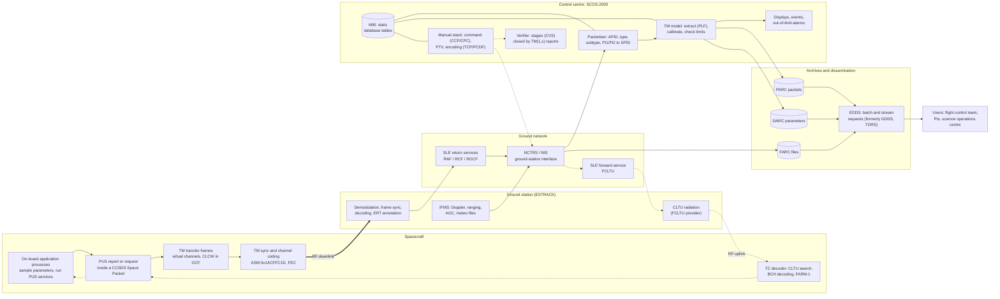
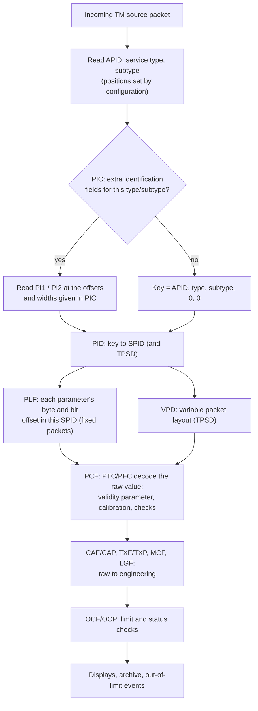
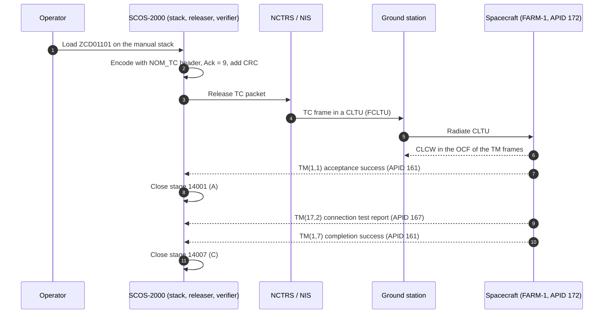

# How it all fits together

A temperature sensor on a spacecraft produces a number. Before an engineer in Darmstadt or a
scientist at a university sees that number as "25 °C, in limits", it passes through a chain of
standards and systems. On-board software packs it into a **report** defined by the ECSS
[Packet Utilization Standard](../ecss/pus/index.md) (PUS). The report travels inside a
[CCSDS Space Packet](../ccsds/space-packet.md). Packets are multiplexed into
[transfer frames](../ccsds/tm-sdlp.md), and the frames are protected by
[channel coding](../ccsds/tm-coding.md) for the radio link. A ground station recovers the
frames and hands them over the ground network using [Space Link Extension](../ccsds/sle/index.md)
(SLE) services. The [SCOS-2000](../scos2000/index.md) mission control system then decodes
every bit, using a database that describes every packet, parameter and command: the
[Mission Information Base](../mib/index.md) (MIB). Finally the data are archived and
disseminated to users through [EDDS](../scos2000/edds.md). Telecommands make the reverse trip,
with a retransmission protocol ([COP-1](../ccsds/cop-1.md)) and a verification loop that
closes in the telemetry.[^g4-scope][^pusc-intro][^sle-what][^icd-scope][^sdd-scope]

This page explains the whole chain once, at the level an engineer new to ESA mission
operations needs, and links every step to the page that explains it in full. Two real
examples from the public Solar Orbiter MIB run through it: a solar-array drive temperature on
the way down and a connection-test command on the way up.

!!! info "How to read this wiki"
    Every factual statement carries a footnote with the document, clause and PDF page. Each
    footnote links to a [library page](../library/index.md) that records where the copy came
    from and when it was taken ([sources and copies](../about/sources-and-copies.md)). Text
    marked **Inference** is this wiki's own reasoning. The [glossary](../glossary.md) expands
    every acronym, and the [MIB explorer](../explorer/index.md) lets you browse, one entry per
    parameter, packet and command, every MIB-format database this wiki holds as data: the Solar Orbiter
    spacecraft MIB of September 2025 (126,745 parameters) and April 2020 (102,104), and the
    instrument databases of SWA (2,885 parameters) and STIX (681).[^mib][^mib20][^swa-idb][^stix-idb]
    Where the standards came from is told on [the history page](history.md).

## The whole chain in one picture

The diagram follows telemetry (solid arrows, left to right) and telecommands (dashed arrows,
right to left) through the five places they visit. It is this wiki's synthesis of the
sources cited in the caption; each box is explained in a section below.



*Downlink and uplink in an ESA mission, after the CCSDS protocol overview, the SLE cross-support
concept, the SCOS-2000 presentations and Database Import ICD, the Mars Express data-handling
description and the EDDS design.*[^g4-dll][^sle-return][^sle-fwd][^gsaw03-overview][^icd-pid][^sp1291-nctrs][^sdd-ground][^fds-track]

## The layers at a glance

| Step | What happens | Data unit | Defined by | Explained in |
|---|---|---|---|---|
| 1 | Application processes sample parameters and run standard services | PUS request or report (a "message") | ECSS-E-ST-70-41C (PUS-C, 2016); ECSS-E-70-41A (PUS-A, 2003) | [PUS](../ecss/pus/index.md), [PUS-A vs PUS-C](../ecss/pus/pus-a-vs-pus-c.md) |
| 2 | The message is wrapped in a packet with an APID and a sequence count | Space Packet, 7 to 65,542 octets | CCSDS 133.0-B-2 | [Space Packet](../ccsds/space-packet.md), [PUS packets](../ecss/pus/packets.md) |
| 3 | Packets from many sources share one link through virtual channels | TM, TC, AOS or USLP Transfer Frame | CCSDS 132.0, 232.0, 732.0, 732.1; COP-1 in 232.1; optional security in 355.0 | [TM SDLP](../ccsds/tm-sdlp.md), [TC SDLP](../ccsds/tc-sdlp.md), [AOS](../ccsds/aos.md), [USLP](../ccsds/uslp.md), [COP-1](../ccsds/cop-1.md), [identifiers](../ccsds/space-link-identifiers.md), [SDLS](../ccsds/sdls.md) |
| 4 | Frames are delimited, randomised and error-protected | ASM plus codeblocks (TM); CLTU (TC) | CCSDS 131.0-B-5 (and -B-6), 231.0-B-4 | [TM coding](../ccsds/tm-coding.md), [CLTU](../ccsds/tc-coding-cltu.md) |
| 4a | The coded symbols modulate a radio carrier, which also carries ranging and Doppler | Channel symbols on the RF link | CCSDS 401.0-B; ECSS-E-ST-50-05C, ECSS-E-ST-50-02C | [RF and ranging](../ccsds/rf-and-ranging.md) |
| 5 | The ground station receives and annotates the data and the network extends the link to the user | SLE transfer-service operations over TCP/IP | CCSDS 910.3-G-3, 910.4-B-2, 911.x, 912.x, 913.1; service management 902.x | [SLE](../ccsds/sle/index.md), [service management](../ccsds/sle/service-management.md), [NCTRS and NIS](../scos2000/nctrs-nis.md) |
| 6 | The control system identifies packets, extracts, calibrates and checks parameters, and builds commands | SCOS-2000 packet (SPID), parameter sample | SCOS-2000 Database Import ICD (the MIB) | [SCOS-2000](../scos2000/architecture.md), [MIB](../mib/index.md) |
| 7 | Packets, parameters and files are archived and served to users | Archive records; EDDS responses | EDDS interface documents; mission DDID | [Archives](../scos2000/archives.md), [EDDS](../scos2000/edds.md) |

Sources for the rows: the PUS scope and space-to-ground interface clauses; the Space Packet
size rules; the CCSDS data link and physical layer overview; the RF standards' scopes; the SLE
concept; the ICD scope; the EDDS
design.[^pusc-71][^spp-size][^g4-dll][^g4-phys][^g4-coding][^rf-401][^rf-5005][^sle-what][^icd-scope][^sdd-ground]

The CCSDS overview places these protocols in a five-layer model (physical, data link, network,
transport, application). The data link layer has two sublayers: the **Data Link Protocol
Sublayer**, which moves higher-layer data in Transfer Frames, and the **Synchronization and
Channel Coding Sublayer**, which delimits, synchronises and protects those frames on the link.
Below it, CCSDS has one omnibus physical-layer standard, Radio Frequency and Modulation Systems
(CCSDS 401.0), for links between spacecraft and ground stations; short-range links between
spacecraft, landers and relays use the separate [Proximity-1](../ccsds/proximity-1.md) protocol
family.[^g4-phys][^prox1] The Space Packet Protocol sits above the data link layer. The PUS is an application-layer
protocol on top of it; the ECSS communications handbook of 2008 notes that ESA and ECSS developed
it independently and that CCSDS has not adopted it.[^g4-layers][^g4-dll][^hb-pus]

## 1. On board: parameters, application processes and services

An on-board **application process** is the unit that sends and receives packets: its APID
names the source of each telemetry packet and the destination of each telecommand
packet.[^pusc-74] It can be software, firmware or hardware, a spacecraft can have one or
many, and the PUS does not prescribe how they map onto subsystems and
computers.[^pusc-intro] Application processes host **subservice providers** and
**subservice users**; usually the providers are on board and the users on the ground, but
the standard does not require this. A message that a user sends to a provider is a
**request**; a message that a provider sends back is a **report**. The PUS distinguishes three kinds of
report: verification reports (routing, acceptance, start, progress and completion of a
request), data reports (on request or autonomous, for example periodic housekeeping) and event
reports.[^pusc-intro]

The PUS is a menu. It defines a set of service types, every one optional, and each mission
selects which services each application process implements and at what capability level. The
result is documented in a mission "Space-to-Ground Interface Control Document".[^pusc-scope]
ECSS-E-ST-70-41C defines 20 standard service types; identifiers 7, 10 and 16 are reserved
because earlier versions used them.[^pusc-types]

| ID | Service type | ID | Service type |
|---|---|---|---|
| 1 | [request verification](../ecss/pus/st01-request-verification.md) | 13 | [large packet transfer](../ecss/pus/st13-large-packet-transfer.md) |
| 2 | [device access](../ecss/pus/st02-device-access.md) | 14 | [real-time forwarding control](../ecss/pus/st14-real-time-forwarding-control.md) |
| 3 | [housekeeping](../ecss/pus/st03-housekeeping.md) | 15 | [on-board storage and retrieval](../ecss/pus/st15-onboard-storage-retrieval.md) |
| 4 | [parameter statistics reporting](../ecss/pus/st04-parameter-statistics.md) | 17 | [test](../ecss/pus/st17-test.md) |
| 5 | [event reporting](../ecss/pus/st05-event-reporting.md) | 18 | [on-board control procedure](../ecss/pus/st18-onboard-operations-procedure.md) |
| 6 | [memory management](../ecss/pus/st06-memory-management.md) | 19 | [event-action](../ecss/pus/st19-event-action.md) |
| 8 | [function management](../ecss/pus/st08-function-management.md) | 20 | [parameter management](../ecss/pus/st20-onboard-parameter-management.md) |
| 9 | [time management](../ecss/pus/st09-time-management.md) | 21 | [request sequencing](../ecss/pus/st21-request-sequencing.md) |
| 11 | [time-based scheduling](../ecss/pus/st11-time-based-scheduling.md) | 22 | [position-based scheduling](../ecss/pus/st22-position-based-scheduling.md) |
| 12 | [on-board monitoring](../ecss/pus/st12-onboard-monitoring.md) | 23 | [file management](../ecss/pus/st23-file-management.md) |

*Names as printed in ECSS-E-ST-70-41C Table 4-1.*[^pusc-types] The 2003 issue, PUS-A,
had 16 services; ST[20] to ST[23] are new in issue C.[^pusa-services][^pusc-types] The full
message list is in the [message type catalogue](../ecss/pus/message-types.md). The PUS is one of
five "level 3" standards under ECSS-E-ST-70C, *Ground systems and operations*; the others cover
on-board control procedures (OBCPs, ECSS-E-ST-70-01), space segment operability (-70-11),
monitoring and control data (-70-31) and the PLUTO procedure language (-70-32).[^e70-annexl]
See [ECSS-E-ST-70C](../ecss/e-st-70c.md), [OBCPs](../ecss/e-st-70-01c.md) and
[PLUTO](../ecss/e-st-70-32c.md).

A **parameter** is the smallest unit of monitoring: a temperature, a voltage, a status bit.
The PUS housekeeping service collects sampled parameters into reports. Each report structure has
an identifier, a collection interval and an ordered list of parameters, some of them
super-commutated (sampled several times per report).[^pusc-hk] The ground must know the layout of
every report it can receive. The SCOS-2000
ICD states this plainly: a new housekeeping packet defined on board through service 3 is not
processed until its definition has also been added to the TM/TC database, and ESA missions
usually create the definition in the database first and generate the service 3 commands from
it.[^icd-s3] That is the first reason the MIB exists.

## 2. Packets: a PUS message inside a CCSDS Space Packet

When messages travel between ground and space, the PUS puts them in CCSDS Space
Packets.[^pusc-intro] A telecommand packet carries a request from a ground application process
to an on-board one; a telemetry packet carries a report the other way.[^pusc-71] A Space Packet
is a 6-octet primary header followed by a data field of 1 to 65,536 octets, so a packet is 7 to
65,542 octets long.[^spp-size]

<div class="bitfield" data-title="Space Packet primary header (48 bits)" data-width="16" data-caption="CCSDS 133.0-B-2 clause 4.1.3; PUS usage after ECSS-E-ST-70-41C clause 7.4.1" data-fields='[{"n":"Version","b":3,"v":"000","d":"Packet Version Number; 000 identifies a Space Packet"},{"n":"Type","b":1,"g":"Packet ID","d":"0 = telemetry, 1 = telecommand"},{"n":"Sec. hdr flag","b":1,"g":"Packet ID","d":"1 when a PUS secondary header follows"},{"n":"APID","b":11,"g":"Packet ID","d":"Application Process Identifier; all ones (2047) is the idle packet"},{"n":"Sequence flags","b":2,"g":"Sequence control","d":"PUS packets are stand-alone: 11"},{"n":"Sequence count or name","b":14,"g":"Sequence control","d":"Incremented per released packet, wraps from 16383 to 0"},{"n":"Packet data length","b":16,"d":"Octets in the packet data field minus one"}]'></div>

The fields, as the PUS uses them:[^spp-hdr][^pusc-74]

| Field | Bits | Values | Meaning |
|---|---|---|---|
| Packet Version Number | 3 | `0b000` | Identifies a Space Packet (a "version 1 CCSDS packet") |
| Packet Type | 1 | 0 TM, 1 TC | Direction of the packet |
| Secondary Header Flag | 1 | 0 or 1 | Every PUS TM packet has a secondary header except spacecraft time packets; every PUS TC packet has one except CPDU command packets |
| Application Process Identifier | 11 | 0 to 2047 | Source of a TM packet, destination of a TC packet; all ones is reserved for idle packets |
| Sequence Flags | 2 | `0b11` | The PUS uses only stand-alone packets |
| Packet Sequence Count or Packet Name | 14 | 0 to 16,383 | TM: incremented for each released packet, wrapping from $2^{14}-1$ to 0; TC: a count or a name that, with the source ID, identifies the command |
| Packet Data Length | 16 | 0 to 65,535 | Number of octets in the data field minus one |

Inside the data field, the PUS adds its own **secondary header**. The service type and
message subtype in it name the message, for example TM[3,25] for a housekeeping parameter
report or TC[17,1] for an are-you-alive connection test,[^pusc-msgs] and the structure of the
rest of the packet follows from that pair.[^pusc-tmud][^pusc-tcud] In PUS-C the headers look like this:[^pusc-tmsh][^pusc-tcsh]

<div class="bitfield" data-title="PUS-C TC packet secondary header, fixed part (40 bits)" data-width="8" data-caption="ECSS-E-ST-70-41C clause 7.4.4.1, Figure 7-9; an optional spare field may follow" data-fields='[{"n":"TC PUS version","b":4,"v":"2","d":"0 was ESA PSS-07-101, 1 was ECSS-E-70-41A"},{"n":"Ack flags","b":4,"d":"bit 3 acceptance, bit 2 start, bit 1 progress, bit 0 completion"},{"n":"Service type ID","b":8},{"n":"Message subtype ID","b":8},{"n":"Source ID","b":16,"d":"Identifies the issuer; used with the sequence count to identify the command"}]'></div>

<div class="bitfield" data-title="PUS-C TM packet secondary header, fixed part (56 bits)" data-width="8" data-caption="ECSS-E-ST-70-41C clause 7.4.3.1, Figure 7-7; followed by the time field and an optional spare field" data-fields='[{"n":"TM PUS version","b":4,"v":"2"},{"n":"S/C time ref. status","b":4,"d":"0 when the process cannot report it"},{"n":"Service type ID","b":8},{"n":"Message subtype ID","b":8},{"n":"Message type counter","b":16,"d":"0 when not supported"},{"n":"Destination ID","b":16,"d":"Addressee of the report"}]'></div>

The packet ends with a 16-bit **packet error control** field. It is mandatory for
telecommands and a mission option for telemetry, and the mission chooses between an ISO 16-bit
checksum and a 16-bit CRC.[^pusc-tmud][^pusc-tcud]

!!! note "Solar Orbiter speaks PUS-A"
    A mission applies the PUS issue its interface documents name. The Solar Orbiter TM/TC ICD
    sets the PUS version field to 1 (ECSS-E-70-41A) in both directions. Its TM data field header is
    10 octets, its largest TM source packet is 4,112 octets, and its 11-bit APID is split into a
    7-bit process ID and a 4-bit packet category.[^solo-pkt][^solo-tm] PUS-A's TC header is
    1 + 3 + 4 + 8 + 8 bits plus an optional source ID whose size the mission chooses.[^pusa-tc]
    See [PUS-A vs PUS-C](../ecss/pus/pus-a-vs-pus-c.md) and
    [how Solar Orbiter uses PUS](../missions/solar-orbiter/pus-usage.md).

The Space Packet Protocol itself does not route. Every node that handles a packet looks at the
APID and forwards it along a path that management has set up; the APID-to-path rules are
agreed per mission and are not part of the protocol.[^g4-spp] CCSDS also defines an
[Encapsulation Packet](../ccsds/encapsulation.md) for carrying other protocols' data units over
the same links.[^g4-frames]

## 3. Frames: many packet streams share one link

A spacecraft has one downlink but many packet sources and data types with different needs:
real-time housekeeping, recorded science, event logs. The data link protocols solve this with
**virtual channels**. A physical channel (the bit stream in one direction) is split into
several logical channels; every transfer frame belongs to exactly one of them. All frames with
the same transfer frame version number and spacecraft ID form a **master channel**.[^g4-frames]
Most missions use the TC Space Data Link Protocol forward and the TM Space Data Link Protocol
in return, and only one data link protocol may be used on a given physical channel.[^g2-combos]

| Identifier | TM SDLP | TC SDLP | AOS SDLP | USLP |
|---|---|---|---|---|
| Transfer Frame Version Number | Version 1 (encoded `0b00`) | Version 1 (encoded `0b00`) | Version 2 | Version 4 |
| Spacecraft ID | 0 to 1023 | 0 to 1023 | 0 to 255 | 0 to 65,535 |
| Virtual Channel ID | 0 to 7 | 0 to 63 | 0 to 63 | 0 to 63 |
| MAP ID | none | 0 to 63 | none | 0 to 15 |

*After CCSDS 130.0-G-4 Table 3-1. The values are registered in the Space Assigned Numbers
Authority (SANA). TM and TC frames share version 1 and are told apart by the ASM or start
sequence that precedes them. AOS issue 5 (CCSDS 732.0-B-5, October 2025) widens the AOS
spacecraft ID to 10 bits; missions on issue 4 or earlier keep the 8-bit field.*[^g4-ids][^tm-tfvn][^aos5-scid]
Every identifier field, its reserved values and how SANA assigns spacecraft IDs are on
[space link identifiers](../ccsds/space-link-identifiers.md). TM, TC, AOS and USLP frames can
also carry the optional [Space Data Link Security](../ccsds/sdls.md) protocol for
authentication and encryption; see [security in CCSDS space links](../ccsds/security.md).[^g4-dll]

### Telemetry frames

TM frames have a **fixed length** on a physical channel during a mission phase, which makes
synchronisation on a weak, noisy signal simple and robust.[^g2-frames] A TM frame is a 6-octet
primary header, an optional secondary header of up to 64 octets, a data field, an optional
4-octet Operational Control Field (OCF) and an optional 2-octet Frame Error Control Field
(FECF).[^tm-frame]

<div class="bitfield" data-title="TM Transfer Frame primary header (48 bits)" data-width="16" data-caption="CCSDS 132.0-B-3 clause 4.1.2" data-fields='[{"n":"TFVN","b":2,"v":"00","g":"Master Channel ID"},{"n":"Spacecraft ID","b":10,"g":"Master Channel ID"},{"n":"VCID","b":3,"d":"Virtual Channel Identifier, 0 to 7"},{"n":"OCF flag","b":1,"d":"1 when the Operational Control Field is present"},{"n":"Master Channel Frame Count","b":8,"d":"Modulo-256 count of frames on the master channel"},{"n":"Virtual Channel Frame Count","b":8,"d":"Modulo-256 count of frames on this virtual channel"},{"n":"Sec. hdr flag","b":1,"g":"Data field status"},{"n":"Sync flag","b":1,"g":"Data field status"},{"n":"Packet order","b":1,"g":"Data field status"},{"n":"Segment length ID","b":2,"g":"Data field status"},{"n":"First Header Pointer","b":11,"g":"Data field status","d":"Position of the first packet header in the data field"}]'></div>

Packets are packed end to end into the data fields of the frames of their virtual channel; a
long packet can span frames, and the **First Header Pointer** tells the receiver where the
first new packet starts.[^tm-hdr] Neither the TM nor the AOS data link protocol retransmits
lost frames: if complete delivery matters, a higher layer must provide it.[^g4-frames]

### Telecommand frames and COP-1

TC frames have a **variable length**, given in the header, so that short commands go out with
little delay.[^g2-frames] A TC frame is a 5-octet header, a data field of up to 1,019 or 1,017
octets and an optional 2-octet FECF, to a maximum of 1,024 octets (5 + 1,017 + 2 = 1,024 when the
FECF is present). The ECSS adoption notice makes the FECF mandatory and keeps only the
1,017-octet figure.[^tc-frame][^tc-hdr]

<div class="bitfield" data-title="TC Transfer Frame primary header (40 bits)" data-width="8" data-caption="CCSDS 232.0-B-4 clause 4.1.2" data-fields='[{"n":"TFVN","b":2,"v":"00"},{"n":"Bypass","b":1,"d":"0 Type-A (FARM checks), 1 Type-B (bypass)"},{"n":"Ctrl cmd","b":1,"d":"0 data, 1 COP control command"},{"n":"Spare","b":2,"v":"00"},{"n":"Spacecraft ID","b":10},{"n":"VCID","b":6,"d":"0 to 63"},{"n":"Frame length","b":10,"d":"Total octets minus one"},{"n":"Frame sequence number","b":8,"d":"N(S), used by COP-1 for Type-A frames"}]'></div>

The **Communications Operation Procedure-1** gives the forward link reliable, in-order
delivery. It is a "go-back-n" retransmission scheme: the sending end runs **FOP-1**, the
spacecraft runs **FARM-1**, and FARM-1 accepts Type-A frames only in strict sequence. FARM-1
reports its state in the **Communications Link Control Word** (CLCW), which travels back in
the 4-octet OCF of the telemetry frames; FOP-1 retransmits on a "Retransmit" flag in the CLCW or on a
timeout. Type-B frames bypass the sequence check and are used for control commands and
recovery.[^cop1][^g2-typea][^g2-frames][^tm-frame] The [COP-1 page](../ccsds/cop-1.md) has the state
machines.

!!! example "Solar Orbiter's link configuration"
    Spacecraft ID `0x28A` (650) on both links. TM frames are always 1,115 octets
    (8,920 bits) with a 1,099-octet data field; TM source packets longer than that are split
    across frames. Virtual channels carry, from highest to lowest downlink priority, real-time
    high-priority TM (VC4), real-time TM (VC0), the critical event log (VC5), playback from the
    on-board computer's mass memory (VC1) and from the solid-state mass memory (VC2, then
    VC3), and idle frames (VC7); the ICD lists VC5 second but sends it only when neither VC4
    nor VC0 has data. TC frames
    are at most 256 octets on one of two virtual channels, one per on-board TC
    decoder.[^solo-tm][^solo-tmframe][^solo-tc]

## 4. Channel coding: getting bits through the noise

The Synchronization and Channel Coding Sublayer adds three functions to a stream of frames:
delimiting and synchronising them, error-correcting coding, and bit-transition generation
(pseudo-randomisation).[^g4-coding]

| Function | Telemetry (CCSDS 131.0-B-5) | Telecommand (CCSDS 231.0-B-4) |
|---|---|---|
| Error correction / validation | Convolutional + FECF; Reed-Solomon; concatenated; turbo + FECF; LDPC; plus SCCC and DVB-S2 for high rates | BCH; BCH + FECF; CCSDS 231.0-B-4 also specifies LDPC codes |
| Pseudo-randomisation | Cyclic pseudo-noise sequence (optional in 131.0-B-5; mandatory from 131.0-B-6, April 2026) | Cyclic pseudo-noise sequence; with BCH required unless the designer verifies operation without it, always applied with LDPC |
| Frame synchronisation | 32-bit (or longer) Attached Sync Marker | 16-bit Start Sequence (BCH); 64-bit Start Sequence with LDPC |

*After CCSDS 130.0-G-4 Table 3-3, CCSDS 131.0-B-6 and CCSDS 231.0-B-4.*[^g4-coding][^tmc6-rand][^cltu][^tc-ldpc][^tc-rand]

On the downlink every frame (or codeblock) is preceded by an **Attached Sync Marker**; for
uncoded, convolutional, Reed-Solomon and rate-7/8 LDPC data it is the 32-bit pattern
`0x1ACFFC1D`.[^asm] On the uplink the unit of transmission is the **Communications Link
Transmission Unit** (CLTU): a start sequence, the frame encoded as a series of codewords, and,
for BCH coding, a tail sequence. A BCH codeword carries 56 information bits, 7 parity bits and
a filler bit set to zero.[^bch][^cltu]

<div class="bitfield" data-title="A CLTU with one BCH codeword (illustrative)" data-width="16" data-caption="Start sequence 0xEB90, one 64-bit codeword, tail 0xC5C5C5C5C5C5C579 (CCSDS 231.0-B-4 clauses 3.2 and 5.2). Real CLTUs carry as many codewords as the frame needs." data-fields='[{"n":"Start sequence","b":16,"v":"0xEB90"},{"n":"Information bits (frame data)","b":56,"g":"BCH codeword"},{"n":"Parity","b":7,"g":"BCH codeword"},{"n":"Filler","b":1,"v":"0","g":"BCH codeword"},{"n":"Tail sequence","b":64,"v":"0xC5C5C5C5C5C5C579","d":"A non-correctable pattern that stops decoding"}]'></div>

The 64-bit LDPC start sequence is `0x034776C7272895B0`, and the (512, 256) LDPC code uses no
tail sequence at all because a conventional LDPC decoder reliably fails when it runs past the
end of the CLTU.[^cltu] The details are on the [TM coding](../ccsds/tm-coding.md) and
[CLTU](../ccsds/tc-coding-cltu.md) pages.

The coded symbols finally modulate a radio carrier. CCSDS 401.0 and ECSS-E-ST-50-05C define the
frequency bands, spectral limits and permitted modulations, and ECSS-E-ST-50-02C the ranging and
Doppler tracking that share the same link.[^rf-401][^rf-5005][^rf-5002][^g4-phys] The Solar Orbiter MIB
shows the choices as data: the deep-space transponder housekeeping report ("PLF DST HK", SPID
[33793](../explorer/index.md#/solo/packet/33793)) reports a telemetry modulation scheme of `GMSK`
or `SPL` and a telecommand bit rate between 7.8125 and 4000 bit/s.[^mib-dst] See
[radio frequency, modulation and ranging](../ccsds/rf-and-ranging.md).

## 5. The ground station and the ground network

ESA's ground stations form the ESTRACK network.[^ifms][^sdd-opslan] At ESOC the operational
LAN (OPSLAN) is the centre of the IP-OPSNET network that connects to the ESTRACK ground
stations; it is a restricted network, and data for outside users must be relayed through
separate RELAY LANs.[^sdd-opslan] In SLE terms, the SLE System at the ground end of the space
link demodulates the signal, terminates the space link protocols and adds **annotation**: the
time of reception, the receiving location, and the quality and sequence status of each data
unit.[^sle-system][^sle-info] The station's Intermediate Frequency and
Modem System (IFMS) also measures Doppler, ranging, signal gain (AGC) and meteorological data
and offers them as files over FTP.[^ifms][^ifms-data] For Rosetta and Mars Express the mission
control system fetched these files through its Network Interface Subsystem, stored them in the
file archive and passed them to flight dynamics.[^fds-track]

### Space Link Extension

SLE standardises how space link data units travel on the ground, so that the ground assets of
different organisations can work together without ad hoc gateways built for each new mission
and one agency's station can serve another agency's spacecraft.[^sle-why] It "extends" the space link in three ways: over
**distance** (processing can happen far from the antenna), in **information** (annotation) and
in **time** (data can be stored and delivered later).[^sle-ext] SLE has transfer services, which
move the data, and management services, which schedule them.[^sle-what] How a mission books
station time through service agreements and service packages is on
[SLE service management](../ccsds/sle/service-management.md).

| Direction | Service | What the user receives or sends |
|---|---|---|
| Return | Return All Frames (RAF) | All frames from one space link symbol stream |
| Return | Return Channel Frames (RCF) | One master channel or selected virtual channels |
| Return | Return Operational Control Field (ROCF) | The OCFs (CLCWs) of a master or virtual channel |
| Return | Return Frame Secondary Header (RFSH) | Frame secondary headers |
| Return | Return Space Packet (RSP) | Packets with selected APIDs from one virtual channel |
| Forward | [Forward Space Packet (FSP)](../ccsds/sle/fsp.md) | Packets for uplink, without coordinating with other users |
| Forward | Forward TC Virtual Channel Access (FTCVCA) | Complete virtual channels for uplink |
| Forward | Forward TC Frame (FTCF) | TC frames to be turned into CLTUs |
| Forward | Forward CLTU (FCLTU) | Ready-made CLTUs for radiation |

*After CCSDS 910.3-G-3 §4.2.1 and §4.3.1.*[^sle-return][^sle-fwd] The ROCF service matters
on the forward side as well: the CLCW it delivers tells the CLTU service provider whether the
physical link is available and tells the provider of the VC and packet services whether TC
frames must be retransmitted under COP-1.[^sle-fwd] Over terrestrial networks, SLE runs on TCP/IP with ASN.1 encoding using the
Internet SLE Protocol (ISP1).[^isp1] The library holds the 2023 issues of the
[RAF, RCF and ROCF](../ccsds/sle/return-services.md) and [FCLTU](../ccsds/sle/fcltu.md)
specifications, the historical [Forward Space Packet](../ccsds/sle/fsp.md) book with its API,
the [ISP1 and API](../ccsds/sle/isp1-and-api.md) books, and the cross support reference model
and [service management](../ccsds/sle/service-management.md) documents; the
[standards landscape](standards-map.md#ccsds) lists their issues.

### NCTRS and NIS: the control centre's door

At ESOC, SCOS-2000 does not talk to stations directly. The **NCTRS** sits between the mission
control system and the ground station network and uses SLE for non-ESA stations.[^gsaw05-infra]
The sources expand the acronym in several ways, among them "Network Control and TM/TC Router
System" and "Network Controller and Telemetry Receiver System".[^gsaw05-infra][^sp1291-nctrs]
For Mars Express it received telemetry already checked and time-stamped with the Earth
reception time by the station equipment, passed it to the mission control system, collected
the telecommands from the control system and forwarded them to the right station, and also
handled tracking data and station files.[^sp1291-nctrs] In the SCOS-2000 R5 era the SLE service
user role belongs to the **NIS**, while the station's TMTCS is the SLE service provider.[^icd-nis] The
acronym appears as "Network Interface System" in an ESOC presentation and as "Network Interface
Subsystem" in the Rosetta and Mars Express flight dynamics ICD.[^gsaw05-nis][^fds-track] SCOS-2000 can send two kinds of "throw event" directives: SLE throw events
go to the station equipment, NIS throw events are executed by the NIS itself.[^icd-nis][^icd-ctype]

The Solar Orbiter MIB shows this interface as data. It defines six NIS throw-event commands
(open and close the TC link, the TM link and the session) on a header called `NOS2KHDR`, and
two COP-1 control frames, `UNLOCK` ("FARM UNLOCK directive") and `SETVR` ("SETV( R )
Directive"), as command type `F`, which the ICD defines as BC control frames. Three more
directives (`RESET` "PAC RESET directive", `REIN_TTR` and `TC_ONLY`) have type `R`, a control
segment.[^icd-ctype][^mib]

!!! warning "Inference"
    The sources place the SLE service user (NIS) on the control-centre side and the FCLTU
    provider at the station, and the MIB defines FARM control frames as commands. Together
    this implies that TC frames, COP-1's FOP-1 and CLTU generation run on the ground side
    before the FCLTU interface. Which ESOC component hosts FOP-1 is not stated in the
    available sources.

## 6. The control centre: SCOS-2000 and the MIB

[SCOS-2000](../scos2000/index.md) is ESA's mission control system kernel, a distributed
client-server system built on the CCSDS packet standards, the PUS and SLE.[^gsaw03-std] Its
servers include the packetiser, the limit checker, the synthetic-parameter generator, the
command multiplexer, releaser, verifier and on-board queue model, the archive and the event
servers.[^gsaw03-cs] The packetiser rebuilds packets from frames, extracts the CLCW and checks
quality and sequence continuity; the command side offers manual and automatic stacks,
pre-transmission validation and multi-stage verification.[^gsaw03-tm][^gsaw03-tc]

### What the MIB is

The SCOS-2000 **Mission Information Base** has a static part, the "database", and a dynamic
part, the packet archive.[^icd-terms] The static part reaches SCOS-2000 as a set of tab-separated
ASCII tables, one file per table named after it (`pcf.dat`, `pid.dat`, ...), exported from the
mission's off-line database and imported into the run-time system.[^icd-scope][^icd-files] The
[Database Import ICD](../mib/icd-history.md) (EGOS-MCS-S2K-ICD-0001) defines those tables. It
distinguishes three representations of a value: the **encoded** bits in the packet, the
**raw** value after type decoding, and the **engineering** value after calibration; for a
16-bit signed integer, raw −1 is encoded as `0xFFFF`.[^icd-terms] The
[data model](../mib/data-model.md) page shows how the tables relate. Independently of any tool,
ECSS-E-ST-70-31C specifies what monitoring and control data a supplier delivers, and
ECSS-E-ST-70-32C the language of the procedures that use it.[^e70-annexl] How missions build
and maintain such databases and procedures is on [operations preparation](../scos2000/operations-preparation.md),
with the [ECSS-E-ST-70-31C](../ecss/e-st-70-31c.md) and [PLUTO](../ecss/e-st-70-32c.md) pages
for the standards.

### How a telemetry packet is decoded



*The packet identification and extraction logic of ICD 7.0 §3.3.2.4 and §3.3.2.5.*[^icd-pid][^icd-pic][^icd-plf]

The key that identifies a packet is the combination of type, subtype, APID and up to two extra
identification values (PI1, PI2); it maps to a **SCOS-2000 Packet ID** (SPID). Packets without
a PUS header are identified by APID alone. Spacecraft APIDs are 0 to 2047; values 2048 to 65,535
are for packets generated by SCOS-2000 applications or by other control domains such as test
equipment.[^icd-pid][^icd-pidf] The
[parameter type](../mib/parameter-types.md) codes PTC and PFC then tell the decoder how to read
each field: PTC 3 is an unsigned integer and PFC 12 makes it 16 bits wide.[^icd-ptc]

#### Follow one temperature (real definitions, illustrative raw value)

Parameter [`NCFT55Y0`](../explorer/index.md#/solo/param/NCFT55Y0), "SADE A PY SADM temp", is a
Solar Orbiter temperature in degC that the MIB places in the solar-array drive equipment: it
travels in the packet "PLF SADE HK" and uses the curve "SADA Temp TM:SA6,7,8". The library
does not expand the abbreviations SADE, SADM and SADA. All definitions below come from the
2025-09-16 MIB.[^mib]

| Step | MIB table | Value in the Solar Orbiter MIB | What SCOS-2000 does with it |
|---|---|---|---|
| Recognise the packet | [`pic`](../mib/tables/pic.md) | Type 3, subtype 25: PI1 at octet 16, 8 bits | Reads PI1 right after the 6-octet primary header and the 10-octet data field header; in this packet that octet is parameter `NCD030A1`, "OBCHP_HK SID" |
| Name the packet | [`pid`](../mib/tables/pid.md), [`tpcf`](../mib/tables/tpcf.md) | (3, 25, APID [212](../explorer/index.md#/solo/apid/212), PI1 89) → SPID [33513](../explorer/index.md#/solo/packet/33513), "PLF SADE HK", mnemonic `YCF1Z089`, `TPCF_SIZE` 273 octets (documentation only)[^icd-tpcf] | Files and distributes the packet under SPID 33513 |
| Find the parameter | [`plf`](../mib/tables/plf.md) | Octet 50, bit 0 in SPID 33513 (also in SPIDs 33521 and 33582) | Extracts the bits |
| Decode | [`pcf`](../mib/tables/pcf.md) | PTC 3, PFC 12 (16-bit unsigned), raw nature `R`, on-board ID 219357222 | Builds the raw value |
| Check validity | `pcf` | `PCF_VALID` = [`NCSD3KG3`](../explorer/index.md#/solo/param/NCSD3KG3) "SADE A SCV Status.scvTm", `PCF_VALPAR` = 2 | Marks the sample valid only while that status reads raw 2, which textual calibration `CCDT0065TM` names `ON` |
| Calibrate | [`caf`](../mib/tables/caf.md), [`cap`](../mib/tables/cap.md) | Curve [`CSDP0006TM`](../explorer/index.md#/solo/calib/num/CSDP0006TM), "SADA Temp TM:SA6,7,8", 146 points, unsigned raw, real engineering, unit degC | Converts raw to °C |
| Check limits | [`ocf`](../mib/tables/ocf.md) | No monitoring check is defined for this parameter | None |

Two calibration points show the shape of the curve: raw 8192 is 25 °C and raw 12235 is
0 °C, and the curve spans raw 1602 (90 °C) to 16119 (−55 °C). An **illustrative** raw value of
8192 at octet 50 is therefore displayed as 25 °C.[^mib] The calibration's extrapolation flag is
empty, and the ICD default `F` returns an invalid engineering value outside the curve's
range.[^icd-caf]

!!! warning "Inference"
    The curve falls as the raw count rises, as a thermistor's would. ICD issue 7.0 does not say
    how SCOS-2000 computes values between two points. Issue 6.9 describes interpolation from
    the points on either side, and ECSS-E-ST-70-31C defines a linear-interpolation
    interpretation function, so linear interpolation is the natural reading.[^icd69-caf][^e3131-lin]

??? example "SQL used"
    ```sql
    -- solo-2025-09-16.sqlite (MIB__20250916M25925PFMS001_SOL)
    SELECT * FROM pic WHERE PIC_TYPE='3' AND PIC_STYPE='25';          -- PI1 offset 16, width 8
    SELECT * FROM pid WHERE PID_SPID='33513';                          -- 3,25,212,89 -> 33513
    SELECT * FROM tpcf WHERE TPCF_SPID='33513';                        -- YCF1Z089, 273
    SELECT PLF_SPID, PLF_OFFBY, PLF_OFFBI FROM plf WHERE PLF_NAME='NCFT55Y0';
    SELECT * FROM pcf WHERE PCF_NAME IN ('NCFT55Y0','NCSD3KG3');
    SELECT * FROM txp WHERE TXP_NUMBR='CCDT0065TM';                    -- 0 NOT_APPLICABLE, 1 OFF, 2 ON
    SELECT * FROM caf WHERE CAF_NUMBR='CSDP0006TM';
    SELECT CAP_XVALS, CAP_YVALS FROM cap WHERE CAP_NUMBR='CSDP0006TM';
    SELECT COUNT(*) FROM ocf WHERE OCF_NAME='NCFT55Y0';                 -- 0
    ```

The [downlink walk-through](downlink.md) and the
[telemetry worked example](worked-example-tm.md) decode complete packets byte by byte.

### How a telecommand is built

On the command side the central table is [`ccf`](../mib/tables/ccf.md), one row per command.
Its parameters are defined in [`cpc`](../mib/tables/cpc.md) and placed in the application data
by [`cdf`](../mib/tables/cdf.md); pre-transmission checks live in [`ptv`](../mib/tables/ptv.md); verification stages in
[`cvs`](../mib/tables/cvs.md), linked to commands through [`cvp`](../mib/tables/cvp.md); and
each command names a packet-header template in [`tcp`](../mib/tables/tcp.md), whose fields are
laid out by [`pcdf`](../mib/tables/pcdf.md).[^icd-tc] The header fields take their values from
the command definition (APID, type, subtype, acknowledgement flags) or are filled in by the
command subsystem (length, sequence count).[^icd-pcdf] The default maximum command size is 248
octets, and the total CLTU size is limited to a mission-specific value.[^icd-size]

Solar Orbiter's standard header template `NOM_TC` ("NOM_DH_TC_Packet_Header"), used by 5,318
of the 5,454 commands in the `ccf` table, lays out the PUS-A packet header like
this:[^mib][^pusa-tc]

<div class="bitfield" data-title="Solar Orbiter NOM_TC header template (80 bits), from the MIB pcdf table" data-width="16" data-caption="Real MIB definitions; F = fixed value, A/T/S/K = taken from the CCF row, P = set by SCOS-2000; type O is not listed in ICD issues 5.1 to 7.0" data-fields='[{"n":"Version","b":3,"v":"0","d":"PCDF type F"},{"n":"Type","b":1,"v":"1","d":"F: telecommand"},{"n":"DFH flag","b":1,"v":"1","d":"F: data field header present"},{"n":"APID","b":11,"d":"A: CCF_APID (PH_APID)"},{"n":"Sequence flags","b":2,"v":"3","d":"F: stand-alone"},{"n":"Sequence count","b":14,"d":"P: PH_SSC"},{"n":"Packet length","b":16,"d":"P: PH_LEN"},{"n":"CCSDS sec. hdr flag","b":1,"v":"0","d":"F"},{"n":"PUS version","b":3,"v":"1","d":"F: PUS-A"},{"n":"Ack","b":4,"d":"K: CCF_ACK (DFH_ACK)"},{"n":"Service type","b":8,"d":"T: CCF_TYPE"},{"n":"Service subtype","b":8,"d":"S: CCF_STYPE"},{"n":"Source ID","b":8,"d":"Type O (not in the ICD 5.1 to 7.0 lists): DFH_SRC"}]'></div>

The 32 bits after the primary header are the 4-octet TC data field header that the Solar Orbiter
TM/TC ICD specifies.[^solo-tcpkt] The 8-bit Source ID element uses `PCDF_TYPE` `O`. The
Database Import ICD issues in the library (5.1, 6.7 Draft A, 6.9 and 7.0) list only the types
`F`, `A`, `T`, `S`, `K` and `P`, so how SCOS-2000 fills this field for Solar Orbiter is not
stated in the available sources.[^icd-pcdf][^icd-pcdf-old]

#### Follow one command (real definitions)

Command [`ZCD01101`](../explorer/index.md#/solo/command/ZCD01101), "Perform Connection Test", is
the PUS test service request TC(17,1) to APID 172, with no parameters, header `NOM_TC` and
acknowledgement flags 9 (`0b1001`).[^mib] In PUS-A's numbering, bit 3 of the Ack field requests
an acceptance report and bit 0 a completion report, so 9 asks for both.[^pusa-tc] The MIB links
the command to two verification stages: [14001](../explorer/index.md#/solo/verif/14001), type
`A` (acceptance), and [14007](../explorer/index.md#/solo/verif/14007), type `C` (completion),
both based on TM reports (source `R`) and both opening 0 s after release with a 20 s
interval.[^mib][^icd-cvs] Report-based stages are closed by the PUS verification reports, whose
packets are implicitly known from their type and subtype.[^icd-cvs] The MIB defines matching
packets: "Telecommand Acceptance Report - Success" TM(1,1) and "Telecommand Execution Completed
Report - Success" TM(1,7) on APID 161, and "Connection Test Response Report" TM(17,2) on
APID 167.[^mib]



*Sequence after the SCOS-2000 commanding functions, the ICD verification stages and the
COP-1 concept; command, stages and report packets from the MIB.*[^gsaw03-tc][^icd-cvs][^cop1][^mib]

!!! warning "Inference"
    The MIB does not say which report APIDs answer a command sent to APID 172; this wiki
    matched them. With Solar Orbiter's split of the APID into a 7-bit process ID and a 4-bit
    packet category, APIDs 172, 161 and 167 all belong to process 10 (categories 12, 1 and 7),
    which is why the diagram shows the reports coming from 161 and 167.[^solo-pkt]

??? example "SQL used"
    ```sql
    -- solo-2025-09-16.sqlite (MIB__20250916M25925PFMS001_SOL)
    SELECT * FROM ccf WHERE CCF_CNAME='ZCD01101';
    SELECT * FROM pcdf WHERE PCDF_TCNAME='NOM_TC';
    SELECT CCF_PKTID, COUNT(*) FROM ccf GROUP BY CCF_PKTID;     -- NOM_TC 5318 of 5454
    SELECT * FROM cvp WHERE CVP_TASK='ZCD01101';                -- stages 14001, 14007
    SELECT s.* FROM cvs s JOIN cvp p ON p.CVP_CVSID=s.CVS_ID WHERE p.CVP_TASK='ZCD01101';
    SELECT PID_TYPE, PID_STYPE, PID_APID, PID_SPID, PID_DESCR FROM pid
      WHERE (PID_TYPE='1' AND PID_STYPE IN ('1','7') AND PID_APID='161')
         OR (PID_TYPE='17' AND PID_STYPE='2' AND PID_APID='167');
    SELECT CCF_CNAME, CCF_DESCR, CCF_CTYPE, CCF_PKTID FROM ccf
      WHERE CCF_CTYPE IN ('F','R','N');                       -- COP-1 and NIS directives
    ```
    The `cvp` and `cvs` columns carry their ICD names (`CVP_TASK`, `CVP_TYPE`, `CVP_CVSID`;
    `CVS_ID`, `CVS_TYPE`, `CVS_SOURCE`, `CVS_START`, `CVS_INTERVAL`, `CVS_SPID`,
    `CVS_UNCERTAINTY`) in the current build of the database.

The [uplink walk-through](uplink.md) and the [telecommand worked example](worked-example-tc.md)
build a complete command down to the CLTU.

### Time: from on-board clock to UTC

A PUS telemetry packet carries its on-board time tag in the time field of its secondary
header, and the ground must translate that into UTC.[^pusc-tmsh] SCOS-2000 does this by time
correlation. The spacecraft latches its clock when it transmits a
frame whose frame count is a multiple of N (a power of 2 between 1 and 256) and reports the
latched time in a later time packet. The ground knows the Earth reception time of the
triggering frame from the NIS header and subtracts the ground, propagation and on-board delays.
Each pair of on-board time and UTC is a "time couple"; a least-squares fit over many couples
gives a gradient and an offset, or for a clock synchronised to an external source such as GPS
only the offset is computed.[^tco] For Mars Express the conversion was accurate to better than
2 ms.[^sp1291-gs] See [time correlation](../scos2000/time-correlation.md) and
[CCSDS time codes](../ccsds/time-codes.md).

## 7. Archives and dissemination

SCOS-2000 files every packet it receives, indexed by type, SPID, data stream and time, and
serves retrievals independently of real-time processing.[^gsaw03-filing] In the EGOS ground
system the archives are separate components: the packet archive (**PARC**) holds telemetry,
telecommand and event packets, the parameter archive (**DARC**) holds parameter values, and the
file archive (**FARC**) holds mission files.[^sdd-ground][^ddid-acr] A dedicated parameter
archive was built because generating parameter values on the fly from packets could not meet
the dissemination system's performance targets.[^srs-current]

For Mars Express, the MCS sat on the operational LAN, only ESOC operations staff could reach
it, and external users reached mission data through the DDS.[^sp1291-dds] The **EGOS
Data Dissemination System** (EDDS) gives users who have no access to the MCS monitoring and
control facilities controlled access to telemetry packets and parameters, telecommand history,
events and auxiliary files through batch requests (a finite data set, possibly scheduled) and
stream requests (a continuous feed), plus management and notification
services.[^sdd-scope][^sdd-svc][^ddid-summary] Its requirements were based on three earlier
ground-segment subsystems and a fourth prototype:[^srs-pred]

| Predecessor | Role |
|---|---|
| [TDRS](../scos2000/tdrs.md) (Telemetry Data Retrieval System) | Extracted parameter values from the SCOS-2000 archive into MVDA or spreadsheet files, via web browser and e-mail |
| WebRM (Web Remote Monitoring) | Remote monitoring with SCOS-2000-style displays |
| [GDDS](../scos2000/gdds-and-ddids.md) (Generic Data Disposition System) | Web and FTP front ends for packets, files and catalogues from the MCS archive |
| MUST (Mission Utility & Support Tools) | Prototype parameter archive with analysis clients |

*After the EDDS Software Requirements Specification §4.2.*[^srs-pred]

The older generation is visible in the Mars Express documents: its Data Distribution System was
based on the GDDS, took XML requests, used SFDU-based data interchange and also mailed weekly
CD-ROMs to the principal investigators.[^sp1291-dds] Solar Orbiter uses the EDDS as its primary
distribution mechanism and, as its nominal route to the Science Ground Segment, RAPID binary
files that contain every packet the MCS receives, forwarded by the GFTS file transfer
software.[^ddid-summary] Each mission documents its delivery products in a Data Delivery
Interface Document (DDID): see [GDDS and DDIDs](../scos2000/gdds-and-ddids.md) and
[EDDS formats](../scos2000/edds-formats.md).

## Why so many standards?

The chain is layered so that each part can change on its own. ESA's control systems show the
history. MSSS processed frame telemetry and telecommand; the SCOS-II paper says it entered
service in 1977, while a 2003 ESA presentation gives 1984 to 1996. SCOS-I (from 1989) moved
to packet telemetry; SCOS-II and then SCOS-2000 added a generic telecommand chain on a
distributed architecture.[^s2-abs][^gsaw03-history] The standards evolved alongside: ESA's own
PSS documents adapted CCSDS recommendations with European options and have all been withdrawn in
favour of ECSS standards or CCSDS books; the [history page](history.md) traces the packet
standards of 1988 to 1994 into today's documents.[^hb-pss] ESOC's reuse strategy rests on the same standards:
CCSDS packet TM/TC, the ECSS PUS, SLE and XML.[^gsaw05-std] ESOC presents the payoff as cost and
risk reduction, because a new mission develops and validates only a small amount of new
software.[^gsaw05-reuse] CCSDS presents it as cross support: ground station owners can offer
standard services to any operator whose spacecraft uses the CCSDS space link
protocols.[^sle-why] The [standards landscape](standards-map.md) explains who
publishes each document, how the issues relate and which ones this wiki holds.

## Where to go next

<div class="grid cards" markdown>

-   :material-map-marker-path:{ .lg .middle } __Overview__

    ---

    [Downlink](downlink.md) and [uplink](uplink.md) step by step; worked examples for a
    [TM packet](worked-example-tm.md) and a [TC](worked-example-tc.md); the
    [standards landscape](standards-map.md); the [history from ESA PSS to CCSDS and ECSS](history.md).

-   :material-layers-triple:{ .lg .middle } __CCSDS protocols__

    ---

    [Protocol stack](../ccsds/index.md), [Space Packet](../ccsds/space-packet.md),
    [Encapsulation](../ccsds/encapsulation.md), [TM SDLP](../ccsds/tm-sdlp.md),
    [TM coding](../ccsds/tm-coding.md), [TC SDLP](../ccsds/tc-sdlp.md),
    [COP-1](../ccsds/cop-1.md), [CLTU](../ccsds/tc-coding-cltu.md), [AOS](../ccsds/aos.md),
    [USLP](../ccsds/uslp.md), [Proximity-1](../ccsds/proximity-1.md),
    [RF and ranging](../ccsds/rf-and-ranging.md), [space link identifiers](../ccsds/space-link-identifiers.md),
    [SDLS](../ccsds/sdls.md), [security](../ccsds/security.md), [time codes](../ccsds/time-codes.md),
    [CFDP](../ccsds/cfdp.md), [XTCE](../ccsds/xtce.md).

-   :material-antenna:{ .lg .middle } __Space Link Extension__

    ---

    [Concept and architecture](../ccsds/sle/index.md),
    [RAF, RCF and ROCF](../ccsds/sle/return-services.md), [FCLTU](../ccsds/sle/fcltu.md),
    [FSP](../ccsds/sle/fsp.md), [ISP1 and the SLE API](../ccsds/sle/isp1-and-api.md),
    [reference model and service management](../ccsds/sle/service-management.md).

-   :material-book-cog:{ .lg .middle } __ECSS and the PUS__

    ---

    [The ECSS system](../ecss/index.md), [E-ST-50 and adoption notices](../ecss/e-st-50-communications.md),
    [E-ST-70C ground systems and operations](../ecss/e-st-70c.md), [E-ST-70-01C OBCPs](../ecss/e-st-70-01c.md),
    [E-ST-70-11C](../ecss/e-st-70-11c.md), [E-ST-70-31C](../ecss/e-st-70-31c.md),
    [E-ST-70-32C PLUTO](../ecss/e-st-70-32c.md),
    [PUS overview](../ecss/pus/index.md), [packet structures](../ecss/pus/packets.md),
    [parameter types](../ecss/pus/parameter-types.md), [PUS-A vs PUS-C](../ecss/pus/pus-a-vs-pus-c.md),
    [message types](../ecss/pus/message-types.md), and one page per service from
    [ST[01]](../ecss/pus/st01-request-verification.md) to [ST[23]](../ecss/pus/st23-file-management.md).

-   :material-monitor-dashboard:{ .lg .middle } __SCOS-2000 and ground systems__

    ---

    [SCOS-2000](../scos2000/index.md), [architecture](../scos2000/architecture.md),
    [as EGSE](../scos2000/egse.md), [NCTRS and NIS](../scos2000/nctrs-nis.md),
    [archives](../scos2000/archives.md), [time correlation](../scos2000/time-correlation.md),
    [EDDS](../scos2000/edds.md), [EDDS formats](../scos2000/edds-formats.md),
    [TDRS](../scos2000/tdrs.md), [GDDS and DDIDs](../scos2000/gdds-and-ddids.md),
    [ancillary systems and EGS-CC](../scos2000/ancillary-and-egs-cc.md),
    [operations preparation](../scos2000/operations-preparation.md),
    [Herschel/Planck ground segment](../scos2000/herschel-planck-ground.md) and
    [interface documents](../scos2000/herschel-planck-interfaces.md).

-   :material-database:{ .lg .middle } __The MIB__

    ---

    [What it is](../mib/index.md), [data model](../mib/data-model.md),
    [parameter types](../mib/parameter-types.md),
    [monitoring](../mib/monitoring.md), [calibration](../mib/calibration.md),
    [checks](../mib/monitoring-checks.md), [commanding](../mib/commanding.md),
    [verification](../mib/command-verification.md), [sequences](../mib/sequences.md),
    [displays](../mib/displays.md), [synthetic parameters](../mib/synthetic-parameters.md),
    [tailoring](../mib/tailoring.md), [tooling](../mib/tooling.md),
    [ICD history](../mib/icd-history.md), [table reference](../mib/tables/index.md).

-   :material-satellite-variant:{ .lg .middle } __Missions__

    ---

    [Missions](../missions/index.md), [Solar Orbiter](../missions/solar-orbiter/index.md),
    [its MIB](../missions/solar-orbiter/mib.md), [its PUS usage](../missions/solar-orbiter/pus-usage.md),
    [instrument interfaces](../missions/solar-orbiter/instrument-interfaces.md), the
    [SWA](../missions/solar-orbiter/swa.md) and [STIX](../missions/solar-orbiter/stix.md)
    instrument databases,
    [Herschel and Planck](../missions/herschel-planck.md),
    [Rosetta, Mars Express and Venus Express](../missions/rosetta-mex-vex.md),
    [other missions](../missions/other-missions.md).

-   :material-magnify:{ .lg .middle } __Look things up__

    ---

    [MIB explorer](../explorer/index.md), [document library](../library/index.md),
    [reference catalogue](../references/index.md), [glossary](../glossary.md),
    [about this wiki](../about/index.md), [methodology](../about/methodology.md),
    [sources and copies](../about/sources-and-copies.md).

</div>

[^g4-scope]: [CCSDS 130.0-G-4, Overview of Space Communications Protocols](../library/ccsds-130-0-130x0g4e1.md), §1.1 "Purpose and scope", PDF p. 9.
[^g4-layers]: [CCSDS 130.0-G-4](../library/ccsds-130-0-130x0g4e1.md), §2.2.1 "Summary" and Figure 2-1, PDF pp. 18–19.
[^g4-dll]: [CCSDS 130.0-G-4](../library/ccsds-130-0-130x0g4e1.md), §2.2.3 "Data Link Layer", PDF pp. 20–21.
[^g4-frames]: [CCSDS 130.0-G-4](../library/ccsds-130-0-130x0g4e1.md), §3.2.1 "General features of data link protocols", PDF pp. 24–25.
[^g4-ids]: [CCSDS 130.0-G-4](../library/ccsds-130-0-130x0g4e1.md), §3.2.2 "Identifiers used by data link protocols" and Table 3-1, PDF pp. 26–28.
[^g4-coding]: [CCSDS 130.0-G-4](../library/ccsds-130-0-130x0g4e1.md), §3.2.4 "Synchronization and channel coding" and Table 3-3, PDF pp. 29–31.
[^g4-spp]: [CCSDS 130.0-G-4](../library/ccsds-130-0-130x0g4e1.md), §3.5 "Application layer", PDF pp. 34–35.
[^g2-combos]: [CCSDS 130.2-G-3, Space Data Link Protocols: Summary of Concept and Rationale](../library/ccsds-130-2-130x2g3.md), §2.2 "Basic concepts" and Figure 2-2, PDF pp. 14–15.
[^g2-frames]: [CCSDS 130.2-G-3](../library/ccsds-130-2-130x2g3.md), §4.1.2 "TC Transfer Frames" and §4.1.3 "TM and AOS Transfer Frames", PDF p. 32.
[^g2-typea]: [CCSDS 130.2-G-3](../library/ccsds-130-2-130x2g3.md), §3.2.2.2 "Reliability provided by TC-SDLP", PDF pp. 20–21.
[^hb-pus]: [ECSS-E-HB-50A, Communications guidelines](../library/ecss-e-hb-50a-15november2008.md), §3.1.4 "Relationship of ECSS standards to CCSDS standards", PDF p. 26.
[^pusc-scope]: [ECSS-E-ST-70-41C, Telemetry and telecommand packet utilization](../library/ecss-e-st-70-41c-15april2016.md), clause 1 "Scope", PDF pp. 9–10.
[^pusc-intro]: [ECSS-E-ST-70-41C](../library/ecss-e-st-70-41c-15april2016.md), §4.1 "Introduction", PDF pp. 18–20.
[^pusc-types]: [ECSS-E-ST-70-41C](../library/ecss-e-st-70-41c-15april2016.md), §4.2.3.2 "Standard service types" and Table 4-1, PDF pp. 22–23.
[^pusa-services]: [ECSS-E-70-41A](../library/ecss-e-70-41a-30jan2003-pus.md), §5.5 "Standard services" and Table 2, PDF p. 50.
[^pusc-71]: [ECSS-E-ST-70-41C](../library/ecss-e-st-70-41c-15april2016.md), §7.1.1 "Packets", PDF p. 425.
[^pusc-74]: [ECSS-E-ST-70-41C](../library/ecss-e-st-70-41c-15april2016.md), §7.4.1 "Overview" of the CCSDS Space Packet, PDF pp. 438–439.
[^pusc-tmsh]: [ECSS-E-ST-70-41C](../library/ecss-e-st-70-41c-15april2016.md), §7.4.3.1 "Telemetry packet secondary header", Figure 7-7, PDF pp. 439–441.
[^pusc-tmud]: [ECSS-E-ST-70-41C](../library/ecss-e-st-70-41c-15april2016.md), §7.4.3.2 "Telemetry user data field", PDF pp. 441–442.
[^pusc-tcsh]: [ECSS-E-ST-70-41C](../library/ecss-e-st-70-41c-15april2016.md), §7.4.4.1 "Telecommand packet secondary header", Figure 7-9, PDF pp. 442–443.
[^pusc-tcud]: [ECSS-E-ST-70-41C](../library/ecss-e-st-70-41c-15april2016.md), §7.4.4.2 "Telecommand user data field", PDF p. 444.
[^pusa-tc]: [ECSS-E-70-41A](../library/ecss-e-70-41a-30jan2003-pus.md), §5.3.3 "Packet data field" (telecommand data field header and Ack bits), PDF pp. 44–45.
[^spp-size]: [CCSDS 133.0-B-2, Space Packet Protocol](../library/ccsds-133-0-133x0b2e2.md), §4.1.2, PDF p. 31.
[^spp-hdr]: [CCSDS 133.0-B-2](../library/ccsds-133-0-133x0b2e2.md), §4.1.3 "Packet primary header" (bits 0–47, idle APID in 4.1.3.3.4.4), PDF pp. 32–36.
[^tm-frame]: [CCSDS 132.0-B-3, TM Space Data Link Protocol](../library/ccsds-132-0-132x0b3.md), §4.1.1 "TM Transfer Frame", PDF pp. 60–61.
[^tm-hdr]: [CCSDS 132.0-B-3](../library/ccsds-132-0-132x0b3.md), §4.1.2 "Transfer Frame Primary Header" (4.1.2.2 to 4.1.2.7.6), PDF pp. 61–66.
[^tc-frame]: [CCSDS 232.0-B-4 (with Cor. 1), TC Space Data Link Protocol](../library/ccsds-232-0-232x0b4e1c1.md), §4.1.1 "TC Transfer Frame", PDF p. 69; the ECSS adoption notice makes the FECF mandatory and limits the data field to 1,017 octets, see [ECSS-E-AS-50-25C Rev.1](../library/ecss-e-as-50-25c-rev-1-13january2023.md), Table 4-1 (4.1.1b, 4.1.1c), PDF p. 8.
[^tc-hdr]: [CCSDS 232.0-B-4](../library/ccsds-232-0-232x0b4e1c1.md), §4.1.2 "Transfer Frame Primary Header" (bits 0–39, 1,024-octet limit in 4.1.2.7), PDF pp. 70–73.
[^cop1]: [CCSDS 232.1-B-2 (with Cor. 1), Communications Operation Procedure-1](../library/ccsds-232-1-232x1b2e2c1.md), §2.1 "Concept of COP-1", PDF p. 15.
[^asm]: [CCSDS 131.0-B-5, TM Synchronization and Channel Coding](../library/ccsds-131-0-131x0b5.md), §9.3 "ASM bit patterns", PDF pp. 65–66.
[^bch]: [CCSDS 231.0-B-4, TC Synchronization and Channel Coding](../library/ccsds-231-0-231x0b4e1.md), §3.2 "Codeword format" and §3.3 "Encoding procedure", PDF p. 24.
[^cltu]: [CCSDS 231.0-B-4](../library/ccsds-231-0-231x0b4e1.md), §5.2.2 "Start sequence" and §5.2.4 "Tail sequence", PDF pp. 31–32.
[^sle-what]: [CCSDS 910.3-G-3, Cross Support Concept Part 1: Space Link Extension Services](../library/ccsds-910x3g3-sle-cross-support.md), §2.1 "What are SLE services?", PDF p. 15.
[^sle-why]: [CCSDS 910.3-G-3](../library/ccsds-910x3g3-sle-cross-support.md), §2.2 and §2.3, PDF p. 16.
[^sle-system]: [CCSDS 910.3-G-3](../library/ccsds-910x3g3-sle-cross-support.md), §3.3 "Space Link Extension system environment", PDF pp. 18–19.
[^sle-ext]: [CCSDS 910.3-G-3](../library/ccsds-910x3g3-sle-cross-support.md), §3.4.1 "Overview" and §3.4.2 "Extension over distance", PDF pp. 19–20.
[^sle-info]: [CCSDS 910.3-G-3](../library/ccsds-910x3g3-sle-cross-support.md), §3.4.3 "Extension in information", PDF pp. 21–22.
[^sle-return]: [CCSDS 910.3-G-3](../library/ccsds-910x3g3-sle-cross-support.md), §4.2.1 "List of return SLE services and their interfaces", PDF pp. 24–25.
[^sle-fwd]: [CCSDS 910.3-G-3](../library/ccsds-910x3g3-sle-cross-support.md), §4.3.1 "List of forward telecommand SLE services and their interfaces", PDF p. 28.
[^isp1]: [CCSDS 913.1-B-2, SLE Internet Protocol for Transfer Services](../library/ccsds-913-1-913x1b2.md), §1.1 "Purpose" (TCP/IP, ASN.1, the name ISP1), PDF p. 10, and §1.4 "Rationale", PDF p. 11.
[^gsaw03-overview]: [N. Peccia, SCOS-2000: ESA's Spacecraft Control for the 21st Century (GSAW 2003)](../library/gsaw2003-peccia.md), slide 11 "Complete system overview", PDF p. 11.
[^gsaw03-history]: [Peccia, GSAW 2003](../library/gsaw2003-peccia.md), slide 9 "History of ESA control systems", PDF p. 9.
[^gsaw03-std]: [Peccia, GSAW 2003](../library/gsaw2003-peccia.md), slides 17–18 "SCOS-2000 architecture concepts" and "Enabling technology", PDF pp. 17–18.
[^gsaw03-cs]: [Peccia, GSAW 2003](../library/gsaw2003-peccia.md), slide 19 "SCOS-2000 client / server", PDF p. 19.
[^gsaw03-tc]: [Peccia, GSAW 2003](../library/gsaw2003-peccia.md), slide 25 "Commanding functions", PDF p. 25.
[^gsaw03-tm]: [Peccia, GSAW 2003](../library/gsaw2003-peccia.md), slide 26 "Monitoring functions", PDF p. 26.
[^gsaw03-filing]: [Peccia, GSAW 2003](../library/gsaw2003-peccia.md), slide 28 "Distribution and filing", PDF p. 28.
[^gsaw05-std]: [D. Guerrucci et al., Mission Families (GSAW 2005)](../library/gsaw2005-guerrucci.md), slide "Software reuse bases", PDF p. 4.
[^gsaw05-infra]: [Guerrucci et al., GSAW 2005](../library/gsaw2005-guerrucci.md), slide "ESOC software infrastructure", PDF p. 5.
[^sp1291-gs]: [ESA SP-1291, Mars Express data handling](../library/sp-1291-data-handling.md), §2.1 "Overview" of the ground segment, PDF p. 5.
[^sp1291-nctrs]: [ESA SP-1291](../library/sp-1291-data-handling.md), §2.2 "Collection of telemetry data", PDF p. 6.
[^sp1291-dds]: [ESA SP-1291](../library/sp-1291-data-handling.md), §2.1 (DDS item), PDF p. 6, and §2.3 "Dissemination of raw data" and §2.3.1, PDF p. 7.
[^ifms]: [IFMS-OCC Interface Control Document, issue 11.4.0](../library/ifms-occ-icd-mex.md), §1 "Introduction" and §2 "Network access", PDF p. 5.
[^ifms-data]: [IFMS-OCC ICD](../library/ifms-occ-icd-mex.md), table of contents for §6 "Data-sets content" (Doppler, gain (AGC), meteorological and ranging data), PDF p. 3.
[^fds-track]: [Rosetta and Mars Express FDS–MCS ICD, RO-ESC-ID-5003 issue B1](../library/mex-esc-id-5003-fds-icd.md), §1.3.1 "Tracking data files", PDF p. 10.
[^tco]: [SCOS-2000 Time Correlation Technical Note, EGOS-MCS-S2K-TN-1030 version 1.0](../library/tn-1030-time-correlation.md), §4 "Time correlation mechanisms", PDF pp. 13–14.
[^icd-scope]: [SCOS-2000 Database Import ICD, EGOS-MCS-S2K-ICD-0001 issue 7.0](../library/icd-7-0-final.md), §1.1 "Purpose" and "Scope", PDF p. 15.
[^icd-terms]: [Database Import ICD 7.0](../library/icd-7-0-final.md), §1.3.1 "Definitions and terminology", PDF p. 17.
[^icd-files]: [Database Import ICD 7.0](../library/icd-7-0-final.md), §2 "Interface overview", §2.2 and §2.3, PDF pp. 21–22.
[^icd-pid]: [Database Import ICD 7.0](../library/icd-7-0-final.md), §3.3.2.4 "Telemetry packets definition" and §3.3.2.4.1 "Packets identification: pid", PDF pp. 81–83.
[^icd-pidf]: [Database Import ICD 7.0](../library/icd-7-0-final.md), §3.3.2.4.1, fields PID_TYPE, PID_STYPE and PID_APID, PDF p. 84.
[^icd-pic]: [Database Import ICD 7.0](../library/icd-7-0-final.md), §3.3.2.4.2 "Packets identification criteria: pic", PDF pp. 91–92.
[^icd-plf]: [Database Import ICD 7.0](../library/icd-7-0-final.md), §3.3.2.5.1 "Parameters location in fixed packets: plf", PDF p. 97.
[^icd-ptc]: [Database Import ICD 7.0](../library/icd-7-0-final.md), Appendix A "SCOS-2000 parameter types", PDF pp. 214–215.
[^icd-caf]: [Database Import ICD 7.0](../library/icd-7-0-final.md), §3.3.2.2.2 "Numerical calibrations: caf" (CAF_INTER, default `F`) and §3.3.2.2.3 "cap", PDF pp. 65–68.
[^icd-s3]: [Database Import ICD 7.0](../library/icd-7-0-final.md), Appendix C "SCOS-2000 Support of Packet Utilisation Standard (PUS)", §3.3 "Service 3: housekeeping and diagnostic data reporting service", PDF p. 238.
[^icd-tc]: [Database Import ICD 7.0](../library/icd-7-0-final.md), §3.3.3 "Commanding data", PDF pp. 126–127.
[^icd-pcdf]: [Database Import ICD 7.0](../library/icd-7-0-final.md), §3.3.3.1.3 "Packet headers definition: pcdf", PDF pp. 129–131.
[^icd-size]: [Database Import ICD 7.0](../library/icd-7-0-final.md), §3.3.3.2 "Commands" (CMDP_MAX_BLOCK_SIZE), PDF p. 132.
[^icd-ctype]: [Database Import ICD 7.0](../library/icd-7-0-final.md), §3.3.3.2.1 "Command characteristics: ccf", field CCF_CTYPE (types R, F, S, T, N), PDF pp. 134–135.
[^icd-cvs]: [Database Import ICD 7.0](../library/icd-7-0-final.md), §3.3.3.4.1 "Verification stages file: cvs", PDF pp. 192–194.
[^icd-nis]: [Database Import ICD 7.0](../library/icd-7-0-final.md), reference documents RD-18 and RD-19, PDF p. 20, and the R5 change list "Support of NIS Throw Events", PDF p. 256.
[^sdd-scope]: [EDDS Software Design Document, EGOS-GEN-EDDS-SDD-1001 version 15.0](../library/sdd.md), §1.2 "Scope", PDF p. 7.
[^sdd-svc]: [EDDS SDD 15.0](../library/sdd.md), §4.1 "Introduction" and §4.2 "EDDS services", PDF pp. 14–15.
[^sdd-ground]: [EDDS SDD 15.0](../library/sdd.md), §4.5.2 "EGOS ground system", PDF p. 18.
[^sdd-opslan]: [EDDS SDD 15.0](../library/sdd.md), §3.2 "Definition of terms" (OPSLAN, RELAY_LAN), PDF p. 12.
[^srs-pred]: [EDDS Software Requirements Specification, EGOS-GEN-EDDS-SRS-1001 version 18.0](../library/srs.md), §4.2 "Relationship to predecessor and successor projects", PDF p. 13.
[^srs-current]: [EDDS SRS 18.0](../library/srs.md), §4.1 "Relationship to current projects", PDF p. 13.
[^ddid-summary]: [Solar Orbiter Data Delivery ICD, SOL-ESC-IF-05011 issue 1 revision 2](../library/solo-ddid-i1r2.md), §2 "Data exchange summary", PDF p. 11.
[^ddid-acr]: [Solar Orbiter DDID](../library/solo-ddid-i1r2.md), §1.4 "Acronyms", PDF p. 9.
[^solo-pkt]: [Solar Orbiter TM-TC and Packet Structure ICD, SOL.S.ASTR.TN.00079 issue 7](../library/sol-s-astr-tn-00079-07.md), §3.2.2.1 "TC data field header" (PUS-53, TC PUS version 1), PDF p. 17; §4.2.1 "TM packet header" (PUS-182 to PUS-211, APID structure, 4,106-octet data field including a 10-octet data field header) and §4.2.2.1 (PUS-222, TM PUS version 1), PDF pp. 24–26.
[^solo-tcpkt]: [SOL.S.ASTR.TN.00079 issue 7](../library/sol-s-astr-tn-00079-07.md), §3.2.1.3 "TC packet length" (PUS-43: 242-octet maximum data field including a 4-octet data field header) and §3.2.2.1 "TC data field header" (PUS-51 to PUS-66), PDF pp. 16–17.
[^icd-pcdf-old]: `PCDF_TYPE` in the earlier issues: [ICD 5.1](../library/icd-5-1-tos-gci.md), §3.3.3.1.3, PDF p. 61; [ICD 6.7 Draft A](../library/icd-6-7-drafta.md), §3.3.3.1.3, PDF p. 123; [ICD 6.9](../library/icd-6-9-archive-org.md), §3.3.3.1.3, PDF p. 127.
[^pusc-msgs]: [ECSS-E-ST-70-41C](../library/ecss-e-st-70-41c-15april2016.md), §8.3.2.13 "TM[3,25] housekeeping parameter report", PDF p. 462, and §8.17.2.1 "TC[17,1] perform an are-you-alive connection test", PDF p. 558.
[^solo-tm]: [SOL.S.ASTR.TN.00079 issue 7](../library/sol-s-astr-tn-00079-07.md), §4.1 "Telemetry overview" (PUS-176), PDF p. 23.
[^solo-tmframe]: [SOL.S.ASTR.TN.00079 issue 7](../library/sol-s-astr-tn-00079-07.md), §4.3 "Telemetry frame" (PUS-242 to PUS-264), PDF pp. 27–28.
[^solo-tc]: [SOL.S.ASTR.TN.00079 issue 7](../library/sol-s-astr-tn-00079-07.md), §3.4 "Telecommand frame" (PUS-153 to PUS-160), PDF pp. 21–22.
[^mib]: [Solar Orbiter MIB release MIB__20250916M25925PFMS001_SOL](../library/mib-20250916m25925pfms001-sol.md), tables `pic`, `pid`, `tpcf`, `plf`, `pcf`, `txp`, `caf`, `cap`, `ocf`, `ccf`, `pcdf`, `cvp`, `cvs`, queried by this wiki (see the SQL blocks).
[^tm-tfvn]: [CCSDS 132.0-B-3](../library/ccsds-132-0-132x0b3.md), §4.1.2.2.2 "Transfer Frame Version Number" and its notes, PDF p. 62.
[^tc-ldpc]: [CCSDS 231.0-B-4](../library/ccsds-231-0-231x0b4e1.md), document control (issue 4 "clarifies procedures related to short LDPC codes") and contents (section 4 "LDPC coding"), PDF pp. 7–8; §5.2.3 note 2 on randomisation, PDF p. 31.
[^gsaw05-nis]: [Guerrucci et al., GSAW 2005](../library/gsaw2005-guerrucci.md), slide "Missions contribution to the EE Kernel (2)" ("Network Interface System Automatic Schedule Execution (NCTRS)"), PDF p. 16.
[^icd-tpcf]: [Database Import ICD 7.0](../library/icd-7-0-final.md), §3.3.2.4.3 "tpcf", field TPCF_SIZE (not imported or used by any SCOS-2000 process), PDF p. 95.
[^pusc-hk]: [ECSS-E-ST-70-41C](../library/ecss-e-st-70-41c-15april2016.md), §6.3.3.2 "Housekeeping parameter report structure", requirement c, PDF p. 80.
[^gsaw05-reuse]: [Guerrucci et al., GSAW 2005](../library/gsaw2005-guerrucci.md), slide "Reuse strategy at ESOC", PDF p. 3.
[^mib20]: [Solar Orbiter MIB release MIB__20200416M10720PFMS001_SOL](../library/mib-20200416m10720pfms001-sol.md), table `pcf` (row count); query by this wiki.
[^swa-idb]: SWA instrument databases [6.3.4](../library/swa-idb-ascii.md) and [6.5.0](../library/swa-idb-v6-5-0.md), table `pcf` (2,885 rows in both); queries by this wiki.
[^stix-idb]: [STIX instrument database v2.26.38](../library/stix-idb-v2-26-38-raw.md), table `pcf` (681 rows); query by this wiki.
[^g4-phys]: [CCSDS 130.0-G-4](../library/ccsds-130-0-130x0g4e1.md), §2.2.2 "Physical Layer" and §2.2.3 "Data Link Layer" (Proximity-1, SDLS), PDF p. 20.
[^prox1]: [CCSDS 211.0-B-6, Proximity-1 Space Link Protocol, Data Link Layer](../library/ccsds-211-0-211x0b6e1.md), §1.1 "Purpose" (short-range links among probes, landers, rovers, constellations and relays), PDF p. 12.
[^rf-401]: [CCSDS 401.0-B-32, Radio Frequency and Modulation Systems, Part 1](../library/ccsds-401-0-401x0b32.md), §1.1 "Purpose", §1.2 "Scope" and §1.3 "Applicability", PDF p. 25.
[^rf-5005]: [ECSS-E-ST-50-05C Rev.2, Radio frequency and modulation](../library/ecss-e-st-50-05c-rev24october2011.md), clause 1 "Scope" (frequency use, transmitted-signal requirements, permissible modulations, tracking systems), PDF p. 9.
[^rf-5002]: [ECSS-E-ST-50-02C, Ranging and Doppler tracking](../library/ecss-e-st-50-02c31july2008.md), title page and table of contents, PDF pp. 1 and 5.
[^e70-annexl]: [ECSS-E-ST-70C, Ground systems and operations](../library/ecss-e-st-70c31july2008.md), Annex L, Table L-1 "ECSS-E-ST-70 level 3 standards", PDF pp. 126–127.
[^aos5-scid]: [CCSDS 732.0-B-5, AOS Space Data Link Protocol](../library/ccsds-732-0-732x0b5ec1.md), §4.1.2.2.3 "Spacecraft Identifier" and the note on issue 4 and earlier, PDF p. 57.
[^tmc6-rand]: [CCSDS 131.0-B-6, TM Synchronization and Channel Coding](../library/ccsds-131-0-131x0b6ec1.md), Document Control (issue 6 "makes the pseudo-randomizer as mandatory"), PDF p. 7, and §10.1 "Overview", PDF p. 69.
[^tc-rand]: [CCSDS 231.0-B-4](../library/ccsds-231-0-231x0b4e1.md), §6.1 "Overview" of the randomizer (required with BCH unless the system designer verifies operation without it; always applied with LDPC), PDF p. 36.
[^mib-dst]: [Solar Orbiter MIB release MIB__20250916M25925PFMS001_SOL](../library/mib-20250916m25925pfms001-sol.md), tables `pid` (SPID 33793, TM(3,25), APID 212, SID 93), `pcf` (`NDSG0045` "DST-A TLM Mod Scheme", `NDSD0012` "DST-A TC Bit Rate") and `txp` (`CDST0009TM`: 0 `GMSK`, 1 `SPL`; `CDST0003TM`: 7.8125 to 4000 bps); queries by this wiki.
[^icd69-caf]: [SCOS-2000 Database Import ICD issue 6.9](../library/icd-6-9-archive-org.md), §3.3.2.2.2 "caf", field 8 `CAF_INTER` (interpolation from the points either side), PDF p. 66.
[^e3131-lin]: [ECSS-E-ST-70-31C](../library/ecss-e-st-70-31c.md), §6.6.3.3.2, Tables 6-77 and 6-78 (interpretation function "linear interpolation"), PDF pp. 102–104.
[^s2-abs]: [P. Kaufeler, M. Pecchioli, I. Shurmer, "SCOSII: ESA's new generation of mission control systems"](../library/ntrs-scos2-new-generation.md), abstract and §1 "Introduction" (MSSS in service in 1977, SCOS-I in 1989), PDF p. 1.
[^hb-pss]: [ECSS-E-HB-50A](../library/ecss-e-hb-50a-15november2008.md), §3.1.3 "Relationship to PSS standards", PDF p. 25.
