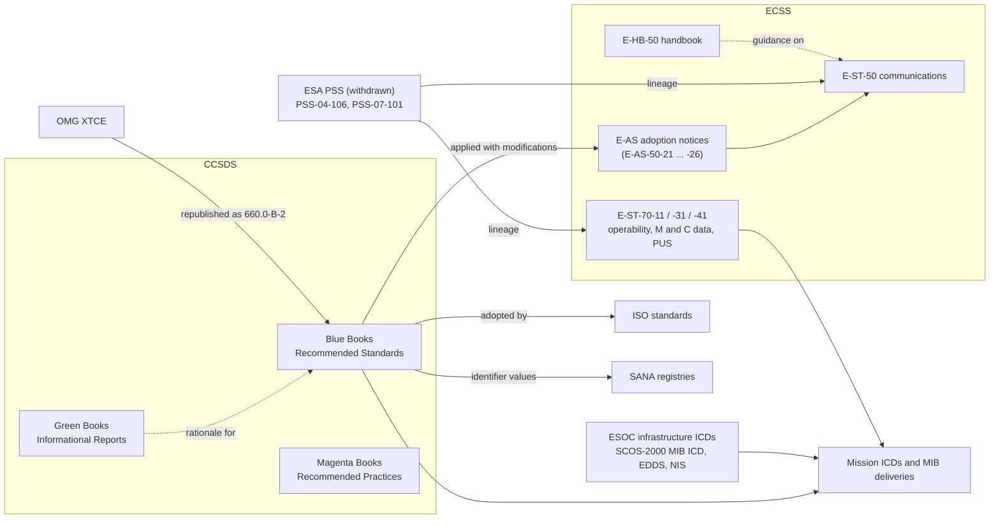
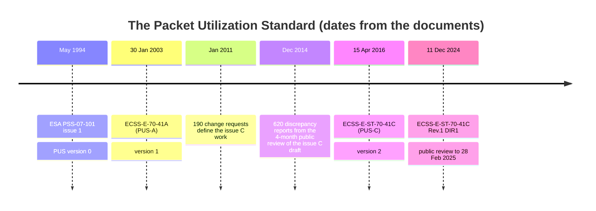

# The standards landscape

The chain described in [How it all fits together](index.md) is specified by documents from
several publishers. The space agencies' **CCSDS** writes the space link and ground cross-support
protocols. **ECSS** writes the European engineering standards, adopts CCSDS books into its own
system and owns the [Packet Utilization Standard](../ecss/pus/index.md). **ISO** publishes many
CCSDS Recommended Standards as ISO standards. **ESA and ESOC** write the interface documents
of their own ground software, such as the SCOS-2000 Database Import ICD that defines the
[MIB](../mib/index.md), and every mission adds its own interface control documents on
top.[^hb-ccsds][^sle-iso][^hb-rel][^icd-scope]

Each family has its own numbering, its own way of issuing revisions and its own idea of what is
binding. This matters in practice because a document names the editions it was written against,
and those editions stay in force for whoever applies it. The Solar Orbiter packet ICD applies the
PUS of 2003; the SCOS-2000 ICD issue of 2017 still points at the ESA PUS of 1994 and at the
CCSDS time code issue of 1990.[^solo-docs][^icd-rd] This page explains how to read each family's document numbers,
how the families depend on each other, and which edition of every document this wiki holds.

## Who publishes what

| Publisher | What it is | Status of its documents | Documents in this wiki's library |
|---|---|---|---|
| **CCSDS** (Consultative Committee for Space Data Systems) | A committee established by the space agencies to solve shared data-system problems; at the April 2023 overview it had 11 member agencies, ESA among them, and 33 observer agencies | "Recommended Standards" are not binding on any agency; endorsement is voluntary | 26 copies of 25 books: protocols, SLE, XTCE, time codes, CFDP |
| **ECSS** (European Cooperation for Space Standardization) | A cooperative effort of ESA, national space agencies and European industry associations; the publisher blocks name the ESA Publications Division (2003), the ESA Requirements and Standards Division at ESTEC (2008, 2016), the Requirements and Standards Section (2021 to 2024) and the ESA Standards Section (2025) | Standards may be tailored to each project; handbooks are informative | 10 documents: E-50 communications, E-70 ground systems and operations |
| **ISO** (International Organization for Standardization) | Publishes many CCSDS Recommended Standards as ISO standards | International standards | None; see [below](#iso-adoption-of-ccsds-books) |
| **ESA PSS** (Procedures, Specifications and Standards) | ESA's own series that adapted CCSDS books for European missions | All withdrawn in favour of ECSS or CCSDS | None; cited by older documents |
| **ESA / ESOC infrastructure** | Interface, design and user documents of SCOS-2000, EDDS, NCTRS/NIS and other EGOS software | Binding for missions that use the software | MIB ICD issues 5.1 to 7.0, TDRS ICD, time-correlation note, the EDDS document set |
| **Missions and their contractors** | Space-to-ground ICDs, data delivery ICDs, packet structure ICDs, MIB deliveries | Binding within the mission | Solar Orbiter, Rosetta, Mars Express and Venus Express documents; two Solar Orbiter MIB releases |
| **OMG** (Object Management Group) | Industry consortium that publishes the XTCE specification | CCSDS republishes it as a Blue Book | XTCE 1.2 inside CCSDS 660.0-B-2 |
| **SANA** (Space Assigned Numbers Authority) | Registrar for all protocol registries created under CCSDS | Holds identifier values such as spacecraft IDs | None (web registries) |

Sources for the rows: CCSDS statement of intent and agency list; ECSS forewords; the SLE concept
and the ECSS handbook on ISO; the handbook on PSS; XTCE title pages; the CCSDS overview on
SANA.[^spp-intent][^g4-agencies][^fw-50][^pub-blocks][^pusc-scope][^sle-iso][^hb-ccsds][^hb-pss][^xtce-omg][^g4-sana] The
library counts are this wiki's own, from its [reference catalogue](../references/index.md); the
RAF book is held twice, as `ccsds-911-1-911x1b5e1` and `ccsds-911x1b5e1-sle-raf`, two copies with
the same checksum.[^copies] The ECSS handbook of 2008 described CCSDS as ten member agencies,
more than 20 observers and over 100 industrial associates; the 2023 count above is this wiki's
count of the lists printed in CCSDS 130.0-G-4.[^hb-ccsds][^g4-agencies]



*How the families feed each other, after the ECSS communications handbook, ECSS-E-ST-50C Rev.1,
the SLE concept, the XTCE Blue Book and the CCSDS overview.*[^hb-rel][^as-table][^sle-iso][^xtce-omg][^g4-sana][^g4-scope]

## CCSDS: colours, numbers and editions

### Book colours

CCSDS publishes in coloured "books". The colour is also a letter inside the document number.

| Colour | Letter | Category | Wording on the cover or in citations | Example in this wiki |
|---|---|---|---|---|
| Blue | B | Recommended Standard: prescriptive interfaces, protocols and encodings | "Recommendation for Space Data System Standards" | [CCSDS 133.0-B-2](../library/ccsds-133-0-133x0b2e2.md) Space Packet Protocol |
| Magenta | M | Recommended Practice: consensus "best" or "state of the art" ways to apply standards | "Recommendation for Space Data System Practices" | [CCSDS 914.0-M-2](../library/ccsds-914-0-914x0m2c1.md) SLE API core |
| Green | G | Informational Report: overviews, rationale, performance data, tutorials | "Report Concerning Space Data System Standards" | [CCSDS 130.0-G-4](../library/ccsds-130-0-130x0g4e1.md) overview of the protocols |
| Orange | not shown in the sources | Experimental Specification: research results, not a standard | not in the library | none |
| Yellow | Y | CCSDS Record: charters and procedures | "CCSDS Record" | CCSDS A02.1-Y-4 *Organization and Processes*, cited in the forewords |
| Silver | `-S` suffix | Historical: superseded or obsolete documents | "(Historical)" | SCPS-NP 713.0-B-1-S; Forward Space Packet 912.3-B-3-S (September 2022) |
| Red | R | Draft Recommendation, circulated before approval | "Draft Recommendation" | CCSDS 910.11-R-1 (SLE service management, 2006) and 727.0-R-5 (CFDP, 2001), both cited as drafts |

*Sources: the ECSS communications handbook §3.1.2, the reference lists of CCSDS 130.0-G-4 and
910.3-G-3, the normative references of ECSS-E-70-41A and the covers of the books
themselves.*[^hb-ccsds][^hb-ccsds2][^g4-refs][^sle-refs][^pusa-refs][^api-cover]

A Green Book usually accompanies a Blue Book: the specification of a protocol is in the Blue
Book and its rationale in the Green Book.[^g4-scope] In this library, CCSDS 130.1-G-3 and
230.1-G-3 summarise the concept and rationale of TM and TC synchronization and channel coding,
130.2-G-3 does the same for the TM, TC and AOS data link protocols, 660.1-G-2 describes the XTCE
elements, and 910.3-G-3 describes the SLE services.[^g4-refs][^g4-coding-refs][^g2-scope][^sle-concept]

### Anatomy of a document number

```text
CCSDS 232.0-B-4 Cor. 1
      │     │ │  └── Technical Corrigendum 1 (October 2023), incorporated in the copy
      │     │ └───── Issue 4 (October 2021)
      │     └─────── B = Blue Book, a Recommended Standard
      └───────────── 232.0 = the book's number (here TC Space Data Link Protocol)
```

The ECSS handbook spells out the rule: a Blue Book number contains the letter B, a Green Book
number the letter G, and the last number is the issue.[^hb-ccsds][^hb-ccsds2] The book numbers cluster by
subject, as the reference lists show:[^g4-refs][^g4-sana]

| Number range | Subjects in the library and in the CCSDS 130.0-G-4 references |
|---|---|
| 120–133 | Data compression (120.0-G, 121.0 to 123.0), overview reports (130.x), TM coding including SCCC and DVB-S2 (131.x), TM SDLP (132.0), packets (133.x) |
| 210–211, 230–232 | Proximity-1 (210.0-G, 211.x); TC coding (230.1, 231.0); TC SDLP (232.0); COP-1 (232.1) |
| 301–355 | Time codes (301.0); spacecraft ID assignment (320.0-M); security (350.0-G, 351.0-M, 352.0, 355.x) |
| 401 | RF and modulation |
| 524, 660 | Mission operations services (524.1); XTCE (660.x) |
| 700–735 | USLP overview (700.1-G); IP over CCSDS (702.1); SCPS (713–717); CFDP (720.1, 727.0); AOS (732.0) and USLP (732.1); DTN, LTP and BP (734.x); AMS (735.1) |
| 901–914 | Cross support: architecture (901.1-M), SLE concept and reference model (910.x), return services (911.x), forward services (912.x), ISP1 (913.1), API (914.0-M) |

!!! warning "Inference"
    CCSDS does not publish this range table in the available sources; it is this wiki's
    grouping of the numbers that appear in the reference lists. The retired Space Link
    Identifiers Blue Book, whose registries SANA replaced, is named in CCSDS 130.0-G-4 without
    its number, so it is not placed in the table.[^g4-sana] The second part after the dot
    (`133.0`, `133.1`) separates sibling books on the same subject, for example the Space Packet
    and Encapsulation Packet protocols.

### Issues, editorial changes and corrigenda

Every CCSDS book in this library opens with a **Document Control** table that lists each issue and its status
("Original issue, superseded", "Current issue"), followed by two kinds of later amendment:[^dc-133][^dc-232]

* An **Editorial Change** (EC) corrects presentation without touching the technical content.
  CCSDS 133.0-B-2 has two: EC 1 (October 2020) adds a missing arrowhead to figure 2-1 and makes
  clear that a link uses either the Encapsulation Packet or the Space Packet protocol; EC 2
  (September 2024) removes duplicated table-of-contents entries and changes the page size to
  A4.[^dc-133] The same A4 change appears in several other editorial changes of 2024, for
  example those of 231.0-B-4, 727.0-B-5 and 232.0-B-4.[^dc-231][^dc-727][^dc-232]
* A **Technical Corrigendum** (Cor.) changes technical text within an issue. CCSDS 232.0-B-4
  Cor. 1 (October 2023) expands the discussion of the order of processing between the TC data
  link protocol, COP-1 and SDLS. CCSDS 232.1-B-2 Cor. 1 (April 2019) adds support for USLP and
  clarifies the FARM-1 window widths. CCSDS 914.0-M-2 Cor. 1 (August 2016) moves the hash
  algorithm reference to CCSDS 913.1-B.[^dc-232][^dc-2321][^dc-914] The cover then states that
  the "current issue includes all updates through Technical Corrigendum 1".[^cover-232]

Each new issue lists its substantive changes. CCSDS 131.0-B-5 (September 2023) revises the
pseudo-randomiser to avoid spectral spikes on high-rate links; CCSDS 133.0-B-2 (June 2020)
removes network-type terminology from the Space Packet Protocol; CCSDS 133.1-B-3 renames the
"Encapsulation Service" to the "Encapsulation Packet Protocol" and drops the Space Packet from
its formats; CCSDS 732.1-B-3 (June 2024) adds VC Packet and VC Access services to USLP and allows
more than one frame per CLTU; the 2023 SLE issues add support for USLP frames.[^dc-131][^dc-133][^dc-1331][^dc-7321][^dc-911]

### File names on ccsds.org

The library's copies come from `ccsds.org/Pubs/`, where each file name compresses the number,
the colour, the issue and the later amendments:[^copies]

| File name | Document control in the copy | Reading |
|---|---|---|
| `130x0g4e1.pdf` | 130.0-G-4, EC 1 (February 2024) | 130.0, Green, issue 4, EC 1 |
| `133x0b2e2.pdf` | 133.0-B-2, EC 1 and EC 2 | 133.0, Blue, issue 2, EC 2 |
| `232x0b4e1c1.pdf` | 232.0-B-4, Cor. 1 (October 2023), EC 1 (October 2024) | 232.0, Blue, issue 4, EC 1, Cor. 1 |
| `232x1b2e2c1.pdf` | 232.1-B-2, EC 1, EC 2, Cor. 1 (April 2019) | 232.1, Blue, issue 2, EC 2, Cor. 1 |
| `914x0m2c1.pdf` | 914.0-M-2, Cor. 1 (August 2016) | 914.0, Magenta, issue 2, Cor. 1 |
| `910x3g3.pdf` | 910.3-G-3, no amendments | 910.3, Green, issue 3 |

!!! warning "Inference"
    CCSDS does not explain its file naming in the available sources. The reading in the last
    column is this wiki's, and it matches the document control table of every copy listed in
    the [version matrix](#version-matrix): `x` replaces the dot, the colour letter and issue
    follow, then `e<n>` for the latest editorial change and `c<n>` for the latest corrigendum.

### Review cycle, status and binding force

The Blue Books carry a standard statement of intent, quoted here from the Space Packet Protocol.
Participation in CCSDS is voluntary and its
recommendations bind no agency. An agency that endorses one agrees to keep its own related
standards in accord with it and to tell the other members about them. Each Recommended Standard
is reviewed within five years of issue to decide whether it stays, changes or is retired; a new
issue does not make existing implementations non-compliant, although members are encouraged to
plan new work against the newer issue.[^spp-intent] Books are approved by the CCSDS Management
Council under the procedures of CCSDS A02.1-Y-4.[^spp-authority][^g4-authority] Retired books keep
their number with an `-S` suffix, for example the historical SLE Forward Space Packet book
912.3-B-3-S of September 2022.[^hb-ccsds2][^g4-refs]

## ECSS: standards, adoption notices, handbooks and drafts

The [ECSS page](../ecss/index.md) describes the ECSS system in full; this section covers what
is needed to read the version matrix.

| Element | Meaning | Example |
|---|---|---|
| `ECSS-E-` | Space engineering branch | ECSS-E-ST-70-41C |
| `-ST-` | Standard (normative, numbered requirements) | ECSS-E-ST-50C Rev.1 |
| `-AS-` | Adoption notice: applies a CCSDS book "with the following modifications" | ECSS-E-AS-50-25C Rev.1 |
| `-HB-` | Handbook: informative, not part of the standards, which prevail in any conflict | ECSS-E-HB-50A |
| Letter after the number | Issue letter. For the standards in the library the sequence is A, then C, and issue B was "never issued"; the adoption notices start directly at C, which their change logs call the "First issue" | ECSS-E-70-41A, ECSS-E-ST-70-41C, ECSS-E-AS-50-26C |
| `Rev.1` | Revision of an issue | ECSS-E-ST-70-11C Rev.1 |
| `DIR1` | Draft distributed for public review | ECSS-E-ST-70-41C Rev.1 DIR1 |

*Sources: the change logs, scopes and title pages of the documents
listed.*[^cl-50][^cl-pusc][^hb-scope][^as25-req][^as25-cl][^as26-scope][^dir-cover][^cl-7011]

### Adoption notices in practice

An adoption notice is a short document that lists, clause by clause, what ECSS changes in a
CCSDS book; everything else applies unchanged.[^as25-ctx] ECSS-E-AS-50-25C Rev.1 (13 January
2023) adopts CCSDS 232.0-B-4 and, among other changes, makes the TC frame's Frame Error Control
Field mandatory instead of optional and keeps only the 1,017-octet maximum for the frame data
field.[^as25-req] ECSS-E-AS-50-26C (1 March 2021) adopts COP-1 (CCSDS 232.1-B-2) and adds an
"FDU aborted indication" that FARM-1 sets when it accepts a Type-BD frame but has no buffer for
it.[^as26-req] It notes that the CCSDS corrigendum published in the meantime does not affect the
adoption.[^as26-scope] Six notices together replace the three 2008 ECSS link standards:[^as-table][^as26-ctx]

| Superseded ECSS standard (31 July 2008) | Adoption notice | CCSDS book adopted (per ECSS-E-ST-50C Rev.1, 2021) | Wiki page |
|---|---|---|---|
| ECSS-E-ST-50-01C TM synchronization and channel coding | ECSS-E-AS-50-21 | 131.0-B-3 (Sept. 2017) | [TM coding](../ccsds/tm-coding.md) |
| ECSS-E-ST-50-03C TM transfer frame protocol | ECSS-E-AS-50-22 | 132.0-B-2 (Sept. 2015) | [TM SDLP](../ccsds/tm-sdlp.md) |
| (ECSS-E-ST-50-03 covered only the TM frame) | ECSS-E-AS-50-23 | 732.0-B-3 (Aug. 2016) | [AOS](../ccsds/aos.md) |
| ECSS-E-ST-50-04C clauses 8 and 9 | ECSS-E-AS-50-24 | 231.0-B-3 (Sept. 2017) | [CLTU](../ccsds/tc-coding-cltu.md) |
| ECSS-E-ST-50-04C clauses 5 and 6 | ECSS-E-AS-50-25 | 232.0-B-3 (Sept. 2015); Rev.1 of 2023 adopts 232.0-B-4 | [TC SDLP](../ccsds/tc-sdlp.md) |
| ECSS-E-ST-50-04C clause 7 | ECSS-E-AS-50-26 | 232.1-B-2 (Sept. 2010) | [COP-1](../ccsds/cop-1.md) |

The adoption notices themselves warn that the CCSDS book that applies is the one named in the
latest version of each notice.[^as25-ctx] The pattern goes back further: before ECSS, ESA
republished CCSDS books in its PSS series with European options, and ECSS-E-ST-50-03C still
carries an annex of differences from ESA PSS-04-106, the ESA Packet Telemetry Standard of January
1988.[^hb-pss][^b-pss]

## ISO adoption of CCSDS books

CCSDS describes its own process as producing recommendations that are "subsequently adopted by
the International Organization for Standardization (ISO) for use by any space
organization".[^sle-iso] The ECSS handbook adds that many CCSDS Recommended Standards are
published as ISO standards.[^hb-ccsds] This wiki's library holds the CCSDS editions only. The ISO
numbers that correspond to the books on this page, and which CCSDS issue each ISO edition
reproduces, are not stated in the available sources.

## ESA and ESOC documents

### The withdrawn ESA PSS series

ESA's PSS documents adapted CCSDS books to European missions by including or excluding options,
and all of them have been withdrawn in favour of ECSS standards or CCSDS
books.[^hb-pss] They survive in the reference lists of later documents:

| PSS document | Title and issue as cited | Cited by |
|---|---|---|
| ESA PSS-04-106 | ESA Packet Telemetry Standard, issue 1, January 1988 | TDRS ICD; ECSS-E-ST-50-03C Annex B[^tdrs-refs][^b-pss] |
| ESA PSS-04-107 | ESA Packet Telecommand Standard, issue 2.0, April 1992 (printed "PSS-074-107" in the SCOS-2000 ICDs) | Herschel/Planck operations interface requirements; SCOS-2000 Database Import ICD 5.1 to 7.0[^hp-ad][^icd-rd] |
| ESA PSS-07-101 | Packet Utilisation Standard, issue 1, May 1994 | SCOS-2000 Database Import ICD 7.0; ECSS-E-ST-70-41C, which calls it PUS version 0[^icd-rd][^pusc-tmsh] |
| ESA PSS-05 | ESA Software Engineering Standard, issue 2, February 1991 | TDRS ICD[^tdrs-refs] |

### ESOC infrastructure documents

ESOC's ground software is documented under structured references. The covers give the
reference, the issue or version and the date, and usually the responsible ESOC unit.

| Reference pattern | Examples in the library | Unit on the cover |
|---|---|---|
| `S2K-MCS-<type>-<nnnn>-TOS-<unit>` | S2K-MCS-ICD-0001-TOS-GCI, Database Import ICD issue 5.1, 26 October 2001; S2K-MCS-SRD-0004-TOS-GIC (TDRS requirements) and S2K-MCS-GLO-0001-TOS-GIC (glossary), cited | ESA/TOS-GCI[^icd51-cover][^tdrs-refs] |
| `EGOS-MCS-S2K-<type>-<nnnn>` | EGOS-MCS-S2K-ICD-0001 (Database Import ICD 6.7 Draft A, 6.9, 7.0); EGOS-MCS-S2K-ICD-0017 (TDRS external interfaces); EGOS-MCS-S2K-TN-1030 (time correlation); EGOS-MCS-S2K-ICD-1005 (RAPID ICD, cited) | ESA/OPS-GIC; ESA/OPS-GDI on the 2018 note[^icd70-cover][^tdrs-cover][^tco-cover][^ddid-refs] |
| `EGOS-GEN-EDDS-<type>-<nnnn>` | SDD-1001, SRS-1001, SUM-1001, ICD-1001 (the EUICD), CIG-1001, EUG-1001, GLO-0001 | OPS-GI (Directorate of Operations and Infrastructure); HSO-GI (Directorate of Human Spaceflight and Operations) on the covers of EUICD 7.0 (December 2014) and glossary 7.0 (April 2017)[^sdd-cover][^euicd7-cover][^euicd13-cover][^glo-cover] |
| `EGOS-MDW-EDDS-<type>-<nnnn>` | Alternative references to EDDS documents: the issue 1 SDD of 2007 and the EUICD in the SRS 18.0 reference lists, the SRS in the Solar Orbiter DDID | cited only[^srs-refs][^ddid-refs] |
| `EGOS-NIS-<item>-ICD-<nnnn>` | EGOS-NIS-NCTR-ICD-0002, NIS/NCTRS volume 2 MCS interface, issue 4.0.2 (November 2009); EGOS-NIS-NIS-ICD-0003, NIS throw events, issue 1.3 (November 2007) | cited only[^icd-rd] |
| `TYPE-NUMBER` short form | Inside SCOS-2000 documents: SRD-0003 (Monitoring SRD), ADD-0007 (Operations Language ADD), SUM-0018 (MIB Applications SUM), CG-0003 (configuration variables), GLO-0001 (glossary), CIDL-0001 (document control list) | —[^icd-ad] |

The document types are the usual software life-cycle set: ICD (interface control document), SRD
(software requirements document) and SRS (software requirements specification), ADD
(architectural design document) and SDD (software design document), SUM (software user manual),
CIG (configuration and installation guide), EUG (update guide), TN (technical note), GLO
(glossary) and SRN (software release note).[^icd-ad][^tdrs-refs][^sdd-cover][^srs-cover][^cig-cover][^eug-cover][^srn-cover] The applicable issue of each
SCOS-2000 document for a given software release is fixed by the SCOS-2000 document control
list.[^icd-ad]

!!! warning "Inference"
    The middle segments of the references (`MCS`, `GEN`, `MDW`, `NIS`, `S2K`, `EDDS`) look
    like a domain and a product code, and the unit codes track ESOC's organisation at the time
    of issue: `TOS` appears in 2001, when the SCOS-2000 team's department belonged to the ESA
    Directorate of Technical and Operational Support, and `OPS` and `HSO` appear later.[^bul108]
    The sources do not define the segments. The same EDDS documents are cited under both
    `EGOS-MDW-EDDS-...` and `EGOS-GEN-EDDS-...` references, and the Solar Orbiter DDID also
    names the EUICD as `MDS-MCS-SW-ICD-1001-OPS-GD`.[^ddid-refs][^srs-refs]

### Mission documents and MIB deliveries

| Kind | Reference | Issue and date | Issued by (as printed) |
|---|---|---|---|
| Data delivery interface document | RO-ESC-IF-5003 / MEX-ESC-IF-5003 | Issue B5, 2003-03-27 | Rosetta/Mars Express MCS[^roddid-b5] |
| Data delivery interface document | RO-ESC-IF-5003 / MEX-ESC-IF-5003 / VEX-ESC-IF-5003 | Issue C2, 2006-02-21 | Rosetta/Mars Express/Venus Express MCS[^roddid-c2] |
| Flight dynamics interface | RO-ESC-ID-5003 (FDS ICD) | Issue B1, 2003-03-07 | ESA/ESOC[^fds-cover] |
| Data delivery interface document | SOL-ESC-IF-05011 (Solar Orbiter DDID) | Issue 1, revision 2, 2019-06-26 | ESA[^ddid-cover] |
| Science ground segment ICD | SOL-SGS-ICD-0006 (E-FECS ICD) | Issue 3, revision 0, 2021-10-05 | ESAC[^efecs-cover] |
| Science ground segment note | SOL-SGS-TN-0007 (services 3 and 20) | Issue 2, revision 0, 2016-10-07 | ESAC[^s20-cover] |
| Industrial packet ICD | SOL.S.ASTR.TN.00079 (TM-TC and packet structure ICD) | Issue 7; the handwritten approval dates are not legible in the extracted text, and the cover copyright line reads 2014 | Airbus Defence and Space Ltd (Stevenage)[^solo-cover] |
| Ground station interface | /MakaluMedia/MR/IFMS/ICD/FTP-OCC (IFMS-OCC ICD) | Issue 11.4.0, 2006-08-09 | MakaluMedia Internet & Engineering Services GmbH, Darmstadt, with an ESOC approval signature[^ifms-cover] |
| MIB delivery | MIB__20250916M25925PFMS001_SOL | `vdf`: name `25925PFM`, comment `20250916-CSW3.1.2_MAS7.33`, release 25925, issue 733 | Solar Orbiter[^mib25] |
| MIB delivery | MIB__20200416M10720PFMS001_SOL | `vdf`: name `10720PFM`, comment `20200416-CSW3.0.3p1_MAS6.51`, release 10720, issue 651 | Solar Orbiter[^mib20] |

!!! warning "Inference"
    The MIB file names appear to combine the delivery date, an `M` plus the `VDF_RELEASE`
    number, `PFM` for the proto-flight model (an expansion found in a Herschel/Planck
    document[^pfm]) and a mission code. `CSW` and `MAS` in the comment field look like
    on-board software and database version labels. None of this is defined in the available
    sources. ESOC-issued mission documents carry `ESC` in the reference, industrial ones the
    contractor's code (`ASTR`), but no source defines these codes either.

??? example "SQL used"
    ```sql
    -- solo-2025-09-16.sqlite and solo-2020-04-16.sqlite
    SELECT VDF_NAME, VDF_COMMENT, VDF_DOMAIN, VDF_RELEASE, VDF_ISSUE FROM vdf;
    ```

## PUS-A, PUS-C and the 2024 Rev.1 draft

The Packet Utilization Standard has three generations, and the version field in every PUS
packet header says which one a packet follows: 0 for ESA PSS-07-101, 1 for ECSS-E-70-41A,
2 for ECSS-E-ST-70-41C.[^pusc-tmsh][^pusc-tcsh]



*Sources: ICD 7.0 references, the change logs of ECSS-E-ST-70-41C and its Rev.1 draft, and an
ESA status presentation of 2015.*[^icd-rd][^cl-pusc][^dir-cover][^valera]

| Aspect | PUS-A: ECSS-E-70-41A | PUS-C: ECSS-E-ST-70-41C | Rev.1 DIR1 (draft) |
|---|---|---|---|
| Date and status | 30 January 2003; superseded | 15 April 2016; current | 11 December 2024; public review 12 December 2024 to 28 February 2025; outcome not stated in the available sources |
| PUS version in headers | 1 | 2 | 2 |
| CCSDS references | Packet Telemetry 102.0-B-5; Telecommand Parts 1 to 3 (201.0-B-3, 202.0-B-3, 202.1-B-2, 203.0-B-2); Time Code Formats 301.0-B-2; CFDP Red Book 727.0-R-5 | Space Packet Protocol 133.0-B-1; Time Code Formats 301.0-B-4 | Space Packet Protocol 133.0-B-2; 301.0-B-4; CFDP 727.0-B-5 and Green Book 720.1-G-4 |
| TC secondary header | CCSDS secondary header flag (1 bit), version (3), Ack (4), service type (8), subtype (8), optional source ID of mission-defined size, spare | Version (4), Ack flags (4), service type (8), message subtype (8), source ID (16), optional spare | Same layout; the 16-bit field is named "source APID" |
| TM secondary header | Spare (1), version (3), spare (4), type (8), subtype (8), optional packet subcounter, destination ID and time, spare | Version (4), time reference status (4), type (8), subtype (8), message type counter (16), destination ID (16), time, optional spare | Same layout; "destination APID" |
| Standard services | 16 (types 1–6, 8, 9, 11–15, 17–19) | 20 (adds 20–23; 7, 10, 16 reserved) | Adds 24 file transfer, 25 file data storage, 26 parameter extraction, 27 critical packet log management; deletes 8 function management |
| Requirements | Requirements not individually named | Named requirements (ECSS drafting rules), the PUS foundation model, system and interface requirements separated | Configuration policy formalised as requirements; consistency with the foundation model |

*Sources for the rows: the normative references, header clauses, service tables and change
logs of the three documents.*[^pusa-refs][^pusc-refs][^dir-refs][^pusa-tc][^pusa-tm][^pusc-tcsh][^pusc-tmsh][^dir-hdr][^pusa-svc][^pusc-types][^cl-pusc][^dir-cl]

Solar Orbiter applies PUS-A: ECSS-E-70-41A is the first applicable document of its TM/TC ICD, and the PUS version field is set to 1 in both directions. The public
MIB shows the same thing from the ground side: its standard TC header template `NOM_TC` fixes the
PUS version field to 1.[^solo-docs][^solo-pus][^mib25] The
[PUS-A vs PUS-C](../ecss/pus/pus-a-vs-pus-c.md) page compares the two issues service by service,
and [How Solar Orbiter uses PUS](../missions/solar-orbiter/pus-usage.md) shows the tailoring.

## Version matrix

"Status" below is the status the copy gives itself in its document control or change log at the
time it was copied. Whether a publisher has issued a newer edition since the copy was taken is
not stated in the available sources; the copy date is in the last column and on each library
page.[^copies]

### CCSDS

| Topic | Document | Issue held | Later amendments in the copy | Status | Library | Wiki page | Copied (UTC) |
|---|---|---|---|---|---|---|---|
| Protocol overview | CCSDS 130.0-G-4 | Green, Apr. 2023 | EC 1, Feb. 2024 | Current issue | [copy](../library/ccsds-130-0-130x0g4e1.md) | [CCSDS stack](../ccsds/index.md) | 2026-11-12 14:10 |
| TM coding rationale | CCSDS 130.1-G-3 | Green, June 2020 | EC 1, Oct. 2024 | Current issue | [copy](../library/ccsds-130-1-130x1g3e1.md) | [TM coding](../ccsds/tm-coding.md) | 2026-11-12 14:10 |
| Data link rationale | CCSDS 130.2-G-3 | Green, Sept. 2015 | none | Current issue | [copy](../library/ccsds-130-2-130x2g3.md) | [CCSDS stack](../ccsds/index.md) | 2026-11-12 14:10 |
| TM sync and channel coding | CCSDS 131.0-B-5 | Blue, Sept. 2023 | none | Current issue | [copy](../library/ccsds-131-0-131x0b5.md) | [TM coding](../ccsds/tm-coding.md) | 2026-11-12 14:10 |
| TM Space Data Link Protocol | CCSDS 132.0-B-3 | Blue, Oct. 2021 | none | Current issue | [copy](../library/ccsds-132-0-132x0b3.md) | [TM SDLP](../ccsds/tm-sdlp.md) | 2026-11-12 14:10 |
| Space Packet Protocol | CCSDS 133.0-B-2 | Blue, June 2020 | EC 1, Oct. 2020; EC 2, Sept. 2024 | Current issue | [copy](../library/ccsds-133-0-133x0b2e2.md) | [Space Packet](../ccsds/space-packet.md) | 2026-11-12 14:10 |
| Encapsulation Packet Protocol | CCSDS 133.1-B-3 | Blue, May 2020 | EC 1, Nov. 2020 | Current issue | [copy](../library/ccsds-133-1-133x1b3e1.md) | [Encapsulation](../ccsds/encapsulation.md) | 2026-11-12 14:10 |
| TC coding rationale | CCSDS 230.1-G-3 | Green, Oct. 2021 | EC 1, Jan. 2023 | Current issue | [copy](../library/ccsds-230-1-230x1g3e1.md) | [CLTU](../ccsds/tc-coding-cltu.md) | 2026-11-12 14:10 |
| TC sync and channel coding | CCSDS 231.0-B-4 | Blue, July 2021 | EC 1, Oct. 2024 | Current issue | [copy](../library/ccsds-231-0-231x0b4e1.md) | [CLTU](../ccsds/tc-coding-cltu.md) | 2026-11-12 14:10 |
| TC Space Data Link Protocol | CCSDS 232.0-B-4 | Blue, Oct. 2021 | Cor. 1, Oct. 2023; EC 1, Oct. 2024 | Current issue | [copy](../library/ccsds-232-0-232x0b4e1c1.md) | [TC SDLP](../ccsds/tc-sdlp.md) | 2026-11-12 14:10 |
| COP-1 | CCSDS 232.1-B-2 | Blue, Sept. 2010 | EC 1, Dec. 2018; EC 2 and Cor. 1, Apr. 2019 | Current issue | [copy](../library/ccsds-232-1-232x1b2e2c1.md) | [COP-1](../ccsds/cop-1.md) | 2026-11-12 14:10 |
| Time code formats | CCSDS 301.0-B-4 | Blue, Nov. 2010 | EC 1, Feb. 2014 | Current issue | [copy](../library/ccsds-301-0-301x0b4e1.md) | [Time codes](../ccsds/time-codes.md) | 2026-11-12 14:10 |
| Space Data Link Security | CCSDS 355.0-B-2 | Blue, July 2022 | none | Current issue | [copy](../library/ccsds-355-0-355x0b2.md) | [SDLS](../ccsds/sdls.md) | 2026-11-12 14:10 |
| XTCE 1.2 | CCSDS 660.0-B-2 (OMG formal/18-10-04) | Blue, Feb. 2020 | none | Current issue | [copy](../library/ccsds-660-0-660x0b2.md) | [XTCE](../ccsds/xtce.md) | 2026-11-12 14:10 |
| XTCE element description | CCSDS 660.1-G-2 | Green, Aug. 2021 | none | Current issue | [copy](../library/ccsds-660-1-660x1g2.md) | [XTCE](../ccsds/xtce.md) | 2026-11-12 14:10 |
| CFDP | CCSDS 727.0-B-5 | Blue, July 2020 | EC 1, Sept. 2024 | Current issue | [copy](../library/ccsds-727-0-727x0b5e1.md) | [CFDP](../ccsds/cfdp.md) | 2026-11-12 14:10 |
| AOS Space Data Link Protocol | CCSDS 732.0-B-4 | Blue, Oct. 2021 | none | Current issue | [copy](../library/ccsds-732-0-732x0b4.md) | [AOS](../ccsds/aos.md) | 2026-11-12 14:10 |
| USLP | CCSDS 732.1-B-3 | Blue, June 2024 | EC 1, Oct. 2024 | Current issue | [copy](../library/ccsds-732-1-732x1b3e1.md) | [USLP](../ccsds/uslp.md) | 2026-11-12 14:10 |
| SLE concept | CCSDS 910.3-G-3 | Green, Mar. 2006 | none | Current issue | [copy](../library/ccsds-910x3g3-sle-cross-support.md) | [SLE](../ccsds/sle/index.md) | 2026-11-05 14:12 |
| SLE Return All Frames | CCSDS 911.1-B-5 | Blue, July 2023 | EC 1, Oct. 2024 | Current issue | [copy](../library/ccsds-911-1-911x1b5e1.md), [second copy](../library/ccsds-911x1b5e1-sle-raf.md) | [Return services](../ccsds/sle/return-services.md) | 2026-11-12 14:10; 2026-11-05 14:12 |
| SLE Return Channel Frames | CCSDS 911.2-B-4 | Blue, July 2023 | EC 1, Oct. 2024 | Current issue | [copy](../library/ccsds-911-2-911x2b4e1.md) | [Return services](../ccsds/sle/return-services.md) | 2026-11-12 14:10 |
| SLE Return Operational Control Fields | CCSDS 911.5-B-4 | Blue, July 2023 | EC 1, Oct. 2024 | "Current update" | [copy](../library/ccsds-911-5-911x5b4e1.md) | [Return services](../ccsds/sle/return-services.md) | 2026-11-12 14:10 |
| SLE Forward CLTU | CCSDS 912.1-B-5 | Blue, July 2023 | EC 1, Oct. 2024 | Current issue | [copy](../library/ccsds-912-1-912x1b5e1.md) | [FCLTU](../ccsds/sle/fcltu.md) | 2026-11-12 14:10 |
| SLE Internet Protocol (ISP1) | CCSDS 913.1-B-2 | Blue, Sept. 2015 | none | Current issue | [copy](../library/ccsds-913-1-913x1b2.md) | [ISP1 and API](../ccsds/sle/isp1-and-api.md) | 2026-11-12 14:10 |
| SLE API core | CCSDS 914.0-M-2 | Magenta, Sept. 2015 | Cor. 1, Aug. 2016 | Current issue | [copy](../library/ccsds-914-0-914x0m2c1.md) | [ISP1 and API](../ccsds/sle/isp1-and-api.md) | 2026-11-12 14:10 |

*Issue, date and amendments from the Document Control page of each copy; copy times from this
wiki's source registry.*[^dc-all][^copies] The ROCF book's own table labels issue 3 "Current
issue" and issue 4 "Current update".[^dc-911]

### ECSS

| Topic | Document | Issue held | Status | Library | Wiki page | Copied (UTC) |
|---|---|---|---|---|---|---|
| Communications | ECSS-E-ST-50C Rev.1 | 1 March 2021 | Second issue, revision 1 | [copy](../library/ecss-e-st-50c-rev-1-1march2021.md) | [E-ST-50](../ecss/e-st-50-communications.md) | 2026-11-12 14:11 |
| TM transfer frame | ECSS-E-ST-50-03C | 31 July 2008 | Superseded by ECSS-E-AS-50-22 and -23 | [copy](../library/ecss-e-st-50-03c-31july2008.md) | [E-ST-50](../ecss/e-st-50-communications.md) | 2026-11-12 14:11 |
| TC data link adoption | ECSS-E-AS-50-25C Rev.1 | 13 January 2023 (adopts 232.0-B-4) | First issue, revision 1 | [copy](../library/ecss-e-as-50-25c-rev-1-13january2023.md) | [TC SDLP](../ccsds/tc-sdlp.md) | 2026-11-12 14:11 |
| COP-1 adoption | ECSS-E-AS-50-26C | 1 March 2021 (adopts 232.1-B-2) | First issue | [copy](../library/ecss-e-as-50-26c-1march2021.md) | [COP-1](../ccsds/cop-1.md) | 2026-11-12 14:11 |
| Communications guidelines | ECSS-E-HB-50A | 15 November 2008 | Handbook (informative) | [copy](../library/ecss-e-hb-50a-15november2008.md) | [E-ST-50](../ecss/e-st-50-communications.md) | 2026-11-12 14:11 |
| Space segment operability | ECSS-E-ST-70-11C Rev.1 | 15 October 2025 | Second issue, revision 1 | [copy](../library/ecss-e-st-70-11c-rev-1-15october2025.md) | [E-ST-70-11C](../ecss/e-st-70-11c.md) | 2026-11-12 14:11 |
| M&C data definition | ECSS-E-ST-70-31C | 31 July 2008 | Issue C; ECSS-E-70-31A (9 Oct. 2007) was the first issue, B never issued | [copy](../library/ecss-e-st-70-31c.md) | [E-ST-70-31C](../ecss/e-st-70-31c.md) | 2026-11-05 14:20 |
| PUS-A | ECSS-E-70-41A | 30 January 2003 | First issue; superseded by issue C | [copy](../library/ecss-e-70-41a-30jan2003-pus.md) | [PUS-A vs PUS-C](../ecss/pus/pus-a-vs-pus-c.md) | 2026-11-12 14:11 |
| PUS-C | ECSS-E-ST-70-41C | 15 April 2016 | Second issue | [copy](../library/ecss-e-st-70-41c-15april2016.md) | [PUS](../ecss/pus/index.md) | 2026-11-12 14:11 |
| PUS Rev.1 draft | ECSS-E-ST-70-41C Rev.1 DIR1 | 11 December 2024 | Draft for public review (review period ending 28 Feb. 2025) | [copy](../library/ecss-e-st-70-41c-rev1-dir1.md) | [PUS-A vs PUS-C](../ecss/pus/pus-a-vs-pus-c.md) | 2026-11-05 14:12 |

*Status from the change log and title page of each copy and from the adoption table of
ECSS-E-ST-50C Rev.1.*[^cl-50][^cl-5003][^as25-cl][^as26-scope][^hb-scope][^cl-7011][^cl-7031][^cl-pusc][^dir-cover][^as-table]

### ESA and ESOC

| Topic | Reference | Issue held | Status in the library | Library | Wiki page | Copied (UTC) |
|---|---|---|---|---|---|---|
| MIB import ICD | S2K-MCS-ICD-0001-TOS-GCI | 5.1, 26 Oct. 2001 | Superseded by later issues | [copy](../library/icd-5-1-tos-gci.md) | [ICD history](../mib/icd-history.md) | 2026-11-05 13:54 |
| MIB import ICD | EGOS-MCS-S2K-ICD-0001 | 6.7 Draft A, 2009-12-01 | Superseded | [copy](../library/icd-6-7-drafta.md) | [ICD history](../mib/icd-history.md) | 2026-11-05 13:53 |
| MIB import ICD | EGOS-MCS-S2K-ICD-0001 | 6.9, 2010-07-06 | Superseded | [copy](../library/icd-6-9-archive-org.md) | [ICD history](../mib/icd-history.md) | 2026-11-05 13:53 |
| MIB import ICD | EGOS-MCS-S2K-ICD-0001 | 7.0 FINAL, 2017-08-11 | Latest issue in the library | [copy](../library/icd-7-0-final.md) | [MIB](../mib/index.md) | 2026-11-05 13:53 |
| TDRS external interfaces | EGOS-MCS-S2K-ICD-0017 | 5.1, 22 Aug. 2008 | Only issue in the library | [copy](../library/icd-0017-tdrs-5-1.md) | [TDRS](../scos2000/tdrs.md) | 2026-11-05 13:54 |
| Time correlation | EGOS-MCS-S2K-TN-1030 | 1.0, 2018-10-31 | Only issue in the library | [copy](../library/tn-1030-time-correlation.md) | [Time correlation](../scos2000/time-correlation.md) | 2026-11-05 13:54 |
| EDDS design | EGOS-GEN-EDDS-SDD-1001 | 15.0 (2018-02-16); 25.0 (2025-03-07) | 25.0 is the later | [15.0](../library/sdd.md), [25.0](../library/sdd-v24.md) | [EDDS](../scos2000/edds.md) | 2026-11-05 14:00; 14:01 |
| EDDS requirements | EGOS-GEN-EDDS-SRS-1001 | 18.0, 2018-02-16 | Only issue in the library | [copy](../library/srs.md) | [EDDS](../scos2000/edds.md) | 2026-11-05 14:02 |
| EDDS user manual | EGOS-GEN-EDDS-SUM-1001 | 14.0 (2018-02-16); 22.0 (2025-01-10) | 22.0 is the later | [14.0](../library/sum.md), [22.0](../library/sum-v22.md) | [EDDS](../scos2000/edds.md) | 2026-11-05 14:05; 14:07 |
| EDDS external user ICD | EGOS-GEN-EDDS-ICD-1001 | 7.0 (2014-12-17); 13.0 (2017-05-05); 15.0 (2018-02-16); 24.0 (2025-01-10) | 24.0 is the latest in the library | [7.0](../library/euicd-unversioned.md), [13.0](../library/euicd-v13.md), [15.0](../library/euicd-i15r0.md), [24.0](../library/euicd-v25.md) | [EDDS formats](../scos2000/edds-formats.md) | 2026-11-05 14:19; 13:56; 13:57; 13:59 |
| EDDS installation guide | EGOS-GEN-EDDS-CIG-1001 | 14.0 (2018-02-16); 25.0 (2025-03-07) | 25.0 is the later | [14.0](../library/cig-i14r0.md), [25.0](../library/cig-v24.md) | [EDDS](../scos2000/edds.md) | 2026-11-05 14:09; 14:10 |
| EDDS update guide | EGOS-GEN-EDDS-EUG-1001 | 12.0, 2018-02-16 | Only issue in the library | [copy](../library/eug.md) | [EDDS](../scos2000/edds.md) | 2026-11-05 14:10 |
| EDDS glossary | EGOS-GEN-EDDS-GLO-0001 | 7.0, 2017-04-10 | Only issue in the library | [copy](../library/glo.md) | [EDDS](../scos2000/edds.md) | 2026-11-05 14:03 |
| EDDS release note | Software Release Note | 14.0, 2018-02-16 | Only issue in the library | [copy](../library/srn.md) | [EDDS](../scos2000/edds.md) | 2026-11-05 14:10 |

*Issues and dates from the title pages; copy times from the source
registry.*[^icd51-cover][^icd67-cover][^icd69-cover][^icd70-cover][^tdrs-cover][^tco-cover][^sdd-cover][^sdd25-cover][^srs-cover][^sum-cover][^sum22-cover][^euicd7-cover][^euicd13-cover][^euicd15-cover][^euicd24-cover][^cig-cover][^cig25-cover][^eug-cover][^glo-cover][^srn-cover][^copies]

!!! note "Library names versus issue numbers"
    Some library slugs come from the file names on the hosting site and do not match the
    issue printed inside: `euicd-v25` holds EUICD version 24.0, and `sdd-v24` and `cig-v24`
    hold version 25.0 of the SDD and CIG.[^euicd24-cover][^sdd25-cover][^cig25-cover] Always cite
    the issue on the title page.

The mission documents (Solar Orbiter, Rosetta, Mars Express, Venus Express) and the two Solar
Orbiter MIB releases are listed with their issues [above](#mission-documents-and-mib-deliveries);
their copy dates are on their library pages and in the
[reference catalogue](../references/index.md).

## How the documents cite each other

Because each family revises on its own schedule, a citing document often names an older edition
than the one in this library. The table records the editions named in the references of the
documents held here.

| Citing document | Edition it names | Edition in this library |
|---|---|---|
| ECSS-E-70-41A (2003) | CCSDS 102.0-B-5 Packet Telemetry, 201.0 to 203.0 Telecommand, 301.0-B-2 (1990), 727.0-R-5 (draft) | Packet Telemetry and Telecommand were later restructured into the Space Packet Protocol, the TM/TC/AOS data link protocols and the TM/TC coding books, held here as 133.0-B-2, 132.0-B-3, 232.0-B-4, 131.0-B-5 and 231.0-B-4; also 301.0-B-4, 727.0-B-5[^pusa-refs][^g4-history] |
| ECSS-E-ST-70-41C (2016) | CCSDS 133.0-B-1 (Sept. 2003), 301.0-B-4 (Nov. 2010) | 133.0-B-2, 301.0-B-4[^pusc-refs] |
| ECSS-E-ST-70-41C Rev.1 DIR1 (2024) | CCSDS 133.0-B-2, 301.0-B-4, 727.0-B-5, 720.1-G-4 | 133.0-B-2, 301.0-B-4, 727.0-B-5[^dir-refs] |
| ECSS-E-ST-50-03C (2008) | CCSDS 132.0-B-1 | 132.0-B-3[^b-pss] |
| ECSS-E-ST-50C Rev.1 (2021) | Adoption notices based on 131.0-B-3, 132.0-B-2, 732.0-B-3, 231.0-B-3, 232.0-B-3, 232.1-B-2 | 131.0-B-5, 132.0-B-3, 732.0-B-4, 231.0-B-4, 232.0-B-4, 232.1-B-2[^as-table] |
| CCSDS 910.3-G-3 (2006) | 132.0-B-1, 131.0-B-1, 732.0-B-1, 231.0-B-1, 232.0-B-1, 133.0-B-1; SLE books of 2004 | the 2015–2024 issues[^sle-refs] |
| CCSDS 130.0-G-4 (2023) | 131.0-B-4 (2022), 231.0-B-3 (2017, although 231.0-B-4 dates from July 2021), 911.1-B-4 and 912.1-B-4 (2016), 732.1-B-2 (2021) | 131.0-B-5, 231.0-B-4, 911.1-B-5, 912.1-B-5, 732.1-B-3[^g4-refs][^dc-231] |
| SCOS-2000 Database Import ICD 7.0 (2017) | ESA PSS-07-101 (1994), CCSDS 301.0-B-2 (1990), ESA Packet Telecommand Standard (1992), and ECSS-E-70-41A with a note that ECSS-E-ST-70-41C will replace it | PUS-C, 301.0-B-4[^icd-rd] |
| Solar Orbiter TM-TC ICD, issue 7 | ECSS-E-70-41A (applicable); ECSS-E-ST-50-03C and ECSS-E-ST-50-04C (reference) | PUS-C; adoption notices[^solo-docs] |

One consequence is visible in the Space Packet itself. PUS-A, written against CCSDS 102.0-B-5,
reserves APID 0 for the time packet and all ones for idle packets; Solar Orbiter's ICD repeats
both reservations. CCSDS 133.0-B-2 notes that the only reserved APID value is now the one for
idle packets.[^pusa-apid][^solo-apid][^spp-idle] A mission's ICD, not the latest Blue Book,
defines what its packets mean.

!!! tip "Reading a mission document"
    Start from its applicable-documents list. It names the editions the design was frozen
    against; read those editions, then use the later ones in this wiki to understand where the
    mission sits relative to current practice. The [library](../library/index.md) pages give
    the publisher URL and copy time of every edition held here.

[^hb-ccsds]: [ECSS-E-HB-50A, Communications guidelines](../library/ecss-e-hb-50a-15november2008.md), §3.1.2 "CCSDS standards", PDF p. 24.
[^hb-ccsds2]: [ECSS-E-HB-50A](../library/ecss-e-hb-50a-15november2008.md), §3.1.2 (continued: Green, Magenta, Orange, Yellow and Silver books), PDF p. 25.
[^hb-pss]: [ECSS-E-HB-50A](../library/ecss-e-hb-50a-15november2008.md), §3.1.3 "Relationship to PSS standards", PDF p. 25.
[^hb-rel]: [ECSS-E-HB-50A](../library/ecss-e-hb-50a-15november2008.md), §3.1.4 "Relationship of ECSS standards to CCSDS standards", PDF p. 26.
[^hb-scope]: [ECSS-E-HB-50A](../library/ecss-e-hb-50a-15november2008.md), §1.2 "Scope", PDF p. 17.
[^sle-iso]: [CCSDS 910.3-G-3, Cross Support Concept Part 1: SLE Services](../library/ccsds-910x3g3-sle-cross-support.md), §1.4 "Rationale", PDF p. 10.
[^sle-refs]: [CCSDS 910.3-G-3](../library/ccsds-910x3g3-sle-cross-support.md), §1.7 "References" (including Red Books 910.11-R-1 and 913.1-R-1), PDF pp. 12–13.
[^sle-concept]: [CCSDS 910.3-G-3](../library/ccsds-910x3g3-sle-cross-support.md), §2.1 "What are SLE services?", PDF p. 15.
[^icd-scope]: [SCOS-2000 Database Import ICD 7.0](../library/icd-7-0-final.md), §1.1 "Purpose" and "Scope", PDF p. 15.
[^icd-ad]: [Database Import ICD 7.0](../library/icd-7-0-final.md), §1.4 "References" and §1.4.1 "Applicable documents", PDF pp. 18–19.
[^icd-rd]: [Database Import ICD 7.0](../library/icd-7-0-final.md), §1.4.2 "Reference documents" (RD-6, RD-8, RD-14, RD-18, RD-19, RD-20), PDF pp. 19–20.
[^solo-docs]: [SOL.S.ASTR.TN.00079 issue 7, Solar Orbiter TM-TC and Packet Structure ICD](../library/sol-s-astr-tn-00079-07.md), §2 "Documents" (AD1, RD1, RD2), PDF p. 13.
[^solo-pus]: [SOL.S.ASTR.TN.00079 issue 7](../library/sol-s-astr-tn-00079-07.md), §3.2.2.1 "TC data field header" (PUS-53, PUS version 1), PDF p. 17, and §4.2.2.1 "TM data field header" (PUS-222, PUS version 1), PDF p. 26.
[^solo-apid]: [SOL.S.ASTR.TN.00079 issue 7](../library/sol-s-astr-tn-00079-07.md), §4.2.1.1 "TM packet ID" (PUS-188), PDF pp. 24–25.
[^solo-cover]: [SOL.S.ASTR.TN.00079 issue 7](../library/sol-s-astr-tn-00079-07.md), title page and running header, PDF p. 1.
[^spp-intent]: [CCSDS 133.0-B-2, Space Packet Protocol](../library/ccsds-133-0-133x0b2e2.md), "Statement of intent", PDF p. 4.
[^spp-authority]: [CCSDS 133.0-B-2](../library/ccsds-133-0-133x0b2e2.md), "Authority", PDF p. 3.
[^spp-idle]: [CCSDS 133.0-B-2](../library/ccsds-133-0-133x0b2e2.md), §4.1.3.3.4.4 and its notes, PDF p. 34.
[^g4-scope]: [CCSDS 130.0-G-4, Overview of Space Communications Protocols](../library/ccsds-130-0-130x0g4e1.md), §1.1 "Purpose and scope", PDF p. 9.
[^g4-authority]: [CCSDS 130.0-G-4](../library/ccsds-130-0-130x0g4e1.md), "Authority" and "Foreword", PDF pp. 3–4.
[^g4-agencies]: [CCSDS 130.0-G-4](../library/ccsds-130-0-130x0g4e1.md), list of member and observer agencies, PDF p. 5 (counted by this wiki: 11 members, 33 observers).
[^g4-refs]: [CCSDS 130.0-G-4](../library/ccsds-130-0-130x0g4e1.md), §1.4 "References" [1] to [61], PDF pp. 11–15.
[^g4-sana]: [CCSDS 130.0-G-4](../library/ccsds-130-0-130x0g4e1.md), §3.2.2 "Identifiers used by data link protocols", PDF p. 26.
[^g2-scope]: [CCSDS 130.2-G-3, Space Data Link Protocols: Summary of Concept and Rationale](../library/ccsds-130-2-130x2g3.md), §2.1 "Design goals", PDF p. 13.
[^xtce-omg]: [CCSDS 660.0-B-2, XML Telemetric and Command Exchange 1.2](../library/ccsds-660-0-660x0b2.md), OMG title page (formal/18-10-04) and copyright page, PDF pp. 9–10.
[^api-cover]: [CCSDS 914.0-M-2, SLE API for Transfer Services: Core Specification](../library/ccsds-914-0-914x0m2c1.md), cover ("Recommended Practice", "Magenta Book"), PDF p. 1.
[^cover-232]: [CCSDS 232.0-B-4](../library/ccsds-232-0-232x0b4e1c1.md), cover note, PDF p. 1.
[^dc-131]: [CCSDS 131.0-B-5](../library/ccsds-131-0-131x0b5.md), Document Control, PDF p. 7.
[^dc-133]: [CCSDS 133.0-B-2](../library/ccsds-133-0-133x0b2e2.md), Document Control, PDF p. 7.
[^dc-1331]: [CCSDS 133.1-B-3, Encapsulation Packet Protocol](../library/ccsds-133-1-133x1b3e1.md), Document Control, PDF p. 7.
[^dc-231]: [CCSDS 231.0-B-4](../library/ccsds-231-0-231x0b4e1.md), Document Control, PDF p. 7.
[^dc-232]: [CCSDS 232.0-B-4](../library/ccsds-232-0-232x0b4e1c1.md), Document Control, PDF p. 7.
[^dc-2321]: [CCSDS 232.1-B-2, COP-1](../library/ccsds-232-1-232x1b2e2c1.md), Document Control, PDF p. 7.
[^dc-727]: [CCSDS 727.0-B-5, CFDP](../library/ccsds-727-0-727x0b5e1.md), Document Control, PDF p. 7.
[^dc-7321]: [CCSDS 732.1-B-3, USLP](../library/ccsds-732-1-732x1b3e1.md), Document Control, PDF p. 7.
[^dc-911]: [CCSDS 911.1-B-5](../library/ccsds-911-1-911x1b5e1.md), [911.2-B-4](../library/ccsds-911-2-911x2b4e1.md) and [911.5-B-4](../library/ccsds-911-5-911x5b4e1.md), Document Control, PDF p. 6 of each.
[^dc-914]: [CCSDS 914.0-M-2](../library/ccsds-914-0-914x0m2c1.md), Document Control, PDF p. 7.
[^dc-all]: Document Control pages: [130.0-G-4](../library/ccsds-130-0-130x0g4e1.md) PDF p. 6; [130.1-G-3](../library/ccsds-130-1-130x1g3e1.md) p. 6; [130.2-G-3](../library/ccsds-130-2-130x2g3.md) p. 5; [131.0-B-5](../library/ccsds-131-0-131x0b5.md) p. 7; [132.0-B-3](../library/ccsds-132-0-132x0b3.md) p. 7; [133.0-B-2](../library/ccsds-133-0-133x0b2e2.md) p. 7; [133.1-B-3](../library/ccsds-133-1-133x1b3e1.md) p. 7; [230.1-G-3](../library/ccsds-230-1-230x1g3e1.md) p. 6; [231.0-B-4](../library/ccsds-231-0-231x0b4e1.md) p. 7; [232.0-B-4](../library/ccsds-232-0-232x0b4e1c1.md) p. 7; [232.1-B-2](../library/ccsds-232-1-232x1b2e2c1.md) p. 7; [301.0-B-4](../library/ccsds-301-0-301x0b4e1.md) p. 7; [355.0-B-2](../library/ccsds-355-0-355x0b2.md) p. 7; [660.0-B-2](../library/ccsds-660-0-660x0b2.md) p. 7; [660.1-G-2](../library/ccsds-660-1-660x1g2.md) p. 6; [727.0-B-5](../library/ccsds-727-0-727x0b5e1.md) p. 7; [732.0-B-4](../library/ccsds-732-0-732x0b4.md) p. 7; [732.1-B-3](../library/ccsds-732-1-732x1b3e1.md) p. 7; [910.3-G-3](../library/ccsds-910x3g3-sle-cross-support.md) p. 5; [911.1-B-5](../library/ccsds-911-1-911x1b5e1.md) p. 6 (identical copy [here](../library/ccsds-911x1b5e1-sle-raf.md)); [911.2-B-4](../library/ccsds-911-2-911x2b4e1.md) p. 6; [911.5-B-4](../library/ccsds-911-5-911x5b4e1.md) p. 6; [912.1-B-5](../library/ccsds-912-1-912x1b5e1.md) p. 6; [913.1-B-2](../library/ccsds-913-1-913x1b2.md) p. 7; [914.0-M-2](../library/ccsds-914-0-914x0m2c1.md) p. 7.
[^fw-50]: [ECSS-E-ST-50C Rev.1, Communications](../library/ecss-e-st-50c-rev-1-1march2021.md), Foreword and publisher block, PDF p. 2.
[^pub-blocks]: Publisher blocks ("Published by"), PDF p. 2 of each: [ECSS-E-70-41A](../library/ecss-e-70-41a-30jan2003-pus.md) (2003), [ECSS-E-HB-50A](../library/ecss-e-hb-50a-15november2008.md) (2008), [ECSS-E-ST-70-41C](../library/ecss-e-st-70-41c-15april2016.md) (2016), [ECSS-E-ST-70-41C Rev.1 DIR1](../library/ecss-e-st-70-41c-rev1-dir1.md) (2024), [ECSS-E-ST-70-11C Rev.1](../library/ecss-e-st-70-11c-rev-1-15october2025.md) (2025).
[^pusc-scope]: [ECSS-E-ST-70-41C](../library/ecss-e-st-70-41c-15april2016.md), clause 1 "Scope" (tailoring in conformance with ECSS-S-ST-00), PDF p. 10.
[^cl-50]: [ECSS-E-ST-50C Rev.1](../library/ecss-e-st-50c-rev-1-1march2021.md), Change log, PDF p. 3.
[^as-table]: [ECSS-E-ST-50C Rev.1](../library/ecss-e-st-50c-rev-1-1march2021.md), §4.2, table of ECSS adoption notices and superseded ECSS standards, PDF pp. 19–20.
[^cl-5003]: [ECSS-E-ST-50-03C, Telemetry transfer frame protocol](../library/ecss-e-st-50-03c-31july2008.md), title page and Change log, PDF pp. 1–3.
[^b-pss]: [ECSS-E-ST-50-03C](../library/ecss-e-st-50-03c-31july2008.md), Annex B "Changes from ESA-PSS-04-106" and the bibliography (CCSDS 132.0-B-1), PDF pp. 34, 37 and 43.
[^as25-cl]: [ECSS-E-AS-50-25C Rev.1, Adoption Notice of CCSDS 232.0-B-4](../library/ecss-e-as-50-25c-rev-1-13january2023.md), title page and Change log, PDF pp. 1–3.
[^as25-ctx]: [ECSS-E-AS-50-25C Rev.1](../library/ecss-e-as-50-25c-rev-1-13january2023.md), clause 2 "Context information" and the overview of superseded standards, PDF p. 6.
[^as25-req]: [ECSS-E-AS-50-25C Rev.1](../library/ecss-e-as-50-25c-rev-1-13january2023.md), clause 4 "Application requirements" and Table 4-1 (4.1.1b, 4.1.1c, 4.1.4.1.1 to 4.1.4.1.3), PDF pp. 8–9.
[^as26-scope]: [ECSS-E-AS-50-26C, Adoption Notice of CCSDS 232.1-B-2](../library/ecss-e-as-50-26c-1march2021.md), Change log and clause 1 "Scope", PDF pp. 3 and 5.
[^as26-ctx]: [ECSS-E-AS-50-26C](../library/ecss-e-as-50-26c-1march2021.md), clause 2 "Context information", PDF p. 6.
[^as26-req]: [ECSS-E-AS-50-26C](../library/ecss-e-as-50-26c-1march2021.md), Table 4-1 (clause 3.3.2 and the new requirement), PDF p. 9.
[^cl-7011]: [ECSS-E-ST-70-11C Rev.1, Space segment operability](../library/ecss-e-st-70-11c-rev-1-15october2025.md), title page and Change log, PDF pp. 1–3.
[^cl-7031]: [ECSS-E-ST-70-31C, Monitoring and control data definition](../library/ecss-e-st-70-31c.md), title page and Change log, PDF pp. 1–3.
[^cl-pusc]: [ECSS-E-ST-70-41C](../library/ecss-e-st-70-41c-15april2016.md), Change log, PDF p. 3.
[^pusc-refs]: [ECSS-E-ST-70-41C](../library/ecss-e-st-70-41c-15april2016.md), clause 2 "Normative references", PDF p. 11.
[^pusc-types]: [ECSS-E-ST-70-41C](../library/ecss-e-st-70-41c-15april2016.md), §4.2.3.2 and Table 4-1, PDF pp. 22–23.
[^pusc-tmsh]: [ECSS-E-ST-70-41C](../library/ecss-e-st-70-41c-15april2016.md), §7.4.3.1, Figure 7-7 and requirement c (versions 0, 1 and 2), PDF pp. 439–440.
[^pusc-tcsh]: [ECSS-E-ST-70-41C](../library/ecss-e-st-70-41c-15april2016.md), §7.4.4.1, Figure 7-9 and requirement c, PDF p. 442.
[^pusa-refs]: [ECSS-E-70-41A](../library/ecss-e-70-41a-30jan2003-pus.md), clause 2 "Normative references", PDF p. 15.
[^pusa-tc]: [ECSS-E-70-41A](../library/ecss-e-70-41a-30jan2003-pus.md), §5.3.3 telecommand data field header, PDF pp. 44–45.
[^pusa-apid]: [ECSS-E-70-41A](../library/ecss-e-70-41a-30jan2003-pus.md), §5.4.2 telemetry packet header (APID reservations), PDF p. 47.
[^pusa-tm]: [ECSS-E-70-41A](../library/ecss-e-70-41a-30jan2003-pus.md), §5.4.3 telemetry data field header, PDF p. 48.
[^pusa-svc]: [ECSS-E-70-41A](../library/ecss-e-70-41a-30jan2003-pus.md), §5.5 "Standard services" and Table 2, PDF p. 50.
[^dir-cover]: [ECSS-E-ST-70-41C Rev.1 DIR1](../library/ecss-e-st-70-41c-rev1-dir1.md), title page (public review 12 December 2024 to 28 February 2025) and Change log for draft development, PDF pp. 1 and 3.
[^dir-cl]: [ECSS-E-ST-70-41C Rev.1 DIR1](../library/ecss-e-st-70-41c-rev1-dir1.md), Change log, main changes (ST[1], ST[3], ST[8] deleted, ST[24] to ST[27], configuration policy), PDF pp. 3–4.
[^dir-refs]: [ECSS-E-ST-70-41C Rev.1 DIR1](../library/ecss-e-st-70-41c-rev1-dir1.md), clause 2 "Normative references", PDF p. 12.
[^dir-hdr]: [ECSS-E-ST-70-41C Rev.1 DIR1](../library/ecss-e-st-70-41c-rev1-dir1.md), §7.4.3.1 Figure 7-7 and §7.4.4.1 Figure 7-9, PDF pp. 488–492.
[^valera]: [S. Valera, ECSS-E-ST-70-41C status (ADCSS 2015)](../library/valera-2015-adcss-ecss-e-st-70-41c-status.md), slide 2, PDF p. 2.
[^icd51-cover]: [SCOS-2000 Database Import ICD issue 5.1](../library/icd-5-1-tos-gci.md), title page and approval sheet, PDF pp. 1–2.
[^icd67-cover]: [Database Import ICD 6.7 Draft A](../library/icd-6-7-drafta.md), title page, PDF p. 1.
[^icd69-cover]: [Database Import ICD 6.9](../library/icd-6-9-archive-org.md), title page, PDF p. 1.
[^icd70-cover]: [Database Import ICD 7.0](../library/icd-7-0-final.md), title page, PDF p. 1.
[^tdrs-cover]: [SCOS-2000 TDRS External Interfaces ICD, EGOS-MCS-S2K-ICD-0017 issue 5.1](../library/icd-0017-tdrs-5-1.md), title page, PDF p. 1.
[^tdrs-refs]: [TDRS External Interfaces ICD 5.1](../library/icd-0017-tdrs-5-1.md), §1.6 "References" (AD-1, RD-1, RD-4, RD-5), PDF p. 12.
[^tco-cover]: [SCOS-2000 Time Correlation Technical Note, EGOS-MCS-S2K-TN-1030](../library/tn-1030-time-correlation.md), title page and change log, PDF pp. 1–2; unit code in the page footer, PDF p. 13.
[^sdd-cover]: [EDDS SDD version 15.0](../library/sdd.md), title page, PDF p. 1.
[^sdd25-cover]: [EDDS SDD version 25.0](../library/sdd-v24.md), title page, PDF p. 1.
[^srs-cover]: [EDDS SRS version 18.0](../library/srs.md), title page, PDF p. 1.
[^srs-refs]: [EDDS SRS version 18.0](../library/srs.md), §2.2 "Reference documents" (EGOS-MDW-EDDS-SDD-1001 issue 1, 2007-04-13), PDF pp. 8–9.
[^sum-cover]: [EDDS SUM version 14.0](../library/sum.md), title page, PDF p. 1.
[^sum22-cover]: [EDDS SUM version 22.0](../library/sum-v22.md), title page, PDF p. 1.
[^euicd7-cover]: [EDDS EUICD version 7.0](../library/euicd-unversioned.md), title page, PDF p. 1.
[^euicd13-cover]: [EDDS EUICD version 13.0](../library/euicd-v13.md), title page, PDF p. 1.
[^euicd15-cover]: [EDDS EUICD version 15.0](../library/euicd-i15r0.md), title page, PDF p. 1.
[^euicd24-cover]: [EDDS EUICD version 24.0](../library/euicd-v25.md), title page, PDF p. 1.
[^cig-cover]: [EDDS CIG version 14.0](../library/cig-i14r0.md), title page, PDF p. 1.
[^cig25-cover]: [EDDS CIG version 25.0](../library/cig-v24.md), title page, PDF p. 1.
[^eug-cover]: [EDDS Update Guide version 12.0](../library/eug.md), title page, PDF p. 1.
[^glo-cover]: [EDDS Glossary version 7.0](../library/glo.md), title page, PDF p. 1.
[^srn-cover]: [EDDS Software Release Note version 14.0](../library/srn.md), title page, PDF p. 1.
[^ddid-cover]: [Solar Orbiter Data Delivery ICD, SOL-ESC-IF-05011](../library/solo-ddid-i1r2.md), title page, PDF p. 1.
[^ddid-refs]: [Solar Orbiter DDID](../library/solo-ddid-i1r2.md), §1.1 "Objective" and §1.3 "Applicable and reference documents" (A-1, R-2, R-15), PDF pp. 7–9.
[^efecs-cover]: [Solar Orbiter E-FECS ICD, SOL-SGS-ICD-0006](../library/sol-sgs-icd-0006-efecs-icd-3-0.md), title page, PDF p. 1.
[^s20-cover]: [Solar Orbiter inter-instrument communication via services 3 and 20, SOL-SGS-TN-0007](../library/sol-sgs-tn-0007-s20-2-0.md), title page, PDF p. 1.
[^roddid-b5]: [Rosetta/Mars Express DDID, issue B5](../library/mex-esc-if-5003-b5.md), title page, PDF p. 1.
[^roddid-c2]: [Rosetta/Mars Express/Venus Express DDID, issue C2](../library/ro-esc-if-5003-ddid-c2.md), title page, PDF p. 1.
[^fds-cover]: [Rosetta and Mars Express FDS–MCS ICD, RO-ESC-ID-5003](../library/mex-esc-id-5003-fds-icd.md), title page, PDF p. 1.
[^ifms-cover]: [IFMS-OCC Interface Control Document](../library/ifms-occ-icd-mex.md), title page and approvals and change history page, PDF pp. 1–2.
[^bul108]: [J-F. Kaufeler et al., Promoting ESA software as a European product: the SCOS-2000 example, ESA Bulletin 108](../library/esa-bulletin-108-ch8.md), author affiliations, PDF p. 1.
[^pfm]: [Herschel/Planck Operations Interface Requirements Document](../library/cosmos-operations-interface-requirements.md), acronym list ("PFM Proto-Flight Model (of spacecraft)"), PDF p. 71.
[^mib25]: [Solar Orbiter MIB release MIB__20250916M25925PFMS001_SOL](../library/mib-20250916m25925pfms001-sol.md), tables `vdf` and `pcdf` (header `NOM_TC`), queried by this wiki.
[^mib20]: [Solar Orbiter MIB release MIB__20200416M10720PFMS001_SOL](../library/mib-20200416m10720pfms001-sol.md), table `vdf`, queried by this wiki.
[^copies]: This wiki's source registry (`data/sources.json`), summarised on [Sources and copies](../about/sources-and-copies.md): publisher URL, copy time (UTC), SHA-256 checksum and size of every library document.
[^g4-coding-refs]: [CCSDS 130.0-G-4](../library/ccsds-130-0-130x0g4e1.md), §3.2.1 and §3.2.4 (references [31], [33], [34] as summaries of concept and rationale), PDF pp. 26 and 31.
[^g4-history]: [CCSDS 130.0-G-4](../library/ccsds-130-0-130x0g4e1.md), §2.1 "History of space communications protocols", PDF p. 16.
[^hp-ad]: [Herschel/Planck Operations Interface Requirements Document, SCI-PT-RS-07360 issue 2.2](../library/cosmos-operations-interface-requirements.md), applicable document AD-7, PDF p. 10.
