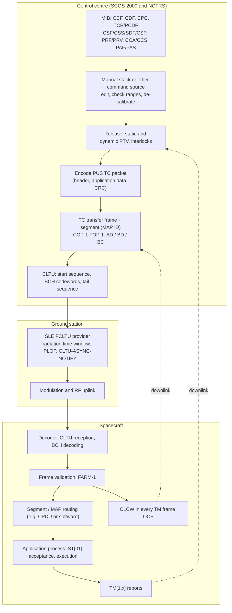
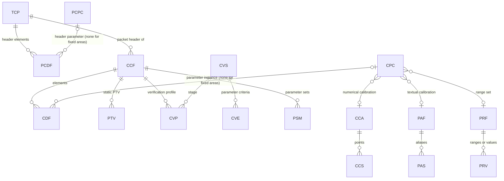
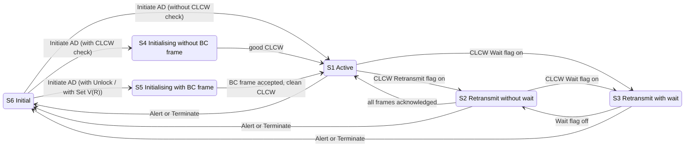
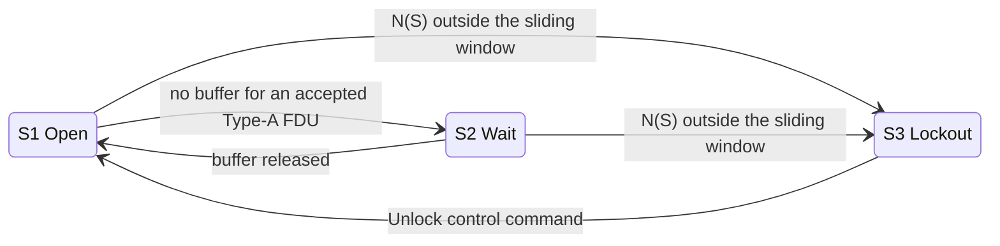
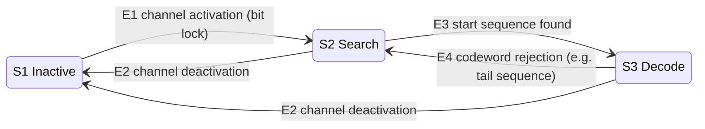
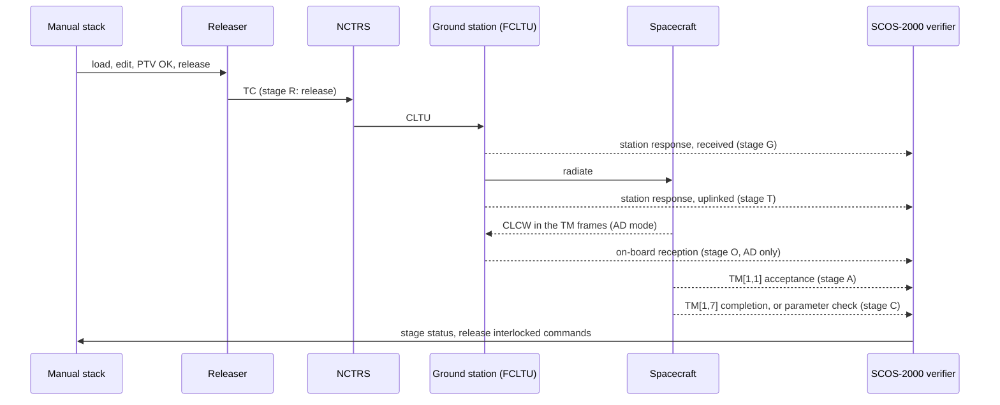

# Uplink: from operator command to on-board execution

A telecommand starts as a line in the [MIB](../mib/index.md): a name, a packet header template,
a list of parameters with their calibrations and allowed ranges, and the checks that will tell
the ground whether it worked. An operator loads it onto a **SCOS-2000 command stack**, edits its
parameters, and releases it. SCOS-2000 checks it (**pre-transmission validation**), encodes it as
a **PUS telecommand packet**, and puts it into a **TC transfer frame**. The frame is protected by
**COP-1** retransmission and encoded as a **CLTU**. The **SLE FCLTU** service then radiates it at
the ground station within its scheduled time window. On board, the decoder checks the frame, the
FARM accepts it in sequence, and the destination application executes the request and reports
back with **PUS ST[01] verification reports**. The ground matches these, and selected telemetry
parameters, against the **verification stages** defined in the MIB. This page follows the
command through every stage, links each one to its detailed page, and uses real Solar Orbiter
definitions. The telemetry direction is described on [Downlink](downlink.md).

!!! info "At a glance"
    | Stage | Data unit | Governing document | Detailed page |
    |---|---|---|---|
    | Definition | command (CCF), parameters (CPC/CDF), header (TCP/PCDF) | SCOS-2000 Database Import ICD 7.0[^icd-cmd] | [Commanding in the MIB](../mib/commanding.md) |
    | Sequencing | sequence (CSF/CSS/SDF/CSP) | same[^icd-seq] | [Command sequences](../mib/sequences.md) |
    | Release | stack entry, PTV, interlock | same; ESA SCOS-2000 presentation, GSAW 2003[^icd-ptv][^gsaw03-cmd] | [SCOS-2000](../scos2000/index.md) |
    | Packet | PUS TC packet: primary header, TC secondary header, application data, CRC | ECSS-E-ST-70-41C / ECSS-E-70-41A, CCSDS 133.0-B-2[^pus-tcsh][^spp-ph] | [PUS packets](../ecss/pus/packets.md) |
    | Frame | TC transfer frame (5-octet header, segment header, FECF) | CCSDS 232.0-B-4[^tc-frame] | [TC SDLP](../ccsds/tc-sdlp.md) |
    | Reliability | AD/BD/BC frames, CLCW | CCSDS 232.1-B-2[^cop-concept] | [COP-1](../ccsds/cop-1.md) |
    | Coding | CLTU (start sequence, BCH codewords, tail sequence) | CCSDS 231.0-B-4[^cltu-struct] | [CLTU](../ccsds/tc-coding-cltu.md) |
    | Radiation | PLOP-1/PLOP-2, FCLTU | CCSDS 231.0-B-4, CCSDS 912.1-B-5[^plop][^fcltu-ovw] | [FCLTU](../ccsds/sle/fcltu.md) |
    | Verification | TM[1,x] reports, CVS/CVE/CVP stages | ECSS-E-ST-70-41C ST[01]; ICD 7.0[^st01-scope][^icd-verif] | [ST[01]](../ecss/pus/st01-request-verification.md), [command verification](../mib/command-verification.md) |

## The layer picture



*Redrawn by this wiki from the sources cited in each section below.*

## 1. Command definition in the MIB

In the SCOS-2000 database the central entity is the **command definition** in the
[ccf](../mib/tables/ccf.md) table. A command has PTV expressions ([ptv](../mib/tables/ptv.md),
one-to-many and ANDed together) and verification stages ([cvs](../mib/tables/cvs.md), shared by
many commands through the mapping table [cvp](../mib/tables/cvp.md)). It also has parameter sets
([pst](../mib/tables/pst.md) via [psm](../mib/tables/psm.md)) and parameters
([cpc](../mib/tables/cpc.md), placed in the application data field by
[cdf](../mib/tables/cdf.md)). Each command parameter may reference one numerical
(de-)calibration ([cca](../mib/tables/cca.md)/[ccs](../mib/tables/ccs.md)), one textual
calibration or alias set ([paf](../mib/tables/paf.md)/[pas](../mib/tables/pas.md)) and one range
set ([prf](../mib/tables/prf.md)/[prv](../mib/tables/prv.md)). Each command also references one
**packet header** ([tcp](../mib/tables/tcp.md)), whose fields are described by
[pcpc](../mib/tables/pcpc.md) and placed by [pcdf](../mib/tables/pcdf.md).[^icd-cmd]



*Relationships as described in ICD issue 7.0 §3.3.3; fixed areas carry no parameter name in
PCDF or CDF. Diagram by this wiki.*[^icd-cmd][^icd-hdr][^icd-cdf]

### The packet header template

The PCDF rows say, bit by bit, where each header element sits and where its value comes from.
The type is `F` for a fixed value, `A`, `T`, `S` or `K` for the APID, service type, subtype or
acknowledgement flags taken from the CCF, and `P` for values that the command subsystem sets
itself, such as the packet length and the source sequence counter.[^icd-hdr] Operators cannot
edit header parameters on the manual stack. The multiplexer maintains the source sequence counter
per APID.[^icd-hdr] The Solar Orbiter MIB defines four headers: `NOM_TC` for normal PUS commands
(5,318 commands), `HPC1_TC` for CPDU high-priority commands (125), `NO_HDR` for frame-level
control commands (5) and `NOS2KHDR` for NIS throw events (6).[^mib-tcp] `HPC1_TC` is only the
6-octet primary header with the data field header flag fixed to 0, and its 125 commands have no
service type or subtype. This matches the PUS rule that CPDU command packets have no secondary
header.[^mib-tcp][^pus-tcsh] The `NOM_TC` template reads:[^mib-tcp]

<div class="bitfield" data-title="Solar Orbiter NOM_TC telecommand header (80 bits, from the MIB PCDF table)" data-width="16"
     data-fields='[{"n":"Version","b":3,"v":"000","g":"Primary header","d":"PCDF F, value 0"},{"n":"Type","b":1,"v":"1","g":"Primary header","d":"PCDF F, value 1 = telecommand"},{"n":"DFH flag","b":1,"v":"1","g":"Primary header","d":"PCDF F, value 1"},{"n":"APID","b":11,"g":"Primary header","d":"PCDF A, from CCF_APID"},{"n":"Seq. flags","b":2,"v":"11","g":"Primary header","d":"PCDF F, value 3 = stand-alone"},{"n":"Sequence count","b":14,"g":"Primary header","d":"PCDF P, set by the command subsystem"},{"n":"Packet length","b":16,"g":"Primary header","d":"PCDF P, set by the command subsystem"},{"n":"Sec. hdr flag","b":1,"v":"0","g":"Data field header","d":"PCDF F, value 0 = non-CCSDS secondary header"},{"n":"PUS version","b":3,"v":"001","g":"Data field header","d":"PCDF F, value 1"},{"n":"Ack","b":4,"g":"Data field header","d":"PCDF K, from CCF_ACK"},{"n":"Service type","b":8,"g":"Data field header","d":"PCDF T, from CCF_TYPE"},{"n":"Service subtype","b":8,"g":"Data field header","d":"PCDF S, from CCF_STYPE"},{"n":"Source ID","b":8,"g":"Data field header","d":"PCDF type O, default 0"}]'></div>

!!! warning "Inference"
    The Solar Orbiter MIB gives the Source ID element the PCDF type `O`, which is not among the
    types listed in ICD issue 7.0 (`F`, `A`, `T`, `S`, `K`, `P`).[^icd-hdr][^mib-tcp] What
    SCOS-2000 does with type `O` is not stated in the available sources. A mission-specific or
    later-release extension seems likely.

### Commands and their parameters

The CCF row gives the name, description, header (`CCF_PKTID`), type, subtype and APID, and the
number of elements. It also gives whether the command can be loaded stand-alone (`CCF_EXEC`) and
which sources may plan it (`CCF_PLAN`).[^icd-ccf] The default interlock scope and stage
(`CCF_ILSCOPE`, `CCF_ILSTAGE`) and the subsystem follow.[^icd-il] Then come the high-priority flag
and fixed MAP ID for CPDU-type commands (`CCF_HIPRI`, `CCF_MAPID`), a redundant APID, the default
acknowledgement flags (`CCF_ACK`, 0 to 15) and the default on-board sub-schedule.[^icd-hipri][^icd-ack]
`CCF_CTYPE` marks the special cases. `R` is a control segment (reset MAP) and `F` a control
frame (BC frame: Unlock or Set V(R)); for both, PCDF/CDF describe the frame data field instead of
a packet. `S` is a packet without CRC, and `T` and `N` are SLE and NIS throw events that are never
uplinked.[^icd-ctype]

Each command element in CDF is a fixed area (`A`), a fixed parameter (`F`) or an editable
parameter (`E`), at a bit offset from the start of the application data field. SCOS-2000 uses
that offset only to sort the elements, which it then encodes one after the other without
gaps.[^icd-cdf] The
value of an editable parameter can come from the parameter default (`D`), from a raw (`R`) or
engineering (`E`) value given in CDF, or from a live telemetry parameter (`T`, a dynamic
default).[^icd-cdfint] Unlike monitoring calibrations, command calibrations work in both
directions: engineering to raw for encoding, raw to engineering for display. They must be
one-to-one, and in `ccs` the *engineering* value is in `CCS_XVALS` and the raw value in
`CCS_YVALS`.[^icd-cca] A range set accepts a value that lies within, or equals, the limits of any
of its PRV rows, and a PRV row with no maximum is a single allowed value.[^icd-prf]

!!! example "Real example: `ZCSD3905` SADE PY Motor Move"
    | Element | CDF | Definition (from the MIB) |
    |---|---|---|
    | Header | `NOM_TC`, TC(131,1), APID 236, `CCF_ACK` = 9 | service 131 lies in the mission-specific range 128 to 255[^pusa-tc] |
    | Fixed area | bits 0–15, value `3905` | described as "Identification number of" (the 24-character description is cut short in the MIB) |
    | `PCSB002A` SADE Unit ID | bits 16–23, editable | PTC 2 / PFC 8; aliases (`CCDT0024TC`): `SADE_A` = 0, `SADE_B` = 1, `SADE_INUSE` = 2, `SADE_NOT_INUSE` = 3 |
    | `PCSB00CD` SADE Delta Position | bits 24–55, editable | PTC 3 / PFC 14 (32-bit unsigned[^icd-ptc]), unit deg; calibration `CSDP0005TC`, 3 points: 0 deg ↔ 0, 0.0727 deg ↔ 512, 305040.290909091 deg ↔ 2147483648 |
    | `PCSB00CC` SADE Motion Direction | bits 56–63, editable | aliases (`CCDT0287TX`): `CLOCKWISE` = 0, `ANTI_CLOCKWISE` = 1 |
    | Verification | CVP | stage 14001 (acceptance, report-based) and 14007 (completion, report-based), each with `CVS_START` 0 s and `CVS_INTERVAL` 20 s |

    Explorer: [ZCSD3905](../explorer/index.md#/solo/command/ZCSD3905).[^mib-cmd]

Across the release there are 5,454 commands and 7,155 command parameters. 327 parameters
reference a numerical calibration, 1,624 an alias set and 694 a range set, using 99 CCA curves,
624 alias sets and 565 range sets.[^mib-cmd] The parameter-set tables (PST, PSV, CPS, PVS, PSM) are
empty in this release.[^mib-cmd] One curiosity: the range set `VCD00353` used by the housekeeping
SID parameter `PCD03011` is described as "Integer between 1 and 19" but allows 1 to 192.[^mib-cmd]

!!! warning "Inference"
    `PRF_DESCR` is limited to 24 characters,[^icd-prf] and "Integer between 1 and 192" has 25.
    The description of `VCD00353` was therefore most likely truncated on import, and the PRV
    values (1 to 192) are authoritative.

## 2. Command sequences

A **command sequence** ([csf](../mib/tables/csf.md)) is an ordered list of elements
([css](../mib/tables/css.md)), each a command, a nested sequence or a comment. Elements carry
their own parameter values ([sdf](../mib/tables/sdf.md)), and the sequence may declare **formal
parameters** ([csp](../mib/tables/csp.md)) that act as placeholders filled in at load time. Nested
sequences are expanded like macros when loaded, and a sequence must never contain itself. Since
R5.0 the sequences are kept as XML in the FARC, and the ASCII tables remain for backward
compatibility.[^icd-seq] Each element can say how its release time is computed: relative to the
previous command (`R`), or relative to the sequence start (`A`), as a delta `hh.mm.ss`. It can
also say whether it needs a separate manual dispatch ("ARM&GO", `CSS_MANDISP`), whether it is
grouped (released as an uninterrupted batch) or blocked (aggregated into one segment), and how
its interlock, PTV and CEV are set.[^icd-css] The sequence-level flag `CSF_IFTT` says whether the
sequence contains execution time-tagged commands. `B` lets the user choose at load time between
on-board time-tagged and ground time-tagged release.[^icd-csf]

!!! example "Real example: `AACC309A` STR A time update v06"
    | Entry | Element | Release | Parameters |
    |---|---|---|---|
    | 1 | `ZST15401` STR1 Select ASP Channel, TC(154,1), APID 652 | `A`, 00.00.00, manual dispatch | `PST05054` ← formal parameter `XC309A01` "ASP CHANNEL" (textual; `SDF_VTYPE` = `F`)[^icd-sdf] |
    | 2 | `ZCD00982` Start Time Synchronisation to User, TC(9,130), APID 172 | `R`, 00.00.01, manual dispatch, so counted from its own dispatch time | `PCD09821` = `STAR_TRACKER_A` (engineering), `PCD09822` = 0 (raw) |

    `CSF_IFTT` = `B`, one formal parameter, two elements. Explorer:
    [AACC309A](../explorer/index.md#/solo/sequence/AACC309A).[^mib-seq]

Solar Orbiter's release has 3,404 sequences with 13,879 elements, 50,014 element parameter values
and 10,981 formal parameters. 3,354 sequences have `CSF_IFTT` = `B`, and the rest `N`.[^mib-seq]
See [Command sequences and parameter sets](../mib/sequences.md).

MIB sequences are one way of grouping commands. ECSS standardises two others: a language for
checkout and operations procedures (PLUTO, ECSS-E-ST-70-32), and on-board control procedures that
run on the spacecraft itself (OBCPs, ECSS-E-ST-70-01), which the PUS controls through
[ST[18]](../ecss/pus/st18-onboard-operations-procedure.md).[^e70-annexl] See
[PLUTO](../ecss/e-st-70-32c.md), [OBCPs](../ecss/e-st-70-01c.md) and, for how missions prepare
their databases and procedures, [operations preparation](../scos2000/operations-preparation.md).

## 3. The command stack and the release chain

SCOS-2000's commanding functions include the **manual stack**, where commands are loaded with
their parameters (with de-calibration) and execution time-tags. The stack also supports release
dependencies, grouping, blocking, delta release times, interlocking, a master manual mode and a
wait mode, static and dynamic PTV, and sequences with formal parameters. Next to it sit an
**autostack** with restricted functions and no editing, and a **multiplexer** that lets several
sources command in parallel. The **command releaser** interfaces to the external destination,
the NCTRS. An **on-board queue model** tracks time-tagged commands, and a **command verifier**
performs multi-stage verification and disables status consistency checks on the affected
parameters.[^gsaw03-cmd] The command history records, for each command, the sequence that loaded
it and the type of command source, its release and execution times, the transmission mode (AD
or BD), the PTV and CAV/CEV check states, the interlock, the AD frame count, and the status of
each verification stage. These are the columns of the TC history printout of the Rosetta, Mars
Express and Venus Express control systems, whose data delivery interface document is
public.[^ro-tch]

**Interlocks** stop further commanding until a command reaches a given stage. The scope can be
global (`G`), local to the command source (`L`), local to the subsystem (`S`), global for the
subsystem (`B`), local or subsystem only on verification failure (`F`, `T`), or none (`N`). The
stage waited on can be ground station reception (`R`), uplink (`U`), on-board reception (`O`,
treated as `U` in BD mode), application acceptance (`A`) or completion (`C`).[^icd-il] Every Solar
Orbiter command in the release defaults to no interlock (`CCF_ILSCOPE` = `N`). 5,443 commands
name the completion stage `C` as their default interlock stage. The 5 frame-level `NO_HDR`
commands carry the undocumented value `N`, and the 6 NIS throw events leave the field
empty.[^mib-ack][^mib-bc]

### Routing

The releaser sends spacecraft commands to the NCTRS unless the optional
[dst](../mib/tables/dst.md) table routes their APID elsewhere. The other choice is `EGSE`, as
`EGSE.SCOE` for non-spacecraft commands or `EGSE.TC.<address>` for a TC front end.[^icd-dst]
Solar Orbiter's release has a single DST row, which sends APID 1372 to `EGSE.TC.0x8800`, the very
example given in the ICD.[^mib-ack][^icd-dst] The NCTRS links the MCS to the ground station network
and uses SLE for non-ESA stations.[^gsaw05-nctrs] Outside ESA, DLR's GECCOS (derived from
SCOS-2000) speaks the same bespoke NCTRS protocol, which is translated to standard SLE.[^dlr-nctrs]
See [NCTRS, NIS and the ground station interface](../scos2000/nctrs-nis.md).

## 4. Pre-transmission validation

Before release, SCOS-2000 runs **static PTV**. Each [ptv](../mib/tables/ptv.md) row requires a
monitoring parameter (numerical, processed by the TM model) to equal a raw or engineering value.
All rows of a command are ANDed together, and an invalid parameter fails the check.[^icd-ptv]
**Dynamic PTV** covers feasibility checks, time checks and interlocks, and both kinds can be
overridden per sequence element (`CSS_DYNPTV`, `CSS_STAPTV`).[^icd-css2] In the Solar Orbiter
archive the SCOS-2000 TC packet header records an **uplink flag**, which is 1 if the command
passed PTV and is to be released and 0 if it failed.[^ddid-tc]

Solar Orbiter uses static PTV sparingly. The release has five PTV rows. `ZCD00D09` "Accept First
Uplink Part" (TC(13,9)) requires the synthetic parameter `NCDXS005` "Nb Immediate TCF" to be 0.
Four SSMM file-transfer commands, among them `ZSM00120` "SSMM Abort LLFT" (TC(13,145)), require
`NMAXS005` "SSMM FTS COMMANDING PTV" to be 0. Both parameters are dynamic OL synthetic
parameters.[^mib-ptv]

## 5. The PUS TC secondary header

A **telecommand packet** carries a request from a ground application process to an on-board
one.[^pus-pkt] Apart from CPDU command packets, every PUS telecommand has a secondary
header.[^pus-tcsh]

=== "PUS-C (ECSS-E-ST-70-41C, 2016)"

    <div class="bitfield" data-title="PUS-C TC packet secondary header (fixed part, 40 bits)" data-width="8"
         data-fields='[{"n":"PUS version","b":4,"v":"0010","d":"TC packet PUS version number = 2"},{"n":"Ack: complete","b":1,"g":"Acknowledgement flags","d":"bit 0 (first transmitted): report successful completion"},{"n":"Ack: progress","b":1,"g":"Acknowledgement flags","d":"bit 1: report successful progress"},{"n":"Ack: start","b":1,"g":"Acknowledgement flags","d":"bit 2: report successful start of execution"},{"n":"Ack: accept","b":1,"g":"Acknowledgement flags","d":"bit 3 (last transmitted): report successful acceptance"},{"n":"Service type ID","b":8},{"n":"Message subtype ID","b":8},{"n":"Source ID","b":16}]'></div>

    | Field | Bits | Values | Meaning |
    |---|---|---|---|
    | TC packet PUS version number | 4 | 2 | Version 0 = ESA PUS, 1 = ECSS-E-70-41A.[^pus-tcsh] |
    | Acknowledgement flags | 4 | bit 3 acceptance, bit 2 start, bit 1 progress, bit 0 completion | Which *successful* stages to report. PUS numbers bits from the most significant (bit 0), so acceptance is the least significant bit of the field.[^pus-ack][^pus-bits] |
    | Message type ID | 8 + 8 | service type, message subtype | Identifies the request.[^pus-ack] |
    | Source ID | 16 | | Identifies the issuing application process; with the sequence count it identifies the packet uniquely.[^pus-ack][^pus-sp] |
    | Spare | optional | | Pads the header to whole words.[^pus-ack] |

    After the application data and optional spare comes the 16-bit **packet error control**
    field. For telecommands it is mandatory, and the mission chooses the ISO checksum or the
    CRC.[^pus-tcud]

=== "PUS-A (ECSS-E-70-41A, 2003), used by Solar Orbiter"

    PUS-A has a 1-bit CCSDS secondary header flag (0 = non-CCSDS header), a 3-bit PUS version
    (1), a 4-bit Ack field, 8-bit type and subtype, an optional source ID of mission-defined
    length, and optional spare bits. Failure reports are generated by default, so the Ack bits
    request only the *success* acknowledgements. Service types 0 to 127 are reserved for the
    standard and 128 to 255 are mission-specific. The PEC is a checksum or CRC fixed for the
    mission.[^pusa-tc]

    Solar Orbiter sets the version to 1 and uses only the acceptance bit and the completion bit;
    the start and progress bits must be zero.[^sol-tcdfh] Its CRC uses the generator polynomial
    $X^{16}+X^{12}+X^5+1$ with an all-ones preset, computed over the whole packet except the CRC
    itself.[^sol-crc] Ground source IDs include 110 for the mission timeline, 111 for TC sequences,
    112 for event-action recovery commands, 113 for the back-up timeline and 120 for direct
    commands.[^sol-src] In the MIB, 5,225 commands have `CCF_ACK` = 9 (`0b1001`, acceptance and
    completion), 78 have 1 (acceptance only), 21 have 0, and 130 have none.[^mib-ack]

The ICD notes that SCOS-2000 matches each TM(1,x) report to its command by the 4 octets that echo
the TC packet ID and sequence control, which must sit at the same position in every type-1
packet. Clearing an Ack bit at load time disables the corresponding report-based stage, but it
cannot add a stage that the CVP table does not define.[^icd-s1][^icd-cvp]

## 6. The Space Packet primary header for telecommands

The primary header has the same layout as on the downlink. Here the packet type is `1`, the APID
names the destination application process, and the 14-bit field holds a sequence count or a
packet name. With the source ID this identifies the packet.[^spp-ph][^pus-sp] Solar Orbiter
splits the APID into a 7-bit process ID and a 4-bit category, which is fixed to 12 for
telecommands. It sets the sequence flags to `0b11`, and it keeps the sequence count per APID and
source ID for ground traceability only: the application accepts commands whatever the
counter.[^sol-tcph] The packet data field is at most 242 octets: 4 octets of data field header,
236 octets of application data and the 2-octet CRC.[^sol-tcph]

!!! note "Two limits that agree"
    SCOS-2000 limits a command to `CMDP_MAX_BLOCK_SIZE` octets, 248 by default. The space for
    parameters is then reduced by the header, the CRC and any time-tag wrapper (the TC(11,4)
    insert command).[^icd-size] For Solar Orbiter, 6 octets of primary header plus the 242-octet
    maximum data field also give 248 octets. The match is this wiki's observation; the
    Solar Orbiter configuration value of the MISC variable is not stated in the available
    sources.

## 7. The TC transfer frame and segment

The **TC Space Data Link Protocol** carries packets in variable-length frames of up to 1,024
octets. A frame has a 5-octet primary header, a data field of up to 1,019 octets (1,017 with an
FECF) and an optional 2-octet frame error control field.[^tc-frame]

<div class="bitfield" data-title="TC transfer frame primary header (40 bits)" data-width="8"
     data-fields='[{"n":"TFVN","b":2,"v":"00"},{"n":"Bypass","b":1,"d":"0 = Type-A (FARM checks), 1 = Type-B (bypass)"},{"n":"Ctrl cmd","b":1,"d":"0 = data (Type-D), 1 = control command (Type-C)"},{"n":"Spare","b":2,"v":"00"},{"n":"Spacecraft ID","b":10},{"n":"VCID","b":6},{"n":"Frame length","b":10,"d":"Total octets minus one"},{"n":"Frame sequence number N(S)","b":8,"d":"V(S) for AD frames, all zeros for BD and BC frames"}]'></div>

| Field | Bits | Values | Meaning |
|---|---|---|---|
| Transfer frame version number | 2 | `0b00` | TC version 1.[^tc-ph] |
| Bypass flag | 1 | `0` Type-A, `1` Type-B | Whether the FARM applies its frame acceptance checks.[^tc-flags] |
| Control command flag | 1 | `0` Type-D, `1` Type-C | Whether the data field holds a frame data unit or a control command.[^tc-flags] |
| Reserved spare | 2 | `0b00` | Reserved.[^tc-ph2] |
| Spacecraft ID | 10 | CCSDS-assigned | Static for all mission phases.[^tc-ph2] |
| Virtual channel ID | 6 | | No numbering constraint.[^tc-ph3] |
| Frame length | 10 | C = octets - 1 | Hence the 1,024-octet maximum.[^tc-ph3] |
| Frame sequence number | 8 | N(S) | Lets the FARM check that Type-A frames are in sequence; kept per VC; all zeros in Type-B frames.[^tc-ph3] |

| Bypass | Control | Frame type | Use |
|---|---|---|---|
| 0 | 0 | **AD** | Data under the sequence-controlled (AD) service of the COP |
| 0 | 1 | | Reserved |
| 1 | 0 | **BD** | Data under the expedited (BD) service, acceptance checks bypassed |
| 1 | 1 | **BC** | COP control commands (Unlock, Set V(R)) |

*Source: CCSDS 232.0-B-4 table 4-1.*[^tc-flags]

The **segment header** is one octet: 2 sequence flags and a 6-bit **multiplexer access point
(MAP) ID**. It is needed on a VC that has more than one MAP or that carries service data units
too large for one frame. If it is used on a VC it must be used in every data frame of that VC, but
it is never present in control-command frames. Sequence flags `0b11` mean an unsegmented service
data unit or several whole packets.[^tc-seg]

<div class="bitfield" data-title="TC segment header (8 bits)" data-width="8"
     data-fields='[{"n":"Sequence flags","b":2,"d":"01 first, 00 continuing, 10 last, 11 no segmentation"},{"n":"MAP ID","b":6}]'></div>

The two control commands are **Unlock**, a single all-zeros octet, and **Set V(R)**, three octets
`0x82 0x00` followed by the new V(R).[^tc-cc] The receiving end applies **frame validation
checks** to every frame, Type-A or Type-B. It checks the expected version number and MCID,
header values consistent with the spacecraft's implemented features, a frame length that matches
the octets received, and, if present, the FECF CRC. A frame that fails any check is
discarded.[^tc-fvc] The FECF uses the same CRC-16 as TM frames.[^tc-fecf]

### What Solar Orbiter does

| Item | Solar Orbiter value |
|---|---|
| SCID | `0x28A` = 650 (same for the flight model, ETB and OBC-DM)[^sol-tcf2] |
| VCIDs | 1 and 2, one per on-board TC decoder, used consistently in the CLCWs[^sol-tcf2] |
| Maximum frame length | 256 octets, so bits 22–23 of the header are always `0b00`[^sol-tcf2] |
| Frame sequence number | V(S) in AD frames, zero in BC and BD frames[^sol-tcf3] |
| Segment | always present, no segmentation (flags `0b11`)[^sol-seg] |
| MAP IDs | 0 = CPDU (TC(2,3) high-priority commands), 1 = normal commanding; not used to select the active processor[^sol-seg] |
| Aggregation | several complete packets per segment, to raise uplink throughput[^sol-agg] |

SCOS-2000 supports this **blocking** at segment level: several packets aggregated into one segment
and sent as one frame and one CLTU.[^icd-s2] In the MIB, the 125 `HPC1_TC` commands are
high-priority with MAP ID 0, matching the CPDU MAP ID of the Solar Orbiter packet
ICD.[^mib-ack][^sol-seg] `CCF_MAPID` is also filled for 205 non-high-priority `NOM_TC` commands:
1 for 128 commands to APIDs 796, 812 and 1020, and 54 for 77 commands to APID 876. The SCOS-2000
ICD says the field is irrelevant unless `CCF_HIPRI` = `Y`.[^mib-ack][^icd-hipri] The MIB also
defines the BC-frame commands `UNLOCK` (one fixed octet `0`) and `SETVR` (a fixed 16-bit `8200`
followed by the 8-bit `VR` parameter), both with `CCF_CTYPE` = `F`. It defines three control
segments with `CCF_CTYPE` = `R`: `RESET`, `REIN_TTR` and `TC_ONLY`.[^mib-bc] The ICD strongly
recommends a global interlock on at least the uplink stage for BC frames.[^icd-ctype] Solar
Orbiter's BC-frame commands carry no default interlock, `CCF_ILSCOPE` = `N`.[^mib-bc]

A 256-octet frame holds exactly one maximum-size Solar Orbiter packet: 5 octets of frame header,
1 octet of segment header, 248 octets of packet and 2 octets of FECF add up to 256. The text of
§3.4 only says the frame length runs to the FECF "if present", but the ICD's telecommand overview
drawing (figure 3.1-1, a picture that is not in the extracted text, read in the PDF) ends every TC
frame with a 2-octet frame error control field (CRC).[^sol-tcf2][^sol-tcph][^sol-tcov] The ECSS
adoption notice of CCSDS 232.0-B-4 also makes the FECF mandatory.[^an-fecf] The
[telecommand worked example](worked-example-tc.md#the-frame-header) discusses the frame drawing
in detail.

## 8. COP-1: FOP-1 on the ground, FARM-1 on board

**COP-1** is a closed-loop, go-back-n ARQ procedure. The **FOP-1** at the sending end sends the
frames of one VC. The **FARM-1** at the receiving end accepts Type-A frames only in strict
sequence and reports its state in the **CLCW**.[^cop-concept] The AD service guarantees, with high
probability, that no frame data unit is lost, duplicated or delivered out of order on that VC.
It uses Type-AD frames for data and Type-BC frames for the Unlock and Set V(R) control commands.
The BD service sends Type-BD frames that bypass acceptance and are only counted.[^cop-ad]



*FOP-1 states after CCSDS 232.1-B-2 §5.1.2. The complete behaviour is in the FOP-1 state
table (events E1 to E46). The transitions shown here are simplified by this wiki.*[^fop-state][^fop-table]

FOP-1 keeps, per VC, V(S), a one-entry wait queue, a sent queue, the expected acknowledgement
NN(R), the timer value T1_Initial, the transmission limit and count, the sliding window width K,
the timeout type and the suspend state.[^fop-vars] It is controlled by four "Initiate AD
Service" directives, one "Terminate AD Service", one "Resume AD Service" and five "FOP-1 Setup"
directives, among them "Set V(S) to V*(S)".[^cop-dir]



*FARM-1 states after CCSDS 232.1-B-2 §6.1.2; simplified by this wiki.*[^farm-state]

FARM-1's sliding window has a total width W that is fixed for the mission. When retransmission
of Type-AD frames is allowed, W is even, between 2 and 254, and is split into a positive part PW
and a negative part NW of W/2 each. Corrigendum 1 adds a mode without retransmission in which W
can be any integer from 1 to 256. In the first mode, a frame with N(S) = V(R) is accepted, and
V(R) is incremented. A frame in the positive window is discarded and the Retransmit flag is set.
A frame in the negative window is simply discarded. A frame outside both windows sends the FARM
into Lockout.[^farm-win]

**The CLCW** (32 bits, in the OCF of TM frames) carries the control word type 0, version `0b00`,
a mission-specific status field, COP in effect `0b01`, the TC VCID it reports on, two spare bits,
the No RF Available, No Bit Lock, Lockout, Wait and Retransmit flags, the two low bits of the
FARM-B counter, a spare bit, and the 8-bit report value N(R).[^clcw] Its bit layout is drawn on
[Downlink, section 5](downlink.md#5-into-transfer-frames-virtual-channels-and-the-master-channel).
Solar Orbiter inserts a CLCW in every TM frame and uses its TC VCIDs consistently with the TC
frames.[^sol-clcw] Its OBC also reports the CLCW fields as housekeeping parameters, with
descriptions such as `PDEC_CLCW.A.LkOt`, `.Wait`, `.ReTx` and `.RepValue`.[^mib-clcw]

## 9. The CLTU: BCH coding, start and tail sequences

The **communications link transmission unit (CLTU)** delimits and synchronises the coded frames.
With BCH coding it is a 16-bit **start sequence**, a series of 64-bit BCH codewords and a 64-bit
**tail sequence**.[^cltu-struct]

| Part | Value | Purpose |
|---|---|---|
| Start sequence | `0xEB90` (`1110101110010000`) | Marks the start of the encoded data; also resolves bit-sense ambiguity.[^cltu-start][^cltu-intro] |
| BCH codewords | 56 information bits + 7 complemented parity bits + 1 filler bit (0) | (63,56) modified BCH code, $g(x) = x^7 + x^6 + x^2 + 1$; the complemented parity helps bit synchronisation and detects bit slips.[^bch] |
| Fill | alternating `0`/`1`, starting with `0` | Completes the last codeword.[^bch-fill] |
| Tail sequence | `0xC5C5C5C5C5C5C579` | A deliberately non-correctable pattern that stops decoding.[^cltu-tail] |

<div class="bitfield" data-title="BCH codeword (64 bits)" data-width="32"
     data-fields='[{"n":"Information bits I0..I55 (possibly randomized)","b":56},{"n":"Complemented parity P0..P6","b":7},{"n":"Filler","b":1,"v":"0"}]'></div>

With BCH coding, randomization of the frames before encoding is required unless the designer
verifies that the system works without it. The randomizer sequence comes from
$h(x) = x^8 + x^6 + x^4 + x^3 + x^2 + x + 1$ and repeats every 255 bits. With the LDPC option
(64-bit start sequence `0x034776C7272895B0`, (128,64) or (512,256) codewords) randomization is
always applied.[^cltu-rand][^cltu-start] The decoder on board moves between three states:
**inactive** (no bit lock), **search** (bit-by-bit search for the start sequence) and **decode**.
It returns to search when a codeword cannot be corrected, which is what the tail sequence
provokes on purpose.[^cltu-rx]



*After CCSDS 231.0-B-4 figure 5-3 and tables 5-1, 5-2.*[^cltu-rx]

Full detail: [TC synchronization and channel coding: the CLTU](../ccsds/tc-coding-cltu.md).

## 10. The physical layer operations procedure

A **PLOP** defines the sequence of carrier modulation modes in a pass. CMM-1 is the unmodulated
carrier, CMM-2 the carrier modulated with the **acquisition sequence** (alternating bits,
preferably at least 16 octets), CMM-3 the carrier with a CLTU, and CMM-4 the carrier with the
**idle sequence**.[^plop-data][^plop-cmm] **PLOP-1** turns the modulation off after every CLTU,
forcing the receiver back to inactive. **PLOP-2** keeps the channel active and separates CLTUs by
the tail sequence (and optional idle), leaving the receiver in search. At least one octet of idle
sequence between CLTUs is recommended, to avoid a rare false start inside a tail. Missions whose
planning began after September 2010 must use PLOP-2.[^plop][^plop2]

## 11. SLE FCLTU: from the control centre to the antenna

The **Forward CLTU** service lets the user send CLTUs to the spacecraft through a forward space
link channel. The provider radiates them in the order received, bit for bit, without interpreting
them. It can only check constraints such as the maximum length, and it works only in online
delivery mode, with one service instance per physical channel.[^fcltu-ovw] Its operations are:[^fcltu-ops]

| Operation | Invoker | Purpose |
|---|---|---|
| CLTU-BIND / CLTU-UNBIND | user | Establish or release the association |
| CLTU-START / CLTU-STOP | user | Prepare for, or stop, transfer and radiation |
| CLTU-TRANSFER-DATA | user | Hand over one CLTU, confirmed |
| CLTU-ASYNC-NOTIFY | provider | Report events such as radiated, expired or production interrupted |
| CLTU-SCHEDULE-STATUS-REPORT / CLTU-STATUS-REPORT | user / provider | Periodic or immediate status |
| CLTU-GET-PARAMETER | user | Read a service parameter |
| CLTU-THROW-EVENT | user | Ask complex management to act, for example on production settings |
| CLTU-PEER-ABORT | either | Abort the association |

Each CLTU-TRANSFER-DATA invocation carries a monotonically increasing **CLTU identification**, an
**earliest** and a **latest radiation time** (either may be null), a **delay time** (the minimum
gap in microseconds before the next CLTU, interpreted according to the PLOP in effect), and
whether a radiation report is wanted.[^fcltu-td][^fcltu-time] If radiation has not started by the
latest radiation time, the provider notifies "sldu expired", discards the buffered CLTUs and blocks
further transfers until the user stops and restarts the service. A "production interrupted" event
has a similar blocking effect.[^fcltu-notify] The provider also reads the CLCWs from the return
link to decide whether the physical channel is available, unless management configures it to
ignore them.[^fcltu-fg] The same function generates the acquisition and idle sequences of the
PLOP.[^fcltu-fg]

!!! warning "Inference"
    Because the FCLTU provider radiates CLTUs unchanged, everything above the physical layer
    (packet, segment, frame, FOP-1, BCH encoding) must happen on the control-centre side before
    CLTU-TRANSFER-DATA. Which ESOC component (SCOS-2000 or the NCTRS) runs FOP-1 and builds
    the CLTU is not stated in the available sources. The SCOS-2000 ICD does say that commands
    can be blocked into one segment and sent "as a single frame/CLTU".[^fcltu-ovw][^icd-s2]

SLE also defines forward services at higher levels. With the **Forward Space Packet** service the
user hands over only packets, and the provider builds the frames, runs COP-1 (using the CLCWs of the
ROCF service) and generates the CLTUs, so that several users can command one spacecraft without
coordinating with each other.[^sle-fwd] The library's copy of that book is stamped historical;
see [FSP](../ccsds/sle/fsp.md) for a side-by-side comparison with FCLTU.[^fsp-api] Which service
instances run in a pass, and with which production parameters, is agreed through
[SLE service management](../ccsds/sle/service-management.md).

The radiated CLTU modulates the uplink carrier, the subject of the CCSDS radio frequency and
modulation book 401.0 and of ECSS-E-ST-50-05C.[^rf-401][^rf-5005] The Solar Orbiter MIB lists the telecommand bit
rates that its deep-space transponder can be set to: 7.8125, 15.625, 250, 1000, 2000 and 4000
bit/s.[^mib-dst] See [radio frequency, modulation and ranging](../ccsds/rf-and-ranging.md).

## 12. Closing the loop: ST[01] reports and MIB verification

### On board: ST[01] request verification

PUS-C's **request verification** service has three subservices. *Routing and reporting* checks
that a request can be routed and is not corrupted, and reports failures as TM[1,10]. *Acceptance
and reporting* checks the request before it is handed to the service, for example its integrity
and the availability of the service, and reports TM[1,1] or TM[1,2]. *Execution reporting* issues
the start, progress and completion reports on behalf of the executing service.[^st01-scope][^st01-route]
Failures are always reported. Successes are reported only when the corresponding
acknowledgement flag was set.[^st01-acc][^st01-exec]

| Report | Meaning | Solar Orbiter |
|---|---|---|
| TM[1,1] / TM[1,2] | successful / failed acceptance | both mandatory[^sol-s1] |
| TM[1,3] / TM[1,4] | successful / failed start of execution | not used (Ack bit 2 = 0)[^sol-tcdfh] |
| TM[1,5] / TM[1,6] | successful / failed progress of execution | not used (Ack bit 1 = 0)[^sol-tcdfh] |
| TM[1,7] / TM[1,8] | successful / failed completion of execution | both mandatory[^sol-s1] |
| TM[1,10] | failed routing | defined only in PUS-C; PUS-A lists subtypes 1 to 8[^st01-route][^pusa-s1] |

Each report starts with the **request ID**: the packet ID and the packet sequence control of the
telecommand. That is not unique by itself; the source is given by the destination ID of the
report.[^st01-fmt] Failure reports add a failure code and optional data.[^st01-fmt] In the Solar
Orbiter MIB, the PIC extracts the 16-bit failure code of TM(1,2) and TM(1,8) at octet 20, just after
the request ID. Combined with the APID, this gives a separate SPID per failure code: 274 SPIDs for
TM(1,2) and 1,477 for TM(1,8).[^mib-verif] The SCOS-2000 verifier itself ignores the failure code
and uses only the subtype.[^icd-s1]

### On the ground: the verification stages

SCOS-2000 tracks each released command through a chain of stages. The ground-side **uplink
verification** stages are release to the NCTRS, ground station reception, uplink (radiation) and
on-board reception, the last only in AD mode. **Execution verification** follows as acceptance
(CAV) and completion (CEV).[^ro-tch] A stage is pending, passed, failed, timed out, unverified,
unknown or idle, among other states.[^ro-tch2] In the EGSE version the ground acknowledgements are
explicit: the front end returns a GS_Ack on reception, a UL_Ack when a BD-mode command has been
sent, and an ONB_Ack when the spacecraft confirms an AD-mode command.[^emcs-ack]



*Stage letters from the Rosetta / Mars Express / Venus Express command history description.
The station responses follow the EMCS acknowledgement policy and the Solar Orbiter DDID, which
updates the uplink time from the station's radiation response. The message flow is simplified by
this wiki: responses that pass through the NCTRS are drawn as going straight to the
verifier.*[^ro-tch][^emcs-ack][^ddid-tc]

The MIB defines the execution stages. Each [cvs](../mib/tables/cvs.md) row has an ID and a
stage type: `A` acceptance, `S` start, `0` to `9` progress steps, `C` completion. Its source is
either `R` for a TM report or `V` for a check of monitoring parameter values. The row also gives
the delay after release (or after execution for time-tagged commands) at which the window opens
(`CVS_START`) and the length of the sampling interval from which the overall verification window
is computed (`CVS_INTERVAL`). It can also give a SPID that closes a parameter-based stage (a
future extension) and a specific verification window (`CVS_UNCERTAINTY`).[^icd-cvs] Report-based
progress stages can only be step 0.[^icd-cvs] Parameter-based stages are made of
[cve](../mib/tables/cve.md) rows. Each requires a valid parameter to equal a value within a
tolerance, all rows of a stage are ANDed together, and each row can also suspend status-consistency
checking of the parameter during the window.[^icd-cve] [cvp](../mib/tables/cvp.md) attaches at most
one stage of each type to a command.[^icd-cvp]

!!! example "Two real verification profiles"
    | Command | Ack | Stages (from CVP and CVS) |
    |---|---|---|
    | [ZCD00305](../explorer/index.md#/solo/command/ZCD00305) Enable HK Para Rpt Gen, TC(3,5), APID 172 | 9 | [14001](../explorer/index.md#/solo/verif/14001) `A`, report, `CVS_START` 0 s, `CVS_INTERVAL` 20 s; [14007](../explorer/index.md#/solo/verif/14007) `C`, report, 0 s, 20 s |
    | [ZPW04604](../explorer/index.md#/solo/command/ZPW04604) PCDU A BDR1_C1 SwitchON, TC(2,128), APID 172 | 1 | [11](../explorer/index.md#/solo/verif/11) `A`, report, 0 s, 20 s; [32](../explorer/index.md#/solo/verif/32) `C`, **parameter**: [NPWD0753](../explorer/index.md#/solo/param/NPWD0753) "IFA_BDR1_Conv1_ST" = raw 1 (`ON`), tolerance 0, `CVS_INTERVAL` 60 s, `CVE_CHECK` = `B` (used both for verification and to drive status-consistency checking) |

    The second command requests only the acceptance report (Ack = 1). Its completion is proved
    by telemetry instead: the converter status must read `ON` within the stage's verification
    window, which is computed from the 60 s interval.[^mib-verif][^icd-cve]

The release defines 206 stages: 16 report-based acceptance stages, 23 report-based completion
stages and 167 parameter-based completion stages, with 171 CVE criteria and 10,697 CVP links.
62 commands have no verification stage at all.[^mib-verif] The most shared stages are 11
(acceptance, 2,263 commands) and 17 (completion, 2,185 commands), followed by 14001 and 14007
(1,524 each).[^mib-verif]

??? example "SQL used"
    Run with `sqlite3 -readonly` against `solo-2025-09-16.sqlite` (release
    `MIB__20250916M25925PFMS001_SOL`). All columns are text. The tables `cvs`, `cve` and `cvp`
    carry their ICD column names (`CVS_ID` ... `CVS_UNCERTAINTY`, `CVE_CVSID` ... `CVE_CHECK`,
    `CVP_TASK`, `CVP_TYPE`, `CVP_CVSID`) in the current build of the database.

    ```sql
    -- headers and command population
    SELECT * FROM tcp;  SELECT * FROM pcpc;
    SELECT * FROM pcdf ORDER BY PCDF_TCNAME, cast(PCDF_BIT AS int);
    SELECT CCF_PKTID, CCF_HIPRI, CCF_MAPID, count(*) FROM ccf GROUP BY 1,2,3;
    SELECT CCF_MAPID, CCF_APID, count(*) FROM ccf
     WHERE CCF_PKTID = 'NOM_TC' AND CCF_MAPID <> '' GROUP BY 1,2;
    SELECT CCF_CNAME, CCF_PKTID, CCF_CTYPE, CCF_ILSTAGE FROM ccf WHERE CCF_ILSTAGE IN ('N','');
    SELECT CCF_ACK, count(*) FROM ccf GROUP BY 1;
    SELECT CCF_ILSCOPE, CCF_ILSTAGE, count(*) FROM ccf GROUP BY 1,2;
    SELECT CCF_CTYPE, count(*) FROM ccf GROUP BY 1;
    SELECT * FROM ccf WHERE CCF_PKTID IN ('NO_HDR','NOS2KHDR');
    SELECT * FROM cdf WHERE CDF_CNAME IN ('UNLOCK','SETVR') ORDER BY CDF_CNAME, cast(CDF_BIT AS int);
    SELECT * FROM dst;  SELECT * FROM ptv;
    SELECT count(*), sum(CPC_CCAREF<>''), sum(CPC_PAFREF<>''), sum(CPC_PRFREF<>'') FROM cpc;

    -- example command
    SELECT * FROM ccf WHERE CCF_CNAME = 'ZCSD3905';
    SELECT * FROM cdf WHERE CDF_CNAME = 'ZCSD3905' ORDER BY cast(CDF_BIT AS int);
    SELECT * FROM cpc WHERE CPC_NAME IN (SELECT CDF_PNAME FROM cdf WHERE CDF_CNAME = 'ZCSD3905');
    SELECT * FROM ccs WHERE CCS_NUMBR = 'CSDP0005TC';
    SELECT * FROM pas WHERE PAS_NUMBR IN ('CCDT0024TC','CCDT0287TX');
    SELECT * FROM prf WHERE PRF_NUMBR = 'VCD00353'; SELECT * FROM prv WHERE PRV_NUMBR = 'VCD00353';

    -- sequences
    SELECT CSF_IFTT, count(*) FROM csf GROUP BY 1;
    SELECT * FROM css WHERE CSS_SQNAME = 'AACC309A' ORDER BY cast(CSS_ENTRY AS int);
    SELECT * FROM sdf WHERE SDF_SQNAME = 'AACC309A';
    SELECT * FROM csp WHERE CSP_SQNAME = 'AACC309A';

    -- verification
    SELECT CVS_TYPE, CVS_SOURCE, count(*) FROM cvs GROUP BY 1,2;
    SELECT CVP_CVSID, count(*) n FROM cvp GROUP BY 1 ORDER BY n DESC LIMIT 4;
    SELECT p.CVP_CVSID, s.* FROM cvp p JOIN cvs s ON s.CVS_ID = p.CVP_CVSID
     WHERE p.CVP_TASK IN ('ZCD00305','ZPW04604');
    SELECT * FROM cve WHERE CVE_CVSID = '32';
    SELECT count(*) FROM ccf WHERE CCF_CNAME NOT IN (SELECT CVP_TASK FROM cvp);
    SELECT * FROM txp WHERE TXP_NUMBR IN ('CDST0003TM', 'CDST0001TM');   -- transponder options
    SELECT cast(PID_STYPE AS int), count(*) FROM pid WHERE PID_TYPE = '1' GROUP BY 1;
    ```

## Worked example: `ZCD00305` from packet to CLTU

The command [`ZCD00305`](../explorer/index.md#/solo/command/ZCD00305) "Enable HK Para Rpt Gen"
is TC(3,5) to APID 172, with `NOM_TC` header and Ack 9. It has one editable element, `PCD03011`
"HK SID" (PTC 3 / PFC 4, 8-bit unsigned, range set `VCD00353`: 1 to 192).[^mib-cmd][^icd-ptc] On
board it asks the housekeeping service to enable periodic generation of the report with the given
SID. Solar Orbiter lists TC(3,5) as "Enable Housekeeping Parameter Report Generation".[^pus-hk5][^sol-s3]
The values below are **illustrative**: SID 1, source ID 120 (direct commands),
sequence count 1, VC 1, MAP ID 1, N(S) = `0x2A` and no randomization; the TC FECF is included, as
the ICD's figure 3.1-1 shows.[^sol-tcov]
The CRCs and BCH parity were computed by this wiki with the algorithms cited. The bytes are not
taken from a real uplink.

| Layer | Octets (hex) | Decoding |
|---|---|---|
| Packet primary header | `18 AC C0 01 00 06` | version 0, type 1, DFH 1, APID 172 (`0b00010101100`: PID 10, category 12); flags `0b11`, count 1; length 6 = 7 octets of data field minus one |
| Data field header | `19 03 05 78` | secondary header flag 0, PUS version 1, Ack `0b1001`; type 3; subtype 5; source ID 120 |
| Application data | `01` | SID 1, within range 1 to 192 |
| Packet error control | `7E 79` | CRC-16, preset all ones, $X^{16}+X^{12}+X^5+1$, over the 11 preceding octets |
| Frame primary header | `02 8A 04 14 2A` | TFVN 0, bypass 0, control 0 (AD frame); SCID 650; VCID 1; length 20 (21 octets); N(S) 42 |
| Segment header | `C1` | flags `0b11`, MAP ID 1 (normal commanding) |
| Frame error control | `C1 39` | CRC-16 over the 19 preceding frame octets |
| CLTU | `EB 90` · `02 8A 04 14 2A C1 18` `6C` · `AC C0 01 00 06 19 03` `DA` · `05 78 01 7E 79 C1 39` `0C` · `C5 C5 C5 C5 C5 C5 C5 79` | start sequence; 3 BCH codewords (7 information octets, then parity/filler octet); tail sequence. The 21-octet frame fills exactly three codewords, so no fill is needed. 34 octets in total |

The packet is 13 octets, the frame 21 octets and the CLTU 34 octets. Under PLOP-2 the CLTU would
be preceded by the acquisition sequence at the start of the pass and followed by at least one
octet of idle sequence.[^plop2] Once on board, the FARM accepts the frame if V(R) = 42 and moves
V(R) to 43, which the next CLCW reports as N(R) = 43.[^farm-win][^clcw] The application then
sends TM(1,1) and, after enabling the report, TM(1,7). SCOS-2000 closes stages 14001 and 14007 when
these arrive within their verification windows, which are computed from the 20 s
`CVS_INTERVAL`.[^mib-verif][^icd-cvs]

## Where to go next

* A byte-level build of a different real command: [Worked example: building a real Solar Orbiter telecommand](worked-example-tc.md).
* Every on-board service that commands reach: [PUS overview](../ecss/pus/index.md), time-tagged commands in [ST[11]](../ecss/pus/st11-time-based-scheduling.md), [ST[13] large packet transfer](../ecss/pus/st13-large-packet-transfer.md), and on-board procedures in [ST[18]](../ecss/pus/st18-onboard-operations-procedure.md).
* Link security on the uplink: [SDLS](../ccsds/sdls.md) and [security in CCSDS space links](../ccsds/security.md); identifiers (SCID, VCID, MAP ID, APID): [space link identifiers](../ccsds/space-link-identifiers.md); the unified link protocol: [USLP](../ccsds/uslp.md).
* Ground-station services and scheduling: [FCLTU](../ccsds/sle/fcltu.md), [FSP](../ccsds/sle/fsp.md), [SLE service management](../ccsds/sle/service-management.md); the radio link itself: [RF and ranging](../ccsds/rf-and-ranging.md).
* Where the TC frame, COP-1, CLTU and CPDU came from: [From ESA PSS to CCSDS and ECSS](history.md).
* MIB background: [data model](../mib/data-model.md), [tailoring](../mib/tailoring.md), [tooling](../mib/tooling.md), [operations preparation](../scos2000/operations-preparation.md).
* Solar Orbiter specifics: [How Solar Orbiter uses PUS](../missions/solar-orbiter/pus-usage.md), [The Solar Orbiter MIB](../missions/solar-orbiter/mib.md), instrument commanding in the [instrument interface documents](../missions/solar-orbiter/instrument-interfaces.md) and the [STIX](../missions/solar-orbiter/stix.md) and [SWA](../missions/solar-orbiter/swa.md) databases.

[^icd-cmd]: [SCOS-2000 Database Import ICD, EGOS-MCS-S2K-ICD-0001 issue 7.0](../library/icd-7-0-final.md), §3.3.3 Commanding data (relationships), PDF pp. 126–128.
[^icd-hdr]: [SCOS-2000 Database Import ICD issue 7.0](../library/icd-7-0-final.md), §3.3.3.1.1–3.3.3.1.3 tcp, pcpc and pcdf (PCDF_TYPE values and remark on header parameters), PDF pp. 128–131.
[^icd-size]: [SCOS-2000 Database Import ICD issue 7.0](../library/icd-7-0-final.md), §3.3.3.2 Commands, remarks on CMDP_MAX_BLOCK_SIZE, PDF pp. 131–132.
[^icd-ctype]: [SCOS-2000 Database Import ICD issue 7.0](../library/icd-7-0-final.md), §3.3.3.2.1 field 4 CCF_CTYPE, PDF pp. 134–135.
[^icd-ccf]: [SCOS-2000 Database Import ICD issue 7.0](../library/icd-7-0-final.md), §3.3.3.2.1 fields 5–12 of ccf, PDF pp. 135–136.
[^icd-il]: [SCOS-2000 Database Import ICD issue 7.0](../library/icd-7-0-final.md), §3.3.3.2.1 fields 13–15 CCF_ILSCOPE, CCF_ILSTAGE, CCF_SUBSYS, PDF pp. 137–138.
[^icd-hipri]: [SCOS-2000 Database Import ICD issue 7.0](../library/icd-7-0-final.md), §3.3.3.2.1 fields 16–18 CCF_HIPRI, CCF_MAPID, CCF_DEFSET, PDF p. 139.
[^icd-ack]: [SCOS-2000 Database Import ICD issue 7.0](../library/icd-7-0-final.md), §3.3.3.2.1 fields 19–21 CCF_RAPID, CCF_ACK, CCF_SUBSCHEDID, PDF p. 140.
[^icd-dst]: [SCOS-2000 Database Import ICD issue 7.0](../library/icd-7-0-final.md), §3.3.3.2.1.1 Command routing: DST, PDF pp. 141–142.
[^icd-cdf]: [SCOS-2000 Database Import ICD issue 7.0](../library/icd-7-0-final.md), §3.3.3.2.3 cdf fields CDF_ELTYPE, CDF_ELLEN, CDF_BIT (PDF pp. 154–155) and CDF_PNAME (PDF p. 156).
[^icd-cdfint]: [SCOS-2000 Database Import ICD issue 7.0](../library/icd-7-0-final.md), §3.3.3.2.3 fields CDF_INTER and CDF_VALUE, PDF pp. 157–158.
[^icd-ptv]: [SCOS-2000 Database Import ICD issue 7.0](../library/icd-7-0-final.md), §3.3.3.2.4 Commands pre-transmission validation: ptv, PDF pp. 159–161.
[^icd-seq]: [SCOS-2000 Database Import ICD issue 7.0](../library/icd-7-0-final.md), §3.3.3.3 Command sequences (introduction) and §3.3.3 relationships, PDF pp. 127, 161.
[^icd-csf]: [SCOS-2000 Database Import ICD issue 7.0](../library/icd-7-0-final.md), §3.3.3.3.1 csf field CSF_IFTT, PDF p. 166.
[^icd-css]: [SCOS-2000 Database Import ICD issue 7.0](../library/icd-7-0-final.md), §3.3.3.3.2 css fields CSS_MANDISP to CSS_ILSTAGE, PDF pp. 169–178.
[^icd-sdf]: [SCOS-2000 Database Import ICD issue 7.0](../library/icd-7-0-final.md), §3.3.3.3.3 sdf fields SDF_FTYPE and SDF_VTYPE, PDF pp. 181–182.
[^icd-css2]: [SCOS-2000 Database Import ICD issue 7.0](../library/icd-7-0-final.md), §3.3.3.3.2 fields CSS_DYNPTV and CSS_STAPTV, PDF p. 178.
[^icd-verif]: [SCOS-2000 Database Import ICD issue 7.0](../library/icd-7-0-final.md), §3.3.3.4 Verification, PDF p. 191.
[^icd-cvs]: [SCOS-2000 Database Import ICD issue 7.0](../library/icd-7-0-final.md), §3.3.3.4.1 Verification stages file: cvs, PDF pp. 192–194.
[^icd-cve]: [SCOS-2000 Database Import ICD issue 7.0](../library/icd-7-0-final.md), §3.3.3.4.2 Verification expressions: cve, PDF pp. 194–199.
[^icd-cvp]: [SCOS-2000 Database Import ICD issue 7.0](../library/icd-7-0-final.md), §3.3.3.4.3 Verification profiles: cvp, PDF pp. 199–200.
[^icd-cca]: [SCOS-2000 Database Import ICD issue 7.0](../library/icd-7-0-final.md), §3.3.3.6–3.3.3.6.4 command parameter (de-)calibrations cca, ccs, paf, pas, PDF pp. 205–210.
[^icd-prf]: [SCOS-2000 Database Import ICD issue 7.0](../library/icd-7-0-final.md), §3.3.3.7.1–3.3.3.7.2 prf and prv, PDF pp. 211–213.
[^icd-s1]: [SCOS-2000 Database Import ICD issue 7.0](../library/icd-7-0-final.md), Appendix C §3.1 Service 1, PDF p. 237.
[^icd-s2]: [SCOS-2000 Database Import ICD issue 7.0](../library/icd-7-0-final.md), Appendix C §3.2 Service 2 (aggregation at TC segment level), PDF p. 238.
[^gsaw03-cmd]: [Peccia, SCOS-2000, GSAW 2003](../library/gsaw2003-peccia.md), slide 25 "Commanding functions", PDF p. 25.
[^gsaw05-nctrs]: [Guerrucci et al., Mission Families, GSAW 2005](../library/gsaw2005-guerrucci.md), slide "ESOC Software Infrastructure", PDF p. 5.
[^dlr-nctrs]: [Gärtner et al., A Mobile and Compact Control Center, SpaceOps 2021](../library/spaceops2021-dlr-mobile-mcs.md), §2.1 System overview and §2.2.1 GECCOS, PDF pp. 5–6.
[^ro-tch]: [Rosetta / Mars Express / Venus Express MCS DDID, RO-ESC-IF-5003 issue C2](../library/ro-esc-if-5003-ddid-c2.md), §7.7.3.2 Columns of the printout, table 1 (fields 3–22 and verification status headings), PDF pp. 72–73.
[^ro-tch2]: [RO-ESC-IF-5003 issue C2](../library/ro-esc-if-5003-ddid-c2.md), §7.7.3.2 table 1 field 23 Task status, PDF p. 73.
[^emcs-ack]: [EGSE based on SCOS 2000, EMCS Software User Manual issue 4.0](../library/emcs-sum-4-0.md), §7.2 The EMCS request acknowledgement policy, PDF pp. 46–47.
[^ddid-tc]: [Solar Orbiter Data Delivery ICD, SOL-ESC-IF-05011 issue 1 rev 2](../library/solo-ddid-i1r2.md), section "SCOS-2000 TC Packet Header Structure" (between §7.1.2 and §7.1.4; its number is not legible in the extracted text), field Uplink Flag, PDF p. 24.
[^pus-bits]: [ECSS-E-ST-70-41C](../library/ecss-e-st-70-41c-15april2016.md), §7.2.2 Bit-field numbering, PDF p. 428.
[^pus-pkt]: [ECSS-E-ST-70-41C](../library/ecss-e-st-70-41c-15april2016.md), §7.1.1 Packets, PDF p. 425.
[^pus-sp]: [ECSS-E-ST-70-41C](../library/ecss-e-st-70-41c-15april2016.md), §7.4.1 The CCSDS space packet, PDF pp. 438–439.
[^pus-tcsh]: [ECSS-E-ST-70-41C](../library/ecss-e-st-70-41c-15april2016.md), §7.4.4.1 Telecommand packet secondary header, figure 7-9 and requirements a to c, PDF p. 442.
[^pus-ack]: [ECSS-E-ST-70-41C](../library/ecss-e-st-70-41c-15april2016.md), §7.4.4.1 requirements d to g (acknowledgement flags, message type, source ID, spare), PDF p. 443.
[^pus-tcud]: [ECSS-E-ST-70-41C](../library/ecss-e-st-70-41c-15april2016.md), §7.4.4.2 Telecommand user data field, PDF p. 444.
[^pus-hk5]: [ECSS-E-ST-70-41C](../library/ecss-e-st-70-41c-15april2016.md), §6.3.3.4.1 Enable the periodic generation of housekeeping parameter reports, PDF pp. 82–83.
[^pusa-tc]: [ECSS-E-70-41A](../library/ecss-e-70-41a-30jan2003-pus.md), §5.3.3 Telecommand packet data field (data field header, application data, PEC), PDF pp. 44–45.
[^pusa-s1]: [ECSS-E-70-41A](../library/ecss-e-70-41a-30jan2003-pus.md), §6.3 Service requests and reports (telecommand verification, subtypes 1 to 8), PDF pp. 52–54.
[^st01-scope]: [ECSS-E-ST-70-41C](../library/ecss-e-st-70-41c-15april2016.md), §6.1.1 ST[01] scope and subservices, PDF pp. 55–56.
[^st01-route]: [ECSS-E-ST-70-41C](../library/ecss-e-st-70-41c-15april2016.md), §6.1.3.2–6.1.3.3 Routing verification and failed routing reports, PDF pp. 58–59.
[^st01-acc]: [ECSS-E-ST-70-41C](../library/ecss-e-st-70-41c-15april2016.md), §6.1.4.1–6.1.4.2 Acceptance verification and successful acceptance reporting, PDF pp. 59–60.
[^st01-exec]: [ECSS-E-ST-70-41C](../library/ecss-e-st-70-41c-15april2016.md), §6.1.5.1–6.1.5.2 Reporting start and progress of execution, PDF pp. 61–62.
[^st01-fmt]: [ECSS-E-ST-70-41C](../library/ecss-e-st-70-41c-15april2016.md), §8.1.2.1–8.1.2.2 TM[1,1] and TM[1,2] structures (request ID, failure notice), figures 8-1 and 8-2, PDF pp. 445–446.
[^spp-ph]: [CCSDS 133.0-B-2, Space Packet Protocol](../library/ccsds-133-0-133x0b2e2.md), §4.1.3 Packet primary header, PDF pp. 32–36.
[^sol-tcph]: [Solar Orbiter TM/TC packet structure ICD, SOL.S.ASTR.TN.00079 issue 7](../library/sol-s-astr-tn-00079-07.md), §3.2.1.1–3.2.1.3 TC packet ID, sequence control and length, PDF pp. 15–16.
[^sol-tcdfh]: [SOL.S.ASTR.TN.00079 issue 7](../library/sol-s-astr-tn-00079-07.md), §3.2.2.1 TC data field header (PUS version, Ack bits, type, subtype), PDF pp. 16–17.
[^sol-crc]: [SOL.S.ASTR.TN.00079 issue 7](../library/sol-s-astr-tn-00079-07.md), §3.2.2.3 TC packet error control and Annex 6 §11.1 CRC checksum algorithms, PDF pp. 17, 268.
[^sol-src]: [SOL.S.ASTR.TN.00079 issue 7](../library/sol-s-astr-tn-00079-07.md), Annex 8 §13.2 Source ID, PDF pp. 275–276.
[^sol-seg]: [SOL.S.ASTR.TN.00079 issue 7](../library/sol-s-astr-tn-00079-07.md), §3.3–3.3.1.1 TC segment header, MAP IDs and CPDU telecommands, PDF pp. 18–19.
[^sol-agg]: [SOL.S.ASTR.TN.00079 issue 7](../library/sol-s-astr-tn-00079-07.md), §3.3.2 TC segment data field (packet aggregation), PDF p. 19.
[^sol-tcf2]: [SOL.S.ASTR.TN.00079 issue 7](../library/sol-s-astr-tn-00079-07.md), §3.4 Telecommand frame (version, bypass and control flags, SCID, VCID, frame length), PDF pp. 20–22.
[^sol-tcf3]: [SOL.S.ASTR.TN.00079 issue 7](../library/sol-s-astr-tn-00079-07.md), §3.4 Frame sequence number and frame data field, PDF p. 22.
[^sol-clcw]: [SOL.S.ASTR.TN.00079 issue 7](../library/sol-s-astr-tn-00079-07.md), §4.3 OCF flag and Operational Control Field (CLCW), PDF pp. 29–30.
[^sol-s1]: [SOL.S.ASTR.TN.00079 issue 7](../library/sol-s-astr-tn-00079-07.md), §5.1 Summary table, service 1, PDF p. 31.
[^sol-s3]: [SOL.S.ASTR.TN.00079 issue 7](../library/sol-s-astr-tn-00079-07.md), §5.1 Summary table, service 3 (TC(3,5)), PDF p. 31.
[^icd-ptc]: [SCOS-2000 Database Import ICD issue 7.0](../library/icd-7-0-final.md), Appendix A SCOS-2000 Parameter Types (PTC 3: PFC 0 to 12 give 4 to 16 bits, PFC 13 gives 24 bits, PFC 14 gives 32 bits), PDF pp. 214–215.
[^tc-frame]: [CCSDS 232.0-B-4, TC Space Data Link Protocol](../library/ccsds-232-0-232x0b4e1c1.md), §4.1.1 TC transfer frame and figure 4-1, PDF p. 69.
[^tc-ph]: [CCSDS 232.0-B-4](../library/ccsds-232-0-232x0b4e1c1.md), §4.1.2.1–4.1.2.2 Primary header and version number, PDF p. 70.
[^tc-flags]: [CCSDS 232.0-B-4](../library/ccsds-232-0-232x0b4e1c1.md), §4.1.2.3 Bypass and control command flags, table 4-1, PDF pp. 71–72.
[^tc-ph2]: [CCSDS 232.0-B-4](../library/ccsds-232-0-232x0b4e1c1.md), §4.1.2.4–4.1.2.5 Reserved spare and spacecraft identifier, PDF p. 72.
[^tc-ph3]: [CCSDS 232.0-B-4](../library/ccsds-232-0-232x0b4e1c1.md), §4.1.2.6–4.1.2.8 VCID, frame length and frame sequence number, PDF p. 73.
[^tc-seg]: [CCSDS 232.0-B-4](../library/ccsds-232-0-232x0b4e1c1.md), §4.1.3.1–4.1.3.2 Transfer frame data field, frame data unit and segment header, table 4-2, PDF pp. 74–76.
[^tc-cc]: [CCSDS 232.0-B-4](../library/ccsds-232-0-232x0b4e1c1.md), §4.1.3.3 Control commands (Unlock, Set V(R)), PDF pp. 76–77.
[^tc-fecf]: [CCSDS 232.0-B-4 Cor. 1](../library/ccsds-232-0-232x0b4e1c1.md), §4.1.4 Frame error control field, PDF pp. 77–78.
[^tc-fvc]: [CCSDS 232.0-B-4](../library/ccsds-232-0-232x0b4e1c1.md), §4.4.9.3 Frame validation check procedure, PDF p. 106.
[^clcw]: [CCSDS 232.0-B-4](../library/ccsds-232-0-232x0b4e1c1.md), §4.2.1 Communications link control word, figure 4-6, PDF pp. 80–86.
[^cop-concept]: [CCSDS 232.1-B-2 Cor. 1, Communications Operation Procedure-1](../library/ccsds-232-1-232x1b2e2c1.md), §2.1 Concept of COP-1, PDF pp. 15–16.
[^cop-ad]: [CCSDS 232.1-B-2](../library/ccsds-232-1-232x1b2e2c1.md), §2.2.1–2.2.2 Sequence-controlled (AD) and expedited (BD) services, PDF pp. 16–17.
[^cop-dir]: [CCSDS 232.1-B-2 Cor. 1](../library/ccsds-232-1-232x1b2e2c1.md), §4.1 Directive request and table 4-1, PDF pp. 27–28.
[^fop-vars]: [CCSDS 232.1-B-2](../library/ccsds-232-1-232x1b2e2c1.md), §5.1.1 FOP-1 variables, PDF p. 36.
[^fop-state]: [CCSDS 232.1-B-2](../library/ccsds-232-1-232x1b2e2c1.md), §5.1.2 State (S1 to S6), PDF pp. 37–38.
[^fop-table]: [CCSDS 232.1-B-2](../library/ccsds-232-1-232x1b2e2c1.md), table 5-1 FOP-1 state table, PDF pp. 51–57.
[^farm-state]: [CCSDS 232.1-B-2](../library/ccsds-232-1-232x1b2e2c1.md), §6.1.1–6.1.5 FARM-1 variables, states and flags, PDF pp. 61–62.
[^farm-win]: [CCSDS 232.1-B-2 Cor. 1](../library/ccsds-232-1-232x1b2e2c1.md), §6.1.7–6.1.8 V(R) and FARM sliding window, figure 6-1, PDF pp. 63–65.
[^cltu-intro]: [CCSDS 231.0-B-4, TC Synchronization and Channel Coding](../library/ccsds-231-0-231x0b4e1.md), §5.1 CLTU introduction (synchronization, ambiguity resolution), PDF p. 30.
[^cltu-struct]: [CCSDS 231.0-B-4](../library/ccsds-231-0-231x0b4e1.md), §5.2.1 Structure of a CLTU, figures 5-1 and 5-2, PDF p. 30.
[^cltu-start]: [CCSDS 231.0-B-4](../library/ccsds-231-0-231x0b4e1.md), §5.2.2–5.2.3 Start sequence and encoded data, PDF p. 31.
[^cltu-tail]: [CCSDS 231.0-B-4](../library/ccsds-231-0-231x0b4e1.md), §5.2.4.1 Tail sequence for BCH coding, PDF p. 32.
[^bch]: [CCSDS 231.0-B-4](../library/ccsds-231-0-231x0b4e1.md), §3.2–3.3 BCH codeword format and encoding procedure, figures 3-1 and 3-2, PDF pp. 24–25.
[^bch-fill]: [CCSDS 231.0-B-4](../library/ccsds-231-0-231x0b4e1.md), §3.4 Fill data, PDF p. 25.
[^cltu-rx]: [CCSDS 231.0-B-4](../library/ccsds-231-0-231x0b4e1.md), §5.3 CLTU reception logic, figure 5-3, tables 5-1 and 5-2, PDF pp. 33–34.
[^cltu-rand]: [CCSDS 231.0-B-4](../library/ccsds-231-0-231x0b4e1.md), §6.1–6.2 Randomizer, PDF p. 36.
[^plop]: [CCSDS 231.0-B-4](../library/ccsds-231-0-231x0b4e1.md), §7.1 Physical layer operations procedures, introduction, PDF p. 39.
[^plop-data]: [CCSDS 231.0-B-4](../library/ccsds-231-0-231x0b4e1.md), §7.2 Data formats (acquisition sequence, CLTU, idle sequence), PDF pp. 39–40.
[^plop-cmm]: [CCSDS 231.0-B-4](../library/ccsds-231-0-231x0b4e1.md), §7.3 Carrier modulation modes, table 7-1, and §7.4 PLOP-1, PDF pp. 40–42.
[^plop2]: [CCSDS 231.0-B-4](../library/ccsds-231-0-231x0b4e1.md), §7.5 PLOP-2, figure 7-2, PDF pp. 42–43.
[^fcltu-ovw]: [CCSDS 912.1-B-5, SLE Forward CLTU Service](../library/ccsds-912-1-912x1b5e1.md), §2.1 Overview, PDF p. 23.
[^fcltu-fg]: [CCSDS 912.1-B-5](../library/ccsds-912-1-912x1b5e1.md), §2.4.1 Forward TC space link processing SLE-FG, PDF pp. 25–27.
[^fcltu-ops]: [CCSDS 912.1-B-5](../library/ccsds-912-1-912x1b5e1.md), §2.6.4.1 FCLTU operations, table 2-1, PDF p. 30.
[^fcltu-td]: [CCSDS 912.1-B-5](../library/ccsds-912-1-912x1b5e1.md), §3.6.1–3.6.2.8 CLTU-TRANSFER-DATA parameters (table 3-6, cltu-identification, radiation times, delay-time), PDF pp. 66–68.
[^fcltu-time]: [CCSDS 912.1-B-5](../library/ccsds-912-1-912x1b5e1.md), §3.6.2.8 delay-time and PLOP behaviour, PDF pp. 68–70.
[^fcltu-notify]: [CCSDS 912.1-B-5](../library/ccsds-912-1-912x1b5e1.md), §3.7.2.3 CLTU-ASYNC-NOTIFY notification types, PDF p. 75.
[^mib-tcp]: [Solar Orbiter MIB release MIB__20250916M25925PFMS001_SOL](../library/mib-20250916m25925pfms001-sol.md), tables `tcp`, `pcpc`, `pcdf` and `ccf` (`CCF_PKTID`); queries by this wiki.
[^mib-cmd]: [Solar Orbiter MIB release MIB__20250916M25925PFMS001_SOL](../library/mib-20250916m25925pfms001-sol.md), tables `ccf`, `cdf`, `cpc`, `cca`, `ccs`, `paf`, `pas`, `prf`, `prv`, `pst`, `psv`, `cps`, `pvs`, `psm`, `cvp`, `cvs` for `ZCSD3905`, `ZCD00305` and `VCD00353`; queries by this wiki.
[^mib-seq]: [Solar Orbiter MIB release MIB__20250916M25925PFMS001_SOL](../library/mib-20250916m25925pfms001-sol.md), tables `csf`, `css`, `sdf`, `csp`, `ccf` for `AACC309A`; queries by this wiki.
[^mib-ack]: [Solar Orbiter MIB release MIB__20250916M25925PFMS001_SOL](../library/mib-20250916m25925pfms001-sol.md), table `ccf` (`CCF_ACK`, `CCF_ILSCOPE`, `CCF_ILSTAGE`, `CCF_HIPRI`, `CCF_MAPID`) and table `dst`; queries by this wiki.
[^mib-ptv]: [Solar Orbiter MIB release MIB__20250916M25925PFMS001_SOL](../library/mib-20250916m25925pfms001-sol.md), tables `ptv`, `ccf` and `pcf`; queries by this wiki.
[^mib-bc]: [Solar Orbiter MIB release MIB__20250916M25925PFMS001_SOL](../library/mib-20250916m25925pfms001-sol.md), tables `ccf`, `cdf` and `cpc` for `UNLOCK`, `SETVR`, `RESET`, `REIN_TTR`, `TC_ONLY`; queries by this wiki.
[^mib-clcw]: [Solar Orbiter MIB release MIB__20250916M25925PFMS001_SOL](../library/mib-20250916m25925pfms001-sol.md), tables `pcf` and `plf` (parameters `PDEC_CLCW.A.*`, SPIDs 19541 and 19550); queries by this wiki.
[^mib-verif]: [Solar Orbiter MIB release MIB__20250916M25925PFMS001_SOL](../library/mib-20250916m25925pfms001-sol.md), tables `cvs`, `cve`, `cvp`, `ccf`, `pcf`, `txp`, `pic` and `pid`; queries by this wiki.
[^sol-tcov]: [SOL.S.ASTR.TN.00079 issue 7](../library/sol-s-astr-tn-00079-07.md), §3.1 Telecommand overview, figure 3.1-1 (TC frame: 5-octet header, data field, 2-octet TC frame error control (CRC); segment of at most 249 octets; packet of 6 + at most 242 octets; a drawing, read in the PDF because it is not in the extracted text), PDF p. 14.
[^an-fecf]: [ECSS-E-AS-50-25C Rev.1](../library/ecss-e-as-50-25c-rev-1-13january2023.md), Table 4-1, rows 4.1.4.1.1 to 4.1.4.1.3 (FECF made mandatory), PDF p. 9.
[^sle-fwd]: [CCSDS 910.3-G-3, Cross Support Concept Part 1: SLE Services](../library/ccsds-910x3g3-sle-cross-support.md), §4.3.1 "List of forward telecommand SLE services and their interfaces" (FSP, FTCVCA, FTCF, FCLTU; the ROCF as input to the VC and packet service provider), PDF p. 28.
[^fsp-api]: [CCSDS 912.3-B-3, SLE Forward Space Packet Service](../library/ccsds-912-3-912x3b3s.md), cover note on the historical status, PDF p. 1.
[^mib-dst]: [Solar Orbiter MIB release MIB__20250916M25925PFMS001_SOL](../library/mib-20250916m25925pfms001-sol.md), tables `pid` (SPID 33793 "PLF DST HK"), `pcf` (`NDSD0012` "DST-A TC Bit Rate", `NDSD0022` "DST-A RNG Type") and `txp` (`CDST0003TM`: 7.8125, 15.625, 250, 1000, 2000 and 4000 bps; `CDST0001TM`: PN, STD); queries by this wiki.
[^rf-401]: [CCSDS 401.0-B-32, Radio Frequency and Modulation Systems, Part 1](../library/ccsds-401-0-401x0b32.md), §1.1 "Purpose", §1.2 "Scope" and §1.3 "Applicability", PDF p. 25.
[^rf-5005]: [ECSS-E-ST-50-05C Rev.2, Radio frequency and modulation](../library/ecss-e-st-50-05c-rev24october2011.md), clause 1 "Scope", PDF p. 9.
[^e70-annexl]: [ECSS-E-ST-70C, Ground systems and operations](../library/ecss-e-st-70c31july2008.md), Annex L, Table L-1 "ECSS-E-ST-70 level 3 standards", PDF pp. 126–127.
