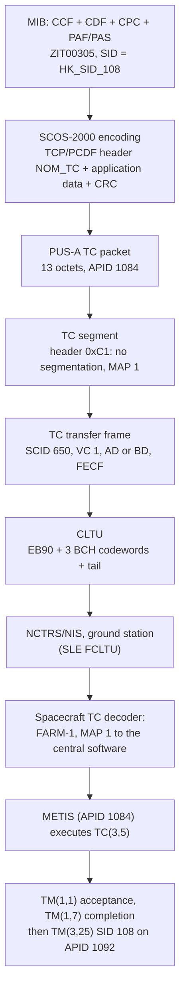
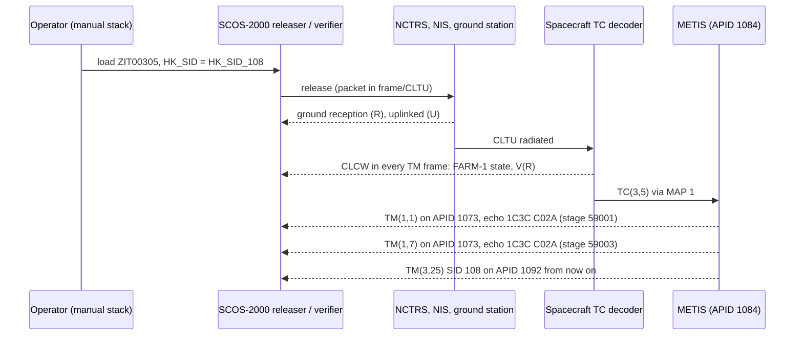

# Worked example: building a real Solar Orbiter telecommand

This page builds one real Solar Orbiter telecommand from its definition in the public
[Mission Information Base](../mib/index.md) (MIB) down to the bits that leave the ground
station antenna. The command definition, its parameter, the textual de-calibration, the packet
header template and the verification stages are real rows of the release
`MIB__20250916M25925PFMS001_SOL` (database `25925PFM`, comment `20250916-CSW3.1.2_MAS7.33`).[^mib-vdf]
Their meaning comes from the [SCOS-2000](../scos2000/index.md) Database Import ICD issue 7.0.[^icd-cmd]
The Solar Orbiter packet and frame rules come from the Solar Orbiter TM-TC and Packet Structure
ICD (SOL.S.ASTR.TN.00079 issue 7).[^sol-scope] The CCSDS and ECSS standards supply the coding
rules. Every byte shown is computed on this page.

!!! info "What is real and what is illustrative"
    **Real** (from the sources cited): command name, APID, type, subtype, acknowledgement
    flags, parameter type, alias table, packet header template, verification stages, the Solar
    Orbiter spacecraft ID (650), the MAP ID convention and the frame and packet length limits.
    **Illustrative** (chosen by this wiki and labelled as such): the packet sequence count (42),
    the source ID (120), the virtual channel (1), the frame sequence number (5) and the choice
    between AD and BD service. The CRCs, BCH parity octets and randomized octets are computed
    from those values with the algorithms of the standards.

We enable the METIS housekeeping report with SID 108, so this page is the uplink twin of
[Worked example: decoding a real Solar Orbiter telemetry packet](worked-example-tm.md), which
decodes exactly that report. The general uplink chain is described on
[Uplink: from operator command to on-board execution](uplink.md).

## The command we picked

We wanted a command with a single parameter that is harmless by design: it changes what
telemetry is generated, not the state of the spacecraft. TC(3,5) "Enable housekeeping parameter
report generation" fits. In the Solar Orbiter ICD it carries a single 1-octet SID and starts
the generation of one defined housekeeping report.[^sol-3-5] The METIS version is:[^mib-ccf]

| Property | Value |
|---|---|
| Command | [`ZIT00305`](../explorer/index.md#/solo/command/ZIT00305) "Enable HK Par. Rep. Gen" |
| Detailed description | `TC(3,5) - ENABLE HK PARAMETER REPORT Generation` |
| PUS service type / subtype | 3 / 5 |
| APID | 1084 (`0x43C`) = Process ID 67, packet category 12 |
| Parameter | `PIT00301` "HK_SID", 8 bits, textual de-calibration `CITT1120TC` |
| Packet header template | `NOM_TC` |
| Acknowledgement flags | 9 = `0b1001` (acceptance and completion reports) |
| Verification stages | 59001 (acceptance), 59003 (completion), both report based |

Solar Orbiter allocates Process IDs 67 to 71 to METIS, and every telecommand APID has packet
category 12.[^sol-apid][^sol-tc-id] All 126 METIS commands go to APID 1084, while the SID 108 report
is generated on APID 1092 (Process ID 68).[^mib-ccf][^mib-tm] The command definition, its
parameter and its verification stages are identical in the April 2020 release
`MIB__20200416M10720PFMS001_SOL`. Two things around them differ: the alias set has grown from 17
entries in 2020 to 18 in 2025 (`HK_SID_110` was added), and in the 2020 `NOM_TC` header template the
source ID is a fixed area of value 0 instead of a header parameter (see [step 3](#step-3-the-packet-header-template-tcp-pcpc-pcdf)).[^mib2020]



Layering from the Solar Orbiter ICD (§3) and the CCSDS TC standards;[^sol-tc-ov][^sdlp-frame][^cltu-struct]
the routing default from the ICD's DST table description.[^icd-dst]

## Step 1: the command definition (CCF)

The [CCF](../mib/tables/ccf.md) holds one record per command.[^icd-ccf] The record of `ZIT00305`,
field by field:[^mib-ccf]

| # | Field | Value | Meaning (ICD §3.3.3.2.1) |
|---|---|---|---|
| 1 | `CCF_CNAME` | `ZIT00305` | unique command name |
| 2 | `CCF_DESCR` | `Enable HK Par. Rep. Gen` | short description (24 characters) |
| 3 | `CCF_DESCR2` | `TC(3,5) - ENABLE HK PARAMETER REPORT Generation` | detailed description |
| 4 | `CCF_CTYPE` | (empty) | a normal packet command; `R`, `F`, `S`, `T` and `N` would mark control segments, BC frames, packets without CRC, SLE and NIS throw events |
| 5 | `CCF_CRITICAL` | `N` | not critical (hazardous) |
| 6 | `CCF_PKTID` | `NOM_TC` | packet header template from the TCP table |
| 7-9 | `CCF_TYPE`, `CCF_STYPE`, `CCF_APID` | 3, 5, 1084 | copied into the header fields of PCDF type `T`, `S` and `A` |
| 10 | `CCF_NPARS` | 1 | one CDF element |
| 11 | `CCF_PLAN` | `N` | not plannable by any source |
| 12 | `CCF_EXEC` | `Y` | may be loaded stand-alone on a manual stack |
| 13 | `CCF_ILSCOPE` | `N` | no interlock by default |
| 14 | `CCF_ILSTAGE` | `C` | stage an interlock would wait for: completion |
| 15 | `CCF_SUBSYS` | 110 | on-board subsystem identifier |
| 16-17 | `CCF_HIPRI`, `CCF_MAPID` | `N`, (empty) | not a high-priority command; no forced MAP ID |
| 18 | `CCF_DEFSET` | (empty) | no default parameter value set |
| 19 | `CCF_RAPID` | (empty) | no redundant APID |
| 20 | `CCF_ACK` | 9 | default value of the 4-bit Ack field, modifiable at load time |
| 21 | `CCF_SUBSCHEDID` | 110 | default on-board sub-schedule if loaded time-tagged |

Field meanings from the ICD.[^icd-ccf][^icd-ctype][^icd-ccf2][^icd-ccf3] The interlock stage only
matters when an interlock is set; with `CCF_ILSCOPE` = `N` there is none.[^icd-ccf2]
`CCF_CRITICAL` = `N` is not unusual: in this release 5448 of the 5454 commands have `N` and
the other 6 leave the field empty, so no command is flagged critical in the MIB.[^mib-stats] The ICD
leaves the extra protection of critical commands to each mission.[^icd-ccf]

There is no [PTV](../mib/tables/ptv.md) row for `ZIT00305`, so no static pre-transmission
validation applies, and no [PSM](../mib/tables/psm.md) row, so no parameter set.[^mib-cdf] The
[DST](../mib/tables/dst.md) table has a single row, for APID 1372. APID 1084 is therefore routed to
the default destination, the NCTRS.[^mib-stats][^icd-dst]

## Step 2: the application data (CDF, CPC and the alias set)

The [CDF](../mib/tables/cdf.md) lists the elements of the application data field, in the order
of `CDF_BIT`. SCOS-2000 encodes them with no gaps, so even padding bits must be declared.[^icd-cdf]
`ZIT00305` has a single element:[^mib-cdf]

| `CDF_ELTYPE` | `CDF_ELLEN` | `CDF_BIT` | `CDF_GRPSIZE` | `CDF_PNAME` | `CDF_INTER` | `CDF_VALUE` | `CDF_TMID` |
|---|---|---|---|---|---|---|---|
| `E` (editable) | 8 | 0 | 0 | `PIT00301` | `R` | (empty) | (empty) |

`CDF_BIT` counts from the end of the packet header, data field header included, so bit 0 is the
first bit after the 10-octet `NOM_TC` header. `CDF_ELLEN` is informative for parameters: the
length really comes from the parameter's PTC/PFC.[^icd-cdf2] An editable element with an empty
`CDF_VALUE` and no dynamic default has no default at all: the operator must type a value before
the command can be loaded.[^icd-cdfval]

The parameter itself is defined in the [CPC](../mib/tables/cpc.md):[^mib-cdf]

| Field | Value | Meaning (ICD §3.3.3.2.2) |
|---|---|---|
| `CPC_PNAME`, `CPC_DESCR` | `PIT00301`, `HK_SID` | name and description |
| `CPC_PTC` / `CPC_PFC` | 2 / 8 | enumerated, 8 bits |
| `CPC_DISPFMT` | `A` | engineering values are entered and shown as ASCII text |
| `CPC_RADIX` | (empty → default `D`) | raw values displayed in decimal |
| `CPC_CATEG` | `T` | textual (de-)calibration, so `CPC_PAFREF` is mandatory |
| `CPC_PRFREF` | (empty) | no range check set |
| `CPC_CCAREF` | (empty) | no numerical (de-)calibration |
| `CPC_PAFREF` | `CITT1120TC` | alias set in PAF/PAS |
| `CPC_INTER`, `CPC_DEFVAL` | `R`, (empty) | no parameter-level default |

Meanings from the ICD and Appendix A.[^icd-cpc][^icd-cpc2][^icd-appa] The Solar Orbiter ICD calls the
SID an unsigned integer of 1 byte; an 8-bit enumerated value encodes the same way.[^sol-3-5][^icd-appa]

### The textual de-calibration `CITT1120TC`

Commanding calibrations work in both directions, from engineering to raw for encoding and from raw
to engineering for display, and must be one-to-one.[^icd-decal] The [PAF](../mib/tables/paf.md) row
[`CITT1120TC`](../explorer/index.md#/solo/calib/ctxt/CITT1120TC) ("HK SID", raw format `U`) has 18
aliases in the [PAS](../mib/tables/pas.md):[^mib-paf]

| `PAS_ALTXT` | `PAS_ALVAL` | | `PAS_ALTXT` | `PAS_ALVAL` |
|---|---|---|---|---|
| `SID_1_BOOT` | 1 | | `HK_SID_107` | 107 |
| `IIC_SID_20` | 20 | | **`HK_SID_108`** | **108** |
| `HK_SID_101` | 101 | | `HK_SID_109` | 109 |
| `HK_SID_102` | 102 | | `HK_SID_110` | 110 |
| `HK_SID_103` | 103 | | `TASKs_Status` | 112 |
| `HK_SID_104` | 104 | | `HK_SPARE_1` ... `HK_SPARE_4` | 113 ... 116 |
| `HK_SID_105` | 105 | | `IIC_COPY` | 120 |
| `HK_SID_106` | 106 | | | |

The operator picks `HK_SID_108`, SCOS-2000 looks up `PAS_ALVAL` and encodes the raw value 108 =
`0x6C`.[^icd-paf][^mib-paf] The alias set mirrors the telemetry textual calibration `CITT1120TM`
used for the SID field of the METIS reports, entry for entry.[^mib-paf]

Six METIS commands share `PIT00301`: TC(3,1) define, TC(3,3) clear, TC(3,5) enable, TC(3,6)
disable, TC(3,9) report and TC(3,130) collection interval.[^mib-cdf]

### Range checks and numerical de-calibrations: not used here

`PIT00301` has neither a range set ([PRF](../mib/tables/prf.md)/[PRV](../mib/tables/prv.md)) nor a
numerical curve ([CCA](../mib/tables/cca.md)/[CCS](../mib/tables/ccs.md)).[^mib-cdf] For contrast,
the platform command [`ZCD00305`](../explorer/index.md#/solo/command/ZCD00305), the same TC(3,5) for
the central software's data management application on APID 172 (Process ID 10), uses an 8-bit
unsigned SID parameter (`PCD03011`, PTC 3 / PFC 4) with range set
[`VCD00353`](../explorer/index.md#/solo/calib/range/VCD00353).[^mib-zcd][^icd-appa][^sol-apid] That range set
has one raw range, 1 to 192, although its description reads "Integer between 1 and 19".[^mib-zcd]
SCOS-2000 accepts a value equal to either bound.[^icd-prv]

!!! warning "Inference"
    The mismatch between the `VCD00353` description ("1 and 19") and its values (1 to 192) is most
    likely a truncation: `PRF_DESCR` holds at most 24 characters, and "Integer between 1 and 192"
    has 25.[^icd-prf-descr] The April 2020 release has the same description and range.[^mib2020]
    The MIB itself does not say which is intended; the PRV values are what SCOS-2000 checks. The
    [uplink walk-through](uplink.md#commands-and-their-parameters) reaches the same reading.

## Step 3: the packet header template (TCP, PCPC, PCDF)

SCOS-2000 builds the packet header from a template. The [TCP](../mib/tables/tcp.md) names the
templates, the [PCPC](../mib/tables/pcpc.md) names the header parameters and the
[PCDF](../mib/tables/pcdf.md) lays the elements out by bit offset from the start of the packet.[^icd-tcp]
The Solar Orbiter MIB defines four templates: `HPC1_TC` (high-priority CPDU commands, no data field
header), `NOM_TC` (normal commands), `NO_HDR` (control frames and segments) and `NOS2KHDR` (NIS throw
events).[^mib-tcp] 5318 commands use `NOM_TC`, 125 use `HPC1_TC`, 6 use `NOS2KHDR` and 5 use
`NO_HDR`.[^mib-stats]

The 13 PCDF elements of `NOM_TC`:[^mib-tcp]

| `PCDF_BIT` | `PCDF_LEN` | `PCDF_DESC` | `PCDF_TYPE` | `PCDF_PNAME` | `PCDF_VALUE` (hex) | Filled by |
|---|---|---|---|---|---|---|
| 0 | 3 | Version Number | `F` | | 0 | fixed |
| 3 | 1 | Type | `F` | | 1 | fixed: telecommand |
| 4 | 1 | DataFieldHeaderFlag | `F` | | 1 | fixed |
| 5 | 11 | APID | `A` | `PH_APID` | 0 | `CCF_APID` |
| 16 | 2 | Sequence Flag | `F` | | 3 | fixed: `0b11` |
| 18 | 14 | Sequence Count | `P` | `PH_SSC` | 0 | command system |
| 32 | 16 | Packet Length | `P` | `PH_LEN` | 0 | command system |
| 48 | 1 | Secondary Header Flag | `F` | | 0 | fixed |
| 49 | 3 | PUS Version | `F` | | 1 | fixed: PUS version 1 |
| 52 | 4 | Ack | `K` | `DFH_ACK` | 0 | `CCF_ACK` |
| 56 | 8 | Service Type | `T` | `DFH_TYPE` | 0 | `CCF_TYPE` |
| 64 | 8 | Service Subtype | `S` | `DFH_STPE` | 0 | `CCF_STYPE` |
| 72 | 8 | Source ID | `O` | `DFH_SRC` | 0 | see below |

Rows from the MIB (all with radix `H`; all PCPC parameters are unsigned, code `U`);[^mib-tcp] type
letters from the ICD: `F` fixed, `A` APID, `T` type, `S` subtype, `K` acknowledgement flags, `P` set
automatically by the command subsystem.[^icd-pcdf] The packet length counts the actual length,
repeated groups included, and the multiplexer keeps a sequence counter per APID. Operators cannot
edit header parameters on a manual stack.[^icd-pcdf]

!!! warning "Inference"
    **Open point, `PCDF_TYPE` = `O`.** The Source ID element uses type `O`, which is not among the six types listed in ICD issue 7.0,
    nor in the other ICD issues in this wiki's library. Its exact semantics are **not stated in
    the available sources**. Since the PCDF value is 0 and the Solar Orbiter ICD reserves values
    110 to 113 and 120 to 122 for ground sources, it is presumably a mission-specific type through which the
    command source inserts its own identifier. This is an inference.[^sol-srcid][^icd-pcdf]
    The April 2020 release supports this reading: there the same element is a fixed area
    (`PCDF_TYPE` = `F`, value 0, no `PCDF_PNAME`), the PCPC has only six parameters (no `DFH_SRC`)
    and the template is described as "Normal Header", so every `NOM_TC` command encoded with that
    release carried source ID 0.[^mib2020]

The `NOM_TC` template matches the Solar Orbiter ICD's description of the TC packet: version `000`,
type 1, data field header flag 1 (all commands except CPDU commands), sequence flags `11`
("stand-alone"), then a 4-octet data field header with the CCSDS secondary header flag 0, PUS
version 1, the Ack field, type, subtype and an 8-bit source ID.[^sol-tc-id][^sol-tc-psc][^sol-tc-dfh][^sol-srcid]
It is the PUS-A layout of ECSS-E-70-41A §5.3.3 with the optional source ID present and no
spare.[^pusa-tc-dfh]

=== "Solar Orbiter (PUS-A, version 1)"

    <div class="bitfield" data-title="NOM_TC data field header (32 bits)" data-width="16"
         data-fields='[{"n":"Sec. hdr flag","b":1,"v":"0","d":"0 = non-CCSDS secondary header"},{"n":"PUS version","b":3,"v":"001","d":"Version 1 (ECSS-E-70-41A)"},{"n":"Ack","b":4,"d":"Bit 3 (LSB) acceptance, bit 0 (MSB) completion; Solar Orbiter allows 0000, 0001, 1000, 1001"},{"n":"Service type","b":8},{"n":"Service subtype","b":8},{"n":"Source ID","b":8,"d":"Ground sources 110-113 and 120-122, on-board sources 11, 14, 15"}]'></div>

    Layout from the MIB PCDF and the Solar Orbiter ICD.[^mib-tcp][^sol-tc-dfh]

=== "PUS-C (version 2), for comparison"

    | Bits | Content |
    |---|---|
    | 4 | TC packet PUS version number, set to 2 |
    | 4 | acknowledgement flags (same bit meanings) |
    | 8 + 8 | message type: service type ID, message subtype ID |
    | 16 | source ID |
    | optional | spare |

    The PUS-C header is 5 octets instead of Solar Orbiter's 4, because the version field grows to
    4 bits and the source ID to 16 bits.[^pusc-tc-sh] See [PUS packet structures](../ecss/pus/packets.md)
    and [PUS-A vs PUS-C](../ecss/pus/pus-a-vs-pus-c.md).

### The Ack field

In PUS-A the four Ack bits ask for success reports: bit 3 (the least significant) for acceptance,
bit 2 for start of execution, bit 1 for progress and bit 0 (the most significant) for completion;
failure reports are always generated.[^pusa-tc-dfh] Solar Orbiter restricts the field to `0000`,
`0001`, `1000` and `1001`; the start and progress bits must be zero.[^sol-tc-dfh][^sol-s1] `CCF_ACK` = 9
is `0b1001`: acceptance and completion. 5225 of the 5454 commands in the release use 9.[^mib-stats]
The flags can be changed when a command is loaded, and unsetting a flag also disables the matching
report-based verification stage.[^icd-ccf3][^icd-cvp]

## Step 4: assemble the packet

Putting the pieces together, with an illustrative sequence count of 42 and source ID 120:

| Octets | Field | Bits | Value | Origin |
|---|---|---|---|---|
| 0-1 | version, type, DFH flag, APID | `000` `1` `1` `10000111100` | `0x1C3C` | PCDF fixed values + `CCF_APID` 1084 |
| 2-3 | sequence flags, sequence count | `11` `00000000101010` | `0xC02A` | fixed `11` + count 42 (illustrative) |
| 4-5 | packet length | 6 | `0x0006` | 7 octets in the data field, minus one |
| 6 | sec. header flag, PUS version, Ack | `0` `001` `1001` | `0x19` | fixed + `CCF_ACK` 9 |
| 7 | service type | 3 | `0x03` | `CCF_TYPE` |
| 8 | service subtype | 5 | `0x05` | `CCF_STYPE` |
| 9 | source ID | 120 | `0x78` | "direct commands" ground source (illustrative choice) |
| 10 | SID (`PIT00301`) | 108 | `0x6C` | `HK_SID_108` via `CITT1120TC` |
| 11-12 | packet error control | CRC-16 | `0x4F50` | computed over octets 0-10 |

```text
1C 3C C0 2A 00 06 19 03 05 78 6C 4F 50        (13 octets)
```

<div class="bitfield" data-title="ZIT00305 as a 104-bit TC packet" data-width="32"
     data-fields='[{"n":"Ver 000","b":3,"v":"000","g":"Primary header"},{"n":"Type 1","b":1,"v":"1","g":"Primary header"},{"n":"DFH 1","b":1,"v":"1","g":"Primary header"},{"n":"APID 1084","b":11,"v":"10000111100","g":"Primary header"},{"n":"Seq flags 11","b":2,"v":"11","g":"Primary header"},{"n":"Seq count 42 (illustrative)","b":14,"g":"Primary header"},{"n":"Packet length 6","b":16,"g":"Primary header"},{"n":"SHF 0","b":1,"v":"0","g":"Data field header"},{"n":"PUS 1","b":3,"v":"001","g":"Data field header"},{"n":"Ack 1001","b":4,"v":"1001","g":"Data field header"},{"n":"Type 3","b":8,"g":"Data field header"},{"n":"Subtype 5","b":8,"g":"Data field header"},{"n":"Source ID 120 (illustrative)","b":8,"g":"Data field header"},{"n":"SID 108","b":8,"g":"Application data"},{"n":"PEC CRC-16 = 0x4F50","b":16,"g":"Error control"}]'></div>

Header field rules from CCSDS 133.0-B-2 and the Solar Orbiter ICD;[^spp-ph][^sol-tc-id][^sol-tc-psc][^sol-tc-len]
values from the MIB rows above.[^mib-ccf][^mib-tcp][^mib-paf]

How the remaining fields are set:

* **Sequence count.** The Solar Orbiter ICD wants it kept per APID and source ID, for tracing the
  command through the ground system; the receiving application does not check it.[^sol-tc-psc]
  In SCOS-2000 the multiplexer maintains it per APID.[^icd-pcdf]
* **Packet length.** C = (octets in the data field) − 1 = (4 + 1 + 2) − 1 = 6. The Solar Orbiter
  static acceptance checks require 5 ≤ C ≤ 241 and compare C with the number of received
  octets.[^sol-tc-len][^sol-s1]
* **Packet error control.** A CRC with generator $G(x) = x^{16} + x^{12} + x^5 + 1$, shift register
  preset to all ones, computed over the whole packet except the last 16 bits.[^sol-crc][^pusa-crc] The
  SCOS-2000 releaser appends it to every command unless `CCF_CTYPE` = `S`.[^icd-ctype] This wiki's
  implementation reproduces the Solar Orbiter ICD's test vectors (`00 00` → `1D0F`,
  `AB CD EF 01` → `04A2`, `14 56 F8 9A 00 01` → `7FD5`) before being applied here.[^sol-crc]

**The size limits fit together.** The Solar Orbiter ICD limits a TC packet data field to 242 octets
(4 header + 236 application data + 2 error control), which makes the largest packet 248
octets.[^sol-tc-len] Its overview drawing (figure 3.1-1) stacks the layers: a TC frame of at most
256 octets is a 5-octet frame header, a frame data field of at most 249 octets (a 1-octet segment
header plus up to 248 octets of packets) and a 2-octet frame error control field.[^sol-tc-ov][^sol-seg]
SCOS-2000's default maximum command size (`CMDP_MAX_BLOCK_SIZE`) is also 248 octets.[^icd-maxsize]

!!! warning "Inference"
    The sources do not say that SCOS-2000's 248-octet default and the Solar Orbiter 248-octet packet
    limit were chosen to match. They are simply equal.

## Step 5: how the command will be verified (CVP, CVS, CVE)

SCOS-2000 verification is either report based (PUS service 1 reports) or parameter based (checks
on telemetry values). The [CVP](../mib/tables/cvp.md) attaches stages to a command, the
[CVS](../mib/tables/cvs.md) defines each stage and the [CVE](../mib/tables/cve.md) holds the
criteria of parameter-based stages.[^icd-verif] `ZIT00305` has two stages:[^mib-cvs]

| `CVS_ID` | `CVS_TYPE` | `CVS_SOURCE` | `CVS_START` | `CVS_INTERVAL` | `CVS_SPID` | `CVS_UNCERTAINTY` |
|---|---|---|---|---|---|---|
| [59001](../explorer/index.md#/solo/verif/59001) | `A` acceptance | `R` report | 0 s | 16 s | (empty) | (empty → −1, standard window) |
| [59003](../explorer/index.md#/solo/verif/59003) | `C` completion | `R` report | 0 s | 32 s | (empty) | (empty → −1, standard window) |

Values from the MIB, columns in ICD field order;[^mib-cvs] meanings from the ICD.[^icd-cvs][^icd-cvp] `CVS_START` is the
delay after release before the window opens, `CVS_INTERVAL` the sampling interval used to compute
the window, and an empty `CVS_UNCERTAINTY` keeps the default window of the TC Spacon.[^icd-cvs]
Report-based stages need no CVE rows, and there are none for these two stages.[^mib-cvs] Stage
59001 is attached to all 126 METIS commands on APID 1084 and stage 59003 to 125 of them; the
exception, `ZIT00605` (TC(6,5) dump memory), uses completion stage 59004 with a 4561 s interval
instead.[^mib-cvs]

The acceptance and completion stages are passed by METIS service 1 reports on APID 1073
(Process ID 67, category 1, reserved for TC verification):[^mib-tm][^sol-apid]

* TM(1,1) acceptance success, SPID 59001, and TM(1,7) completion success, SPID 59003. Both carry
  the 2-octet TC packet ID and the 2-octet packet sequence control of the command, which the MIB
  places at octets 16 and 18 (`NIT82001`, `NIT82002`).[^mib-tm][^sol-s1-rep]
* For our command these four octets would be `1C 3C C0 2A`. The SCOS-2000 verifier extracts them
  from every service 1 report to find the command instance.[^icd-appc-s1]
* Failures arrive as TM(1,2) or TM(1,8) with a 2-octet failure ID after the echo. The PIC
  identifies service 1 subtypes 2 and 8 by a 16-bit PI1 at octet 20, so each failure ID gets its
  own SPID (for example TM(1,2) failure ID 2, "PEC_ERROR", is SPID 59007).[^mib-tm][^sol-fid] The
  verifier itself uses only the subtype, not the failure code.[^icd-appc-s1]

!!! warning "Inference"
    The verification stage IDs 59001 and 59003 are equal to the SPIDs of the METIS TM(1,1) and
    TM(1,7) packets. This looks like a naming convention of the Solar Orbiter MIB; the ICD does
    not require it, and `CVS_SPID` is empty for these stages.



The ground stages R, U and O are the interlock stages named in the ICD (reception at the ground
station, uplink, on-board reception); in BD mode O is treated as U.[^icd-ccf2] Stages A and C come
from the CVS rows above.[^mib-cvs] The CLCW that every Solar Orbiter TM frame carries reports the
FARM-1 state of the TC virtual channel, including V(R), the sequence number of the next Type-AD
frame it expects.[^sol-frame-ocf][^cop-vr]

!!! warning "Inference"
    The ICD does not say how SCOS-2000 detects stage O. For an AD frame, a V(R) that has moved past
    the frame's N(S) shows that FARM-1 accepted it, which is presumably what closes the stage; the
    diagram does not claim more than that the CLCW carries this information.

!!! warning "Inference"
    That the enabled SID 108 report then appears on APID 1092, although the command went to APID
    1084, is deduced from the MIB: the alias `HK_SID_108` of the command and the SID value 108 of
    SPID 59208 are the same, and METIS defines SID 108 only on APID 1092.[^mib-paf][^mib-tm] The MIB does
    not link commands to the packets they enable. ICD Appendix C also warns that SCOS-2000 needs
    the packet definition in the database before the report is enabled on board.[^icd-appc-s3]

## Step 6: the TC segment and the transfer frame

### The segment header

Solar Orbiter puts every TC packet in a TC segment. The 1-octet segment header has 2 sequence
flags, always `11` because packets are never segmented, and a 6-bit MAP ID: 0 for CPDU commands,
1 for all normal commands.[^sol-seg] The segment data field may hold several complete packets
(aggregation), each found from the length of the one before; SCOS-2000 supports this blocking, but
high-priority commands cannot be aggregated.[^sol-seg-data][^icd-appc-s2][^icd-ccf2] Our segment holds
one packet:

<div class="bitfield" data-title="Segment header 0xC1" data-width="8"
     data-fields='[{"n":"Seq flags","b":2,"v":"11","d":"No segmentation"},{"n":"MAP ID = 1","b":6,"v":"000001","d":"1 = normal commanding (0 = CPDU)"}]'></div>

Field layout from CCSDS 232.0-B-4 §4.1.3.2.2 and table 4-2,[^sdlp-seghdr] values from the Solar Orbiter ICD.[^sol-seg]

### The frame header

The [TC transfer frame](../ccsds/tc-sdlp.md) adds a 5-octet primary header and a 2-octet frame
error control field (FECF).[^sdlp-frame][^sdlp-ph]

<div class="bitfield" data-title="TC transfer frame primary header, Type-AD example (40 bits)" data-width="8"
     data-fields='[{"n":"Version","b":2,"v":"00","d":"TC frame version 1"},{"n":"Bypass","b":1,"v":"0","d":"0 = Type-A (FARM acceptance checks)"},{"n":"Ctrl cmd","b":1,"v":"0","d":"0 = data (Type-D)"},{"n":"Spare","b":2,"v":"00"},{"n":"Spacecraft ID = 650 (0x28A)","b":10,"v":"1010001010"},{"n":"VCID = 1 (illustrative)","b":6,"v":"000001"},{"n":"Frame length = 20","b":10,"v":"0000010100","d":"Total octets minus one: 21 - 1"},{"n":"Frame sequence number N(S) = 5 (illustrative)","b":8,"v":"00000101"}]'></div>

| Field | Bits | Solar Orbiter rule | Our frame |
|---|---|---|---|
| Version number | 0-1 | `00` | `00` |
| Bypass flag | 2 | 0 = Type-A, FARM acceptance checks; 1 = Type-B, checks bypassed | AD: 0, BD: 1 |
| Control command flag | 3 | 0 = data, 1 = control command | 0 |
| Spare | 4-5 | `00` | `00` |
| Spacecraft ID | 6-15 | `0x28A` (650), also used by the ETB and OBC-DM | 650 |
| Virtual channel ID | 16-21 | one VC per on-board TC decoder; the ICD lists `000001` and `000010` | 1 (illustrative) |
| Frame length | 22-31 | total octets − 1; Solar Orbiter frames are at most 256 octets, so bits 22-23 are `00` | 20 |
| Frame sequence number | 32-39 | AD: the FOP-1 counter V(S); BD and BC: `0x00` | AD: 5 (illustrative), BD: 0 |

Rules from the Solar Orbiter ICD §3.4 and CCSDS 232.0-B-4 §4.1.2.[^sol-tc-frame][^sdlp-ph][^sdlp-types]
The ICD's VC wording is not fully consistent: it calls the "suggested values" zero and one but
encodes the two decoders as `000001` and `000010`.[^sol-tc-frame] The frame is 5 + 1 + 13 + 2 = 21
octets, so the length field holds 20.

**The FECF is present.** The text of the Solar Orbiter ICD §3.4 only counts the frame length "to the
last bit of the FRAME ERROR CONTROL FIELD (if present)", but its drawings settle the question:
figure 3.1-1 shows a 2-octet TC frame error control field (CRC) at the end of every TC frame, and
the frame drawing of §3.4 lists a 16-bit frame error control field after the data field, with at
most 251 octets for the two together.[^sol-tc-ov][^sol-tc-frame] This matches the ICD's TC coding
reference, ECSS-E-ST-50-04C, in which all TC frames carry the FECF, and the current ECSS adoption
notice of CCSDS 232.0-B-4, which makes it mandatory.[^sol-rd][^hb-diff4][^an-fecf]

The FECF uses the same CRC as the packet error control (generator $x^{16} + x^{12} + x^5 + 1$,
preset to all ones), computed over the 19 preceding octets.[^sdlp-fecf] This wiki's implementation
reproduces the FECFs of the CCSDS 230.1-G-3 examples (`4C A9` for the Unlock frame, `BB 22` for the
BD example, `9F 71` for the AD example).[^gb-ex]

=== "Type-AD (sequence-controlled)"

    ```text
    02 8A 04 14 05 | C1 | 1C 3C C0 2A 00 06 19 03 05 78 6C 4F 50 | 03 FF
    header           seg  TC packet                                 FECF
    ```

    Bypass 0, N(S) = 5 (illustrative). The [FARM-1](../ccsds/cop-1.md) passes the frame on only
    if N(S) equals V(R), the sequence number it expects next; the outcome is reported in the CLCW
    carried by every Solar Orbiter TM frame.[^sdlp-types][^cop-vr][^sol-frame-ocf]

=== "Type-BD (expedited)"

    ```text
    22 8A 04 14 00 | C1 | 1C 3C C0 2A 00 06 19 03 05 78 6C 4F 50 | 56 0B
    header           seg  TC packet                                 FECF
    ```

    Bypass 1 and N(S) = 0, as the Solar Orbiter ICD requires for BD frames. The FARM acceptance
    checks are bypassed; the frame validation checks still apply.[^sol-tc-frame][^sdlp-types]

The MIB also defines the COP-1 control frames that prepare AD mode: `UNLOCK` (control command flag
set, one fixed octet `0x00`) and `SETVR` (fixed area `0x8200` followed by an editable 8-bit V(R)),
both with `CCF_CTYPE` = `F` and the empty header template `NO_HDR`.[^mib-bc] Their structure is the
CCSDS Unlock and Set V(R) control commands.[^sdlp-cc]

## Step 7: the CLTU

The frame is wrapped in a Communications Link Transmission Unit for the physical layer: a 16-bit
start sequence, BCH codewords and a 64-bit tail sequence.[^cltu-struct] Each BCH codeword carries 56
information bits followed by 7 complemented parity bits and a filler bit 0, using the (63,56)
modified BCH code with $g(x) = x^7 + x^6 + x^2 + 1$.[^bch-format][^bch-enc] If the frame does not fill
the last codeword, fill octets `0x55` (alternating bits starting with 0) are appended.[^bch-fill]

<div class="bitfield" data-title="First BCH codeword of the Type-AD CLTU (64 bits)" data-width="32"
     data-fields='[{"n":"Information: 02 8A 04 14 (frame octets 0-3)","b":32,"g":"56 information bits"},{"n":"Information: 05 C1 1C (frame octets 4-6)","b":24,"g":"56 information bits"},{"n":"Parity (complemented)","b":7,"g":"Error control octet 0xD8","d":"Complements of P0..P6"},{"n":"Filler 0","b":1,"v":"0","g":"Error control octet 0xD8"}]'></div>

Our 21-octet frame is exactly three 7-octet blocks, so no fill is needed and the CLTU is
2 + 3 × 8 + 8 = 34 octets. ECSS-E-ST-50-04 puts exactly one frame in each CLTU.[^hb-diff3]

=== "Type-AD, not randomized"

    | Part | Octets |
    |---|---|
    | Start sequence | `EB 90` |
    | Codeword 1 | `02 8A 04 14 05 C1 1C` + `D8` |
    | Codeword 2 | `3C C0 2A 00 06 19 03` + `FE` |
    | Codeword 3 | `05 78 6C 4F 50 03 FF` + `FA` |
    | Tail sequence | `C5 C5 C5 C5 C5 C5 C5 79` |

=== "Type-AD, randomized"

    | Part | Octets |
    |---|---|
    | Start sequence | `EB 90` |
    | Codeword 1 | `FD B3 9A 4E 6D 28 1A` + `80` |
    | Codeword 2 | `C9 AC A3 2F A7 28 5D` + `B2` |
    | Codeword 3 | `0D B8 3E E7 EB AD B1` + `2E` |
    | Tail sequence | `C5 C5 C5 C5 C5 C5 C5 79` |

=== "Type-BD, not randomized"

    | Part | Octets |
    |---|---|
    | Start sequence | `EB 90` |
    | Codeword 1 | `22 8A 04 14 00 C1 1C` + `BC` |
    | Codeword 2 | `3C C0 2A 00 06 19 03` + `FE` |
    | Codeword 3 | `05 78 6C 4F 50 56 0B` + `EC` |
    | Tail sequence | `C5 C5 C5 C5 C5 C5 C5 79` |

=== "Type-BD, randomized"

    | Part | Octets |
    |---|---|
    | Start sequence | `EB 90` |
    | Codeword 1 | `DD B3 9A 4E 68 28 1A` + `E4` |
    | Codeword 2 | `C9 AC A3 2F A7 28 5D` + `B2` |
    | Codeword 3 | `0D B8 3E E7 EB F8 45` + `38` |
    | Tail sequence | `C5 C5 C5 C5 C5 C5 C5 79` |

Start sequence `0xEB90` and tail `0xC5C5C5C5C5C5C579` from CCSDS 231.0-B-4 §5.2;[^cltu-start][^cltu-tail]
codewords computed by this wiki with the BCH encoder of §3.3 and, in the randomized tabs, the
pseudo-randomizer of §6 applied to the frame before encoding.[^bch-enc][^rnd-desc][^rnd-apply] Both
algorithms were first checked against the unrandomized and randomized CLTUs of CCSDS 230.1-G-3
annex F, examples 1, 12 and 15.[^gb-ex]

!!! warning "Inference"
    **Randomization.** Whether Solar Orbiter randomizes its TC frames is **not stated in the available sources**.
    With BCH coding, CCSDS requires the randomizer unless the system designer verifies that the
    link works without it, so in practice it is optional and fixed per physical channel by
    management. In ECSS-E-ST-50-04, which the Solar Orbiter ICD lists as its TC coding reference,
    randomization is always used; the ECSS handbook adds that some European on-board hardware cannot handle it.[^rnd-ov][^hb-diff6][^sol-rd]
    Both forms are therefore shown.

On board, the decoder looks for the start sequence, decodes each codeword (ECSS-E-ST-50-04
always uses single-error-correction mode, which is why the FECF is needed), removes the
randomization after decoding, and stops at the tail sequence, which is built to be uncorrectable.[^bch-dec][^hb-diff4][^hb-diff7][^rnd-apply][^cltu-tail]
Acquisition and idle sequences around the CLTU depend on the physical layer operations procedure
(PLOP) and are not shown.[^gb-ex] Details: [TC synchronization and channel coding: the CLTU](../ccsds/tc-coding-cltu.md).

## Step 8: from SCOS-2000 to the antenna

With no DST entry for APID 1084, SCOS-2000 releases the command to the NCTRS, the default
destination for spacecraft commands.[^icd-dst][^mib-stats] Towards the ground station, the CCSDS
[SLE forward CLTU service](../ccsds/sle/fcltu.md) is the standard service "that enables a mission to
send CLTUs to a spacecraft".[^fcltu] (The alternative [Forward Space Packet](../ccsds/sle/fsp.md)
service, whose book the library holds as a historical copy, takes packets instead and leaves the
frames and CLTUs to the provider.)[^sle-fwd][^fsp-hist] Which ground component encodes the frame and the CLTU for Solar
Orbiter is not stated in the sources used for this page; see
[NCTRS, NIS and the ground station interface](../scos2000/nctrs-nis.md). The CLTU then modulates the
uplink carrier at one of the telecommand bit rates of the spacecraft transponder (7.8125 to
4000 bit/s in the MIB's calibration of the transponder's TC bit rate parameter);[^mib-dst] see
[radio frequency, modulation and ranging](../ccsds/rf-and-ranging.md). The ICD notes that a
CLTU has a mission-specific maximum size, which constrains `CMDP_MAX_BLOCK_SIZE`.[^icd-maxsize]

The released command is archived too. The Solar Orbiter data delivery ICD says the archive keeps
a TC packet per released command (SPID 100) with its verification status and the full packet sent
to the spacecraft, plus a separate packet (SPID 200) with the static PTV and verification details
from the MIB.[^ddid-tc]

## Related pages

* The general chain: [Uplink: from operator command to on-board execution](uplink.md); the report
  this command enables: [Worked example: decoding a real Solar Orbiter telemetry packet](worked-example-tm.md).
* The layers used here: [Space Packet](../ccsds/space-packet.md), [PUS packet structures](../ecss/pus/packets.md),
  [ST[03] housekeeping](../ecss/pus/st03-housekeeping.md), [ST[01] request verification](../ecss/pus/st01-request-verification.md),
  [TC SDLP](../ccsds/tc-sdlp.md), [COP-1](../ccsds/cop-1.md), [CLTU](../ccsds/tc-coding-cltu.md) and the
  identifiers they carry, on [space link identifiers](../ccsds/space-link-identifiers.md).
* The MIB tables: [commanding](../mib/commanding.md) and [command verification](../mib/command-verification.md).
* Where the TC frame, CLTU and CPDU conventions came from: [From ESA PSS to CCSDS and ECSS](history.md).
* How a Solar Orbiter instrument specifies its own telecommands: [instrument interface documents](../missions/solar-orbiter/instrument-interfaces.md).

??? example "SQL used"
    Run against `solo-2025-09-16.sqlite` (release `MIB__20250916M25925PFMS001_SOL`) and, for the
    comparison, `solo-2020-04-16.sqlite`. In the current build of these databases `cvs`, `cve`
    and `cvp` carry their ICD column names: `CVS_ID`, `CVS_TYPE`, `CVS_SOURCE`, `CVS_START`,
    `CVS_INTERVAL`, `CVS_SPID`, `CVS_UNCERTAINTY`; `CVE_CVSID` ... `CVE_CHECK`; and `CVP_TASK`,
    `CVP_TYPE`, `CVP_CVSID`.

    ```sql
    SELECT * FROM vdf;
    SELECT * FROM ccf WHERE CCF_CNAME = 'ZIT00305';
    SELECT * FROM cdf WHERE CDF_CNAME = 'ZIT00305' ORDER BY cast(CDF_BIT AS int);
    SELECT * FROM cpc WHERE CPC_NAME = 'PIT00301';
    SELECT * FROM paf WHERE PAF_NUMBR = 'CITT1120TC';
    SELECT * FROM pas WHERE PAS_NUMBR = 'CITT1120TC' ORDER BY cast(PAS_ALVAL AS int);
    SELECT CDF_CNAME FROM cdf WHERE CDF_PNAME = 'PIT00301';
    SELECT * FROM ptv WHERE PTV_CNAME = 'ZIT00305';                  -- no rows
    SELECT * FROM dst;                                                -- one row, APID 1372
    -- packet header templates
    SELECT * FROM tcp; SELECT * FROM pcpc;
    SELECT * FROM pcdf WHERE PCDF_TCNAME = 'NOM_TC' ORDER BY cast(PCDF_BIT AS int);
    -- same query on solo-2020-04-16.sqlite: Source ID row is F / no PCDF_PNAME / value 0
    SELECT CCF_PKTID, count(*) FROM ccf GROUP BY 1;
    SELECT CCF_ACK, count(*) FROM ccf GROUP BY 1;
    SELECT CCF_CRITICAL, count(*) FROM ccf GROUP BY 1;
    SELECT count(*) FROM ccf WHERE CCF_APID = '1084';
    -- verification
    SELECT * FROM cvp WHERE CVP_TASK = 'ZIT00305';
    SELECT * FROM cvs WHERE CVS_ID IN ('59001', '59003', '59004');
    SELECT * FROM cve WHERE CVE_CVSID IN ('59001', '59003');          -- no rows
    SELECT count(*) FROM cvp v JOIN ccf c ON c.CCF_CNAME = v.CVP_TASK
     WHERE c.CCF_APID = '1084' AND v.CVP_CVSID = '59001';             -- 126
    SELECT PID_TYPE, PID_STYPE, PID_PI1_VAL, PID_SPID, PID_DESCR FROM pid
     WHERE PID_APID = '1073' ORDER BY 2, 3;
    SELECT * FROM pic WHERE PIC_TYPE = '1';
    SELECT l.*, c.PCF_DESCR FROM plf l JOIN pcf c ON c.PCF_NAME = l.PLF_NAME
     WHERE l.PLF_SPID IN ('59001', '59003', '59007');
    -- contrast and control frames
    SELECT * FROM ccf WHERE CCF_CNAME = 'ZCD00305';
    SELECT * FROM prf WHERE PRF_NUMBR = 'VCD00353'; SELECT * FROM prv WHERE PRV_NUMBR = 'VCD00353';
    SELECT * FROM ccf WHERE CCF_CTYPE <> '';
    SELECT * FROM cdf WHERE CDF_CNAME IN ('UNLOCK', 'SETVR');
    ```

[^mib-vdf]: [Solar Orbiter MIB release MIB__20250916M25925PFMS001_SOL](../library/mib-20250916m25925pfms001-sol.md), table `vdf`; query by this wiki.
[^icd-cmd]: [SCOS-2000 Database Import ICD issue 7.0](../library/icd-7-0-final.md), §3.3.3 Commanding data (overview of CCF, CPC, CDF, CVS/CVP/CVE, TCP/PCPC/PCDF relationships), PDF pp. 126–128.
[^sol-scope]: [Solar Orbiter TM-TC and Packet Structure ICD, SOL.S.ASTR.TN.00079 issue 7](../library/sol-s-astr-tn-00079-07.md), §1.1 Scope and Purpose (ECSS-E-70-41A data structures), PDF p. 11.
[^sol-rd]: [SOL.S.ASTR.TN.00079 issue 7](../library/sol-s-astr-tn-00079-07.md), §2.2 Reference Documents (RD2 ECSS-E-ST-50-04C, TC synchronisation and channel coding), PDF p. 13.
[^sol-tc-ov]: [SOL.S.ASTR.TN.00079 issue 7](../library/sol-s-astr-tn-00079-07.md), §3.1 Telecommand Overview and figure 3.1-1 (frame 5 + 249 max + 2 octets CRC, segment 1 + 248 max, packet 6 + 242 max; a drawing, read in the PDF because it is not in the extracted text), PDF p. 14.
[^sol-tc-id]: [SOL.S.ASTR.TN.00079 issue 7](../library/sol-s-astr-tn-00079-07.md), §3.2.1.1 TC Packet ID (APID = 7-bit Process ID + category 12), PDF p. 15.
[^sol-tc-psc]: [SOL.S.ASTR.TN.00079 issue 7](../library/sol-s-astr-tn-00079-07.md), §3.2.1.2 TC Packet Sequence Control, PDF p. 16.
[^sol-tc-len]: [SOL.S.ASTR.TN.00079 issue 7](../library/sol-s-astr-tn-00079-07.md), §3.2.1.3 TC Packet Length (maximum data field 242 octets), PDF p. 16.
[^sol-tc-dfh]: [SOL.S.ASTR.TN.00079 issue 7](../library/sol-s-astr-tn-00079-07.md), §3.2.2.1 TC Data Field Header (secondary header flag, PUS version 1, Ack bits, type, subtype), PDF pp. 16–17.
[^sol-crc]: [SOL.S.ASTR.TN.00079 issue 7](../library/sol-s-astr-tn-00079-07.md), §3.2.2.3 TC Packet Error Control, PDF p. 17, and Annex 6 §11.1 CRC Checksum Algorithms with the test vectors of figure 11.1-1, PDF pp. 268–269.
[^sol-seg]: [SOL.S.ASTR.TN.00079 issue 7](../library/sol-s-astr-tn-00079-07.md), §3.3 (figure 3.3-1: 1-octet segment header, segment data field of at most 248 octets) and §3.3.1 TC Segment Header (no segmentation, MAP ID 0 = CPDU, 1 = normal), PDF p. 18.
[^sol-seg-data]: [SOL.S.ASTR.TN.00079 issue 7](../library/sol-s-astr-tn-00079-07.md), §3.3.2 TC Segment Data Field (packet aggregation), PDF p. 19.
[^sol-tc-frame]: [SOL.S.ASTR.TN.00079 issue 7](../library/sol-s-astr-tn-00079-07.md), §3.4 Telecommand Frame (frame drawing with a 5-octet header and a 16-bit frame error control field, flags, SCID 0x28A, VCIDs, frame length up to 256 octets, frame sequence number), PDF pp. 20–22.
[^sol-frame-ocf]: [SOL.S.ASTR.TN.00079 issue 7](../library/sol-s-astr-tn-00079-07.md), §4.3, requirements PUS-271 and PUS-295 (CLCW in the OCF of every TM frame, TC VC IDs consistent with the CLCW), PDF pp. 29–30.
[^sol-s1]: [SOL.S.ASTR.TN.00079 issue 7](../library/sol-s-astr-tn-00079-07.md), §5.2 Service 1: Telecommand Verification (allowed Ack values, static acceptance checks, 5 ≤ packet length ≤ 241), PDF pp. 40–41.
[^sol-s1-rep]: [SOL.S.ASTR.TN.00079 issue 7](../library/sol-s-astr-tn-00079-07.md), §5.2.1–5.2.4 TM(1,1), TM(1,2), TM(1,7), TM(1,8), PDF pp. 41–43.
[^sol-3-5]: [SOL.S.ASTR.TN.00079 issue 7](../library/sol-s-astr-tn-00079-07.md), §5.4.5 TC (3,5) Enable HK Parameter Report Generation (SID, unsigned integer, 1 byte), PDF p. 53.
[^sol-apid]: [SOL.S.ASTR.TN.00079 issue 7](../library/sol-s-astr-tn-00079-07.md), Annex 8 §13.1 (packet categories, Process IDs 67 to 71 for METIS), PDF pp. 272–274.
[^sol-srcid]: [SOL.S.ASTR.TN.00079 issue 7](../library/sol-s-astr-tn-00079-07.md), Annex 8 §13.2 Source ID (ground sources 110–113 and 120–122, direct commands 120; on-board sources 11, 14, 15), PDF pp. 275–276.
[^sol-fid]: [SOL.S.ASTR.TN.00079 issue 7](../library/sol-s-astr-tn-00079-07.md), Annex 9 §14.1 Standard Failure ID (failure ID 2 = incorrect checksum), PDF p. 278.
[^pusa-tc-dfh]: [ECSS-E-70-41A (PUS-A)](../library/ecss-e-70-41a-30jan2003-pus.md), §5.3.3 Packet data field (TC data field header, Ack bit meanings, optional source ID and spare), PDF pp. 44–45.
[^pusa-crc]: [ECSS-E-70-41A (PUS-A)](../library/ecss-e-70-41a-30jan2003-pus.md), Annex A.1 Specification of the cyclic redundancy code (CRC), PDF pp. 207–210.
[^pusc-tc-sh]: [ECSS-E-ST-70-41C (PUS-C)](../library/ecss-e-st-70-41c-15april2016.md), §7.4.4.1 Telecommand packet secondary header and figure 7-9, PDF pp. 442–443.
[^spp-ph]: [CCSDS 133.0-B-2, Space Packet Protocol](../library/ccsds-133-0-133x0b2e2.md), §4.1.3 Packet Primary Header, PDF pp. 32–36.
[^sdlp-frame]: [CCSDS 232.0-B-4, TC Space Data Link Protocol](../library/ccsds-232-0-232x0b4e1c1.md), §4.1.1 TC Transfer Frame and figure 4-1, PDF p. 69.
[^sdlp-ph]: [CCSDS 232.0-B-4](../library/ccsds-232-0-232x0b4e1c1.md), §4.1.2 Transfer Frame Primary Header (fields and bit positions), PDF pp. 70–73.
[^sdlp-types]: [CCSDS 232.0-B-4](../library/ccsds-232-0-232x0b4e1c1.md), §4.1.2.3 Bypass and Control Command Flags and table 4-1, PDF pp. 71–72, and §4.1.2.8 Frame Sequence Number notes, PDF p. 73.
[^sdlp-seghdr]: [CCSDS 232.0-B-4](../library/ccsds-232-0-232x0b4e1c1.md), §4.1.3.2.2 Segment Header, figure 4-3 and table 4-2, PDF pp. 75–76.
[^sdlp-cc]: [CCSDS 232.0-B-4](../library/ccsds-232-0-232x0b4e1c1.md), §4.1.3.3 Control Commands (Unlock, Set V(R)), PDF pp. 76–77.
[^sdlp-fecf]: [CCSDS 232.0-B-4 Cor. 1](../library/ccsds-232-0-232x0b4e1c1.md), §4.1.4.2 Frame Error Control Field Encoding Procedure, PDF pp. 77–78.
[^an-fecf]: [ECSS-E-AS-50-25C Rev.1](../library/ecss-e-as-50-25c-rev-1-13january2023.md), table 4-1, rows 4.1.1c and 4.1.4.1.1–4.1.4.1.3 (FECF mandatory), PDF pp. 8–9.
[^hb-diff3]: [ECSS-E-HB-50A](../library/ecss-e-hb-50a-15november2008.md), §4.7.4.4 Difference 3 (one frame per CLTU), PDF pp. 69–70.
[^hb-diff4]: [ECSS-E-HB-50A](../library/ecss-e-hb-50a-15november2008.md), §4.7.4.5 Difference 4 (FECF in all TC frames, SEC decoding), PDF p. 70.
[^hb-diff6]: [ECSS-E-HB-50A](../library/ecss-e-hb-50a-15november2008.md), §4.7.4.7 Difference 6 (randomization always used), PDF p. 71.
[^hb-diff7]: [ECSS-E-HB-50A](../library/ecss-e-hb-50a-15november2008.md), §4.7.4.8 Difference 7 (BCH always decoded in SEC mode), PDF p. 71.
[^cop-vr]: [CCSDS 232.1-B-2 Cor. 1, Communications Operation Procedure-1](../library/ccsds-232-1-232x1b2e2c1.md), §6.1.5 Retransmit_Flag and §6.1.7 Receiver_Frame_Sequence_Number V(R), PDF pp. 62–63.
[^bch-format]: [CCSDS 231.0-B-4, TC Synchronization and Channel Coding](../library/ccsds-231-0-231x0b4e1.md), §3.2 Codeword Format and figure 3-1, PDF p. 24.
[^bch-enc]: [CCSDS 231.0-B-4](../library/ccsds-231-0-231x0b4e1.md), §3.3 Encoding Procedure and figure 3-2, PDF pp. 24–25.
[^bch-fill]: [CCSDS 231.0-B-4](../library/ccsds-231-0-231x0b4e1.md), §3.4 Fill Data, PDF p. 25.
[^bch-dec]: [CCSDS 231.0-B-4](../library/ccsds-231-0-231x0b4e1.md), §3.5 Decoding Procedure (TED and SEC), PDF p. 26.
[^cltu-struct]: [CCSDS 231.0-B-4](../library/ccsds-231-0-231x0b4e1.md), §5.1–5.2.1 and figure 5-1, PDF p. 30.
[^cltu-start]: [CCSDS 231.0-B-4](../library/ccsds-231-0-231x0b4e1.md), §5.2.2 Start Sequence, PDF p. 31.
[^cltu-tail]: [CCSDS 231.0-B-4](../library/ccsds-231-0-231x0b4e1.md), §5.2.4.1 Tail Sequence for BCH Coding, PDF p. 32.
[^rnd-ov]: [CCSDS 231.0-B-4](../library/ccsds-231-0-231x0b4e1.md), §6.1 Overview (randomizer optional with BCH, managed), PDF p. 36.
[^rnd-desc]: [CCSDS 231.0-B-4](../library/ccsds-231-0-231x0b4e1.md), §6.2 Randomizer Description and figure 6-1, PDF pp. 36–37.
[^rnd-apply]: [CCSDS 231.0-B-4](../library/ccsds-231-0-231x0b4e1.md), §6.3 Application of the Randomizer, PDF p. 37.
[^gb-ex]: [CCSDS 230.1-G-3, TC Synchronization and Channel Coding, Summary of Concept and Rationale](../library/ccsds-230-1-230x1g3e1.md), annex F (introduction and examples 1, 12 and 15), PDF pp. 134–135, 146 and 149.
[^fcltu]: [CCSDS 912.1-B-5, SLE Forward CLTU Service](../library/ccsds-912-1-912x1b5e1.md), §1.1 Purpose, PDF p. 10.
[^ddid-tc]: [Solar Orbiter Data Delivery ICD, SOL-ESC-IF-05011 issue 1 rev. 2](../library/solo-ddid-i1r2.md), §7.1 (telecommand packets in the archive, SPID 200) and §7.1.1 (Filing Key note, SPIDs 100 and 200), PDF pp. 19 and 21.
[^icd-tcp]: [SCOS-2000 Database Import ICD issue 7.0](../library/icd-7-0-final.md), §3.3.3.1 Packet Headers, tcp and pcpc, PDF pp. 128–129.
[^icd-pcdf]: [SCOS-2000 Database Import ICD issue 7.0](../library/icd-7-0-final.md), §3.3.3.1.3 Packet headers definition: pcdf (remark and fields 1–8), PDF pp. 129–131.
[^icd-maxsize]: [SCOS-2000 Database Import ICD issue 7.0](../library/icd-7-0-final.md), §3.3.3.2 Commands (CMDP_MAX_BLOCK_SIZE default 248 bytes, CLTU size limit), PDF pp. 131–132.
[^icd-ccf]: [SCOS-2000 Database Import ICD issue 7.0](../library/icd-7-0-final.md), §3.3.3.2.1 Command characteristics: ccf, fields 1–3 and 5–12, PDF pp. 132–136.
[^icd-ctype]: [SCOS-2000 Database Import ICD issue 7.0](../library/icd-7-0-final.md), §3.3.3.2.1, field 4 CCF_CTYPE, PDF pp. 134–135.
[^icd-ccf2]: [SCOS-2000 Database Import ICD issue 7.0](../library/icd-7-0-final.md), §3.3.3.2.1, fields 13–18 (CCF_ILSCOPE, CCF_ILSTAGE, CCF_SUBSYS, CCF_HIPRI, CCF_MAPID, CCF_DEFSET), PDF pp. 137–139.
[^icd-ccf3]: [SCOS-2000 Database Import ICD issue 7.0](../library/icd-7-0-final.md), §3.3.3.2.1, fields 19–21 (CCF_RAPID, CCF_ACK, CCF_SUBSCHEDID), PDF p. 140.
[^icd-dst]: [SCOS-2000 Database Import ICD issue 7.0](../library/icd-7-0-final.md), §3.3.3.2.1.1 Command routing: DST (default destination NCTRS), PDF pp. 141–142.
[^icd-cpc]: [SCOS-2000 Database Import ICD issue 7.0](../library/icd-7-0-final.md), §3.3.3.2.2 Command parameters: cpc, fields 1–8, PDF pp. 142–146.
[^icd-cpc2]: [SCOS-2000 Database Import ICD issue 7.0](../library/icd-7-0-final.md), §3.3.3.2.2, fields 9–13 (CPC_PRFREF, CPC_CCAREF, CPC_PAFREF, CPC_INTER, CPC_DEFVAL), PDF pp. 147–149.
[^icd-cdf]: [SCOS-2000 Database Import ICD issue 7.0](../library/icd-7-0-final.md), §3.3.3.2.3 Commands definition: cdf (no gaps between elements), PDF p. 151.
[^icd-cdf2]: [SCOS-2000 Database Import ICD issue 7.0](../library/icd-7-0-final.md), §3.3.3.2.3, fields 1–7 (CDF_ELTYPE, CDF_ELLEN, CDF_BIT, CDF_GRPSIZE, CDF_PNAME), PDF pp. 154–156.
[^icd-cdfval]: [SCOS-2000 Database Import ICD issue 7.0](../library/icd-7-0-final.md), §3.3.3.2.3, fields 8–10 (CDF_INTER, CDF_VALUE, CDF_TMID; empty value means the user must enter one), PDF pp. 157–159.
[^icd-verif]: [SCOS-2000 Database Import ICD issue 7.0](../library/icd-7-0-final.md), §3.3.3.4 Verification, PDF p. 191.
[^icd-cvs]: [SCOS-2000 Database Import ICD issue 7.0](../library/icd-7-0-final.md), §3.3.3.4.1 Verification stages file: cvs, fields 1–7, PDF pp. 192–194.
[^icd-cvp]: [SCOS-2000 Database Import ICD issue 7.0](../library/icd-7-0-final.md), §3.3.3.4.3 Verification profiles: cvp (disabling report stages via the Ack flags), PDF pp. 199–200.
[^icd-decal]: [SCOS-2000 Database Import ICD issue 7.0](../library/icd-7-0-final.md), §3.3.3.6 Command/Sequence Parameters (De-)calibrations, PDF p. 205.
[^icd-paf]: [SCOS-2000 Database Import ICD issue 7.0](../library/icd-7-0-final.md), §3.3.3.6.3–3.3.3.6.4 Textual (de-)calibrations: paf and pas, PDF pp. 208–210.
[^icd-prv]: [SCOS-2000 Database Import ICD issue 7.0](../library/icd-7-0-final.md), §3.3.3.7.2 Parameter range values: prv, PDF p. 213.
[^sle-fwd]: [CCSDS 910.3-G-3, Cross Support Concept Part 1: SLE Services](../library/ccsds-910x3g3-sle-cross-support.md), §4.3.1 "List of forward telecommand SLE services and their interfaces" (FSP, FTCVCA, FTCF and FCLTU; the VC and packet service provider uses the CLCW to decide on COP-1 retransmissions), PDF p. 28.
[^fsp-hist]: [CCSDS 912.3-B-3, SLE Forward Space Packet Service](../library/ccsds-912-3-912x3b3s.md), cover note ("CCSDS Historical Document", no longer current), PDF p. 1.
[^mib-dst]: [Solar Orbiter MIB release MIB__20250916M25925PFMS001_SOL](../library/mib-20250916m25925pfms001-sol.md), tables `pcf` (`NDSD0012` "DST-A TC Bit Rate") and `txp` (`CDST0003TM`: 7.8125, 15.625, 250, 1000, 2000 and 4000 bps); queries by this wiki.
[^icd-prf-descr]: [SCOS-2000 Database Import ICD issue 7.0](../library/icd-7-0-final.md), §3.3.3.7.1 Parameter range sets: prf, field 2 `PRF_DESCR` Char(24), PDF p. 211.
[^icd-appa]: [SCOS-2000 Database Import ICD issue 7.0](../library/icd-7-0-final.md), Appendix A SCOS-2000 Parameter Types (PTC 2 and PTC 3 rows), PDF pp. 214–215.
[^icd-appc-s1]: [SCOS-2000 Database Import ICD issue 7.0](../library/icd-7-0-final.md), Appendix C §3.1 Service 1 (4-byte echo, failure code ignored), PDF p. 237.
[^icd-appc-s2]: [SCOS-2000 Database Import ICD issue 7.0](../library/icd-7-0-final.md), Appendix C §3.2 Service 2 (aggregation of commands at TC segment level), PDF p. 238.
[^icd-appc-s3]: [SCOS-2000 Database Import ICD issue 7.0](../library/icd-7-0-final.md), Appendix C §3.3 Service 3, PDF pp. 238–239.
[^mib-ccf]: [Solar Orbiter MIB release MIB__20250916M25925PFMS001_SOL](../library/mib-20250916m25925pfms001-sol.md), table `ccf`, command `ZIT00305` and the commands on APID 1084; queries by this wiki.
[^mib-cdf]: [Solar Orbiter MIB release MIB__20250916M25925PFMS001_SOL](../library/mib-20250916m25925pfms001-sol.md), tables `cdf`, `cpc`, `ptv` and `psm` for `ZIT00305` and `PIT00301`; queries by this wiki.
[^mib-paf]: [Solar Orbiter MIB release MIB__20250916M25925PFMS001_SOL](../library/mib-20250916m25925pfms001-sol.md), tables `paf` and `pas` (`CITT1120TC`), compared with `txp` (`CITT1120TM`); queries by this wiki.
[^mib-zcd]: [Solar Orbiter MIB release MIB__20250916M25925PFMS001_SOL](../library/mib-20250916m25925pfms001-sol.md), tables `ccf`, `cdf`, `cpc`, `prf` and `prv` for `ZCD00305`, `PCD03011` and `VCD00353`; queries by this wiki.
[^mib-tcp]: [Solar Orbiter MIB release MIB__20250916M25925PFMS001_SOL](../library/mib-20250916m25925pfms001-sol.md), tables `tcp`, `pcpc` and `pcdf`; queries by this wiki.
[^mib-cvs]: [Solar Orbiter MIB release MIB__20250916M25925PFMS001_SOL](../library/mib-20250916m25925pfms001-sol.md), tables `cvp`, `cvs` and `cve` (ICD column names), joined with `ccf`; queries by this wiki.
[^mib-tm]: [Solar Orbiter MIB release MIB__20250916M25925PFMS001_SOL](../library/mib-20250916m25925pfms001-sol.md), tables `pid`, `pic`, `tpcf` and `plf` for APIDs 1073 and 1092 (service 1 reports and TM(3,25) SID 108); queries by this wiki.
[^mib-bc]: [Solar Orbiter MIB release MIB__20250916M25925PFMS001_SOL](../library/mib-20250916m25925pfms001-sol.md), tables `ccf` (`CCF_CTYPE` not empty) and `cdf` for `UNLOCK` and `SETVR`; queries by this wiki.
[^mib-stats]: [Solar Orbiter MIB release MIB__20250916M25925PFMS001_SOL](../library/mib-20250916m25925pfms001-sol.md), table `ccf` (counts by `CCF_PKTID`, `CCF_ACK`, `CCF_CRITICAL`) and table `dst`; queries by this wiki.
[^mib2020]: [Solar Orbiter MIB release MIB__20200416M10720PFMS001_SOL](../library/mib-20200416m10720pfms001-sol.md), tables `ccf`, `cdf`, `cpc`, `cvp`, `cvs`, `paf` and `pas` for `ZIT00305`, `tcp`, `pcpc` and `pcdf` (template `NOM_TC`), and `prf` and `prv` for `VCD00353`, compared with the 2025 release; queries by this wiki.
