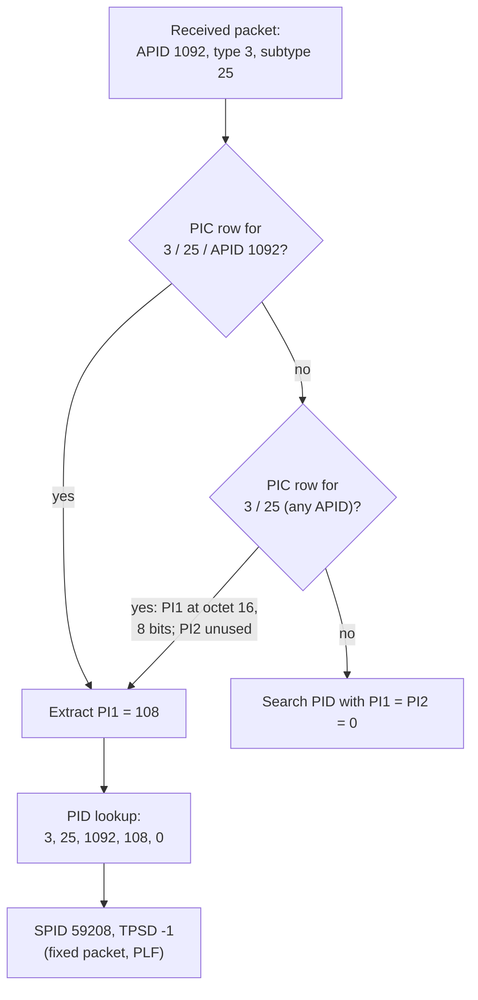

# Worked example: decoding a real Solar Orbiter telemetry packet

This page follows one real housekeeping packet of the Solar Orbiter spacecraft through the
ground system, byte by byte. The packet definition, every parameter, every calibration curve
and every limit come from the public Solar Orbiter [Mission Information Base](../mib/index.md)
(MIB), release `MIB__20250916M25925PFMS001_SOL` (database `25925PFM`, comment
`20250916-CSW3.1.2_MAS7.33`).[^mib-vdf] The meaning of each MIB field comes from the
[SCOS-2000](../scos2000/index.md) Database Import ICD issue 7.0, which the public Solar Orbiter
document site (hosted at IRAP) files among its MOC documents as the "MOC-applicable MIB" ICD.[^icd-cover] The packet
structure comes from the Solar Orbiter TM-TC and Packet Structure ICD (SOL.S.ASTR.TN.00079
issue 7).[^sol-scope] The bytes at the end are a constructed example: no real downlinked
telemetry is used on this page.

!!! info "What is real and what is illustrative"
    **Real** (from the sources cited): the APID, type, subtype, SID, SPID, packet layout,
    parameter names and types, calibration points, polynomial coefficients, textual aliases,
    limit values, and the header conventions of Solar Orbiter.
    **Illustrative** (constructed by this wiki): the source sequence count, the on-board time
    and the raw parameter values in the byte string of [step 6](#step-6-decode-an-illustrative-byte-string).
    They were chosen to look plausible and to exercise every calibration type. They are **not**
    spacecraft data.

The companion page [Worked example: building a real Solar Orbiter telecommand](worked-example-tc.md)
builds the command that switches this very report on. The general flow is explained on
[Downlink: from on-board parameter to operator display](downlink.md).

## The packet we picked

We want a fixed-layout PUS [housekeeping report](../ecss/pus/st03-housekeeping.md)
(service type 3, subtype 25) that is small enough to decode completely and that still uses
every kind of monitoring calibration the MIB offers. The MIB holds 288 TM(3,25) packet
definitions on 62 APIDs.[^mib-stats] Filtering them by size and by the calibration tables
their parameters reference leaves only two packets of 5 to 45 parameters that combine numerical
curves, polynomials, textual calibrations and a limit check (SPIDs 59208 and 54101, the latter
with 44 parameters; query in the SQL box below). The best fit is the METIS instrument's
"HK SID 108 - HVU - LED" report:[^mib-pid]

| Property | Value | Source table |
|---|---|---|
| SCOS-2000 packet ID (SPID) | [59208](../explorer/index.md#/solo/packet/59208) | [PID](../mib/tables/pid.md) `PID_SPID` |
| Description | `TM(3,25) - HK SID 108 - HVU - LED` | `PID_DESCR` |
| APID | [1092](../explorer/index.md#/solo/apid/1092) (`0x444`) | `PID_APID` |
| PUS service type / subtype | 3 / 25 (housekeeping parameter report) | `PID_TYPE`, `PID_STYPE` |
| First extra identifier (PI1) | 108 (the structure ID, SID) | `PID_PI1_VAL` |
| Packet mnemonic | `YIT59208` | [TPCF](../mib/tables/tpcf.md) `TPCF_NAME` |
| Packet size | 37 octets | `TPCF_SIZE` |
| Parameters | 11, all at fixed positions | [PLF](../mib/tables/plf.md) |
| Calibrations used | 2 textual, 3 two-point numerical, 1 175-point numerical, 1 polynomial | [TXF](../mib/tables/txf.md), [CAF](../mib/tables/caf.md), [MCF](../mib/tables/mcf.md) |
| Limit checks | soft and hard limits on the HVU temperature | [OCF](../mib/tables/ocf.md), [OCP](../mib/tables/ocp.md) |

Values from the 2025 release.[^mib-pid][^mib-plf][^mib-cal][^mib-ocf] The same layout (the same
eleven parameters at the same offsets), the same numerical curves, polynomial and limits are already
present in the April 2020 release `MIB__20200416M10720PFMS001_SOL`, with two differences: in 2020
`SAFE_Param` (`NIT0E072`) is an uncalibrated 16-bit unsigned integer (PTC 3 / PFC 12, category `N`,
no `CITT1072TM`), and the SID alias set `CITT1120TM` has 17 entries (no `HK_SID_110`).[^mib2020]

APID 1092 splits into a 7-bit Process ID of 68 and a 4-bit packet category of 4
(1092 = 68 × 16 + 4). The Solar Orbiter ICD allocates Process IDs 67 to 71 to the METIS payload
instrument and reserves category 4 for routine, cyclic TM(3,25) housekeeping.[^sol-apid] The same
APID carries 16 different TM(3,25) packets in the MIB, told apart only by their SID (1, 102 to 110,
112 to 116 and 120).[^mib-pid] That is why the SID matters so much in the identification step below.

!!! warning "Inference"
    The parameter descriptions use the abbreviations HVU, MCP and LED (for example `HVU_mcp_V`,
    `LED_curr_set`). The MIB does not expand them. They plausibly refer to a high-voltage unit, a
    micro-channel plate and a light-emitting diode used for calibration, but this is not stated
    in the available sources. Nothing on this page depends on that reading.

## The path of the packet through the ground system

```mermaid
flowchart LR
    A["TM transfer frames<br/>1115 octets, SCID 650"] -->|"first header pointer,<br/>packet length"| B["TM source packet<br/>37 octets"]
    B --> C["TM packetiser:<br/>APID, type, subtype<br/>+ PIC: PI1 = SID"]
    C -->|"PID lookup"| D["SCOS-2000 TM packet<br/>filing key SPID 59208"]
    D --> E["Parameter extraction<br/>PLF offsets + PCF PTC/PFC"]
    E --> F["Calibration<br/>TXF/TXP, CAF/CAP, MCF"]
    F --> G["Monitoring checks<br/>OCF/OCP"]
    G --> H["Displays, archive,<br/>EDDS delivery"]
```



The order of the steps follows the ICD's description of the telemetry packetiser and of
parameter extraction from fixed packets.[^icd-tmpkt][^icd-proc] The frame-level steps are
specified by the Solar Orbiter ICD and by [CCSDS 132.0-B-3](../ccsds/tm-sdlp.md).[^sol-frame][^tm-fhp]

### Step 0: from frames to packets

Solar Orbiter telemetry transfer frames have one allowed length of 1115 octets (8920 bits)
before encoding, carry the CCSDS spacecraft identifier 650 (`0x28A`), always have a frame
secondary header, always carry a Command Link Control Word in the operational control field and
always end with a frame error control word.[^sol-frame] The frame data field has a constant
size of 1099 octets and TM source packets may be up to 4112 octets long, so a long packet is
split across frames.[^sol-tm-ov] Data sources are mapped onto virtual channels: real-time TM uses
VC0, playback from the on-board computer mass memory VC1, playback from the solid state mass
memory VC2 and VC3, high-priority real-time TM VC4, the critical event log VC5 and idle frames
VC7; VC6 is marked "not required".[^sol-vc]

The receiver locates the first packet of a frame with the 11-bit first header pointer and finds
each following packet from the packet length field of the one before.[^sol-frame][^tm-fhp] The
first header pointer is all ones (`0b11111111111`) when no packet starts in the frame, and
`0b11111111110` for Solar Orbiter idle frames on VC7.[^sol-frame] Our 37-octet packet is short
enough to sit inside one frame data field, but it may also straddle two frames. The details are
on [TM Space Data Link Protocol](../ccsds/tm-sdlp.md).

## Step 1: the Space Packet primary header

Every Solar Orbiter TM source packet starts with the 6-octet [CCSDS Space Packet](../ccsds/space-packet.md)
primary header, which ECSS-E-70-41A (PUS-A) reuses unchanged.[^spp-ph][^pusa-tm]

<div class="bitfield" data-title="Primary header of SPID 59208 (48 bits)" data-width="16"
     data-fields='[{"n":"Version","b":3,"v":"000","g":"Packet ID","d":"Must be 000 for all Solar Orbiter TM"},{"n":"Type","b":1,"v":"0","g":"Packet ID","d":"0 = telemetry"},{"n":"DFH flag","b":1,"v":"1","g":"Packet ID","d":"1 = data field header present (all TM except the time packet)"},{"n":"APID = 1092 (PID 68, CAT 4)","b":11,"v":"10001000100","g":"Packet ID","d":"7-bit Process ID 68 (METIS) and 4-bit packet category 4 (HK routine)"},{"n":"Grouping flags","b":2,"v":"11","g":"Sequence control","d":"11 = stand-alone packet"},{"n":"Source sequence count","b":14,"g":"Sequence control","d":"Per APID and destination, wraps from 16383 to 0 (illustrative value 1234 below)"},{"n":"Packet length = 30","b":16,"v":"0000000000011110","d":"Octets in the packet data field minus one: 37 - 6 - 1 = 30"}]'></div>

| Field | Bits | Solar Orbiter rule | This packet |
|---|---|---|---|
| Version number | 0-2 | `0b000` for all TM; the ground rejects any other value with an alarm | `0b000` |
| Packet type | 3 | 0 for telemetry | 0 |
| Data field header flag | 4 | 1 for every TM packet except the standard spacecraft time packet | 1 |
| APID | 5-15 | 7-bit Process ID followed by 4-bit packet category; APID 0 is the time packet, all ones the idle packet | 1092 = PID 68, category 4 |
| Grouping flags | 16-17 | `11` stand-alone; `01`/`00`/`10` mark a group of self-contained packets answering one request | `0b11` |
| Source sequence count | 18-31 | separate counter per APID and destination ID, +1 per packet, wraps from $2^{14}-1$ to 0 and must never "short-cycle" | illustrative: 1234 |
| Packet length | 32-47 | octets in the packet data field minus one; at most 4106 octets (10-octet header + 4096 source data) | 30 |

Rules from the Solar Orbiter ICD §4.2.1;[^sol-tm-id][^sol-tm-psc][^sol-tm-len] field positions from
CCSDS 133.0-B-2 §4.1.3.[^spp-ph] Solar Orbiter numbers bits from 0 at the most significant, first
transmitted bit and transmits the most significant byte first, the same convention as CCSDS.[^sol-bits][^spp-bits]

The packet length is fixed by the definition: the TPCF gives 37 octets, and the last PLF entry
ends at octet 36 (see [step 4](#step-4-the-plf-layout)), so the field must read 37 − 6 − 1 = 30.[^mib-plf]
The MIB sets `PID_CHECK` to 0 for this packet, which tells the packetiser not to verify a packet
error control field.[^mib-pid][^icd-pid] Only 6 of the 11,150 PID rows set it to 1: three describe
complete transfer frames (APID 1) and three sit on APID 1966, which the Solar Orbiter data
delivery ICD uses for packets generated by the control system, such as time correlation
packets.[^mib-stats][^ddid-1966] None is a spacecraft source packet. The Solar
Orbiter TM source packet drawing (figure 4.2-1) ends with the source data and has no packet error
control field; the ICD defines that field and its CRC for telecommand packets only.[^sol-tm-id][^sol-crc]

## Step 2: the PUS data field header (PUS-A, version 1)

Solar Orbiter does **not** use PUS-C. Its packet ICD applies ECSS-E-70-41A of 30 January 2003
(PUS-A) as applicable document AD1 and states that the on-board application-layer data
structures follow that standard.[^sol-scope][^sol-ad] The TM data field header carries PUS version
number 1, the value PUS-A prescribes; PUS-C later records that version 1 "corresponds to the
ECSS-E-70-41A".[^sol-dfh][^pusa-dfh][^pusc-tmsh] The time field uses the CCSDS unsegmented time code
(CUC) with 4 octets of coarse time and 2 octets of fine time, and the whole header is 10 octets
long.[^sol-dfh][^sol-tm-len]

<div class="bitfield" data-title="Solar Orbiter TM data field header (80 bits, PUS-A)" data-width="16"
     data-fields='[{"n":"Spare","b":1,"v":"0","d":"Reserved, set to zero (was the CCSDS secondary header flag)"},{"n":"PUS version","b":3,"v":"001","d":"PUS version number 1 (ECSS-E-70-41A)"},{"n":"Spare","b":4,"v":"0000","d":"Pads to a full octet"},{"n":"Service type = 3","b":8,"v":"00000011"},{"n":"Service subtype = 25","b":8,"v":"00011001"},{"n":"Destination ID","b":8,"v":"00000000","d":"00000000 = ground for HK category packets"},{"n":"Time: coarse (CUC)","b":32,"g":"On-board time (CUC 4+2)","d":"Seconds, unsegmented binary count"},{"n":"Time: fine (CUC)","b":16,"g":"On-board time (CUC 4+2)","d":"Binary fraction of a second, resolution 2^-16 s"}]'></div>

| Field | Bits | Values | Meaning |
|---|---|---|---|
| Spare | 1 | `0` | PUS-A keeps this bit at zero for symmetry with the TC header; it used to be a CCSDS secondary header flag. |
| PUS version number | 3 | `0b001` | Version 1 (ECSS-E-70-41A). Version 0 was the older ESA PUS. |
| Spare | 4 | `0b0000` | Completes the octet; Solar Orbiter requires all spares to be zero. |
| Service type | 8 | 3 | Housekeeping and diagnostic data reporting. |
| Service subtype | 8 | 25 | Housekeeping parameter report. |
| Destination ID | 8 | `0x00` | Solar Orbiter uses the optional destination field. Packets of categories 2, 3, 4, 8 and 9 always carry 0 (ground). |
| Time | 48 | CUC, 4 + 2 octets | The time at which generation of the packet started. |

Field definitions from PUS-A §5.4.3,[^pusa-dfh] Solar Orbiter values from SOL.S.ASTR.TN.00079
§4.2.2.1 and Annex 8 §13.3.[^sol-dfh][^sol-dest] PUS-A also defines an optional packet sub-counter;
Solar Orbiter does not include it: figure 4.2-2 of the ICD has no such field.[^sol-dfh]

!!! note "Checked against the drawing"
    Figure 4.2-2 of the Solar Orbiter ICD, which draws this header, is a picture and is not part
    of the extracted text. Read directly in the PDF (page 26), it lists exactly the fields and sizes
    above, in this order: spare (1 bit), PUS version = 1 (3 bits), spare = 0 (4 bits), service type
    (8 bits), service subtype (8 bits), destination ID (8 bits) and S/C time (48 bits, CUC), and the
    ICD notes that this uses optional fields of PUS-A.[^sol-dfh] The MIB agrees on the total: the PIC
    places the SID at octet 16 = 6 + 10, and every spacecraft TM packet in the PID table has
    `PID_DFHSIZE` = 16, except the time report TM(9,2) on APID 0, which has no data field header and
    `PID_DFHSIZE` = 6.[^mib-pic][^mib-stats]

=== "Solar Orbiter (PUS-A, version 1)"

    | Octet | Content |
    |---|---|
    | 6 | spare (1) + version `001` (3) + spare (4) |
    | 7 | service type |
    | 8 | service subtype |
    | 9 | destination ID (8 bits) |
    | 10-15 | time, CUC 4 + 2 octets |

    Sources: PUS-A §5.4.3 and the Solar Orbiter ICD.[^pusa-dfh][^sol-dfh]

=== "PUS-C (version 2), for comparison"

    | Bits | Content |
    |---|---|
    | 4 | TM packet PUS version number, set to 2 |
    | 4 | spacecraft time reference status |
    | 8 + 8 | message type: service type ID, message subtype ID |
    | 16 | message type counter |
    | 16 | destination ID |
    | variable | time (PFC declared by the mission) |
    | optional | spare |

    A PUS-C header with the same 6-octet time would be 13 octets long, three more than Solar
    Orbiter's.[^pusc-tmsh] The differences between issues are summarised on
    [PUS-A vs PUS-C](../ecss/pus/pus-a-vs-pus-c.md) and
    [PUS packet structures](../ecss/pus/packets.md).

### The time field

The 6-octet time is a CUC T-field: an unsegmented binary count of seconds followed by a binary
fraction of a second.[^cuc] In the packet header the P-field is implicit. The standard
spacecraft time packet TM(9,2), which has no data field header, carries the same 4 + 2 format
together with an explicit P-field `0b00101110`.[^sol-timepkt] Read with CCSDS 301.0-B-4, that
P-field means: no extension (bit 0 = 0), agency-defined epoch (bits 1-3 = `010`, a level 2 time
code), 4 octets of coarse time (bits 4-5 = `11`, i.e. 3 + 1) and 2 octets of fine time (bits 6-7
= `10`).[^cuc] The Solar Orbiter ICD gives 00:00 on 1 January 2000 as the spacecraft zero time
reference, and also says that the on-board time starts at 0 at computer power-up and is then set
by TC(9,128) relative to an arbitrary zero point.[^sol-time] With 2 octets of binary fraction, the
fine time resolution is $2^{-16}$ s, about 15.26 µs.[^cuc]

The MIB describes the same format. In the time report (SPID 9999, APID 0, `PID_DFHSIZE` = 6) the
PLF places the S-field `NCD09021` at octet 6, the P-field `NCD09022` at octet 7 and the on-board time
`NCD09023` at octet 8, and `NCD09023` has PTC 9 / PFC 17.[^mib-time] ICD Appendix A defines PTC 9 /
PFC 17 as an absolute time in CUC format with 4 octets of coarse and 2 octets of fine time, 6 octets
in all.[^icd-appa-time]

!!! warning "Inference"
    The Solar Orbiter ICD calls the packet time format "CUC 9/17".[^sol-dfh] It does not explain the
    label; it is presumably the same SCOS-2000 PTC/PFC pair 9/17.

The ICD adds that the structure of the time field "allows the identification of non-synchronised
time", but does not explain how; the phrase occurs nowhere else in its text.[^sol-dfh] The ground converts on-board time to UTC
by [time correlation](../scos2000/time-correlation.md), using the time packets on VC0.[^sol-time]

## Step 3: how SCOS-2000 identifies the packet

The SCOS-2000 telemetry packetiser cannot interpret a packet from its APID alone. It reads the
APID from the primary header and the type and subtype from configured positions. If the PIC
asks for it, it then extracts up to two more identification fields (PI1, PI2) from the data
field. With the full key it looks up the PID, which gives the processing keys: the SPID for
fixed packets and the TPSD for variable ones.[^icd-tmpkt]



The precedence rules come from the ICD's PIC description.[^icd-pic] The Solar Orbiter MIB has one
PIC row for type 3 / subtype 25, with no APID, so it applies to every APID:[^mib-pic]

| `PIC_TYPE` | `PIC_STYPE` | `PIC_PI1_OFF` | `PIC_PI1_WID` | `PIC_PI2_OFF` | `PIC_PI2_WID` | `PIC_APID` |
|---|---|---|---|---|---|---|
| 3 | 25 | 16 | 8 | -1 | 0 | (empty: all APIDs) |

`PIC_PI1_OFF` counts octets from the start of the TM source packet, which SCOS-2000 files
complete in the body of its own packet; `PIC_PI1_WID` is in bits. An offset of -1 means "no second
identification field".[^icd-pic] Octet 16 is the first octet of the source data, which the Solar
Orbiter ICD defines as the 1-octet SID of a TM(3,25).[^sol-3-25] PUS-A also says the ground
identifies a housekeeping report by its SID together with the APID and the packet nature.[^pusa-hk]

The PID row that matches the key is:[^mib-pid]

| Field | Value | Meaning (ICD §3.3.2.4.1) |
|---|---|---|
| `PID_TYPE`, `PID_STYPE` | 3, 25 | PUS type and subtype; 0 would mean "no data field header" |
| `PID_APID` | 1092 | APID; 0-2047 for spacecraft packets |
| `PID_PI1_VAL`, `PID_PI2_VAL` | 108, 0 | values of the extra identification fields |
| `PID_SPID` | 59208 | SCOS-2000 packet ID: names the fixed structure in the PLF and is the archive filing key |
| `PID_DESCR` | `TM(3,25) - HK SID 108 - HVU - LED` | free text, also used for event messages |
| `PID_UNIT` | (empty) | on-board subsystem, reserved for future filtering |
| `PID_TPSD` | -1 | not a variable (VPD) packet |
| `PID_DFHSIZE` | 16 | start offset for variable-packet processing; irrelevant for a fixed packet |
| `PID_TIME` | `Y` | the packet carries a time field |
| `PID_INTER` | (empty) | no generation period declared; the ICD's "expired" timeout is computed from this field, which it says to leave empty for non-periodic packets |
| `PID_VALID` | `Y` | this key combination is the valid one |
| `PID_CHECK` | 0 | do not check a packet error control field |
| `PID_EVENT`, `PID_EVID` | `N`, (empty) | do not raise a SCOS-2000 event on reception |

Field meanings from the ICD;[^icd-pid] the expiry rule from the PCF remark.[^icd-pcf-expire] The
matching [TPCF](../mib/tables/tpcf.md) row gives the mnemonic `YIT59208` shown on displays and a
size of 37 octets.[^mib-pid] The ICD recommends that `TPCF_SIZE` include the SCOS-2000 packet header
when the field is used to size history files, but the field is informative only and is not
imported.[^icd-tpcf]

!!! warning "Inference"
    `TPCF_SIZE` = 37 equals the length of the bare source packet. Solar Orbiter's MIB therefore
    appears to fill this field with source packet sizes, without the SCOS-2000 header. The same
    holds for the other packets inspected on this page.

### The SCOS-2000 packet around it

Once identified, the source packet is filed and distributed as a SCOS-2000 packet. The Solar
Orbiter data delivery ICD describes that wrapper as a common header followed by a TM-specific
header, and then the full, un-stripped source packet.[^ddid-pkt] For Solar Orbiter the common
header carries spacecraft ID 650, packet structure version 5, a stream ID that maps to the virtual
channel (for example 1000 for VC0 real-time non-science data), and the SPID as "filing key".
It also stores the MIB release number (`VDF_RELEASE`) used when the packet was archived.[^ddid-common]
The TM header repeats the TPSD, the APID, the source sequence count and the type and subtype.[^ddid-tmhdr]
Adding up the field lengths listed in the DDID gives 60 octets for the common header and 16 for the
TM header, 76 in total, so our packet is stored as 76 + 37 = 113 octets. The ICD quotes the
same 76 octets for SCOS-2000 packet header version 4.[^icd-tpcf]

## Step 4: the PLF layout

For fixed packets the [PLF](../mib/tables/plf.md) lists every parameter occurrence. `PLF_OFFBY`
is the octet offset from the start of the source packet (the end of the SCOS-2000 header) and
`PLF_OFFBI` the bit within that octet, with bit 0 the leftmost. The length is not in the PLF: it
follows from the parameter's PTC/PFC pair in the PCF.[^icd-plf][^icd-pcf-width] The eleven entries of
SPID 59208 are:[^mib-plf]

| Octets | `PLF_OFFBY` / `OFFBI` | Parameter | Description | PTC / PFC → width | Calibration (`PCF_CURTX`) | Unit |
|---|---|---|---|---|---|---|
| 16 | 16 / 0 | [`NIT83001`](../explorer/index.md#/solo/param/NIT83001) | HK_SID | 2 / 8 → 8-bit enumerated | textual [`CITT1120TM`](../explorer/index.md#/solo/calib/txt/CITT1120TM) | |
| 17-18 | 17 / 0 | [`NIT0E070`](../explorer/index.md#/solo/param/NIT0E070) | SCREEN_Param | 3 / 12 → 16-bit unsigned | none | |
| 19-20 | 19 / 0 | [`NIT0E071`](../explorer/index.md#/solo/param/NIT0E071) | MCP_Param | 3 / 12 → 16-bit unsigned | none | |
| 21-22 | 21 / 0 | [`NIT0E072`](../explorer/index.md#/solo/param/NIT0E072) | SAFE_Param | 2 / 16 → 16-bit enumerated | textual [`CITT1072TM`](../explorer/index.md#/solo/calib/txt/CITT1072TM) | |
| 23-24 | 23 / 0 | [`NIT0E0B6`](../explorer/index.md#/solo/param/NIT0E0B6) | HVU_mcp_V | 3 / 12 → 16-bit unsigned | numerical [`CITP1058TM`](../explorer/index.md#/solo/calib/num/CITP1058TM) | V |
| 25-26 | 25 / 0 | [`NIT0E0BF`](../explorer/index.md#/solo/param/NIT0E0BF) | HVU_mcp_i | 3 / 12 → 16-bit unsigned | numerical [`CITP1088TM`](../explorer/index.md#/solo/calib/num/CITP1088TM) | uA |
| 27-28 | 27 / 0 | [`NIT0E0B5`](../explorer/index.md#/solo/param/NIT0E0B5) | HVU_temp | 3 / 12 → 16-bit unsigned | numerical [`CITP1074TM`](../explorer/index.md#/solo/calib/num/CITP1074TM) | degC |
| 29-30 | 29 / 0 | [`NIT0E0B7`](../explorer/index.md#/solo/param/NIT0E0B7) | HVU_scr_V | 3 / 12 → 16-bit unsigned | numerical [`CITP1089TM`](../explorer/index.md#/solo/calib/num/CITP1089TM) | V |
| 31-32 | 31 / 0 | [`NIT0E090`](../explorer/index.md#/solo/param/NIT0E090) | LED_curr_set | 3 / 12 → 16-bit unsigned | polynomial [`CIT01081TM`](../explorer/index.md#/solo/calib/poly/CIT01081TM) | |
| 33-34 | 33 / 0 | [`NIT0E0AN`](../explorer/index.md#/solo/param/NIT0E0AN) | led_cal_nom | 3 / 12 → 16-bit unsigned | polynomial `CIT01081TM` | |
| 35-36 | 35 / 0 | [`NIT0E0BN`](../explorer/index.md#/solo/param/NIT0E0BN) | led_cal_red | 3 / 12 → 16-bit unsigned | polynomial `CIT01081TM` | |

Positions and types from the MIB;[^mib-plf][^mib-pcf] widths from ICD Appendix A, where PTC 2 is an
unsigned enumerated value of PFC bits and PTC 3 / PFC 12 an unsigned 16-bit integer.[^icd-appa]
Every entry has `PLF_NBOCC` = 1 (no super-commutation), `PLF_LGOCC` = 0, `PLF_TIME` = 0 (every
sample takes the packet time stamp) and `PLF_TDOCC` = 1.[^mib-plf][^icd-plf] The packet has no gaps:
octets 16 to 36 are fully covered. PTC/PFC codes are explained on
[MIB parameter types](../mib/parameter-types.md) and [PUS parameter types](../ecss/pus/parameter-types.md).

<div class="bitfield" data-title="Source data of SPID 59208, octets 16 to 36 (168 bits, one octet per row)" data-width="8"
     data-fields='[{"n":"HK_SID (NIT83001)","b":8,"g":"octet 16","d":"PTC 2 / PFC 8, SID = 108 for this packet"},{"n":"SCREEN_Param (NIT0E070)","b":16,"g":"octets 17-18","d":"PTC 3 / PFC 12, raw only"},{"n":"MCP_Param (NIT0E071)","b":16,"g":"octets 19-20","d":"PTC 3 / PFC 12, raw only"},{"n":"SAFE_Param (NIT0E072)","b":16,"g":"octets 21-22","d":"PTC 2 / PFC 16, textual CITT1072TM"},{"n":"HVU_mcp_V (NIT0E0B6)","b":16,"g":"octets 23-24","d":"PTC 3 / PFC 12, curve CITP1058TM, V"},{"n":"HVU_mcp_i (NIT0E0BF)","b":16,"g":"octets 25-26","d":"PTC 3 / PFC 12, curve CITP1088TM, uA"},{"n":"HVU_temp (NIT0E0B5)","b":16,"g":"octets 27-28","d":"PTC 3 / PFC 12, curve CITP1074TM, degC, limit checked"},{"n":"HVU_scr_V (NIT0E0B7)","b":16,"g":"octets 29-30","d":"PTC 3 / PFC 12, curve CITP1089TM, V"},{"n":"LED_curr_set (NIT0E090)","b":16,"g":"octets 31-32","d":"PTC 3 / PFC 12, polynomial CIT01081TM"},{"n":"led_cal_nom (NIT0E0AN)","b":16,"g":"octets 33-34","d":"PTC 3 / PFC 12, polynomial CIT01081TM"},{"n":"led_cal_red (NIT0E0BN)","b":16,"g":"octets 35-36","d":"PTC 3 / PFC 12, polynomial CIT01081TM"}]'></div>

Layout from the MIB PLF and PCF tables.[^mib-plf][^mib-pcf] The data field as a whole is 10 + 21 = 31
octets, which matches the packet length field value 30 from step 1.

!!! warning "Inference"
    Three of the four numerical curves (`CITP1058TM`, `CITP1088TM`, `CITP1089TM`) span raw values
    0 to 4095 (`CAP_XVALS`), the temperature curve `CITP1074TM` stays inside 1130 to 2689, and the
    Solar Orbiter ICD requires parameters of 8 bits or more to be right-aligned in their
    octets.[^mib-cal][^sol-align] This suggests that the values are 12-bit converter counts
    right-aligned in 16-bit slots, with the top four bits normally zero. The MIB itself declares
    16-bit fields, so SCOS-2000 extracts and calibrates all 16 bits.

### For contrast: a bit-packed packet

Not every packet is this tidy. In the PHI instrument's report `PHI_monitoredHousekeeping`
([SPID 53001](../explorer/index.md#/solo/packet/53001), APID 1156, SID 1) several parameters share
an octet and `PLF_OFFBI` does real work.[^mib-phi] Octets 17 and 18 hold seven status fields,
and a 16-bit parameter overlaps all of them:

<div class="bitfield" data-title="SPID 53001 octets 17-18: bit-packed status fields" data-width="16"
     data-fields='[{"n":"needPowerOff","b":1,"d":"NIPDH103, OFFBY 17 OFFBI 0, PTC 2 PFC 1"},{"n":"haveService20","b":1,"d":"NIPDH104, OFFBI 1, PTC 2 PFC 1"},{"n":"vmmStatus","b":1,"d":"NIPDH105, OFFBI 2"},{"n":"tmChannel","b":1,"d":"NIPDH106, OFFBI 3"},{"n":"mode","b":4,"d":"NIPDH107, OFFBI 4, PTC 2 PFC 4"},{"n":"spwNomStatus","b":3,"d":"NIPDH108, OFFBY 18 OFFBI 0, PTC 2 PFC 3"},{"n":"spwRedStatus","b":3,"d":"NIPDH109, OFFBY 18 OFFBI 3, PTC 2 PFC 3"},{"n":"(no field parameter)","b":2,"d":"Bits 6-7 of octet 18 belong to none of the seven field parameters; only the 16-bit word NIPGH102 covers them"}]'></div>

The parameter `NIPGH102` (PHI_MONHK_status, PTC 3 / PFC 12) starts at octet 17 bit 0 and spans the
same 16 bits, so SCOS-2000 extracts the whole status word as well as its fields.[^mib-phi] The ICD
explicitly allows such overlapping PLF entries and gaps.[^icd-plf]

## Step 5: five parameters in depth

All eleven parameters are raw telemetry parameters (`PCF_NATUR` = `R`) with no validity parameter
(`PCF_VALID` empty), no on-board parameter ID (`PCF_PID` empty), no status consistency checking
(`PCF_USCON` = `N`) and `PCF_SUBSYS` = 110.[^mib-pcf] Without a validity parameter no validity
condition is evaluated for these samples.[^icd-pcf-valid] The ICD declares the parameters of a periodic
packet "expired" when no new packet arrives within `PID_INTER` plus a global margin; with `PID_INTER`
empty, this packet declares no period for that check.[^icd-pcf-expire][^icd-pid]

!!! warning "Inference"
    The ICD does not say explicitly how SCOS-2000 treats a periodic report whose `PID_INTER` is
    empty. Since it prescribes an empty field for non-periodic packets, SPID 59208 is presumably
    handled like a non-periodic packet, with no expiry timeout.

`PCF_INTER` = `F` is present but ignored: SCOS-2000 takes the extrapolation rule from the
calibration curve.[^icd-pcf-misc] The [CUR](../mib/tables/cur.md) table has no rows for these
parameters, so each one has at most the single calibration named in `PCF_CURTX`.[^mib-cal][^icd-cur]

### 5.1 `NIT83001` HK_SID: a textual calibration

| PCF field | Value | Meaning |
|---|---|---|
| `PCF_PTC` / `PCF_PFC` | 2 / 8 | 8-bit enumerated value |
| `PCF_CATEG` | `S` | status parameter: needs a textual calibration |
| `PCF_CURTX` | `CITT1120TM` | name of the TXF entry |

The [TXF](../mib/tables/txf.md) row `CITT1120TM` ("HK SID") has raw format `U` and 18 aliases in the
[TXP](../mib/tables/txp.md). Each alias maps a single raw value (`TXP_FROM` = `TXP_TO`) to a text:
1 → `SID_1_BOOT`, 20 → `IIC_SID_20`, 101 to 110 → `HK_SID_101` to `HK_SID_110`,
112 → `TASKs_Status`, 113 to 116 → `HK_SPARE_1` to `HK_SPARE_4` and 120 → `IIC_COPY`.[^mib-cal] A raw value with no alias
gives the invalid engineering value `****`.[^icd-pcf-misc] Category `S` must be used only with a
textual calibration and makes `PCF_CURTX` mandatory.[^icd-pcf-categ] Textual calibrations are
described on [Calibration in the MIB](../mib/calibration.md).[^icd-txf]

In this packet the SID can only ever be 108, because the packetiser used it to choose SPID 59208.
The textual calibration is still useful: the same parameter `NIT83001` is the SID field of 18
METIS packets in the PLF (SPIDs 59201 to 59221 and 59290), so one alias set serves them all.[^mib-plf]

### 5.2 `NIT0E072` SAFE_Param: a 16-bit status word with two states

`NIT0E072` is a 16-bit enumerated parameter (PTC 2 / PFC 16), category `S`, calibrated by
[`CITT1072TM`](../explorer/index.md#/solo/calib/txt/CITT1072TM) "HV_SAFE STATUS", which has exactly
two aliases: raw 0 → `HV_ENABLED`, raw 1 → `HV_DISABLED`.[^mib-cal] Any other raw value would show
`****`.[^icd-pcf-misc] No status check (OCP) is attached.[^mib-ocf]

### 5.3 `NIT0E0B6` HVU_mcp_V: a two-point numerical curve

| PCF field | Value | | CAF field | Value |
|---|---|---|---|---|
| `PCF_PTC` / `PFC` | 3 / 12 | | `CAF_NUMBR` | `CITP1058TM` ("hvu_mcp_v") |
| `PCF_CATEG` | `N` | | `CAF_ENGFMT` / `RAWFMT` / `RADIX` | `R` / `U` / `D` |
| `PCF_CURTX` | `CITP1058TM` | | `CAF_UNIT` | V |
| `PCF_UNIT` | V | | `CAF_NCURVE` | 2 |
| `PCF_DECIM` | 2 | | `CAF_INTER` | (empty → default `F`) |
| `PCF_DARC` | 1 | | | |

Values from the PCF and CAF;[^mib-pcf][^mib-cal] field meanings from the ICD.[^icd-pcf-misc][^icd-pcf-darc][^icd-caf]
The [CAP](../mib/tables/cap.md) holds two points, (0, −330.4) and (4095, 1084.372).[^mib-cal] ICD 7.0
defines a numerical curve as a list of raw/engineering point pairs and uses `CAF_INTER` only for raw
values outside the range; it does not spell out the rule inside the range.[^icd-caf][^icd-cap] The
earlier ICD issue 6.9 describes it: a value between two points is interpolated linearly from the points
on either side.[^icd69-caf] The ECSS ground-segment data standard ECSS-E-ST-70-31C defines this kind of
interpretation function the same way.[^e3131-lin] Read that way, two points make the curve a straight
line:

$$V = -330.4 + x \cdot \frac{1084.372 - (-330.4)}{4095} \approx -330.4 + 0.345488\,x \quad \text{[V]}$$

Engineering values are real numbers (`CAF_ENGFMT` = `R`) shown with 2 decimals (`PCF_DECIM`).
`CAF_INTER` is empty, and its import default `F` makes a raw value outside 0-4095 return an
invalid engineering value instead of an extrapolated one.[^icd-caf] `PCF_DARC` = 1 asks the
parameter archive (DARC) to add the parameter to its recording list. The field is read by DARC
only and not imported by SCOS-2000.[^icd-pcf-darc] See [Mission archives](../scos2000/archives.md).

`NIT0E0BF` HVU_mcp_i and `NIT0E0B7` HVU_scr_V use the same pattern with their own two-point curves:
`CITP1088TM` from (0, −61.3) to (4095, 121.77) µA, and `CITP1089TM` from (0, −2220.18) to
(4095, 7585.263) V.[^mib-cal]

### 5.4 `NIT0E0B5` HVU_temp: a 175-point curve with limits

The temperature uses [`CITP1074TM`](../explorer/index.md#/solo/calib/num/CITP1074TM) "HVU_Temp"
(engineering format `R`, raw `U`, decimal, unit degC, 175 points, `CAF_INTER` empty).[^mib-cal]
Its raw points run from 1130 (−56.75671214 °C) to 2689 (67.29716203 °C), in steps of 9 raw counts
except for the first and last intervals.[^mib-cal] A selection of points:

| `CAP_XVALS` (raw) | 1130 | 1512 | 1647 | 1917 | 2034 | 2043 | 2502 | 2610 | 2689 |
|---|---|---|---|---|---|---|---|---|---|
| `CAP_YVALS` (°C) | −56.7567 | −30.1346 | −20.2692 | 0.2396 | 9.7533 | 10.4941 | 50.0829 | 59.9437 | 67.2972 |

Points from the CAP table, rounded to 4 decimals here.[^mib-cal] The curve is not a straight line:
the slope grows from about 0.067 °C per count at the cold end to about 0.094 °C per count at the
warm end (computed from the CAP points by this wiki). Because `CAF_INTER` defaults to `F`, any raw value below 1130 or above
2689 has an **invalid** engineering value.[^icd-caf]

This is the only parameter of the packet with monitoring checks:[^mib-ocf]

| Table | Field | Value | Meaning |
|---|---|---|---|
| OCF | `OCF_NBCHCK` | 2 | two consecutive violating valid samples are needed to declare the parameter out of limits |
| OCF | `OCF_NBOOL` | 2 | two OCP records follow |
| OCF | `OCF_INTER` | `C` | limits are in calibrated (engineering) values |
| OCF | `OCF_CODIN` | `R` | limits are real numbers |
| OCP pos. 1 | `OCP_TYPE`, `LVALU`, `HVALU` | `S`, −20, 50 | soft limits, no applicability condition |
| OCP pos. 2 | `OCP_TYPE`, `LVALU`, `HVALU` | `H`, −30, 60 | hard limits, no applicability condition |

Values from the MIB;[^mib-ocf] meanings from the ICD.[^icd-ocf][^icd-ocp] Limit checks always come in
low/high pairs, soft and hard pairs must follow each other in the order soft then hard, a value
exactly equal to a limit is not out of limits, and a parameter violating both is displayed at the
higher criticality.[^icd-ocp] Mapped back through the curve (by this wiki's interpolation), the soft
band −20 °C to 50 °C corresponds to raw values of about 1651 to 2501 and the hard band −30 °C to
60 °C to about 1514 to 2611. More on checks: [Monitoring checks](../mib/monitoring-checks.md).

### 5.5 `NIT0E090` LED_curr_set: a polynomial

`NIT0E090` is calibrated by the [MCF](../mib/tables/mcf.md) polynomial
[`CIT01081TM`](../explorer/index.md#/solo/calib/poly/CIT01081TM) "ILED", with coefficients
A0 = 0, A1 = 6.6E-5 and A2 = A3 = A4 = 0.[^mib-cal] SCOS-2000 evaluates
$Y = A_0 + A_1 X + A_2 X^2 + A_3 X^3 + A_4 X^4$,[^icd-mcf] here simply

$$Y = 6.6 \times 10^{-5} \cdot X$$

A full-scale 12-bit count of 4095 gives 0.27027. `PCF_UNIT` is empty and the MCF table has no unit
field, so the display shows a bare number with 2 decimals.[^mib-pcf][^icd-mcf] `led_cal_nom` and `led_cal_red` share the same polynomial.[^mib-plf]
A polynomial needs no point table and no extrapolation flag: it is defined for every raw value.[^icd-mcf]

The two remaining parameters, `SCREEN_Param` and `MCP_Param`, have no calibration. The ICD says
that the unit of an uncalibrated parameter would be shown next to the raw value, but both units
are empty here.[^icd-pcf]

## Step 6: decode an illustrative byte string

The 37 octets below were **constructed by this wiki** to match the definition above. The sequence
count (1234), the time (coarse `0x2F5E1000`, fine `0x8000`) and every parameter value are invented.

```text
offset  00 01 02 03 04 05 06 07 08 09 0A 0B 0C 0D 0E 0F
0x00    0C 44 C4 D2 00 1E 10 03 19 00 2F 5E 10 00 80 00
0x10    6C 00 00 00 00 00 01 03 BC 05 5B 07 F8 03 9F 0B
0x20    B8 00 00 00 00
```

| Octets | Bytes | Field | Raw | Decoded / engineering |
|---|---|---|---|---|
| 0-1 | `0C 44` | version, type, DFH flag, APID | `0b000`, 0, 1, 1092 | TM packet with data field header from APID 1092 (PID 68, category 4) |
| 2-3 | `C4 D2` | grouping flags, sequence count | `0b11`, 1234 | stand-alone packet, count 1234 (illustrative) |
| 4-5 | `00 1E` | packet length | 30 | 31-octet data field, 37-octet packet |
| 6 | `10` | spare, PUS version, spare | 0, 1, 0 | PUS-A version 1 |
| 7-8 | `03 19` | type, subtype | 3, 25 | housekeeping parameter report |
| 9 | `00` | destination ID | 0 | ground |
| 10-13 | `2F 5E 10 00` | coarse time | 794 693 632 | seconds of on-board time (illustrative) |
| 14-15 | `80 00` | fine time | 32 768 | + 0.5 s |
| 16 | `6C` | `NIT83001` HK_SID | 108 | `HK_SID_108` → PI1 = 108 → SPID 59208 |
| 17-18 | `00 00` | `NIT0E070` SCREEN_Param | 0 | 0 (no calibration) |
| 19-20 | `00 00` | `NIT0E071` MCP_Param | 0 | 0 (no calibration) |
| 21-22 | `00 01` | `NIT0E072` SAFE_Param | 1 | `HV_DISABLED` |
| 23-24 | `03 BC` | `NIT0E0B6` HVU_mcp_V | 956 | −330.4 + 956 × 0.345488 = **−0.11 V** |
| 25-26 | `05 5B` | `NIT0E0BF` HVU_mcp_i | 1371 | −61.3 + 1371 × 0.044706 = **−0.01 uA** |
| 27-28 | `07 F8` | `NIT0E0B5` HVU_temp | 2040 | between (2034, 9.7533) and (2043, 10.4941): 9.7533 + 6 × 0.082314 = **10.25 degC**, within soft limits |
| 29-30 | `03 9F` | `NIT0E0B7` HVU_scr_V | 927 | −2220.18 + 927 × 2.394492 = **−0.49 V** |
| 31-32 | `0B B8` | `NIT0E090` LED_curr_set | 3000 | 6.6E-5 × 3000 = **0.20** |
| 33-34 | `00 00` | `NIT0E0AN` led_cal_nom | 0 | 0.00 |
| 35-36 | `00 00` | `NIT0E0BN` led_cal_red | 0 | 0.00 |

Header rules from the Solar Orbiter ICD and PUS-A;[^sol-tm-id][^sol-dfh][^pusa-dfh] parameter
definitions and calibration data from the MIB;[^mib-plf][^mib-pcf][^mib-cal][^mib-ocf] arithmetic by this
wiki, rounded to `PCF_DECIM` = 2 decimals. The raw values were picked so that the high-voltage
readings sit near zero, consistent with the illustrative `HV_DISABLED` state; this is a
narrative choice, not spacecraft behaviour.

A few "what if" cases show the checks at work:

* **HVU_temp raw 2560** (`0A 00`) calibrates to about 55.3 °C. That is above the soft high limit
  (50) but below the hard high limit (60). After two consecutive such samples (`OCF_NBCHCK` = 2)
  the parameter is reported soft out of limits.[^mib-ocf][^icd-ocf]
* **HVU_temp raw 1000** lies below the first calibration point (1130). With `CAF_INTER` = `F`
  the engineering value is invalid.[^icd-caf] Limit checks work on valid values only, so this
  sample is not limit-checked at all.[^icd-ocp]
* **SAFE_Param raw 2** has no alias in `CITT1072TM`, so the display shows `****`.[^icd-pcf-misc]
* **SID 107 instead of 108** (octet 16 = `6B`) would make the PID lookup return SPID 59207
  ("HK SID107 - PMP Polarization"), and an entirely different PLF layout would apply.[^mib-pid]

The same decoding, written as a short Python sketch (illustrative code, not part of SCOS-2000):

```python
import struct
pkt = bytes.fromhex("0C44C4D2001E100319002F5E100080006C0000000000"
                    "0103BC055B07F8039F0BB800000000")
w0, w1, plen = struct.unpack(">HHH", pkt[:6])
apid, ssc = w0 & 0x7FF, w1 & 0x3FFF            # 1092, 1234
svc, sub, sid = pkt[7], pkt[8], pkt[16]         # 3, 25, 108
coarse, fine = struct.unpack(">IH", pkt[10:16])
obt = coarse + fine / 65536                     # on-board seconds
raw = lambda off: struct.unpack(">H", pkt[off:off + 2])[0]
hvu_mcp_v = -330.4 + raw(23) * (1084.372 + 330.4) / 4095   # CITP1058TM
led_curr = 6.6e-5 * raw(31)                                  # CIT01081TM
```

## Step 7: what happens after decoding

SCOS-2000 has no special processing for service 3 packets: each one must be defined in the
database before the spacecraft starts sending it. The time stamp of each parameter sample is the
packet time plus the static offset in the database (`PLF_TIME`, 0 here). The collection interval is
also static and does not follow service 3 commands that change it on board.[^icd-s3] With the
packet time stamped, each sample is calibrated, checked and archived, and is then available to
displays, to the parameter archive and to external users through
[EDDS](../scos2000/edds.md). The archived SCOS-2000 packet carries a time-stamp policy flag: for
spacecraft TM it can be the correlated spacecraft event time, with a quality flag.[^ddid-common]
The [Downlink](downlink.md) page follows that chain further.

??? example "SQL used"
    Run against `solo-2025-09-16.sqlite` (release `MIB__20250916M25925PFMS001_SOL`) and, for the
    comparison, `solo-2020-04-16.sqlite`. All columns are stored as text.

    ```sql
    SELECT * FROM vdf;
    -- candidate HK packets: parameter count and calibration kinds per SPID
    WITH x AS (SELECT p.PID_SPID spid, p.PID_APID apid, t.TPCF_SIZE sz, c.PCF_NAME pn, c.PCF_CURTX cx
                 FROM pid p JOIN tpcf t ON t.TPCF_SPID = p.PID_SPID
                 JOIN plf l ON l.PLF_SPID = p.PID_SPID JOIN pcf c ON c.PCF_NAME = l.PLF_NAME
                WHERE p.PID_TYPE = '3' AND p.PID_STYPE = '25')
    SELECT spid, apid, sz, count(*) n,
           sum(cx IN (SELECT CAF_NUMBR FROM caf)) ncaf, sum(cx IN (SELECT TXF_NUMBR FROM txf)) ntxf,
           sum(cx IN (SELECT MCF_IDENT FROM mcf)) nmcf, sum(pn IN (SELECT OCF_NAME FROM ocf)) nlim
      FROM x GROUP BY spid HAVING n BETWEEN 5 AND 45 AND ncaf >= 1 ORDER BY n;
    -- adding "AND ntxf >= 1 AND nmcf >= 1 AND nlim >= 1" leaves SPIDs 59208 (11) and 54101 (44)
    SELECT count(*), count(DISTINCT PID_APID) FROM pid WHERE PID_TYPE = '3' AND PID_STYPE = '25';
    -- identification
    SELECT * FROM pic WHERE PIC_TYPE = '3';
    SELECT * FROM pid WHERE PID_SPID = '59208';
    SELECT * FROM tpcf WHERE TPCF_SPID = '59208';
    SELECT PID_PI1_VAL, PID_SPID, PID_DESCR FROM pid WHERE PID_APID = '1092';
    SELECT PID_DFHSIZE, PID_TIME, count(*) FROM pid GROUP BY 1, 2;
    SELECT PID_CHECK, count(*) FROM pid GROUP BY 1;
    -- time report: OBT parameter type
    SELECT l.PLF_NAME, l.PLF_OFFBY, c.PCF_DESCR, c.PCF_PTC, c.PCF_PFC
      FROM plf l JOIN pcf c ON c.PCF_NAME = l.PLF_NAME WHERE l.PLF_SPID = '9999';
    -- layout, parameters, calibrations, checks
    SELECT l.*, c.* FROM plf l JOIN pcf c ON c.PCF_NAME = l.PLF_NAME
     WHERE l.PLF_SPID = '59208' ORDER BY cast(l.PLF_OFFBY AS int), cast(l.PLF_OFFBI AS int);
    SELECT * FROM txf WHERE TXF_NUMBR IN ('CITT1120TM', 'CITT1072TM');
    SELECT * FROM txp WHERE TXP_NUMBR IN ('CITT1120TM', 'CITT1072TM');
    SELECT * FROM caf WHERE CAF_NUMBR LIKE 'CITP10%';
    SELECT * FROM cap WHERE CAP_NUMBR IN ('CITP1058TM', 'CITP1074TM', 'CITP1088TM', 'CITP1089TM')
     ORDER BY CAP_NUMBR, cast(CAP_XVALS AS int);
    SELECT * FROM mcf WHERE MCF_IDENT = 'CIT01081TM';
    SELECT * FROM cur WHERE CUR_PNAME IN (SELECT PLF_NAME FROM plf WHERE PLF_SPID = '59208');  -- no rows
    SELECT * FROM ocf WHERE OCF_NAME = 'NIT0E0B5';
    SELECT * FROM ocp WHERE OCP_NAME = 'NIT0E0B5';
    -- bit-packed contrast
    SELECT l.PLF_NAME, l.PLF_OFFBY, l.PLF_OFFBI, c.PCF_PTC, c.PCF_PFC, c.PCF_DESCR
      FROM plf l JOIN pcf c ON c.PCF_NAME = l.PLF_NAME WHERE l.PLF_SPID = '53001';
    ```

[^mib-vdf]: [Solar Orbiter MIB release MIB__20250916M25925PFMS001_SOL](../library/mib-20250916m25925pfms001-sol.md), table `vdf` (`VDF_NAME` 25925PFM, `VDF_COMMENT` 20250916-CSW3.1.2_MAS7.33, release 25925, issue 733); query by this wiki.
[^icd-cover]: [SCOS-2000 Database Import ICD issue 7.0](../library/icd-7-0-final.md) (EGOS-MCS-S2K-ICD-0001, 2017-08-11), document header and §3.3.2.1, PDF p. 40; the library copy comes from the `documents/MOC` folder of solarorbiter.irap.omp.eu, where its file name starts "MOC-applicable MIB" (see the library page for the URL and copy time).
[^sol-scope]: [Solar Orbiter TM-TC and Packet Structure ICD, SOL.S.ASTR.TN.00079 issue 7](../library/sol-s-astr-tn-00079-07.md), §1.1 Scope and Purpose, PDF p. 11.
[^sol-ad]: [SOL.S.ASTR.TN.00079 issue 7](../library/sol-s-astr-tn-00079-07.md), §2.1 Applicable Documents (AD1 ECSS-E-70-41A, 30 January 2003), PDF p. 13.
[^sol-tm-ov]: [SOL.S.ASTR.TN.00079 issue 7](../library/sol-s-astr-tn-00079-07.md), §4.1 Telemetry Overview (maximum packet 4112 octets, frame data field 1099 octets), PDF p. 23.
[^sol-tm-id]: [SOL.S.ASTR.TN.00079 issue 7](../library/sol-s-astr-tn-00079-07.md), figure 4.2-1 TM Source Packet Structure (48-bit header, 80-bit data field header, source data, no error control field; a drawing, read in the PDF) and §4.2.1.1 TM Packet ID, PDF pp. 24–25.
[^sol-tm-psc]: [SOL.S.ASTR.TN.00079 issue 7](../library/sol-s-astr-tn-00079-07.md), §4.2.1.2 TM Packet Sequence Control, PDF p. 25.
[^sol-tm-len]: [SOL.S.ASTR.TN.00079 issue 7](../library/sol-s-astr-tn-00079-07.md), §4.2.1.3 TM Packet Length (4106 octets including the 10-octet data field header), PDF p. 25.
[^sol-dfh]: [SOL.S.ASTR.TN.00079 issue 7](../library/sol-s-astr-tn-00079-07.md), §4.2.2.1 TM Data Field Header (spares, PUS version 1, type, subtype, S/C time CUC 4+2) and figure 4.2-2 (field list with sizes; a drawing, read in the PDF because it is not in the extracted text), PDF p. 26.
[^sol-frame]: [SOL.S.ASTR.TN.00079 issue 7](../library/sol-s-astr-tn-00079-07.md), §4.3 Telemetry Frame (frame length 1115 octets, SCID 0x28A, OCF/CLCW, counters, flags, first header pointer, secondary header, FECW), PDF pp. 27–30.
[^sol-vc]: [SOL.S.ASTR.TN.00079 issue 7](../library/sol-s-astr-tn-00079-07.md), §4.3, requirement PUS-248 (virtual channel table, a picture read in the PDF; VC6 "not required") and PUS-264 (virtual channel priority scheme), PDF p. 28.
[^sol-crc]: [SOL.S.ASTR.TN.00079 issue 7](../library/sol-s-astr-tn-00079-07.md), §3.2.2.3 TC Packet Error Control, PDF p. 17, and Annex 6 §11.1 CRC Checksum Algorithms ("two trailing octets of a TC Packet"), PDF p. 268.
[^sol-3-25]: [SOL.S.ASTR.TN.00079 issue 7](../library/sol-s-astr-tn-00079-07.md), §5.4.13 TM (3,25) HK Parameter Report (SID, 1 byte, enumerated), PDF p. 59.
[^sol-time]: [SOL.S.ASTR.TN.00079 issue 7](../library/sol-s-astr-tn-00079-07.md), §5.10 Service 9: Time Management (zero time reference 1 January 2000, CUC 4+2, time correlation via VC0), PDF p. 95.
[^sol-timepkt]: [SOL.S.ASTR.TN.00079 issue 7](../library/sol-s-astr-tn-00079-07.md), Annex 4 §9.1 Standard Spacecraft Time Source Packet (P-field 00101110), PDF pp. 265–266.
[^sol-bits]: [SOL.S.ASTR.TN.00079 issue 7](../library/sol-s-astr-tn-00079-07.md), Annex 1 §6.1 Bit Numbering Convention, PDF p. 262.
[^sol-align]: [SOL.S.ASTR.TN.00079 issue 7](../library/sol-s-astr-tn-00079-07.md), Annex 2 Field Alignment Convention, PDF p. 263.
[^sol-apid]: [SOL.S.ASTR.TN.00079 issue 7](../library/sol-s-astr-tn-00079-07.md), Annex 8 §13.1 Application Process ID Assignment (packet categories, Process IDs 67 to 71 for METIS), PDF pp. 272–274.
[^sol-dest]: [SOL.S.ASTR.TN.00079 issue 7](../library/sol-s-astr-tn-00079-07.md), Annex 8 §13.3 Destination ID, PDF pp. 276–277.
[^pusa-tm]: [ECSS-E-70-41A (PUS-A)](../library/ecss-e-70-41a-30jan2003-pus.md), §5.4.1–5.4.2 Telemetry source packet structure and source packet header, PDF pp. 46–47.
[^pusa-dfh]: [ECSS-E-70-41A (PUS-A)](../library/ecss-e-70-41a-30jan2003-pus.md), §5.4.3 Packet data field (data field header fields, version 1, optional sub-counter, destination ID and time), PDF pp. 48–49.
[^pusa-hk]: [ECSS-E-70-41A (PUS-A)](../library/ecss-e-70-41a-30jan2003-pus.md), §8.2.1.1 (SID) and §8.3.8 Reporting housekeeping or diagnostic data, PDF pp. 61 and 69–70.
[^pusc-tmsh]: [ECSS-E-ST-70-41C (PUS-C)](../library/ecss-e-st-70-41c-15april2016.md), §7.4.3.1 Telemetry packet secondary header and figure 7-7, PDF pp. 439–441.
[^spp-ph]: [CCSDS 133.0-B-2, Space Packet Protocol](../library/ccsds-133-0-133x0b2e2.md), §4.1.3 Packet Primary Header (§4.1.3.2 to §4.1.3.5), PDF pp. 32–36.
[^spp-bits]: [CCSDS 133.0-B-2](../library/ccsds-133-0-133x0b2e2.md), §1.6.3 Conventions (bit numbering), PDF p. 14.
[^tm-fhp]: [CCSDS 132.0-B-3, TM Space Data Link Protocol](../library/ccsds-132-0-132x0b3.md), §4.1.2.7.6 First Header Pointer, PDF p. 66.
[^cuc]: [CCSDS 301.0-B-4, Time Code Formats](../library/ccsds-301-0-301x0b4e1.md), §3.2.1 CUC T-field and §3.2.2 CUC P-field, PDF p. 15.
[^ddid-pkt]: [Solar Orbiter Data Delivery ICD, SOL-ESC-IF-05011 issue 1 rev. 2](../library/solo-ddid-i1r2.md), §7 Data Definition and §7.1 SCOS-2000 Packet Format Definition, PDF pp. 18–19.
[^ddid-common]: [SOL-ESC-IF-05011 issue 1 rev. 2](../library/solo-ddid-i1r2.md), §7.1.1 SCOS-2000 Common Packet Header Structure, PDF pp. 20–22.
[^ddid-1966]: [SOL-ESC-IF-05011 issue 1 rev. 2](../library/solo-ddid-i1r2.md), §8.1 Packetised Data (table of MCS internally generated packets on APID 1966, including mini transfer frames and the time correlation packets), PDF pp. 26–27.
[^ddid-tmhdr]: [SOL-ESC-IF-05011 issue 1 rev. 2](../library/solo-ddid-i1r2.md), §7.1.2 SCOS-2000 TM Packet Header Structure, PDF p. 23.
[^icd-tmpkt]: [SCOS-2000 Database Import ICD issue 7.0](../library/icd-7-0-final.md), §3.3.2.4 Telemetry Packets Definition (how the packetiser uses PID and PIC), PDF pp. 81–82.
[^icd-pid]: [SCOS-2000 Database Import ICD issue 7.0](../library/icd-7-0-final.md), §3.3.2.4.1 Packets identification: pid, fields 1–16, PDF pp. 84–91.
[^icd-pic]: [SCOS-2000 Database Import ICD issue 7.0](../library/icd-7-0-final.md), §3.3.2.4.2 Packets identification criteria: pic, PDF pp. 91–93.
[^icd-tpcf]: [SCOS-2000 Database Import ICD issue 7.0](../library/icd-7-0-final.md), §3.3.2.4.3 Telemetry packets characteristics: tpcf (TPCF_SIZE, 64 or 76-byte SCOS-2000 header), PDF pp. 93–96.
[^icd-proc]: [SCOS-2000 Database Import ICD issue 7.0](../library/icd-7-0-final.md), §3.3.2.5 Telemetry Packets Processing, PDF pp. 96–97.
[^icd-plf]: [SCOS-2000 Database Import ICD issue 7.0](../library/icd-7-0-final.md), §3.3.2.5.1 Parameters location in fixed packets: plf (overlaps and gaps allowed, fields 1–8), PDF pp. 97–99.
[^icd-pcf]: [SCOS-2000 Database Import ICD issue 7.0](../library/icd-7-0-final.md), §3.3.2.1.1 pcf, fields 1–6, PDF pp. 41–43.
[^icd-pcf-width]: [SCOS-2000 Database Import ICD issue 7.0](../library/icd-7-0-final.md), §3.3.2.1.1 pcf, field 7 PCF_WIDTH (not used for PLF extraction; length implicit in PTC/PFC), PDF p. 44.
[^icd-pcf-valid]: [SCOS-2000 Database Import ICD issue 7.0](../library/icd-7-0-final.md), §3.3.2.1.1 pcf, field 8 PCF_VALID, PDF p. 45.
[^icd-pcf-expire]: [SCOS-2000 Database Import ICD issue 7.0](../library/icd-7-0-final.md), §3.3.2.1.1 (remark on validity and packet expiry based on PID_INTER), PDF p. 40.
[^icd-pcf-categ]: [SCOS-2000 Database Import ICD issue 7.0](../library/icd-7-0-final.md), §3.3.2.1.1 pcf, fields 10–12 PCF_CATEG, PCF_NATUR, PCF_CURTX, PDF pp. 47–49.
[^icd-pcf-misc]: [SCOS-2000 Database Import ICD issue 7.0](../library/icd-7-0-final.md), §3.3.2.1.1 pcf, fields 13–17 (PCF_INTER ignored, "****" for unmatched textual values, PCF_DECIM, PCF_SUBSYS), PDF pp. 50–52.
[^icd-pcf-darc]: [SCOS-2000 Database Import ICD issue 7.0](../library/icd-7-0-final.md), §3.3.2.1.1 pcf, fields 20–23 (PCF_DARC used only by DARC), PDF pp. 53–55.
[^icd-cur]: [SCOS-2000 Database Import ICD issue 7.0](../library/icd-7-0-final.md), §3.3.2.2.1 Calibration conditional selection: cur, PDF pp. 63–65.
[^icd-caf]: [SCOS-2000 Database Import ICD issue 7.0](../library/icd-7-0-final.md), §3.3.2.2.2 Numerical calibrations: caf (CAF_INTER default F, linear extrapolation with P), PDF pp. 65–67.
[^icd-cap]: [SCOS-2000 Database Import ICD issue 7.0](../library/icd-7-0-final.md), §3.3.2.2.3 Numerical calibrations definition: cap, PDF p. 68.
[^icd-txf]: [SCOS-2000 Database Import ICD issue 7.0](../library/icd-7-0-final.md), §3.3.2.2.4–3.3.2.2.5 txf and txp, PDF pp. 69–70.
[^icd-mcf]: [SCOS-2000 Database Import ICD issue 7.0](../library/icd-7-0-final.md), §3.3.2.2.6 Polynomial calibrations definitions: mcf, PDF pp. 70–71.
[^icd-ocf]: [SCOS-2000 Database Import ICD issue 7.0](../library/icd-7-0-final.md), §3.3.2.3.1 Monitoring checks: ocf, PDF pp. 72–75.
[^icd-ocp]: [SCOS-2000 Database Import ICD issue 7.0](../library/icd-7-0-final.md), §3.3.2.3.2 Monitoring checks definition: ocp (rules and fields 1–7), PDF pp. 75–81.
[^icd-appa]: [SCOS-2000 Database Import ICD issue 7.0](../library/icd-7-0-final.md), Appendix A SCOS-2000 Parameter Types (PTC 2 and PTC 3 rows), PDF pp. 214–215.
[^icd-appa-time]: [SCOS-2000 Database Import ICD issue 7.0](../library/icd-7-0-final.md), Appendix A SCOS-2000 Parameter Types (PTC 9 rows, PFC 15 to 18 = CUC with 4 octets of coarse time), PDF pp. 219–221.
[^mib-time]: [Solar Orbiter MIB release MIB__20250916M25925PFMS001_SOL](../library/mib-20250916m25925pfms001-sol.md), tables `pid`, `plf` and `pcf` for SPID 9999 (TM(9,2) time report); queries by this wiki.
[^icd-s3]: [SCOS-2000 Database Import ICD issue 7.0](../library/icd-7-0-final.md), Appendix C §3.3 Service 3 (database definition first, static time offsets and collection interval), PDF pp. 238–239.
[^e3131-lin]: [ECSS-E-ST-70-31C](../library/ecss-e-st-70-31c.md), §6.6.3.3.2, Table 6-77 Interpretation data (linear interpolation between calibration points) and Table 6-78, PDF pp. 102–104.
[^icd69-caf]: [SCOS-2000 Database Import ICD issue 6.9](../library/icd-6-9-archive-org.md) (2010-07-06), §3.3.2.2.2 caf, field 8 CAF_INTER (interpolation from the points either side, extrapolation from the two highest or lowest points), PDF p. 66.
[^mib-stats]: [Solar Orbiter MIB release MIB__20250916M25925PFMS001_SOL](../library/mib-20250916m25925pfms001-sol.md), table `pid` (counts of TM(3,25) rows and APIDs, `PID_DFHSIZE`, `PID_CHECK`); queries by this wiki.
[^mib-pid]: [Solar Orbiter MIB release MIB__20250916M25925PFMS001_SOL](../library/mib-20250916m25925pfms001-sol.md), tables `pid` and `tpcf` for SPID 59208 and APID 1092; queries by this wiki.
[^mib-pic]: [Solar Orbiter MIB release MIB__20250916M25925PFMS001_SOL](../library/mib-20250916m25925pfms001-sol.md), table `pic`, row for type 3 subtype 25; query by this wiki.
[^mib-plf]: [Solar Orbiter MIB release MIB__20250916M25925PFMS001_SOL](../library/mib-20250916m25925pfms001-sol.md), table `plf` for SPID 59208 joined with `pcf`; queries by this wiki.
[^mib-pcf]: [Solar Orbiter MIB release MIB__20250916M25925PFMS001_SOL](../library/mib-20250916m25925pfms001-sol.md), table `pcf`, the eleven parameters of SPID 59208; queries by this wiki.
[^mib-cal]: [Solar Orbiter MIB release MIB__20250916M25925PFMS001_SOL](../library/mib-20250916m25925pfms001-sol.md), tables `txf`, `txp`, `caf`, `cap`, `mcf` and `cur` for the calibrations named by the parameters of SPID 59208; queries by this wiki.
[^mib-ocf]: [Solar Orbiter MIB release MIB__20250916M25925PFMS001_SOL](../library/mib-20250916m25925pfms001-sol.md), tables `ocf` and `ocp` (only `NIT0E0B5` of SPID 59208 has entries); queries by this wiki.
[^mib-phi]: [Solar Orbiter MIB release MIB__20250916M25925PFMS001_SOL](../library/mib-20250916m25925pfms001-sol.md), tables `pid`, `plf` and `pcf` for SPID 53001; queries by this wiki.
[^mib2020]: [Solar Orbiter MIB release MIB__20200416M10720PFMS001_SOL](../library/mib-20200416m10720pfms001-sol.md), tables `vdf`, `pid`, `tpcf`, `plf`, `pcf`, `cap`, `mcf`, `txf`, `txp`, `ocf` and `ocp` for SPID 59208 and its parameters, compared with the 2025 release; queries by this wiki.
