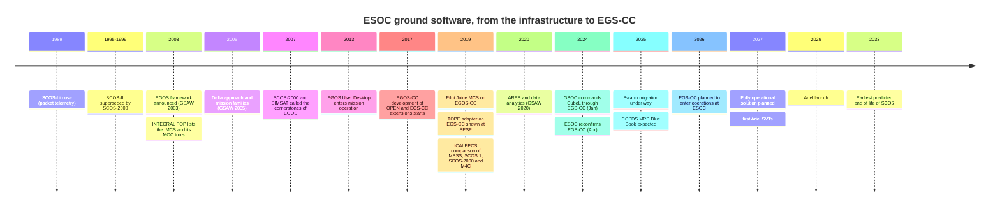
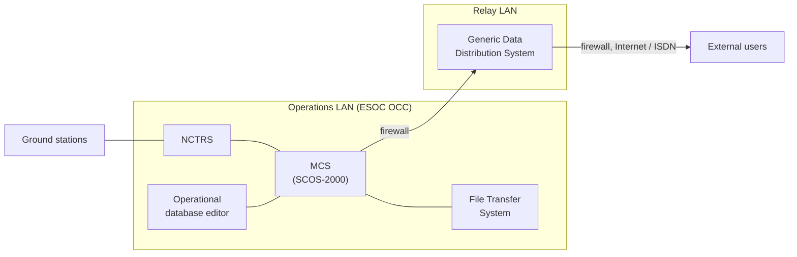
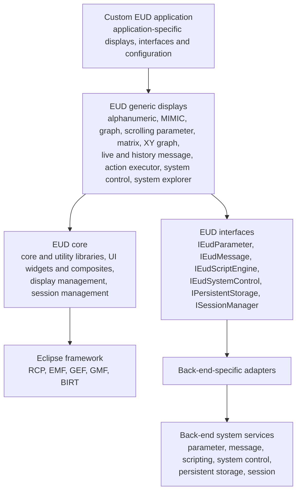
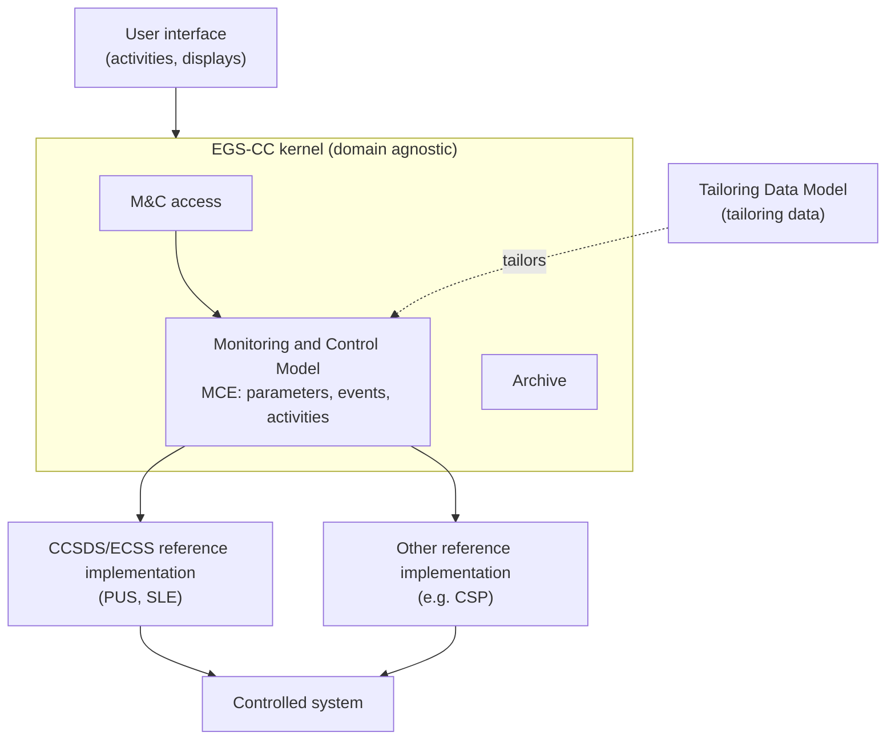
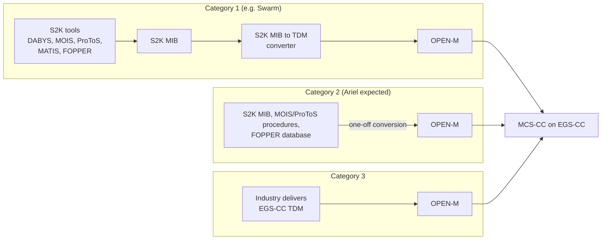
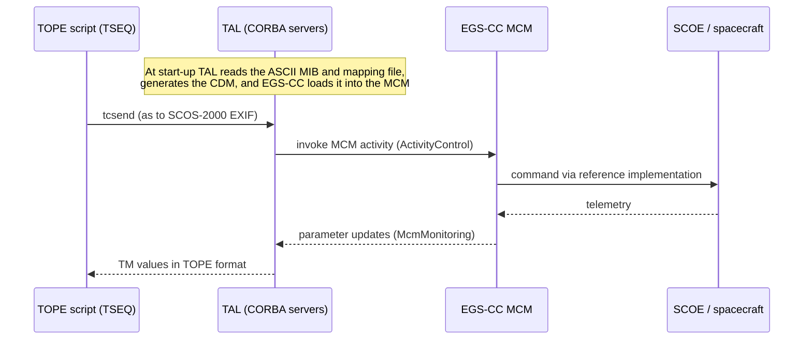

# Ancillary systems, MICONYS and the move to EGS-CC

[SCOS-2000](index.md) never worked alone. At the European Space Operations Centre (ESOC) it
sits in a family of reusable ground software, branded **EGOS** from 2003 and presented in 2005
as the "ESOC software infrastructure". Around the SCOS-2000 kernel are a network
router ([NCTRS](nctrs-nis.md)), data dissemination ([GDDS](gdds-and-ddids.md),
[TDRS](tdrs.md), [EDDS](edds.md)), [archives](archives.md), data analysis (MUST, then ARES),
tools that manage tailoring data and procedures (DABYS, MOIS, ProToS, FOPPER), automation
(MATIS) and a desktop framework (EUD). ESOC's 2025 paper calls SCOS-2000 and its complementary
systems the **MICONYS** suite of generic products, and announces its replacement by a system
built on the **European Ground Systems Common Core (EGS-CC)**.[^so25-abs][^gsaw05-infra][^so25-cat][^santos-ares][^sdd-egos]

This page follows that story from the 2005 infrastructure picture to the 2025 migration
plan. It explains what each ancillary system does as far as the sources say, shows the tool
set of one ESOC mission (INTEGRAL, 2003) and the selection made by a consortium-run mission
outside ESOC (CHEOPS, 2025), describes the EGOS User Desktop that became the common face of
these systems, then explains how EGS-CC differs from SCOS-2000, how ESOC extends and adapts it
(EGOS-CC), and what happens to the [MIB](../mib/index.md) on the way. It ends with three
neighbouring developments: a GSOC concept for small satellites on EGS-CC, the CCSDS Mission
Product Distribution services compared with EDDS, and the web framework that turns payload
requests into command request files. The tools that prepare the tailoring data (databases,
procedures, displays) have their own page, [operations preparation](operations-preparation.md).

!!! info "At a glance"
    * **2005**: SCOS-2000, NCTRS, GDDS, TDRS/WebRM and reused mission tools form the ESOC
      software infrastructure; new mission control systems are specified as a "delta"
      against it, and mission families add a kernel layer.[^gsaw05-infra][^gsaw05-delta]
    * **2013-2014**: the EGOS User Desktop (EUD), a Java and Eclipse RCP framework, enters
      mission operation and becomes the replacement GUI of SCOS-2000, SIMSAT, NIS and FARC.[^eud-what][^eud-stat]
    * **2017-2019**: the EGOS-CC project designs ESOC's EGS-CC based products and builds a
      pilot Juice MCS; GMV runs SCOS-era TOPE procedures on EGS-CC.[^airb-prog][^tope-intro]
    * **2019**: ESOC compares its four control-system generations; M4C, built on EGS-CC, is to
      provide features equivalent to "SCOS-2000 and its complementary systems".[^ical-gen]
    * **2020**: ARES, an evolution of MUST, is ESOC's off-line analysis and multi-mission
      storage system, with a Python library, novelty detection and a dependency finder.[^santos-ares]
    * **April 2024**: ESOC reconfirms EGS-CC as the basis of its next MCS; Swarm is the pilot
      migration, Ariel the first mission to launch on it.[^so25-ms][^so25-phases]
    * **2033 at the earliest**: predicted end of life of SCOS, after a transition of at least
      7 years for more than 40 missions.[^so25-need]



The dates come from the sources cited in the sections below.[^gsaw03-hist][^gsaw03-ll][^int-title][^gsaw05-infra][^b130-egos][^eud-what][^airb-prog][^tope-intro][^ical-gen][^santos-ares][^csp-pass][^so25-ms][^so25-phases][^so25-need][^so25-way][^mpd-concl]

## The ESOC software infrastructure (2005)

### Reuse as a strategy

At the 2005 Ground System Architectures Workshop (GSAW, 1-3 March 2005), ESOC described its
approach as maximum reuse of experience, procedures, software and operations concept.
Reuse cuts cost, because a new mission develops and maintains only a small amount of code,
and cuts risk, because the reused software has already been validated by earlier
missions.[^gsaw05-reuse] The reuse rests on two bases. The first is design: mission control
components built expressly for reuse, mission needs designed in a generic way, and
harmonised spacecraft design in everything that affects the ground segment. The second is
standards: CCSDS packet TM/TC (see [Space Packet](../ccsds/space-packet.md)), the ECSS
[Packet Utilisation Standard](../ecss/pus/index.md), [Space Link Extension](../ccsds/sle/index.md)
and XML.[^gsaw05-bases]

### The components

The 2005 presentation lists the infrastructure as follows:[^gsaw05-infra]

| Component | Role in 2005 |
|---|---|
| SCOS-2000 (Spacecraft Control and Operations System) | Distributed client-server system with the generic services for TM reception and processing, TC uplink and verification, data archiving, display and retrieval |
| NCTRS (Network Control and TM/TC Router System) | Interface between the mission control system and the ground station network, using SLE for non-ESA stations; see [NCTRS and NIS](nctrs-nis.md) |
| GDDS (Generic Data Disposition System) | Data distribution to external users; see [GDDS](gdds-and-ddids.md) |
| TDRS (Telemetry Data Retrieval Services) and WebRM | Web-based live telemetry, command verification, telemetry retrieval and statistics for external users such as payload owners; see [TDRS](tdrs.md) |
| File Transfer System | Reused from XMM |
| Mission Planning System | Reused from Envisat |
| Database editors | Reused from Cryosat |

The last three are examples of software that started as a mission-specific need but was
designed generically enough to be reused. The ground segment scenario slide of the same
talk places the operational database editor, the MCS (SCOS-2000), NCTRS and the file
transfer system on the operations LAN, the GDDS behind firewalls on a relay LAN, and
external users beyond the Internet or ISDN.[^gsaw05-scen] The redrawing below follows the
component labels of that slide.



!!! warning "Inference"
    The arrows and the grouping are this wiki's reading of the slide's labels, which the
    text extraction preserves only as a list. The slide itself does not describe the data
    flows.

### The delta approach and the requirement sets

The **delta approach** means that MCS requirements are no longer written in full but only as
differences from the infrastructure, typically SCOS-2000. The talk lists the benefits: a slim
requirements document, more detail from an early phase, clear identification of new
developments, and better cost and risk estimates. The approach carries through the life
cycle. Design is a delta as well, with interfaces kept untouched where possible. Testing
focuses on mission-specific features, because several missions test the common software at
the same time. In maintenance, the SCOS-2000 kernel is maintained under separate
arrangements, so each mission maintains only its own part.[^gsaw05-delta] The page on
[SCOS-2000](index.md#mission-families-and-the-delta-approach) shows the resulting layering.

Missions with similar profiles need similar features that are not generic enough for
SCOS-2000. These are grouped into a **family kernel**, a software layer on top of SCOS-2000,
so the saving applies twice.[^gsaw05-fam] In 2005 ESOC named three families: Earth Explorer
(low Earth orbit, short visibility periods), planetary (long propagation delay, on-board
autonomy) and observatory (long visibility, proposal-based observations).[^gsaw05-fam2] The
2007 ESA Bulletin names four families in use at ESOC, with slightly different labels:
interplanetary, Earth observation, observatory, and navigation (typically a constellation in
medium Earth orbit).[^b130-fam]

For the Earth Explorer family the talk sorts requirements into five sets:[^gsaw05-sets]

| Set | Meaning |
|---|---|
| (a) | SCOS-2000 requirements, fully reusable by any Earth Explorer mission |
| (b) | Earth Explorer kernel requirements, common to all missions of the family |
| (c) | Mission-specific requirements, used by only one mission |
| (d) | Requirements implemented by one mission but common to others: candidates for moving into the family kernel |
| (e) | Requirements implemented in the family kernel but common to other families: candidates for moving into SCOS-2000 |

The heritage slide gives 680 kernel requirements and 35, 42 and 115 mission-specific
requirements for Cryosat, GOCE and Aeolus, 872 in total for the family.[^gsaw05-her] (At
definition phase the counts had been 406, 129 and 57 kernel requirements; the
[SCOS-2000 page](index.md#mission-families-and-the-delta-approach) reproduces that table.)

The missions also contributed functions to the kernel. Several were marked as already moved,
or as candidates for moving, into SCOS-2000:[^gsaw05-contrib][^gsaw05-contrib2]

| Mission | Contributions to the Earth Explorer kernel |
|---|---|
| Cryosat | Off-line database editor and consistency checker (\*); command subsystem extension with command and parameter identifiers (\*); playback telemetry processing with command verification (\*); mission planning system; file transfer system; scheduler, standing order and polling tool; bad time quality handling configurable per virtual channel; on-board software maintenance with fully configurable memory devices and range checks; on-board queue dump processing with automatic generation of delete commands; XML syntax for all ground segment interface files; prime and backup real-time servers with an off-line archive server |
| GOCE | Mission planning enhancements (multiple planning files); telemetry data gap identification; task parameter files with multiple sequences and microseconds; automatic telemetry replay; time correlator |
| Aeolus | Weekly consolidation of playback telemetry; on-board software management enhancements (configuration control through sequences in the central file archive); orbital coordinates in planning and commands; automatic schedule execution in the network interface system (NCTRS) |

(\*) marks items flagged on the slide as already moved or candidate for moving into SCOS-2000.
The development workspace was a single, highly configurable system with a separate
installation per mission, strong configuration control, isolation of kernel requirements and
a requirement review at each delivery.[^gsaw05-ws] The conclusions stress that ground
segment teams should take part in the design of the satellite TM/TC, because harmonised
TM/TC data types, structures and services across similar satellites save cost in the
MCS.[^gsaw05-concl]

### One mission's tool set: the INTEGRAL MOC (2003)

The infrastructure lists above are ESOC's view. INTEGRAL's Flight Operations Plan, Volume 1
(issue 2, 21 February 2003), gives a mission's view of the same period: the elements its mission
operations centre (MOC) used to run the satellite, and who was responsible for each.[^int-title][^int-gs]
How the FOP's structure compares with the mission operations plan of ECSS-E-ST-70C is shown on
[ECSS-E-ST-70C](../ecss/e-st-70c.md#a-real-flight-operations-plan-integral).

| MOC element (FOP Vol. 1) | What the FOP says about it |
|---|---|
| INTEGRAL Monitoring and Control System (IMCS) | The control system. Developed under the responsibility of the ESOC unit TOS-GMC, finally accepted by the flight control team (FCT), kept under a maintenance contract with its developer for late satellite changes and malfunctions[^int-gs][^int-tools] |
| Timeline Generation System (MPS) | Part of the IMCS[^int-gs] |
| Mission Archive & Data Distribution System (MADDS) | Part of the IMCS[^int-gs] |
| Flight Dynamics System (FDS) | Developed and maintained by TOS-GFO, which gave the FCT a subset of flight dynamics functions for the operations allocated to it[^int-gs][^int-tools] |
| Offline Performance Analysis System (PAS) | Listed only[^int-gs] |
| On-Board S/W Maintenance System (OBSMS) | The prime tool to control and verify new or modified on-board software images; responsibility passed to the MOC after commissioning, and no maintenance contract was foreseen[^int-gs][^int-tools][^int-cr] |
| INTEGRAL Overall Simulator (IOS) | Developed under the responsibility of TOS-GMS, tested before launch, under a maintenance contract with its developer[^int-gs][^int-tools] |
| INTEGRAL Security Distribution System (ISDS) | Listed only[^int-gs] |
| [NCTRS](nctrs-nis.md) | Part of the MOC hardware and software under ESOC's standard configuration control, like the IMCS and the FDS; every modification approved by the Spacecraft Operations Manager (SOM)[^int-cc] |

The FCT was supported by ESOC units for ground system control, station equipment and control,
communications, data processing, flight dynamics and computer systems.[^int-team] The ESOC
organisation chart in the same volume places "Mission Control Systems" (TOS-GC), "Mission
Support" (TOS-GM), "Flight Dynamics" (TOS-GF) and "Station Systems" (TOS-GS) under Ground Systems
Engineering (TOS-G), and the ground facilities operations, the flight operations and the
Villafranca and Redu stations under Mission Operations (TOS-O).[^int-org] How the unit codes in
the text (TOS-GMC, TOS-GMS, TOS-GFO) relate to the divisions of the chart is not stated in the
available sources.

ESOC's own GSAW 2003 slide of INTEGRAL as an "S2K based MCS" shows the same elements around the
IMCS (the IOS, the NCTRS, the timeline generator MPS, the FDS, the on-board software maintenance
system, PAS and ISDS), with two differences of naming: PAS is the "Offline Evaluation System" on
the slide but the "Offline Performance Analysis System" in the FOP, and where the FOP names
MADDS the slide shows an operations archive with a long history file and mission archive
CD-ROMs (see [other missions](../missions/other-missions.md#integral)).[^gsaw03-int][^int-gs]
The FOP itself never names SCOS-2000; the identification comes from that slide and from the R2.0
release plan of 2000 (see [SCOS-2000](index.md#integral-and-cheops-two-operator-views)).

!!! warning "Inference"
    The INTEGRAL list maps onto the later EGOS vocabulary: MPS onto mission planning, MADDS onto
    the generic data disposition and archive products, IOS onto the SIMSAT simulator
    infrastructure and NCTRS onto NCTRS/SLE; OBSMS has no counterpart in the 2003 EGOS list.
    The FOP describes the elements as INTEGRAL systems and does not say which of them were generic ESOC products.[^int-gs][^gsaw03-egos]

## EGOS: the name for the whole

In 2003 ESOC presented a new framework, **EGOS**, as a family of products following the
SCOS-2000 approach. The list then covered ground systems test and validation (GSTV), a
multi-mission configuration control manager (MCCM), ground systems monitoring and control
(GSMC), NCTRS/SLE, the SIMSAT simulator infrastructure, generic file transfer (GFTS) and data
disposition (GDDS), operations preparation (OPS), advanced data analysis (ADAS), automated
procedure execution (APES), an archive (EVA), EGSE, mission planning (MPS), a TM and TC
baseband system (TMTCS) and flight dynamics (FDS).[^gsaw03-ll][^gsaw03-egos] In 2007 the ESA
Bulletin described EGOS as an extensive suite of applications, middleware and lower-level
components covering mission control, simulator infrastructure and ground station
"back-end" software, with SIMSAT and SCOS-2000 as cornerstones.[^b130-egos]

The sources expand the acronym in several ways:

| Expansion | Source |
|---|---|
| ESA Ground Operations Software system | GSAW 2003[^gsaw03-ll] |
| ESA Ground Operations Software | ESA Bulletin 130 (2007)[^b130-egos] |
| ESA Ground Operation System | EDDS glossary (2017); SpaceOps 2025 MPD paper[^glo-acr][^mpd-acr] |
| ESA Ground Operations System | EGOS-CC paper, acronym list[^pecc-acr] |
| European Ground Operation System | EGOS-CC paper, body text: "the brand name for the ground data systems infrastructure applications managed at ESOC"[^pecc-egoscc] |

## MICONYS: the mission control product suite

ESOC's 2025 paper defines **MICONYS** ("MIssion COntrol SYStem" in its acronym list,
"MIssion CONtrol sYSstem" in its abstract) as SCOS-2000 plus the
complementary systems that form a suite of generic products. These products "have
significantly evolved over time" and are a mature baseline, but SCOS-2000 shows signs of
obsolescence that "can no longer be ignored".[^so25-abs] The earlier EGOS-CC paper expands
MICONYS as "Mission Control System infrastructure".[^pecc-acr] The suite is not listed in
one place in the sources. The table collects the ESOC products that the sources name next to
SCOS-2000 and what they say about each; which of them formally belong to MICONYS is not stated
in the available sources.

| Product | Expansion as printed | What the sources say |
|---|---|---|
| SCOS-2000 (S2K) | Satellite Control and Operation System[^so25-acr] | The kernel: TM/TC processing, archiving, displays (see [architecture](architecture.md)) |
| MOIS | Mission Operations Information System.[^so25-acr] | Used to manage flight control procedures of category 1 missions; OPEN-M can replace it[^so25-cat] |
| ProToS | Procedure Tool Suite (written "ProTos")[^so25-acr] | Procedure management at ESOC (category 1); at GSOC a procedural tool suite developed and maintained by GSOC to define, edit, validate, version and execute procedures through the GECCOS API, and to automate activities[^so25-cat][^csp-protos] |
| MATIS | Mission Automation System[^so25-acr][^glo-acr2] | Tool of the S2K generation; OPEN-M replaces its preparation part, while automated execution is native in EGS-CC[^so25-cat] |
| DABYS | DAtaBase sYStem[^so25-acr] | One of the "S2K MIB database management tools" kept by category 1 missions[^so25-cat] |
| FOPPER | Not expanded in the available sources | Listed among the S2K generation tools; its database is converted to OPEN-M for category 2 missions[^so25-cat] |
| OPEN / OPEN-M | Operations Preparation ENvironment[^so25-acr] | The EGS-CC era preparation environment and its mission operations extension (see below)[^airb-open] |
| EDDS | EGOS Data Dissemination System (EDDS documents); EGOS Data Disposition System (MPD paper)[^glo-acr][^mpd-acr] | Data dissemination to users from PARC, DARC, SMON, FARC and SCOS-2000; see [EDDS](edds.md)[^sdd-egos] |
| MUST | Mission Utility & Support Tool (EDDS glossary); "Mission Utility Support tools" (GSAW 2020); "Mission Utility and Support Tools" (CHEOPS paper)[^glo-acr2][^santos-ares][^ch-must] | Server/client analysis tools: a parameter archive built from scheduled historic packet requests to the MCS, with analysis clients;[^srs-must] still used by CHEOPS in 2025, with WebMUST, fed by SCOS-2000 RAPID files (see [below](#a-consortiums-selection-cheops-2025))[^ch-must] |
| ARES | Analysis and Reporting System (GSAW 2020); Operational Data Off-Line Analysis, Correlation and Reporting System (EDDS glossary)[^santos-ares][^glo-acr] | Off-line data analysis system, an evolution of MUST (see below) |
| EUD | EGOS User Desktop[^glo-acr][^eud-what] | Java and Eclipse RCP client framework on which ARES and the EDDS client are built; replacement GUI for SCOS-2000, SIMSAT, NIS and FARC by 2014 (see [below](#eud-the-common-user-interface-2014))[^santos-ares][^sum-eud][^eud-stat] |
| REALS | EGOS Remote Alert System | Generates alerts for on-call staff; EGOS-CC adds an adapter that writes REALS alert files[^airb-t1] |

!!! note "Mission Information Base or Database"
    The two SpaceOps 2025 papers, by ESOC (#477) and by Starion with ESA (#141), expand MIB as
    "Mission Information Database".[^so25-acr][^crf-acr]
    The DLR paper and the EGOS-CC paper use "Mission Information Base".[^csp-acr][^pecc-acr]
    Both refer to the same SCOS-2000 tailoring data described on [the MIB](../mib/index.md).

### MUST and the data products

The EDDS requirements (issue 18.0, 2018) describe the three "current" dissemination
subsystems on which the EDDS requirements are based: TDRS (parameter extraction from fixed-length packets in the SCOS-2000
history files, results as MVDA or spreadsheet files), WebRM (remote monitoring through
CORBA-based injection and provision servers, with SCOS-2000-like displays), and the generic
DDS (web and FTP front ends serving continuous, file and catalogue data). These "do not
perform any analysis". A fourth, prototype subsystem, MUST, gave input to EDDS: its server
keeps a parameter archive filled by scheduled historic packet requests from the MCS, and its
clients analyse those parameters. EDDS was required to offer a similar TM parameter
interface so that "MUST like clients" could be supported.[^srs-must]

MUST outlived the prototype stage. In 2025 the CHEOPS team uses MUST and its web interface,
WebMUST, for telemetry visualisation and trend analysis "as alternatives to SCOS-2000, which is
limited in certain functionalities". The tool was first implemented at ESOC and later
transferred to INTA and the University of Bern "due to maintenance considerations"; the
operations and instrument teams now run and maintain it with support from the company Solenix.
Its database is updated with RAPID files generated by SCOS-2000, and periodic trend analyses use
the Python MUSTLink API, which authenticates against the server and splits large requests into
pages to avoid overloading it.[^ch-must]

## EUD: the common user interface (2014)

At GSAW 2014 ESOC presented the **EGOS User Desktop (EUD)**, a framework for building rich-client
graphical user interfaces and an integration platform for GUI components, aimed primarily at
ground data systems. ESA called it the basis of its new generation of user interfaces at ESOC; it
had been in mission operation since 2013.[^eud-what] It belonged to a wider modernisation of the
ground data systems infrastructure, motivated by obsolescence of existing implementations,
removal of dependencies on COTS products and cost reduction through reuse, with four objectives:
state-of-the-art open-source technology, platform independence (Linux and Windows), shared
implementations across systems and domains, and a harmonised look and feel.[^eud-bg] Obsolescence
and cost are also the reasons ESOC later gives for moving to EGS-CC (see
[below](#why-scos-2000-has-to-be-replaced)).

EUD is written in Java on the Eclipse Rich Client Platform (RCP; the expansion is the CHEOPS
paper's),[^ch-rcp] uses only open-source software and runs on several operating systems. Its unit of integration is the **display**, technically an
Eclipse RCP view or editor plug-in: standard RCP views run unchanged, and an extended view base
class gives access to EUD facilities. On top come eleven common displays, an extended widget
library, standard interfaces through which displays receive data, and adapters that connect to
each back end.[^eud-ov] The architecture slide stacks these as follows:[^eud-arch]



The status in February 2014 shows how far EUD had spread across the ESOC products named on this
page:[^eud-stat]

| Status (Feb 2014) | Systems |
|---|---|
| Replacement GUI for an existing system | SCOS-2000, SIMSAT, NIS, FARC |
| New developments on EUD | ARES, GSMC, FIDES, GSSC, MPSF and others |
| Ongoing | MATIS, SPMON |
| Planned | GFTS, DARC, DABYS |
| In operation | The EUD Telemetry Desktop (EUD-TMD) for Gaia |

The framework was described as mature since 2011, and "the majority" of ground-system GUIs were
EUD based.[^eud-stat] An Offline Display Development Environment (ODDE) prepared displays, and the
display definition files were cross-compatible between ODDE, the MCS, SIMSAT, ARES and GSMC.
Further benefits claimed were very positive user acceptance, reduced learning effort, features
added for one application becoming available to all, and no licence cost.[^eud-odde][^eud-ben]
Plans included a Web-EUD that runs the same code as a web application through Eclipse RAP, new
generic displays (density distribution, spectral analysis, 3D graphs) and use in more systems,
"e.g. EGS-CC". The lessons learned were that consolidating functions across domains took much
initial effort, that an agile approach was crucial, and that adapters to legacy systems can be
tedious.[^eud-fut] How EUD relates to the display definitions of the MIB and to OPEN is covered
on [operations preparation](operations-preparation.md#displays-and-user-interfaces-the-egos-user-desktop)
and [display definitions in the MIB](../mib/displays.md).

!!! warning "Inference"
    The 2014 list explains why the later EGS-CC era papers can treat the user interface as a
    shared layer: by then the GUIs of SCOS-2000, the NIS and the analysis tools were already
    built on one framework. The papers on EGOS-CC do not say whether EUD itself was carried into
    the EGS-CC-based products.[^eud-stat][^eud-fut]

## ARES and data analytics (GSAW 2020)

In March 2020 ESOC presented the state of its data analytics infrastructure. It maps ESOC's
systems onto four "big data" layers: a raw layer at full fidelity in file and folder
structures, a processing layer for distributed computation, an optimised layer of
structured data organised by use case, and a low-latency speed layer.[^santos-layers] At
ESOC, storage and infrastructure is ARES. Data accessibility (preparation, processing,
retrieval, enhancement) is provided by PyARES, the novelty detection system, the dependency
finder and long-term data preservation (LTDP) products and collections.[^santos-esoc]

### ARES

ARES (Analysis and Reporting System) is an off-line data analysis system. It evolved from
the Mission Utility Support tools (MUST) and is built on the EGOS User Desktop framework. It
mainly stores spacecraft housekeeping data in engineering format, supports generic storage
of files, parameters and events, and is optimised for fast retrieval.[^santos-ares] The
architecture slide shows an ARES client with display and database access layers, an ARES
server with a backend that reads import files from a file system, the EDDS response file,
and below them EDDS, the MCS and the DARC and PARC archives, on an ARES LAN and an operations
LAN.[^santos-ares] The demonstration slides show graphical, alphanumeric and table
displays.[^santos-disp]

!!! warning "Inference"
    The slide labels suggest that ARES is fed by EDDS response files, which EDDS produces
    from the [PARC and DARC archives](archives.md) of the MCS. The EDDS design document
    supports this reading: its appendix C discusses the "response format compatibility for
    ARES" when EDDS serves telemetry from EGS-CC instead of SCOS-2000.[^sdd-ares] The data
    path is not described in prose in the available sources.

The multi-mission shared storage answers growing volumes: Gaia, for example, receives
around 150 million unique housekeeping TM samples per day. Its goals are to remove limits on
data type and content (store all data rather than a subset, mine across missions), to scale
with stable retrieval performance, to offer high availability and redundancy, to enable
long-term data preservation, and to give all missions a homogeneous service.[^santos-mm]

### PyARES, novelty detection and the dependency finder

**PyARES** is a Python library for ARES. It offers metadata and data retrieval, processing
with user-defined functions and machine-learning jobs (random forest). It aims to "bring the
processing to the data" with PySpark and hides technologies such as Spark, HBase and
Protobuf.[^santos-pyares]

**Novelty detection** looks for unusual behaviour, which "is often the signature of an
anomaly in the way to happen". "Deep novelty" uses neural networks when a parameter's
behaviour depends on other parameters; the slide judges deep learning promising but in need
of more effort.[^santos-nov] The **dependency finder** looks for parameters whose joint
distribution is very different from the one expected if they were related only by chance. It supports training,
anomaly investigation and operations preparation. A prototype by the Artificial Intelligence
and Operations Innovation team was validated by the Mars Express flight control team.[^santos-dep]

**LTDP products and collections** combine diverse data types, preserve them with semantic
context and metadata, and federate data sources. A prototype used ARES (a Hadoop database
cluster), Elastic Search and a REST API, with a generic schema for multi-mission products,
different data types and instructions to preserve and recreate products.[^santos-ltdp] The
"examples of potential future work" were live TM stream processing, a federation with a central data portal for correlation
with science data, migration of legacy missions to Hadoop, operational AI tools for
operators, and a curated "Anomaly Detection ESA Dataset" for benchmarking.[^santos-future]

## A consortium's selection: CHEOPS (2025)

CHEOPS, the first small-class ("S-class") mission of ESA's Cosmic Vision programme, launched in
December 2019, is a case where the operations are not ESA's: the CHEOPS consortium is responsible
for all operational aspects, and its subsystems were "independently developed and tailored". The
mission operations centre (MOC) is at INTA's Torrejón space centre (CEIT) in Spain and the science
operations centre (SOC) at the University of Geneva.[^ch-intro] The MOC shows which ESOC
products a small team picked and what it built or bought instead:

| Function | What CHEOPS uses | ESOC counterpart named on this page |
|---|---|---|
| Mission control | SCOS-2000 version 5.4.2, configured through environment variables and the MIB, with a Python module library that gives automation access to "all MCS tasks"[^ch-mcs] | SCOS-2000 |
| Automation | GMV's Flyplan: schedules and runs MCS and flight dynamics tasks, Gantt display, Jython scripts, and the data-driven `monitorCHEOPS` activity that watches folders for input files[^ch-auto] | MATIS |
| File transfer | The Generic File Transfer System (GFTS) between MOC components and with the SOC, with integrity checks[^ch-auto] | GFTS in the EGOS list of 2003; GFTS planned on EUD in 2014[^gsaw03-egos][^eud-stat] |
| Flight dynamics | GMV's Focus suite (Fortran with a Java HMI) and Autofocus for automated sequences[^ch-fds] | The FDS of the EGOS list |
| Telemetry analysis | MUST and WebMUST, fed with SCOS-2000 RAPID files; MUSTLink Python API[^ch-must] | MUST, then ARES |
| Simulator | Built on ESA's Simulus 5.4 framework and the SIMSAT platform, with SLE communication to ground stations[^ch-sim] | SIMSAT |
| Packet archive | The SCOS-2000 PARC, storing TM, TC and events in a MySQL database[^ch-pass] | [PARC](archives.md) |
| Reports | SCOS-2000 executables that print displayed data, RGTgenerator for TC execution status, and HKTMreporter, a SCOS-2000 program developed for CHEOPS[^ch-post] | |
| Station scheduling | The CEIT G/S Planner, written in C# by INTA, shared with other missions of the INTA station[^ch-fds] | ESTRACK scheduling (see [NCTRS and NIS](nctrs-nis.md#booking-the-pass-estrack-scheduling-and-cross-support)) |

!!! warning "Inference"
    The third column is this wiki's mapping onto the ESOC product names used elsewhere on this
    page. The CHEOPS paper calls SCOS-2000, MUST, Simulus, NAPEOS and the Earth Observation CFI
    software ESA's; it does not say who supplies GFTS, and it does not compare Flyplan with MATIS
    or the G/S Planner with ESTRACK tools.[^ch-auto][^ch-mcs][^ch-must][^ch-sim][^ch-fds][^ch-rcp]

The MOC runs on an operational platform of two servers, three clients and a RAID-5 disk array.
Only the nominal server reads and writes the array; switching to the redundant server means
stopping all tools, moving the disk mount and restarting. The MCS, flight dynamics and automation
are client-server, with servers on both servers and clients on all clients, while the file
transfer tool runs only on the servers. A reference platform for training and validation, with
one server like the operational ones, one simulator server and one client, moved to virtual
machines in 2022 when hardware maintenance became problematic.[^ch-hw] The automation lets the
routine operations run without staff outside working hours, with 5 people at the MOC and 3 to 4
at the SOC.[^ch-concl] How CHEOPS turns its activity plan into SCOS-2000 stacks is described on
[operations preparation](operations-preparation.md#operations-preparation-in-practice-cheops),
and its pass handling on [NCTRS and NIS](nctrs-nis.md#cheops-a-pass-without-estrack-2025).

!!! note "Two different SSFs"
    CHEOPS stores CommandBuilder output in an "SSF file, an ASCII file that can be read by any
    standard SCOS-2000 using the MIB", whose telecommands are later loaded into the Auto
    Stack.[^ch-mcs] ESTRACK's service management uses SSF for the CCSDS Simple Schedule Format, a
    booking list exchanged with station providers.[^estrack-acr] The CHEOPS paper does not expand
    its SSF; that it is a saved SCOS-2000 command stack, unrelated to the CCSDS format, is this
    wiki's reading.

## Why SCOS-2000 has to be replaced

ESOC's EGOS-CC paper gives the reason plainly: the SCOS-2000-based generation "is expected to
face significant obsolescence problems in the next decade", with maintenance and evolution
costs becoming excessive. EGS-CC is the opportunity to modernise the infrastructure and its
processes.[^pecc-bg] The ICALEPCS paper of 2019, by M. Pecchioli, one of its two authors, puts it in one
sentence: the generation in operation "has been successfully used for all categories of
missions, including many commercial ones operated outside ESOC", but its implementation is
expected "to face obsolescence in the coming years".[^ical-abs] Obsolescence had already been the
first motivation of the EUD modernisation of 2014, together with removing COTS dependencies and
cutting cost through reuse.[^eud-bg]
The 2025 paper quantifies the transition. ESOC predicts at least 7
years from the moment EGS-CC first enters operations (in 2026) to the end of life of SCOS,
so no earlier than 2033. One driver is the number of missions at ESOC, above 40.[^so25-need]

## EGS-CC in brief

The **European Ground Systems Common Core** is an initiative led by ESA with European
industry. It answers a fragmented landscape: many different monitoring and control (M&C)
systems in use, often different ones for assembly, integration and test (AIT) and for
operations, with little synergy across missions and phases. Its kernel makes no
implementation or interface assumption about the controlled system, so the same core can
serve space segment and ground segment applications.[^pecc-bg][^airb-intro] The sources
describe the following building blocks:

| Concept | Meaning in the sources |
|---|---|
| Kernel | Core M&C, data handling and application support; generic and agnostic of the application domain[^csp-egscc] |
| Reference Implementation (RI) | Components that adapt the kernel to an application, for example a CCSDS/PUS mission; it may be modified or replaced[^csp-egscc] |
| Monitoring and Control Model (MCM) | A model of the monitored and controlled space system, reflecting its functional decomposition; a hierarchy of Monitoring and Control Elements (MCE)[^tope-mcm] |
| MCE aspects | Activities, events, parameters and nested elements[^tope-mcm][^csp-tdm] |
| Tailoring Data Model (TDM) | Defines the data model of the controlled system and of EGS-CC itself, allows customising the packetisation layer, and holds consistency rules[^csp-tdm] |
| Conceptual Data Model (CDM) | The EGS-CC data model that teams used to the "SCOS-2000 MIB ICD" must learn[^pecc-dis] |
| Technology | Distributed OSGi application in the Apache Karaf runtime, written in Java; "no C++, no CORBA, no SQL"[^csp-karaf][^tope-java][^pecc-dis] |
| Software Development Environment (SDE) | The prescribed tools and procedures for developing and integrating components[^pecc-dis] |

The MCM separates the abstract M&C view from the processing of the data units exchanged with
a particular controlled system. That is why the same kernel can control a spacecraft, EGSE,
ground station equipment or EGS-CC itself, with data that need not be TM/TC packets.[^tope-mcm]
An abstract aspect is mapped to an implementation aspect: a parameter to a packet, an
activity to a process.[^csp-tdm]



The diagram combines the layering described by DLR (kernel, exchangeable RI, TDM tailoring
the MCM) with ESOC's description of the M&C adaptation layer.[^csp-egscc][^csp-tdm][^pecc-ext]

### What changes for ESOC

ESOC lists the expected benefits beyond replacing obsolete software:[^pecc-ben]

* **Heterogeneous controlled systems.** SCOS-2000 was designed for spacecraft that exchange
  TM/TC with the control system according to PUS. EGS-CC adds an abstraction layer for any
  system, ground segment included.
* **Systems of systems.** Simpler tailoring, validation and deployment for composites of
  units, ground station networks, control centres, mission families and constellations.
* **Off-the-shelf reuse.** A component and interface based design in which applications are
  built without modifying the infrastructure ("binary compatibility").
* **Simpler operations concepts.** Today's operations work at the level of single
  telecommands and parameters; the abstraction layer allows higher-level interactions that
  are easier to automate.
* **Cross-fertilisation.** Space segment and ground station teams use different tools and
  life cycles today; a common data model is to harmonise them.

The paper is equally clear about what the new generation must match: the functional scope of
the current systems (thousands of user and software requirements), their usability,
performance, the teams' expertise and their operational maturity.[^pecc-eng] Instead of a
"flat specification", ESOC built a hierarchical functional model of the whole infrastructure
and used it for a **functional gap analysis**: which functions EGS-CC supports natively,
which need extensions, and which can be dropped as conflicting with EGS-CC concepts. The
result is a "delta specification" again, now against EGS-CC. Reusing an existing application
instead of a new extension was chosen only when it clearly minimised total cost without
harming long-term maintainability.[^pecc-eng2]

The same paper calls the change disruptive, in seven respects:[^pecc-dis]

| Area | What changes |
|---|---|
| Terminology | A newly agreed EGS-CC vocabulary that all teams must adopt |
| Engineering culture | EGS-CC is reused as a "black box" third-party product; SCOS-2000-based MCSs assumed full freedom to modify the infrastructure |
| Tools and processes | Model-based engineering, component and interface based design, layered validation and automated V&V in a prescribed SDE |
| Technology | A modern stack without C++, CORBA or SQL, which changes the expertise needed |
| Data model | Teams know the "SCOS-2000 MIB ICD" in detail; the EGS-CC CDM defines similar data types with a largely different approach and semantics, and definitions are expected earlier in the spacecraft development |
| External interfaces | Few interfaces are standardised; EGS-CC supports many natively, but differently |
| Approach to operations | Model-based operations through the MCM, already practice for ESA ground station operations, a "very significant change" for spacecraft operations |

## EGOS-CC: ESOC's EGS-CC based infrastructure

### Decomposition

ESOC named its EGS-CC based generation of applications **EGOS-CC**.[^pecc-egoscc] Both ESOC
papers decompose it into the same layers:[^pecc-dec][^airb-dec]

| Layer | Content |
|---|---|
| Development Environment | Tools for developing, integrating and validating EGS-CC components and applications; in 2019 based on the EGS-CC SDE |
| Preparation Environment | Definition and management of tailoring data: M&C model, TM/TC packets, automation procedures, displays. A framework with common services (import, compare, merge, consistency checks, versions and baselines, product generation and export) and a library of editors per data type |
| Platform Baseline | Operating system and third-party stack: two Linux distributions for the back end and Windows for the front end (undated paper); SLES12 (2019 paper) |
| EGS-CC | The main M&C functions, adopted without modification |
| Extension Components | Additional features built with exactly the same approach as EGS-CC components |
| Adapter Components | Bridges to other ground systems (mission planning, flight dynamics, ancillary applications), proprietary where no standard exists |
| Ancillary Applications | Planning, schedule execution and automation at ground segment level, dissemination, analysis and reporting, on-call notification, long-term storage. Largely legacy, not built with EGS-CC practices |

Two application domains sit on top. **Mission control systems** must support many dozens of
users in parallel (especially in LEOP), "off-line operations" with very short passes or very
long propagation delays, real-time and deferred data to reconstruct the spacecraft state,
end-to-end verification of complex operations, automation across ground and space, and access
to the full mission data set. **Ground station M&C** needs fully automated planning,
scheduling and execution that can re-plan on events, shared tailoring data across equivalent
units, and both local and remote operation over very limited bandwidth.[^pecc-dom][^airb-dom]

### Products: MICONYS-CC, M4C, GSMC-CC and OPEN

The undated paper calls the products **MICONYS-CC** (the EGS-CC based mission control system
infrastructure) and **GSMC-CC** (ground station monitoring and control). Each consists of an
off-line preparation application, the Operations Preparation ENvironment (OPEN); a core
execution application based on EGS-CC plus "EGS-CC like" EGOS-CC components; and several
legacy EGOS applications for dissemination, analysis and reporting. MICONYS-CC is the basis
for full mission control systems, which add mission-specific extensions.[^pecc-egoscc]

The 2019 SESP paper calls the mission product **M4C** (Mission Control Core based on Common
Core) and the ground station product "Ground Station Monitoring and Control System based on
Common Core". M4C and GSMC-CC have a functional scope "very similar" to SCOS-2000 and to STC2 (ESOC's
ground station product), respectively. M4C can be extended for a given MCS, while GSMC-CC is
not mission-specific because ground stations are shared.[^airb-m4c][^airb-intro] Cross-domain
applications (CDAs) such as data distribution and long-term archiving stay outside the EGS-CC
run-time and are being adapted to work with both M4C and GSMC-CC and with the current S2K
and GSMC infrastructure; a separate ESOC initiative turns them into centrally managed
multi-mission services.[^airb-m4c] EGS-CC itself offers little support for preparing
tailoring data, so OPEN is a full framework, completed by **OPEN-M** for mission operations
and **OPEN-S** for ground stations. All three were to be available to the EGS-CC community
under the ESA Software Community License.[^airb-open]

The ICALEPCS paper of the same year describes M4C from the system-design side and sets it against
MSSS and SCOS-2000 (the full comparison is on
[SCOS-2000](index.md#four-generations-compared-2019)). Its main points for M4C are:[^ical-sys][^ical-perf][^ical-ctx]

* **Deployment.** "Conceptually centralised": only the user interaction layer runs remotely, in
  installation-free thin clients, while the central functions sit on separate scalable tiers
  (software-defined networks, cloud computing, cluster storage). Together with the strictly
  layered organisation, for example of system sessions, this allows multi-mission deployments in
  which missions share most mission control functions. SCOS-2000 MCSs, by contrast, run on
  dedicated physical machines.
* **Scalability.** From dedicated machines with local storage to fully shared multi-mission
  virtual data centres.
* **Components.** Each component is self-standing, with its design model, external interfaces,
  test environment and procedures, configuration data and tailoring data.
* **Extensibility.** Mission-specific functions, or changes to the behaviour of common functions,
  without source-code changes to the infrastructure, which the paper calls the design focus of
  M4C. User-defined scripts, processing routines and displays are credited to the recent
  generations in general.
* **Operations.** Any control action ("activity") can be triggered from the ground or on board,
  on delta or absolute times, events or procedures; file based operations are supported, as in
  SCOS-2000.
* **Preparation.** OPEN, an expandable Eclipse-based framework in which editors for each data
  type can be developed and integrated quickly, used in a distributed but centrally managed way.
  The paper presents OPEN as the latest step of preparation support without tying it to one
  generation.
* **Maintainability.** Portable technologies with few direct COTS dependencies, widely used
  languages with a large pool of experts, modules visible only through service interfaces,
  extension and customisation hooks, and automated production, deployment and validation of the
  operational systems. The paper names the last three of these five measures as a significant
  improvement over SCOS-2000.

### Functional extensions

ESOC identified two kinds of genuine extensions (as opposed to "ground system adapters" that
only connect EGS-CC to legacy systems such as mission planning or flight dynamics):
**Operations Services**, high-level functions for executing operations, and **M&C
Adaptation**, interfaces to the controlled system.[^pecc-ext]

Operations services:[^pecc-ops]

* **File based operations (FbO)**, in three levels: file transfer management (initiate,
  suspend, resume uploads and downloads), file store management (create folders, delete
  files, keep a ground image of the on-board store and synchronise folders), and file
  utilisation (operations specific to a file type, such as activating a loaded "TC file" and
  verifying the commands it contains). See [PUS ST\[23\] file management](../ecss/pus/st23-file-management.md).
* **On-board software management**: patch upload and verification before activation, assuming
  memory management through PUS service 6 ([ST\[06\]](../ecss/pus/st06-memory-management.md))
  but with a life cycle of memory images that does not depend on one spacecraft.
* **Automated schedule execution**: the mission planning system produces schedules for the
  spacecraft (PUS service 11, [ST\[11\]](../ecss/pus/st11-time-based-scheduling.md)) or for
  the MCS; EGS-CC only time-tags control activities, so a service is needed that starts
  activities "at the same level of abstraction as the human operator would do".

M&C adaptation, on top of the PUS-over-SLE components and SCOE adapters of the EGS-CC
reference implementation:[^pecc-ops][^pecc-ext2]

* **File based reception of TM frames**, for short-pass, high-rate missions (notably Earth
  observation) and for replaying AIT data. A manifest file describes each TM file so that
  different formats and data types can be injected without reconfiguration. The component
  plays the same role as the SLE component.
* **File exchange with the space segment**, wrapping ESA's generic implementation of
  [CFDP](../ccsds/cfdp.md): CFDP PDUs to and from TM/TC packets, files to and from the
  EGS-CC file store, and M&C of the CFDP engine.
* **Cross Support Transfer Services (CSTS)**, the CCSDS successor of SLE, which adds
  monitoring data from the ground station provider.
* **ESA ground station M&C interface**, for equipment that follows the "CORBA M&C ICD".
* **Ground system M&C adapters**, so that control centre systems become elements of the
  controlled system and are operated like any other.

### The component list of 2019

The 2019 paper lists the EGOS-CC components being developed:[^airb-t1][^airb-t3]

| Domain | Component | Purpose |
|---|---|---|
| Cross-domain | EGOS Remote Alert System adapter | Writes REALS alert files from EGS-CC M&C events and system messages |
| Cross-domain | CSTS MD provider and adapter | Provider and consumer of the CSTS Monitoring Data service |
| Cross-domain | Ground Schedule Increment loader | Loads a ground schedule increment from a file (EGS-CC only has an API) |
| Ground stations | Ground Station M&C interface | For equipment supporting the ESA Ground Station M&C ICD |
| Ground stations | ESTRACK ground station schedule interface | Receives, validates and converts ESTRACK Management System schedule files into ground schedule increments |
| Ground stations | STDM interface | Receives orbit prediction (STDM) files from flight dynamics and distributes them to station equipment |
| Mission operations | File Based Operations | The functions needed for ground-space file exchange |
| Mission operations | OBSW Management | Patch and dump images, patch upload commands, verification of the upload from TM |
| Mission operations | TM Files Ingestion | Reception and processing of TM files with frames or packets recorded at the station or received through FbO |
| Mission operations | Command Request Management | Turns command request files (CRF) from mission planning, flight dynamics and external users into EGS-CC stacks or ground schedule increments |
| Mission operations | TM Packet Interface adapter | Serves TM packets over a simple socket interface to the TM Packet Interface Library (TPL) of flight dynamics |
| Mission operations | Mission Propagation Delay | Extends time correlation to compute the one-way light time from flight dynamics OWLT files |
| Mission operations | PUS-C Service 11 | Replaces the PUS-A service 11 reference implementation for missions with PUS-C scheduling (see [PUS-A vs PUS-C](../ecss/pus/pus-a-vs-pus-c.md)) |

The ESTRACK schedule interface, a ground station operations component, connects EGOS-CC to the
network's planning, which a SpaceOps 2025 paper describes from the scheduling office's side. The ESTRACK Scheduling Office solves all
users' standing orders with the ESTRACK Planning System (EPS) into a baseline booking, and the
ESTRACK Management System web Portal (EMSP) exchanges requests and booking lists with users and
external providers, by REST or by XML files; since 2017 all new interfaces use the CCSDS Simple
Schedule Format and the draft SMURF request format. Network operations are fully automated:
each service type is linked to a scheduling template of automated tasks that turns every
allocation into an executable timeline.[^estrack-eps][^estrack-fmt][^estrack-exec] Whether the
EMS schedule files that the EGOS-CC component converts into ground schedule increments use one
of these formats is not stated in the available sources. The pass side is on
[NCTRS and NIS](nctrs-nis.md#booking-the-pass-estrack-scheduling-and-cross-support) and the
standards on [SLE service management](../ccsds/sle/service-management.md).

The engineering principles were to leave complementary systems unchanged where possible, to
treat EGS-CC as a black box (no source changes to kernel or reference implementation), to
run the EGS-CC technology on ESOC's SLES baseline, to use the EGS-CC phase C/D SDE (UML
modelling tool, version control and so on), and to apply EGS-CC's product requirements to
every extension.[^airb-eng]

### Programmatics to 2019

The EGOS-CC project proceeds incrementally: system engineering, progressive development,
integration and validation, and progressive deployment into real missions. Phase B delivered
the high-level design and specification; development of the extensions was planned to start
in the second quarter of 2017.[^pecc-prog] By March 2019 development of OPEN and the
extensions had started (in 2017), OPEN was delivered monthly to end users for evaluation, and
the first EGOS-CC components were due in the second quarter of 2019.[^airb-prog] The **Juice
MCS** (J-MCS) was the first target. A pilot J-MCS was to show stability, reliability, maturity
and functional scope before a commitment in September 2019; a pilot GSMC-CC was to lead to a
decision at the end of 2019.[^airb-prog] ESOC acted as an EGS-CC integrator, sat on the EGS-CC
engineering team, integrators' team and steering board, and, when problems blocked progress,
patched EGS-CC itself while raising the corresponding software problem reports (SPRs). Users
saw mock-ups and test sessions that ran the EGS-CC reference test facility (RTF) simulator
and the BepiColombo simulator side by side.[^airb-prog][^pecc-acr]

!!! note "Juice and Ariel"
    The 2019 paper names Juice as the first target MCS. The 2025 paper names Swarm (a flying
    mission) as the first migration and Ariel as the first mission to launch on EGS-CC. The
    outcome of the 2019 Juice decision is not stated in the available sources.[^airb-prog][^so25-phases]

## Towards EGS-CC at ESOC (2025)

### April 2024 and the Swarm pilot

In April 2024 ESOC reconfirmed that its next-generation mission control system will be based
on EGS-CC. The agreed way forward was to prepare the system first for **Swarm**, a
constellation of three satellites launched in 2013 to study Earth's magnetic field. Swarm
demands precision and reliability, its scope tests performance and scalability, and because
it is flying with its S2K system still available, the transition can proceed "at no risk" as
confidence grows.[^so25-ms][^so25-swarm]

The paper lists the expected benefits: shared modernisation cost for pre- and post-launch
systems (EGSE and MCS) in Europe; a common data model across pre- and post-launch phases;
exchange of ancillary applications (procedure preparation, scheduled automation, data
analysis) across organisations; one code base for many ESOC missions; one solution for both
mission control and ground station M&C; native automation; common operations and tailoring
data across missions; installation-free web access; and the automatic testing approach of
EGS-CC.[^so25-ben]

### Phases of adoption

| Phase | Content | Status in 2025 |
|---|---|---|
| Design and development | Components that extend EGS-CC, and the IT infrastructure | Largely completed |
| Testing and validation, step 1 | Migrate a legacy mission: Swarm, including all auxiliary systems, procedures and IT needed for EGS-CC operations | Current phase |
| Testing and validation, step 2 | Prepare a mission to launch on EGS-CC: Ariel, first SVTs in 2027, launch in 2029 | Planned |
| Testing and validation, step 3 | Prepare a ground segment native in the EGS-CC TDM, no longer relying on the S2K MIB format | Planned |
| Operational roll-out | Roll out MCS-CC and move selected missions, starting in parallel after the Swarm scenarios are re-run successfully | To complete in the early 2030s |

The table restates the phase list of the 2025 paper.[^so25-phases] MCS-CC (Mission Control
System based on EGS-CC) is the name of the layer of MCS-specific components on top of EGS-CC.[^so25-acr][^so25-recent]

### What happens to the MIB: three categories

The 2025 paper warns that the impact of moving to another data model for tailoring data
"must not be underestimated". Each mission belongs to one of three categories; missions move
into category 1 or 2 as the roll-out progresses, and new missions native in the TDM are
category 3. All three use EGS-CC.[^so25-cat]

| Category | Tailoring data | Tools | Example |
|---|---|---|---|
| 1 | The mission keeps its native S2K MIB | MOIS, ProToS, MATIS, DABYS and FOPPER keep managing TM/TC database and procedures. OPEN-M sits between these tools and the MCS, and an **S2K MIB to EGS-CC TDM converter** imports the data. OPEN-M can optionally take over procedures (replacing MOIS and ProToS) and MATIS and FOPPER, while the MIB stays managed as before. A category 1 mission need not move to category 2 | Swarm |
| 2 | Formerly an S2K MIB mission, fully migrated to EGOS-CC formats | Converters (S2K MIB, MOIS and ProToS procedures, FOPPER database), already developed, move everything into OPEN-M, which replaces MOIS, MATIS preparation, ProToS, FOPPER, DABYS and other S2K MIB tools | Ariel expected (to be confirmed) |
| 3 | Received directly in EGS-CC TDM format from industry | No S2K MIB converter; all tailoring data, flight control procedures included, managed in OPEN-M; normally the case for missions using EGS-CC also for AIV | New missions |



The flowchart restates the category descriptions; the paper's own figures (data model
categorisation, Swarm tailoring process) are not reproduced here.[^so25-cat] The difference
between categories 2 and 3 lies only in the converters, which constrain the initial data to an
"S2K-like use" of the EGS-CC formats.[^so25-cat]

!!! example "How big is an S2K MIB that a converter must carry?"
    The public Solar Orbiter MIB of 16 September 2025 is an example of the S2K MIB format that
    category 1 and 2 missions bring with them. It holds 126 745 monitoring parameters
    ([pcf](../mib/tables/pcf.md)), of which 125 161 raw, 1 582 dynamic OL synthetic and 2
    saved synthetic; 400 792 parameter locations in fixed packets ([plf](../mib/tables/plf.md))
    and 19 863 variable packet entries ([vpd](../mib/tables/vpd.md)); 11 150 TM packet
    definitions ([pid](../mib/tables/pid.md)); 5 454 commands ([ccf](../mib/tables/ccf.md))
    with 7 155 command parameters ([cpc](../mib/tables/cpc.md)) and 47 609 command element
    rows ([cdf](../mib/tables/cdf.md)); 3 404 command sequences ([csf](../mib/tables/csf.md))
    with 13 879 sequence entries ([css](../mib/tables/css.md)); 206 verification stages
    ([cvs](../mib/tables/cvs.md)) used in 10 697 command-to-stage links
    ([cvp](../mib/tables/cvp.md)); and 1 582 OL expression files.[^mib25]

    !!! warning "Inference"
        Which migration category Solar Orbiter belongs to is not stated in the available
        sources. The figures only show the scale of the tailoring data that a conversion from
        the S2K MIB format has to handle for a large ESA science mission.

??? example "SQL used (Solar Orbiter MIB row counts)"
    ```sql
    -- solo-2025-09-16.sqlite (MIB__20250916M25925PFMS001_SOL)
    SELECT * FROM vdf;                      -- 25925PFM | 20250916-CSW3.1.2_MAS7.33 | ...
    SELECT count(*) FROM pcf;               -- 126745
    SELECT PCF_NATUR, count(*) FROM pcf GROUP BY 1;   -- R 125161, D 1582, S 2
    SELECT count(*) FROM plf;               -- 400792
    SELECT count(*) FROM vpd;               -- 19863
    SELECT count(*) FROM pid;               -- 11150
    SELECT count(*) FROM ccf;               -- 5454
    SELECT count(*) FROM cpc;               -- 7155
    SELECT count(*) FROM cdf;               -- 47609
    SELECT count(*) FROM csf;               -- 3404
    SELECT count(*) FROM css;               -- 13879
    SELECT count(*) FROM cvs;               -- 206
    SELECT count(*) FROM cvp;               -- 10697
    SELECT count(*) FROM synthetic;         -- 1582
    ```

### Challenges and recent work

The hardest technical problem named is the **archive**. It must store telemetry frames,
packets, parameters, events, log messages, alarm states and control activities, balance
storage speed and volume against retrieval performance, absorb peaks and support many filter
combinations, while keeping the total cost of ownership of data down. Working in a large
community brought valuable insight but also process overhead compared with what ESOC's users
knew from SCOS. Many community issues concerned the **user interface**, so more customisation
capabilities were added while keeping common parts common.[^so25-chal]

Work in 2024-2025 focused on Swarm's key scenarios: commanding chain enhancements including
pre-release checks, playback telemetry processing, a user interface for SLE links,
performance of user interface and back end, retrieval and display of historical data, a
refurbished time correlation, on-board queue modelling, a smaller memory footprint and
usability. These went partly into EGS-CC itself and partly into the MCS-CC layer.[^so25-recent]
Next come file based operations, on-board software maintenance, security, and PUS-C for
operational use, including the Generic Operational Interface Requirements that future ESOC
missions are to support. Validation is expected to take most of 2026, leading to a fully
operational solution in 2027 in line with Ariel's 2029 launch.[^so25-way]

### EDDS on EGS-CC

[EDDS](edds.md) is one of the cross-domain applications that must work with both
generations. Its latest design document in the library (published as "v24"; the title page
reads version 25.0 of 7 March 2025, the page footers version 24.0 of 10 January 2025) adds an
**EDDS-CC** architecture. A new "ARC standalone" Java library inside the EDDS server reads batch data
(TM, TC, parameters, messages) from the EGS-CC HBase archive; unlike SCOS, EGS-CC stores all
processed data in its archive. A second data provider calls EGS-CC REST end points maintained
by the EGS-CC team.[^sdd-cc][^sdd-rest] Two mapping questions follow:

* **Domains and partitions.** SCOS uses domains and data partitions. EGS-CC segregates data
  per mission in one static *dataspace*, and per session (live, playback and others) in
  dynamic *datapartitions*. EDDS maps the dataspace to a domain and keeps datapartitions as
  partitions. There is no default partition in EGS-CC, so every EDDS-CC request must name
  both.[^sdd-ds]
* **Telemetry fields.** An EGS-CC TM report lacks several fields that S2K reports carry,
  which could affect ARES. Available fields include APID, packet ID, generation and
  Earth-received times, time quality, source sequence counter, PUS type and subtype,
  spacecraft and virtual channel IDs, route, body and datapartition. Missing are, among
  others, the database version, ground station, SLE service ID, SPID, PI1/PI2, packet length
  and mnemonic. It was agreed to map the [SPID](../mib/tables/pid.md) to the packet ID.[^sdd-ares]

!!! note
    Appendix D of the EDDS design document first says that datapartitions are kept as
    datapartitions, then summarises the mapping as "domain and dataspace". The first reading
    matches the rest of the appendix.[^sdd-ds]

## Running SCOS-era procedures on EGS-CC: TOPE

ESA uses two flavours of SCOS: SCOS-2000 for operations at ESOC, and SCOS-EGSE at ESTEC,
which includes **TOPE** (test procedure, preparation and execution) for automation
procedures. Repositories of TOPE procedures and engineers who want to keep using TOPE exist;
migrating them to the EGS-CC automation language was expected to be "far from trivial". With
ESA, GMV therefore built adapters that migrate existing MIB databases to EGS-CC and run TOPE
scripts on top of it. They were deployed with a development version of EGS-CC in the Avionics
Test Bench (ATB) at ESTEC, one of the earliest EGS-CC deployments.[^tope-intro]

TOPE extends Tcl with AIV commands. They follow four patterns: synchronous calls (fetch a
parameter, write the system log, patch database commands), asynchronous subscriptions to TM
packets and parameters that appear as Tcl variable updates, synchronous calls with
asynchronous progress (`tcsend` to the spacecraft or a SCOE, `callasync` for child
sequences), and local helper commands (waits, logging, conversions).[^tope-over] In the ATB
Real-Time Bench, TOPE lives in the TSEQ subsystem: one TOPE interpreter per test sequence,
the TSVR server coordinating parallel instances, TEXEC (monitoring GUI, log viewer, debugger)
and TPREP (editor and consistency checker). TSEQ talks to SCOS-2000 through **EXIF**, the
CORBA-based external interface module of the SCOS-2000 kernel, which injects events,
parameters or commands and provides telemetry, packets, events and command history.[^tope-over][^tope-exif]

The **TOPE Adaptation Layer (TAL)**, developed in ERFEC (the EGSE reference facility in the
EGS-CC context), replaces EXIF. It implements CORBA servers compliant with the existing
TSEQ/SCOS-2000 IDL files, so TSEQ needs no change, and translates in both directions. On the
EGS-CC side it consumes the M&C access API (activity, parameter, event control; parameter
and event injection; MCM access, name translation, monitoring and element registration), M&C
definition management, messaging and system configuration.[^tope-tal][^tope-svc]



At start-up TAL receives, through EGS-CC configuration, the path of the ASCII MIB files and of
a file mapping MIB definitions to MCM definitions. It loads the MIB, generates the EGS-CC CDM
that EGS-CC loads into the MCM, and on request extracts or injects MCM parameters, activities
and events. Two constraints follow: the ASCII MIB must always be provided (the ATB used the
EagleEye mission's MIB), and TM/TC defined only in the MCM cannot be written back to ASCII MIB
files; TAL logs a warning instead.[^tope-mib] TAL was designed in UML 2 with Enterprise
Architect along the EGS-CC modelling guidelines, written in Java with JacORB, built and checked
with the EGS-CC reference SDE (Jenkins, Nexus, SonarQube), packaged as OSGi bundles running
inside an EGS-CC session, and validated with the EGS-CC Component Test Framework managed in
the Test Management System.[^tope-java][^tope-sde] GMV concludes that the approach can serve
long term or as a staged migration.[^tope-sde]

## Beyond ESOC: small satellites on EGS-CC at GSOC

The German Space Operations Center (GSOC) runs **GECCOS**, a SCOS-2000-based MCS, at the heart
of its multi-mission environment. GECCOS connects through the NCTRS protocol to an SLE switch
board and from there to a worldwide station network, and processes PUS TM/TC, so the
spacecraft must follow CCSDS and ECSS. Two elements make this work: the MIB, in which "each
single TM/TC" is defined, and the procedures. ProToS prepares and runs TC stacks through the
GECCOS API and automates activities; SATMON gives real-time and historical TM access, also
from outside the control centre.[^csp-gsoc][^csp-protos] It has become an "industry standard"
that the manufacturer delivers a MIB and procedures.[^csp-protos]

**CubeL**, a 3U CubeSat launched in early 2021 and GSOC's first small satellite, broke these
assumptions. It uses the CubeSat Space Protocol (CSP) through a manufacturer toolkit of nodes
talking over ZMQ, a command-line terminal (CSP-Term), and a UHF station. There is no MIB:
commands are functions of a C API, one operator input may trigger several CSP packets, and the
TM structure is defined in JSON. Integrating it needed a patched modem firmware, a new tool to
command over GSOC's S-band link, an auxiliary MIB for telemetry, new off-line processing,
mission planning changes and a custom automation solution.[^csp-cubel]

DLR proposes to solve such cases with an EGS-CC **reference implementation for CSP**. An
operator invokes an activity; it passes through the M&C access and MCM components to an
activity processor, a CSP component that calls the manufacturer's CSP API. The return value
of the API call becomes the activity result, and tailoring the TDM can add the CSP packet
format for TM processing.[^csp-ri] The component is a Maven project with three modules:
`csp-library` (Java bindings to the C library generated with SWIG plus JNI glue, packaged as
native code in a Karaf bundle), `csp-terminal` (a CSP node whose `CspActivityProcessingService`
implements a TDM activity and reports through EGS-CC's `IActivityReporter`), and `csp-feature`
(deployment as a Karaf feature).[^csp-design] In an experimental pass in **January 2024** GSOC
commanded CubeL through this prototype: pings to the on-board computer and TM requests to
subsystems.[^csp-pass]

The consequence for the MIB is notable. Today GSOC requires a MIB, which a CSP manufacturer
"inherently cannot comply to". With EGS-CC the requirement could shift to exposing the
manufacturer's API as EGS-CC activities and defining the TM structures in the TDM.[^csp-ri]
The ground station interface stays open: SLE and the CORTEX equipment at compatible stations
rely on CCSDS 401.0, 131.0 and 231.0 and on the [TM](../ccsds/tm-sdlp.md) and
[TC](../ccsds/tc-sdlp.md) data link protocols, so a CSP mission might instead route the RF
signal to a project-specific software modem at the operations centre.[^csp-gs]

## Mission products delivery: the CCSDS MPD services

### The standard

The CCSDS Spacecraft Monitoring and Control (SM&C) working group is standardising **Mission
Product Distribution (MPD)** services within the CCSDS Mission Operations (MO) framework,
whose Message Abstraction Layer (MAL) describes services independently of implementation and
transport, with machine-readable specifications in the SANA registry.[^mpd-intro] Cross-agency
exchange of mission products had relied on bespoke, mission-specific interfaces, "often
duplicative, fragile, and hard to scale".[^mpd-abs] MPD defines three services:[^mpd-svc][^mpd-svc2]

| Service | Operations | Pattern |
|---|---|---|
| Product Retrieval | `listProducts` (metadata filtered by type, dates, source, attributes); `getProducts` (full products through a progress interaction); `deliverProductFiles` (transfer to a URI with per-file status) | Pull, ad hoc |
| Order Management | `listStandingOrders`; `submitStandingOrder` (filter, delivery method, target, validity); `cancelStandingOrder` | Subscription set-up |
| Product Order Delivery | `notifyProductDelivery` (notification of a file transfer: metadata, file name, URI, status); `deliverProducts` (products through publish-subscribe) | Push |

The information model separates **ProductType** (name, description, attribute definitions
with type and unit), **Product** (an instance with creation and content dates, source,
attribute values, file metadata and body) and **StandingOrder** (a long-lived subscription
with filter, delivery method, validity and target). Filters are **ProductFilter** (type,
domain, sources, attributes), **TimeWindow** and **AttributeFilter** in three variants:
ValueRange, ValueSet and StringPattern.[^mpd-model] Delivery can be by service message or by
file transfer to a nominated URI, with or without notification.[^mpd-svc2]

### MPD compared with EDDS

The paper maps EDDS onto MPD:[^mpd-edds]

| EDDS concept | MPD equivalent |
|---|---|
| `batchRequest()` / `streamRequest()` | `submitStandingOrder()` |
| `getResponse()` | `notifyProductDelivery()`, `deliverProducts()` |
| `getJobs()`, `getStatus()` | `listStandingOrders()` |
| `getCatalogue()` | `listProducts()` with ProductFilter |
| FileServerDelivery, ServerDelivery | Delivery methods FILETRANSFER, SERVICE_COMPLETE |
| File metadata embedded in responses | File metadata in the ProductMetadata structure |

It describes EDDS as using a SOAP/WSDL interface with an XML schema for data requests, job
submission and tracking, catalogue queries and user management, plus a REST service. EDDS
supports push and pull like MPD and server-to-server transfers. It has no advanced metadata
search, does not normally forward live delivery notifications (job status is polled), and
uses login credentials that yield tokens, where MPD assumes MAL access control. An EDDS job
corresponds to an MPD standing order. Some EDDS product types (PktEv, PktTc, PktTm) and their
filters are specific to the data models of SCOS and EGS-CC and may need compromises.[^mpd-edds][^mpd-diff]
The paper also maps NASA AMMOS DataDrive, which is pull-oriented with CLI-only subscriptions,
and lists gaps on both sides.[^mpd-dd]

ESA and NASA JPL each built an independent prototype provider against a shared test harness
on ESA's Java MO stack, with local `file://` transfers only and no connection to EDDS or
DataDrive. The tests, derived from the draft standard, exposed naming inconsistencies,
misused nullable attributes and inappropriate field types, which were fixed in the data
model.[^mpd-proto] The specification the paper works from is the Red Book CCSDS 522.2-R-2,
"Mission Operations - Mission Data Product Distribution Services" (July 2024). At the time of
writing (2025) the standard was in the final stage of CCSDS agency review, a Prototype Report
(Yellow Book) was in preparation, and Blue Book publication was expected in Q3-Q4
2025.[^mpd-concl] Whether it was published is not stated in the available sources.

## Payload command requests: the CRF framework

At ESOC, payload requests belong to a broader concept, the **Command Request File (CRF)**,
which carries telecommands, sequences, automation procedures and mission events, collectively
called "occurrences". Payload teams of BepiColombo and JUICE submit **Payload Operations
Requests (POR)** and **Payload Direct Operations Requests (PDOR)**, subtypes of CRF in XML,
which must agree with the mission's MIB.[^crf-abs][^crf-efc] Earlier missions let each user
devise their own way of creating and delivering CRFs, which caused many iterations with the
flight control team because of MIB and ICD incompatibilities.[^crf-abs]

Under ESA's EFC2 frame contract, the Starion service team at ESAC built a centralised web
framework. For BepiColombo (launched October 2018, 7.2-year cruise, nine planetary flybys) it
is called **SPOT Cruise**; by the time of the paper it had produced more than about 1 500
payload operations requests since launch, for near-Earth commissioning, six-monthly instrument check-outs and flyby
science.[^crf-bepi][^crf-spot] Its features: COSMOS LDAP access control, a POR/PDOR editor,
**MIB compatibility checks**, e-mail notifications, full traceability, **MIB update handling
and conflict resolution**, flight dynamics and science events, product generation with direct
submission to the MOC and delivery and acknowledgement monitoring, 3D flyby visualisation,
timeline and resource simulation, search, and a MOIS-compatible procedure builder.[^crf-spot]
**SPOT JUICE** was adapted in 2021 without 3D, procedure builder and simulation, supported
ground tests, commissioning, check-outs and the Lunar-Earth gravity assist of August 2024, and
produced more than about 700 requests; HERA and ARIEL showed interest.[^crf-juice][^crf-efc]

| Capability | Purpose |
|---|---|
| CRF editing | Create and edit accurate, complete CRFs |
| Management of MIB updates | Handle MIB changes and resolve conflicts |
| MIB compatibility validation | Every CRF compatible with the MIB |
| ICD compliance verification | CRF content conforms to the operations planning ICDs |
| CRF generation and delivery | Creation, submission, delivery and acknowledgement monitoring |

The capabilities above are those summarised by the paper.[^crf-sum]

!!! warning "Inference"
    The CRF is also the input of the EGOS-CC *Command Request Management* component, which
    converts CRFs into EGS-CC stacks or ground schedule increments.[^airb-t3] A framework
    such as SPOT therefore stays useful across the move to EGS-CC, provided its MIB checks are
    applied to whatever tailoring data the MCS-CC uses. The sources do not discuss this link.

## Not stated in the available sources

* The expansion of FOPPER, and a full, authoritative list of MICONYS products.
* The data flows between ARES, EDDS and the MCS archives, beyond slide labels.
* The outcome of the 2019 pilot J-MCS decision and the reasons for moving the first
  migration from Juice to Swarm.
* The format and content of the EGS-CC TDM and CDM, and how the S2K MIB to TDM converter maps
  individual MIB tables.
* The publication status of the CCSDS MPD Blue Book after 2025.
* Which of INTEGRAL's MOC elements (MPS, MADDS, PAS, OBSMS, IOS, ISDS) were generic ESOC products,
  and how the unit codes TOS-GMC, TOS-GMS and TOS-GFO map onto the ESOC organisation chart.
* Whether EUD, or a web successor of it, became the user interface of the EGS-CC-based products.
* The commercial missions "operated outside ESOC" that the 2019 paper credits to the SCOS-2000
  generation.
* The format of the ESTRACK Management System schedule files consumed by the EGOS-CC ESTRACK
  schedule interface.

## Related pages

* [SCOS-2000](index.md) (including the [four-generation comparison](index.md#four-generations-compared-2019)),
  [SCOS-2000 architecture](architecture.md) and [SCOS-2000 as EGSE](egse.md)
* [Operations preparation](operations-preparation.md), [other missions](../missions/other-missions.md)
  and [SLE service management](../ccsds/sle/service-management.md) (ESTRACK scheduling)
* [From ESA PSS to CCSDS and ECSS](../overview/history.md), the history of the standards these
  systems implement
* [EDDS](edds.md), [EDDS request and data formats](edds-formats.md), [TDRS](tdrs.md),
  [GDDS](gdds-and-ddids.md), [archives](archives.md), [NCTRS and NIS](nctrs-nis.md),
  [time correlation](time-correlation.md)
* [The MIB](../mib/index.md), [mission tailoring of the MIB](../mib/tailoring.md),
  [MIB tooling](../mib/tooling.md) and [Herschel/Planck](herschel-planck-ground.md)
* [The Solar Orbiter MIB](../missions/solar-orbiter/mib.md) and the
  [MIB explorer](../explorer/index.md#/solo/search/NIA)

## Sources and copies

Each footnote links the library page of its source, which gives the original URL, the SHA-256
of the copy and the time of copy. The sources of this page were copied on 5 November 2026, and
the second-round additions on 12 November 2026:

| Library page | Document | Original host | Copied (UTC) |
|---|---|---|---|
| [gsaw2005-guerrucci](../library/gsaw2005-guerrucci.md) | Guerrucci et al., "Mission Families: a cost effective approach to Mission Control System development", GSAW 2005 | gsaw.org | 2026-11-05 14:12:20 |
| [gsaw2003-peccia](../library/gsaw2003-peccia.md) | N. Peccia, "SCOS-2000, ESA's Spacecraft Control for the 21st Century", GSAW 2003 | gsaw.org | 2026-11-05 13:54:32 |
| [bul130-merri-happy-families](../library/bul130-merri-happy-families.md) | Merri et al., "Happy Families", ESA Bulletin 130 (2007) | esa.int | 2026-11-05 14:10:17 |
| [gsaw2020-santos](../library/gsaw2020-santos.md) | R. Santos, "State and evolution of data analytics infrastructure at ESOC", GSAW 2020 | gsaw.org | 2026-11-05 14:12:26 |
| [pecchioli-egs-cc-esoc](../library/pecchioli-egs-cc-esoc.md) | Pecchioli and Walsh, "The EGS-CC based Mission Control Infrastructure at ESOC" (undated) | indico.esa.int | 2026-11-05 14:12:27 |
| [airdrive-b8b986f](../library/airdrive-b8b986f.md) | Walsh et al., "Developing EGS-CC based applications; the EGOS-CC experience", SESP 2019 | airdrive.eventsair.com | 2026-11-05 14:11:45 |
| [airdrive-9d40c91](../library/airdrive-9d40c91.md) | Barradas Pereira et al. (GMV), "Integrating TOPE with EGS-CC", SESP 2019 | airdrive.eventsair.com | 2026-11-05 14:11:44 |
| [spaceops2025-egs-cc](../library/spaceops2025-egs-cc.md) | Reggestad and Widegård, "Towards EGS-CC at ESOC", SpaceOps 2025 #477 | publications.spaceops.org | 2026-11-05 14:12:29 |
| [4s-2024-egscc-bruegge](../library/4s-2024-egscc-bruegge.md) | Brügge et al. (DLR), "Integrating small satellite missions into a multi-mission operations environment", 4S 2024 | elib.dlr.de | 2026-11-05 14:07:41 |
| [spaceops2025-0309-mpd-edds](../library/spaceops2025-0309-mpd-edds.md) | Marszk et al., "CCSDS Mission Product Distribution Services", SpaceOps 2025 #309 | publications.spaceops.org | 2026-11-05 14:07:07 |
| [spaceops2025-0141](../library/spaceops2025-0141.md) | de la Fuente et al. (Starion), "Optimizing Payload Operations Management through an Automated Commanding Request Framework", SpaceOps 2025 #141 | publications.spaceops.org | 2026-11-05 14:07:09 |
| [srs](../library/srs.md), [glo](../library/glo.md), [sum](../library/sum.md), [sdd-v24](../library/sdd-v24.md) | EDDS software requirements (issue 18.0, 2018), glossary (issue 7.0, 2017), client user manual and design document (file "v24", title page version 25.0, 2025) | solarorbiter.irap.omp.eu | 2026-11-05 14:01:34-14:05:49 |
| [mib-20250916m25925pfms001-sol](../library/mib-20250916m25925pfms001-sol.md) | Solar Orbiter MIB release of 16 September 2025 | solarorbiter.irap.omp.eu | 2026-11-05 14:24:03 |
| [icalepcs2019-weapp01-esa-control-systems](../library/icalepcs2019-weapp01-esa-control-systems.md) | M. Pecchioli, "Old and New Generation Control Systems at ESA", ICALEPCS 2019 (WEAPP01) | jacow.org | 2026-11-12 17:48:01 |
| [2014s12b-schutz](../library/2014s12b-schutz.md) | J. Schütz, "EGOS User Desktop: A Generic User Interface Framework for Ground Segment Software", GSAW 2014 | gsaw.org | 2026-11-12 17:52:54 |
| [fop-vol01](../library/fop-vol01.md) | INTEGRAL Flight Operations Plan, Volume 1 Mission Management, issue 2.0 (2003) | sigma2.irap.omp.eu | 2026-11-12 17:52:52 |
| [cheops-ground-segment-systems-and-automation-for-mission-and-science-o](../library/cheops-ground-segment-systems-and-automation-for-mission-and-science-o.md) | Heitzmann et al., "CHEOPS Ground Segment: Systems and Automation for Mission and Science Operations" (arXiv:2505.08352) | arxiv.org | 2026-11-12 17:52:36 |
| [spaceops-0016-estrack-deep-space-cross-support-using-ccsds-servi](../library/spaceops-0016-estrack-deep-space-cross-support-using-ccsds-servi.md) | Unal et al., "ESTRACK Deep Space Cross Support using CCSDS Service Management", SpaceOps 2025 #16 | publications.spaceops.org | 2026-11-12 17:52:56 |

[^so25-abs]: [Reggestad and Widegård, "Towards EGS-CC at ESOC", SpaceOps 2025 #477](../library/spaceops2025-egs-cc.md), abstract and §1 Introduction, PDF pp. 1-2.
[^so25-acr]: [SpaceOps 2025 #477](../library/spaceops2025-egs-cc.md), Acronyms/Abbreviations, PDF pp. 1-2. The list prints "Tailoring Data Model (TMD)", while the body uses TDM.
[^so25-need]: [SpaceOps 2025 #477](../library/spaceops2025-egs-cc.md), §1 "The Need for Transition", PDF p. 2.
[^so25-ben]: [SpaceOps 2025 #477](../library/spaceops2025-egs-cc.md), §1 "Benefits of EGS-CC Integration", PDF p. 3.
[^so25-ms]: [SpaceOps 2025 #477](../library/spaceops2025-egs-cc.md), §1 "Major Milestone: Confirmation of EGS-CC", PDF p. 3.
[^so25-swarm]: [SpaceOps 2025 #477](../library/spaceops2025-egs-cc.md), §1 "Focus on SWARM Mission", PDF p. 4.
[^so25-phases]: [SpaceOps 2025 #477](../library/spaceops2025-egs-cc.md), §2 Adoption at ESOC, PDF p. 4.
[^so25-cat]: [SpaceOps 2025 #477](../library/spaceops2025-egs-cc.md), §2 "Path towards an EGS-CC TDM based operations", categories 1-3, PDF pp. 4-5.
[^so25-chal]: [SpaceOps 2025 #477](../library/spaceops2025-egs-cc.md), §2 "Challenges and Solutions", PDF p. 6.
[^so25-recent]: [SpaceOps 2025 #477](../library/spaceops2025-egs-cc.md), §2 "Recent activities", PDF p. 6.
[^so25-way]: [SpaceOps 2025 #477](../library/spaceops2025-egs-cc.md), §2 "Way Forward", PDF pp. 6-7.
[^gsaw05-reuse]: [Guerrucci et al., GSAW 2005](../library/gsaw2005-guerrucci.md), title slide (1-3 March 2005) and slide "Reuse Strategy at ESOC", PDF pp. 1 and 3.
[^gsaw05-bases]: [GSAW 2005](../library/gsaw2005-guerrucci.md), slide "Software Reuse Bases", PDF p. 4.
[^gsaw05-infra]: [GSAW 2005](../library/gsaw2005-guerrucci.md), slide "ESOC Software Infrastructure", PDF p. 5.
[^gsaw05-scen]: [GSAW 2005](../library/gsaw2005-guerrucci.md), slide "ESOC Ground Segment Scenario", PDF p. 6.
[^gsaw05-delta]: [GSAW 2005](../library/gsaw2005-guerrucci.md), slide "The 'Delta' Approach", PDF p. 7.
[^gsaw05-fam]: [GSAW 2005](../library/gsaw2005-guerrucci.md), slides "Why Mission Families?" and "Delta Approach applied to Mission Families", PDF pp. 8-9.
[^gsaw05-fam2]: [GSAW 2005](../library/gsaw2005-guerrucci.md), slide "Mission Families at ESOC", PDF p. 10.
[^gsaw05-sets]: [GSAW 2005](../library/gsaw2005-guerrucci.md), slides "The Earth Explorer Mission Family Evolution" and "The EE Mission Family Requirements Sets", PDF pp. 11-12.
[^gsaw05-her]: [GSAW 2005](../library/gsaw2005-guerrucci.md), slides "The EE Mission Family Requirements Definition" and "The EE Mission Family Heritage Today", PDF pp. 13-14.
[^gsaw05-contrib]: [GSAW 2005](../library/gsaw2005-guerrucci.md), slide "Missions contribution to the EE Kernel (1)", PDF p. 15.
[^gsaw05-contrib2]: [GSAW 2005](../library/gsaw2005-guerrucci.md), slide "Missions contribution to the EE Kernel (2)", PDF p. 16.
[^gsaw05-ws]: [GSAW 2005](../library/gsaw2005-guerrucci.md), slide "The Development Workspace", PDF p. 17.
[^gsaw05-concl]: [GSAW 2005](../library/gsaw2005-guerrucci.md), slide "Conclusions", PDF p. 18.
[^gsaw03-hist]: [N. Peccia, GSAW 2003](../library/gsaw2003-peccia.md), slide "History of ESA control systems", PDF p. 9.
[^gsaw03-ll]: [GSAW 2003](../library/gsaw2003-peccia.md), slide "Lessons learned", PDF p. 29.
[^gsaw03-egos]: [GSAW 2003](../library/gsaw2003-peccia.md), slide "A vision for the future", PDF p. 30.
[^b130-egos]: [Merri et al., ESA Bulletin 130 (May 2007)](../library/bul130-merri-happy-families.md), introduction, PDF p. 3.
[^b130-fam]: [ESA Bulletin 130](../library/bul130-merri-happy-families.md), "Mission Families", PDF p. 4.
[^glo-acr]: [EDDS Glossary, EGOS-GEN-EDDS-GLO-0001 v7.0.0 (2017)](../library/glo.md), §4 Acronyms, PDF p. 9.
[^glo-acr2]: [EDDS Glossary](../library/glo.md), §4 Acronyms (MAS, MATIS, MUST), PDF p. 10.
[^mpd-acr]: [Marszk et al., SpaceOps 2025 #309](../library/spaceops2025-0309-mpd-edds.md), Acronyms/Abbreviations, PDF p. 1.
[^pecc-acr]: [Pecchioli and Walsh, "The EGS-CC based Mission Control Infrastructure at ESOC"](../library/pecchioli-egs-cc-esoc.md), Acronym list, PDF p. 12.
[^pecc-egoscc]: [Pecchioli and Walsh](../library/pecchioli-egs-cc-esoc.md), "EGOS-CC Products", PDF pp. 7-8.
[^pecc-bg]: [Pecchioli and Walsh](../library/pecchioli-egs-cc-esoc.md), Introduction, "Background", PDF p. 1.
[^pecc-ben]: [Pecchioli and Walsh](../library/pecchioli-egs-cc-esoc.md), "The Objectives of the EGS-CC Adoption at ESOC", PDF pp. 1-2.
[^pecc-eng]: [Pecchioli and Walsh](../library/pecchioli-egs-cc-esoc.md), "The Engineering Approach", PDF p. 2.
[^pecc-eng2]: [Pecchioli and Walsh](../library/pecchioli-egs-cc-esoc.md), "The Engineering Approach" (continued), PDF p. 3.
[^pecc-dis]: [Pecchioli and Walsh](../library/pecchioli-egs-cc-esoc.md), "A Disruptive Change", PDF pp. 3-4.
[^pecc-dec]: [Pecchioli and Walsh](../library/pecchioli-egs-cc-esoc.md), "High Level Decomposition", Figure 1 and its description, PDF pp. 5-6.
[^pecc-dom]: [Pecchioli and Walsh](../library/pecchioli-egs-cc-esoc.md), mission control systems and ground station M&C design drivers, PDF pp. 6-7.
[^pecc-ext]: [Pecchioli and Walsh](../library/pecchioli-egs-cc-esoc.md), "EGS-CC Functional Extensions", Figure 3, PDF p. 8.
[^pecc-ops]: [Pecchioli and Walsh](../library/pecchioli-egs-cc-esoc.md), "Operations Services" and "M&C Adaptation", PDF p. 9.
[^pecc-ext2]: [Pecchioli and Walsh](../library/pecchioli-egs-cc-esoc.md), "M&C Adaptation" (CFDP, CSTS, ESA ground stations M&C interface, ground systems M&C adapters), PDF pp. 9-10.
[^pecc-prog]: [Pecchioli and Walsh](../library/pecchioli-egs-cc-esoc.md), "Programmatics" and "Conclusions", PDF pp. 10-11.
[^airb-intro]: [Walsh, Pecchioli, Widegård and Lannes, "Developing EGS-CC based applications; the EGOS-CC experience", SESP 2019](../library/airdrive-b8b986f.md), Introduction, PDF pp. 1-2.
[^airb-dec]: [SESP 2019, EGOS-CC experience](../library/airdrive-b8b986f.md), "High Level Decomposition", PDF pp. 2-3.
[^airb-dom]: [SESP 2019, EGOS-CC experience](../library/airdrive-b8b986f.md), design drivers of the two application domains, PDF pp. 3-4.
[^airb-m4c]: [SESP 2019, EGOS-CC experience](../library/airdrive-b8b986f.md), "EGOS-CC Products", PDF p. 4.
[^airb-open]: [SESP 2019, EGOS-CC experience](../library/airdrive-b8b986f.md), "EGOS-CC Products" (OPEN, OPEN-M, OPEN-S, ESA Software Community License), PDF pp. 4-5.
[^airb-t1]: [SESP 2019, EGOS-CC experience](../library/airdrive-b8b986f.md), Tables 1 and 2, cross-domain and ground station components, PDF p. 5.
[^airb-t3]: [SESP 2019, EGOS-CC experience](../library/airdrive-b8b986f.md), Table 3, mission operations components, PDF pp. 5-6.
[^airb-eng]: [SESP 2019, EGOS-CC experience](../library/airdrive-b8b986f.md), "Engineering Approach", PDF p. 6.
[^airb-prog]: [SESP 2019, EGOS-CC experience](../library/airdrive-b8b986f.md), "Programmatics", PDF p. 7.
[^tope-intro]: [Barradas Pereira, Santos and del Rey (GMV), "Integrating TOPE with EGS-CC", SESP 2019](../library/airdrive-9d40c91.md), Introduction, PDF p. 1.
[^tope-over]: [Integrating TOPE with EGS-CC](../library/airdrive-9d40c91.md), "Overview" and "TOPE in ATB-RTB", PDF p. 2.
[^tope-exif]: [Integrating TOPE with EGS-CC](../library/airdrive-9d40c91.md), EXIF description, PDF p. 3.
[^tope-mcm]: [Integrating TOPE with EGS-CC](../library/airdrive-9d40c91.md), "Monitoring and Control Model", PDF p. 4.
[^tope-tal]: [Integrating TOPE with EGS-CC](../library/airdrive-9d40c91.md), "Integrating TOPE with EGS-CC", PDF pp. 4-5.
[^tope-svc]: [Integrating TOPE with EGS-CC](../library/airdrive-9d40c91.md), Fig. 5 TAL architecture and consumed services, PDF p. 5.
[^tope-mib]: [Integrating TOPE with EGS-CC](../library/airdrive-9d40c91.md), MIB definitions handling and constraints, PDF p. 6.
[^tope-java]: [Integrating TOPE with EGS-CC](../library/airdrive-9d40c91.md), "Developing for EGS-CC", PDF pp. 6-7.
[^tope-sde]: [Integrating TOPE with EGS-CC](../library/airdrive-9d40c91.md), SDE, OSGi bundles, CTF and TMS, and "Conclusions", PDF p. 7.
[^csp-acr]: [Brügge et al., 4S Symposium 2024](../library/4s-2024-egscc-bruegge.md), List of abbreviations, PDF p. 16.
[^csp-gsoc]: [4S 2024](../library/4s-2024-egscc-bruegge.md), §2.1 Established systems and standardization, PDF pp. 2-3.
[^csp-protos]: [4S 2024](../library/4s-2024-egscc-bruegge.md), §2.1 (ProToS, SATMON) and §2.2, PDF pp. 3-4.
[^csp-cubel]: [4S 2024](../library/4s-2024-egscc-bruegge.md), §2.3 Case study: integration of CubeL, PDF pp. 5-7.
[^csp-egscc]: [4S 2024](../library/4s-2024-egscc-bruegge.md), §3.1 An overview of EGS-CC, PDF pp. 7-8.
[^csp-tdm]: [4S 2024](../library/4s-2024-egscc-bruegge.md), §3.1, Tailoring Data Model paragraph, PDF p. 8.
[^csp-ri]: [4S 2024](../library/4s-2024-egscc-bruegge.md), §3.2 Defining a reference implementation for CSP, PDF pp. 8-9.
[^csp-design]: [4S 2024](../library/4s-2024-egscc-bruegge.md), §3.3 CSP component design, PDF pp. 9-11.
[^csp-karaf]: [4S 2024](../library/4s-2024-egscc-bruegge.md), §3.3, footnote 3 (OSGi application in Apache Karaf), PDF p. 10.
[^csp-pass]: [4S 2024](../library/4s-2024-egscc-bruegge.md), §4.1 Commanding CubeL with EGS-CC, PDF p. 11.
[^csp-gs]: [4S 2024](../library/4s-2024-egscc-bruegge.md), §4.4 Interface to the ground station, PDF pp. 13-14.
[^santos-layers]: [R. Santos, GSAW 2020 (3 March 2020)](../library/gsaw2020-santos.md), title slide and slide "Architecture - Big Data Layers", PDF pp. 1 and 3.
[^santos-esoc]: [GSAW 2020](../library/gsaw2020-santos.md), slide "Architecture - Big Data Layers @ESOC", PDF p. 4.
[^santos-ares]: [GSAW 2020](../library/gsaw2020-santos.md), slide "Infrastructure: Introduction to ARES", PDF p. 5.
[^santos-disp]: [GSAW 2020](../library/gsaw2020-santos.md), slides "Displays", PDF pp. 6-8.
[^santos-mm]: [GSAW 2020](../library/gsaw2020-santos.md), slide "Infrastructure: (Big Data) Multi mission shared storage", PDF p. 9.
[^santos-pyares]: [GSAW 2020](../library/gsaw2020-santos.md), slide "Processing and Retrieval: PyARES", PDF p. 10.
[^santos-nov]: [GSAW 2020](../library/gsaw2020-santos.md), slide "Processing: (Deep) Novelty Detection", PDF p. 11.
[^santos-dep]: [GSAW 2020](../library/gsaw2020-santos.md), slide "Processing: Dependency Finder", PDF p. 12.
[^santos-ltdp]: [GSAW 2020](../library/gsaw2020-santos.md), slide "Enhancement: LTDP products and collections", PDF p. 13.
[^santos-future]: [GSAW 2020](../library/gsaw2020-santos.md), slides "Examples of potential future work" and "Conclusions", PDF pp. 14-15.
[^srs-must]: [EDDS Software Requirements Specification, EGOS-GEN-EDDS-SRS-1001 v18.0 (2018)](../library/srs.md), §4.1-4.2 Relationship to current and predecessor projects, PDF p. 13.
[^sum-eud]: The EDDS client "is based on EUD and Eclipse RCP": [EDDS Software User Manual](../library/sum.md), PDF p. 11. The client framework is also listed in [EDDS SDD v24.0](../library/sdd-v24.md), PDF p. 22.
[^sdd-egos]: [EDDS Software Design Document, EGOS-GEN-EDDS-SDD-1001 (file "v24"; title page version 25.0, 2025-03-07; footers version 24.0, 2025-01-10)](../library/sdd-v24.md), cover and approval page, PDF pp. 1-2, and §4.5.2 EGOS Ground System, PDF p. 19.
[^sdd-cc]: [EDDS SDD v24.0](../library/sdd-v24.md), §7 EDDS-CC Architecture and §6.2.10 HARC data provider, PDF pp. 148 and 67.
[^sdd-rest]: [EDDS SDD v24.0](../library/sdd-v24.md), §8 EDDS-CC REST Architecture, PDF p. 151.
[^sdd-ares]: [EDDS SDD v24.0](../library/sdd-v24.md), Appendix C Response Format Compatibility for ARES, §10.6 TM Report, PDF p. 160.
[^sdd-ds]: [EDDS SDD v24.0](../library/sdd-v24.md), Appendix D Dataspace and Datapartition in EGS-CC, PDF p. 161.
[^mpd-abs]: [Marszk et al., "CCSDS Mission Product Distribution Services", SpaceOps 2025 #309](../library/spaceops2025-0309-mpd-edds.md), Abstract, PDF p. 1.
[^mpd-intro]: [SpaceOps 2025 #309](../library/spaceops2025-0309-mpd-edds.md), §1 Introduction, PDF p. 2.
[^mpd-svc]: [SpaceOps 2025 #309](../library/spaceops2025-0309-mpd-edds.md), §2 Overview and §2.2.1-2.2.2, PDF pp. 3 and 5.
[^mpd-svc2]: [SpaceOps 2025 #309](../library/spaceops2025-0309-mpd-edds.md), §2.2.3 Product Order Delivery Service and §2.3 Use Cases, PDF p. 6.
[^mpd-model]: [SpaceOps 2025 #309](../library/spaceops2025-0309-mpd-edds.md), §2.1 MPD Information Model Overview, PDF pp. 4-5.
[^mpd-edds]: [SpaceOps 2025 #309](../library/spaceops2025-0309-mpd-edds.md), §3.1 EGOS Data Disposition System and Table 1, PDF p. 6.
[^mpd-diff]: [SpaceOps 2025 #309](../library/spaceops2025-0309-mpd-edds.md), §3.1.1 Key Differences and Observations, PDF pp. 6-7.
[^mpd-dd]: [SpaceOps 2025 #309](../library/spaceops2025-0309-mpd-edds.md), §3.2-3.3 DataDrive and summary of comparison, PDF pp. 7-8.
[^mpd-proto]: [SpaceOps 2025 #309](../library/spaceops2025-0309-mpd-edds.md), §4 Inter-Agency Prototyping and Validation, PDF pp. 8-9.
[^mpd-concl]: [SpaceOps 2025 #309](../library/spaceops2025-0309-mpd-edds.md), §6 Conclusions and reference [1], PDF p. 11.
[^crf-abs]: [de la Fuente et al. (Starion), SpaceOps 2025 #141](../library/spaceops2025-0141.md), Abstract, PDF p. 1.
[^crf-acr]: [SpaceOps 2025 #141](../library/spaceops2025-0141.md), Acronyms/Abbreviations, PDF p. 2.
[^crf-bepi]: [SpaceOps 2025 #141](../library/spaceops2025-0141.md), §1 Introduction, PDF p. 2.
[^crf-efc]: [SpaceOps 2025 #141](../library/spaceops2025-0141.md), §1 (EFC2 frame contract, HERA and ARIEL) and §2, PDF p. 3.
[^crf-spot]: [SpaceOps 2025 #141](../library/spaceops2025-0141.md), §2 BepiColombo CRF editor case, PDF pp. 3-4.
[^crf-juice]: [SpaceOps 2025 #141](../library/spaceops2025-0141.md), §3 JUICE CRF editor case, PDF pp. 5-6.
[^crf-sum]: [SpaceOps 2025 #141](../library/spaceops2025-0141.md), §4 Summary of the Commanding Request Framework Functions, PDF p. 6.
[^mib25]: [Solar Orbiter MIB release MIB__20250916M25925PFMS001_SOL](../library/mib-20250916m25925pfms001-sol.md), tables `vdf`, `pcf`, `plf`, `vpd`, `pid`, `ccf`, `cpc`, `cdf`, `csf`, `css`, `cvs`, `cvp` and `synthetic`, queried by this wiki on 2026-11-12.
[^gsaw03-int]: [GSAW 2003](../library/gsaw2003-peccia.md), slide "An S2K based MCS in a GS Context" (INTEGRAL), PDF p. 13.
[^int-title]: [INTEGRAL Flight Operations Plan, Vol. 1 Mission Management, INT-MOC-FOP-FOP-1001-TOS-OGI, issue 2 revision 0 (21 February 2003)](../library/fop-vol01.md), title page and change record sheet, PDF pp. 1–2.
[^int-gs]: [INTEGRAL FOP Vol. 1](../library/fop-vol01.md), Book 1 §1.1.4 Ground Segment Set-Up (elements of the MOC), PDF pp. 10–11.
[^int-team]: [INTEGRAL FOP Vol. 1](../library/fop-vol01.md), Book 2 §1.2.3 MOC Team Structure, PDF p. 19.
[^int-org]: [INTEGRAL FOP Vol. 1](../library/fop-vol01.md), Book 2 Figure 3 ESOC Organisation, PDF p. 20.
[^int-cr]: [INTEGRAL FOP Vol. 1](../library/fop-vol01.md), Book 4 change record sheet (issue 1.1: "No OBSMS maintenance contract foreseen"), PDF p. 29.
[^int-cc]: [INTEGRAL FOP Vol. 1](../library/fop-vol01.md), Book 4 §1.4.3.1.1 MOC, PDF p. 33.
[^int-tools]: [INTEGRAL FOP Vol. 1](../library/fop-vol01.md), Book 4 §1.4.3.2.3 to §1.4.3.2.6 (OBSMS, simulator, mission control system, flight dynamics system), PDF p. 36.
[^eud-what]: [J. Schütz, "EGOS User Desktop: A Generic User Interface Framework for Ground Segment Software", GSAW 2014 (26 February 2014)](../library/2014s12b-schutz.md), slide 2 "What is EGOS User Desktop (EUD)", PDF p. 2.
[^eud-bg]: [Schütz, GSAW 2014](../library/2014s12b-schutz.md), slide 3 "Background", PDF p. 3.
[^eud-ov]: [Schütz, GSAW 2014](../library/2014s12b-schutz.md), slides 4 to 7 "EUD Overview" and "EUD Features", PDF pp. 4–7.
[^eud-arch]: [Schütz, GSAW 2014](../library/2014s12b-schutz.md), slide 10 "Architecture", PDF p. 10.
[^eud-stat]: [Schütz, GSAW 2014](../library/2014s12b-schutz.md), slides 11 to 14 "Current Status" and "EUD Telemetry Desktop (EUD-TMD) in operation (GAIA)", PDF pp. 11–14.
[^eud-odde]: [Schütz, GSAW 2014](../library/2014s12b-schutz.md), slide 17 "Offline Display Development Env.", PDF p. 17.
[^eud-ben]: [Schütz, GSAW 2014](../library/2014s12b-schutz.md), slide 18 "Benefits", PDF p. 18.
[^eud-fut]: [Schütz, GSAW 2014](../library/2014s12b-schutz.md), slides 19 "Future Plans" and 21 "Lessons Learned", PDF pp. 19 and 21.
[^ical-abs]: [M. Pecchioli, "Old and New Generation Control Systems at ESA", ICALEPCS 2019, paper WEAPP01](../library/icalepcs2019-weapp01-esa-control-systems.md), Abstract, PDF p. 1.
[^ical-gen]: [Pecchioli, ICALEPCS 2019](../library/icalepcs2019-weapp01-esa-control-systems.md), "Infrastructure Evolution" (the four generations), PDF p. 3.
[^ical-ctx]: [Pecchioli, ICALEPCS 2019](../library/icalepcs2019-weapp01-esa-control-systems.md), "System Context" (preparation with OPEN, routine operations), PDF pp. 4–5.
[^ical-sys]: [Pecchioli, ICALEPCS 2019](../library/icalepcs2019-weapp01-esa-control-systems.md), "System Design" (modularity, deployment, scalability, adaptability/extensibility), PDF pp. 5–6.
[^ical-perf]: [Pecchioli, ICALEPCS 2019](../library/icalepcs2019-weapp01-esa-control-systems.md), "System Design" (technology, maintainability), PDF pp. 6–7.
[^ch-intro]: [Heitzmann et al., "CHEOPS Ground Segment: Systems and Automation for Mission and Science Operations", arXiv:2505.08352 (13 May 2025)](../library/cheops-ground-segment-systems-and-automation-for-mission-and-science-o.md), Abstract and §1 Introduction, PDF p. 1.
[^ch-fds]: [CHEOPS ground segment paper](../library/cheops-ground-segment-systems-and-automation-for-mission-and-science-o.md), §2.2 Predicted orbit and G/S contacts from MOC (Focus, Autofocus, CEIT G/S Planner), PDF p. 3.
[^ch-rcp]: [CHEOPS ground segment paper](../library/cheops-ground-segment-systems-and-automation-for-mission-and-science-o.md), §2.3 Activity Plan creation at SOC (MPS client on the "Eclipse Rich Client Platform"), PDF p. 4.
[^ch-auto]: [CHEOPS ground segment paper](../library/cheops-ground-segment-systems-and-automation-for-mission-and-science-o.md), §3 Activity Plan processing (GFTS, Flyplan, monitorCHEOPS) and Figure 3, PDF p. 5.
[^ch-mcs]: [CHEOPS ground segment paper](../library/cheops-ground-segment-systems-and-automation-for-mission-and-science-o.md), §3.2 TC Conversion and Pass Assignment (SCOS-2000 version 5.4.2, MIB, CommandBuilder, SSF file, Python module library), PDF p. 6.
[^ch-pass]: [CHEOPS ground segment paper](../library/cheops-ground-segment-systems-and-automation-for-mission-and-science-o.md), §4 CHEOPS passes (PARC on MySQL), PDF p. 6.
[^ch-post]: [CHEOPS ground segment paper](../library/cheops-ground-segment-systems-and-automation-for-mission-and-science-o.md), §4.3 Post-pass activities (reports, RGTgenerator, HKTMreporter), PDF p. 8.
[^ch-must]: [CHEOPS ground segment paper](../library/cheops-ground-segment-systems-and-automation-for-mission-and-science-o.md), §6.1 Parameter Archive and Plotting tool, PDF p. 12.
[^ch-sim]: [CHEOPS ground segment paper](../library/cheops-ground-segment-systems-and-automation-for-mission-and-science-o.md), §6.2 CHEOPS Spacecraft Simulator, PDF p. 12.
[^ch-concl]: [CHEOPS ground segment paper](../library/cheops-ground-segment-systems-and-automation-for-mission-and-science-o.md), §7 Conclusions, PDF p. 12.
[^ch-hw]: [CHEOPS ground segment paper](../library/cheops-ground-segment-systems-and-automation-for-mission-and-science-o.md), Appendix A.1 Mission Operations Center, Figures 8 and 9, PDF p. 13.
[^estrack-acr]: [Unal et al., "ESTRACK Deep Space Cross Support using CCSDS Service Management", SpaceOps 2025 #16](../library/spaceops-0016-estrack-deep-space-cross-support-using-ccsds-servi.md), Acronyms/Abbreviations and reference [2] (CCSDS 902.1-B-1), PDF pp. 2 and 9.
[^estrack-eps]: [SpaceOps 2025 #16](../library/spaceops-0016-estrack-deep-space-cross-support-using-ccsds-servi.md), §2 Inside the box: ESTRACK Scheduling Office tools and processes, and §3.2 Interfacing with users (REST and file-based exchange), PDF pp. 2 and 4.
[^estrack-fmt]: [SpaceOps 2025 #16](../library/spaceops-0016-estrack-deep-space-cross-support-using-ccsds-servi.md), §3.3 Interfacing with provider (XML files, XSL shielding) and §4.2 Format, PDF pp. 5–6.
[^estrack-exec]: [SpaceOps 2025 #16](../library/spaceops-0016-estrack-deep-space-cross-support-using-ccsds-servi.md), §4.5 Support execution, PDF p. 7.
