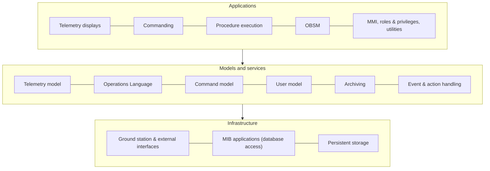
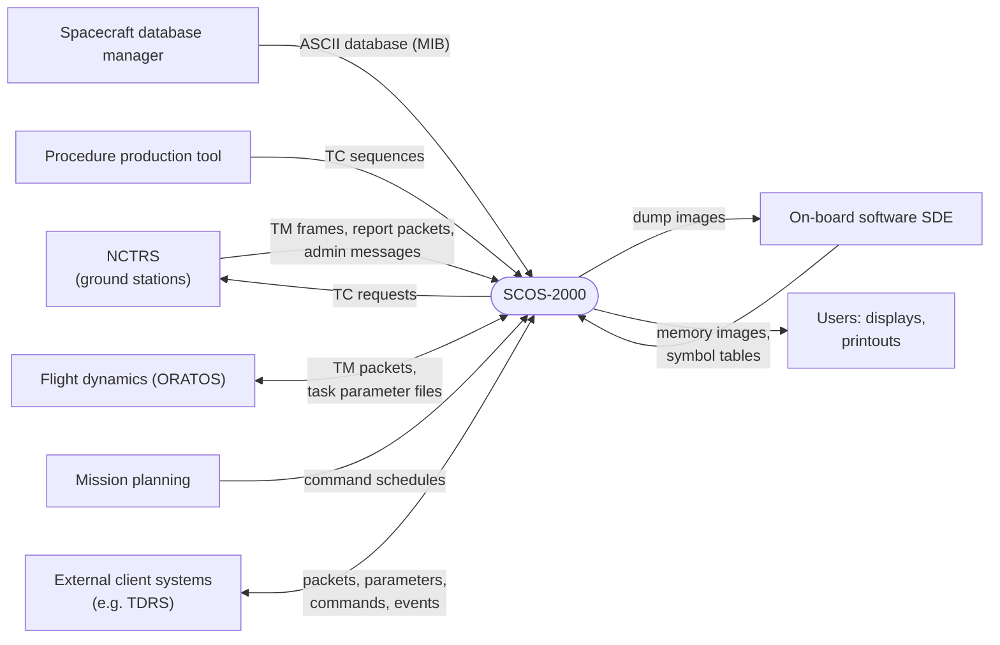
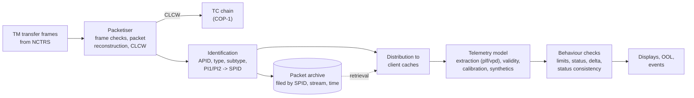
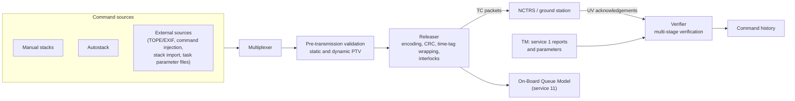

# SCOS-2000 architecture

[SCOS-2000](index.md) is described by ESA as a mission control system **kernel**: a set of
object-oriented components that system developers can reuse, and a set of generic
executables that a mission can use as they are when their functions match its needs. The
same kernel is meant for spacecraft control and for checkout systems, can be extended with
mission-specific functions, and is distributed, scalable, configurable and open.[^gsaw03-concepts]
This page explains how that kernel is organised and how data flows through it. It starts
with the overall structure, then follows telemetry from the ground station to the operator's
display and telecommands from the operator to the spacecraft, and ends with archives,
events, external interfaces, configuration and multi-domain operation.

The descriptions come mostly from ESA presentations and interface documents of 2000–2018.
SCOS-2000 changed considerably between releases (see [releases](index.md#releases)), so
each statement is dated by its source. The mission database that configures all of this is
described in [the MIB](../mib/index.md) and its topic pages.

## Overall structure

### Clients and servers

SCOS-2000 inherits the client-server design of SCOS-II: each operator works on a
workstation with local processing and local caches, while central servers coordinate the
system and host the interfaces to the ground stations.[^ntrs2-arch][^gsaw03-cs] The GSAW
2003 presentation lists the processes on each side:[^gsaw03-cs]

| Side | Processes | Domain |
|---|---|---|
| Server (prime and backup) | Packetiser | TM |
| | Behaviour (limits) checker | TM |
| | Synthetic parameter packet generator | TM |
| | Multiplexer, Releaser, Verifier, On-Board Queue Model (OBQM) | TC |
| | Archive | TM, TC, events |
| | Events & Actions servers | Events |
| | Configuration server (MISCdynamic) | System |
| Client (MMI applications) | Desktop (with alarm display) | System |
| | Monitoring display container, out-of-limits (OOL) display | TM |
| | Event logger | Events |
| | Manual and automatic stacks, TC history | TC |
| | Caches | TM, TC, events |
| | Configuration client (TM and TC "SPACON") | System |

A typical configuration is a network of workstations, but the system can be scaled down to
a "SCOS-2000 in-a-box" on a single workstation for simpler missions.[^b115-what] ESOC's LEOP
configuration of 2003 had prime and backup SCOS-2000 servers, prime and backup NCTRS, and
35 client workstations spread over six rooms (15 + 6 + 6 + 4 + 2 + 2).[^gsaw03-leop]

### Functional subsystems and layers

ESA groups the functions of SCOS-2000 into subsystems with short names: telemetry
processing (TM), telecommanding (TC), the online database (DB), the online archive (ARCH),
general services and utilities, the Operations Language (OL), roles and privileges (USER),
events and actions (EVAC), and on-board software maintenance (OBSM).[^b115-what] The GSAW
2003 slides arrange the software in layers, from persistent storage and database access at
the bottom, through the telemetry, command and user models, to the applications on top:[^gsaw03-layers]



The diagram is this wiki's condensed reading of the "SCOS-2000 Software Layers" slide.[^gsaw03-layers]

### Enabling technology

| Area | Technology (2003) |
|---|---|
| Design | Object-oriented analysis and design, UML with Rational Rose |
| Languages | C++ with the STL on Unix |
| GUI library | ILOG Views |
| Packet archive | C-Tree+ |
| Object database | ObjectStore (classic line); POST++ (evolution line) |
| CORBA | Iona Orbix, CORBA 2.1 (classic); omniORB, CORBA 2.3 (evolution) |
| Public-domain tools | Flex and Bison (OL parsing), Tcl/Tk (old task launcher), a2ps (printouts), zlib (packet compression) |
| Space standards | CCSDS packet TM/TC, ECSS PUS, SLE for ground station interoperability |

All rows come from the "Enabling Technology" slide of GSAW 2003.[^gsaw03-tech] The ESOC
presentation of April 2000 adds that the new CORBA-based external interfaces were one of
the main differences between SCOS-2 and SCOS-2000.[^p2000-name]

### Context and interfaces



The diagram follows the "System Overview" and "System interfaces" slides. The ground
station interface is NCTRS, with protocols for the station equipment of that time. The
spacecraft database arrives as ASCII files produced with a database editing tool. Flight
dynamics receives real-time and retrieved TM packets and sends task parameter files. Other
systems connect through APIs for packets, parameters, commands and events.[^gsaw03-sys]

## Operator applications

Operators start SCOS-2000 from a **task launcher**. In the Herschel PACS instrument test set-up
of 2004, the command `s2.start` opened the launcher; one button selected all server
applications and another the standard client applications. The **desktop** then showed a
top bar with the workstation settings, user login and alarm-tone control, and a footer with
the three most recent log messages.[^guide-start][^guide-desk] The client applications and
their launcher names were:[^guide-apps]

| Launcher name | Application | Purpose |
|---|---|---|
| MON | Telemetry desktop | Alphanumeric, strip chart, scrolling and mimic TM displays |
| VPD | Variable packet display | Contents of variable TM packets |
| MSTK | Manual stack | Manual telecommand release |
| TCHIST | Telecommand history | Status of every released command and its verification stages |
| OOL | Out-of-limits display | Parameters currently out of limits |
| EVLOG | Event logger (message display) | Scrolling display of SCOS-2000 log messages |

The 2003 slides list the display types in more detail.[^gsaw03-mon2]

| Display | Description |
|---|---|
| Alphanumeric display (AND) | 32 or 64 parameters |
| Graphic display (GRD) | 1 to 8 parameters against time, strip chart emulation, or parameter against parameter |
| Mimic displays | Schematic displays, with an editor |
| Scrolling display (SCD) | Parameter values scrolling with time |
| Telemetry Query Display (TQD) | Query of one parameter, with an OL editor and a panel showing each validity condition |
| Out-of-limits displays | Current limit violations |
| Packet displays | Variable Packet Display, Telemetry Packet History Display, On-Board Event History Display |
| Command displays | Command History Display, Command Query Display, On-Board Queue Display (OBQD) |
| TM and TC SPACON | Online control of processing: filing on/off, reset of status consistency checks, limit values, calibration points, OL expressions |

The display types and SPACON functions come from the monitoring and commanding slides of
GSAW 2003.[^gsaw03-mon1][^gsaw03-mon2][^gsaw03-cmd] The TQD validity panel is described in the EMCS
user manual and its OL editor in the ICD.[^emcs-validity][^i70-udc] The MIB defines AND, GRD, SCD and printout layouts; see
[display definitions in the MIB](../mib/displays.md).

Each application has its own user manual. The 2004 guide lists manuals for the external
interface and TOPE, the desktop, the event logger, the telemetry desktop, the OOL display,
the variable packet display, the manual stack and the command history.[^guide-docs] The
Database Import ICD references further manuals and design documents, among them the
monitoring, commanding and system-level software requirements documents, the OL design
document, the Synthetic Parameters user manual, the Events & Actions user manual, the MIB
Applications user manual, and interface documents for stack import, task parameter files
and telemetry parameter injection.[^i70-refs]

## The telemetry chain



The steps are those of the "Monitoring functions" and "Top level components" slides of
GSAW 2003.[^gsaw03-mon1][^gsaw03-top] The sections below follow the chain.

### Packetiser

The **telemetry packetiser** receives telemetry transfer frames, report packets and
administrative messages. It reconstructs packets from frames, extracts the Command Link
Control Word (CLCW) for the commanding chain, and applies quality, continuity and sequence
checks.[^gsaw03-mon1][^gsaw03-top] The Database Import ICD added the Packetiser in issue 5.0
for release R2.2e.[^i70-log] To recognise a packet, the packetiser reads the APID from its
fixed place in the header, and the PUS type and subtype from a position set in the
configuration (the same position for all packets of a spacecraft). For some type and subtype
combinations it also reads up to two additional identification fields from the application
data, as specified in the [`pic`](../mib/tables/pic.md) table. It then looks up the
[`pid`](../mib/tables/pid.md) table to find the processing keys: the **SCOS-2000 Packet ID
(SPID)** for fixed packets and the Telemetry Packet Structure Definition (TPSD) for variable
packets.[^i70-pkt] Packets without a data field header are identified by APID alone.[^i70-pkt2]

The ICD turns two on-board design choices into explicit constraints: the type and subtype
must sit at the same place in every TM packet, and every packet with the same type and
subtype must carry its additional identification fields at the same place.[^i70-pkt]
From R5.0 each distinct TM packet must have its own SPID, because packets are stored in a
database and sharing SPIDs caused retrieval and display problems.[^i70-pkt2][^i70-r5pkt]
The packetiser can check the packet error control field (when `PID_CHECK` is 1) and can
generate an event when a packet arrives (when `PID_EVENT` is `I`, `W` or `A`).[^i70-pidchk]

**Time stamping.** Every frame and packet that is filed or distributed gets a time stamp,
which is the prime filing key of the history files. The packetiser supports three options:
the time of filing in the archive (useful when replaying old frames during tests), the
Frame Transmission Time derived from the Earth Reception Time minus ground, propagation and
on-board delays, or the on-board time in the packet converted to UTC through the time
correlation library.[^tn1030-stamp] The time correlation function itself (time couples,
least-squares or synchronised-clock coefficients, accuracy and validity status) is described
on [Time correlation in SCOS-2000](time-correlation.md).[^tn1030-overview]

### The telemetry model: extraction, validity and calibration

Parameter extraction follows the [`plf`](../mib/tables/plf.md) definitions for fixed
packets (including super-commutated parameters) and the [`vpd`](../mib/tables/vpd.md)
definitions for variable packets.[^gsaw03-mon1][^i70-pkt] Variable packets have a
limitation: the values extracted from them cannot take part in the full TM processing
(validity, monitoring checks, verification, synthetic parameters), because their parameter
identities and time references are only known once each packet is opened. The ICD
therefore advises against using variable packets for regular housekeeping.[^i70-varpkt]

Every value carries a **validity**. The TOPE interface of the EGSE version exposes the
validity as a bit set, and its list shows the causes that SCOS-2000 tracks: state validity
false, system element not powered, transport route off, a telecommand scheduled for the
parameter (transient), transport errors, an expired value (packet not arrived), unknown
state, calibration failure, a time before the mission epoch, a packet not configured in the
cache, an uninitialised value, retrieval errors, database errors, unknown fields or types,
overflow, division by zero, and OL parse errors.[^emcs-validity] These causes extend the
validity factors already planned for SCOS-II: power, data unit quality, data routing, age,
stability after commanding and user-defined status.[^ntrs2-mon]

The raw value of a parameter is its value before calibration. It is not the same as the
encoded bits, except for unsigned integers: a raw value of `-1` in a 16-bit signed integer
parameter is encoded as `0xFFFF`.[^i70-defs] Calibration turns raw values into engineering
values. See [calibration in the MIB](../mib/calibration.md) and
[MIB parameter types](../mib/parameter-types.md).

### Behaviour checking

The behaviour checker applies the monitoring checks defined in the
[`ocf`](../mib/tables/ocf.md) and [`ocp`](../mib/tables/ocp.md) tables. The ICD defines
limit checks and status checks (each with soft or hard severity), delta checks on the change
since the last valid value, and **status consistency checks** against a reference value that
SCOS-2000 maintains from the predicted or detected effect of commands. A fifth type, `E`,
does not raise an out-of-limits state at all: it generates a SCOS-2000 event whose full ID
is `BEHV::` followed by the parameter name, which can then trigger actions.[^i70-ocp] Each
check has an applicability condition (a parameter equal to a value), except status
consistency checks, whose applicability is always true. The checks of a
parameter are evaluated in order and the search stops at the first applicable check or
soft/hard pair, unless the global variable `BEHV_STOP_FIRST_SET` says otherwise.[^i70-ocp] Details are on [monitoring checks](../mib/monitoring-checks.md).

The Solar Orbiter MIB of September 2025 uses four of the five `OCP_TYPE` codes: 4,153 `H`, 3,096
`S`, 105 delta (`D`) and 15 status consistency (`C`) check records, and no event-only (`E`)
checks.[^mib-solo] SCOS-II had planned "behaviour checks" against a predicted on-board state.[^ntrs2-mon]

??? example "SQL used"
    ```sql
    -- solo-2025-09-16.sqlite
    SELECT OCP_TYPE, count(*) FROM ocp GROUP BY 1;
    -- C|15   D|105   H|4153   S|3096
    SELECT PID_EVENT, count(*) FROM pid GROUP BY 1;
    -- (blank)|1162   A|6360   I|1374   N|1095   W|1159
    SELECT PID_CHECK, count(*) FROM pid GROUP BY 1;
    -- 0|11144   1|6
    SELECT PID_EVENT, PID_TYPE, PID_STYPE, count(*) FROM pid
     WHERE PID_EVENT IN ('A','I','W') GROUP BY 1, 2, 3;
    -- A|1|2|274   A|1|8|1477   A|5|3|2911   A|5|4|1698   I|5|1|1374   W|5|2|1159
    SELECT PID_TYPE, PID_STYPE, PID_APID, PID_DESCR FROM pid WHERE PID_CHECK = '1';
    -- 0|0|1|Bad/Idle/Good complete transfer frame (3 rows)
    -- 166|1..3|1966|MATIS BASIC HKTM OK, MATIS RX LOCK EXPECTED, MATIS SSMM FTS COMMANDING
    ```

The same MIB flags 8,893 of its 11,150 packet definitions to raise an event on reception:
6,360 with severity Alarm, 1,374 Info and 1,159 Warning (the other 2,257 have `N` or the
default, which is `N`). The severities follow the PUS report types: all 1,374 Info events are
(5,1) reports and all 1,159 Warning events are (5,2) reports, while the Alarm events are
(5,3) and (5,4) event reports (2,911 and 1,698) and (1,8) and (1,2) failure reports (1,477 and
274). See [ST[05] event reporting](../ecss/pus/st05-event-reporting.md) and
[ST[01] request verification](../ecss/pus/st01-request-verification.md). Only 6 packet
definitions ask the packetiser to check the packet error control field: the three
transfer-frame entries on APID 1 and three type 166 packets on APID 1966 described as MATIS
reports, so no spacecraft source packet definition has `PID_CHECK = 1`.[^mib-solo][^i70-pidchk]

!!! warning "Inference"
    Two readings here are the wiki's own. First, the status consistency check, whose
    reference value follows the commands sent, can be seen as a simple form of the SCOS-II
    behaviour checks against a predicted on-board state; neither source draws the link.
    Second, since no spacecraft packet definition in the Solar Orbiter MIB sets `PID_CHECK`,
    packet error control is probably checked elsewhere in the ground chain or not at all at
    packet level. The MIB does not say which.

## Synthetic parameters and the OL

**Synthetic parameters** are monitoring parameters whose value SCOS-2000 calculates (the ICD
notes that older systems called them derived parameters). Once calculated they behave like
telemetry: they can be displayed, calibrated, limit-checked and used in other synthetic
parameters. Their validity follows from the validity of their inputs and can be restricted
further with an explicit validity condition.[^i70-synth][^i70-synth3] The field `PCF_NATUR`
of the [`pcf`](../mib/tables/pcf.md) table selects the kind:[^i70-synth][^i70-synth2][^i70-udc]

| `PCF_NATUR` | Kind | How it is calculated | Stored? |
|---|---|---|---|
| `D` | Dynamic OL synthetic | OL expression in a file named after the parameter, evaluated locally when an application needs it, every time a contributing value or validity changes; recalculated in retrieval | No |
| `P` | SPEL synthetic | Like `D`, written in the Synthetic Parameter Expression Language; only in the EGSE delivery of SCOS-2000 | No |
| `H` | Hard-coded synthetic | C++ code, written directly or produced by the OL compiler, linked into a library; cheaper to run but not visible or editable online | No |
| `S` | Saved synthetic | Calculated centrally by the Synthetic Parameters Packet Generator (SPPG) from a linked `D` or `H` parameter, stored in synthetic packets | Yes |
| `C` | Static user-defined constant | Constant from `PCF_PARVAL`, changeable with the OL editor of the TQD | – |
| `R` | Raw telemetry (and dynamic user-defined constants) | Extracted from a packet; dynamic constants come from an internal "constants" packet set through TM SPACON or the parameter injection interface | – |

SCOS-2000 evaluates synthetic parameters in cascade: a new sample of parameter A triggers A,
then any B that uses A, then any C that uses B. Up to R3.1 this forbade circular dependencies.
Later releases calculate each parameter only once per update cycle.[^i70-synth3] The ICD
warns that synthetic parameters that use super-commutated inputs are evaluated once per
sample and can be very demanding.[^i70-synth2]

**Saved synthetic parameters** exist because dynamic ones are recalculated on each
workstation and again in retrieval. A saved value is calculated once, centrally, and stored
with its validity, so every display shows the same value when moving backwards or forwards
in history, even after the definition changes. The cost is that a synthetic packet is only
generated when its triggering TM packet arrives, so not every intermediate value is kept.
Each saved parameter occupies a 13-octet slot in its synthetic packet.[^i70-synth2]

<div class="bitfield" data-title="Saved synthetic parameter slot in an SPPG synthetic packet (104 bits)" data-width="32" data-caption="ICD 7.0 §3.3.2.1.2; the ICD gives the three sizes in this order but does not state the octet layout inside the slot" data-fields='[{"n":"Value","b":64,"d":"8 octets holding the calculated value (raw or engineering, as calculated)"},{"n":"Value type","b":8,"d":"1 octet identifying the type of the stored value"},{"n":"Validity flags","b":32,"d":"4 octets of validity flags"}]'></div>

### Example: saved synthetics in the Solar Orbiter MIB

The Solar Orbiter MIB of September 2025 has 1,582 dynamic OL synthetic parameters (each with
its OL file), 2 saved synthetic parameters, and no hard-coded, SPEL or constant
parameters.[^mib-solo] The two saved parameters, [`NTTSS030`](../explorer/index.md#/solo/param/NTTSS030)
and [`NTTSS031`](../explorer/index.md#/solo/param/NTTSS031), hold the time of the last
carrier lock of the two transponders labelled DST-1 and DST-2. Each is linked through `PCF_RELATED` to a
dynamic OL parameter (`NTTSX030`, `NTTSX031`). Both are stored in the synthetic packet
[SPID 66838](../explorer/index.md#/solo/packet/66838), defined in `pid` as type 251,
subtype 2 on [APID 1966](../explorer/index.md#/solo/apid/1966) with the description
"Saved Synthetics", and in `tpcf` as `SAVED_SYNTH`. Their `plf` entries sit at byte offsets
0 and 13: exactly one 13-octet slot each, as the ICD requires.[^mib-solo][^i70-synth2]

The OL file of `NTTSX030` (real MIB data, comments omitted) updates a global variable with the
time of the receiver lock parameter only when that parameter's raw value is 1 (locked), and
otherwise returns the previous saved value through a "static reference" to `$NTTSS030`:

```text
if (NDSD0021.raw == 1) then
GVAR_DST_1_LastCarrierLockTime := NDSD0021.time;
endif;
$NTTSS030;
```

The `if (...) then ... endif;` form and the `:=` assignment are the same as in the SCOS-II OL
example of 1994 described on the [overview page](index.md#the-scos-ii-operations-language-ol),
and the ICD documents the `.raw` and `.eng` parameter views of the SCOS-2000 OL.[^mib-solo][^ol-example][^i70-udc]
The full OL syntax is documented in the SCOS-2000 Synthetic Parameters user manual, which is
not in this wiki's library.[^i70-synth][^i70-refs] See
[synthetic parameters and the OL language](../mib/synthetic-parameters.md).

??? example "SQL used"
    ```sql
    -- solo-2025-09-16.sqlite
    SELECT PCF_NATUR, count(*) FROM pcf GROUP BY 1;     -- D|1582  R|125161  S|2
    SELECT count(*) FROM synthetic;                       -- 1582
    SELECT PCF_NAME, PCF_DESCR, PCF_RELATED FROM pcf WHERE PCF_NATUR = 'S';
    -- NTTSS030|Last C_Lock DST-1|NTTSX030   NTTSS031|Last C_Lock DST-2|NTTSX031
    SELECT PLF_NAME, PLF_SPID, PLF_OFFBY, PLF_OFFBI FROM plf WHERE PLF_NAME IN ('NTTSS030','NTTSS031');
    -- NTTSS030|66838|0|0   NTTSS031|66838|13|0
    SELECT PID_TYPE, PID_STYPE, PID_APID, PID_SPID, PID_DESCR FROM pid WHERE PID_SPID = '66838';
    -- 251|2|1966|66838|Saved Synthetics
    SELECT * FROM tpcf WHERE TPCF_SPID = '66838';         -- 66838|SAVED_SYNTH|26
    SELECT SOURCE FROM synthetic WHERE NAME = 'NTTSX030';
    ```

### Internally generated packets

Several SCOS-2000 functions publish their state as **internal TM packets**, so that the
normal monitoring displays, checks and archives can handle it. The ICD names the SPPG
synthetic packets, the "constants" packet of dynamic user-defined constants, the "MISC"
packet with selected dynamic configuration variables, and the system control packets of the
multi-domain SCTL application. It recommends giving each of them a `pid` entry with a
type, subtype and APID combination that no other source uses.[^i70-pkt2][^i70-udc][^i70-dcv][^i70-sctl]
In the Solar Orbiter MIB the saved synthetic packet uses type 251 on APID 1966 (see above). The
same MIB also has `pid` entries for bad, idle and good complete transfer frames (SPIDs
1000002, 1000003 and 1000006, APID 1, type and subtype 0), which the ICD does not list among
the internal packets.[^mib-solo]

!!! warning "Inference"
    The transfer-frame entries probably let the archive and the packet history displays
    handle the frames that the packetiser files (GSAW 2003 lists TM transfer frames among its
    inputs, and TN-1030 says that frames as well as packets are time-stamped for filing).[^gsaw03-top][^tn1030-stamp]
    The MIB does not document their purpose.

??? example "SQL used"
    ```sql
    -- solo-2025-09-16.sqlite
    SELECT PID_TYPE, PID_STYPE, PID_APID, PID_SPID, PID_DESCR FROM pid
     WHERE CAST(PID_SPID AS int) >= 1000000 ORDER BY CAST(PID_SPID AS int);
    -- 0|0|1|1000002|Bad complete transfer frame
    -- 0|0|1|1000003|Idle complete transfer frame
    -- 0|0|1|1000006|Good complete transfer frame
    ```

## The telecommand chain



The structure follows the GSAW 2003 "Commanding functions" slide.[^gsaw03-cmd]

### Command sources

The **manual stack** is the operator's main tool. In 2003 it could load commands and
sequences with parameters, de-calibrate parameter values, time-tag commands for on-board
execution, and set release dependencies by grouping, blocking, delta release times and
interlocking. It had a master manual mode and a wait mode, applied static and dynamic
pre-transmission validation (PTV), and could save and load commands, sequences, stack files
and task parameter files (TPFs). Sequences accept formal parameters and absolute start or
execution times. The **autostack** offers a restricted subset with no editing, driven by
release or execution times.[^gsaw03-cmd] A **multiplexer** lets several sources command in
parallel.[^gsaw03-cmd] Command sequences and their parameters are defined in the MIB (see
[command sequences and parameter sets](../mib/sequences.md)); from R5.0 they are converted to
XML and loaded from the file archive.[^i70-r5]

### Release

The **releaser** is the interface to the external command destination, NCTRS.[^gsaw03-cmd]
It builds the packet from the header definition and parameters in the MIB (see
[commanding in the MIB](../mib/commanding.md)) and automatically appends the 16-bit CRC
unless the command type says otherwise.[^i70-ctype] Commands with an execution time-tag are
automatically wrapped in service (11,4) commands.[^i70-c11] The maximum command size is set
by a configuration variable, with a default of 248 octets that must leave room for the
header, the CRC and the time-tag wrapper.[^i70-size] Interlocks hold further commands until
a given verification stage of a previous command is reached.[^i70-ctype][^emcs-tcsend]

The command type `CCF_CTYPE` marks commands that are not ordinary packets. `R` is a control
segment (a "reset map" command) and `F` a control frame (a BC frame: Unlock or Set V(R)); for
both, the MIB defines the frame data field rather than a packet header. `S` is a packet
without a packet error control field, typically for EGSE equipment. From R5.0, `T` is an SLE
throw event, sent to the SLE service provider at the ground station, and `N` is a NIS throw
event, executed by the NIS and not forwarded to the station.[^i70-ctype][^i70-ccf]

The Solar Orbiter MIB uses three of these types. Its control frames are
[`UNLOCK`](../explorer/index.md#/solo/command/UNLOCK) and
[`SETVR`](../explorer/index.md#/solo/command/SETVR), its control segments are `RESET`,
`REIN_TTR` and `TC_ONLY`, and six NIS throw events open and close the session and the TM and
TC links (for example [`EGENRTCO`](../explorer/index.md#/solo/command/EGENRTCO), "GENERIC OPEN
TC LINK"). The throw events use a dedicated packet header named `NOS2KHDR`, described as "NIS
Throw Events".[^mib-solo] See [COP-1](../ccsds/cop-1.md) for the Unlock and Set V(R)
directives and [NCTRS, NIS and the ground station interface](nctrs-nis.md) for throw events.

??? example "SQL used"
    ```sql
    -- solo-2025-09-16.sqlite
    SELECT CCF_CNAME, CCF_DESCR, CCF_CTYPE, CCF_PKTID FROM ccf WHERE CCF_CTYPE <> '';
    -- EGENRTCC|GENERIC CLOSE TC LINK|N|NOS2KHDR   EGENRTCO|GENERIC OPEN TC LINK|N|NOS2KHDR
    -- EGENRTMC|GENERIC CLOSE TM LINK|N|NOS2KHDR   EGENRTMO|GENERIC OPEN TM LINK|N|NOS2KHDR
    -- ESESIONC|CLOSE SESSION|N|NOS2KHDR          ESESIONO|OPEN SESSION|N|NOS2KHDR
    -- REIN_TTR|Reinit TTR|R|NO_HDR  RESET|PAC RESET directive|R|NO_HDR  TC_ONLY|CPDU TC_Only|R|NO_HDR
    -- SETVR|SETV( R ) Directive|F|NO_HDR  UNLOCK|FARM UNLOCK directive|F|NO_HDR
    SELECT * FROM tcp;   -- HPC1_TC, NO_HDR, NOM_TC, NOS2KHDR (NIS Throw Events)
    ```

### Verification

The **verifier** performs multi-stage verification of each released command and disables
status consistency checks on the telemetry parameters that the command affects.[^gsaw03-cmd]
SCOS-2000 supports two kinds of verification stage. **Report-based** stages wait for PUS
service 1 reports. **Parameter-based** stages check monitoring parameter values against
criteria within a time window.[^i70-verif] For service 1, the verifier extracts the 4 octets
that echo the command's packet ID and sequence control from each report, to identify the
command instance. The echo must be at the same place in all type 1 reports. The subtype
alone decides success or failure; the failure code is ignored. Progress reports can only
feed progress stage 0.[^i70-c1][^i70-cvs] See [ST[01] request verification](../ecss/pus/st01-request-verification.md)
and [command verification in the MIB](../mib/command-verification.md).

The full list of stages appears in the EGSE user manual, which gives the order that the TOPE
language reports for each stage:[^emcs-stages]

| Order | Stage | Meaning |
|---|---|---|
| 0 | `PTV_DYNAMIC` | Dynamic pre-transmission validation |
| 1 | `PTV_STATIC` | Static pre-transmission validation |
| 2 | `MCS_RELEASE` | Release by the MCS |
| 3 | `UV_GS_RECEIVE` | Received by the ground station (or EGSE TC front end) |
| 4 | `UV_GS_UPLINK` | Uplinked |
| 5 | `UV_ONB_ACCEPT` | Accepted on board (reported by the ground station or TC front end when the spacecraft confirms reception of an AD-mode command) |
| 6 | `EV_APP_ACCEPT` | Accepted by the application process |
| 7 | `EV_START_EXEC` | Start of execution |
| 8–17 | `EV_PROGRESS_0` to `EV_PROGRESS_9` | Progress steps 0 to 9 |
| 18 | `EV_END_EXEC` | Completion of execution |

Each stage has a status. The values listed are `IDLE`, `PENDING`, `PASSED`, `FAILED`,
`UNVERIFIED`, `UNKNOWN`, `TIMEOUT`, `SUPERSEDED`, `UNCERTAIN_FAILED`, `UNCERTAIN_PASSED`,
`AFFECTED`, `SCC` and `NOT_APPLICABLE`.[^emcs-stages] The stages prefixed "UV" are
reported by the ground side (the ground station through NCTRS, or the EGSE TC front end).
Those prefixed "EV" concern execution by the application process, reported through
service 1 or derived from telemetry conditions.[^emcs-ack]

In the Solar Orbiter MIB, the 206 verification stages are all acceptance or completion
stages: 16 report-based acceptance stages, 23 report-based completion stages and 167
parameter-based completion stages. There are no start or progress stages.[^mib-solo]

??? example "SQL used"
    ```sql
    -- solo-2025-09-16.sqlite; cvs uses generic column names: COL2 = CVS_TYPE, COL3 = CVS_SOURCE
    SELECT COL2, COL3, count(*) FROM cvs GROUP BY 1, 2;
    -- A|R|16   C|R|23   C|V|167
    ```

### The on-board queue model

The **On-Board Queue Model (OBQM)** keeps a ground image of the on-board schedule of
time-tagged commands, displayed in the On-Board Queue Display.[^gsaw03-cmd] The ICD lists
what SCOS-2000 does for [ST[11] time-based scheduling](../ecss/pus/st11-time-based-scheduling.md):
it wraps execution time-tagged commands in (11,4) commands, models the effect of service 11
commands on the ground image, reconstructs the image from spacecraft reports (from R5.2),
supports delayed verification of time-tagged commands with live and playback telemetry, and
generates service 11 commands from selections in the ground image. The limits are that the
command structures follow the Rosetta reference implementation, each (11,4) command carries
one TC packet, only absolute time tags are supported, and interlocks and the time-shift
command are not modelled.[^i70-c11]

## Archives

SCOS-2000 files every received packet centrally. In 2003 the archive used C-Tree+ with
non-circular filing (files grow continuously and are split for long-term archiving), fixed
or variable length records, and filing by type (TM, TC, event), SPID, data stream (a logical
grouping such as real-time or playback) and time. Retrievals run independently from
real-time processing. Packets are distributed to client caches over TCP/IP. Administrators
can switch filing on and off globally with the `PDSadmin` tool, switch hot to the backup
server, and use an administration tool to delete, dump, export, print or re-send packets and
to split the archive.[^gsaw03-filing] In the EGSE delivery of 2004, each SPID archive was an
index file and a data file in the `hfiles` directory. Each record had a header used for
retrieval and a body with the received data.[^emcs-arch]

Retrieval can start at any time, select a data stream, and merge up to 4 streams on one
display. Synthetic parameters are recalculated for retrieved data.[^gsaw03-mon1] The ICD
calls this dynamic part of the Mission Information Base the **packet archive**, in contrast
with the static database.[^i70-defs] Release 5 changed both parts. From R5.0 packets are
stored in a database, and sequence and display definitions are converted to XML and kept in
the **File Archive (FARC)** instead of the run-time database.[^i70-r5pkt][^i70-r5]

Later ESOC systems added further archives around SCOS-2000: the Packet ARChive (PARC) and the
Data Archive (DARC) for parameters, with the `PCF_DARC` field of the MIB selecting the
parameters to archive.[^glo-acr][^i70-darc] They are described on
[mission archives: PARC, DARC and FARC](archives.md).

## Events and actions

SCOS-2000 events are messages with a severity, stored in the archive (so they can be
retrieved) and notified live to operators, with severities configurable by role.[^i70-c5]
They come from several places:

* the packetiser, when a packet flagged with `PID_EVENT` arrives; the event text comes from
  the packet description and the event ID has the form `TPKT_OBE::` plus a number between
  1 and 9999;[^i70-pidevt]
* the behaviour checker, for checks of type `E`, with the ID `BEHV::` plus the parameter
  name;[^i70-ocp]
* SCOS-2000 applications themselves, whose event numbers start at 10000.[^i70-pidevt]

The **Events & Actions** servers react to events with configured actions. The ICD gives the
examples of sending an e-mail, setting a configuration variable and running a script.[^i70-ocp][^gsaw03-cs]
The **event logger** shows the event stream to operators.[^guide-apps] SCOS-II had already
planned an "Events & Actions" facility, in which user-defined events identified in the incoming
data are logged and trigger actions such as recovery or diagnosis, and "event-driven commanding
routines" that react automatically to on-board anomalies.[^ntrs2-ol][^ntrs2-cmd]

## External interfaces

### EXIF and TOPE

The **SCOS External Interface services (EXIF)** are an extension module of SCOS-2000 with a
CORBA interface. External applications use it to acquire telemetry, send commands, raise
events or alarms, and retrieve historical data. Some EXIF services inject events, parameters
or commands into SCOS-2000. Others deliver telemetry parameters, TM packets, events or command
history to the requesting application. EXIF is made of several CORBA servers, found through
the CORBA naming service.[^tope-exif] In the PACS set-up of 2004, the EXIF tasks `EXIF_TMM`,
`EXIF_TM1`, `EXIF_CHM` and `EXIF_CH1` were started from a separate launcher (`exif.start`)
together with the TOPE test language. Each additional TOPE client needed its own
`EXIF_CHx` task.[^guide-tope][^emcs-start]

The **Test and Operations Procedure Environment (TOPE)** is a Tcl extension that uses EXIF to
send commands, fetch and subscribe to parameters, and follow command verification. It is
described in detail on [SCOS-2000 as EGSE](egse.md).[^emcs-tope][^tope-exif]

### Other interfaces

| Interface | Purpose | Source |
|---|---|---|
| NCTRS | TM frames and packets in, TC packets out, administrative messages, throw events | [^gsaw03-sys][^i70-ccf] |
| Flight Dynamics Interface (FDIF) | Live packets to registered clients; used by Planck LFI to feed its Level 1 pipeline | [^gsaw03-sys][^lfi-31b] |
| Task Parameter File (TPF) | Command requests from flight dynamics and other systems | [^gsaw03-sys][^i70-refs] |
| Stack Import | Command stacks prepared outside SCOS-2000 | [^i70-refs] |
| Command Injection Service | Commands from external applications | [^emcs-refs] |
| Telemetry Parameter Injection | Values for dynamic user-defined constants | [^i70-udc][^i70-refs] |
| Data retrieval services (e.g. TDRS) | Packets and parameters for external client systems | [^gsaw03-sys] |

The Planck LFI instrument team shows how these interfaces were used in practice. Its
real-time assessment system used SCOS-2000 to receive telemetry, keep a local database of raw
packets, check for missing, damaged or duplicated packets, display housekeeping values in
engineering units, send telecommands, and raise out-of-limits alarms. A task built on the
Flight Dynamics Interface let the team's telemetry handler register as a SCOS-2000 client,
choose the packets to receive, and be notified of each live packet. For its own tests, the
team modified the SCOS-2000 Telemetry Receiver (TMR), part of the SCOS-2000 simulators, to
replay simulated housekeeping and science telemetry.[^lfi-31b] See [EDDS](edds.md) and
[TDRS](tdrs.md) for ESOC's data dissemination systems.

## Configuration

### MISCconfig and configuration variables

Most SCOS-2000 behaviour is set by **configuration variables** in the `MISCconfig` file,
documented in the SCOS-2000 Configuration Variables guide.[^i70-refs] Examples in the MIB ICD
include the position of type and subtype in TM packets, the directory of the OL expression
files (`IMPT_EXPR_DIR`), the default on-board clock (`TCO_DEFAULT_OBT_ID`), the maximum
command size, and the name of the time-tag wrapper command.[^i70-pkt][^i70-synth][^i70-obt][^i70-size]
The EGSE user manual of 2004 lists the EGSE-specific variables: the routing mode, gateway
hosts and ports, the SPIDs for system packets, time-stamping and checksum options, and the
mission epoch.[^emcs-misc] See [SCOS-2000 as EGSE](egse.md#configuration-misc-variables-and-system-spids).

Some variables can change at run time. The **MISC server** keeps their state, distributes
changes to its clients, and publishes selected variables in the internal "MISC" TM packet.
Each published variable needs `pcf` and `plf` entries, as a 32-bit signed integer, a double
precision real or a character string. Only numeric variables can be fully processed by the
monitoring applications. Their positions in the packet must stay the same across database
versions, so that older MISC packets in the archive can still be read.[^i70-dcv]

### MIB import

The static database enters SCOS-2000 through the **importer**, which reads the ASCII
tables (one `.dat` file per table, tab-separated) and the synthetic parameter files and
builds the run-time database. The importer checks field formats and lengths, mandatory
fields, relational integrity and parameter value syntax, and logs its messages to a file that
is overwritten at each import. It can import a whole database or only check it.[^i70-import]
Its full description is on [the MIB](../mib/index.md#import-checks-and-options).

### Domains and multi-mission operation

SCOS-2000 is a single system that can manage and control several entities called
**domains**. Each domain has its own directory of MIB files and synthetic parameter files.
A special **General Domain** needs the files of all domains plus its own multi-domain
database, which only defines multi-domain synthetic parameters. An import started from the
General Domain can import the database of any domain; an import started from a specific
domain only imports that domain.[^i70-domains] The multi-domain System Control application
(SCTL) starts, stops and monitors the SCOS-2000 server families, and records their status in
TM packets that the normal displays can show.[^i70-sctl]

Multi-mission support grew over time. SCOS-II was designed to control several satellites of
one family, not several missions.[^ntrs2-arch] In April 2000 ESOC planned R4.0 to allow
several SCOS-2000 versions on one machine and to support constellations.[^p2000-evol] In 2003
R4.0 was announced as multi-mission (constellations and formation flying; LEO, GEO and deep
space).[^gsaw03-ver]

## Performance and limitations

| Figure | Value | Source |
|---|---|---|
| SCOS-II design goals | 2 Mbps TM and 4 kbps TC concurrently, more than 10 display updates per second, up to 50 workstations | [^ntrs2-perf] |
| SCOS-2000 telecommand chain (2010, Terma) | About 2 packets per second with checking, 20 without | [^arm-tc] |

The ICD documents several functional limits besides those already mentioned. The deduced
data structure of PUS is not supported, only deduced parameter fields. Variable packets
cannot feed the full TM processing. The generation interval of periodic housekeeping
packets is static in the database, and the time stamp of each sample in a housekeeping
packet is the packet time plus a fixed offset from the database. Commands can be blocked
into one TC segment, but not aggregated into one TC packet. There is no specific processing
of services 2, 3, 4, 5, 8, 12, 14 and 15 (for service 15, packets downlinked inside (15,8)
reports are not extracted), and services 6 and 13 need mission-specific implementations.[^i70-c-struct][^i70-c4][^i70-c13]
Terma, an industrial user, added that recent ESOC developments tended to increase the size and
complexity of SCOS-2000, and that some key parts of the code base had been approached in a
"short term way" and needed refactoring.[^arm-tc][^arm-adapt]

## Related pages

* [SCOS-2000 overview and history](index.md) and [SCOS-2000 as EGSE](egse.md)
* [The MIB](../mib/index.md), [MIB data model](../mib/data-model.md),
  [monitoring in the MIB](../mib/monitoring.md) and [commanding in the MIB](../mib/commanding.md)
* [Time correlation](time-correlation.md), [archives](archives.md) and
  [NCTRS and NIS](nctrs-nis.md)
* [Downlink](../overview/downlink.md) and [uplink](../overview/uplink.md) overviews
* [Space Packet Protocol](../ccsds/space-packet.md), [PUS packets](../ecss/pus/packets.md)
  and [COP-1](../ccsds/cop-1.md)

## Sources and copies

Each footnote links the library page of its source, which records the original URL, the
SHA-256 of the copy and the time of copy. The main sources of this page:

| Library page | Document | Copied (UTC) |
|---|---|---|
| [gsaw2003-peccia](../library/gsaw2003-peccia.md) | GSAW 2003 presentation on SCOS-2000 | 2026-11-05 13:54 |
| [icd-7-0-final](../library/icd-7-0-final.md) | SCOS-2000 Database Import ICD, issue 7.0 (2017) | 2026-11-05 13:53 |
| [emcs-sum-4-0](../library/emcs-sum-4-0.md) | EGSE based on SCOS 2000: the EMCS, SUM issue 4.0 (2004) | 2026-11-05 14:06 |
| [s2k-guide-for-the-impatient](../library/s2k-guide-for-the-impatient.md) | Herschel PACS "SCOS 2000 User Guide for the impatient" (2004) | 2026-11-05 13:54 |
| [tn-1030-time-correlation](../library/tn-1030-time-correlation.md) | SCOS-2000 Time Correlation Technical Note (2018) | 2026-11-05 13:54 |
| [airdrive-9d40c91](../library/airdrive-9d40c91.md) | "Integrating TOPE with EGS-CC", SESP 2019 | 2026-11-05 14:11 |
| [arxiv-1001-4730-planck-lfi-tm](../library/arxiv-1001-4730-planck-lfi-tm.md) | "Level 1 on-ground telemetry handling in Planck LFI" (2010) | 2026-11-05 14:06 |
| [mib-20250916m25925pfms001-sol](../library/mib-20250916m25925pfms001-sol.md) | Solar Orbiter MIB, release of 16 September 2025 | 2026-11-05 14:24 |

[^gsaw03-concepts]: [GSAW 2003, Peccia](../library/gsaw2003-peccia.md), slide "SCOS-2000 Architecture concepts", PDF p. 17.
[^gsaw03-tech]: [GSAW 2003, Peccia](../library/gsaw2003-peccia.md), slide "SCOS-2000 Enabling Technology", PDF p. 18.
[^gsaw03-cs]: [GSAW 2003, Peccia](../library/gsaw2003-peccia.md), slide "SCOS-2000 Client / Server", PDF p. 19.
[^gsaw03-layers]: [GSAW 2003, Peccia](../library/gsaw2003-peccia.md), slides "SCOS-2000 Architecture Context" and "SCOS-2000 Software Layers", PDF pp. 20–21.
[^gsaw03-sys]: [GSAW 2003, Peccia](../library/gsaw2003-peccia.md), slides "SCOS-2000 System Overview" and "System interfaces", PDF pp. 22–23.
[^gsaw03-top]: [GSAW 2003, Peccia](../library/gsaw2003-peccia.md), slide "Top level components", PDF p. 24.
[^gsaw03-cmd]: [GSAW 2003, Peccia](../library/gsaw2003-peccia.md), slide "Commanding functions", PDF p. 25.
[^gsaw03-mon1]: [GSAW 2003, Peccia](../library/gsaw2003-peccia.md), slide "Monitoring functions" (packetiser, parameters, retrievals, online changes), PDF p. 26.
[^gsaw03-mon2]: [GSAW 2003, Peccia](../library/gsaw2003-peccia.md), slide "Monitoring functions" (displays, TM SPACON, synthetic packet generator), PDF p. 27.
[^gsaw03-filing]: [GSAW 2003, Peccia](../library/gsaw2003-peccia.md), slide "Distribution and filing", PDF p. 28.
[^gsaw03-leop]: [GSAW 2003, Peccia](../library/gsaw2003-peccia.md), slide "Spacecraft control systems - LEOP system", PDF p. 12.
[^gsaw03-ver]: [GSAW 2003, Peccia](../library/gsaw2003-peccia.md), slide "SCOS-2000 Versions", PDF p. 16.
[^b115-what]: [ESA Bulletin 115, "Checking Whether SCOS is up to SPEC"](../library/esa-bulletin-115-ch8.md), "What exactly is SCOS-2000?", PDF p. 2.
[^p2000-name]: [ESOC SCOS-2000 presentation, April 2000](../library/scos2000-complete-presentation-2000.md), slide "Name?", PDF p. 8.
[^p2000-evol]: [ESOC SCOS-2000 presentation, April 2000](../library/scos2000-complete-presentation-2000.md), slides "SCOS Evolution", PDF pp. 10–11.
[^ntrs2-arch]: [SCOSII: the user's perspective](../library/ntrs-scos2-new-generation.md), §2 and §2.1 Architecture, PDF p. 1.
[^ntrs2-perf]: [SCOSII: the user's perspective](../library/ntrs-scos2-new-generation.md), §2.4 Performance, PDF p. 2.
[^ntrs2-mon]: [SCOSII: the user's perspective](../library/ntrs-scos2-new-generation.md), §4.2 Parameter Validity and §4.3 Parameter Checking, PDF p. 5.
[^ntrs2-cmd]: [SCOSII: the user's perspective](../library/ntrs-scos2-new-generation.md), §5.3 Activity Execution (event-driven commander), PDF pp. 5–6.
[^ntrs2-ol]: [SCOSII: the user's perspective](../library/ntrs-scos2-new-generation.md), §2.5.2 Operations Language (events and actions), PDF p. 3.
[^ol-example]: [SCOSII OL: A Dedicated Language for Mission Operations (NTRS 19950011118)](../library/ntrs-scosii-ol.md), Figure 2 and Table 1 (OL example and constructs), PDF pp. 4–5.
[^guide-start]: [SCOS 2000 User Guide for the impatient (PICC-ME-MN-001, V2.0, 2004)](../library/s2k-guide-for-the-impatient.md), §3.1 and §3.2 Starting SCOS 2000, PDF p. 4.
[^guide-desk]: [SCOS 2000 User Guide for the impatient](../library/s2k-guide-for-the-impatient.md), §3.2 (desktop), PDF pp. 5–6.
[^guide-tope]: [SCOS 2000 User Guide for the impatient](../library/s2k-guide-for-the-impatient.md), §3.3 Starting TOPE, PDF p. 6.
[^guide-apps]: [SCOS 2000 User Guide for the impatient](../library/s2k-guide-for-the-impatient.md), §4 Using SCOS 2000, PDF p. 7.
[^guide-docs]: [SCOS 2000 User Guide for the impatient](../library/s2k-guide-for-the-impatient.md), §1.1 Useful Documents, PDF p. 3.
[^emcs-validity]: [EMCS SUM issue 4.0](../library/emcs-sum-4-0.md), §6.2 Fetch a parameter (`getrawvalidity` bits and TQD validity panel), PDF pp. 35–36.
[^emcs-stages]: [EMCS SUM issue 4.0](../library/emcs-sum-4-0.md), §6.1.2 Acknowledgement report access functions and §6.12 `getstageorder`, PDF pp. 33 and 42–43.
[^emcs-ack]: [EMCS SUM issue 4.0](../library/emcs-sum-4-0.md), §7.2 The EMCS Request acknowledgement Policy, PDF pp. 46–48.
[^emcs-tcsend]: [EMCS SUM issue 4.0](../library/emcs-sum-4-0.md), §6.1 `tcsend` arguments `ilocktype` and `ilockstage`, PDF p. 30.
[^emcs-arch]: [EMCS SUM issue 4.0](../library/emcs-sum-4-0.md), §7.9.1 SCOS internal archives, PDF p. 57.
[^emcs-tope]: [EMCS SUM issue 4.0](../library/emcs-sum-4-0.md), §1.4.3 The Test and Operation Procedure Environment, PDF p. 13.
[^emcs-start]: [EMCS SUM issue 4.0](../library/emcs-sum-4-0.md), §5.2 Starting the External Interfaces and TOPE, PDF p. 27.
[^emcs-misc]: [EMCS SUM issue 4.0](../library/emcs-sum-4-0.md), §4.2 MISCconfig EGSE specific variables, PDF pp. 23–25.
[^emcs-refs]: [EMCS SUM issue 4.0](../library/emcs-sum-4-0.md), §1.2 reference [R9] Command Injection Service ICD, PDF p. 8.
[^tn1030-overview]: [SCOS-2000 Time Correlation TN (EGOS-MCS-S2K-TN-1030)](../library/tn-1030-time-correlation.md), §3 Overview and §4 Time Correlation Mechanisms, PDF pp. 10–16.
[^tn1030-stamp]: [SCOS-2000 Time Correlation TN](../library/tn-1030-time-correlation.md), §5 Time Correlation Packetizer, PDF p. 17.
[^tope-exif]: [Barradas Pereira et al., "Integrating TOPE with EGS-CC", SESP 2019](../library/airdrive-9d40c91.md), "Overview" and "TOPE in ATB-RTB" (EXIF), PDF pp. 2–3.
[^lfi-31b]: [Planck LFI Level 1 paper](../library/arxiv-1001-4730-planck-lfi-tm.md), §3.1 SCOS in the LFI Level 1, PDF pp. 11–12.
[^arm-tc]: [Armitage, "Right-Sizing Test Tools", SESP 2010](../library/indico-109-armitage-2011926.md), "Motivations", PDF p. 1.
[^arm-adapt]: [Armitage, SESP 2010](../library/indico-109-armitage-2011926.md), "Adaptable", PDF p. 3.
[^glo-acr]: [EDDS Glossary (EGOS-GEN-EDDS-GLO)](../library/glo.md), acronym list (DARC, FARC, PARC), PDF pp. 9–10.
[^i70-log]: [ICD 7.0](../library/icd-7-0-final.md), document change log (issue 5.0 for R2.2e), PDF p. 4.
[^i70-refs]: [ICD 7.0](../library/icd-7-0-final.md), §1.4.1 Applicable documents and §1.4.2 Reference documents, PDF pp. 18–20.
[^i70-defs]: [ICD 7.0](../library/icd-7-0-final.md), §1.3.1 Definitions and Terminology, PDF p. 17.
[^i70-domains]: [ICD 7.0](../library/icd-7-0-final.md), §2.2 Location and naming convention of the ASCII files, and §2.5 Import options, PDF pp. 21–23.
[^i70-import]: [ICD 7.0](../library/icd-7-0-final.md), §2.1 to §2.5, PDF pp. 21–24.
[^i70-r5]: [ICD 7.0](../library/icd-7-0-final.md), §2.5 (R5.0 run-time management of sequences and displays in the FARC), PDF p. 24.
[^i70-r5pkt]: [ICD 7.0](../library/icd-7-0-final.md), Annex 1, changes applicable from R5.0 in ICD version 6.5 (packets stored in a database), PDF p. 256.
[^i70-obt]: [ICD 7.0](../library/icd-7-0-final.md), §3.3.2.1.1 field `PCF_OBTID`, PDF p. 54.
[^i70-darc]: [ICD 7.0](../library/icd-7-0-final.md), §3.3.2.1.1 field `PCF_DARC`, PDF p. 54.
[^i70-synth]: [ICD 7.0](../library/icd-7-0-final.md), §3.3.2.1.2 Synthetic parameters (dynamic OL), PDF p. 55.
[^i70-synth2]: [ICD 7.0](../library/icd-7-0-final.md), §3.3.2.1.2 (SPEL, hard-coded and saved synthetic parameters, SPPG, 13-byte slots), PDF pp. 56–57.
[^i70-synth3]: [ICD 7.0](../library/icd-7-0-final.md), §3.3.2.1.2 (common handling, cascade evaluation), PDF p. 58.
[^i70-udc]: [ICD 7.0](../library/icd-7-0-final.md), §3.3.2.1.3 User Defined Constants, PDF pp. 58–60.
[^i70-dcv]: [ICD 7.0](../library/icd-7-0-final.md), §3.3.2.1.4 Dynamic Configuration Variables, PDF pp. 60–62.
[^i70-sctl]: [ICD 7.0](../library/icd-7-0-final.md), §3.3.2.1.5 System Control Parameters, PDF p. 62.
[^i70-ocp]: [ICD 7.0](../library/icd-7-0-final.md), §3.3.2.3.2 Monitoring checks definition: ocp (check types, events, applicability rules) and field `OCP_TYPE`, PDF pp. 75–78.
[^i70-pkt]: [ICD 7.0](../library/icd-7-0-final.md), §3.3.2.4 Telemetry Packets Definition (how the packetiser uses PID and PIC), PDF pp. 81–82.
[^i70-pkt2]: [ICD 7.0](../library/icd-7-0-final.md), §3.3.2.4.1 pid (key, SPID uniqueness from R5.0, internally generated packets), PDF p. 83.
[^i70-pidchk]: [ICD 7.0](../library/icd-7-0-final.md), §3.3.2.4.1 fields `PID_CHECK` and `PID_EVENT`, PDF pp. 89–90.
[^i70-pidevt]: [ICD 7.0](../library/icd-7-0-final.md), §3.3.2.4.1 fields `PID_EVENT` and `PID_EVID`, PDF pp. 90–91.
[^i70-size]: [ICD 7.0](../library/icd-7-0-final.md), §3.3.3.2 Commands (maximum command size), PDF p. 132.
[^i70-ccf]: [ICD 7.0](../library/icd-7-0-final.md), §3.3.3.2.1 ccf (throw events from R5.0), PDF p. 132.
[^i70-ctype]: [ICD 7.0](../library/icd-7-0-final.md), §3.3.3.2.1 field `CCF_CTYPE`, PDF pp. 134–135.
[^i70-verif]: [ICD 7.0](../library/icd-7-0-final.md), §3.3.3.4 Verification, PDF p. 191.
[^i70-cvs]: [ICD 7.0](../library/icd-7-0-final.md), §3.3.3.4.1 cvs, fields `CVS_TYPE` and `CVS_SOURCE`, PDF pp. 192–193.
[^i70-varpkt]: [ICD 7.0](../library/icd-7-0-final.md), Appendix C §2 Support of PUS data structures, PDF p. 236.
[^i70-c-struct]: [ICD 7.0](../library/icd-7-0-final.md), Appendix C §2 (deduced structures not supported), PDF p. 236.
[^i70-c1]: [ICD 7.0](../library/icd-7-0-final.md), Appendix C §3.1 Service 1, PDF p. 237.
[^i70-c4]: [ICD 7.0](../library/icd-7-0-final.md), Appendix C §3.2 to §3.7 (services 2 to 8), PDF pp. 237–240.
[^i70-c5]: [ICD 7.0](../library/icd-7-0-final.md), Appendix C §3.5 Service 5 (event generation on packet reception), PDF p. 239.
[^i70-c11]: [ICD 7.0](../library/icd-7-0-final.md), Appendix C §3.9 Service 11, PDF pp. 240–241.
[^i70-c13]: [ICD 7.0](../library/icd-7-0-final.md), Appendix C §3.10 to §3.13 (services 12 to 15), PDF pp. 241–242.
[^mib-solo]: [Solar Orbiter MIB release 20250916](../library/mib-20250916m25925pfms001-sol.md), tables `pcf`, `plf`, `pid`, `tpcf`, `ocp`, `ccf`, `tcp`, `cvs` and the synthetic parameter files, queried by this wiki.
