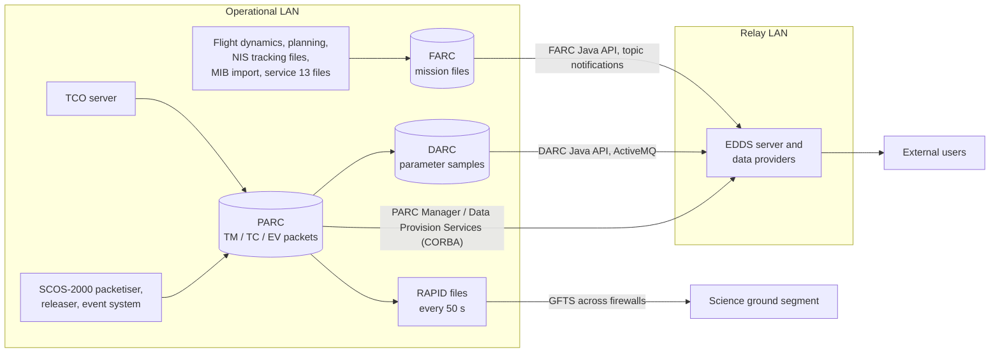
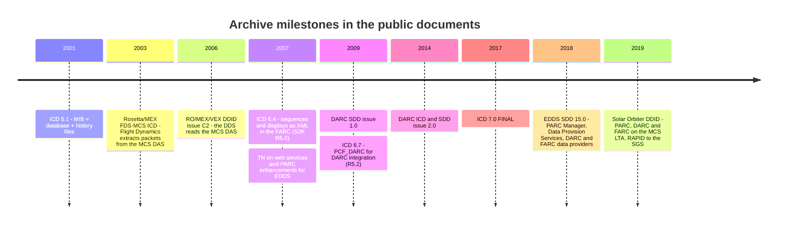

# Mission archives: PARC, DARC and FARC

Everything a [SCOS-2000](index.md) mission control system receives, sends or produces ends up in
one of three archives of ESA's ground operation software (EGOS):

* the **PARC**, the packet archive, holding SCOS-2000 telemetry, telecommand and event packets;
* the **DARC**, the parameter archive, holding decoded telemetry parameter samples;
* the **FARC**, the file archive, holding mission files: flight dynamics and planning products,
  MIB releases, files reconstructed from the downlink, and SCOS-2000's own sequence and display
  definitions.

For Solar Orbiter all three run on the mission control system's long-term archive (LTA) server on
the operational LAN, and the data dissemination system ([EDDS](edds.md)) answers every external
request from them.[^solo-gen][^solo-sec] This page collects what the public documents say about
the three archives. Their own interface and design documents are not public, so much of the
picture comes from their clients (EDDS, the time correlation server, the MIB import) and from the
Solar Orbiter Data Delivery ICD; where the sources are silent, the page says so.

## Names

| Acronym | Expansion as printed | Source |
|---|---|---|
| PARC | Packet ARChive | EDDS glossary[^glo-acr] |
| PARC | Packet Archive | EDDS SDD[^sdd-acr] |
| DARC | **Data Archive** | EDDS glossary[^glo-acr] |
| DARC | **Parameter Archive** | Solar Orbiter DDID; Database Import ICD 7.0 ("Parameter Archive (DARC) system")[^solo-acr][^icd-darc] |
| DARC | "a dedicated parameter archive"; the SDD calls its content the "Telemetry Parameter Archive" | EDDS SRS; EDDS SDD[^srs-ctx][^sdd-darc] |
| FARC | File Archive | EDDS glossary; Solar Orbiter DDID[^glo-acr][^solo-acr] |
| LTA | Long Term Archive | Solar Orbiter DDID[^solo-acr] |
| RAPID | Raw Archive Packet Interceptor Dumper | Solar Orbiter DDID[^solo-acr] |
| PDS | Packet Distribution System | EDDS glossary[^glo-acr] |
| CPD | Client Packet Distributor | EDDS SDD[^sdd-acr] |

The two expansions of DARC describe the same component; its content is parameters.

## Where the archives sit



The flows are assembled from the Solar Orbiter DDID (sources of each data type, RAPID, the Generic
File Transfer System GFTS), the
EDDS SDD (data provider interfaces) and the import ICD (MIB content in the FARC).[^solo-gen][^solo-rapid][^sdd-ctx][^sdd-providers][^icd-farc]

!!! warning "Inference"
    The arrow from PARC to DARC is this wiki's reading: SCOS-2000 decommutes parameters from
    packets, and the DARC returns, for each sample, the SPID and generation time of the packet it
    came from, which suggests that it is populated from processed packets. How samples actually
    reach the DARC is not stated in the available sources.[^sum-darc230]

EDDS supports several deployment scenarios: data providers in the operational LAN, replicated in
the relay LAN, split between the two, or replicated in the office LAN; when they are outside the
operational LAN, the only interaction with it is their synchronisation by the Secure File Transfer
daemon.[^sdd-deploy] The EDDS SRS recommends, for security and performance, replicating the
long-term archives to the EDDS LAN.[^srs-repl] For Solar Orbiter, the redundancy of the back end
(the data providers on the MCS) is that of the MCS itself, the DDS being reconfigured to the backup
source if needed.[^solo-backup]

## History: from history files to three archives

**History files.** In the SCOS-2000 of the early 2000s the MIB was described as a static part, the
"database", and a dynamic part, the "history files".[^icd51-hist] Up to S2K-R5 the SPID of a
telemetry packet also decided which history file the packet was archived in.[^icd70-spid] Issue
5.1 therefore asks that the mapping between packet identification fields and SPIDs not change once
archiving has started, and that PID entries whose SPIDs are present in the history files not be
deleted, so that retrieval services "such as the Generic Data Distribution System" keep
working.[^icd51-pid] The
Rosetta/Mars Express/Venus Express DDID speaks of the MCS **Data Archive System (DAS)**, "not to be
confused with the long term data archive", from which the DDS and Flight Dynamics' SCOS-2000/ORATOS
Data Access (SoDA) software retrieved packets; TC packets were retrieved by the primary key of the TC history file (packet
filing time) or its secondary key (specified execution time).[^ro-das][^ro-tckeys][^fds-soda] The
SCOS-2000 TM retrieval service TDRS likewise extracted parameter values from fixed-length packets in
"the SCOS-2000 history file archive".[^srs-ctx]

**Renaming.** Among the clarifications of ICD issue 6.7, one asks that remaining mentions of "History
files" be replaced by "packet archive".[^icd70-a1-67]

**FARC.** From SCOS-2000 release 5.0, command sequence and display definitions are converted to XML
and imported into the FARC instead of the run-time database (ICD issue 6.4, 2007).[^icd-farc][^icd70-log]
Aeolus contributed to the Earth Explorer kernel the management of on-board software configurations
through sequences stored in a "Central File Archive".[^gsaw05]

**DARC.** The DARC was developed because, in the words of the EDDS SRS, mission control systems
"generate parameter data on the fly", which could not meet EDDS performance; a design document for
it existed by January 2009 (issue 1.0). The same SRS section adds that a "new packet archive low
level component" (PARC) had been finalised within EGOS.[^srs-ctx][^srs-darcsdd] The MIB gained the field
`PCF_DARC` for it with ICD issue 6.7 (S2K-DCR-5146, and SPR-5711 adding `PCF_DARC` and `PCF_ENDIAN`
"for DARC integration"), applicable from SCOS-2000 R5.2.[^icd70-a1-67] The DARC ICD and design
document reached issue 2.0 in June 2014.[^glo-refs] EDDS later had to distinguish DARC versions
up to 2.2.2 (millisecond time stamps, engineering values only) from 2.3.0 and later (microseconds,
raw values, parent packet information).[^cig-darc][^sum-darc230]



Sources: the cited ICD issues and the reference lists of the EDDS SRS and glossary.[^icd51-hist][^fds-soda][^ro-das][^icd70-log][^glo-refs][^srs-darcsdd][^icd70-a1-67][^sdd-title][^solo-title]

## PARC: the packet archive

### What it holds

The PARC stores **SCOS-2000 packets**, also called TDEV packets: a common header, a header
specific to telemetry (TM), telecommand (TC) or event (EV) packets, and the packet data.[^solo-pkt]

* For spacecraft TM the packet data are the complete source packet from its primary header
  onwards. Some packets instead contain a whole transfer frame (for example frames filed while a
  science packet is incomplete) or MCS-internal data on separate data streams.[^solo-pktdata][^solo-frames]
* For TC the packet data are not the telecommand alone but everything the TC History needs:
  static information from the MIB, release conditions, verification status and finally the packet
  sent. SCOS-2000 also files, with SPID 200, a separate packet with the static PTV/CEV details of
  each command; released commands use SPID 100. Because the MIB on the MCS may change, storing the
  static information with each command is the only way to interpret old commands correctly.[^solo-pktdata][^solo-tcdetails][^solo-tmhdr]
* For EV the packet data are MCS event messages, for example the metadata of TM files
  reconstructed from the downlink.[^solo-pktdata]
* MCS-internal packets on APID 1966: file transfer model metadata, good, bad and idle mini transfer
  frames, bad telemetry packets, missing packet detection, packets with no assigned SPID, dynamic
  user-defined constants, TC Spacon and MISC configuration packets, time correlation report, couple
  and coefficient packets, and releaser packets including ground station responses.[^solo-int]
* The time correlation server files its couples and coefficients here, deletes couple packets in
  the PARC on request, and finds the earliest valid coefficients by querying it.[^tn-parc]

Telemetry and event packets are written once; the same packet can be stored twice (for example
after a re-call to fill a gap), differing only in some header fields such as the reception time.
TC packets, in contrast, are **updated** in place each time their verification status changes;
their release time is a unique key.[^solo-update]

### Keys and header

The common header carries the two keys. The *filing time* is part of the primary key and is the
EDDS "generation time": for spacecraft TM, the time stamp chosen by the time-stamping policy
(normally the correlated on-board generation time), for TC the release time. The *creation time*
is a secondary key, the EDDS "storage" or "reception" time: for TM roughly when the packet was
received and stored, for TC its (estimated) execution time.[^solo-hdr] The *Filing Key* is the
SPID.[^solo-tmhdr]

<div class="bitfield" data-title="SCOS-2000 common packet header, Solar Orbiter version 5 (480 bits)" data-width="32"
     data-fields='[{"n":"C-Tree","b":16},{"n":"Access flag","b":8,"d":"0 insert, 1 update"},{"n":"Spare","b":6},{"n":"Sim","b":2},
                   {"n":"Filing time s","b":32,"g":"Filing time (primary key)"},{"n":"Filing time us","b":32,"g":"Filing time (primary key)"},
                   {"n":"Creation time s","b":32,"g":"Creation time (secondary key)"},{"n":"Creation time us","b":32,"g":"Creation time (secondary key)"},
                   {"n":"Create ID","b":32},{"n":"S/C ID","b":16},{"n":"G/S ID","b":16},{"n":"Size","b":32},
                   {"n":"Type","b":4,"d":"1 TM, 2 TC, 3 EV"},{"n":"Version","b":4,"v":"5"},{"n":"Spare","b":2},{"n":"Filing","b":1},{"n":"Dist","b":1},{"n":"Timestamp","b":2,"d":"0 PR, 1 FT, 2 PG"},{"n":"Time quality","b":2},{"n":"Stream ID","b":16},
                   {"n":"Sequence counter","b":32},{"n":"Filing key = SPID","b":32},{"n":"Retr key 1","b":16},{"n":"Retr key 2","b":16},
                   {"n":"Mission ID","b":16},{"n":"Context ID","b":16},{"n":"Domain ID","b":16},{"n":"DB release","b":16},{"n":"DB issue","b":16},{"n":"Spare","b":16}]'></div>

The field list is the Solar Orbiter DDID's simplified version of the SCOS-2000 Packet Management
ADD; for Solar Orbiter the S/C ID and mission ID are 650, context and domain 0, and the header
version 5.[^solo-hdr] A TM packet adds a 16-octet header (validity, TPSD, route ID with data unit
type and qualifier, APID, source sequence count, PUS type and subtype).[^solo-tmhdr] The full field
semantics are on [EDDS request and data formats](edds-formats.md).

!!! warning "Inference: header sizes"
    The fields above add up to 60 octets and the TM header to 16, i.e. 76 octets, which is the
    SCOS-2000 TM packet header length that the import ICD gives for header version 4 (64 octets
    for versions 0 to 3).[^solo-hdr][^solo-tmhdr][^icd-tpcf] Solar Orbiter's version 5 therefore
    appears to keep the version 4 size; no source states it.

The DB release and DB issue fields record the MIB version used when the packet was archived, from
`VDF_RELEASE` and `VDF_ISSUE` of the [vdf](../mib/tables/vdf.md) table.[^solo-hdr] In the public
releases these are 10720/651 (MIB of 2020-04-16, comment "20200416-CSW3.0.3p1_MAS6.51") and
25925/733 (2025-09-16, "20250916-CSW3.1.2_MAS7.33").[^mib][^mib20] The *Stream ID* separates data
streams: for Solar Orbiter 1000 to 1003 are VC 0 real-time non-science, VC 1 playback non-science,
VC 2 science and VC 3 file transfer online, 2000 to 2003 the offline equivalents, stream 1 for TC,
1000 and 1001 for events, and 65535 for internal packets such as superseded time correlation
coefficients.[^solo-hdr]

!!! note "TPCF_SIZE and the archive"
    The import ICD keeps a field `TPCF_SIZE` in [tpcf](../mib/tables/tpcf.md) solely for mission
    tools that generate "History Files configuration files", recommending the full SCOS-2000
    packet size (header plus source packet) for fixed packets and 0 for variable
    ones.[^icd-tpcf] Solar Orbiter fills it with source packet sizes, for example 14 octets for
    the time report.[^mib]

### Access paths

EDDS reaches the PARC in two ways:[^sdd-parc][^sdd-tm][^cig-parc][^sum-batch]

| Path | Interface | Capabilities and limits |
|---|---|---|
| **PARC Manager** | CORBA (method `viewSelectMode` of the view operation interface); registered in the CORBA name server, hard-coded as "PAMASviews" up to SCOS 5.4 | Batch only. Queries by SPID only, not APID, and no filtering by type or subtype; EDDS maps APID, type, subtype and PI1/PI2 to SPIDs using the mission's `pid.dat` and filters the rest itself. Supports the "PARC raw" request types and the TM gap report |
| **Data Provision Services** | CORBA `HFC.StreamingService`: `retrieveRange` for history (markers, a batch per call, 60 s processing limit), `subscribe` for live data; Command, Packet, Event and Out of Limits provision services | Data already decoded, decoupling EDDS from packet details; parameter information for TM; the only path for **streaming** |

Batch retrieval selects by the PARC primary and secondary keys and the data stream, retrieves in
fixed-size arrays, then filters, formats, compresses and encrypts.[^sdd-tm] The EDDS user manual
lists SMON, the SCOS-2000 monitoring service, as a third route to PARC data; SMON requests return
parameter values with out-of-limit information rather than packets.[^sum-batch] The TM gap report needs SCOS 5.4.18 or 5.5.2 or later.[^sum-batch]
The "new PARC API" introduced **dataspaces**: a request may name the dataspace to read, the first
in the list being the PARC's current one.[^sdd-queues][^sum-dataspace][^cig-parc]

!!! warning "Inference"
    A dataspace looks like a separate partition of the archive (for example for tests, simulations
    or reprocessing) within one mission and domain. A later issue of the EDDS SDD has an appendix
    "Dataspace and Datapartition in EGS-CC", requiring every EDDS request to EGS-CC to name a
    dataspace and a datapartition, so the concept carried over to EGS-CC. None of the available
    sources defines a PARC dataspace.[^sdd-queues][^srs-ds][^sdd25-ds]

## RAPID: mirroring the packet archive

**RAPID** files are binary files of SCOS-2000 packets produced by the MCS packet archive process. They
were designed for mirroring packet archives across a firewall (Solar Orbiter also uses them to keep
the prime and backup MCS in step), and they are the nominal way the Solar Orbiter science ground
segment (SGS) receives all packet data.[^solo-rapid][^solo-rapidsize]

* Three files are open at any time, for TM (including time packets and coefficient packets), TC and
  EV. Each is closed after a configurable time (50 s for Solar Orbiter) and then pushed by the
  Generic File Transfer System (GFTS)[^solo-acr] across the operational LAN and corporate firewalls, up to 5 transfers in parallel to clear a
  backlog, so files may arrive out of order; two weeks of RAPID files are kept for recovery.[^solo-rapid][^solo-rapidsize][^solo-storage]
* Packets appear in the order the MCS received them, so re-dumped or re-called data arrive out of
  generation order, and updated TC packets reappear in full.[^solo-rapid]
* Names are `PARC_<Type>_<FirstPacketTime>__<LastPacketTime>`, with times in
  `YYYY-MM-DDTHH:MM:SS.mmmmmm`: reception time for TM, last update time for TC, MCS creation time
  for EV; for example `PARC_TM_2019-04-04T12:30:00.000000__2019-04-04T12:32:50.000000`.[^solo-rapidname]
* A C++ library for reading RAPID files can be delivered to the SGS.[^solo-rapidname]

A RAPID file is a sequence of records, each preceded by a 32-bit length. A record has a fixed part
and a variable part:[^solo-rapidfmt]

<div class="bitfield" data-title="RAPID record, fixed part (448 bits) - followed by FIL and the SCOS-2000 packet" data-width="32"
     data-fields='[{"n":"ID (record version, 1)","b":64},{"n":"ST - first packet to delete (unused)","b":64},{"n":"ET - last packet to delete (unused)","b":64},{"n":"AT - action time (us since 1970)","b":64},{"n":"DS - packet data size","b":64},{"n":"TYPE","b":32,"d":"0 insert, 1 update, 2 delete"},{"n":"SM - sync marker","b":32,"v":"0x1ACFFC1D"},{"n":"NS (not used)","b":32},{"n":"FS - filter size (0)","b":32}]'></div>

| Field | Octets | Meaning |
|---|---|---|
| ID | 8 | Version of the record structure, value 1 |
| ST, ET | 8 + 8 | Time range of packets to delete; present but not used |
| AT | 8 | Action time: MCS time of the insert or update in the original archive, 64-bit microseconds since 1970 |
| DS | 8 | Size of the PACKET field |
| TYPE | 4 | 0 insert (any packet), 1 update (a TC packet to overwrite), 2 delete (should not occur; ignore) |
| SM | 4 | Sync marker 0x1ACFFC1D |
| NS | 4 | Not used |
| FS | 4 | Size of FIL, 0 for Solar Orbiter |
| FIL | 0 | Filter information for deletions, absent |
| PACKET | DS | The SCOS-2000 packet with its headers |

!!! warning "Inference"
    The sync marker 0x1ACFFC1D is the same 32-bit pattern as the CCSDS attached sync marker of
    telemetry frames, presumably chosen to make record boundaries easy to verify.[^solo-rapidfmt][^ccsds-asm]
    The reuse is not commented on in the source.

!!! note "Which ICD defines RAPID?"
    The Solar Orbiter DDID references a "RAPID ICD", EGOS-MCS-S2K-ICD-1005; the EDDS glossary lists
    the same number as the "System management SCOS-2000 - SFM service ICD", issue 5 of 2008.[^solo-docs][^glo-refs]
    One of the two references is wrong, or the number was reused; neither document is public.

## DARC: the parameter archive

### What it holds

The DARC stores telemetry parameter samples. EDDS documents several properties:

* **Engineering values.** Up to DARC 2.2.2 only engineering values are kept, so the TDRS-compatible
  spreadsheet output cannot show raw values; from 2.3.0 the raw value and its type, the parent
  packet (the SPID for SCOS-2000) and the parent packet's generation time are also returned, and
  time stamps have microsecond rather than millisecond resolution.[^sdd-tdrs][^sum-darc230][^cig-darc]
* **No limit status, no statistics.** The DARC does not provide the out-of-limit status of samples,
  and it does not compute statistics: EDDS reads all the data to compute them.[^sdd-tdrs]
* **Recording list.** Not every parameter is archived. The MIB field `PCF_DARC` adds a parameter to
  the recording list (`1`) or leaves the DARC configuration unchanged (`0`, the default); it is not
  imported by SCOS-2000, only read by the DARC.[^icd-darc]
* **Consolidation and dataspaces.** The DARC has a "last consolidation time" per dataspace, which
  EDDS shows and lets users take as the end of a parameter request.[^sdd-queues][^srs-ds][^sum-dataspace]
* **Live stream.** Live parameter samples are published on an ActiveMQ topic (an example name in the
  CIG is `esa.egos.darc.realtimeParams`); EDDS re-encodes them in Google Protocol Buffers.[^sdd-darc][^cig-darc]

In the Solar Orbiter MIB, 49,330 of 126,745 monitoring parameters (39 %) have `PCF_DARC = 1`; in
the 2020 release, 43,456 of 102,104 (43 %).[^mib][^mib20] All other parameters leave the field
empty.

!!! warning "Inference"
    With `0` meaning "no change", an empty `PCF_DARC` presumably leaves those parameters out of
    the recording list unless the DARC is configured otherwise; their values remain available from
    the packets in the PARC. The ICD does not say what the DARC does with parameters never flagged.[^icd-darc]

### Access

EDDS uses the DARC Java API (`IDataRetrieval`, with `getParamSamples` and
`getStaticParameterList`) for five request types: parameters, statistics, definitions, preview and
report. When all parameters are requested with no quota restriction and no TDRS formatting, EDDS
retrieves everything in one DARC sample request; otherwise it requests each parameter and
merges.[^sdd-darcreq] The CIG configures it with a database host, schema, user, dataspace and the
`edds.darc.post.2.3.0` switch.[^cig-darc] SCOS-2000's own monitoring service SMON is an alternative
parameter source that also returns out-of-limit information.[^sum-batch]

## FARC: the file archive

### What it holds

| Content | Source |
|---|---|
| Auxiliary files from flight dynamics, mission planning and ground station scheduling | For Solar Orbiter: MIB, attitude (ATT, AttitudePTEL), events (EVT), orbit (Orbit, short and long term), one-way light time (OWLT), station visibility and link budget (VISTA), HGA blockage (HGAB), short-term solar aspect (SolarAspectST), CRF files (CRFG), user events (UEVT), station scheduling events (EVFM)[^solo-aux] |
| TM files downlinked with the Solar Orbiter service 13 protocol | Stored under the `data` directory as file type "DLPP Files", named `<PS_ID>_<file_reconstruction_timestamp>`, e.g. `13_2014.336.13.54.07.057`; plain concatenations of TM packets, not split into the PARC in the baseline[^solo-tmfiles] |
| Tracking data from the ground stations | For Rosetta and Mars Express, the MCS obtained the ESA IFMS files through the NIS and stored them in the FARC, along with NASA/DSN tracking files[^fds-farc] |
| Command sequence and display definitions (XML) | Since SCOS-2000 R5.0[^icd-farc] |

The EDDS view of the FARC is a **catalogue** (file type, creation time, release and issue per
file), **files** retrieved by name, type or time, and **subscriptions**.[^sum-batch] A domain value
of −1 denotes the FARC's "No Domain".[^sdd-queues] With the "Consolidated FARC" version 2.0i5, EDDS must also be configured with the zone of the FARC
server.[^cig-farc]
The client interface is the FARC Client Services API (EGOS-GEN-FARC-ICD-1001, issue 4.5 of
2012), not public; EDDS isolates itself from FARC versions behind an interface jar.[^cig-refs][^sdd-farcif]

### Subscriptions

When a file changes, the FARC server posts a message on a message bus topic; EDDS matches it
against its subscription table and either delivers the new version by a file request or sends an
e-mail, and drops subscriptions to deleted files.[^sdd-farc] Solar Orbiter users can subscribe to
any auxiliary file received by the file archive, whether it comes from an external or an internal
source.[^solo-summary] Streaming makes no sense for files and is not supported.[^sdd-farc]

### MIB content in the FARC

The FARC holds MIB-derived content in two senses.

1. **Run-time definitions.** From SCOS-2000 R5.0, sequence ([csf](../mib/tables/csf.md),
   [css](../mib/tables/css.md), [sdf](../mib/tables/sdf.md), [csp](../mib/tables/csp.md)) and
   display ([dpf](../mib/tables/dpf.md), [gpf](../mib/tables/gpf.md), [spf](../mib/tables/spf.md)
   and related) definitions in the ASCII MIB are converted on request into XML files and imported
   into the FARC, not into the POST run-time database; command sources and the TM desktop load them
   from there. Sequences and displays are thus imported independently of a new TM/TC database, and
   incrementally: only the definitions in the imported files change, the others stay
   available.[^icd-farc][^icd-disp][^icd-seq] The XML formats are in the TC Sequences definitions
   ICD (ICD-0051) and the TM Displays and Printout definitions ICD (ICD-5001), both not
   public.[^icd-ad] See [Command sequences](../mib/sequences.md) and
   [Display definitions](../mib/displays.md).
2. **MIB releases as files.** Solar Orbiter's FARC holds the mission database file as auxiliary
   file type `MIB`, available through EDDS; Rosetta and Mars Express distributed it as file type
   `MIB_`, tarred, to Flight Dynamics.[^solo-aux][^fds-mib] The public MIB releases on this wiki
   ([2020](../library/mib-20200416m10720pfms001-sol.md),
   [2025](../library/mib-20250916m25925pfms001-sol.md)) are such files.

## Beyond the MCS archives

A 2020 ESOC presentation describes ARES (Analysis and Reporting System), an off-line analysis system
evolved from MUST and built on the EGOS User Desktop, mainly for housekeeping data in engineering
format. Its server reads EDDS response files fed from the DARC and PARC on the operational LAN; a
multi-mission shared store aims at keeping all data rather than a subset (Gaia alone receives
around 150 million unique housekeeping samples a day), ARES itself being described as a Hadoop
database cluster, and the PyARES library brings Spark-based processing to the
data.[^santos-ares][^santos-store][^santos-py][^santos-ltdp]

## What is not public

| Document | Reference | Mentioned in |
|---|---|---|
| DARC ICD | EGOS-GEN-DARC-ICD-1001, issue 2.0, 2014-06-06 | EDDS glossary and SDD[^glo-refs][^sdd-refs] |
| DARC Software Design Document | EGOS-GEN-DARC-SDD-1001, issue 1.0 (2009) and 2.0 (2014) | EDDS SRS and glossary[^srs-darcsdd][^glo-refs] |
| Analysis of Web Services and PARC Enhancements to support EDDS | EGOS-MDW-EDDS-TN-1002 (also printed EGOS-MDW-TN-1002), 2007-04-13 | EDDS glossary and SDD[^glo-refs][^sdd-refs] |
| FARC Client Services API | EGOS-GEN-FARC-ICD-1001, issue 4 revision 5, 2012-10-31 | EDDS CIG[^cig-refs] |
| SCOS-2000 Packet Management ADD (SCOS-2000 packet structure) | EGOS-MDS-S2K-ADD-0024 | Solar Orbiter DDID[^solo-docs] |
| RAPID ICD | EGOS-MCS-S2K-ICD-1005 | Solar Orbiter DDID[^solo-docs] |
| TC sequences and TM displays XML ICDs | ICD-0051, ICD-5001 | ICD 7.0[^icd-ad] |
| Data Disposition System SRD (GDDS) | EGOS-MCS-GDDS-SRD-5720 | EDDS glossary[^glo-refs] |

Questions the public sources leave open: the storage technology of the PARC and the FARC (the CIG
names only a DARC "database" with host and schema), retention and consolidation policies, how the
DARC is fed, what a dataspace is exactly, and how PARC dataspaces relate to DARC ones.[^cig-darc]
HARC, a further source named next to the PARC and DARC in the current EDDS documents, is not an
SCOS-2000 archive: the EDDS SDD describes its HARC data provider as retrieving data from the EGOS-CC
HBase archive.[^euicd-harc][^sdd25-harc]

## Related pages

* [EDDS](edds.md), [EDDS request and data formats](edds-formats.md), [TDRS](tdrs.md) and
  [GDDS and the DDIDs](gdds-and-ddids.md): the systems that read the archives.
* [Time correlation in SCOS-2000](time-correlation.md): couples and coefficients filed in the PARC.
* [SCOS-2000 architecture](architecture.md) and [NCTRS, NIS and the ground station interface](nctrs-nis.md).
* [The Solar Orbiter MIB](../missions/solar-orbiter/mib.md) and [History of the Database Import ICD](../mib/icd-history.md).

## SQL used

??? example "SQL used"
    ```sql
    -- solo-2025-09-16.sqlite (MIB__20250916M25925PFMS001_SOL)
    SELECT * FROM vdf;                                   -- 25925PFM | 20250916-CSW3.1.2_MAS7.33 | 0 | 25925 | 733
    SELECT count(*), sum(PCF_DARC = '1') FROM pcf;      -- 126745, 49330
    SELECT quote(PCF_DARC), count(*) FROM pcf GROUP BY 1;  -- '' 77415, '1' 49330
    SELECT * FROM tpcf WHERE TPCF_SPID = 9999;          -- YCD00902 | 14
    -- solo-2020-04-16.sqlite (MIB__20200416M10720PFMS001_SOL)
    SELECT * FROM vdf;                                   -- 10720PFM | 20200416-CSW3.0.3p1_MAS6.51 | 0 | 10720 | 651
    SELECT count(*), sum(PCF_DARC = '1') FROM pcf;      -- 102104, 43456
    ```

[^glo-acr]: [EDDS Glossary EGOS-GEN-EDDS-GLO-0001, version 7.0](../library/glo.md), §4 Acronyms (DARC, FARC, PARC, PDS), PDF pp. 9–10.
[^glo-refs]: [EDDS Glossary](../library/glo.md), §2 Applicable Documents and §3 Reference Documents (RD-4, RD-32, RD-33, RD-35, RD-37, RD-38), PDF pp. 6–8.
[^sdd-acr]: [EDDS Software Design Document EGOS-GEN-EDDS-SDD-1001, version 15.0](../library/sdd.md), acronym list (CPD, PARC), PDF p. 11.
[^sdd-title]: [EDDS SDD](../library/sdd.md), title page (version 15.0, 2018-02-16), PDF p. 1.
[^sdd-refs]: [EDDS SDD](../library/sdd.md), reference documents RD-18, RD-23 and RD-24, PDF p. 9.
[^sdd-ctx]: [EDDS SDD](../library/sdd.md), §4.5.2 EGOS Ground System and §6.1.1 Top Level Component Architecture, PDF pp. 18 and 22.
[^sdd-deploy]: [EDDS SDD](../library/sdd.md), §6.1.2 deployment scenarios, PDF pp. 23–28.
[^sdd-providers]: [EDDS SDD](../library/sdd.md), Table 1 EDDS Component Summary (PARC, FARC, DARC and SMON data providers), PDF pp. 31–33.
[^sdd-queues]: [EDDS SDD](../library/sdd.md), §6.2.8.8 EDDS Server processing (queues `retrieve.dataspaces`, `retrieve.consolidation`, `retrieve.farccat`), PDF pp. 59–60.
[^sdd-parc]: [EDDS SDD](../library/sdd.md), §6.2.9 PARC and Data Provision data providers, PDF pp. 64–65.
[^sdd-farcif]: [EDDS SDD](../library/sdd.md), §6.2.10 EDDS FARC Interface, PDF p. 66.
[^sdd-farc]: [EDDS SDD](../library/sdd.md), §6.2.11 FARC data provider, PDF pp. 67–68.
[^sdd-darc]: [EDDS SDD](../library/sdd.md), §6.2.13 DARC data provider, PDF pp. 71–72.
[^sdd-tm]: [EDDS SDD](../library/sdd.md), §6.3.9 PARC & Data Provision Request Processor, PDF pp. 96–99.
[^sdd25-ds]: [EDDS SDD EGOS-GEN-EDDS-SDD-1001, version 25.0 (2025-03-07)](../library/sdd-v24.md), Appendix D Dataspace and Datapartition in EGS-CC, PDF p. 161.
[^sdd25-harc]: [EDDS SDD version 25.0](../library/sdd-v24.md), §6.2.10 HARC data provider, PDF p. 67.
[^sdd-tdrs]: [EDDS SDD](../library/sdd.md), §6.3.12.8.2 and §6.3.12.8.3 Parameter TDRS and spreadsheet formatters, PDF pp. 120–121.
[^sdd-darcreq]: [EDDS SDD](../library/sdd.md), §6.3.12 DARC Request Processor, PDF pp. 120–123.
[^sum-batch]: [EDDS Software User Manual EGOS-GEN-EDDS-SUM-1001, version 14.0](../library/sum.md), §5.2 Batch Request types, PDF pp. 15–16.
[^sum-dataspace]: [EDDS SUM](../library/sum.md), §6.1.5.6.4.3 Dataspace option, PDF p. 50.
[^sum-darc230]: [EDDS SUM](../library/sum.md), §6.1.5.6.4.5 Representation Selection and §6.1.5.6.4.6 DARC v2.3.0 and later, PDF p. 50.
[^srs-ctx]: [EDDS Software Requirements Specification EGOS-GEN-EDDS-SRS-1001, version 18.0](../library/srs.md), §4.1 Relationship to Current Projects and §4.2, PDF p. 13.
[^srs-darcsdd]: [EDDS SRS](../library/srs.md), reference document RD-25 (DARC SDD issue 1.0, 2009-01-09), PDF p. 9.
[^srs-ds]: [EDDS SRS](../library/srs.md), requirements on dataspaces and the DARC last consolidation time, PDF pp. 40–44.
[^srs-repl]: [EDDS SRS](../library/srs.md), requirement EDDS-SR-08030 (data location; replication of the long-term archives recommended), PDF p. 110.
[^cig-darc]: [EDDS Configuration and Installation Guide EGOS-GEN-EDDS-CIG-1001 (issue 24.0 in the page footers)](../library/cig-v24.md), DARC properties and DARC note, PDF pp. 13 and 21–22.
[^cig-parc]: [EDDS CIG](../library/cig-v24.md), PARC properties (`edds.parc.dataspace`, `edds.parc.dataspaces.enabled`) and §3.2.6.1.12 PARC Manager application name, PDF pp. 24 and 35.
[^cig-farc]: [EDDS CIG](../library/cig-v24.md), FARC ORB properties (`edds.farc.orb.zone`), PDF p. 28.
[^cig-refs]: [EDDS CIG](../library/cig-v24.md), §2.1.1 Applicable documents (AD-5), PDF p. 9.
[^euicd-harc]: [EDDS EUICD EGOS-GEN-EDDS-ICD-1001, version 24.0](../library/euicd-v25.md), §6 Table 13 Data Type Formatting (PARC, HARC, DARC, FARC and EGS-CC sources), PDF pp. 38–39.
[^solo-title]: [Solar Orbiter Data Delivery ICD SOL-ESC-IF-05011, issue 1 revision 2](../library/solo-ddid-i1r2.md), title page, PDF p. 1.
[^solo-docs]: [Solar Orbiter DDID](../library/solo-ddid-i1r2.md), §1.3.2 Reference Documents (R-9, R-15), PDF pp. 8–9.
[^solo-acr]: [Solar Orbiter DDID](../library/solo-ddid-i1r2.md), §1.4 Acronyms, PDF p. 9.
[^solo-summary]: [Solar Orbiter DDID](../library/solo-ddid-i1r2.md), §2 Data Exchange Summary, PDF p. 11.
[^solo-storage]: [Solar Orbiter DDID](../library/solo-ddid-i1r2.md), §5.5 Storage Requirements, PDF p. 14.
[^solo-sec]: [Solar Orbiter DDID](../library/solo-ddid-i1r2.md), §5.6 Security Requirements, PDF p. 15.
[^solo-backup]: [Solar Orbiter DDID](../library/solo-ddid-i1r2.md), §5.8 Backup Requirements, PDF p. 15.
[^solo-gen]: [Solar Orbiter DDID](../library/solo-ddid-i1r2.md), §6.1 Generation Method and §6.2 Data passed through the Interface, PDF p. 16.
[^solo-pkt]: [Solar Orbiter DDID](../library/solo-ddid-i1r2.md), §7.1 SCOS-2000 Packet Format Definition, PDF p. 18.
[^solo-pktdata]: [Solar Orbiter DDID](../library/solo-ddid-i1r2.md), §7.1 (packet data of TM, EV and TC packets), PDF p. 19.
[^solo-hdr]: [Solar Orbiter DDID](../library/solo-ddid-i1r2.md), §7.1.1 SCOS-2000 Common Packet Header Structure, PDF pp. 20–22.
[^solo-tmhdr]: [Solar Orbiter DDID](../library/solo-ddid-i1r2.md), §7.1.1 (Filing Key, TC SPIDs) and §7.1.2 SCOS-2000 TM Packet Header Structure, PDF pp. 21 and 23.
[^solo-tcdetails]: [Solar Orbiter DDID](../library/solo-ddid-i1r2.md), §7.1.4 Command Details Data, PDF p. 25.
[^solo-frames]: [Solar Orbiter DDID](../library/solo-ddid-i1r2.md), §7.3 Missing Frames and Bad Packets, PDF p. 25.
[^solo-int]: [Solar Orbiter DDID](../library/solo-ddid-i1r2.md), §8.1 Packetised Data, table of MCS internally generated packets, PDF p. 26.
[^solo-aux]: [Solar Orbiter DDID](../library/solo-ddid-i1r2.md), §8.4.1 Auxiliary File Types, PDF p. 29.
[^solo-tmfiles]: [Solar Orbiter DDID](../library/solo-ddid-i1r2.md), §8.4.2 TM Files, §8.4.2.3 and §8.4.2.4, PDF pp. 29–31.
[^solo-rapid]: [Solar Orbiter DDID](../library/solo-ddid-i1r2.md), §10 RAPID File Exchange and §10.1, PDF p. 33.
[^solo-update]: [Solar Orbiter DDID](../library/solo-ddid-i1r2.md), §10.1 (updates of TC packets, duplicate TM and EV packets), PDF p. 33.
[^solo-rapidsize]: [Solar Orbiter DDID](../library/solo-ddid-i1r2.md), §10.2 RAPID Size and Frequency of Transfers, PDF pp. 33–34.
[^solo-rapidname]: [Solar Orbiter DDID](../library/solo-ddid-i1r2.md), §10.3 RAPID Interface Utility Software and §10.4 RAPID File Naming Convention, PDF p. 34.
[^solo-rapidfmt]: [Solar Orbiter DDID](../library/solo-ddid-i1r2.md), §10.5 RAPID File Format Definition, Figures 1 and 2 and the record table, PDF pp. 34–35.
[^icd51-hist]: [SCOS-2000 Database Import ICD issue 5.1](../library/icd-5-1-tos-gci.md), §1.4.1 Definitions and Terminology, PDF p. 10.
[^icd51-pid]: [ICD issue 5.1](../library/icd-5-1-tos-gci.md), §3.3.2.4.1 pid, remarks on SPIDs present in the history files, PDF p. 39.
[^icd70-spid]: [SCOS-2000 Database Import ICD issue 7.0](../library/icd-7-0-final.md), §3.3.2.4.1 pid, field 6 `PID_SPID`, PDF p. 86.
[^icd-tpcf]: [ICD 7.0](../library/icd-7-0-final.md), §3.3.2.4.3 tpcf, field 3 `TPCF_SIZE`, PDF p. 95.
[^icd-darc]: [ICD 7.0](../library/icd-7-0-final.md), §3.3.2.1.1 pcf, field 22 `PCF_DARC`, PDF p. 54.
[^icd-farc]: [ICD 7.0](../library/icd-7-0-final.md), §2.5 import of sequence and display definitions into the FARC, PDF p. 24.
[^icd-disp]: [ICD 7.0](../library/icd-7-0-final.md), §3.3.2.7 display definitions (introduction), PDF p. 110.
[^icd-seq]: [ICD 7.0](../library/icd-7-0-final.md), §3.3.3.3 command sequences (introduction), PDF p. 161.
[^icd-ad]: [ICD 7.0](../library/icd-7-0-final.md), applicable documents AD-4 (ICD-0051) and AD-5 (ICD-5001), PDF p. 18.
[^icd70-log]: [ICD 7.0](../library/icd-7-0-final.md), document change log (issue 6.4: sequences and displays moved to the FARC as XML), PDF p. 5.
[^icd70-a1-67]: [ICD 7.0](../library/icd-7-0-final.md), Annex 1, changes applicable from R5.2 in ICD version 6.7 (S2K-DCR-5146, S2K-SPR-5711) and the 6.7 clarifications, PDF pp. 258–259.
[^ro-das]: [Rosetta/MEX/VEX DDID issue C2](../library/ro-esc-if-5003-ddid-c2.md), §6.2 Generation Method, PDF p. 38.
[^ro-tckeys]: [DDID issue C2](../library/ro-esc-if-5003-ddid-c2.md), §7.1.3.19 note on TC execution and uplink time filter keywords, PDF pp. 50–51.
[^fds-soda]: [RO-ESC-ID-5003 issue B1, FDS-MCS ICD](../library/mex-esc-id-5003-fds-icd.md), §1.3.1 Data from MCS to FDS (packetised data via SoDA), PDF p. 9.
[^fds-farc]: [FDS-MCS ICD](../library/mex-esc-id-5003-fds-icd.md), §1.3.1 tracking data files (via the NIS into the MCS FARC), PDF p. 10.
[^fds-mib]: [FDS-MCS ICD](../library/mex-esc-id-5003-fds-icd.md), §6.3.2 Rosetta Files (MIB_) and §7.7 Mission Information Base, PDF pp. 25 and 29.
[^gsaw05]: [Guerrucci et al., GSAW 2005](../library/gsaw2005-guerrucci.md), slide "Missions contribution to the EE Kernel (2)", PDF p. 16.
[^tn-parc]: [EGOS-MCS-S2K-TN-1030 Time Correlation TN](../library/tn-1030-time-correlation.md), §6.3.1.5 and §6.5.2.2 (couple packets sent to the PARC, `deleteTimeCouple`, `findEarliestTime`), PDF pp. 30 and 43.
[^ccsds-asm]: [CCSDS 131.0-B-5, TM Synchronization and Channel Coding](../library/ccsds-131-0-131x0b5.md), §9.3.1 ASM bit pattern and Figure 9-1, PDF pp. 65–66.
[^santos-ares]: [Santos, State and evolution of data analytics infrastructure at ESOC, GSAW 2020](../library/gsaw2020-santos.md), slide "Infrastructure: Introduction to ARES", PDF p. 5.
[^santos-store]: [Santos, GSAW 2020](../library/gsaw2020-santos.md), slide "Multi mission shared storage", PDF p. 9.
[^santos-py]: [Santos, GSAW 2020](../library/gsaw2020-santos.md), slide "Processing and Retrieval: PyARES", PDF p. 10.
[^santos-ltdp]: [Santos, GSAW 2020](../library/gsaw2020-santos.md), slide "Enhancement: LTDP products and collections", PDF p. 13.
[^mib]: [Solar Orbiter MIB release MIB__20250916M25925PFMS001_SOL](../library/mib-20250916m25925pfms001-sol.md), tables `vdf`, `pcf` and `tpcf`, queried by this wiki on 2026-11-12.
[^mib20]: [Solar Orbiter MIB release MIB__20200416M10720PFMS001_SOL](../library/mib-20200416m10720pfms001-sol.md), tables `vdf` and `pcf`, queried by this wiki on 2026-11-12.
