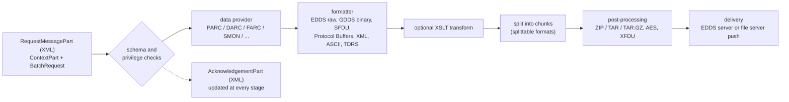
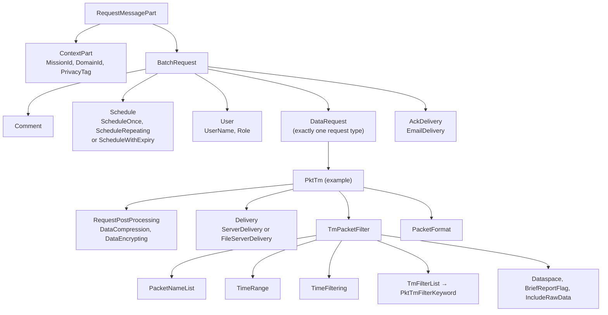

# EDDS request and data formats

This page is the format reference for the [EGOS Data Dissemination System (EDDS)](edds.md).
It covers what a client sends (XML requests), what it gets back (acknowledgements, identifiers,
response files) and the binary records inside those files. The generic definitions come from
the EDDS External User Interface Control Document (EUICD), mainly issue 24.0 of January 2025.
That document says its XML schema files are the primary reference and the text follows
them.[^eu-purpose] The mission layer comes from the Solar Orbiter Data Delivery Interface
Control Document (DDID) SOL-ESC-IF-05011 issue 1.2. The DDID explains which archive answers
each request, which SCOS-2000 headers wrap each packet, and how RAPID files carry the whole
packet archive to the Science Ground Segment.[^ddid-scope]

Three real byte sequences are decoded below. One is a raw PARC telemetry packet shown in an
ESOC presentation, and two are the GDDS binary examples printed in the EUICD. Every decoding
step is marked as this wiki's own work.

## Overview: one request, many shapes of answer



The figure is this wiki's summary of the processing order given in the SDD.[^sdd-steps] The
request type decides which formats are allowed. The EUICD's format table, condensed (✓* marks
formats that can be split into several response files):[^eu-fmt]

| Request family | EDDS raw | Binary (Protocol Buffers or files) | XML | ASCII | Others |
|---|---|---|---|---|---|
| Packet TM, TC (PARC) | ✓* | – | – | – | GDDS_BINARY*, SFDU |
| Packet EV (PARC) | ✓* | – | – | – | – |
| Packet TM, TC, EV raw (PARC) | – | ✓* | ✓* | – | – |
| TM report, TC report, event record report | – | ✓* | ✓* | ✓* | RawSourceBinary* (TM report) |
| OOL record report | – | ✓* | ✓* | – | – |
| TM gap report | – | ✓ | ✓ | – | – |
| Packet statistics | – | – | ✓ | – | – |
| Parameter TM (DARC, SMON) | – | ✓* | ✓* | – | TDRS |
| Parameter definition | – | ✓* | ✓* | – | – |
| Parameter statistics, preview | – | – | ✓* | ✓* | – |
| FARC file, file-system file | – | ✓ (as received, in TAR) | – | – | – |
| FARC and file-system catalogues | – | – | ✓ | ✓ | – |
| Acknowledgement | – | – | ✓ | – | – |

Splitting is configured by the EDDS administrator. Each chunk keeps a valid header and tail of
its format.[^eu-fmt] The column positions of Table 13 do not survive text extraction well. This
wiki placed the marks using the per-type format enumerations of EUICD Appendix H (for example
`ParamStatisticsFormat` is `XML` or `ASCII`, and `ParamDefinitionFormat` is `XML` or
`BINARY`).[^eu-h]

## The batch request

### Request types

Every request names one data-access type. The enumeration `DataAccessDataElement` (EUICD
Appendix D.24) is also the "subtype" field of the request ID.[^eu-d24][^eu-reqid]

| Data source | Request types |
|---|---|
| DARC | `Param`, `ParamStatistics`, `ParamDefinition`, `ParamPreview` |
| SMON | `SmonParam` |
| PARC | `PktTm`, `PktTc`, `PktEv`, `PktTmRaw`, `PktTcRaw`, `PktEvRaw`, `PktTmStatistics`, `PktTcStatistics`, `PktEvStatistics`, `PktTmReport`, `PktTcReport`, `PktTmGapReport`, `EventRecordReport`, `OolRecordReport` |
| FARC | `ArchiveCatalogue`, `ArchiveFile`, `ArchiveSubscription` |
| File system | `FileSystemFileCatalogue`, `FileSystemFolderCatalogue`, `FileSystemFile`, `FileSystemSubscription` |
| EDDS | `EddsUsageReport` |
| Streams | `ParamStream`, `PktTmStream`, `PktTcStream`, `PktEvStream`, `OolStream` |
| EGS-CC | `EgsccActivityReport`, `EgsccLogMessageReport` (and the `Egscc...` packet and parameter types of Table 12) |

The `DataSource` enumeration names the back ends: `FARC`, `DARC`, `PARC`, `EDDS`, `SMON`,
`FileSystem` and `DataProvisionService`.[^eu-d27] The types that return XML are paired with
response types. `Param` returns `ParamResponse`, `PktTmRaw` returns `PktRawResponse`,
`PktTcReport` returns `PktTcReportResponse`, `ArchiveCatalogue` returns `CatalogueResponse`,
and so on. The packet types `PktTm`, `PktTc` and `PktEv` and the file types return binary
files.[^eu-map]

### Element tree

The top element of a batch request is `RequestMessagePart` in the namespace
`http://edds.egos.esa/model`. The tree below follows the "children" lists of the schema
appendices.[^eu-c66][^eu-c8][^eu-c16][^eu-c61]



The common building blocks are listed below.

| Element | Content | Values and rules |
|---|---|---|
| `ContextPart` | `MissionId`, `DomainId`, `PrivacyTag` | `PrivacyTag` is `PRIVATE`, `ROLE`, `MISSION` or `PUBLIC`[^eu-d3][^eu-d42] |
| `User` | `UserName`, `Role` | The role picks the privileges and the quota sets[^eu-d22] |
| `ScheduleOnce` | `Immediate` or `Once` (`AbsoluteTime`, `AbsoluteDOYTime` or `RelativeTime`) | Relative times use the XSD duration type[^eu-j] |
| `ScheduleRepeating` | `RepeatingSchedule`: `StartTime`, `Repetition` (`CronExpression` or `Step`), `EndTime` (`FinalDate`, `FinalDOYDate`, `Delta` or `NumberOfRepetition`) | The Archiver creates one request, and one job ID, per execution[^eu-j][^sdd-sched] |
| `ScheduleWithExpiry` | As `ScheduleOnce` plus `RequestExpiryDate` | – [^eu-j] |
| `RequestPostProcessing` | `DataCompression`, `DataEncrypting` | `ZIP`, `TAR`, `TARGZ`, `NONE`; `NONE`, `AES` (implementation mission-specific)[^eu-d25] |
| `ServerDelivery` | `FileName`, `NamePrefixSuffix`, `TimeFormat`, `CustomTimeFormat` | `TimeFormat` is `CCSDS`, `DOY` or `CUSTOM`. File names may not contain a slash, backslash, backtick, question mark, angle bracket, vertical bar, colon, tab or line break.[^eu-e] |
| `FileServerDelivery` | `TargetLocations` (`Target`, `FileServerUsername`, `FileServerPassword`, `TargetFolder`), naming fields, `KeepFileAfterDelivery` | Pushes the result to the user's (S)FTP server[^eu-e] |
| `AckDelivery` | `EmailDelivery` (`EmailList`, `Default`) | Acknowledgement by e-mail[^eu-e] |
| `TimeRange` | `StartTime`, `StartDOYTime`, `RelativeStartTime`, `EndTime`, `EndDOYTime`, `Duration`, `ConsolidationTime` | Used by all packet and parameter filters[^eu-d19] |
| `TimeFiltering` | `GENERATION_TIME` or `STORAGE_TIME` | On-board time (primary key) or archive reception time (secondary key)[^eu-g61] |

### Filters

Packet filters combine a time range with keyword lists. The keywords below are the children of
the filter-keyword types.[^eu-g37-39]

| Filter | Keywords |
|---|---|
| `PktTmFilterKeyword` | `Apid`, `Pid`, `Category`, `GenerationTime`, `GenerationDOYTime`, `ReceptionTime`, `ReceptionDOYTime`, `TimeQuality`, `VirtualChannel`, `DataStream`, `DataBaseVersion`, `GroundStation`, `SourceSequenceCounter`, `SpacecraftId`, `MaximumDataVolume` |
| `PktTcFilterKeyword` | `ExecutionTime`, `ReleaseTime` (and DOY forms), `Type`, `SubType`, `Name`, `DataStream`, `DataBaseVersion`, `SourceSequenceCounter`, `SequenceName`, `CommandSource`, the four acknowledgement flags, `CommandSubSystem`, `CommandSubschedule`, `MaximumDataVolume`, `GroundStationId`, `Description`, `Apid`, `UplinkMode`, `OverallVerificationStatus`, and one status keyword per verification stage (release, ground station, uplink, on-board reception, acceptance, execution start, steps 1 and 2, completion; real-time and playback) |
| `PktEvFilterKeyword` | `GenerationTime`, `GenerationDOYTime`, `Id`, `MessageText`, `Category`, `Severity`, `ApplicationId`, `ApplicationName`, `Workstation`, `MaximumDataVolume` |
| `ParamTmFilter` | `DarcDataSpace`, `ParamNameList`, `TimeRange`, `TimeFiltering`, `DeliveryRange`, `OnChange`, `ParamFilterList`, `SuperCommutationFlag`, `MaxDecimalPlaces`, the TDRS options `TdrsUseDOY`, `TdrsStatsOnly` and `TdrsDataOnly`, and `RepresentationSelection` (`ENG`, `RAW` or `ALL`) |

Packet names (APID, PI1, PI2, SPID, type, subtype) are written in the `SpidsSpecifier` syntax:
a comma-separated list of values or numeric ranges such as `100-200`.[^eu-d43] The
`CommandSource` enumeration lists the SCOS-2000 command sources: `MANUAL_STACK`, `AUTO_STACK`,
`EXT_SOURCE`, `TC_SPACON`, `OBQM_DISP`, `SMF_SOURCE`, `NAVPRS_STACK`, `MKMF_STACK`, `PKMF_STACK`
and `SKMF_STACK`. `UplinkMode` is `A` (AD transmission mode) or `B` (BD).[^eu-g55][^eu-g62]
These AD and BD modes are the [COP-1](../ccsds/cop-1.md) service types.

The APID filter is not native to the PARC Manager, which can only query by SPID. The EDDS
expands APID, type, subtype, PI1 and PI2 filters into a SPID list using the mission's
[`pid.dat`](../mib/tables/pid.md).[^sdd-apid] The SRS asks that the APID filter cover "all
fields of the APID (e.g. PID and PCAT)".[^srs-tm] This refers to the split of the 11-bit APID
into a 7-bit process ID and a 4-bit packet category, as Solar Orbiter's packet ICD defines
it, for example.[^solo-apid] The EUICD's TM header fields "PID" and "Category" are both
"calculated from the APID".[^eu-612]

### An illustrative request

The EUICD contains no complete XML request instance. Its Appendix O gives Java code that
builds a DARC parameter request object by object.[^eu-o2] The listing below is that object tree
written out as XML by this wiki. It is **illustrative**: the parameter names come from the
[Solar Orbiter MIB](../missions/solar-orbiter/mib.md), but the element order, the namespace
prefix and the mandatory-element rules have not been checked against the XSD.

```xml
<RequestMessagePart xmlns="http://edds.egos.esa/model">
  <ContextPart>
    <MissionId>SOLO</MissionId>            <!-- mission name as configured in EDDS -->
    <DomainId>0</DomainId>
    <PrivacyTag>PRIVATE</PrivacyTag>
  </ContextPart>
  <BatchRequest>
    <Comment>IMU temperature, one day</Comment>
    <Schedule><Immediate/></Schedule>      <!-- ScheduleOnce/Immediate -->
    <User><UserName>investigator1</UserName><Role>PI_ROLE</Role></User>
    <DataRequest>
      <Param>
        <RequestPostProcessing>
          <DataCompression>TARGZ</DataCompression>
          <DataEncrypting>NONE</DataEncrypting>
        </RequestPostProcessing>
        <Delivery><ServerDelivery><FileName>imu_temp</FileName></ServerDelivery></Delivery>
        <ParamTmFilter>
          <DarcDataSpace>DEFAULT</DarcDataSpace>
          <ParamNameList>
            <ParamNameListElement>NMUD1113</ParamNameListElement>
          </ParamNameList>
          <TimeRange>
            <StartTime>2025-09-01T00:00:00Z</StartTime>
            <EndTime>2025-09-02T00:00:00Z</EndTime>
          </TimeRange>
          <TimeFiltering>GENERATION_TIME</TimeFiltering>
          <DeliveryRange><None/></DeliveryRange>
        </ParamTmFilter>
        <ParamTmFormat><Format>DARC_Binary</Format></ParamTmFormat>
        <DataSource>DARC</DataSource>
      </Param>
    </DataRequest>
    <AckDelivery><EmailDelivery><Default/></EmailDelivery></AckDelivery>
  </BatchRequest>
</RequestMessagePart>
```

[`NMUD1113`](../explorer/index.md#/solo/param/NMUD1113) is the "IMU11 SIA temperature"
parameter. The `Param` format choices are `XML`, `TDRS`, `Binary` (EGS-CC binary) and
`DARC_Binary`.[^eu-h25] For speed, the EUICD's own example code recommends binary
output.[^eu-o2]

### Stream requests

A stream request has the same shape. `StreamRequestMessagePart` holds a `ContextPart` and a
`StreamRequest`. The `StreamRequest` holds `Comment`, `Schedule`, `User` and a
`StreamDataRequest`, which contains one of `ParamStream`, `PktTmStream`, `PktTcStream`,
`PktEvStream` or `OolStream`. The packet and OOL streams each have a `DataSource` and a
`Filter`; `ParamStream` has a `ParamNameList` and a `ParamTmStreamFilter`.[^eu-l]

### GDDS requests through the Request Submitter

The Request Submitter accepts requests in the older [GDDS](gdds-and-ddids.md) XML format. It
first validates a file against the EDDS schema, then against the GDDS schema. GDDS files are
converted with the XSLT `GDDS2EDDS.xsl` and submitted under the Submitter's own user
account.[^sdd-rs][^eu-gdds] The mapping has limits:[^eu-gdds]

| GDDS element | EDDS mapping |
|---|---|
| `schedule/firstStartTime`, `schedule/interval` | Execution time of the first request; days between requests. GDDS has no end date, so 10 requests are always created. |
| `general/comment` | Request comment. Extra lines `Mission:` and `Domain:` select a mission and domain other than the default. |
| `general/userInfo` with `destInfo/FTP` | Credentials, file name and directory for file-server delivery; otherwise EDDS server delivery |
| `general/formatInfo/compression` | EDDS compression option (`SFDUrequired` and `missionFormat` are not used) |
| `item` with `dataType` `TLM` | TM packet request. `dataSource` is the APID; the filter needs a lower and an upper `SourcePktsGenTime` bound. |
| `item` with `dataType` `CMH`, `dataSource` `CMDH` | Raw TC packets (bounds on `ExecutionTime`) |
| `item` with `dataType` `CMH`, `dataSource` `CMDPB` / `CMDPF` | TC brief or full report |
| `item` with `dataType` `AUX` | Archive file (`Name`, and `Release` plus `Issue` mapped to a version) |

GDDS filters are recursive binary trees of `bin` and `leaf` nodes with operations such as
`OP_AND`, `OP_GTE` and `OP_LTE`. The EDDS accepts them only in a simple form, with no OR
inside an AND. If such an "illegal" expression occurs, the whole subtree is ignored.[^eu-gdds]

## Identifiers and acknowledgements

### Request and response IDs

Request IDs are created by the Archiver when the request is stored.[^eu-reqid]

| Form | Used for | Example (illustrative) |
|---|---|---|
| `[RequestType].[Username].[yyyy.DDD.hh.mm.ss.SSS]` | `AccountRequest` (LDAP changes) | `AccountRequest.investigator1.2025.255.10.00.00.000` |
| `[RequestType].[Subtype].[Mission].[Domain].[yyyy.DDD.hh.mm.ss.SSS].[RandomStr]` | Everything else | `BatchRequest.Param.SOLO.0.2025.255.10.00.00.000.Ab3x` |

`RequestType` is one of `BatchRequest`, `StreamRequest`, `Cancel`, `DeleteData`,
`DeleteRequest` or `AccountRequest`. The time is the creation time in day-of-year form, GMT.
`RandomStr` is four random characters. Response files are named
`<request id without random part>@<creation time>.<counter>.<extension>`, with the counter
starting at 1 for split responses.[^eu-reqid] The Delivery Manager recovers the request ID
from the file name to look up the delivery method.[^sdd-dm] Stream Client recordings use
`TmRecording_`, `TcRecording_`, `OolRecording_`, `EvRecording_` or `ParamRecording_`,
followed by day, month, year, hour, minute, second and millisecond, separated by
underscores.[^eu-streamnames]

### The AcknowledgementPart

There is exactly one acknowledgement per request. It is created by the Archiver and updated at
every stage.[^sdd-ack] Its children are:[^eu-a1]

| Group | Elements |
|---|---|
| Identity | `ContextPart`, `RequestId`, `User`, `Priority` |
| Status | `State`, `Retries`, `Reason` (for retries), `Error`, `ProblemRecords` (records that could not be retrieved) |
| Times (each also in DOY form) | `ReportCreationDate`, `SubmissionTime`, `ScheduledTime`, `StartTime`, `CompletionTime`, `ExpiryTime` |
| Progress | `Percentage`, `RetrievedSamples`, `FilteredSamples` |
| Output | `ResponseFiles` (each a `ResponseFileEntry`: `FileName`, `Size`, `Status`, `Error`, `Checksum`, a CRC32 of the completed file), `Delivery`, `AckDelivery` |
| Resume support | `FilterTimeWindow` (the time-range filter converted to an absolute window), `LastSampleReference` (the last record stored, for resumable requests) |

`State` takes the values of the request life cycle: `SUBMITTED`, `QUEUED`, `CANCELED`,
`SUSPENDED`, `COMPLETED_NO_RESULTS`, `SERVER_COMPLETED`, `DELIVERED`,
`DELIVERED_RESP_DELETED`, `DELIVERED_PARTIAL_RESULTS`, and the errors `ERROR_LOCALLY_DELIVERED`,
`ERROR_ACCESS_DENIED`, `ERROR_INVALID_REQUEST`, `ERROR_LIMIT_EXCEEDED`,
`ERROR_SERVER_NOT_AVAILABLE`, `ERROR_DELIVERY` and `ERROR_UNKNOWN`.[^eu-d44] The SUM adds
`ACTIVE`; the state diagram is on the [EDDS page](edds.md#request-states).[^sum-states]

## Response packaging

* **Compression.** `ZIP` archives compressed files. `TAR` bundles files without compression
  (USTAR format). `TARGZ` compresses the tar file with gzip.[^sum-comp][^eu-batch]
* **Encryption.** `AES`, enabled per mission. The SDD's delivery manager notes that a key file
  can be one of the response files.[^eu-d25][^sdd-dm]
* **XFDU.** An optional post-processing step wraps the response in a CCSDS XML Formatted Data
  Unit (CCSDS 661.0-B-1). The SDD's XFDU formatter adds each data file in Base64, with metadata
  and a checksum that the XFDU library itself does not compute.[^eu-xfdu][^sdd-xfdu] The SRS
  asks that each EDDS data-object ID map one-to-one to an XFDU data-object ID, and that a
  CCSDS Submission Information Package layer could later be added on top.[^srs-xfdu]
* **XML transforms.** Every XML-capable request can be passed through a mission stylesheet.
  `getTransformations()` lists the stylesheets available.[^eu-xslt]
* **ASCII.** Similar to the XML without markup. The TC report imitates the SCOS-2000
  Command History display, with one column per check and verification stage. Examples are S
  and D (static and dynamic PTV checks), C (CEV), IL (interlock), R, G, T, O and A (release,
  ground station, uplink, on-board reception, acceptance), and SS, 1122 and CC (execution
  start, steps and completion). Stage values include F, U, X, P, T, S, I, A, C, V, N and
  E.[^eu-ascii] See [command verification](../mib/command-verification.md) for the stages.
* **TDRS spreadsheet.** Tab-separated parameter values in the format of the
  [TDRS ICD](tdrs.md#spreadsheet-files-fst-fen-cmp), produced by `Param.xsl` or by a faster
  native formatter. The TDRS retrieval ID, execution ID and expiration day are filled with
  dummy values, except that the native formatter puts the EDDS request ID in the retrieval
  ID.[^eu-m]

## EDDS raw binary

The "EDDS raw" (EDDS binary) format is self-describing. A mission chooses which header fields
accompany each packet.[^eu-61]

| Part | Occurs |
|---|---|
| EDDS raw header | once |
| EDDS header fields (1), data element (1) | per packet |
| … | |
| EDDS header fields (N), data element (N) | |

The EDDS raw header is N (1 octet), the number of header fields defined, followed by one octet
per field giving its size. For a string field, the size octet only says whether the field is
included, because string lengths are known only at run time. Strings are written as a length
followed by the characters, both in hexadecimal.[^eu-611][^eu-612]

<div class="bitfield" data-title="EDDS raw header (example with N = 3)" data-width="32" data-caption="EUICD issue 24.0 §6.1.1, Table 15" data-fields='[{"n":"N","b":8,"d":"Number of EDDS header fields defined for this data type (may be 0)"},{"n":"Size_1","b":8,"d":"Octets used by header field 1"},{"n":"Size_2","b":8,"d":"Octets used by header field 2"},{"n":"Size_3","b":8,"d":"Octets used by header field 3 (last)"}]'></div>

<div class="bitfield" data-title="EDDS raw TM data element (packet part drawn truncated)" data-width="32" data-caption="EUICD issue 24.0 §6.1.2.1, Table 17" data-fields='[{"n":"EDDS sequence count","b":8,"d":"Modulo 256; resets on resume; continues across split files"},{"n":"Data length","b":32,"d":"Size of the data field in octets"},{"n":"TM source packet …","b":24,"d":"Raw packet in network byte order, Data length octets"}]'></div>

The sequence count lets a client detect missing elements. The TC and EV elements have the same
three parts. For them, the EUICD calls the count and length fields "Unsigned Integer" without
giving their sizes.[^eu-612]

### Header fields available per packet type

| # | TM header field (EUICD Table 16) | # | TC header field (Table 18) |
|---|---|---|---|
| 1 | Source sequence counter | 1 | PUS service type |
| 2 | APID | 2 | Source type |
| 3 | PID (from the APID) | 3 | PUS service subtype |
| 4 | Category (from the APID) | 4 | APID |
| 5 | P1 value (mission-specific) | 5 | PID |
| 6 | P2 value | 6 | Category |
| 7 | SCOS-2000 data stream | 7 | Virtual channel ID |
| 8 | Generation time (CUC, time-correlated) | 8 | Verification status (mission-specific) |
| 9 | Reception time (CUC, extraction from frame) | 9 | Uplink time (CUC) |
| 10 | Packet length (for GDDS compatibility) | 10 | Execution time (CUC) |
| 11 | SPID | 11 | Last update time |
| 12 | Ground station | 12 | Release time |
| 13 | Virtual channel | 13 | Sequence name (top-level parent) |
| 14 | Data unit type | 14 | Sub-schedule |
| 15 | PUS service type | 15 | Subsystem |
| 16 | PUS service subtype | 16 | Command source (workstation) |
| 17 | SLE service ID (8 bits, for GDDS compatibility) | 17 | Command acknowledgement (4-bit PUS ack) |
| 18 | Time quality: 0 good, 1 inaccurate, 2 bad | 18 | Verification stages supported (R, GTO, AC) |
| 19 | Quality flag / time-stamp type: 0 packet reception, 1 frame transmission, 2 packet generation | 19 | Data stream |
| 20 | Database version | 20 | Domain |
| 21 | Domain | 21 | Database version |
| | | 22 | PUS source sequence count |
| | | 23–27 | CUV; CAV VC0; CEV VC0; CAV VC1; CEV VC1 |
| | | 28 | Packet length |
| | | 29 | Command name |

The table is from EUICD §6.1.2.1–§6.1.2.2.[^eu-612] EV packets can carry event type, event ID,
source, category, generation time and domain.[^eu-613] The EGS-CC variants add fields such as
the live flag, packet instance ID, earth-received time, route, data partition and storage
time.[^eu-612] Header layouts are configured per mission in XML files (`RawTmPktHeader`,
`RawTcPktHeader`) that name each field and its length.[^cig-appa]

!!! info "EDDS raw is hexadecimal text"
    Despite the word "binary", the EUICD speaks of data "stored in a raw (ASCII hexadecimal)
    file".[^eu-61] The Solar Orbiter DDID and the ESOC presentation describe EDDS raw as an
    ASCII string of the hexadecimal packet data, including the EDDS raw header.[^ddid-fmt][^ppt-raw]

## GDDS binary

`GDDS_BINARY` reproduces the response format of the older [GDDS](gdds-and-ddids.md) FTP
service.[^srs-appb] Unlike EDDS raw, it is real binary: a fixed header followed by the source
packet without any SCOS-2000 header.[^ddid-fmt] The EUICD explains it by analogy with EDDS raw.
The GDDS TM header fields correspond to EDDS fields 8, 10, 12, 13, 17 and 18, and the TC header
fields to EDDS fields 9, 10, 23 to 29 and 13. Its examples show the header fields followed
directly by the packet.[^eu-613ex]

<div class="bitfield" data-title="GDDS binary TM packet header (144 bits = 18 octets)" data-width="16" data-caption="EUICD issue 24.0 §6.1.3.1" data-fields='[{"n":"SCET seconds (high)","b":16,"g":"SCET (EDDS field 8)","d":"Seconds since 1970-01-01"},{"n":"SCET seconds (low)","b":16,"g":"SCET (EDDS field 8)"},{"n":"SCET sub-seconds (high)","b":16,"g":"SCET (EDDS field 8)","d":"Described as microseconds"},{"n":"SCET sub-seconds (low)","b":16,"g":"SCET (EDDS field 8)"},{"n":"Packet length (high)","b":16,"g":"Field 10"},{"n":"Packet length (low)","b":16,"g":"Field 10"},{"n":"Ground station ID","b":16,"g":"Field 12"},{"n":"Virtual channel ID","b":16,"g":"Field 13"},{"n":"SLE service","b":8,"g":"Field 17","d":"How the data came over SLE (service and channel type)"},{"n":"Time quality","b":8,"g":"Field 18","d":"0 good, 1 inaccurate, 2 bad"}]'></div>

<div class="bitfield" data-title="GDDS binary TC packet header (368 bits = 46 octets)" data-width="16" data-caption="EUICD issue 24.0 §6.1.3.2" data-fields='[{"n":"Uplink time s (hi)","b":16,"g":"Uplink time"},{"n":"Uplink time s (lo)","b":16,"g":"Uplink time"},{"n":"Uplink time µs (hi)","b":16,"g":"Uplink time"},{"n":"Uplink time µs (lo)","b":16,"g":"Uplink time"},{"n":"Exec time s (hi)","b":16,"g":"Execution time"},{"n":"Exec time s (lo)","b":16,"g":"Execution time"},{"n":"Exec time µs (hi)","b":16,"g":"Execution time"},{"n":"Exec time µs (lo)","b":16,"g":"Execution time"},{"n":"CUV","b":16,"d":"Command uplink verification stage"},{"n":"CAV VC0","b":16,"d":"Acceptance stage, real-time"},{"n":"CEV VC0","b":16,"d":"Execution stage, real-time"},{"n":"CAV VC1","b":16,"d":"Acceptance stage, playback"},{"n":"CEV VC1","b":16,"d":"Execution stage, playback"},{"n":"Packet length (hi)","b":16},{"n":"Packet length (lo)","b":16},{"n":"Command ID (1/4)","b":16,"g":"Command ID (8 octets)"},{"n":"Command ID (2/4)","b":16,"g":"Command ID (8 octets)"},{"n":"Command ID (3/4)","b":16,"g":"Command ID (8 octets)"},{"n":"Command ID (4/4)","b":16,"g":"Command ID (8 octets)"},{"n":"Parent sequence ID (1/4)","b":16,"g":"Parent sequence ID (8 octets)"},{"n":"Parent sequence ID (2/4)","b":16,"g":"Parent sequence ID (8 octets)"},{"n":"Parent sequence ID (3/4)","b":16,"g":"Parent sequence ID (8 octets)"},{"n":"Parent sequence ID (4/4)","b":16,"g":"Parent sequence ID (8 octets)"}]'></div>

The EUICD says the 8-octet times hold seconds since 1970 in the first four octets and
microseconds in the last four.[^eu-613ex] The Solar Orbiter DDID adds that the seconds count
ignores leap seconds.[^ddid-fmt]

### Worked example: the EUICD's two GDDS telecommands

The EUICD prints two TC records (real bytes from the source).[^eu-613ex] This wiki decodes
them below. The interpretation of the PUS fields uses the
[PUS-A](../ecss/pus/pus-a-vs-pus-c.md) TC layout of ECSS-E-70-41A.[^pusa-hdr][^pusa-114]

| Field | Record 1 bytes | Decoded by this wiki |
|---|---|---|
| Uplink time | `4FB6 5AD2 000E 9A94` | 1337350866 s and 957076 µs = 2012-05-18T14:21:06.957076Z |
| Execution time | `4FB6 5BE4 0006 9398` | 1337351140 s and 431000 µs = 2012-05-18T14:25:40.431Z |
| CUV, CAV VC0, CEV VC0, CAV VC1, CEV VC1 | `0004 1000 0000 1000 0000` | Stage codes; their meaning is not stated in the available sources |
| Packet length | `0000 000D` | 13 octets |
| Command ID | `5A41 4330 3330 3036` | ASCII `ZAC03006` |
| Parent sequence ID | `0000 0000 0000 0000` | none |
| TC packet | `18BC C1F1 0006 1903 0600 0084 C0` | See below |

The 13-octet packet starts with a [Space Packet](../ccsds/space-packet.md) primary header.
`0x18BC` gives version 0, type 1 (TC), secondary header flag 1 and APID `0x0BC` = 188.
`0xC1F1` gives sequence flags `0b11` (stand-alone) and sequence count 497. The length field
`0x0006` means a 7-octet data field, and 6 + 7 = 13 agrees with the GDDS length field. The
data field header `0x19 03 06` reads as: CCSDS secondary header flag 0, PUS version 1, ack
`0b1001` (acceptance and completion), service 3, subtype 6.[^pusa-hdr]

Record 2 is a 33-octet `ZMT11004` packet (`18FC C012 001A 190B 0400 0007 …`): APID 252,
sequence count 18, length field 26 (27-octet data field), data field header `0x19 0B 04`,
which is service 11, subtype 4. After the three octets `00 00 07` come the six octets
`4FB6 5BE4 6E56`, then the **complete record 1 packet** (`18BC C1F1 0006 1903 0600 0084 C0`),
and finally the two octets `B539`. Its uplink and execution times are both
`4FB6 5AD2 000E 9A95`, one microsecond after record 1's uplink time.[^eu-613ex]

!!! warning "Inference"
    Record 2 looks like a PUS-A TC(11,4) "Insert Telecommands in Command Schedule"
    request.[^pusa-114] It would load record 1's command into the on-board schedule. The six
    octets before the embedded packet would then be its release time: `0x4FB65BE4` equals
    record 1's execution time in seconds, and `0x6E56`/65536 = 0.431 s equals record 1's
    `431000` µs. The first `00` after the subtype may be an optional PUS-A source ID, and the
    final `B539` probably the packet error control, but neither they nor the octets `00 07`
    before the time are explained in the available sources. Record 1's own data field
    (`19 03 06 00 00 84 C0`) would then be header, source ID, one octet of application data
    and a 2-octet error control field.

### Worked example: the GDDS TM records

The two TM records in the same EUICD section have generation times `4E94 46BE A7B8 D000` and
`4E94 46BE 6334 3000`, packet length `0x50` (80 octets), and zero ground station, virtual
channel, SLE service and time quality.[^eu-613ex] `0x4E9446BE` is 2011-10-11T13:38:06Z.

!!! warning "Inference"
    The second words (`0xA7B8D000` = 2813906944 and `0x63343000` = 1664364544) are larger than
    10<sup>6</sup>, so they cannot be microseconds as the EUICD states. The 80-octet payloads
    also do not decode as CCSDS packets: read that way, their length field would be `0xFFFF`.
    The first payload ends in the ASCII text `UPDATE %`. Read instead as the 16-octet
    SCOS-2000 TM-specific header in little-endian order (see
    [below](#tm-specific-header-16-octets)), the first 16 octets of each payload give validity
    0, TPSD -1, route ID 0, APID 200, SSC 1 (2 in the second record) and type and subtype 200,
    which suggests an internal SCOS-2000 packet body rather than a spacecraft source packet.
    This is speculation. The TM example is best read as a layout illustration only.

## Protocol Buffers binary

The "Binary" format of most report and parameter types is Google Protocol Buffers. A file
starts with an ASCII header line of the form `# Key1: Value1; ... ; KeyN: ValueN`, with the keys
`Type` and `Version`. The header line is followed by length-prefixed ("framed") messages, each
prefixed by its size as a varint.[^eu-gpb] The `.proto` files ship in the `edds-ws-common`
project. The EDDS uses the Protocol Buffers implementation of the ActiveMQ library, whose output
is compatible with Google's implementation.[^eu-n]

| Message | Used by | Main fields |
|---|---|---|
| `DarcParameterBinary` | Parameter TM (DARC; also HARC "DARC_Binary") | `param_name`, `gen_time`, `storage_time`, `value`, `validity` (VALID, INVALID, UNKNOWN, EXPIRED), `type` (BIT, UTINYINT … DOUBLE, STRING, DATETIME, …), and fields absent in DARC 2.2.2 and earlier: `parentGenTime`, `parentId` (the SPID), typed raw values |
| `ParamDefinitions` / `ParamDefinitionRecord` | Parameter definitions | `name`, `description`, `unit`, `type`, `active` |
| `SMONParameterBinary` | SMON parameters | name, calibration ID, packet instances (reception and generation time, sample offset, sequence counter), representation samples with validity and behaviour states |
| `PacketRawBinary` | Packet TM/TC/EV raw | `packet` (hex string of the SCOS-2000 packet), `packet_id` |
| `PacketTMBinary` | Packet TM report | APID, PID, category, SPID, type, subtype, generation and reception time, ground station, VC, data unit type, PI1, PI2, packet length, mnemonic, `body`, decoded parameters (name, unit, radix, bit and byte offset, value) |
| `PacketTCBinary` | Packet TC report | command name, source, sequence, release, uplink and execution times, PUS type and subtype, APID, SSC, PTV and CEV check states, group and block flags, interlocks, every verification-stage state (real-time and playback), time-tag status, parameters, mission-specific fields, `body` |
| `PacketTMGapBinary` | TM gap report | gap start and end, data partition, APID, SSC before and after, packets missing |
| `OOLReportBinary` | OOL record report | record type (LIMIT, STATE, STATUS_CONSISTENCY, SOFT_HARD_LIMIT, DELTA, …), parameter state, value, limits, delta and violation data |
| `EventRecordReportBinary` | Event record report | ID, domain, generation time, application, severity, type, workstation, message |

The fields are from EUICD §6.7.3.3.[^eu-proto] The OOL states correspond to the SCOS-2000
[monitoring checks](../mib/monitoring-checks.md) defined in the MIB. The PTV and CEV check
states of the TC report correspond to the MIB's
[verification definitions](../mib/command-verification.md).

**RawSourceBinary**, available for TM report requests, is the simplest format. It is a plain
concatenation of CCSDS TM source packets with no extra header, made from the raw packet bodies
of the report.[^eu-raw][^sum-raw]

### Worked example: a real Packet TM Raw file

The Solar Orbiter EDDS presentation shows the first bytes of a "Pkt TM Raw" response in binary
format (real bytes from the source).[^ppt-59] It starts with the ASCII header
`# Type: Packet TM Raw PARC data; Version: 1.0;` followed by:

| Bytes (hex) | Decoded by this wiki |
|---|---|
| `0A` | Line feed ending the header line |
| `DD 02` | Varint frame length: 0x5D + 2 × 128 = 349 octets of message |
| `0A` | Field 1 (`packet`), wire type 2 (length-delimited) |
| `D8 02` | Length 0x58 + 2 × 128 = 344 |
| `30 30 30 30 …` | 344 ASCII hex characters ("0000…"), that is a 172-octet SCOS-2000 packet |
| `10 01` | Field 2 (`packet_id`), wire type 0 (varint), value 1. 1 + 2 + 344 + 2 = 349 octets, the frame length |

!!! warning "Inference"
    EUICD §6.7.3.1 says the header line ends with a "single line feed character (byte value
    A0 in HEX)".[^eu-gpb] The real file has `0x0A`, which is the ASCII line feed, so "A0" in the
    EUICD is probably a transposition. The same section lists only `Parameter` and
    `SMON Parameter` as `Type` values, while the sample's header says `Packet TM Raw PARC data`. The
    slide shows the framing bytes twice, and one copy reads `D8 82` instead of `D8 02`; only
    `D8 02` gives a length that matches the 344 hex digits that follow. The presentation also
    shows the same packet in the XML format, as the `<Packet>` element of a `PktRawResponse`.
    The 344 hex digits are identical.

The 172-octet packet itself is decoded field by field in the
[SCOS-2000 packet section](#worked-example-decoding-the-raw-parc-packet) below.

## SCOS-2000 packets inside the PARC

"Raw" PARC requests return the packet exactly as the [packet archive](archives.md) stores it.
That is a **SCOS-2000 packet** (also called a TDEV packet): a common header, a type-specific
header for TM, TC or EV, and the packet data.[^ddid-71] For spacecraft TM, the packet data is
the complete, unstripped source packet. Internal MCS "telemetry" (filed on a separate data
stream) and occasionally whole frames can also appear. For TC, the packet data holds the MCS
command details and the uplinked packet.[^ddid-71] The DDID takes its definitions from the
SCOS-2000 Packet Management ADD, which is not in the library.[^ddid-711]

### Common header (60 octets)

<div class="bitfield" data-title="SCOS-2000 common packet header (480 bits)" data-width="32" data-caption="Solar Orbiter DDID §7.1.1 (after SCOS-2000 Packet Management ADD §5.3.1)" data-fields='[{"n":"C-Tree","b":16,"d":"Kept for backward compatibility with the old c-tree file storage"},{"n":"Access flag","b":8,"d":"0 inserted packet, 1 update"},{"n":"Spare","b":6},{"n":"Sim flag","b":2,"d":"0 spacecraft, 1 simulator or test tool"},{"n":"FT seconds","b":32,"g":"Filing time","d":"Primary retrieval key = EDDS Generation Time; seconds since 1970"},{"n":"FT microseconds","b":32,"g":"Filing time"},{"n":"CT seconds","b":32,"g":"Creation time","d":"Secondary key = EDDS Storage/Reception Time"},{"n":"CT microseconds","b":32,"g":"Creation time"},{"n":"Create ID","b":32,"d":"Old-archive retrieval key"},{"n":"S/C ID","b":16,"d":"650 for Solar Orbiter"},{"n":"G/S ID","b":16,"d":"Receiving ground station"},{"n":"Size","b":32,"d":"Whole SCOS-2000 packet incl. headers"},{"n":"Type","b":4,"d":"1 TM, 2 TC, 3 Event"},{"n":"Version","b":4,"d":"5 for Solar Orbiter"},{"n":"Spare","b":2},{"n":"Filing","b":1},{"n":"Dist","b":1},{"n":"Time-stamp","b":2,"d":"0 PR, 1 FT, 2 PG"},{"n":"Time quality","b":2,"d":"0 good, 1 inaccurate, 2 bad"},{"n":"Stream ID","b":16,"d":"MCS data stream; maps to VCs for TM"},{"n":"Seq counter","b":32,"d":"Internal MCS gap counter, not the PUS SSC"},{"n":"Filing key (SPID)","b":32},{"n":"Retr key 1","b":16},{"n":"Retr key 2","b":16},{"n":"Mission ID","b":16},{"n":"Context ID","b":16},{"n":"Domain ID","b":16},{"n":"DB release","b":16,"d":"VDF_RELEASE of the MIB used"},{"n":"DB issue","b":16,"d":"VDF_ISSUE of the MIB used"},{"n":"Spare","b":16}]'></div>

The field meanings, condensed from DDID §7.1.1:[^ddid-711]

| Field | Bits | Meaning and Solar Orbiter values |
|---|---|---|
| FT (filing time) | 32 + 32 | The primary key, which the EDDS calls generation time. For TM it is the correlated on-board time when time-stamp = 2 and time quality = 0. For TC it is the release time. |
| CT (creation time) | 32 + 32 | When the SCOS-2000 packet was created, roughly its reception and storage. For TC, the (estimated) execution time. |
| S/C ID | 16 | 650 for Solar Orbiter |
| G/S ID | 16 | 21 Kourou, 22 Perth, 23 New Norcia, 24 Cebreros, 25 Malargüe, 30 Maspalomas, 201 Reference Test Station (ESOC), 202 NDIU Lite, 203 NDIU IFMS |
| Type, Version | 4, 4 | Type 1 TM, 2 TC, 3 event; version 5 |
| Time-stamp | 2 | 0 = time-stamped at SCOS-2000 reception (PR), 1 = frame transmission time, i.e. earth reception time minus propagation delay (FT), 2 = correlated SCET (PG) |
| Stream ID | 16 | 1000 to 1003 = VC0 real-time non-science, VC1 playback non-science, VC2 science, VC3 file transfer (online); 2000 to 2003 the offline equivalents; 1 for TC; 1000 and 1001 for events; 65535 internal packets to be ignored |
| Filing key | 32 | The SCOS-2000 SPID, linking to the MIB [`pid`](../mib/tables/pid.md) table. TCs use SPIDs 100 and 200. |
| Mission, context, domain IDs | 16 each | 650, 0, 0 for Solar Orbiter; not for external use |
| DB release, DB issue | 16 each | [`VDF_RELEASE`](../mib/tables/vdf.md) and `VDF_ISSUE` of the MIB used for archiving |

The DDID lists the offline VC1 playback stream twice, as 2001 and 2002, and then VC2 science
as 2003. The table above reproduces the entries as printed.[^ddid-711]

### TM-specific header (16 octets)

<div class="bitfield" data-title="SCOS-2000 TM packet header (128 bits)" data-width="32" data-caption="Solar Orbiter DDID §7.1.2" data-fields='[{"n":"Validity","b":32,"d":"Not used"},{"n":"TPSD","b":32,"d":"Structure ID for variable packets (PID_TPSD); -1 for fixed packets"},{"n":"Route ID","b":16,"d":"LSB = data unit type (high nibble) and qualifier (low nibble)"},{"n":"PUS APID","b":16,"d":"11-bit APID copied from the primary header"},{"n":"PUS SSC","b":16,"d":"14-bit source sequence count"},{"n":"Service type","b":8},{"n":"Subtype","b":8}]'></div>

The TPSD is the MIB's [`PID_TPSD`](../mib/tables/pid.md). It is -1 for fixed-structure packets
and the [`vpd`](../mib/tables/vpd.md) structure number for variable ones.[^ddid-712][^icd-tpsd]
The low octet of the route ID classifies the data unit:[^ddid-712]

| Data unit type (high nibble) | Qualifier (low nibble) |
|---|---|
| 0 TM transfer frame | 0 good, 1 bad, 2 idle |
| 1 TM source packet | 0 good, 1 bad, 2 idle, 3 unknown, 4 service 9 time packet |
| 2 internal MCS TM packet | 0 CLCW, 1 user-defined constants, 2 status consistency check, 3 dynamic MISC, 4 on-line MIB changes, 5 SPPG, 6 SPID validity, 7 TPKT configuration, 8 external source |

When frames are missing in the middle of a large science packet, the MCS files the partial
packet as data unit 1, qualifier 1 (bad). It then files the remaining frames one per SCOS-2000
packet as data unit 0, qualifier 0, until it finds the next packet header. The MCS cannot detect
frames missing at the start of the next packet, so the DDID tells users to separate packets by
time stamp.[^ddid-73]

### TC-specific header (44 octets)

<div class="bitfield" data-title="SCOS-2000 TC packet header (352 bits)" data-width="32" data-caption="Solar Orbiter DDID §7.1.3" data-fields='[{"n":"UT seconds","b":32,"g":"Uplink time","d":"Release time at first, then the station radiation time"},{"n":"UT microseconds","b":32,"g":"Uplink time"},{"n":"ET seconds","b":32,"g":"Execution time","d":"Time tag, or release/uplink + propagation delay"},{"n":"ET microseconds","b":32,"g":"Execution time"},{"n":"LUT seconds","b":32,"g":"Last update time"},{"n":"LUT microseconds","b":32,"g":"Last update time"},{"n":"Request ID","b":32},{"n":"Request element index","b":16},{"n":"Variable address size","b":16,"d":"Fixed + variable command details size"},{"n":"PUS APID","b":16},{"n":"PUS SSC","b":16},{"n":"Service type","b":8},{"n":"Subtype","b":8},{"n":"PUS ack flags","b":8,"d":"4-bit ack copied from the TC"},{"n":"Uplink flag","b":8,"d":"1 = passed PTV and released"},{"n":"Source host","b":8},{"n":"Source type","b":8},{"n":"Request details fixed size","b":16}]'></div>

The TC packet data hold the "command details". These are the static MIB information (mnemonic,
parameters, verification definitions) and dynamic status, so that the TC history stays readable
even after the runtime MIB has changed. The layout is defined in a separate ICD, and the DDID
warns that it changes during development.[^ddid-714] It is written by overlaying a C++ object on
a 32-bit platform, so fields are 32-bit aligned with padding: an 8-bit field at offset 100
followed by a 32-bit field puts the second at 104.[^ddid-714] For decoding, the EDDS
needs an XML description of this structure per mission (`TCPacketStructure.xsd`).[^cig-appa]
The MCS also archives a second TC packet per command, with SPID 200, which holds the PTV/CEV
details. External users should ignore it.[^ddid-71] There is no event-specific header: event
information goes straight into the packet data.[^ddid-73]

### Worked example: decoding the raw PARC packet

The 172-octet packet from the presentation (real bytes, decoded by this wiki using the DDID
field list) is shown below.[^ppt-59][^ddid-711][^ddid-712]

| Offset | Bytes | Field | Value |
|---|---|---|---|
| 0 | `0000 00 00` | C-Tree, access flag, spare/sim | 0, 0, 0 |
| 4 | `69 73 27 56` | FT seconds | `0x56277369` = 1445426025 → 2015-10-21T11:13:45Z |
| 8 | `B9 40 08 00` | FT microseconds | 540857 |
| 12 | `6F 73 27 56` | CT seconds | 1445426031 (6 s after FT) |
| 16 | `C5 7C 09 00` | CT microseconds | 621765 |
| 20 | `01 00 00 00` | Create ID | 1 |
| 24 | `30 03` | S/C ID | 816 |
| 26 | `CB 00` | G/S ID | 203 (NDIU IFMS in the DDID list) |
| 28 | `AC 00 00 00` | Size | 172 = whole packet |
| 32 | `15` | Type, version | 1 (TM), 5 |
| 33 | `26` | Flags, time-stamp, time quality | bit assignment not confirmed |
| 34 | `E8 03` | Stream ID | 1000 (VC0 real-time, online) |
| 36 | `9C 11 00 00` | Seq counter | 4508 |
| 40 | `A8 DE 00 00` | Filing key (SPID) | 57000 |
| 44–47 | `0000 0000` | Retrieval keys | 0 |
| 48 | `30 03` | Mission ID | 816 |
| 50–53 | `0000 0000` | Context, domain | 0, 0 |
| 54 | `06 00 01 00` | DB release, issue | 6, 1 |
| 58 | `00 00` | Spare | |
| 60 | `00 00 30 00` | Validity | not used |
| 64 | `FF FF FF FF` | TPSD | -1 (fixed packet) |
| 68 | `10 FF` | Route ID | LSB `0x10`: data unit 1 (source packet), qualifier 0 (good) |
| 70 | `F4 05` | PUS APID | 1524 |
| 72 | `64 0F` | PUS SSC | 3940 |
| 74 | `03 19` | Service, subtype | 3, 25 |
| 76 | `0D F4 CF 64 00 59 …` | Source packet (96 octets) | see below |

The source packet starts at octet 76 in big-endian CCSDS order. `0x0DF4` gives version 0, type
0 (TM), secondary header flag 1, APID `0x5F4` = 1524. `0xCF64` gives sequence flags `0b11` and
count 3940. The length field `0x0059` = 89 gives a 96-octet packet, and 60 + 16 + 96 = 172 equals
the Size field. Octets 6–8 of the source packet, `10 03 19`, give service 3 subtype 25, a
[housekeeping report](../ecss/pus/st03-housekeeping.md).

!!! warning "Inference"
    * The multi-octet SCOS-2000 header fields are **little-endian** in this sample. Only that
      reading gives a plausible date, microseconds below 10<sup>6</sup>, a Size of 172 and an
      APID and SSC that match the source packet. The CCSDS source packet itself is big-endian.
      The DDID says the Solar Orbiter EDDS is configured so that "all data" is big-endian, but
      it does not say whether that covers the archived SCOS-2000 header.[^ddid-fmt]
    * The sample is probably **not Solar Orbiter data**. S/C ID and mission ID are 816, not
      650. In the 2025 Solar Orbiter MIB, SPID 57000 is "SPICE Real Time and FDIR HK Report"
      on APID 1364, and APID 1524 does not occur in either the April 2020 or the September
      2025 release. The presentation is dated September 2017, its first presenter was
      BepiColombo's mission data systems manager, it was updated for Solar Orbiter only in
      January 2019, and the time stamps date from October 2015.[^ppt-authors][^mib-sql]
    * The type and version octet `0x15` decodes as type 1, version 5 if the first-listed field
      takes the high nibble. The same rule applied to octet 33 (`0x26`) would give filing 1,
      dist 0, time-stamp 1, time quality 2, which this wiki cannot confirm.

## Solar Orbiter DDID specifics

### What the Solar Orbiter DDS delivers and from where

| Data type | Source on the MCS long-term archive | DDID section |
|---|---|---|
| TM packets (including MCS-generated packets such as time correlation) | LTA PARC | 7 and 8.1 |
| TC packets | LTA PARC | 7 and 8.1 |
| Event packets | LTA PARC | 7, 8.1, 8.4.2.2 |
| TM, TC and event statistics | LTA PARC | SUM 5.2.3 |
| TM parameters and parameter statistics | LTA DARC | 8.2 |
| Command history report, TM gap report, TM/TC/event reports | LTA PARC | 8.3 |
| Auxiliary files, TM files, archive catalogues | LTA FARC | 8.4 |

The table follows DDID §6.2.[^ddid-62] Telemetry packets downlinked through the Solar Orbiter
service 13 file protocol are delivered as TM files rather than as packets. See
[ST[13] large packet transfer](../ecss/pus/st13-large-packet-transfer.md).[^ddid-62] For
Solar Orbiter, the formats are configured as follows:[^ddid-fmt]

* **EDDS raw** with **no** extra header fields (N = 0). Each element is therefore `00`, then
  the EDDS sequence count, the data length and the source packet, without any SCOS-2000
  header. This is exactly the [layout above](#edds-raw-binary) with an empty field list.
* **GDDS binary**: the binary header followed by the source packet. The SLE service ID field
  is "not believed relevant to the end user".
* **Packet raw** (Protocol Buffers or XML): the hex string *includes* the SCOS-2000 headers.
* **Byte order**: big-endian. **Times**: 4-octet seconds since 1970 (leap seconds not counted)
  plus 4-octet microseconds.

The DDID refers to EUICD sections by the numbering of EUICD **issue 15**, the issue current
when the DDID was revised (the 2019 presentation names issue 15.0 as the EUICD that the DDID
complements).[^ppt-ddid] Its "6.7.3.3.6" (binary TC report), "6.7.3.3.8" (TM gap report),
"6.7.3.3.9" (OOL report) and "Table 5" (EDDS file header) match issue 15. In issue 24.0 these
are §6.7.3.3.7, §6.7.3.3.11, §6.7.3.3.12 and Table 15.[^eu15-num][^eu-proto][^ddid-83]

### MCS-internal packets and the MIB

Besides spacecraft packets, the Solar Orbiter TM archive holds packets generated by the MCS
itself, on APID 1966. Users should filter them out by APID or by SPID, except for the time
correlation packets.[^ddid-81] The DDID lists 14 SPIDs. This wiki's queries show that the April
2020 MIB defines exactly those 14 SPIDs on APID 1966. The September 2025 release defines 18: it
adds three MATIS packets and "Saved Synthetics".[^mib-sql]

| SPID | PUS type, subtype | Description in the 2025 MIB | In DDID list | In 2020 MIB |
|---|---|---|:-:|:-:|
| [101](../explorer/index.md#/solo/packet/101), 102, 103 | 166, 1–3 | MATIS basic HKTM OK, RX lock expected, SSMM FTS commanding | – | – |
| [66810](../explorer/index.md#/solo/packet/66810) | 160, 1 | File Transfer Model, modelled transfer packet | ✓ | ✓ |
| 66830 | 160, 3 | Dynamic UDCs | ✓ | ✓ |
| 66831 | 160, 6 | TC Spacon packet (TC configuration) | ✓ | ✓ |
| 66832 | 160, 5 | MISC config variables packet | ✓ | ✓ |
| 66838 | 251, 2 | Saved Synthetics | – | – |
| [66840](../explorer/index.md#/solo/packet/66840) | 164, 1 | Time Correlation Report | ✓ | ✓ |
| [66841](../explorer/index.md#/solo/packet/66841) | 164, 2 | TCO Time_Couples OBT | ✓ | ✓ |
| [66842](../explorer/index.md#/solo/packet/66842) | 164, 3 | TCO_Coefficients OBT | ✓ | ✓ |
| 66850 | 165, 1 | TM packet used by the Releaser G/S response | ✓ | ✓ |
| 66980, 66981, 66982 | 161, 5 / 4 / 3 | Good, bad, idle mini-transfer frame | ✓ | ✓ |
| 66983 | 162, 1 | Bad telemetry packets | ✓ | ✓ |
| 66985 | 160, 2 | Missing packets detection (variable packet, TPSD 66985) | ✓ | ✓ |
| 66999 | 162, 2 | TM packet with no assigned SPID | ✓ | ✓ |

The [APID 1966 explorer page](../explorer/index.md#/solo/apid/1966) lists them all. The DDID
gives the time correlation packets as type 164 with subtypes 1, 2 and 3, which agrees with the
MIB.[^ddid-81] The spacecraft's own time packets have APID 0.[^ddid-81] In the MIB that is
SPID [9999](../explorer/index.md#/solo/packet/9999), TM(9,2) "Time Report", a 14-octet packet
with parameters at octets 6, 7 and 8 (the last is `NCD09023` "OBCHP_OBT").[^mib-sql] See
[ST[09] time management](../ecss/pus/st09-time-management.md).

The **time correlation coefficient packet** (SPID 66842, 66 octets) is what an external user
needs to turn on-board time into UTC. Its parameters, from the MIB:[^mib-sql]

| Octet | Parameter | Description | PTC/PFC |
|---|---|---|---|
| 16 | `NYG02023` | TCO VALIDITY 2 | 3/4 |
| 17 | `NYG02024` | TCO ACCURACY 2 | 3/4 |
| 18 | `NYG02026` | TCO GRADIENT 2 | 5/2 |
| 26 | `NYG02027` | TCO OFFSET 2 | 5/2 |
| 34 | `NYG02028` | TCO OBT_N 2 | 5/2 |
| 42 | `NYG02029` | TCO UTC_N 2 | 5/2 |
| 50 | `NYG02031` | TCO STD 2 | 5/2 |
| 58 | `NYG02032` | TCO STE 2 | 5/2 |

The parameter types are explained under [PTC/PFC in SCOS-2000](../mib/parameter-types.md), and
the octet positions are the [`PLF_OFFBY`](../mib/tables/plf.md) values. The eight values fill the
packet exactly: the last 8-octet value starts at octet 58 and the packet is 66 octets
long.[^mib-sql] The DDID
points to the BepiColombo/Solar Orbiter packetiser ICD for the packet content, and the
[time correlation page](time-correlation.md) explains gradient and offset.[^ddid-811]

??? example "SQL used"
    Run against `solo-2025-09-16.sqlite` and `solo-2020-04-16.sqlite` on 2026-11-12. All
    columns are text.

    ```sql
    -- MCS-internal packets
    SELECT PID_TYPE, PID_STYPE, PID_APID, PID_SPID, PID_DESCR, PID_TPSD, PID_DFHSIZE
    FROM pid WHERE CAST(PID_APID AS int) = 1966 ORDER BY CAST(PID_SPID AS int);
    -- 18 rows in 2025, 14 rows in 2020

    -- time packet, idle packet and packet sizes
    SELECT PID_TYPE, PID_STYPE, PID_APID, PID_SPID, PID_DESCR, PID_DFHSIZE
    FROM pid WHERE PID_SPID IN ('9999', '66986');
    SELECT * FROM tpcf WHERE TPCF_SPID IN ('9999', '66840', '66841', '66842');
    -- 9999 YCD00902 14 | 66840 TCORRREP 173 | 66841 OBTCOUPL 105 | 66842 OBTCOEFF 66

    -- parameters of the time and time-correlation packets
    SELECT p.PLF_SPID, p.PLF_NAME, p.PLF_OFFBY, p.PLF_OFFBI, c.PCF_DESCR, c.PCF_PTC, c.PCF_PFC
    FROM plf p LEFT JOIN pcf c ON c.PCF_NAME = p.PLF_NAME
    WHERE CAST(p.PLF_SPID AS int) IN (66840, 66841, 66842, 9999)
    ORDER BY CAST(p.PLF_SPID AS int), CAST(p.PLF_OFFBY AS int);

    -- the SPID of the presentation sample
    SELECT PID_TYPE, PID_STYPE, PID_APID, PID_SPID, PID_DESCR FROM pid WHERE PID_SPID = '57000';
    -- 3 | 25 | 1364 | 57000 | SPICE Real Time and FDIR HK Report
    ```

### Command history report fields

Solar Orbiter's TC report carries extra "Science Kernel" fields. In XML they are `CustomField`
elements (name, type, value), and in Protocol Buffers they are mission-specific fields. The
fields are `isForcedSubScheduleId`, `CevCheckStatePB` (CEV check state for the playback
stream), `uniqueID` (traceability to a command request file), `s13ObFileId` and
`s13ObFileAttribute` (`PLAIN`, `OBCP`, `TC_DELAYED`, `TC_IMMEDIATE` or `PAYLOAD_CONTEXT`). The
last two flag commands uplinked inside service 13 files.[^ddid-83]

### Files: auxiliary files and TM files

The FARC file types available to users include the MIB itself (type `MIB`), attitude and
pointing timelines, event files, short- and long-term orbit files, one-way light time, station
visibility predictions, HGA blockage, solar aspect predictions, command request files (`CRFG`),
user events and ground-station scheduling events.[^ddid-84]

TM files downlinked through service 13 are stored in the FARC under `data`, as file type
`DLPP Files`. Each is a plain concatenation of TM packets, named
`<packet store ID>_<reconstruction time>`, for example `13_2014.336.13.54.07.057`.[^ddid-842]
Their transaction history comes as **event packets with SPID 4000**:[^ddid-8422]

| Field | Octets |
|---|---|
| Transaction ID, packet store ID, status, FDUs received, FDUs expected, retransmissions | 4 each |
| Start time, last packet time, end time | 4 each |
| Size of file name field | 4 |
| File name | as given by the previous field |
| Injection kind (0 automatic, 1 manual), injection time | 4 each |

Status takes 11 values: 0 unknown, 1 active, 2 completed, 3 incomplete, 4 injected, 5 pending
abort, 6 cancelled, 7 aborted, 8 pending injection, 9 injection error, 10 cleaned.[^ddid-8422]

### RAPID files

The nominal route from the operations ground segment to the Science Ground Segment is not the
EDDS. It is a stream of **RAPID** (Raw Archive Packet Interceptor Dumper) files forwarded by
the Generic File Transfer System (GFTS).[^ddid-10][^ddid-acr] The MCS writes every SCOS-2000
packet it archives into one of three open RAPID files, one each for TM, TC and EV. It closes
them after a configurable time: 50 s on the long-term archive for Solar Orbiter. GFTS then
moves them across the OPS LAN firewall to the relay server, and from there to the SGS, with up
to 5 parallel transfers to clear a backlog. Two weeks of RAPID files are kept for
recovery.[^ddid-10][^ddid-55]

File names follow `PARC_<Type>_<FirstPacketTime>__<LastPacketTime>`, with times as
`YYYY-MM-DDTHH:MM:SS.mmmmmm`. Type is TM, TC or EV. The times are the reception time for TM,
the last update time for TC, and the creation time for events, for example
`PARC_TM_2019-04-04T12:30:00.000000__2019-04-04T12:32:50.000000`.[^ddid-104] A file is a
sequence of records, each preceded by a 32-bit length. Each record has a fixed metadata part,
then the SCOS-2000 packet.[^ddid-105] ST, ET and AT are 8-octet fields of type "Time". The
DDID's §7 defines its time fields as 4-octet seconds since 1970 plus 4-octet microseconds; it
does not say whether the RAPID record uses the same encoding.[^ddid-105][^ddid-fmt]

<div class="bitfield" data-title="RAPID record, fixed part (448 bits = 56 octets)" data-width="32" data-caption="Solar Orbiter DDID §10.5; 64-bit fields drawn as two 32-bit halves" data-fields='[{"n":"ID (high)","b":32,"g":"ID: record structure version = 1"},{"n":"ID (low)","b":32,"g":"ID: record structure version = 1"},{"n":"ST (high)","b":32,"g":"ST: first packet to delete (not used)","d":"8-octet Time field"},{"n":"ST (low)","b":32,"g":"ST: first packet to delete (not used)"},{"n":"ET (high)","b":32,"g":"ET: last packet to delete (not used)"},{"n":"ET (low)","b":32,"g":"ET: last packet to delete (not used)"},{"n":"AT (high)","b":32,"g":"AT: action time","d":"MCS system time of the insert or update (8-octet Time field)"},{"n":"AT (low)","b":32,"g":"AT: action time"},{"n":"DS (high)","b":32,"g":"DS: packet data size","d":"Length of the PACKET field in octets (8-octet unsigned integer)"},{"n":"DS (low)","b":32,"g":"DS: packet data size"},{"n":"TYPE","b":32,"d":"0 insert, 1 update (TC), 2 delete (ignore)"},{"n":"SM","b":32,"v":"0x1ACFFC1D","d":"Sync marker"},{"n":"NS","b":32,"d":"Not used"},{"n":"FS","b":32,"d":"Filter size; 0 for Solar Orbiter, so FIL is empty"}]'></div>

The action field matters for TCs. A TC packet is rewritten whenever its verification status
changes, and the new copy arrives in a later RAPID file with action "update". An ingestion tool
must overwrite the earlier copy, identified by its release time. TM and EV packets are never
updated, but recalls can store the same packet twice with a new reception time. Packets also
arrive in reception order, not generation order.[^ddid-101]

!!! warning "Inference"
    The sync marker `0x1ACFFC1D` is the same 32-bit value as the CCSDS attached sync marker of
    [TM transfer frames](../ccsds/tm-coding.md) for uncoded, convolutional or Reed-Solomon
    coded data.[^asm] The DDID gives no reason for the choice.

## Gaps in the available sources

* The SCOS-2000 Packet Management ADD (EGOS-MDS-S2K-ADD-0024), the Command Source Handler ICD
  (TC command details) and the RAPID ICD (EGOS-MCS-S2K-ICD-1005) are cited by the DDID but are
  not in the library.[^ddid-refs]
* The full XSD files are attached to the DDID PDF as a ZIP (EDDS 2.3 schemas, according to the
  DDID; the 2019 presentation names an `EDDS_2.1_wsdl_schema_definitions.zip`). Text
  extraction does not recover them, so this page relies on the EUICD's schema
  appendices.[^ddid-summary][^ppt-xsd]
* The meanings of the GDDS stage codes (CUV, CAV, CEV values), of the SLE service ID values and
  of the OOL packet versions 5 to 7 are not stated in the available sources.

[^eu-purpose]: [EDDS EUICD issue 24.0](../library/euicd-v25.md), §1.1 Purpose, PDF p. 17.
[^ddid-scope]: [Solar Orbiter DDID SOL-ESC-IF-05011 issue 1.2](../library/solo-ddid-i1r2.md), title page and §1.1 Objective, PDF pp. 1 and 7.
[^sdd-steps]: [EDDS SDD issue 25.0](../library/sdd-v24.md), §6.1.7.3 Making a batch request, PDF pp. 40–41.
[^eu-fmt]: [EDDS EUICD issue 24.0](../library/euicd-v25.md), §6 Formats, Table 13, PDF pp. 37–39.
[^eu-h]: [EDDS EUICD issue 24.0](../library/euicd-v25.md), Appendix H.16–H.28 format simple types (ArchiveFileFormat, CatalogueFormat, EvPacketFormat, PacketFormat, ParamDefinitionFormat, ParamPreviewFormat, ParamStatisticsFormat, ParamTmFormat, ParcRawPacketFormat), PDF pp. 299–302.
[^eu-d24]: [EDDS EUICD issue 24.0](../library/euicd-v25.md), Appendix D.24 simpleType DataAccessDataElement, PDF pp. 235–236.
[^eu-reqid]: [EDDS EUICD issue 24.0](../library/euicd-v25.md), §7.1 Request ID Convention and §7.2 Response ID Convention, PDF p. 83.
[^eu-d27]: [EDDS EUICD issue 24.0](../library/euicd-v25.md), Appendix D.27 simpleType DataSource, PDF p. 236.
[^eu-map]: [EDDS EUICD issue 24.0](../library/euicd-v25.md), §5.6 Request and Response Mappings, Table 12, PDF pp. 35–36.
[^eu-c66]: [EDDS EUICD issue 24.0](../library/euicd-v25.md), Appendix C.66 complexType RequestMessagePart, PDF p. 210.
[^eu-c8]: [EDDS EUICD issue 24.0](../library/euicd-v25.md), Appendix C.8 complexType BatchRequest, PDF p. 177.
[^eu-c16]: [EDDS EUICD issue 24.0](../library/euicd-v25.md), Appendix C.16 complexType DataRequest, PDF pp. 180–182.
[^eu-c61]: [EDDS EUICD issue 24.0](../library/euicd-v25.md), Appendix C.61 complexType PktTm and G.54 TmPacketFilter, PDF pp. 206 and 278.
[^eu-d3]: [EDDS EUICD issue 24.0](../library/euicd-v25.md), Appendix D.3 complexType ContextPart, PDF p. 227.
[^eu-d42]: [EDDS EUICD issue 24.0](../library/euicd-v25.md), Appendix D.42 simpleType PrivacyTag, PDF p. 241.
[^eu-d22]: [EDDS EUICD issue 24.0](../library/euicd-v25.md), Appendix D.22 complexType User, PDF p. 234.
[^eu-j]: [EDDS EUICD issue 24.0](../library/euicd-v25.md), Appendix J Schedule Data Type (J.1–J.8), PDF pp. 328–331.
[^sdd-sched]: [EDDS SDD issue 25.0](../library/sdd-v24.md), §6.1.7.3 and §6.2.7.5 (`esa.egos.edds.request.batch.unprocessed`), PDF pp. 40 and 56–57.
[^eu-d25]: [EDDS EUICD issue 24.0](../library/euicd-v25.md), Appendix D.13 RequestPostProcessing, D.25 DataCompression and D.26 DataEncrypting, PDF pp. 231 and 236.
[^eu-e]: [EDDS EUICD issue 24.0](../library/euicd-v25.md), Appendix E Delivery Data Type (E.1–E.8), PDF pp. 246–249.
[^eu-d19]: [EDDS EUICD issue 24.0](../library/euicd-v25.md), Appendix D.19 complexType TimeRange, PDF p. 233.
[^eu-g61]: [EDDS EUICD issue 24.0](../library/euicd-v25.md), Appendix G.61 simpleType TimeFiltering, PDF p. 281.
[^eu-g37-39]: [EDDS EUICD issue 24.0](../library/euicd-v25.md), Appendix G.36–G.39 (ParamTmFilter, PktEv/PktTc/PktTm filter keywords), PDF pp. 269–272.
[^eu-d43]: [EDDS EUICD issue 24.0](../library/euicd-v25.md), Appendix D.43 simpleType SpidsSpecifier, PDF p. 241.
[^eu-g55]: [EDDS EUICD issue 24.0](../library/euicd-v25.md), Appendix G.55 simpleType CommandSource, PDF p. 279.
[^eu-g62]: [EDDS EUICD issue 24.0](../library/euicd-v25.md), Appendix G.62 simpleType UplinkMode, PDF p. 281.
[^sdd-apid]: [EDDS SDD issue 25.0](../library/sdd-v24.md), §6.2.9.5.1.1 PARC CORBA Interface Current Limitations and §6.3.9.9.2.2, PDF pp. 66 and 104.
[^srs-tm]: [EDDS SRS issue 18.0](../library/srs.md), requirement EDDS-SR-00320, PDF p. 36.
[^solo-apid]: [Solar Orbiter TM-TC and Packet Structure ICD, SOL.S.ASTR.TN.00079 issue 7](../library/sol-s-astr-tn-00079-07.md), §3.2.1.1 TC Packet ID (Application Process ID), PDF p. 15.
[^eu-o2]: [EDDS EUICD issue 24.0](../library/euicd-v25.md), Appendix O.2 DARC Parameter Downloader (`createDARCParameterRequest`), PDF pp. 365–368.
[^eu-h25]: [EDDS EUICD issue 24.0](../library/euicd-v25.md), Appendix H.25 simpleType ParamTmFormat, PDF p. 301.
[^eu-l]: [EDDS EUICD issue 24.0](../library/euicd-v25.md), Appendix L Stream Request Data Type (L.1–L.9), PDF pp. 351–354.
[^sdd-rs]: [EDDS SDD issue 25.0](../library/sdd-v24.md), §6.2.4 Request Submitter, PDF p. 50.
[^eu-gdds]: [EDDS EUICD issue 24.0](../library/euicd-v25.md), §4.3.5 Request Submitter and §4.3.5.1 GDDS Requests (Tables 6–10), PDF pp. 27–32.
[^sdd-dm]: [EDDS SDD issue 25.0](../library/sdd-v24.md), §6.1.5 Table 1 (Delivery Manager) and §6.2.17, PDF pp. 35 and 78–81.
[^eu-streamnames]: [EDDS EUICD issue 24.0](../library/euicd-v25.md), §7.2.1 EDDS Stream Client's response file name convention, PDF p. 84.
[^sdd-ack]: [EDDS SDD issue 25.0](../library/sdd-v24.md), §6.2.7.8.1 Acknowledgment Processing, PDF p. 59.
[^eu-a1]: [EDDS EUICD issue 24.0](../library/euicd-v25.md), Appendix A.1 complexType AcknowledgementPart and A.6 ResponseFileEntry, PDF pp. 166–168.
[^eu-d44]: [EDDS EUICD issue 24.0](../library/euicd-v25.md), Appendix D.44 simpleType State, PDF pp. 241–242.
[^sum-states]: [EDDS SUM issue 22.0](../library/sum-v22.md), §5.4 Requests Statuses, PDF pp. 19–21.
[^sum-comp]: [EDDS SUM issue 22.0](../library/sum-v22.md), §5.5 Compression options, PDF p. 21.
[^eu-batch]: [EDDS EUICD issue 24.0](../library/euicd-v25.md), §4.1.2 Batch Service, PDF p. 22.
[^eu-xfdu]: [EDDS EUICD issue 24.0](../library/euicd-v25.md), §6.4 XFDU, PDF p. 51.
[^sdd-xfdu]: [EDDS SDD issue 25.0](../library/sdd-v24.md), §6.3.9.9.17 XFDU Formatter, PDF p. 117.
[^srs-xfdu]: [EDDS SRS issue 18.0](../library/srs.md), §5.1.2.3 XFDU (EDDS-SR-00600, EDDS-SR-00620, EDDS-SR-00624), PDF pp. 60–61.
[^eu-xslt]: [EDDS EUICD issue 24.0](../library/euicd-v25.md), §6.3 XML Transform, PDF p. 51.
[^eu-ascii]: [EDDS EUICD issue 24.0](../library/euicd-v25.md), §6.6 ASCII, Table 26, PDF pp. 51–53.
[^eu-m]: [EDDS EUICD issue 24.0](../library/euicd-v25.md), §6.5 TDRS Spreadsheet and Appendix M.1, PDF pp. 51 and 355.
[^eu-61]: [EDDS EUICD issue 24.0](../library/euicd-v25.md), §6.1 EDDS Binary, Table 14, PDF p. 39.
[^eu-611]: [EDDS EUICD issue 24.0](../library/euicd-v25.md), §6.1.1 EDDS Raw Header, Table 15, PDF pp. 39–40.
[^eu-612]: [EDDS EUICD issue 24.0](../library/euicd-v25.md), §6.1.2.1 TM to §6.1.2.2.1 EGSCC TC (Tables 16–20.1), PDF pp. 40–45.
[^eu-613]: [EDDS EUICD issue 24.0](../library/euicd-v25.md), §6.1.2.3 EV, Tables 21–22, PDF pp. 45–46.
[^cig-appa]: [EDDS CIG issue 25.0](../library/cig-v24.md), Appendix A Packet Data (A.1, A.2, A.4), PDF pp. 85–86.
[^ddid-fmt]: [Solar Orbiter DDID issue 1.2](../library/solo-ddid-i1r2.md), §7 Data Definition, PDF p. 18.
[^ppt-raw]: [EDDS / DDID Presentation & Demo, SOL-ESC-PRS-22100](../library/sol-esc-prs-22100-edds-ddid-demo.md), slides 56 and 61 ("EDDS Data Format Definition", "EDDS Raw").
[^srs-appb]: [EDDS SRS issue 18.0](../library/srs.md), Appendix B Backwards Compatibility (EDDS-SR-05680), PDF p. 124.
[^eu-613ex]: [EDDS EUICD issue 24.0](../library/euicd-v25.md), §6.1.3 GDDS Binary File Example, Tables 23–24, PDF pp. 46–49.
[^pusa-hdr]: [ECSS-E-70-41A](../library/ecss-e-70-41a-30jan2003-pus.md), §5.3.2 Packet header and §5.3.3 Packet data field (data field header, Ack bits), PDF pp. 43–45.
[^pusa-114]: [ECSS-E-70-41A](../library/ecss-e-70-41a-30jan2003-pus.md), §14.3.2 Inserting telecommands in the command schedule, TC(11,4), PDF p. 105.
[^eu-gpb]: [EDDS EUICD issue 24.0](../library/euicd-v25.md), §6.7.3 Google Proto Buffers, §6.7.3.1 Header line and §6.7.3.2 Data, PDF p. 54.
[^eu-n]: [EDDS EUICD issue 24.0](../library/euicd-v25.md), Appendix N Google Protocol Buffers, PDF p. 356.
[^eu-proto]: [EDDS EUICD issue 24.0](../library/euicd-v25.md), §6.7.3.3 Specific formats (6.7.3.3.1–6.7.3.3.16), PDF pp. 54–82.
[^eu-raw]: [EDDS EUICD issue 24.0](../library/euicd-v25.md), §6.8 RawSourceBinary, PDF p. 82.
[^sum-raw]: [EDDS SUM issue 22.0](../library/sum-v22.md), §5.2.5 PARC Requests, PDF p. 18.
[^ppt-59]: [EDDS / DDID Presentation & Demo](../library/sol-esc-prs-22100-edds-ddid-demo.md), slide 59 "ProtoBuf low-level details (using EDDS data)".
[^ppt-authors]: [EDDS / DDID Presentation & Demo](../library/sol-esc-prs-22100-edds-ddid-demo.md), slides 1–2 (title slide dated 28/09/2017, presenters, and the Solar Orbiter update of January 2019).
[^ddid-71]: [Solar Orbiter DDID issue 1.2](../library/solo-ddid-i1r2.md), §7.1 SCOS-2000 Packet Format Definition, PDF pp. 18–19.
[^ddid-711]: [Solar Orbiter DDID issue 1.2](../library/solo-ddid-i1r2.md), §7.1.1 SCOS-2000 Common Packet Header Structure, PDF pp. 20–22.
[^ddid-712]: [Solar Orbiter DDID issue 1.2](../library/solo-ddid-i1r2.md), §7.1.2 SCOS-2000 TM Packet Header Structure, PDF p. 23.
[^icd-tpsd]: [SCOS-2000 Database Import ICD issue 7.0](../library/icd-7-0-final.md), §3.3.2.4.1 pid, field PID_TPSD, PDF p. 87.
[^ddid-73]: [Solar Orbiter DDID issue 1.2](../library/solo-ddid-i1r2.md), §7.2 Event Header and §7.3 Missing Frames and Bad Packets, PDF p. 25.
[^ddid-714]: [Solar Orbiter DDID issue 1.2](../library/solo-ddid-i1r2.md), §7.1.3 TC Packet Header Structure and §7.1.4 Command Details Data, PDF pp. 24–25.
[^mib-sql]: [Solar Orbiter MIB release MIB__20250916M25925PFMS001_SOL](../library/mib-20250916m25925pfms001-sol.md) and [MIB__20200416M10720PFMS001_SOL](../library/mib-20200416m10720pfms001-sol.md), tables [`pid`](../mib/tables/pid.md), [`tpcf`](../mib/tables/tpcf.md), [`plf`](../mib/tables/plf.md) and [`pcf`](../mib/tables/pcf.md), queried by this wiki (SQL block above).
[^ddid-62]: [Solar Orbiter DDID issue 1.2](../library/solo-ddid-i1r2.md), §6.1 Generation Method and §6.2 Data passed through the Interface, PDF p. 16.
[^eu15-num]: [EDDS EUICD issue 15.0](../library/euicd-i15r0.md), list of tables (Table 5) and §6.7.3.3.6 Packet TC Report, §6.7.3.3.8 Packet TM Gap Report and §6.7.3.3.9 Out of Limit Record Report, PDF pp. 13, 53 and 56.
[^ppt-ddid]: [EDDS / DDID Presentation & Demo](../library/sol-esc-prs-22100-edds-ddid-demo.md), slide 5 "DDID Overview".
[^ddid-81]: [Solar Orbiter DDID issue 1.2](../library/solo-ddid-i1r2.md), §8.1 Packetised Data, PDF p. 26.
[^ddid-811]: [Solar Orbiter DDID issue 1.2](../library/solo-ddid-i1r2.md), §8.1.1–§8.1.3 time correlation packets, PDF p. 27.
[^ddid-83]: [Solar Orbiter DDID issue 1.2](../library/solo-ddid-i1r2.md), §8.3.1 Command History Report, §8.3.2 Packet TM Gap Report and §8.3.3 Other EDDS Reports, PDF p. 28.
[^ddid-84]: [Solar Orbiter DDID issue 1.2](../library/solo-ddid-i1r2.md), §8.4.1 Auxiliary File Types, PDF p. 29.
[^ddid-842]: [Solar Orbiter DDID issue 1.2](../library/solo-ddid-i1r2.md), §8.4.2 TM Files, §8.4.2.3 and §8.4.2.4, PDF pp. 29 and 31.
[^ddid-8422]: [Solar Orbiter DDID issue 1.2](../library/solo-ddid-i1r2.md), §8.4.2.2 Associated Meta Data Event packets, PDF pp. 30–31.
[^ddid-10]: [Solar Orbiter DDID issue 1.2](../library/solo-ddid-i1r2.md), §10 RAPID File Exchange, §10.1 and §10.2, PDF pp. 33–34.
[^ddid-acr]: [Solar Orbiter DDID issue 1.2](../library/solo-ddid-i1r2.md), §1.4 Acronyms, PDF p. 9.
[^ddid-55]: [Solar Orbiter DDID issue 1.2](../library/solo-ddid-i1r2.md), §5.5 Storage Requirements, PDF p. 14.
[^ddid-104]: [Solar Orbiter DDID issue 1.2](../library/solo-ddid-i1r2.md), §10.4 RAPID File Naming Convention, PDF p. 34.
[^ddid-105]: [Solar Orbiter DDID issue 1.2](../library/solo-ddid-i1r2.md), §10.5 RAPID File Format Definition, PDF pp. 34–35.
[^ddid-101]: [Solar Orbiter DDID issue 1.2](../library/solo-ddid-i1r2.md), §10.1 Packet Data forwarded from OGS to SGS and §10.5, PDF pp. 33–34.
[^ddid-refs]: [Solar Orbiter DDID issue 1.2](../library/solo-ddid-i1r2.md), §1.3 Applicable and Reference Documents (A-3, A-7, R-9, R-15), PDF pp. 7–9.
[^ddid-summary]: [Solar Orbiter DDID issue 1.2](../library/solo-ddid-i1r2.md), §2.1 DDS Requests from DDS User, footnote 2, PDF p. 11.
[^ppt-xsd]: [EDDS / DDID Presentation & Demo](../library/sol-esc-prs-22100-edds-ddid-demo.md), slide 7 "DDID – attached EDDS Schema files".
[^asm]: [CCSDS 131.0-B-5, TM Synchronization and Channel Coding](../library/ccsds-131-0-131x0b5.md), §9.3 ASM bit patterns, §9.3.1 and the note after §9.3.5 listing the patterns in hexadecimal, PDF pp. 65–66.
