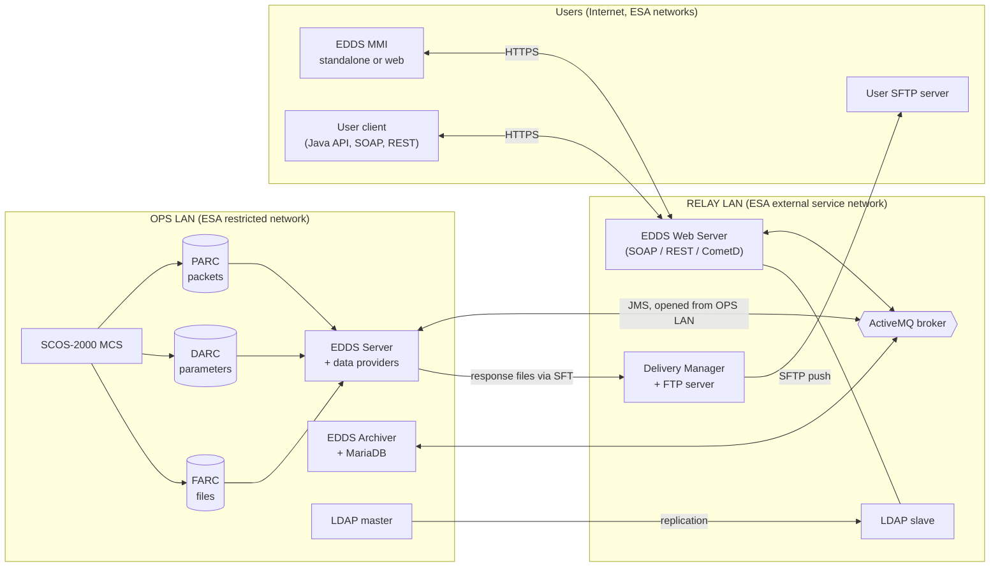
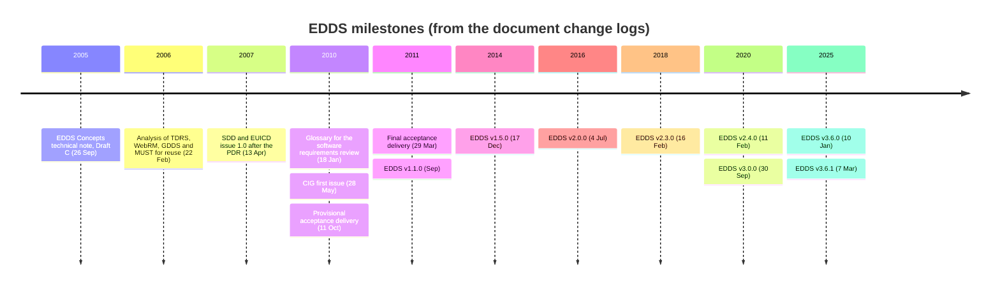
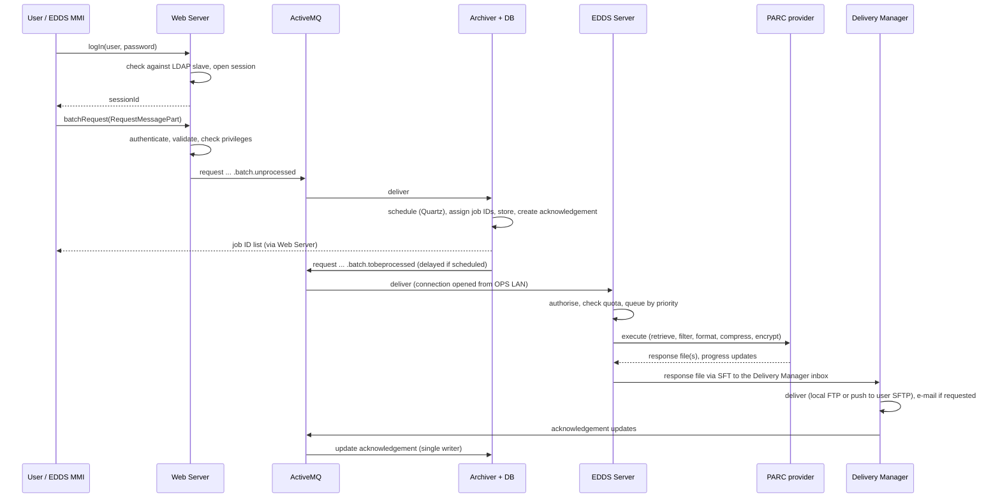
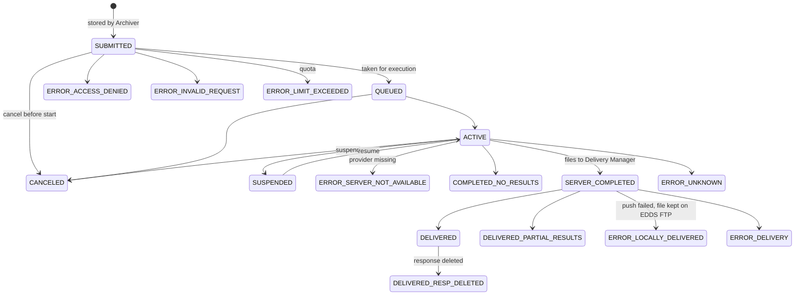

# EDDS: EGOS Data Dissemination System

The **EGOS Data Dissemination System (EDDS)** is the component of ESA's ground operations
software (EGOS) that gives controlled access to mission data to people who have no access to
the monitoring and control facilities of a [SCOS-2000](index.md) mission control system
(MCS).[^sdd-scope] A principal investigator who wants every raw packet of an instrument, an
industrial team that needs a month of housekeeping parameters, or a science operations centre
that subscribes to new orbit files all use the EDDS. The EDDS itself does not analyse data. It
retrieves data from the mission archives, filters and formats it, and delivers it as files or
as a live stream.[^srs-purpose]

The EDDS replaced three older SCOS-2000 add-ons: the
[Telemetry Data Retrieval System (TDRS)](tdrs.md), Web Remote Monitoring (WebRM) and the
[Generic Data Disposition System (GDDS)](gdds-and-ddids.md). Its requirements also took ideas
from the MUST parameter-analysis prototype.[^srs-pred] This page describes the system: history,
services, architecture, processing chain, security model and the public document set. The
companion page [EDDS request and data formats](edds-formats.md) gives the XML request
structures and the binary layouts byte by byte.

!!! info "Name variants"
    All EDDS documents in the library expand EDDS as "EGOS Data Dissemination System".[^srs-acr]
    A 2025 SpaceOps paper by ESOC and JPL authors expands it as "EGOS Data Disposition System"
    instead, which echoes the older GDDS name.[^mpd-name] This wiki uses the expansion printed in
    the EDDS documents themselves.

## At a glance

| Aspect | Summary |
|---|---|
| Purpose | Controlled access to science and non-science MCS data for users outside the MCS[^srs-purpose] |
| Users | Principal investigators, industry and other ESA sites, analysis and engineering staff, science operations centres[^srs-users] |
| Data sources | Packet archive (PARC), parameter archive (DARC), on-the-fly parameters (SMON), file archive (FARC), a served file-system directory, SCOS-2000 Data Provision Services, and in recent releases the EGS-CC HBase archive and EGS-CC REST services[^sdd-arch][^sum-types] |
| Services | Authentication, batch, stream and user management, plus asynchronous notifications[^euicd-svc][^sdd-svc] |
| Interfaces | SOAP web services described in WSDL, a REST/JSON API, e-mail acknowledgements, push delivery to a client (S)FTP server[^euicd-if][^euicd-rest] |
| Formats | EDDS binary ("EDDS raw"), GDDS binary, SFDU, Google Protocol Buffers binary, XML (with XSLT transforms), ASCII, TDRS spreadsheet, XFDU packaging, RawSourceBinary[^euicd-fmt] |
| Main technologies | Apache Tomcat, JAX-WS, ActiveMQ, Camel, MariaDB, OpenLDAP, Quartz, CometD, Eclipse RCP/RAP, XFDU library[^sdd-cots] |
| Latest version in the library | EDDS v3.6.1 (SDD and CIG issue 25.0, 2025-03-07)[^sdd25-log] |

## Where the EDDS sits

The EDDS lives between the operational LAN, which holds the MCS and its archives, and the
users outside. The figure is this wiki's simplified summary of the SDD system-context and
deployment figures.[^sdd-context][^sdd-deploy]



Mission data never leaves the OPS LAN through an inbound connection. The EDDS Server connects
out to the message broker, and response files cross the firewall through the Secure File
Transfer (SFT) daemon.[^sdd-netsec] The same deployment can be mirrored for internal users on
the Office LAN.[^sdd-context]

## History and predecessors

### The four systems the EDDS replaced

The SRS traces the EDDS to three SCOS-2000 ground-segment subsystems and one prototype.[^srs-pred]

| Predecessor | What it did | What the EDDS kept |
|---|---|---|
| [TDRS](tdrs.md) (Telemetry Data Retrieval System) | Extracted TM parameter values from the SCOS-2000 history-file archive and returned them as MVDA or spreadsheet files. Only fixed-length TM packets were handled. Web browser and e-mail interface, with user interface and retrieval separated for security and performance.[^srs-pred] | Parameter retrieval, the TDRS spreadsheet format (via XSLT or a native formatter)[^srs-appb][^euicd-m][^tdrs-ss] |
| WebRM (Web Remote Monitoring) | Remote monitoring without physical MCS access. CORBA-based injection and provision servers, plus a Java client with SCOS-2000 look-and-feel displays.[^srs-pred] | Stream services, the display client concept[^srs-stream] |
| [GDDS](gdds-and-ddids.md) (Generic Data Disposition System) | Web and FTP front ends that multiplex requests from many users. CORBA/FTP interface to the MCS archive for continuous data (packets), files and catalogues.[^srs-pred] | GDDS FTP-service requests (via the Request Submitter and an XSLT) and the GDDS binary response format[^srs-appb] |
| MUST (Mission Utility & Support Tool) | Server/client prototype that builds its own parameter archive from scheduled MCS packet requests, with analysis clients.[^srs-pred] | Batch retrieval of parameter definitions and batch or stream retrieval of parameter data for MUST-like clients[^srs-batch] |

The ESOC infrastructure slide of a 2005 Ground System Architectures Workshop talk shows the
pre-EDDS picture. It lists SCOS-2000, NCTRS and GDDS, and describes "TDRS and WebRM" as the web
interfaces that give external users such as payload owners live telemetry, command
verification, telemetry retrieval and statistics.[^gsaw05]

### Timeline

The dates come from the change logs and reference lists of the EDDS documents.[^srs-refs][^sdd25-log][^glo-log][^cig25-log]



Two of the SRS reference documents give the design lineage. One is the 2003 "SCOS-2000 TM Data
Retrieval Services SRD" (the TDRS requirements). The other is "TDRS External Interfaces Control
Document" issue 4.3 of 2004.[^srs-refs] SRS issue 18.0 has 551 numbered requirements (551
distinct `EDDS-SR-nnnnn` identifiers, each with a "Need:" line). Their "Source:" fields cite
[RD-3] (listed as the TDRS SRD) in 29 requirements, [RD-4] (listed as the GDDS requirements
document) in 25, [RD-5] (listed as the WebRM baseline) in 24 and [RD-6] (listed as the MUST
Repository ICD) in 30; a few requirements cite several. Most of the others name a review (SWRR,
SWRR2) or a product-backlog item, and 138 give no source at all. This wiki counted these
fields in the extracted text, including sources that wrap onto a second line.[^srs-trace]

!!! warning "Inference: the reference labels may be shifted"
    The identifiers quoted after the labels do not always fit the listed documents. Every
    [RD-4] citation carries an `SR-TMDR-nnnnnn` identifier, and every [RD-6] citation carries
    `R-WEB-nnnn` identifiers, although [RD-6] is listed as a MUST document.[^srs-trace] The SRS
    is known to mis-number other references (it cites the SLE reference model as [RD-15],
    which is listed as [RD-13]).[^srs-stream] Which predecessor document each requirement
    really came from is therefore uncertain.

The project followed an agile method. The SDD says requirements and solutions evolve through
cross-functional teams, and that the detailed design lives in the JavaDoc rather than in the
document.[^sdd-agile]

## Purpose and users

The SRS names two user groups: those who need remote monitoring, and those who analyse
spacecraft data. Remote monitoring is served by stream services. Analysis is served by
file-based delivery of archived data, reports and statistics.[^srs-purpose] Binary packet
deliveries are often used by principal investigators to populate their own local archives.
The SRS models this explicitly as the use case "Populate Local Archive".[^srs-usecases]

The system is deliberately **not** an analysis tool. The SRS says the EDDS provides MCS data in a
format that facilitates analysis and aims to support many formats that can be added or
retired.[^srs-purpose] An ESOC presentation for Solar Orbiter users puts it more bluntly. The
EDDS is not a data warehouse, since response files are stored only for a limited time. It is
not a post-processing tool either, because its display and analysis features are very
limited.[^ppt-not]

Two more design goals shape the architecture:

* **Multi-mission and multi-domain.** One authentication entry point serves autonomous
  mission domains, and every request names its mission and domain.[^srs-purpose] A domain is
  an instance of an MCS or data archive, independent of all others. A mission groups domains,
  and contexts such as live operations, testing or training.[^srs-terms]
* **Generic archive access.** The EDDS should be able to front any data archive, not only the
  MCS, through a generic extension layer.[^srs-purpose][^srs-other] Recent releases use this
  layer for EGS-CC data providers.[^sdd-arch]

## Data types

The EUICD organises everything the EDDS can deliver into six data-type families. The table
shows which delivery mechanisms each family supports in issue 24.0.[^euicd-types]

| Family | Data types | File server | EDDS server | Stream | E-mail |
|---|---|:-:|:-:|:-:|:-:|
| Packet | TM, TC and EV in "EDDS raw" and "PARC raw" forms, packet statistics | ✓ | ✓ | ✓ (not statistics) | – |
| Parameter | TM parameter samples, statistics, preview, definition | ✓ | ✓ | ✓ (samples only) | – |
| Report | MCS reports, EDDS reports | ✓ | ✓ | – | – |
| Archived files | File, catalogue | ✓ | ✓ | – | – |
| File system | File catalogue, folder catalogue, file | ✓ | ✓ | – | – |
| Acknowledgement | Request status records | ✓ | ✓ | – | ✓ |

* **Packets** are telemetry (TM), telecommand (TC) and MCS event (EV) packets as stored by the
  MCS, in network byte order. The "raw" variants return the archived packet as a hexadecimal
  string wrapped in XML. They can only be filtered by start time, end time and (for TM and EV)
  a list of [SPIDs](../mib/tables/pid.md).[^euicd-pkt] An EV packet is an MCS event: the
  EUICD and SUM call it the "SCOS Event Log". The SRS lists on-board event (OBEV) reports as a
  separate report type, so an EV packet is not a spacecraft
  [PUS event report](../ecss/pus/st05-event-reporting.md).[^srs-pkt]
* **Parameters** come either from the dedicated parameter archive DARC, or are generated on
  the fly by SMON from archived packets. The DARC is fast but holds only the subset of
  parameters a mission chooses to archive. The SMON path is slower but can reach every
  parameter.[^srs-param] Parameter definitions (name, description, subsystem, unit) are derived
  from the spacecraft database, the [MIB](../mib/index.md).[^srs-param][^euicd-param] The
  EUICD warns that samples are not guaranteed to be time-ordered. A resumed request may also
  contain duplicates, unless the split size is set to 0 so that the whole request
  restarts.[^euicd-param]
* **Reports**: the MCS reports are the TM packet report, TM packet gap report, TC packet
  report, out-of-limits (OOL) data report and event record report. The EDDS reports are the
  system log and the EDDS usage report. Status and request-summary reports are listed but not
  supported in issue 24.0.[^euicd-report] For OOL reports the EDDS understands PARC OOL packet
  versions 5, 6 and 7, which correspond to different SCOS-2000 releases.[^euicd-report]
* **Archived files** are FARC contents: flight dynamics, mission planning and TT&C station
  files, plus catalogues. Where the FARC supports it, a user can subscribe so that a changed
  file is fetched automatically.[^euicd-files] The SRS adds that the mission database itself
  should be retrievable from the FARC, since TM, TC or EV data are of little use without
  it.[^srs-files]
* **Acknowledgements** are status records generated by the EDDS. They are produced when a
  request is received, and when it completes or fails.[^srs-ack][^euicd-ack]

## Services

The EUICD exposes four services to clients: authentication, batch, stream and user
management.[^euicd-svc] The SDD groups the same functions as data services (batch and stream),
management services and notification services.[^sdd-svc]

### Batch service

A batch request is an XML document that lists data types and a filter per type, and names a
delivery method. The EDDS retrieves the data, builds the data set, delivers it, and then
considers the request complete. A batch request can carry a schedule, for one-shot, cyclic or
standing execution.[^euicd-batch][^srs-batch] The response is a binary or ASCII file, optionally
compressed or encrypted, or an XML file shown in the client. Compression is applied by
default. The supported archive forms are `zip`, `tar` (USTAR, uncompressed) and `tar.gz`.
AES encryption can be enabled or disabled per mission.[^euicd-batch]

Users can edit a request in the client's forms, save it on the server, reload and re-edit it,
or write the XML by hand and upload it. Uploaded requests are validated against the XML
schema, and then checked for privilege and for mission-specific semantics (for example, the
end date must be after the start date).[^srs-batchuc] Request queues are per mission,
persistent on disk, and dispatched with a priority algorithm.[^srs-batchuc]

### Stream service

A stream request opens a continuous flow of data that ends only when the stream is closed by
the client, an administrator or the MCS.[^srs-streamuc] The SRS bases the stream concept on the
offline and online modes of the [SLE return services](../ccsds/sle/return-services.md).
"Offline" means previously archived data; "online" means data routed as it arrives. Online
delivery has two modes. **Timely** mode drops data to meet a delivery deadline; **complete**
mode delivers everything, possibly with a long delay.[^srs-stream][^euicd-stream]

In issue 24.0 of the EUICD the stream data are published on ActiveMQ topics. Clients read them
either directly from the topic, or through the client API over CometD/Bayeux after calling
`startStreamData(RequestID)`.[^euicd-stream]

| Stream | Source | Topic | Bayeux channel | Body format |
|---|---|---|---|---|
| Parameters | DARC (v3.0.0 or later, SLES 12) | parameter stream topic | `PARAM_STREAM` | Protocol Buffers parameter record |
| Packet TM | Data Provision Services (SCOS 5.4.21 / 5.5.4 or later) | `esa.egos.edds.packet.stream.tm` | `PKT_TM_STREAM` | As the binary Packet TM Report |
| Packet TC | Data Provision Services | `esa.egos.edds.packet.stream.tc` | `PKT_TC_STREAM` | As the binary Packet TC Report |
| Packet EV | Data Provision Services | `esa.egos.edds.packet.stream.ev` | `PKT_EV_STREAM` | As the binary Event Record Report |
| Out of limits | Data Provision Services | `esa.egos.edds.packet.stream.ool` | `PKT_OOL_STREAM` | As the binary OOL Record Report |

The topics and channels are from EUICD §4.1.3 and §12.1.8.6.[^euicd-stream][^euicd-api]
For DARC streaming, the EDDS subscribes to a DARC-owned topic with a JMS selector built from
the request filter. Each DARC message carries header fields: `ValueType`, `Value`, `Validity`
(0 valid, 1 invalid, 2 unknown, 3 expired), `SystemElement`, `Source`, `State`, `GenericData`,
`GenerationTime` (Unix time) and `Name`. The EDDS re-encodes them as Protocol Buffers records
tagged with `RequestId` and `MISSION_NAME`.[^euicd-darcstream]

!!! warning "Inference"
    The sources disagree about packet streaming. EUICD 24.0 §4.1.3 says only DARC parameter
    streaming is supported, yet §4.1.3.2 to §4.1.3.6 describe live TM, TC, EV and OOL
    streaming through the Data Provision Services.[^euicd-stream] SUM 22.0 says PARC stream
    forms can be saved but not submitted.[^sum-stream] Both the EUICD (§4.1.3.2) and the SDD
    (§6.2.9.8.2) state that live packet streaming works only through the Data Provision
    Services, not the PARC Manager.[^euicd-stream][^sdd-parc] This wiki reads the "only DARC"
    sentence and the SUM note as left over from releases without that back end. Which
    missions use packet streaming is not stated in the available sources.

A lightweight **EDDS Stream Client** attaches to an ACTIVE stream request and dumps the data to
files at a fixed interval. SDD §6.2.5 lists TM, TC, OOL, event and parameter streams, and XML,
Protocol Buffers, GDDS (TM and TC only) and "RawBody" binary outputs, and the EUICD defines
recording file names for all five stream types.[^sdd-streamclient][^euicd-streamclient] Other
passages still describe it as TM-only: SDD §4.5.5 and §6.1.7.5, and CIG §3.6.6, which allows
only the Packet TM stream type.[^sdd-streamtm][^cig-sc]

### User management and the access model

The SRS describes the problem this model solves: user-account administration used to cost ESA
support staff a lot of effort.[^srs-acct] The EDDS therefore has a single authentication entry
point and a layered model:

* **Accounts** belong to users. After logging in, a user picks a mission and a **role** for the
  session.[^srs-acct][^sdd-login]
* A **role** bundles privileges. They cover which operations may be performed, which data
  types may be accessed, which services may be used, which quotas apply, and the request
  priority.[^srs-acct]
* The generic roles are System Administrator ("super user"), Mission Administrator, Manager
  (administers a group of users under one role, for example a PI institute) and Investigator
  (data access only).[^srs-acct]

In the implemented system, the SUM shows roles assembled from three kinds of reusable sets,
plus groups.[^sum-quick][^sum-sets]

| Object | What it controls |
|---|---|
| Data Access Set | Data sources and request types a role may issue. A role without one cannot issue batch requests. |
| Operation Data Set | User-management operations the role may perform (for example create but not delete quota sets) |
| Quota Set | Limits: requests per period, ongoing requests (ACTIVE or QUEUED), data volume per period, disk space, and SPID, APID, parameter-name, TC-name, FARC file name/type and file-system folder restrictions, data time range and maximum time-filter duration |
| Role | Name, contact details, the sets above, a priority, enabled flag |
| Group | Binds users to roles. Disabling a group locks all its users out. |

Quota periods are given as cron expressions. With several quota sets on one role, the smallest
numerical limit applies, but the SPID, APID, parameter-name and file restrictions are combined
as a union. APID restrictions are converted to SPID lists before checking.[^sum-sets] EDDS and
Mission Administrators act as super users and need no sets.[^sum-sets]

User records live in LDAP. The EDDS can also authenticate users against a separate "central
LDAP", so that removing someone centrally also locks them out of the EDDS.[^sdd-ldap] The
Solar Orbiter DDS uses the quota mechanism to limit each external user to certain APIDs, SPIDs,
parameter names, file names or types, data volumes and relative time ranges. The DDID gives
"the last 12 months" as an example.[^ddid-quota]

### Web-service operations

The EDDS port type in the WSDL is shared by batch and stream services. Every operation runs in
a session. Most operations can raise `requestFault`, `authorizationFault` or `sessionFault`.
The exceptions are `logIn`, which raises `authenticationFault` or `passwordExpiredFault`,
`checkUserPassword` (`authenticationFault`, `sessionFault`), and the one-way `logOut` and
`hasSessionExpired`, which declare no fault.[^euicd-port] The operations, grouped by purpose:

| Group | Operations |
|---|---|
| Session | `logIn`, `logOut`, `hasSessionExpired`, `checkUserPassword` |
| Batch and stream submission | `batchRequest`, `streamRequest`, `reSubmit`, `startStreamData`, `stopStreamData` |
| Monitoring and control | `getStatus`, `getStatuses`, `getJobs`, `getJobsWithStatus`, `getJobsWithStatusAndLimit`, `cancel`, `suspend`, `resume`, `deleteData`, `deleteRequest`, `getHistoricalLog`, `stopHistoricalLogRetrieval` |
| Retrieval of results and templates | `getResponse`, `getRequest`, `getStreamRequest` |
| Catalogues and metadata | `getParamDefinitions`, `getCatalogue`, `getFarcCatalogue` (deprecated), `getDataspaces`, `getAlias`, `getLastConsolidation`, `getAllowedRequestTypes`, `getTransformations` |
| User management | `accountRequest`, `getUsers`, `getMissions`, `getMissionsAndDomains`, `getRoles`, `getUserAccountDetails`, `getMissionDetails`, `getUserQuota`, `getQuotaDetails`, `hasPermissionToSeeAllUsers` |

The table follows EUICD §9.2.1.1.[^euicd-port] Issue 24.0 adds a REST API at
`.../edds/EddsRestService/v1/` that mirrors these operations with JSON bodies. The REST API
adds a JSON Web Token (JWT, RFC 7519) authentication layer on top of the older session
mechanism, which the EUICD itself calls insecure.[^euicd-rest] The Java client API
(`edds-ws-client`, version 3.6.0 in issue 24.0) wraps the services, and a
`NotificationManager` delivers asynchronous push notifications over CometD.[^euicd-api][^sdd-clientapi]

A 2025 SpaceOps paper maps these operations onto the new CCSDS Mission Product Distribution
(MPD) services. `batchRequest`/`streamRequest` map to standing orders, `getResponse` to
product delivery, `getCatalogue` to product listing, and the file-server and server
deliveries to MPD delivery methods.[^mpd-map]

## Architecture

### Components

The SDD's component summary, simplified:[^sdd-comp]

| Component | Role |
|---|---|
| EDDS MMI (standalone Eclipse RCP application, or web application on Eclipse RAP) | Builds batch, stream and user-management requests, shows status, downloads responses, administers users. No XML knowledge needed.[^sdd-mmi] |
| EDDS Client API | Java façade over the SOAP and REST services, used by the MMI and by third-party tools such as MUST and ARES[^sdd-comp][^sdd-clientapi] |
| EDDS Web Server | JAX-WS web application in Tomcat. It authenticates users, validates requests, checks privileges and serves notifications. It normally runs on the RELAY LAN.[^sdd-web] |
| EDDS Archiver | Stores incoming requests in MariaDB, schedules them with Quartz, creates and updates the single acknowledgement per request, archives log messages[^sdd-archiver] |
| EDDS Server | One instance per mission. It authorises requests, checks quotas, queues by priority, routes each request to a data provider, and produces response files.[^sdd-server] |
| Data providers | PARC Manager and Data Provision Services (packets), DARC and SMON (parameters), FARC (files), file system, EDDS reports, HARC (EGS-CC HBase archive), EGS-CC REST[^sdd-arch][^sdd-comp] |
| Delivery Manager | Polls for finished response files and delivers them (local FTP area or push to user (S)FTP). It also sends e-mail and deletes expired responses.[^sdd-dm] |
| Secure File Transfer (SFT) | Separate ESOC product that moves files between two LANs through a firewall over TCP/IP. GFTS can play the same role.[^sdd-sft] |
| Request Submitter | Polls a directory for EDDS or GDDS request files and submits them; GDDS requests are first converted by XSLT[^sdd-rs] |
| Stream Client | Saves the data of an active stream request to files at intervals[^sdd-streamclient] |

The services are defined as WSDL files plus XSD schemas. JAX-WS `wsimport` generates the
client stubs, server skeletons and bean classes from them. These are the baseline of the
client API, web server, server and data providers.[^sdd-svcarch]

### The message bus

All components talk through an ActiveMQ JMS broker. The SDD explains the two JMS primitives the
design relies on. A message on a **queue** goes to exactly one listener, which allows load
balancing. A message on a **topic** goes to every listener, which suits status broadcasts.
Persistent queues and topics keep messages until a consumer returns.[^sdd-mq] The choice
explains several operating rules:

* Run only one Archiver. Log messages arrive on topics, so two Archivers would store every log
  twice.[^sdd-scal]
* Several EDDS Servers per mission are possible, because batch requests sit on a queue. But on
  start-up a server re-processes any request left ACTIVE in the database, so two servers could
  fight over the same request.[^sdd-scal]
* Cancel and suspend messages are sent on **topics**. Nobody knows which server is processing a
  given request, so every server must see the message.[^sdd-servermsg]

Typical destinations include `esa.egos.edds.request.batch.unprocessed` (web server to
Archiver), `esa.egos.edds.request.batch.tobeprocessed` (Archiver to Server),
`esa.egos.edds.update.ack` (acknowledgement updates, applied only by the Archiver) and
`esa.egos.edds.email.queue` (outgoing mail).[^sdd-archiver][^sdd-servermsg]

### Deployment and network security

The SRS lists the ESOC networks the EDDS must serve.[^srs-net]

| Security domain | ESOC networks | Served by EDDS |
|---|---|---|
| ESA Restricted Networks | OPS LAN | Yes |
| ESA Internal Service Networks | OFFICE LAN, PRE-OPSLAN, SIMLAN | OFFICE LAN and PRE-OPSLAN only |
| ESA External Service Networks | RELAY LAN, CITI DMZ, PISA LAN, ACCESS LAN | All except ACCESS LAN |
| Non-ESA Networks | Public Internet | Yes |

ESOC's security rules allow no inbound connections into the OPS LAN, no permanent connections
between the OPS LAN and an outside LAN, and only connections initiated from inside.[^sdd-netsec]
The EDDS satisfies them as follows:

* The EDDS Server on the OPS LAN opens its JMS connection to the broker on the RELAY LAN. The
  connection is not permanent and is re-established when lost.[^sdd-netsec][^sdd-batchflow]
* Response files go back to the RELAY LAN through SFT. Several SFT instances can be used, for
  example to separate stream and batch traffic.[^sdd-sft]
* The LDAP master sits inside and pushes changes to the LDAP slave outside. It uses `slurpd`
  in "one shot" mode, so the replication connection is not permanent either.[^sdd-netsec]

The SDD describes four deployment scenarios.[^sdd-deploy]

| Scenario | Where the data providers are | Pros | Cons |
|---|---|---|---|
| 1. Base | OPS LAN; Web Server and file server on RELAY LAN | Simplest; easy access to OPS LAN components | Heavy file traffic through the OPS LAN firewall |
| 2. Replicated outside | Copies on the RELAY LAN, synchronised by SFT | Little firewall traffic | Some services impossible; data replicated into a less secure LAN |
| 3. Split | Some inside, some outside; two EDDS Server instances | All services, better performance | Complex configuration; replication |
| 4. Office LAN replica | Copies on the Office LAN; separate web and EDDS servers for internal and external users | Performance for internal users; data replicated once | Complex; data in a less secure internal LAN |

For scalability, one Web Server and one Archiver are shared by all missions. There is one EDDS
Server per mission, one set of data-provider drivers per mission and domain, one Delivery
Manager, optional Stream Clients, and at least two SFT instances (one per firewall side) per
mission and domain.[^sdd-scal]

### Data providers

The EDDS Server reaches every archive through a data-provider driver with the same handler
chain: data retrieval, then filter, formatter, optional compression and optional
encryption.[^sdd-comp] The list has grown over time. SDD issue 15.0 (EDDS v2.3.0, 2018)
describes PARC and Data Provision, FARC, file-system, DARC and SMON providers only. The HARC and
EGS-CC REST providers first appear in the library's issue 25.0 (2025).[^sdd15-toc][^sdd-harc]

| Provider | Archive and interface | Batch | Stream | Notes |
|---|---|:-:|:-:|---|
| PARC Manager | Packet archive via CORBA | ✓ | – | Queries only by SPID. The EDDS adds APID, type and subtype filtering by mapping APIDs to SPIDs with the MIB `pid.dat`.[^sdd-parc][^sdd-apid] |
| Data Provision Services | Packet archive via a SCOS-2000 CORBA service that returns decoded data | ✓ | ✓ | Only path for live packet streams; can also return parameter information for TM[^sdd-parc] |
| DARC | Parameter archive via Java API | ✓ | ✓ | Stream via a Camel route from the DARC broker[^sdd-darc] |
| SMON | On-the-fly parameters from packets via CORBA | ✓ | – | The EDDS starts or restarts its own SMON instance via the SCOS-2000 task interface. Only one SMON request may be active at a time.[^sdd-smon][^sum-smon] |
| FARC | File archive via Java API, behind a versioned interface JAR | ✓ | – | Catalogues and subscriptions; FARC changes arrive as JMS notifications[^sdd-farc] |
| File system | Indexed directory on the EDDS Server | ✓ | – | File and folder catalogues, file retrieval packaged as TAR, subscriptions[^sdd-fs][^sum-fs] |
| HARC | EGS-CC HBase archive via the ARC Standalone Java API | ✓ | – | EGS-CC TM, TC, parameters, messages and events; the SUM also lists activity reports[^sdd-harc][^sum-types] |
| EGS-CC REST | EGS-CC REST endpoints as a STOMP client, with data returned over HTTP or Kafka | ✓ | – | A session token is requested for every EDDS request[^sdd-egscc][^sdd-egsccrest] |

!!! note "The MIB inside the EDDS"
    The EDDS needs a copy of some [MIB](../mib/index.md) files for every domain it serves.
    It uses [`pid.dat`](../mib/tables/pid.md) to convert SPIDs to APIDs and back, and
    [`tpcf.dat`](../mib/tables/tpcf.md) for packet descriptions. For the TC reports it also
    needs the command subsystem and command host files and `MISCbase.ids`, plus two
    hand-written mappings: command source types (`CMDsourceTypeMapping.properties`) and
    command request status types (`CMD_ttRqstObqStatusMapping.properties`). With the Data
    Provision Services it additionally needs `MISCcontext_SHARED.sta` to map domain and data
    stream names. The CIG warns that stale copies break filters such as an APID
    search.[^cig-mib] An SRN issue 14.0 fix concerns a "request incorrect status when SPID
    not in pid.dat".[^srn-fixes] For scale, the September 2025 Solar Orbiter MIB has 11,150
    packet definitions spread over 293 APIDs. One APID can stand for hundreds of SPIDs: APID
    263 alone has 699, and 64 APIDs have 24 or more.[^mib-pid]

??? example "SQL used"
    Run against `solo-2025-09-16.sqlite` (all columns are stored as text).

    ```sql
    -- packet definitions, distinct APIDs and the SPID range
    SELECT count(*), count(DISTINCT PID_APID),
           min(CAST(PID_SPID AS int)), max(CAST(PID_SPID AS int))
    FROM pid;
    -- result: 11150 | 293 | 101 | 1000006
    -- SPIDs per APID
    SELECT PID_APID, count(*) c FROM pid GROUP BY PID_APID ORDER BY c DESC LIMIT 1;
    -- result: 263 | 699
    SELECT count(*) FROM (SELECT PID_APID FROM pid GROUP BY PID_APID HAVING count(*) >= 24);
    -- result: 64
    ```

## How a batch request flows

The SDD scenario for an archived-packet request delivered by the Delivery Manager:[^sdd-batchflow]



The steps inside the EDDS Server follow a chain of responsibility.[^sdd-server]

1. **Authorisation**: the user's role must allow the request. The acknowledgement is updated.
2. **Quota check**: if a generic quota check fails, the request is not executed and the
   acknowledgement explains why.
3. **Execution**: requests are queued by role priority, with a configurable number running in
   parallel. A `BatchRequestHandlerFactory` combines retrieval, filtering and formatting
   handlers for the specific archive. Results are transformed by XSLT if requested, then
   encrypted and compressed.[^sdd-server][^sdd-batchflow]

On a provider error the server can retry at configured intervals. The request stays ACTIVE, and
the acknowledgement records the retries and the reason.[^sdd-batchflow] Persistent messages
mean that requests survive a server crash. On start-up the server also recovers SUBMITTED
requests whose execution time is in the past.[^sdd-server] Suspending a request marks the last
sample of the last finished file in the acknowledgement. Resuming restarts from there, with a
possible small overlap; the overlap is larger for raw and OOL requests, because the PARC
returns undecoded packets in batches.[^sdd-servermsg]

### Request states

The EUICD state enumeration and the SUM's status table give the life cycle. ACTIVE appears in
the SUM and SDD, and in the EUICD's own streaming text, but not in the EUICD enumeration
(Appendix D.44).[^euicd-state][^sum-states][^euicd-stream] The SDD also spells the deleted
state `DELIVERY_RESP_DELETED` once, where the EUICD and SUM write
`DELIVERED_RESP_DELETED`.[^sdd-dmmodes]

!!! warning "Inference"
    No source draws the state machine. The transitions below are this wiki's reading of the
    state descriptions in the SUM and EUICD and of the processing steps in the
    SDD.[^sum-states][^sdd-server][^sdd-servermsg][^sdd-dmmodes]



## Delivery mechanisms

| Mechanism | How it works | Protocol |
|---|---|---|
| EDDS Server (default) | The response stays on the EDDS FTP area. It is downloaded with the client (`getResponse`) or by SFTP with the EDDS account. | HTTPS, SFTP |
| File Server (push) | The Delivery Manager uploads with PUT to the user's server, with configurable retries. FTP is used if no SFTP credentials are given. Unless "keep file after delivery" is set, the copy on the EDDS is deleted after success. | SFTP or FTP |
| E-mail | Acknowledgements only. The EDDS sends mail but never reads it. | SMTP/SMTPs |
| Stream | Client application connected to the web server | HTTPS (CometD) |

The table combines the SRS, SDD and EUICD.[^srs-proto][^sdd-dmmodes][^euicd-deliv][^ppt-deliv][^sdd-mail]
Files of a split response are delivered one by one as soon as each is ready. FTP account
details are stored encrypted in the database. Expired responses are deleted by scheduled JMS
messages, after a retention period set by the mission administrator.[^sdd-dm][^sdd-dmmodes]
Failed deliveries go to a "failed" directory and must be moved back by hand to retry.[^sdd-dmmodes]

The SRS still lists RDM (raw data media) and "display" as delivery mechanisms inherited from the
GDDS and WebRM.[^srs-toc] The EUICD issue 24.0 delivery chapter describes only file server,
EDDS server and stream.[^euicd-deliv]

## Performance targets

SRS Appendix D sets throughput targets per data type and delivery path.[^srs-perf]

| Data type | Client | File server / EDDS server | RDM | Display | Stream, online | Stream, offline |
|---|---|---|---|---|---|---|
| TM, TC or EV packets | – | 500 packets/s | TBD | as stream | 20 kbit/s (\*1) or 300 kbit/s (\*2) | 20 kbit/s (\*1) or 300 kbit/s (\*2) |
| Packet statistics | 500 packets/s | 500 packets/s | – | – | – | – |
| TM parameters | – | 10,000 samples/s | TBD | as stream | 500 samples/s | 10,000 samples/s |
| Parameter statistics and definitions | 10,000 samples/s | 10,000 samples/s | – | – | – | – |

The markers \*1 and \*2 are not explained in the SRS: its legend only defines kps (kbit/s), sps
and pps. Reports, files, catalogues and acknowledgements are "TBD".[^srs-perf] The Solar
Orbiter DDID adds an availability requirement of at least 95 % over a month, including
maintenance downtimes.[^ddid-backup]

## The Solar Orbiter DDS in brief

Solar Orbiter's "DDS" is an EDDS installation at ESOC, described in the mission's Data Delivery
Interface Control Document (DDID) SOL-ESC-IF-05011.[^ddid-scope] Its main features:

* Prime and backup servers on the RELAY LAN, the backup in **cold** redundancy. A switch-over
  means users re-point their client. Scheduled requests must be resubmitted, and temporarily
  stored responses must be requested again.[^ddid-if][^ddid-backup]
* Data come from the MCS long-term archive (LTA): packets from its PARC, parameters from its
  DARC and files from its FARC. TM is retrievable "within seconds" of reception at the
  station.[^ddid-gen]
* File-server push over SFTP is the nominal delivery. Users whitelist the DDS addresses and can
  use an ESA-provided SSH public key instead of a password. Server-side storage is not a
  baseline option.[^ddid-summary][^ddid-if]
* The nominal route to the Science Ground Segment is not the EDDS but **RAPID** files forwarded
  by GFTS, described on the [formats page](edds-formats.md#rapid-files).[^ddid-summary]

The DDID publishes the server host names and IP addresses for firewall configuration. This
wiki does not repeat them. The full Solar Orbiter specifics, including SCOS-2000 packet headers,
internal packets and RAPID records, are on the [formats page](edds-formats.md#solar-orbiter-ddid-specifics).

Other ESOC tools consume EDDS output too. The ARES analysis system, the successor of MUST,
imports EDDS response files fed from the MCS DARC and PARC.[^ares]

## The document set

The library holds 14 EDDS documents copied from the Solar Orbiter EDDS document area at IRAP on
2026-11-05. Each library page gives the exact URL, copy time and checksum. Several **file names
do not match the version printed inside**.

| Library page | Document | File name at source | Printed version and date | EDDS release | Copied (UTC) |
|---|---|---|---|---|---|
| [srs](../library/srs.md) | Software Requirements Specification, EGOS-GEN-EDDS-SRS-1001 | `EGOS-GEN-EDDS-SRS.pdf` | 18.0, 2018-02-16 | 2.3.0 | 2026-11-05 14:02:35 |
| [sdd](../library/sdd.md) | Software Design Document, EGOS-GEN-EDDS-SDD-1001 | `EGOS-GEN-EDDS-SDD.pdf` | 15.0, 2018-02-16 | 2.3.0 | 2026-11-05 14:00:17 |
| [sdd-v24](../library/sdd-v24.md) | Software Design Document | `EGOS-GEN-EDDS-SDD.v24.pdf` | **25.0**, 2025-03-07 | 3.6.1 | 2026-11-05 14:01:34 |
| [euicd-unversioned](../library/euicd-unversioned.md) | External User ICD, EGOS-GEN-EDDS-ICD-1001 | `EGOS-GEN-EDDS-EUICD.pdf` | 7.0, 2014-12-17 | 1.5.0 | 2026-11-05 14:19:57 |
| [euicd-v13](../library/euicd-v13.md) | External User ICD | `EGOS-GEN-EDDS-EUICD v13.pdf` | 13.0, 2017-05-05 | 2.2.0 | 2026-11-05 13:56:04 |
| [euicd-i15r0](../library/euicd-i15r0.md) | External User ICD | `EGOS-GEN-EDDS-ICD-1001_EUICD_i15r0_2.pdf` | 15.0, 2018-02-16 | 2.3.0 | 2026-11-05 13:57:31 |
| [euicd-v25](../library/euicd-v25.md) | External User ICD | `EGOS-GEN-EDDS-EUICD.v25.pdf` | **24.0**, 2025-01-10 | 3.6.0 | 2026-11-05 13:59:26 |
| [sum](../library/sum.md) | Software User Manual, EGOS-GEN-EDDS-SUM-1001 | `EGOS-GEN-EDDS-SUM.pdf` | 14.0, 2018-02-16 | 2.3.0 | 2026-11-05 14:05:49 |
| [sum-v22](../library/sum-v22.md) | Software User Manual | `EGOS-GEN-EDDS-SUM.v22.pdf` | 22.0, 2025-01-10 | 3.6.0 | 2026-11-05 14:07:57 |
| [cig-i14r0](../library/cig-i14r0.md) | Configuration and Installation Guide, EGOS-GEN-EDDS-CIG-1001 | `EGOS-GEN-EDDS-CIG-1001-i14r0_2.pdf` | 14.0, 2018-02-16 | 2.3.0 | 2026-11-05 14:09:15 |
| [cig-v24](../library/cig-v24.md) | Configuration and Installation Guide | `EGOS-GEN-EDDS-CIG.v24.pdf` | **25.0**, 2025-03-07 | 3.6.1 | 2026-11-05 14:10:02 |
| [eug](../library/eug.md) | EDDS Update Guide, EGOS-GEN-EDDS-EUG-1001 | `EGOS-GEN-EDDS-EUG.pdf` | 12.0, 2018-02-16 | 2.2.0 to 2.3.0 | 2026-11-05 14:10:09 |
| [srn](../library/srn.md) | Software Release Note | `EGOS-GEN-EDDS-SRN.pdf` | 14.0, 2018-02-16 | 2.3.0 | 2026-11-05 14:10:20 |
| [glo](../library/glo.md) | EDDS Glossary, EGOS-GEN-EDDS-GLO-0001 | `EGOS-GEN-EDDS-GLO.pdf` | 7.0, 2017-04-10 | see below | 2026-11-05 14:03:37 |

The versions, dates and releases come from each title page and change log.[^ver-srs][^ver-sdd][^sdd25-log][^ver-euicd7][^ver-euicd13][^ver-euicd15][^ver-euicd24][^ver-sum][^ver-sum22][^ver-cig14][^cig25-log][^ver-eug][^ver-srn][^glo-log]

What each document is for:

* The **SRS** gives the general description (predecessors, data types, logical model, use
  cases) and about a hundred pages of numbered `EDDS-SR-nnnnn` requirements with need,
  priority, stability and verification method.[^srs-terms2]
* The **SDD** covers the top-level architecture and the component and sub-component design.
  Issue 25.0 adds chapters on EGS-CC integration (HARC and REST) and DevOps (GitLab pipeline,
  Docker images, Helm deployment).[^sdd-egscc][^sdd-devops]
* The **EUICD** is the user-facing contract: services, data types, formats, naming,
  delivery, the WSDL operations and the full XML schemas as appendices. It states that the
  XSD files take precedence over the document, and that missions write their own DDIDs on top
  of it.[^euicd-purpose]
* The **SUM** explains the client application step by step, including the status table and
  user-management screens.[^sum-quick]
* The **CIG** covers building and deploying every component, firewall and SSL configuration,
  the MIB files the server needs, and the XML files that describe header layouts.[^cig-mib][^cig-appa]
* The **EUG** gives upgrade steps, here the database migration tool for v2.2.0 to
  v2.3.0.[^ver-eug]
* The **SRN** for v2.3.0 lists tested dependencies (SCOS 6.0.1, DARC 3.0.0, FARC 3.1.0, EUD
  3.1.8, SLES 12), known limitations and the delivered fixes.[^srn-deps]
* The **GLO** holds references, acronyms and terms used across the set.[^glo-log]

!!! warning "Inference: version mismatches to keep in mind"
    * `EGOS-GEN-EDDS-EUICD.v25.pdf` is EUICD **issue 24.0**, and `SDD.v24` and `CIG.v24`
      are **issue 25.0**.[^ver-euicd24][^sdd25-log][^cig25-log]
    * Inside issue 25.0 of the SDD and CIG, the body page footers still read 24.0
      (2025-01-10). The SDD's front matter even shows "24.0.0 2023-11-01", and the CIG's first
      front-matter footer reads "ISSUE: 25.0 2024-03-08".[^sdd25-footer][^cig25-footer]
    * The SRN title page says 2018-02-16, but its change log dates issue 14.0 2017-02-16.[^ver-srn]
    * The EUICD 15.0 change log dates the issue 2018-01-15, while the title page says
      2018-02-16.[^ver-euicd15]
    * Glossary issue 7.0 (April 2017) says "Updated for EDDS v1.8.0i1", although the other
      documents had reached v2.2.0 by May 2017.[^glo-log]

    This wiki always cites the version printed on the title page and names the slug, so a
    reader can open the right file.

## Related pages

* [EDDS request and data formats](edds-formats.md): XML requests, acknowledgements,
  EDDS/GDDS binary, Protocol Buffers, SCOS-2000 packet headers and RAPID files.
* [TDRS](tdrs.md): the parameter-retrieval predecessor and its file formats.
* [GDDS and mission DDIDs](gdds-and-ddids.md): the packet-dissemination predecessor.
* [Mission archives: PARC, DARC and FARC](archives.md): the systems behind the data providers.
* [Ancillary systems, MICONYS and EGS-CC](ancillary-and-egs-cc.md): MUST, ARES and the move to EGS-CC.
* [Solar Orbiter](../missions/solar-orbiter/index.md) and its [MIB](../missions/solar-orbiter/mib.md).

[^sdd-scope]: [EDDS SDD issue 25.0](../library/sdd-v24.md), §1.2 Scope and §4.1 Introduction, PDF pp. 8 and 15.
[^srs-purpose]: [EDDS SRS issue 18.0](../library/srs.md), §4.3 Function and Purpose, PDF p. 14.
[^srs-pred]: [EDDS SRS issue 18.0](../library/srs.md), §4.2 Relationship to Predecessor and Successor Projects, PDF p. 13.
[^srs-acr]: [EDDS SRS issue 18.0](../library/srs.md), §3.1 Acronyms, PDF p. 10; [SDD issue 25.0](../library/sdd-v24.md), §3.1, PDF p. 12; [EUICD issue 24.0](../library/euicd-v25.md), §3.1, PDF p. 20.
[^mpd-name]: [Marszk et al., SpaceOps 2025 #309](../library/spaceops2025-0309-mpd-edds.md), abstract and acronym list, PDF p. 1, and §3.1, PDF p. 6.
[^srs-users]: [EDDS SRS issue 18.0](../library/srs.md), §4.5 Relation to Other Systems, PDF p. 23.
[^sdd-arch]: [EDDS SDD issue 25.0](../library/sdd-v24.md), §4.5.2 EGOS Ground System and §6.1.1 Top Level Component Architecture, PDF pp. 19 and 23.
[^sum-types]: [EDDS SUM issue 22.0](../library/sum-v22.md), §5.2 Batch Request types, PDF pp. 17–19.
[^euicd-svc]: [EDDS EUICD issue 24.0](../library/euicd-v25.md), §4 Software Overview, PDF p. 22.
[^sdd-svc]: [EDDS SDD issue 25.0](../library/sdd-v24.md), §4.2 EDDS Services, PDF pp. 15–16.
[^euicd-if]: [EDDS EUICD issue 24.0](../library/euicd-v25.md), §4.2 EDDS Interface Overview and §9.1, PDF pp. 25 and 86.
[^euicd-rest]: [EDDS EUICD issue 24.0](../library/euicd-v25.md), §9.5 EDDS REST API endpoints and §9.5.1 REST API Authentication, PDF pp. 136–143.
[^euicd-fmt]: [EDDS EUICD issue 24.0](../library/euicd-v25.md), §6 Formats and Table 13, PDF pp. 37–39; §6.4 XFDU, §6.5 TDRS Spreadsheet and §6.7.3 Google Proto Buffers, PDF pp. 51 and 54.
[^sdd-cots]: [EDDS SDD issue 25.0](../library/sdd-v24.md), §5.6.1 COTS, PDF pp. 21–22.
[^sdd25-log]: [EDDS SDD issue 25.0](../library/sdd-v24.md), title page and Document Change Log, PDF pp. 1–3.
[^sdd-context]: [EDDS SDD issue 25.0](../library/sdd-v24.md), §4.4 System Context, PDF pp. 17–18.
[^sdd-deploy]: [EDDS SDD issue 25.0](../library/sdd-v24.md), §6.1.2 EDDS deployment (scenarios 6.1.2.1–6.1.2.5), PDF pp. 24–28.
[^sdd-netsec]: [EDDS SDD issue 25.0](../library/sdd-v24.md), §6.1.3 EDDS vs. ESOC Network Security requirements, PDF p. 29.
[^srs-appb]: [EDDS SRS issue 18.0](../library/srs.md), Appendix B Backwards Compatibility, PDF pp. 123–124.
[^euicd-m]: [EDDS EUICD issue 24.0](../library/euicd-v25.md), Appendix M EDDS Parameter Spreadsheet, PDF p. 355.
[^srs-stream]: [EDDS SRS issue 18.0](../library/srs.md), §4.3.2.3 Stream and §4.3.4.1.2 Stream services, PDF pp. 17 and 20.
[^srs-batch]: [EDDS SRS issue 18.0](../library/srs.md), §4.3.4.1 Data Services and §4.3.4.1.1 Batch Services, PDF pp. 19–20.
[^gsaw05]: [Guerrucci et al., GSAW 2005](../library/gsaw2005-guerrucci.md), slides "ESOC Software Infrastructure" and "ESOC Ground Segment Scenario", PDF pp. 5–6.
[^srs-refs]: [EDDS SRS issue 18.0](../library/srs.md), §2.2 Reference documents [RD-2], [RD-3], [RD-4], [RD-5], [RD-11], [RD-19], PDF pp. 8–9.
[^glo-log]: [EDDS Glossary issue 7.0](../library/glo.md), title page, approval page and Document Change Log, PDF pp. 1–3.
[^cig25-log]: [EDDS CIG issue 25.0](../library/cig-v24.md), Document Change Log, PDF pp. 2–3.
[^srs-trace]: [EDDS SRS issue 18.0](../library/srs.md), §5 Specific Requirements, "Need:" and "Source:" fields of the requirement tables, PDF pp. 33–123 (counted by this wiki in the extracted text, per requirement and including wrapped source lines; `srcgrep.py` output is capped at 400 matches and is not enough for this count); reference list [RD-3] to [RD-6], PDF p. 8.
[^sdd-agile]: [EDDS SDD issue 25.0](../library/sdd-v24.md), §1.1 Purpose and §1.2.1 Note about the content of the document, PDF p. 8.
[^srs-usecases]: [EDDS SRS issue 18.0](../library/srs.md), §4.7.1.3 Use Cases, PDF p. 27.
[^ppt-not]: [EDDS / DDID Presentation & Demo, SOL-ESC-PRS-22100](../library/sol-esc-prs-22100-edds-ddid-demo.md), slide 11 "EDDS is not…".
[^srs-terms]: [EDDS SRS issue 18.0](../library/srs.md), §3.2 Definition of Terms, PDF p. 12.
[^srs-other]: [EDDS SRS issue 18.0](../library/srs.md), §4.5 Relation to Other Systems, PDF pp. 22–23.
[^euicd-types]: [EDDS EUICD issue 24.0](../library/euicd-v25.md), §5 Data Types, Table 11, PDF p. 33.
[^euicd-pkt]: [EDDS EUICD issue 24.0](../library/euicd-v25.md), §5.1 Packet, PDF p. 33.
[^srs-pkt]: [EDDS SRS issue 18.0](../library/srs.md), §4.3.1.1 Packet and §4.3.1.3 Report (list including "OBEV Data Report"), PDF p. 16; EV is expanded as "Event (Mission control system event)" in [EUICD issue 24.0](../library/euicd-v25.md), §3.1, PDF p. 20, and called "SCOS Event Log" in its §4.1.3.2, PDF p. 23, and in [SUM issue 22.0](../library/sum-v22.md), §5.2.9, PDF p. 19.
[^srs-param]: [EDDS SRS issue 18.0](../library/srs.md), §4.3.1.2 Parameter, PDF p. 16.
[^euicd-param]: [EDDS EUICD issue 24.0](../library/euicd-v25.md), §5.2 Parameter, PDF pp. 33–34.
[^euicd-report]: [EDDS EUICD issue 24.0](../library/euicd-v25.md), §5.3 Report, PDF p. 34.
[^euicd-files]: [EDDS EUICD issue 24.0](../library/euicd-v25.md), §5.4 Archived Files, PDF p. 34.
[^srs-files]: [EDDS SRS issue 18.0](../library/srs.md), §4.3.1.4 Archived Files, PDF p. 17.
[^srs-ack]: [EDDS SRS issue 18.0](../library/srs.md), §4.3.1.5 Acknowledgment, PDF p. 17.
[^euicd-ack]: [EDDS EUICD issue 24.0](../library/euicd-v25.md), §5.5 Acknowledgement, PDF p. 35.
[^euicd-batch]: [EDDS EUICD issue 24.0](../library/euicd-v25.md), §4.1.2 Batch Service, PDF p. 22.
[^srs-batchuc]: [EDDS SRS issue 18.0](../library/srs.md), §4.7.2.3 Use Cases (Request Client, Submit, Schedule, Monitor, Validate, Process Batch Requests, Format Data), PDF pp. 28–29.
[^srs-streamuc]: [EDDS SRS issue 18.0](../library/srs.md), §4.7.3 Stream Services Use case, PDF p. 30.
[^euicd-stream]: [EDDS EUICD issue 24.0](../library/euicd-v25.md), §4.1.3 Stream Service to §4.1.3.6 Out of Limits and §8.1.3 Stream, PDF pp. 22–25 and 85.
[^euicd-api]: [EDDS EUICD issue 24.0](../library/euicd-v25.md), §12.1.8.6 Perform StreamRequest and §12.4 Dependencies, PDF pp. 154–155 and 165.
[^euicd-darcstream]: [EDDS EUICD issue 24.0](../library/euicd-v25.md), §4.1.3.1 DARC Streaming Support, Table 1, PDF p. 23.
[^sum-stream]: [EDDS SUM issue 22.0](../library/sum-v22.md), §5.3 Stream Request types, PDF p. 19.
[^sdd-streamclient]: [EDDS SDD issue 25.0](../library/sdd-v24.md), §4.5.5 Stream Client and §6.2.5 EDDS Stream Client, PDF pp. 19 and 51.
[^euicd-streamclient]: [EDDS EUICD issue 24.0](../library/euicd-v25.md), §4.3.4 EDDS Stream client and §7.2.1.1–§7.2.1.5 (file names for TM, TC, OOL, Event and Param requests), PDF pp. 27 and 84.
[^sdd-streamtm]: [EDDS SDD issue 25.0](../library/sdd-v24.md), §4.5.5 Stream Client and end of §6.1.7.5 Making a stream request, PDF pp. 19 and 43.
[^cig-sc]: [EDDS CIG issue 25.0](../library/cig-v24.md), §3.6.6 Start the Stream Client (optional), PDF p. 51.
[^sdd-mail]: [EDDS SDD issue 25.0](../library/sdd-v24.md), §4.5.11 Mail User Agent and §6.1.2.5 E-mail server deployment, PDF pp. 20 and 28.
[^srs-acct]: [EDDS SRS issue 18.0](../library/srs.md), §4.7.4 Account Management Use Case, PDF pp. 31–32.
[^sdd-login]: [EDDS SDD issue 25.0](../library/sdd-v24.md), §6.1.7.1 Logging in to EDDS, PDF pp. 37–38.
[^sum-quick]: [EDDS SUM issue 22.0](../library/sum-v22.md), §5.1 Setting up user access for a blank mission, PDF p. 16.
[^sum-sets]: [EDDS SUM issue 22.0](../library/sum-v22.md), §6.1.3.7 to §6.1.3.11 (quota sets, operation data sets, data access sets, roles, groups), PDF pp. 33–36.
[^sdd-ldap]: [EDDS SDD issue 25.0](../library/sdd-v24.md), §4.5.9 LDAP, PDF pp. 19–20.
[^ddid-quota]: [Solar Orbiter DDID, SOL-ESC-IF-05011 issue 1.2](../library/solo-ddid-i1r2.md), §3.2 Constraints, §6.3 Size and Frequency of Transfers and §9 DDS User Information, PDF pp. 12, 17 and 32.
[^euicd-port]: [EDDS EUICD issue 24.0](../library/euicd-v25.md), §9.2.1 EDDS Port Type and §9.2.1.1 EddsPortType, PDF pp. 87–103.
[^sdd-clientapi]: [EDDS SDD issue 25.0](../library/sdd-v24.md), §6.2.2 EDDS Client API, PDF pp. 47–48.
[^mpd-map]: [Marszk et al., SpaceOps 2025 #309](../library/spaceops2025-0309-mpd-edds.md), §3.1 and Table 1 "Mapping EDDS Concepts to MPD", PDF pp. 6–7.
[^sdd-comp]: [EDDS SDD issue 25.0](../library/sdd-v24.md), §6.1.5 EDDS Component Overview, Table 1, PDF pp. 30–35.
[^sdd-mmi]: [EDDS SDD issue 25.0](../library/sdd-v24.md), §4.3 Client Applications and §6.2.1 EDDS Client Application, PDF pp. 16 and 44–46.
[^sdd-web]: [EDDS SDD issue 25.0](../library/sdd-v24.md), §4.5.6 Web Server and §6.2.6 EDDS Web Server, PDF pp. 19 and 52–53.
[^sdd-archiver]: [EDDS SDD issue 25.0](../library/sdd-v24.md), §6.2.7 EDDS Archiver, PDF pp. 54–59.
[^sdd-server]: [EDDS SDD issue 25.0](../library/sdd-v24.md), §6.2.8 EDDS Server, including §6.2.8.8.2 Request Processing, PDF pp. 60–65.
[^sdd-dm]: [EDDS SDD issue 25.0](../library/sdd-v24.md), §6.2.17 Delivery Manager, PDF pp. 78–81.
[^sdd-sft]: [EDDS SDD issue 25.0](../library/sdd-v24.md), §4.5.3 Secure File Transfer and §6.2.3, PDF pp. 19 and 49.
[^sdd-rs]: [EDDS SDD issue 25.0](../library/sdd-v24.md), §4.5.4 Request Submitter and §6.2.4, PDF pp. 19 and 50.
[^sdd-svcarch]: [EDDS SDD issue 25.0](../library/sdd-v24.md), §6.1.6 EDDS Services, PDF pp. 36–37.
[^sdd-mq]: [EDDS SDD issue 25.0](../library/sdd-v24.md), §6.1.1 Top Level Component Architecture, PDF p. 24.
[^sdd-scal]: [EDDS SDD issue 25.0](../library/sdd-v24.md), §6.1.4 EDDS Scalability, PDF pp. 29–30.
[^sdd-servermsg]: [EDDS SDD issue 25.0](../library/sdd-v24.md), §6.2.8.8 Processing (queues and topics of the EDDS Server), PDF pp. 61–64.
[^srs-net]: [EDDS SRS issue 18.0](../library/srs.md), §4.4 Environmental Considerations, Table 3, PDF pp. 21–22.
[^sdd-batchflow]: [EDDS SDD issue 25.0](../library/sdd-v24.md), §6.1.7.3 Making a batch request and §6.1.7.4, PDF pp. 38–41.
[^sdd-parc]: [EDDS SDD issue 25.0](../library/sdd-v24.md), §6.2.9 PARC and Data Provision data providers, PDF pp. 66–67.
[^sdd-apid]: [EDDS SDD issue 25.0](../library/sdd-v24.md), §6.3.9.9.2.2 Request Processing (ApidToSpid converter using `pid.dat`), PDF p. 104.
[^sdd-darc]: [EDDS SDD issue 25.0](../library/sdd-v24.md), §6.2.15 DARC data provider, PDF pp. 76–77.
[^sdd-smon]: [EDDS SDD issue 25.0](../library/sdd-v24.md), §6.2.16 SMON data provider, PDF pp. 77–78.
[^sum-smon]: [EDDS SUM issue 22.0](../library/sum-v22.md), §5.2.7 SMON Requests, PDF p. 18.
[^sdd-farc]: [EDDS SDD issue 25.0](../library/sdd-v24.md), §6.2.12 EDDS FARC Interface and §6.2.13 FARC data provider, PDF pp. 71–73.
[^sdd-fs]: [EDDS SDD issue 25.0](../library/sdd-v24.md), §6.2.14 File System data provider, PDF pp. 74–75.
[^sum-fs]: [EDDS SUM issue 22.0](../library/sum-v22.md), §5.2.8 File System Requests, PDF p. 19.
[^sdd-harc]: [EDDS SDD issue 25.0](../library/sdd-v24.md), §6.2.10 HARC data provider and §7 EDDS-CC Architecture, PDF pp. 67–68 and 148–150.
[^sdd-egscc]: [EDDS SDD issue 25.0](../library/sdd-v24.md), §6.2.11 EGSCC data provider, PDF pp. 68–70.
[^sdd-egsccrest]: [EDDS SDD issue 25.0](../library/sdd-v24.md), §8 EDDS-CC REST Architecture, PDF pp. 151–152.
[^cig-mib]: [EDDS CIG issue 25.0](../library/cig-v24.md), §4.7 SCOS 2000 MIB Required Files, PDF pp. 76–78.
[^srn-fixes]: [EDDS SRN issue 14.0](../library/srn.md), §2.4.1 SPRs/SCRs/DCRs for 2.3.0 (EDDS-935), PDF p. 8.
[^mib-pid]: [Solar Orbiter MIB release MIB__20250916M25925PFMS001_SOL](../library/mib-20250916m25925pfms001-sol.md), table [`pid`](../mib/tables/pid.md), queried by this wiki on 2026-11-12 (SQL above).
[^euicd-state]: [EDDS EUICD issue 24.0](../library/euicd-v25.md), Appendix D.44 simpleType State, PDF pp. 241–242.
[^sum-states]: [EDDS SUM issue 22.0](../library/sum-v22.md), §5.4 Requests Statuses, Table 1, PDF pp. 19–21.
[^srs-proto]: [EDDS SRS issue 18.0](../library/srs.md), §4.3.2 Delivery Mechanism and §4.7 Table 4 Delivery Protocols, PDF pp. 17 and 25.
[^sdd-dmmodes]: [EDDS SDD issue 25.0](../library/sdd-v24.md), §6.2.17.9 Processing, including delivery modes, file deletion and re-delivery, PDF pp. 81–83.
[^euicd-deliv]: [EDDS EUICD issue 24.0](../library/euicd-v25.md), §8 Delivery, PDF p. 85.
[^ppt-deliv]: [EDDS / DDID Presentation & Demo](../library/sol-esc-prs-22100-edds-ddid-demo.md), slides 16–17 "EDDS Services" and "EDDS data delivery types".
[^srs-toc]: [EDDS SRS issue 18.0](../library/srs.md), table of contents §5.1.3 Delivery Mechanism (Client, File Server & EDDS Server, RDM, Display, Stream, Email), PDF p. 5.
[^srs-perf]: [EDDS SRS issue 18.0](../library/srs.md), Appendix D Data type Performance, Table 5, PDF p. 125.
[^ddid-backup]: [Solar Orbiter DDID issue 1.2](../library/solo-ddid-i1r2.md), §5.8 Backup Requirements, PDF p. 15.
[^ddid-scope]: [Solar Orbiter DDID issue 1.2](../library/solo-ddid-i1r2.md), title page and §1.1–1.2, PDF pp. 1 and 7.
[^ddid-if]: [Solar Orbiter DDID issue 1.2](../library/solo-ddid-i1r2.md), §4 DDS Interface Characteristics, PDF pp. 13–14.
[^ddid-gen]: [Solar Orbiter DDID issue 1.2](../library/solo-ddid-i1r2.md), §6.1 Generation Method, PDF p. 16.
[^ddid-summary]: [Solar Orbiter DDID issue 1.2](../library/solo-ddid-i1r2.md), §2 Data Exchange Summary, PDF p. 11.
[^ares]: [Santos, GSAW 2020](../library/gsaw2020-santos.md), slide "Infrastructure: Introduction to ARES", PDF p. 5.
[^ver-srs]: [EDDS SRS](../library/srs.md), title page and change log, PDF pp. 1 and 3.
[^ver-sdd]: [EDDS SDD issue 15.0](../library/sdd.md), title page and change log, PDF pp. 1–3.
[^ver-euicd7]: [EDDS EUICD issue 7.0](../library/euicd-unversioned.md), title page and change log, PDF pp. 1–3.
[^ver-euicd13]: [EDDS EUICD issue 13.0](../library/euicd-v13.md), title page and change log, PDF pp. 1–3.
[^ver-euicd15]: [EDDS EUICD issue 15.0](../library/euicd-i15r0.md), title page and change log, PDF pp. 1–3.
[^ver-euicd24]: [EDDS EUICD issue 24.0](../library/euicd-v25.md), title page and change log, PDF pp. 1–3.
[^ver-sum]: [EDDS SUM issue 14.0](../library/sum.md), title page and change log, PDF pp. 1–3.
[^ver-sum22]: [EDDS SUM issue 22.0](../library/sum-v22.md), title page and change log, PDF pp. 1–4.
[^ver-cig14]: [EDDS CIG issue 14.0](../library/cig-i14r0.md), title page and change log, PDF pp. 1–3.
[^ver-eug]: [EDDS Update Guide issue 12.0](../library/eug.md), title page, change log and §3, PDF pp. 1–2 and 6.
[^ver-srn]: [EDDS SRN issue 14.0](../library/srn.md), title page and change log, PDF pp. 1 and 3.
[^srs-terms2]: [EDDS SRS issue 18.0](../library/srs.md), §3.3 Requirement terms and table of contents §5, PDF pp. 4–5 and 12.
[^sdd-devops]: [EDDS SDD issue 25.0](../library/sdd-v24.md), §10 EDDS DevOps, PDF p. 155.
[^euicd-purpose]: [EDDS EUICD issue 24.0](../library/euicd-v25.md), §1.1 Purpose and §1.2 Scope, PDF p. 17.
[^cig-appa]: [EDDS CIG issue 25.0](../library/cig-v24.md), Appendix A Packet Data, PDF pp. 85–86.
[^srn-deps]: [EDDS SRN issue 14.0](../library/srn.md), §2.2 Software Dependencies and §2.3 Known Limitations, PDF p. 7.
[^tdrs-ss]: [TDRS External Interfaces ICD, EGOS-MCS-S2K-ICD-0017 issue 5.1](../library/icd-0017-tdrs-5-1.md), §10 Spreadsheet Result Data File Specification, PDF pp. 31–34.
[^sdd15-toc]: [EDDS SDD issue 15.0](../library/sdd.md), table of contents §6.2.9–§6.2.15, PDF p. 5.
[^sdd25-footer]: [EDDS SDD issue 25.0](../library/sdd-v24.md), page footers ("VERSION: 24.0 2025-01-10"), e.g. PDF pp. 8 and 15, and front-matter footer ("VERSION: 24.0.0 2023-11-01"), PDF p. 2.
[^cig25-footer]: [EDDS CIG issue 25.0](../library/cig-v24.md), page footers ("ISSUE:24.0 2025-01-10"), e.g. PDF pp. 3 and 10, and the first front-matter footer ("ISSUE: 25.0 2024-03-08"), PDF p. 2.
