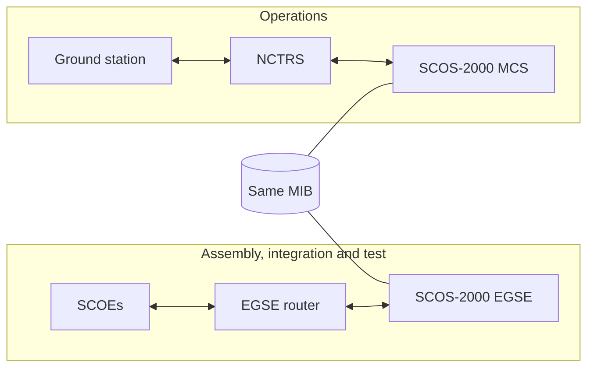
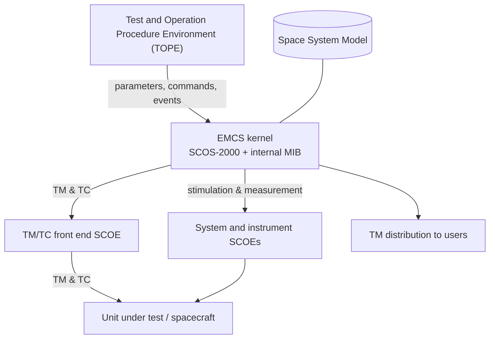
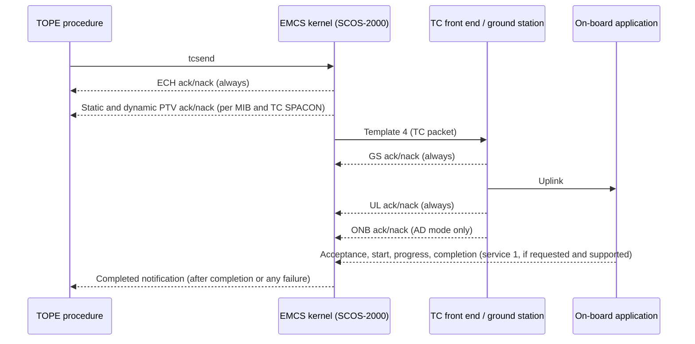
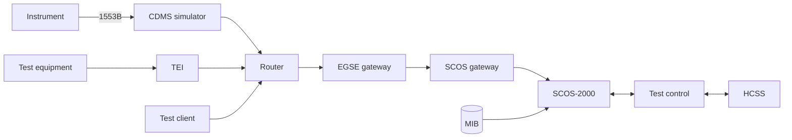
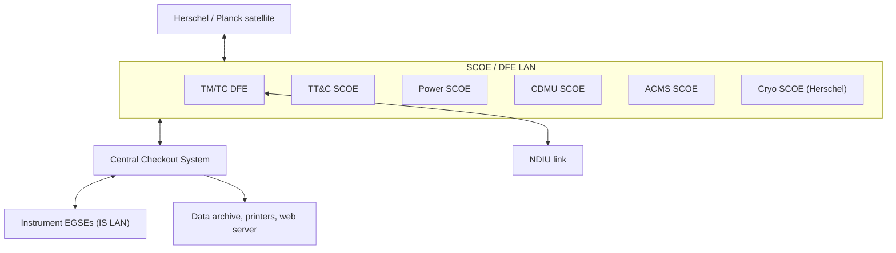
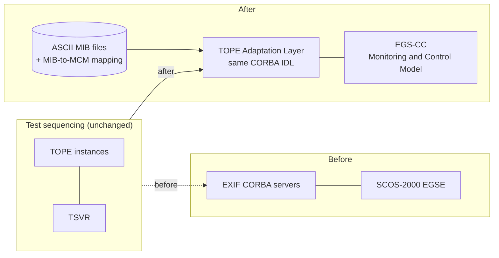

# SCOS-2000 as EGSE and central checkout

Before a spacecraft flies, it is tested on the ground. Its units, instruments and finally the
complete satellite are connected to **electrical ground support equipment (EGSE)**: the
electrical and electronic equipment that supports assembly, integration, functional and
environmental testing, ground station compatibility tests and launch operations.[^sp45-defs]
The heart of a system-level EGSE is the **Central Checkout System (CCS)**, from which tests are
prepared, run and archived. Around it sit **Specific Check Out Equipment (SCOE)** units, each
dedicated to one subsystem or interface.[^sp45-ccs][^sp45-acr]

ESA designed [SCOS-2000](index.md) to serve both mission control and checkout. Its stated
objective is to reuse the same system for the MCS, the EGSE and station control wherever
possible.[^gsaw03-obj] This page describes how that worked in practice: the PROBA heritage,
the "EGSE and Mission Control System" (EMCS) that ESA delivered to the Herschel/Planck
instrument teams, the TOPE test language, the Herschel/Planck instrument and central checkout
systems, commercial products that keep SCOS-2000 compatibility, translators between
databases, and the migration of TOPE procedures to EGS-CC. The internals of the kernel are on
[SCOS-2000 architecture](architecture.md).

## Why one system for test and operations

Several ESA policies pushed checkout and operations towards common tools. In April 2000 the
FIRST/Planck (later Herschel/Planck) project summarised ESA's science directorate policy:
EGSE is procured by industry as part of the spacecraft contract, the agency delivers as
little as possible to industry, and commonality between the flight control system and the
checkout system is to be pursued within the project's constraints. The same goal applied to
Rosetta and Mars Express.[^p2000-proj] The Herschel/Planck EGSE specification lists the
expected benefits: less duplicated effort, lower risk and cost, and more synergy between
AIV and flight operations. It names the areas where commonality is pursued: the Mission
Information Base, user interfaces, data archiving and distribution, on-board software
management and maintenance, and the user language for test procedures and in-orbit
operations.[^sp45-common]

ESA's Bulletin of 2007 confirms the result: common tools for spacecraft checkout and for
operations preparation gave a seamless transition from manufacture to operations, which
Herschel and Planck exploited.[^b130-hp] The modifications that made SCOS-2000 usable for
spacecraft and instrument checkout were pioneered for the PROBA technology satellite and
then merged into the evolution version of SCOS-2000.[^b108-proba]



The diagram follows the "Commonality" slide of ESOC's April 2000 presentation: the same
kernel talks to SCOEs through a router during tests and to ground stations through NCTRS in
operations.[^p2000-common] The shared MIB is not on that slide; it is added from the
Herschel/Planck EGSE specification, which names the Mission Information Base as the first
area of commonality.[^sp45-common]

## The PROBA heritage

PROBA (Project for On-Board Autonomy) was a small technology satellite with a 32-bit
processor, an Earth-observation imager and a test bed for automatic operations, including
on-board mission planning. Its ground station was a 2 m antenna at Redu, independent of the
ESA network.[^mom-proba] For PROBA, ESA built a common EGSE and mission control system on
SCOS-2 (release R1.4), and planned to move it to SCOS-2000 R2.2 by the end of 2000.[^emcs-ovw][^p2000-proba]
In April 2000 ESOC offered the reusable PROBA elements plus two additional database and
procedure tools:[^p2000-proba-el][^p2000-offer][^p2000-licdoc]

| Element | Description |
|---|---|
| SCOS-2000 | The kernel |
| EGSE router | TM reception, TC transmission and the SCOS gateway |
| Procedure automation tool | Based on the free Tcl/Tk language; used for complex procedures in AIV and in PROBA operations |
| Database editors | Based on ORACLE, used for both spacecraft and SCOE data (the SCOE equipment was addressed like a spacecraft subsystem) |
| Integral database editor (additional) | Based on MS-Access, used for INTEGRAL |
| Winfops/MOIS (additional) | Based on MS-Access, for procedure preparation and simple (tabular) automation |

The meeting minutes add that messages to the SCOEs were routed by APID, using APIDs outside
the spacecraft range, and that the PROBA procedure environment read the ORACLE database
directly at compile time.[^mom-proba] On a Windows NT PC, the router sustained 1 Mbps of
telemetry (input through a DMA parallel card) and 4 kbps of telecommands (through an RS-422
card) at less than 15 % CPU load. Distributing the data cost about 2 % CPU per virtual
channel.[^p2000-perf] Full ground-space commanding needed a commercial product, the
"TC Encoder Shell" from De Lande Long, priced at about 10 kEUR per PC and needed only when
the CCSDS COP-1 protocol was used.[^p2000-fe][^p2000-cots]

## The EMCS: EGSE and Mission Control System

The document "EGSE based on SCOS 2000: the EGSE & Mission Control System", a software user
manual written at ESTEC, describes the EGSE version of SCOS-2000 that ESA delivered to the
Herschel/Planck instrument developers. Issue 4.0 of March 2004 covers the "SCOS EGSE Release
2.3e P5", installed on Linux SuSE 7.3. The manual complements the generic SCOS-2000
documentation with installation and configuration procedures, the TOPE language reference and
the EGSE message formats.[^emcs-scope][^emcs-log] Earlier issues followed SCOS-2000 R2.1.1
(2001) and R2.3e with ESOC patches (2003). Issue 3.0 introduced a new language grammar to ease
the transfer of procedures to the Herschel/Planck CCS.[^emcs-log]

The EMCS has four parts:[^emcs-ovw]



### The Space System Model and system element identifiers

The **Space System Model (SSM)** is an information system holding the mission information that
the EMCS and its users need. The concept comes from ECSS-E-00 and was to be specified in
ECSS-E-70-31 (see [ECSS-E-ST-70-31C](../ecss/e-st-70-31c.md)).[^emcs-ssm] The space system is a
hierarchy of **system elements (SE)**: the spacecraft with its data handling system, on-board
software and application processes, and the ground segment with the EMCS, SCOS and the SCOEs.
Elements that take part in monitoring and control get a 16-bit SE identifier. For on-board
application processes, the SE identifier is the APID; the 11-bit APID field of CCSDS packets
reserves `0x0000` to `0x07FF` for them.[^emcs-ssm] The SSM allocates the other identifiers:[^emcs-seid]

| SE identifier | Type | Use |
|---|---|---|
| `0x0000`–`0x07FF` | APID | Spacecraft application processes |
| `0x0800` | Router | Reserved (spacecraft identifier in the MIB) |
| `0x1000`–`0x1FFF` | – | SCOS-2 tasks |
| `0x2000`–`0x2FFF` | – | EMCS clients (for example TOPE) |
| `0x4000`–`0x4FFF` | – | Ground station application processes |
| `0x8000`–`0x87FF` | APID | Alternative routing of spacecraft application processes via "EGSE_8000" |
| `0x8000`–`0x8FFF` | – | SCOE application processes |
| `0x8800` | Router | Alternative routing of spacecraft application processes via the TC front end |
| `0x8801` | APID | TC front end controller |
| `0x8810`–`0x8817` | APID | TM front end, virtual channels 0 to 7 |
| `0x8818` | APID | TM front end controller |
| `0xF000`–`0xFFFF` | – | EGSE gateway and router tasks |

!!! note "Decimal values in the source"
    The manual prints the decimal equivalent of `0x1000` as 4099 and the SCOE range
    `0x8000`–`0x8FFF` as 34816–36863. The hexadecimal values above are given as printed;
    `0x1000` is 4096 and `0x8000` is 32768 in decimal (the manual's own Appendix B uses
    `0x8000` = 32768 as its example). The printed decimal range 34816–36863 corresponds to
    `0x8800`–`0x8FFF` instead, so either the hexadecimal start or the decimal start of the SCOE
    range is a misprint; the sources do not say which.[^emcs-seid][^emcs-conv]

The SE type tells the kernel what it can do with an element. Elements of type APID process
requests, so activities (telecommands, procedures, stimuli) can be attached to them. Elements of
type Router only carry requests and reports onward. SCOS-2000 was changed to control any
element that processes requests, whether it is on board or on the ground.[^emcs-ssm2] An
Oracle-based SSM repository was under development but not yet available in 2004, so users
populated the mission data through the SCOS-2000 ASCII files, extended for EGSE needs.[^emcs-seid]

### The EMCS kernel and the SCOE

The kernel is SCOS-2000 with three additions: it can route commands to the spacecraft through
the ground station or through a SCOE, it can monitor and control ground processes such as
SCOE applications, and it can send commands and process telemetry that are not predefined in
the database.[^emcs-kernel] It connects to the SCOEs over TCP/IP.[^emcs-scoe]

For PROBA, ESTEC built the **EGSE router**, a generic facility on Windows for integrating and
remotely controlling SCOE equipment. The router provides location transparency, client
management with several clients per connection, data transparency, and message delivery
either by asynchronous call-back or by synchronous polling. It was written in Delphi as an
ActiveX server using Microsoft DCOM, usable from any ActiveX language (Delphi, C++, LabView,
Java). Systems without DCOM, such as SCOS-2000, connect through a TCP/IP **gateway**.[^emcs-router]
The Windows **TM front end** extracts, archives and distributes CCSDS telemetry packets from a
bit stream, either from an on-board data handling interface simulator or from baseband
equipment. The **TC front end** turns command requests into a CCSDS stream, using the
commercial TC Encoder Shell for the full ground-space protocol.[^emcs-fe] For Herschel/Planck
the Windows router and front ends were not used. SRON developed a Linux router for Herschel,
compatible with the ESTEC set-up on the SCOS side but not on the SCOE side.[^emcs-scoe]

### EGSE message format

Messages between ground applications on the EGSE router share one header, defined in the EGSE
Gateway ICD:[^emcs-msg]

<div class="bitfield" data-title="EGSE router message header (160 bits)" data-width="32" data-caption="EMCS SUM issue 4.0 §7.1; bit 0 is the first transmitted bit (Appendix B)" data-fields='[{"n":"DstID","b":16,"d":"Identifier of the destination ground application"},{"n":"SrcID","b":16,"d":"Identifier of the sending ground application"},{"n":"Token","b":32,"d":"Unique message identifier set by the sender, used to report on the processing of the message"},{"n":"Time (seconds)","b":32,"g":"Time (SunOS format)","d":"Unsigned seconds since 1970-01-01T00:00:00"},{"n":"Time (microseconds)","b":32,"g":"Time (SunOS format)","d":"Remaining microseconds"},{"n":"Msg_Type","b":8,"d":"Template number 1 to 7; selects the layout of the application data"},{"n":"Spare","b":8,"v":"0"},{"n":"S/C id","b":16,"d":"Spacecraft identifier (0x66 for PROBA)"}]'></div>

| Field | Size | Meaning |
|---|---|---|
| DstID | 2 octets | Unique identifier of the destination ground application |
| SrcID | 2 octets | Unique identifier of the sending application |
| Token | 4 octets | Unique message identifier, used in reports about the processing of the message |
| Time | 8 octets | SunOS time format: 4 octets of seconds since 1970-01-01T00:00:00 and 4 octets of remaining microseconds |
| Msg_Type | 1 octet | Template number that defines the application data layout |
| Spare | 1 octet | 0 |
| S/C id | 2 octets | Spacecraft identifier; `0x66` for PROBA |
| Application data | any | Layout given by the template |

The field sizes and meanings come from §7.1 of the EMCS manual.[^emcs-msg] The message types
are:[^emcs-msg]

| Msg_Type | Template | Direction (from the manual's descriptions) |
|---|---|---|
| 1 | SCOE command | SCOS-2000 to a SCOE |
| 2 | SCOE command verification report | SCOE to SCOS-2000 |
| 3 | SCOE observation report | SCOE to SCOS-2000 |
| 4 | Sending TC packet request | SCOS-2000 to the TC front end |
| 5 | Sending TC packet verification report | TC front end to SCOS-2000 |
| 6 | TM packet report | TM front end to SCOS-2000 |
| 7 | TM frame reports | (application data not defined in the manual) |

**Template 1 (SCOE command)** keeps the PUS application data but replaces the CCSDS and PUS
headers by the EGSE header. The parameter structure follows the PUS service type and subtype
and is defined in the MIB.[^emcs-t1]

<div class="bitfield" data-title="Template 1, SCOE command: start of application data (24 bits)" data-width="8" data-caption="Followed by the command parameters (any length)" data-fields='[{"n":"Service Type","b":8},{"n":"Service Subtype","b":8},{"n":"Not used","b":4,"g":"Ack","d":"Bits 0 to 3"},{"n":"Completion","b":1,"g":"Ack","d":"Bit 4: Completion_Ack requirement"},{"n":"Progress","b":1,"g":"Ack","d":"Bit 5: Progress_Ack requirement"},{"n":"Start","b":1,"g":"Ack","d":"Bit 6: Start_Ack requirement"},{"n":"Acceptance","b":1,"g":"Ack","d":"Bit 7: Acceptance_Ack requirement"}]'></div>

**Template 2 (SCOE command verification report)** carries service type 1 with a subtype from 1
to 8, the 4-octet token of the SCOE command, a step number (for subtypes 5 and 6 only; its
size is not printed), a 1-octet code and parameters. Footnotes in the manual say that neither
step-level progress reporting nor the code was supported by the EMCS server in 2004. The subtypes are
1 successful acceptance, 2 failed acceptance, 3 successful start, 4 failed start, 5 successful
progress, 6 failed progress, 7 successful completion and 8 failed completion, mirroring
[ST[01]](../ecss/pus/st01-request-verification.md).[^emcs-t2]

**Template 3 (SCOE observation report)** lets an EGSE application send any feedback to SCOS, in
a structure modelled on a PUS telemetry packet: service type, subtype and a parameter structure
like PUS source data. It is sent with the router's "smData" service.[^emcs-t3]

**Template 4 (sending TC packet)** asks the TC front end to uplink a complete CCSDS/PUS TC
packet:[^emcs-t4]

<div class="bitfield" data-title="Template 4, sending TC packet: start of application data (32 bits)" data-width="8" data-caption="Followed by the full CCSDS/PUS TC packet" data-fields='[{"n":"Not used","b":1,"g":"Ack","d":"Bit 0"},{"n":"ONB","b":1,"g":"Ack","d":"Bit 1: ONB_Ack requirement (AD mode only)"},{"n":"GS","b":1,"g":"Ack","d":"Bit 2: GS_Ack requirement"},{"n":"UL","b":1,"g":"Ack","d":"Bit 3: UL_Ack requirement"},{"n":"Not used","b":4,"g":"Ack","d":"Bits 4 to 7"},{"n":"Channel (VC)","b":8,"d":"Virtual channel number"},{"n":"MAPID","b":8,"d":"Multiplexed Access Point Identifier"},{"n":"Service","b":8,"d":"AD = 0, BD = 2"}]'></div>

In BD mode, the UL_Ack report says whether the packet was completely sent to the spacecraft.
In AD mode, it says whether the packet was confirmed by the COP-1 protocol through the CLCW. In
2004 the mapping from service type and subtype to MAPID was hard-coded in the SCOS-to-SCOE
interface, as it had been for PROBA.[^emcs-t4] See [TC Space Data Link Protocol](../ccsds/tc-sdlp.md)
and [COP-1](../ccsds/cop-1.md) for AD and BD frames, MAP IDs and the CLCW.

**Template 5 (sending TC packet verification report)** returns service type 1 with subtypes 9
to 14: 9 successful GS, 10 failed GS, 11 successful UL, 12 failed UL, 13 successful on-board
acceptance, 14 failed on-board acceptance. It also carries the 4-octet EGSE command token, a code
and parameters. SCOS-2000 injects these reports as telemetry packets.[^emcs-t5]

**Template 6 (TM packet report)** wraps a full CCSDS/PUS telemetry packet received by the TM
front end. Service 1 reports inside it are injected with a packet ID known to the SCOS-2000
verifier.[^emcs-t6]

!!! note "SPID values for injected verification reports"
    The manual gives the packet IDs used to inject Template 5 and service 1 reports as 10005 and
    10006 in §7.7 and §7.8, but lists the defaults of the corresponding configuration variables
    (`EGSE_VER_TC_GS_PKTID`, `EGSE_VER_TC_REP_PKTID`) as 23 and 24 in §4.2.[^emcs-t5][^emcs-t6][^emcs-misc]
    The sources do not explain the difference; the values are configurable in any case.

### The acknowledgement policy

PUS defines four acknowledgements that a command can request from the on-board application
process: acceptance, start, progress and completion. The EMCS extends this so that a command can
be followed through the EMCS kernel, NCTRS and the SCOEs as well. Any element that processes
requests, on board or on the ground, may report with the four PUS acknowledgements (Template 2
for SCOE commands, Template 6 for TC packets). Three further acknowledgement requests, with six
reports (service 1 subtypes 9 to 14), follow the ground front ends:[^emcs-ack]

| Acknowledgement | Issued by | When |
|---|---|---|
| GS_Ack | Ground station or SCOE TC front end | The telecommand is received |
| UL_Ack | Ground station or SCOE TC front end | A BD-mode telecommand has been sent to the spacecraft |
| ONB_Ack | Ground station or SCOE TC front end | The spacecraft confirms reception of an AD-mode telecommand |



The sequence follows the table of conditional reporting in §7.2. The External Command Handler
(ECH) always confirms receipt, the PTV reports depend on the MIB and the TC SPACON settings, the
ground reports are always delivered, and the on-board reports depend on the application
process. The manual warns that the order of the reports cannot be guaranteed. SCOS-2000 can also
verify execution through telemetry conditions (the CEV, confirmation of execution verification)
instead of, or in addition to, service 1 reports.[^emcs-ack]

### Internal archives and packet identification

The SCOS EGSE stores every received message (Templates 2, 3, 5 and 6) as an internal SCOS
packet with a SPID. SPIDs 0 to 100 are reserved for kernel needs (§4.1.1 says 1 to 100) and can be
reallocated through the configuration and the minimum EGSE data set.[^emcs-arch][^emcs-min] The SPID is chosen from
the template number, the APID, the service type and subtype, and the PI1 and PI2 identification
fields, as for spacecraft packets.[^emcs-arch] Specific processing then applies:[^emcs-proc]

* **Time stamping** depends on `EGSE_TM_FILING_TIME_TYPE`: 1 uses the reception time on the
  SCOS machine, 2 uses the time field of the router header, and 3 converts the on-board time in
  the packet through time correlation, with a sanity check. A packet whose on-board time differs
  from the current time by more than `EGSE_TM_OBT_THRESHOLD` gets the current time instead, a
  warning, and the type "PR" rather than "PG" in the packet history.
* **Checksum verification**: packets that fail can be discarded, or archived in a dedicated data
  stream and flagged invalid together with all their parameters.
* **Request verification**: Template 2, Template 5 and service 1 reports go to the SCOS-2000
  verifier and are stored under system SPIDs.
* **Unknown messages**: an observation report or TM packet without a matching `pid` entry is
  "rejected" and filed under a wrapper SPID. After the MIB is updated and re-imported, the
  `PDS_DISP` task copies the stored messages into their proper SPID archives.[^emcs-redist]

### Configuration: MISC variables and system SPIDs

The EGSE-specific variables in the `MISCconfig` file include:[^emcs-misc]

| Variable | Default | Meaning |
|---|---|---|
| `EGSE_MODE` | 1 | 0: the TC releaser connects only to NCTRS; 1: to NCTRS and the EGSE router; 2: only to the EGSE router |
| `NCTRS_EGSE_TC_SERVER`, `..._PORT` | localhost, 2222 | Host and port of the SCOS gateway that connects to the router |
| `EGSE_EGW_SERVER`, `..._PORT` | localhost, 9876 | Host and port of the router's EGSE gateway |
| `EGSE_BINCMD_NAME` | `ZBINTC` | "Binary command" for uploading commands not defined in the MIB; to be removed from the MIB where not authorised |
| `EGSE_VER_SCOE_PKTID` | 22 | SPID of SCOE command verification reports |
| `EGSE_SEND_CHKSUM_ERROR_PKT` | 1 | Archive (1) or drop (0) TM packets that fail the checksum |
| `EGSE_STREAM_ID_FOR_CRC_ERROR` | 65534 | Data stream for packets that fail the checksum |
| `EGSE_TM_FILING_TIME_TYPE` | 1 | Time stamping: 1 EMCS time, 2 ground station or SCOE time, 3 on-board time |
| `EGSE_TM_OBT_THRESHOLD` | 60 | Sanity threshold for on-board times |
| `EGSE_DUPLICATE_GS_UL` | 1 | Simulate an on-board acknowledgement for each UL report received in BD mode |
| `EGSE_WRAPPER_PKTID_3`, `_6` | 20, 21 | SPIDs for unknown observation reports and unknown TM packets |
| `IMPT_DST_FILE` | `dst.dat` | File with the routing configuration of system elements |
| `OOL_PACKET_APID` | 3000 | SPID for out-of-limits event packets |
| `TCO_MISSION_EPOCH` | 1958-01-01T00:00:00.000000 | Mission epoch (the manual says the default is 1970) |

### The minimum EGSE data set

The EGSE needs some generic MIB definitions to work. They are delivered as `MIN_EGSE_v2`, and
every name in it starts with the letter "Z" so that it is easy to recognise.[^emcs-min] A mission
adapts the TC packet header (`tcp`, `pcdf`, `pcpc`), the time-tag wrapper command `ZLOADTT` and
the binary command `ZBINTC` (`ccf`, `cdf`, `cpc`), the definitions that decode rejected and
service 1 packets (`dpc`, `pcf`, `plf`), and the version entry (`vdf`).[^emcs-min] Two scripts
manage databases: `mergeDATA` merges several data sets (for example MIN_EGSE and one instrument)
into a new set, and `setSCOSdata` points SCOS-2000 at a given MIB, links its TOPE procedures,
installs its archive and cache configuration, and runs the import.[^emcs-merge] See
[the MIB](../mib/index.md) for the tables and [MIB tooling](../mib/tooling.md) for editors.

### Command routing in the MIB: the `dst` table

The MIB table [`dst`](../mib/tables/dst.md) routes commands by APID. The ICD says it is
optional and only used by SCOS-2000-based EGSE systems. Each route is a string of up to three
dot-separated fields: the destination system (`NCTRS`, the default, or `EGSE`), the request
type (`SCOE` for non-spacecraft commands, `TC` for spacecraft commands) and, for spacecraft
commands not sent through NCTRS, the address of the ground equipment that sends them. The ICD's
example `EGSE.TC.0x8800` sends spacecraft commands through the SCOE and the TC front end
`0x8800`.[^i70-dst] This matches the system element `0x8800` of the EMCS manual.[^emcs-seid]

The Solar Orbiter MIB of September 2025 still contains exactly one `dst` record, as did the
release of April 2020: APID 1372 is routed to `EGSE.TC.0x8800`. All 91 commands on
[APID 1372](../explorer/index.md#/solo/apid/1372) have names starting with `ZIC`, and 7 of
their descriptions mention the SPICE instrument; for example `ZIC00085` is described as
opening the door of the SPICE optics unit.[^mib-solo][^mib-solo2020]

!!! warning "Inference"
    The `dst` record is probably a leftover of instrument-level testing on a SCOS-2000-based
    EGSE, carried into the flight MIB because the instrument database was merged into the
    spacecraft database. In the mission control system, which sends commands through NCTRS, it
    has no evident use. Neither the MIB nor the sources say why it is there.

??? example "SQL used"
    ```sql
    -- solo-2025-09-16.sqlite
    SELECT * FROM dst;                                     -- 1372|EGSE.TC.0x8800
    SELECT count(*) FROM ccf WHERE CCF_APID = '1372';      -- 91
    SELECT count(*) FROM ccf WHERE CCF_APID = '1372' AND CCF_CNAME LIKE 'ZIC%';   -- 91
    SELECT count(*) FROM ccf WHERE CCF_APID = '1372'
       AND (CCF_DESCR LIKE '%SPICE%' OR CCF_DESCR2 LIKE '%SPICE%');            -- 7
    SELECT CCF_CNAME, CCF_DESCR, CCF_DESCR2 FROM ccf WHERE CCF_CNAME = 'ZIC00085';
    -- ZIC00085|SDM_OPEN_DOOR|Open the door to the SPICE Optics Unit
    -- solo-2020-04-16.sqlite
    SELECT * FROM dst;                                     -- 1372|EGSE.TC.0x8800
    ```

## TOPE: the Test and Operations Procedure Environment

ECSS-E-70-32 specifies a common procedure language for test and operations, **PLUTO**
(Procedure Language for Users in Test and Operations). When PLUTO tools were not yet available,
ESA delivered to the Herschel/Planck instrument teams a procedure environment based on Tcl/Tk,
called **TOPE** (Test and Operations Procedure Environment). TOPE starts commands to the
spacecraft or the SCOEs through the EMCS kernel, follows their execution through the reports
that SCOS returns, and monitors the space system through telemetry and ground parameters.[^emcs-tope]
Procedures may use any low-level Tcl/Tk function. The constructs defined since issue 3.0 of the
manual are not compatible with the earlier TOPE language.[^emcs-tl] Later sources expand the
acronym differently: GMV writes "Test procedure, preparation and execution" and Terma "Test &
Operations Procedure Executive".[^tope-ovw][^ccs5-tope]

TOPE talks to SCOS-2000 through the **EXIF** CORBA services (see
[architecture](architecture.md#exif-and-tope)). A 2019 GMV paper classifies TOPE's EGSE commands
by their interaction pattern:[^tope-ovw]

| Pattern | Commands | Mechanism |
|---|---|---|
| Synchronous | `fetch`, `syslog`, the database patch commands | Direct CORBA calls on EXIF |
| Asynchronous | `subscribe` for TM packets and parameters | Registration is synchronous; updates arrive later as Tcl variable updates |
| Synchronous with asynchronous progress | `tcsend`, `callasync` | A call followed by progress notifications |
| Local | waiting, logging, data access, conversions | No interaction with the EGSE |

### Sending commands: `tcsend`

`tcsend <CommandName> <Arguments> <Parameters>` sends a command to the unit under test or to a
SCOE. All arguments are optional:[^emcs-tcsend][^emcs-tcsend2]

| Argument | Meaning |
|---|---|
| `via <string>` | Routing: server (`EGSE` or `NCTRS`), encoding style (`TC` or `SCOE`), destination `0x0000`–`0xFFFF`; default from the `dst` table |
| `mapid <n>`, `vcid <n>` | MAP ID and virtual channel for TC-style commands (defaults from the configuration or `CCF_MAPID`) |
| `checks {...}` | Static PTV, dynamic PTV and CEV checks on or off (`ALL` by default, or `NONE`) |
| `ack {...}` | Acknowledgements to request: `ACCEPT`, `START`, `PROGRESS`, `COMPLETE`, `ALL` or `NONE`; default from `CCF_ACK` and the header definition |
| `referby <Varname>` | Tcl variable updated with each acknowledgement report |
| `userrequestid <id>` | End-user identifier of the request |
| `releasetime <time>` | Absolute release time `YYYY.DDD.HH.MM.SS.UUUUUU`; otherwise as soon as possible |
| `executiontime <time>` | Builds an on-board schedule command (service 11,4) to execute at that time |
| `ilocktype`, `ilockstage` | Interlock type (`NONE`, `LOCAL`, `GLOBAL`, `SUBSYS_LOCAL`, `SUBSYS_GLOBAL`) and the stage that releases it |
| `nowait` | Do not wait automatically for stage `UV_GS_RECEIVE` |

Each parameter is a list `{name value [format] [RAW|ENG|DEFAULT]}`. The default format is a
string that SCOS converts to the parameter's type. The explicit formats are long (32-bit
signed), unsigned long, IEEE single-precision float, boolean, string, binary string, time,
short, unsigned short, char and octet. Binary parameters can be given as characters or as a hex
string.[^emcs-tcsend2] `tcsend` returns a unique request ID, or throws a Tcl exception on
failure.[^emcs-tcsend2] Absolute times use `YYYY.DDD.HH.MM.SS.mmmmmm`, relative times
`[+|-]HH.MM.SS.mmmmmm` with abbreviations allowed.[^emcs-time]

The report variable is read with access functions: `getrequestid`, `getstage`, `getstatus`,
`getstagehistory`, `getcompleted`, `getupdatetime`, `getuserrequestid` and `tostring`.[^emcs-stages]
The stage names and their order are listed on the [architecture page](architecture.md#verification).
`getstagehistory` returns one character per stage, matching the SCOS TC history display:[^emcs-stagehist]

| Status | Letter | Status | Letter |
|---|---|---|---|
| IDLE | I | SUPERSEDED | E |
| PENDING | P | UNCERTAIN_FAILED | N |
| PASSED | S | UNCERTAIN_PASSED | V |
| FAILED | F | AFFECTED | A |
| UNVERIFIED | U | SCC | (empty) |
| UNKNOWN | X | NOT_APPLICABLE | ? |
| TIMEOUT | T | | |

The transfer mode for commands can be read and set with `gettransfermode` and
`settransfermode` (`AD` or `BD`).[^emcs-mode]

### Telemetry: `fetch`, `subscribe` and waiting

`fetch <ParameterName>` returns a Tcl list with the parameter's properties. Access functions
return the name, raw value, extracted value (regardless of validity), engineering value, default
value (engineering if it exists, otherwise raw), each value's validity as a bit set, the
out-of-limits state (`NOMINAL`, `WARNING`, `ALARM`, `SCC`), the status consistency state and the
time stamp.[^emcs-fetch] The validity bits are listed on the
[architecture page](architecture.md#the-telemetry-model-extraction-validity-and-calibration).

`subscribe <ParameterName> referby <Varname> ?whenever UPDATE|CHANGE?` updates a variable
whenever the parameter is updated (by a new packet, or by a contributing parameter such as the
source of a synthetic parameter or a validity, limit-applicability or calibration-selection
parameter) or only when it changes. `subscribeset` does the same for a list of
parameters, and `unsubscribe` cancels subscriptions.[^emcs-sub] `waitfor <Varname> ?-until
<Expression>?` waits until the variable is set and the expression is true. `waittime` waits for
a relative time, `watchdog` runs an action when a condition on watched variables becomes true,
and `putlog`, `openlog` and `closelog` handle the test log.[^emcs-wait]

```tcl
# Illustrative TOPE fragment, constructed for this page from the syntax in the EMCS SUM.
# Command and parameter names are invented.
tcsend CMD001 referby vCmd ack {ACCEPT COMPLETE} {PAR1 10 UL RAW}
waitfor vCmd -until {[getcompleted $vCmd]}
putlog "CMD001 stages: [getstagehistory $vCmd]"

subscribe TEMP01 referby vT whenever CHANGE
waitfor vT -until {[isengvaluevalid $vT] && [getengvalue $vT] > 20.0}
putlog "TEMP01 now [getengvalue $vT] ([getoolstate $vT])"
```

### Running TOPE

In the PACS instrument test set-up of 2004, the router and EGSE gateway were started first, then
a gateway for the PACS test equipment interface, then SCOS-2000 from its task launcher (server
tasks, then client applications), and finally the EXIF tasks and a TOPE instance from a second
launcher. Starting a second procedure in the same TOPE window suspended the first until the
second finished. Parallel procedures needed another TOPE window and another `EXIF_CHx` task.[^guide-start][^guide-tope]
The manual's debugger, TUBA, could step through procedures but had known limits, such as
treating several procedures as one sequential flow.[^emcs-tuba]

### TOPE on the Herschel/Planck CCS

Procedures written for instrument tests were to be reused on the Herschel/Planck CCS, which had
its own TOPE implementation ("TOPE/CCS"). Appendix E of the manual lists the differences:[^emcs-ccs]

| Topic | Instrument EGSE (TOPE/IEGSE) | Central checkout (TOPE/CCS) |
|---|---|---|
| Parallel procedures | Cooperative multitasking with one event loop; procedures can share global variables and can miss updates | One process per procedure; truly parallel; no shared "spill-over" variables |
| SCOE connection | Established automatically | Explicit `connect` and `disconnect` |
| SCOE commanding | No locking | `attach` (an exclusive lock) before the first SCOE command |
| TM update mode | `whenever UPDATE` and `whenever CHANGE` | Packet parameters update only when a source packet arrives; `whenever CHANGE` not available |
| Features | `via`, `mapid`, `vcid`, interlocks, `watchdog`, `openlog`/`closelog`, transfer mode | Not supported |

The CCS worked only in BD mode.[^emcs-mode] A technical note of 2003 proposed how a CCS test
script could run a full instrument telecommand sequence while the instrument EGSE supplied the
parameter values. The CCS sends a TC packet over the PIPE protocol asking for a named
observation. The instrument EGSE expands it with the Herschel Common Science System (HCSS),[^hcss] in
particular its CUS component, and returns the command IDs, parameter values and delays in
housekeeping TM packets.[^ccstc] The concept was
prototyped with MIB files ingested into the PACS SCOS-2000 EGSE and run with TOPE. The note
records that the telecommand request ID needed by this scheme was known to SCOS-2000 since
version 2.3e, and that the observation request was limited to 242 characters.[^ccstc]

## Herschel/Planck instrument EGSE

### The decision for SCOS-2000

The Herschel/Planck instrument teams evaluated SCOS-2000 from 3 to 5 November 1999 as a
"framework" for a common real-time assessment (RTA) system, and later as an EGSE kernel. PACS
collected the missing functions in a "delta" user requirements document in April 2000.[^p2000-eval]
At a meeting at ESOC on 18 and 19 April 2000, ESOC presented its status, the EGSE elements, the
licence and the support and service options.[^p2000-agenda] The project stated that the choice
was entirely the instrument teams' and that it could not provide technical support, hardware,
software or funding.[^p2000-proj] All instrument groups stated unanimously that they intended to
use SCOS-2000 as the basis for their EGSE and RTA systems. The three Herschel instruments agreed
a common EGSE development, with requirements frozen around June 2000.[^mom-concl]

### The EGSE-ILT and its integration

The Herschel EGSE for instrument level tests (EGSE-ILT) shared its building blocks among the
three Herschel instruments:[^hip-blocks]

| Block | Delivered by |
|---|---|
| SCOS-2000 | ESA |
| SCOS gateway | ESTEC |
| Test equipment interface (TEI) | HIFI |
| TM/TC router | HIFI |
| Test control | PACS |
| CDMS simulator | SPIRE |
| OBSM | ESA |
| MIB editor | ESA |



The diagram follows the overview figure of the integration plan.[^hip-blocks] The plan of 2001
tested the blocks one at a time, each with a MIB that described the TM and TC packets used:[^hip-tests]

| Test | Functions demonstrated |
|---|---|
| Router | TM packets from a test client to SCOS-2000, TC packets back, throughput |
| Test equipment interface | TM from test equipment to SCOS-2000 and TC to test equipment |
| CDMS simulator | TM and TC routing through the simulated command and data management system, its command interface, and (to be confirmed) the time packet protocol |
| Test control | Reading housekeeping values from SCOS-2000, sending TCs, test procedures, command mnemonic sequences and autonomy procedures |
| Test control and HCSS | Communication between test control, the HCSS and the test client |

On-board software maintenance was left as an open item.[^hip-tests] The common EGSE document
overview lists the documents of this effort, including the EGSE-ILT and real-time analysis user
requirements, the CDMS simulator requirements, the router statement of work and ICDs, the TEI
specification and requirements, the test-control statement of work, the Test Technology
Activities (TTA-2000) user manual, the MIB-editor requirements and evaluation report, and the
OBSM facility requirements.[^cedo]

### Test equipment as PUS application processes

The HIFI **TEI TMTC packet ICD** of December 2001 shows how test equipment was made to look like
on-board software to SCOS-2000. Each TEI unit has an APID in the range 2016 to 2023 and speaks
PUS. The TC packet header follows the CCSDS layout, but the ICD (which applies the
Herschel/Planck Packet Structure ICD) splits the 14-bit sequence count into a 3-bit source field
(always `000` for these packets) and an 11-bit counter maintained per source and APID:[^tei-tc]

<div class="bitfield" data-title="TEI TC source packet header and data field header (80 bits)" data-width="16" data-caption="TEI TMTC packet ICD §3.1; followed by application data and a 16-bit PEC" data-fields='[{"n":"Version","b":3,"v":"000"},{"n":"Type","b":1,"v":"1"},{"n":"Hdr flag","b":1,"v":"1"},{"n":"APID","b":11,"d":"2016 to 2023 for the TEI units"},{"n":"Seq. flags","b":2,"v":"11"},{"n":"Source","b":3,"v":"000","d":"Source of the command; always 000 here"},{"n":"Counter","b":11,"d":"Maintained by each source for each APID; wraps to 0"},{"n":"Packet length","b":16,"d":"Octets in the packet data field minus 1"},{"n":"Sec. hdr flag","b":1,"v":"0","g":"Data field header"},{"n":"PUS version","b":3,"v":"0","g":"Data field header"},{"n":"Ack","b":4,"g":"Data field header","d":"As numbered in the ICD: bit 3 acceptance, bit 2 start, bit 1 progress, bit 0 completion"},{"n":"Type","b":8,"g":"Data field header"},{"n":"Subtype","b":8,"g":"Data field header"},{"n":"Spare","b":8,"v":"0","g":"Data field header"}]'></div>

<div class="bitfield" data-title="TEI TM data field header (80 bits)" data-width="16" data-caption="TEI TMTC packet ICD §3.2; follows the 6-octet packet header" data-fields='[{"n":"Spare","b":1,"v":"0"},{"n":"PUS version","b":3,"v":"0"},{"n":"Spare","b":4,"v":"0"},{"n":"Type","b":8},{"n":"Subtype","b":8},{"n":"Spare","b":8,"v":"0"},{"n":"Coarse OBT","b":32,"d":"Seconds"},{"n":"Fine OBT","b":16,"d":"Sub-seconds"}]'></div>

All TEI units accept (8,4) and (17,1) and generate (1,1), (1,2), (5,4) and (17,2); the
other services below are used by particular units (for example (5,1) by the power
distribution unit and (21,1) by the scanner):[^tei-all][^tei-pdu]

| Service (type, subtype) | Direction | Content |
|---|---|---|
| (8,4) | TC | "Perform an activity of a function": function ID, activity ID, structure ID and data (for example set observation ID, set building block ID, switch a power distribution output, set temperatures, move a scanner) |
| (17,1) / (17,2) | TC / TM | Connection test and link connection report |
| (1,1) / (1,2) | TM | Acceptance success, and failure with error codes 0 illegal APID, 1 incomplete or illegal length, 2 incorrect checksum, 3 illegal type, 4 illegal subtype, 5 illegal or inconsistent application data |
| (3,25) | TM | Housekeeping reports, starting with SID, observation ID and building block ID |
| (5,1) / (5,4) | TM | Event and error/alarm reports |
| (21,1) | TM | Measurement reports (scanner, network analyser) |

See [ST[08] function management](../ecss/pus/st08-function-management.md),
[ST[17] test](../ecss/pus/st17-test.md) and [ST[03] housekeeping](../ecss/pus/st03-housekeeping.md).
Some TEI telemetry carried safety information for SCOS-2000 itself. A status bit in the source
unit's report meant that the state was undefined and that "SCOS must not release" commands that
increase a bias.[^tei-src]

### Constraints from the spacecraft level

The spacecraft prime imposed rules on the instrument databases so that they could later be
merged. In January 2003 Alcatel asked the instrument teams to limit calibration curve and range
set identifiers to 3 digits and command verification stage identifiers to 4, although the
Database Import ICD issue 5.1 allowed 4, 4 and 5 digits. It also allocated ranges inside the
single "constant packet" of dynamic user-defined constants: system 0000–0099, service module
0100–0199, payload module 0200–0299, then ranges for HIFI, HFI, PACS and LFI. The SPID of the
constant packet was to hold 1024 octets.[^alc]

!!! note "As printed"
    The fax lists HIFI twice (0300–0399 and 0500–0599, both for Herschel) and does not name SPIRE.
    The second entry may be meant for SPIRE, but the source does not say so. The Planck range
    0500–0599 is marked "Not used" with the query "Sorbtion cooler ?", and 0600–1023 is spare
    for later allocation by Alcatel. The unit of the ranges is not stated. Since they run from
    0000 to 1023, octet offsets in the 1024-octet constant packet would fit, but this is the
    wiki's reading.[^alc]

### Planck LFI: SCOS-2000 in an instrument ground segment

The Planck LFI team used SCOS-2000 as the real-time assessment part of its Level 1 software. For
the instrument-only tests, the EGSE was based on SCOS 2.3e. The team modified the SCOS-2000
Telemetry Receiver to replay simulated telemetry, and used the Flight Dynamics Interface to
stream live packets to its own telemetry handler. From the Planck integration tests onwards, the
EGSE was the Herschel/Planck CCS (HPCCS), which used a new protocol, PIPE (Packet Interface
Protocol for EGSE), to talk to external equipment. The team then wrote an "LFIGateway" to pass
telemetry from the HPCCS to its own systems.[^lfi-31][^sp45-acr] See
[Herschel/Planck: SCOS-2000 in a science mission ground segment](herschel-planck-ground.md).

## Herschel/Planck system EGSE

### The EGSE general requirements

Alcatel Space's **EGSE General Requirements Specification** (H-P-1-ASPI-SP-0045, issue 3 of June
2002) applies to every EGSE item used in Herschel/Planck system AIT.[^sp45-scope] The EGSE must
run automated tests, power instruments and modules, supervise the satellite permanently, provide
link, simulation and stimulation signals, decommutate telemetry, send and monitor telecommands,
manage the 1553 bus, acquire data and issue commands. It must also support test preparation by
simulation and offer self-test.[^sp45-scope] Its commonality section states that the instrument
EGSEs and the ESOC flight control system will both be based on SCOS-2000, and refers to an
analysis of which CCS requirements SCOS-2000 supports.[^sp45-common2] The equipment includes:[^sp45-items]

| Group | Items |
|---|---|
| System EGSE | CCS; TM/TC data front end (DFE); TT&C SCOE; power SCOE (junction unit, solar array simulator, battery simulator, battery conditioning equipment); CDMU SCOE; ACMS SCOE |
| Payload module EGSE | CDMU DFE; PLM SCOE |
| Launch interfaces | Check Out Terminal Equipment (COTE), spacecraft simulator, cable sets |
| Special equipment | OBSW quick loading (to be confirmed), test cabling and adapters, pyro tester, break-out boxes, power distribution unit, data and web server |

All SCOEs are connected to the CCS by Ethernet and work in local mode (from their own
peripherals) or remote mode (under CCS control), with a manual mode for power instruments.[^sp45-items][^sp45-modes]
The CCS centralises the test-execution user interfaces, but every SCOE keeps a backup interface
for safety.[^sp45-rules]



The diagram is a simplified reading of the system-level architecture figure of SP-0045.[^sp45-arch]
The specification names three user categories: the system administrator, the EGSE operator (who
populates the database, writes test sequences and configures the test environment) and the test
conductor, who executes or witnesses a test without being an EGSE expert.[^sp45-rules]

### Central checkout functions

The CCS is the core of the system EGSE: all testing is prepared, controlled and archived there,
and it is the single point of control of the system-level AIV programme. A "CCS lite" with one
server instead of two serves the payload module and instrument EGSE. The CCS must be compatible
with the ESA packet telemetry and telecommand standards PSS-04-105 and PSS-04-106.[^sp45-ccs][^sp45-std]
Its required functions include:[^sp45-ccsfun]

* standard interfaces for data distribution to the instrument EGSEs (without real-time control
  from them), for the front ends, and for an Internet gateway;
* pre-transmission checks of telecommands against the satellite database, with operator
  confirmation for hazardous commands, and a facility to block or veto ESOC commands during
  system validation tests run from the MOC;
* a simple test sequence language usable both interactively and in automated sequences, with
  parallel and nested sequences, debugging, a sequence library, configuration control and
  automatic logging;
* a database development environment and a database management system portable between
  environments;
* processing of all housekeeping data, automatic verification of TC reception and execution from
  the satellite database, and support for on-board control procedures;
* complete archiving of test data in a Test Result Database, time-correlated to 1 s (to be
  confirmed), with retrieval tools and off-line distribution;
* support of a mirror site of the Herschel/Planck System DataBase (HPSDB).

The **TM/TC DFE** connects the CCS to the spacecraft. It acquires telemetry at up to 3.5 Mbps,
reconstructs packets from transfer frames and validates them, and can simulate telemetry. It
sends telecommands at up to 4 kbps, encapsulating packets in CLTUs, filtering hazardous commands
and extracting the CLCW. It also passes telemetry to, and telecommands from, the link of the
Network Data Interface Unit (NDIU).[^sp45-dfe][^sp45-acr] See
[TC channel coding and the CLTU](../ccsds/tc-coding-cltu.md). The **TT&C SCOE** provides the RF
links and RF measurements.[^sp45-ttc]

### The HPCCS and its database

The Herschel/Planck Central Checkout System (HPCCS) that resulted was developed by Terma (the
Netherlands) under an Alcatel Alenia Space Italia subcontract, and is based on SCOS-2000 with
additional test functions. The Herschel/Planck System DataBase (HPSDB) was developed by GMV.[^nlr-team][^nlr-hpccs] NLR's account of the attitude control subsystem shows how
data flowed into it. The subsystem's test equipment combined the EuroSim real-time simulator with
the HPCCS, which commanded and monitored EuroSim through remote messages and commands in the same
format as spacecraft TM/TC. A dedicated database therefore had to generate the SCOS-2000 input
files. The available SCOS-2000 MS Access database did not fit: it supported a single mission, not
two missions with common data, and offered no configuration control at object level. Dutch Space
built its operations database in the DOORS requirements tool instead, and exported to the HPSDB,
from which SCOS-2000 files were produced for AIT and operations.[^nlr-hpccs] See
[MIB tooling](../mib/tooling.md).

## Commercial checkout systems around SCOS-2000

### Terma: from SCOS-2000-based CCS to compatible re-implementations

Terma delivered several system-level checkout systems for ESA missions with a CCS based on
SCOS-2000, and reused them at instrument level.[^arm-motiv] Its 2010 paper explains why it then
built a new small system, **CMDVS** (Commanding Monitoring Data-handling & Visualization System),
with Satellite Services BV (SSBV). A SCOS-2000-based system needs a separate EGSE database for the
front ends. Commanding front ends with TM and TC packets is awkward and limited by the speed of
the SCOS-2000 telecommand chain. Maintaining SCOS-2000 on modern platforms was getting more
expensive. Developing a monitoring and control system from scratch had cost about 30 MEUR in
the past, and users would not accept a completely new system.[^arm-motiv][^arm-new]

The answer was compatibility. CMDVS keeps the CCS test language and the SCOS-2000 MIB interface,
which Terma describes as "not perfectly normalized" but well known and well understood.[^arm-new]
By early 2010 it implemented all SCOS-2000 TM and command processing features. Front ends are
driven through plugins that expose their APIs directly to the test language instead of through
TM/TC packets. Variable packets are fully processed, header generation is fully database driven,
all PUS type codes up to 64 bits are supported, and up to 64 verification stages can be configured
(SCOS-2000 has no stage after the last completion report).[^arm-new][^arm-feat] The same plugin
technique was moved back into Terma's SCOS-2000-based CCS, whose external interface manager
became a generic process with project-specific plugins.[^arm-ccs]

Terma's current products, **CCS5** (multi-user checkout), **SCS5** (multi-user operations) and
**TSC** (single user), are full new implementations that keep the SCOS-2000 MIB data model.[^ccs5-hist][^ccs5-ds]
Terma's 2024 presentation explains the decision. Legacy systems such as SCOS-2000 were becoming
uneconomic to maintain, too slow and inflexible for new missions, and onerous to install. Asking
users to adopt a completely new data model would require retraining, and Terma was too small to
impose industry-wide standards.[^ccs5-hist]

| Feature | CCS5 / TSC (2024) | Source |
|---|---|---|
| Database | SCOS-2000 MIB ICD 6.9 extended (presentation: features of 6.9 to 7.2): unlimited field lengths, several databases loaded and dropped at run time, deduced parameters in TM and TC, little- and big-endian parameters, dynamic housekeeping definitions; TC sequence tables not supported | [^ccs5-ds][^ccs5-std] |
| Automation | TOPE on Tcl/Tk 8.6, syntax derived from SCOS-2000 TOPE, with multi-threading, debugger and syntax checker | [^ccs5-ds][^ccs5-tope] |
| Standards | ECSS PUS-A and PUS-C, CCSDS packets, CFDP, TM frames, CLTU and COP-1, SDLS authentication and encryption, CubeSat Space Protocol | [^ccs5-std][^ccs5-sec] |
| Interfaces | EGSE: EDEN and C&C protocols; ground stations: NIS (optionally SLE), Cortex and others | [^ccs5-ds][^ccs5-if] |
| Archive | Raw data in segmented binary files, indexes in an RDBMS (MySQL, MariaDB, PostgreSQL; SQLite for TSC) | [^ccs5-ds][^ccs5-arch] |
| Performance | About 150,000 parameter updates per second, 1,500 packets per second, 500 TC per second with verification (TSC) or 100 (CCS) | [^ccs5-perf] |
| Test features | TM simulation from the MIB definition, TC modelling, SVF mode with simulated time, merging of databases from several suppliers | [^ccs5-sim] |
| Licence | Terma IPR; perpetual licence with one year of warranty | [^ccs5-ds][^ccs5-lic] |

See [SDLS](../ccsds/sdls.md), [CFDP](../ccsds/cfdp.md) and [SLE](../ccsds/sle/index.md).

### Translating SCOS-2000 databases to other checkout systems

Not every prime contractor used a SCOS-2000-based checkout system. Thales Alenia Space Italia
(TAS-I) and Intecs built the **SRDB Translator** to import a SCOS-2000 MIB into the database of
TAS-I's ECHO checkout system. Their paper notes that SCOS-2000 had become a standard for ESA
mission control and, in most cases, for EGSE too, so the Satellite Reference Database (SRDB)
was almost always based on the SCOS-2000 run-time database.[^comi-intro] The two databases cover
similar entities, but a one-to-one table mapping was "almost inapplicable". Each item falls into
one of three cases: present in both (converted), present only in the SRDB (handled, ignored or
added to ECHO), or needed only by ECHO (supplied separately).[^comi-db] Examples of the conversion
rules:[^comi-rules]

| Data | SCOS-2000 | ECHO | Action |
|---|---|---|---|
| Verification stage | Any stage of the execution profile | All checks tied to TC uplink | Stage not imported |
| Verification window | Start time and duration in seconds | Maximum time from emission, in ms | (start + interval) × 1000 |
| Expected value | Raw or engineering | Engineering only | Raw-value checks discarded |
| Numerical curve identifier | Char(10) | Integer 1 to 9999 | Mapping algorithm; original name kept in the description |
| Raw value radix | Decimal, octal or hexadecimal | Decimal | Converted to decimal |
| Point-pair curve size | No limit | 2 to 1000 points | Shorter curves skipped, extra points dropped |
| Curves per parameter | No limit | 4 | Limit raised to 99 |

The first version served Galileo GIOVE-B, whose SRDB was a single MS Access 2000 file. An
enhanced version served Sentinel-1 and was also used for BepiColombo unit tests of the on-board
computer and mass memory. The translator followed ICD issue 6.1, and older BepiColombo databases
needed missing columns added before import.[^comi-app][^comi-limits]

| BepiColombo database | Parameters | TM packets | TC packets |
|---|---|---|---|
| On-board computer (OBC) | 3,745 | 521 | 399 |
| Solid state mass memory (SSMM) | 1,947 | 1,921 | 535 |

The figures come from the paper's Table 3.[^comi-limits] The authors concluded that frequent ICD
changes and mission tailoring made such translators costly. They suggested a standard database
interface, for example an XML mark-up language.[^comi-concl] See [XTCE](../ccsds/xtce.md) and
[ECSS-E-ST-70-31C](../ecss/e-st-70-31c.md) for standardised alternatives.

## From TOPE to EGS-CC

ESA uses two flavours of SCOS: SCOS-2000 for operations at ESOC and **SCOS-EGSE** for EGSE
applications at ESTEC, which includes TOPE. With EGS-CC replacing both, repositories of TOPE
procedures would in principle have to be rewritten in the EGS-CC automation language.[^tope-intro]
GMV and ESA instead connected TOPE to EGS-CC in the ERFEC activity (EGSE reference facility in
EGS-CC context), for the Real-Time Bench of ESTEC's Avionics Test Bench (ATB-RTB).[^tope-intro][^tope-tal]

In the ATB-RTB, TOPE runs inside a test sequencing subsystem with four parts besides EXIF:[^tope-atb]

| Component | Role |
|---|---|
| TOPE | Tcl-based test sequence interpreter; one instance per running sequence |
| TSVR (TOPE Server) | Coordination and synchronisation between parallel TOPE instances |
| TEXEC (TOPE Execution Tools) | GUI to monitor and control running instances, log viewer, graphical debugger |
| TPREP (TOPE Preparation Tools) | Editor and consistency checker for test sequences |



The **TOPE Adaptation Layer (TAL)** replaces EXIF. It implements CORBA servers that comply with
the existing TSEQ/SCOS-2000 IDL files, so TSEQ runs unmodified. Inside EGS-CC it uses the
monitoring and control access, definition management, messaging and configuration services.[^tope-tal]
EGS-CC models the space system as a Monitoring and Control Model (MCM): a hierarchy of monitoring
and control elements with activities, events and parameters, independent of TM/TC packets.[^tope-mcm]
At start-up, TAL reads the ASCII MIB files and a mapping file, generates the EGS-CC conceptual
data model from the MIB, and EGS-CC loads it into the MCM. TAL then translates TOPE's commands,
parameters and events to MCM activities, parameters and events, and back.[^tope-mib] The approach
has two constraints: the ASCII MIB must always be present (the ATB used the EagleEye mission MIB),
and new TM/TC defined in the MCM cannot be written back to the MIB.[^tope-mib] TAL is written in
Java with JacORB and deployed as OSGi bundles inside an EGS-CC session.[^tope-dev] See
[ancillary systems, MICONYS and EGS-CC](ancillary-and-egs-cc.md).

## Related pages

* [SCOS-2000 overview](index.md) and [SCOS-2000 architecture](architecture.md)
* [The MIB](../mib/index.md), [MIB tooling](../mib/tooling.md) and
  [mission tailoring of the MIB](../mib/tailoring.md)
* [Herschel and Planck](../missions/herschel-planck.md) and
  [Herschel/Planck ground segment](herschel-planck-ground.md)
* [PUS](../ecss/pus/index.md), [ST[01] request verification](../ecss/pus/st01-request-verification.md)
  and [ST[11] time-based scheduling](../ecss/pus/st11-time-based-scheduling.md)
* [ECSS-E-ST-70-31C monitoring and control data definition](../ecss/e-st-70-31c.md)

## Sources and copies

Each footnote links the library page of its source, which records the original URL, the
SHA-256 of the copy and the time of copy. The main sources of this page:

| Library page | Document | Copied (UTC) |
|---|---|---|
| [emcs-sum-4-0](../library/emcs-sum-4-0.md) | S. Valera, "EGSE based on SCOS 2000: the EGSE & Mission Control System", SUM issue 4.0 (2004) | 2026-11-05 14:06 |
| [h-p-1-aspi-sp-0045-egse-general-req](../library/h-p-1-aspi-sp-0045-egse-general-req.md) | Herschel/Planck EGSE General Requirements Specification, issue 3 (2002) | 2026-11-05 14:06 |
| [cosmos-herschel-egse-integration-plan](../library/cosmos-herschel-egse-integration-plan.md) | Herschel EGSE integration plan, SRON (2001) | 2026-11-05 14:11 |
| [cosmos-tei-tmtc-packet-icd](../library/cosmos-tei-tmtc-packet-icd.md) | HIFI TEI TMTC packet ICD, issue 1.0 (2001) | 2026-11-05 14:07 |
| [ccs-tc-if-1-0](../library/ccs-tc-if-1-0.md) | "A possible approach for the CCS IEGSE telecommand interface" (2003) | 2026-11-05 14:06 |
| [terma-ccs5-tsc-presentation](../library/terma-ccs5-tsc-presentation.md) | Terma, "CCS5 & TSC" presentation (13 March 2024) | 2026-11-05 14:07 |
| [indico-109-armitage-2011926](../library/indico-109-armitage-2011926.md) | A. Armitage, "Right-Sizing Test Tools", SESP 2010 | 2026-11-05 14:07 |
| [indico-109-comi-2009436](../library/indico-109-comi-2009436.md) | Comi et al., "SRDB Translator" | 2026-11-05 14:07 |
| [airdrive-9d40c91](../library/airdrive-9d40c91.md) | Barradas Pereira et al., "Integrating TOPE with EGS-CC", SESP 2019 | 2026-11-05 14:11 |
| [mib-20250916m25925pfms001-sol](../library/mib-20250916m25925pfms001-sol.md) | Solar Orbiter MIB, release of 16 September 2025 | 2026-11-05 14:24 |

[^sp45-defs]: [H-P-1-ASPI-SP-0045 EGSE General Requirements Specification, issue 3](../library/h-p-1-aspi-sp-0045-egse-general-req.md), §3.1.4 Specific terms and definition, PDF p. 13.
[^sp45-acr]: [H-P-1-ASPI-SP-0045](../library/h-p-1-aspi-sp-0045-egse-general-req.md), §2.4 Acronyms, PDF p. 10.
[^sp45-std]: [H-P-1-ASPI-SP-0045](../library/h-p-1-aspi-sp-0045-egse-general-req.md), §2.1 Standards (S2 ESA-PSS-04-105, S3 ESA-PSS-04-106), PDF p. 8.
[^sp45-scope]: [H-P-1-ASPI-SP-0045](../library/h-p-1-aspi-sp-0045-egse-general-req.md), §3.1.1 Functional description and §3.1.2 Use and mission, PDF p. 11.
[^sp45-rules]: [H-P-1-ASPI-SP-0045](../library/h-p-1-aspi-sp-0045-egse-general-req.md), §3.2.1 Basic rules and concepts (GRQT-0000a to 0000k), PDF pp. 16–17.
[^sp45-common]: [H-P-1-ASPI-SP-0045](../library/h-p-1-aspi-sp-0045-egse-general-req.md), §3.2.2 Commonality requirements, PDF p. 18.
[^sp45-common2]: [H-P-1-ASPI-SP-0045](../library/h-p-1-aspi-sp-0045-egse-general-req.md), §3.2.2 (commonality between mission phases, GRQT-0001), PDF p. 19.
[^sp45-items]: [H-P-1-ASPI-SP-0045](../library/h-p-1-aspi-sp-0045-egse-general-req.md), §3.2.3 Generalities, PDF p. 20.
[^sp45-modes]: [H-P-1-ASPI-SP-0045](../library/h-p-1-aspi-sp-0045-egse-general-req.md), §3.2.3 (SCOE operational modes and interfaces), PDF p. 21.
[^sp45-arch]: [H-P-1-ASPI-SP-0045](../library/h-p-1-aspi-sp-0045-egse-general-req.md), Figures 1 and 2 (EGSE general and system architecture), PDF pp. 21–22.
[^sp45-ccs]: [H-P-1-ASPI-SP-0045](../library/h-p-1-aspi-sp-0045-egse-general-req.md), §3.2.4.1 CCS (Central Checkout System), PDF p. 28.
[^sp45-ccsfun]: [H-P-1-ASPI-SP-0045](../library/h-p-1-aspi-sp-0045-egse-general-req.md), §3.2.4.1, GRQT-0002a and GRQT-0002b, PDF pp. 28–30.
[^sp45-dfe]: [H-P-1-ASPI-SP-0045](../library/h-p-1-aspi-sp-0045-egse-general-req.md), §3.2.4.2 TM/TC DFE, GRQT-0003, PDF pp. 31–32.
[^sp45-ttc]: [H-P-1-ASPI-SP-0045](../library/h-p-1-aspi-sp-0045-egse-general-req.md), §3.2.4.3 TT&C SCOE, GRQT-0004, PDF p. 33.
[^gsaw03-obj]: [GSAW 2003, Peccia](../library/gsaw2003-peccia.md), slide "ESA Objectives", PDF p. 3.
[^b130-hp]: [ESA Bulletin 130, "Happy Families"](../library/bul130-merri-happy-families.md), page on operational simulators and common tools, PDF p. 7.
[^b108-proba]: [ESA Bulletin 108](../library/esa-bulletin-108-ch8.md), "Experience so far", PDF p. 5.
[^p2000-common]: [ESOC SCOS-2000 presentation, April 2000](../library/scos2000-complete-presentation-2000.md), slide "Commonality", PDF p. 13.
[^p2000-proba-el]: [ESOC SCOS-2000 presentation, April 2000](../library/scos2000-complete-presentation-2000.md), slide "Main Elements", PDF p. 14.
[^p2000-perf]: [ESOC SCOS-2000 presentation, April 2000](../library/scos2000-complete-presentation-2000.md), slide "Performance", PDF p. 18.
[^p2000-fe]: [ESOC SCOS-2000 presentation, April 2000](../library/scos2000-complete-presentation-2000.md), slides "SCOS TCP/IP Gateway" and "TM/TC front end", PDF pp. 19–20.
[^p2000-proba]: [ESOC SCOS-2000 presentation, April 2000](../library/scos2000-complete-presentation-2000.md), slide "PROBA Status & Plan", PDF p. 24.
[^p2000-offer]: [ESOC SCOS-2000 presentation, April 2000](../library/scos2000-complete-presentation-2000.md), slide "TOS Offer (S/W Only)", PDF p. 26.
[^p2000-licdoc]: [ESOC SCOS-2000 presentation, April 2000](../library/scos2000-complete-presentation-2000.md), annexed note "Software License, Support and Service" (list of software items), PDF p. 45.
[^p2000-cots]: [ESOC SCOS-2000 presentation, April 2000](../library/scos2000-complete-presentation-2000.md), slide "Cost COTS's" (router and automation tool), PDF p. 32.
[^p2000-agenda]: [ESOC SCOS-2000 presentation, April 2000](../library/scos2000-complete-presentation-2000.md), agenda, PDF p. 2.
[^p2000-eval]: [ESOC SCOS-2000 presentation, April 2000](../library/scos2000-complete-presentation-2000.md), "SCOS 2000 Evaluation" by the FIRST/Planck project, history, PDF p. 39.
[^p2000-proj]: [ESOC SCOS-2000 presentation, April 2000](../library/scos2000-complete-presentation-2000.md), "FIRST/Planck Project Position", PDF pp. 41–43.
[^mom-proba]: [Minutes, "SCOS 2000 and FIRST/PLANCK", 19 April 2000](../library/scos2000-and-first-planck-mom.md), item 4 EGSE and supporting elements, PDF p. 2.
[^mom-concl]: [Minutes, "SCOS 2000 and FIRST/PLANCK"](../library/scos2000-and-first-planck-mom.md), items 8 and conclusion, PDF p. 4.
[^emcs-log]: [EMCS SUM issue 4.0](../library/emcs-sum-4-0.md), change log and change record, PDF pp. 2–3.
[^emcs-scope]: [EMCS SUM issue 4.0](../library/emcs-sum-4-0.md), §1.1 Scope, PDF p. 7.
[^emcs-ovw]: [EMCS SUM issue 4.0](../library/emcs-sum-4-0.md), §1.4 Overview, PDF p. 9.
[^emcs-ssm]: [EMCS SUM issue 4.0](../library/emcs-sum-4-0.md), §1.4.1 The Space System Model, PDF p. 10.
[^emcs-ssm2]: [EMCS SUM issue 4.0](../library/emcs-sum-4-0.md), §1.4.1 (SE types), PDF p. 11.
[^emcs-seid]: [EMCS SUM issue 4.0](../library/emcs-sum-4-0.md), §1.4.1 SE identifier table and SSM repository, PDF pp. 11–12.
[^emcs-kernel]: [EMCS SUM issue 4.0](../library/emcs-sum-4-0.md), §1.4.2 The EMCS kernel, PDF p. 13.
[^emcs-tope]: [EMCS SUM issue 4.0](../library/emcs-sum-4-0.md), §1.4.3 The Test and Operation Procedure Environment, PDF p. 13.
[^emcs-scoe]: [EMCS SUM issue 4.0](../library/emcs-sum-4-0.md), §1.4.4 The SCOE, PDF p. 14.
[^emcs-router]: [EMCS SUM issue 4.0](../library/emcs-sum-4-0.md), §1.4.4.1 The MS-Windows EGSE Router, PDF p. 15.
[^emcs-fe]: [EMCS SUM issue 4.0](../library/emcs-sum-4-0.md), §1.4.4.2 and §1.4.4.3 TM and TC front ends, PDF p. 15.
[^emcs-min]: [EMCS SUM issue 4.0](../library/emcs-sum-4-0.md), §4.1.1 The minimum EGSE data set, PDF pp. 21–22.
[^emcs-merge]: [EMCS SUM issue 4.0](../library/emcs-sum-4-0.md), §4.1.2 mergeDATA and §4.1.3 setSCOSdata, PDF pp. 22–23.
[^emcs-misc]: [EMCS SUM issue 4.0](../library/emcs-sum-4-0.md), §4.2 MISCconfig EGSE specific variables, PDF pp. 23–25.
[^emcs-tl]: [EMCS SUM issue 4.0](../library/emcs-sum-4-0.md), §6 TOPE language definition, PDF p. 28.
[^emcs-tcsend]: [EMCS SUM issue 4.0](../library/emcs-sum-4-0.md), §6.1 `tcsend` arguments, PDF pp. 28–30.
[^emcs-tcsend2]: [EMCS SUM issue 4.0](../library/emcs-sum-4-0.md), §6.1 parameters, return value and logging, PDF pp. 31–32.
[^emcs-time]: [EMCS SUM issue 4.0](../library/emcs-sum-4-0.md), §6.1.1 Time format parameter values, PDF p. 32.
[^emcs-stages]: [EMCS SUM issue 4.0](../library/emcs-sum-4-0.md), §6.1.2 Acknowledgement report access functions, PDF pp. 33–34.
[^emcs-stagehist]: [EMCS SUM issue 4.0](../library/emcs-sum-4-0.md), §6.1.2 `getstagehistory`, PDF p. 34.
[^emcs-mode]: [EMCS SUM issue 4.0](../library/emcs-sum-4-0.md), §6.1.3 Get/Set the transfer mode (AD/BD), PDF pp. 34–35.
[^emcs-fetch]: [EMCS SUM issue 4.0](../library/emcs-sum-4-0.md), §6.2 Fetch a parameter, PDF pp. 35–37.
[^emcs-sub]: [EMCS SUM issue 4.0](../library/emcs-sum-4-0.md), §6.3 to §6.5 subscribe, subscribeset, unsubscribe, PDF pp. 37–39.
[^emcs-wait]: [EMCS SUM issue 4.0](../library/emcs-sum-4-0.md), §6.6 to §6.11 waitfor, waittime, watchdog and logging, PDF pp. 39–42.
[^emcs-msg]: [EMCS SUM issue 4.0](../library/emcs-sum-4-0.md), §7.1 EGSE Message Format, PDF pp. 44–45.
[^emcs-ack]: [EMCS SUM issue 4.0](../library/emcs-sum-4-0.md), §7.2 The EMCS Request acknowledgement Policy, PDF pp. 46–48.
[^emcs-t1]: [EMCS SUM issue 4.0](../library/emcs-sum-4-0.md), §7.3 SCOE Request, Template 1, PDF p. 49.
[^emcs-t2]: [EMCS SUM issue 4.0](../library/emcs-sum-4-0.md), §7.4 SCOE command Verification Report, Template 2, PDF pp. 50–51.
[^emcs-t3]: [EMCS SUM issue 4.0](../library/emcs-sum-4-0.md), §7.5 SCOE Observation Report, Template 3, PDF p. 52.
[^emcs-t4]: [EMCS SUM issue 4.0](../library/emcs-sum-4-0.md), §7.6 Sending TC Packets, Template 4 and footnotes, PDF p. 53.
[^emcs-t5]: [EMCS SUM issue 4.0](../library/emcs-sum-4-0.md), §7.7 Sending TC Packet Verification Report, Template 5, PDF pp. 54–55.
[^emcs-t6]: [EMCS SUM issue 4.0](../library/emcs-sum-4-0.md), §7.8 TM Packet Report, Template 6, PDF p. 56.
[^emcs-arch]: [EMCS SUM issue 4.0](../library/emcs-sum-4-0.md), §7.9.1 SCOS internal archives, PDF p. 57.
[^emcs-proc]: [EMCS SUM issue 4.0](../library/emcs-sum-4-0.md), §7.9.2.1 to §7.9.2.5, PDF pp. 57–61.
[^emcs-redist]: [EMCS SUM issue 4.0](../library/emcs-sum-4-0.md), §7.9.2.6 Re-distributing unknown reports, PDF p. 61.
[^emcs-conv]: [EMCS SUM issue 4.0](../library/emcs-sum-4-0.md), Appendix B Conventions (B.1 hexadecimal values, B.2 bit and octet numbering), PDF p. 63.
[^emcs-tuba]: [EMCS SUM issue 4.0](../library/emcs-sum-4-0.md), Appendix C.4 Known limitations of TUBA, PDF p. 64.
[^emcs-ccs]: [EMCS SUM issue 4.0](../library/emcs-sum-4-0.md), Appendix E CCS migration guideline, PDF pp. 70–71.
[^guide-start]: [SCOS 2000 User Guide for the impatient](../library/s2k-guide-for-the-impatient.md), §3.1 and §3.2, PDF pp. 4–6.
[^guide-tope]: [SCOS 2000 User Guide for the impatient](../library/s2k-guide-for-the-impatient.md), §3.3 Starting TOPE and §5 Using TOPE, PDF pp. 6–7.
[^ccstc]: [Wiezorrek, "A Possible Approach For The CCS IEGSE Telecommand Interface" (12 Feb 2003)](../library/ccs-tc-if-1-0.md), scope, concept, prototyping and open points, PDF pp. 1–2.
[^hip-blocks]: [Herschel EGSE integration plan, SRON-U/HIFI/PL/2001-1](../library/cosmos-herschel-egse-integration-plan.md), §3 Integration flow and Fig. 3-1, PDF pp. 3–4.
[^hip-tests]: [Herschel EGSE integration plan](../library/cosmos-herschel-egse-integration-plan.md), §3.1 to §3.5 and §4, PDF pp. 5–13.
[^cedo]: [Common EGSE document overview](../library/cosmos-common-egse-document-overview.md), document list, PDF p. 1.
[^tei-tc]: [TEI TMTC packet ICD, SRON-U/HIFI/SP/2001-011](../library/cosmos-tei-tmtc-packet-icd.md), §3.1 TC source packet, PDF p. 4.
[^tei-all]: [TEI TMTC packet ICD](../library/cosmos-tei-tmtc-packet-icd.md), §3.2 TM source packet and §4.1 All TEI, PDF pp. 5–7.
[^tei-pdu]: [TEI TMTC packet ICD](../library/cosmos-tei-tmtc-packet-icd.md), §4.2 to §4.7 (PDU, FPU, scanner, source, VNA), PDF pp. 8–20.
[^tei-src]: [TEI TMTC packet ICD](../library/cosmos-tei-tmtc-packet-icd.md), §4.6.1.1 Telemetry from TEI-SRC (source status bits), PDF p. 17.
[^alc]: [Alcatel Space fax H-P-ASP-LT-2607 (27/01/03), "Herschel/Planck - SCOS - Limitation to naming convention"](../library/alc-scos-fax-2003-01-27.md), requirements and justification, PDF pp. 1–2.
[^lfi-31]: [Planck LFI Level 1 paper](../library/arxiv-1001-4730-planck-lfi-tm.md), §3.1 SCOS in the LFI Level 1, PDF pp. 11–12.
[^nlr-team]: [NLR-TP-2007-240](../library/nlr-report-e0d9e9a5.md), "Industrial team", PDF p. 9.
[^nlr-hpccs]: [Timmermans et al., "Turning requirements into operations - Herschel/Planck ACMS Database Experience", NLR-TP-2007-240](../library/nlr-report-e0d9e9a5.md), executive summary and "SCOS-2000 based ACMS Test Equipment", PDF pp. 1 and 12.
[^arm-motiv]: [Armitage, "Right-Sizing Test Tools", SESP 2010](../library/indico-109-armitage-2011926.md), Introduction and "Motivations", PDF p. 1.
[^arm-new]: [Armitage, SESP 2010](../library/indico-109-armitage-2011926.md), development decision and "Front End Interfacing", PDF p. 2.
[^arm-feat]: [Armitage, SESP 2010](../library/indico-109-armitage-2011926.md), "Fully Featured", "Compatible" and "Adaptable", PDF p. 3.
[^arm-ccs]: [Armitage, SESP 2010](../library/indico-109-armitage-2011926.md), "Benefits for System Level EGSE", PDF p. 5.
[^ccs5-hist]: [Terma, "CCS5 & TSC" presentation (13 March 2024)](../library/terma-ccs5-tsc-presentation.md), slide "Motivations & History", PDF p. 3.
[^ccs5-std]: [Terma CCS5 & TSC presentation](../library/terma-ccs5-tsc-presentation.md), slide "Standards Support", PDF p. 7.
[^ccs5-if]: [Terma CCS5 & TSC presentation](../library/terma-ccs5-tsc-presentation.md), slides "External Interfaces" and "Mixed Interface Protocols", PDF pp. 8–9.
[^ccs5-perf]: [Terma CCS5 & TSC presentation](../library/terma-ccs5-tsc-presentation.md), slide "Maximum Performance", PDF p. 12.
[^ccs5-tope]: [Terma CCS5 & TSC presentation](../library/terma-ccs5-tsc-presentation.md), slides "Automation (TOPE)" and "TOPE Detailed Features", PDF pp. 30–31.
[^ccs5-arch]: [Terma CCS5 & TSC presentation](../library/terma-ccs5-tsc-presentation.md), slide "Archive Technical Details", PDF p. 35.
[^ccs5-sim]: [Terma CCS5 & TSC presentation](../library/terma-ccs5-tsc-presentation.md), slides "Merging TMTC Databases", "SVF Mode", "TM Simulation" and "Advanced TC Modelling", PDF pp. 40–43.
[^ccs5-sec]: [Terma CCS5 & TSC presentation](../library/terma-ccs5-tsc-presentation.md), slide "Authentication & Encryption", PDF p. 44.
[^ccs5-lic]: [Terma CCS5 & TSC presentation](../library/terma-ccs5-tsc-presentation.md), slide "Legal, Licensing & Purchasing", PDF p. 55.
[^ccs5-ds]: [Terma data sheet "CCS5, SCS5 & TSC"](../library/terma-ccs5-datasheet.md), PDF pp. 1–2.
[^comi-intro]: [Comi, Insinga and Sala, "SRDB Translator: A Tool to Transfer Data from S2K to ECHO Databases"](../library/indico-109-comi-2009436.md), Introduction, PDF p. 1.
[^comi-db]: [Comi et al.](../library/indico-109-comi-2009436.md), "Critical Issue: The Databases" and "Analysis", PDF pp. 2–3.
[^comi-rules]: [Comi et al.](../library/indico-109-comi-2009436.md), Tables 1 and 2, PDF pp. 3–4.
[^comi-app]: [Comi et al.](../library/indico-109-comi-2009436.md), "Main Features" (ICD issue 6.1) and "Applications", PDF pp. 5–6.
[^comi-limits]: [Comi et al.](../library/indico-109-comi-2009436.md), "Limits" and Table 3, PDF p. 6.
[^comi-concl]: [Comi et al.](../library/indico-109-comi-2009436.md), "Concluding Remarks", PDF p. 7.
[^tope-intro]: [Barradas Pereira, Santos and del Rey, "Integrating TOPE with EGS-CC", SESP 2019](../library/airdrive-9d40c91.md), Introduction, PDF p. 1.
[^tope-ovw]: [Barradas Pereira et al., SESP 2019](../library/airdrive-9d40c91.md), "Overview", PDF p. 2.
[^tope-atb]: [Barradas Pereira et al., SESP 2019](../library/airdrive-9d40c91.md), "TOPE in ATB-RTB", PDF pp. 2–3.
[^tope-mcm]: [Barradas Pereira et al., SESP 2019](../library/airdrive-9d40c91.md), "Monitoring and Control Model", PDF p. 4.
[^tope-tal]: [Barradas Pereira et al., SESP 2019](../library/airdrive-9d40c91.md), "Integrating TOPE with EGS-CC" (TAL architecture), PDF pp. 4–5.
[^tope-mib]: [Barradas Pereira et al., SESP 2019](../library/airdrive-9d40c91.md), MIB to MCM conversion and constraints, PDF p. 6.
[^tope-dev]: [Barradas Pereira et al., SESP 2019](../library/airdrive-9d40c91.md), "Developing for EGS-CC", PDF pp. 6–7.
[^hcss]: [HCSS MIB Clarification and Tailoring Note](../library/hcss-mib-clarification-tailoring-note.md), §1.1 Overview (expansion of HCSS), PDF p. 4.
[^i70-dst]: [ICD 7.0](../library/icd-7-0-final.md), §3.3.3.2.1.1 Command routing: DST, PDF pp. 141–142.
[^mib-solo]: [Solar Orbiter MIB release 20250916](../library/mib-20250916m25925pfms001-sol.md), tables `dst` and `ccf`, queried by this wiki.
[^mib-solo2020]: [Solar Orbiter MIB release 20200416](../library/mib-20200416m10720pfms001-sol.md), table `dst`, queried by this wiki.
