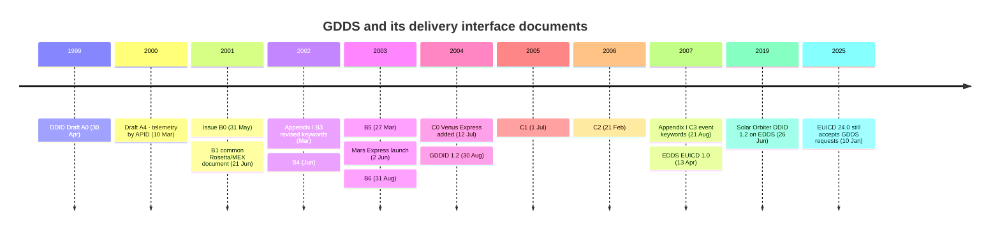
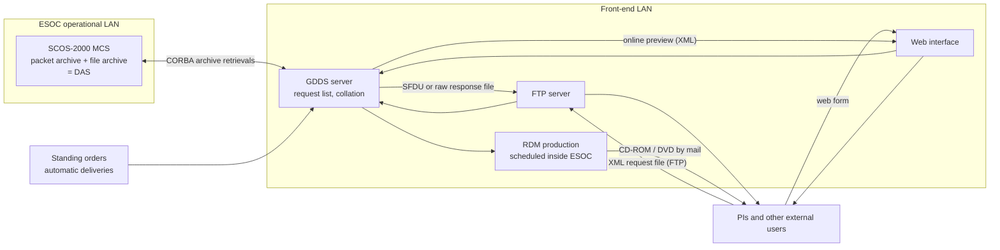
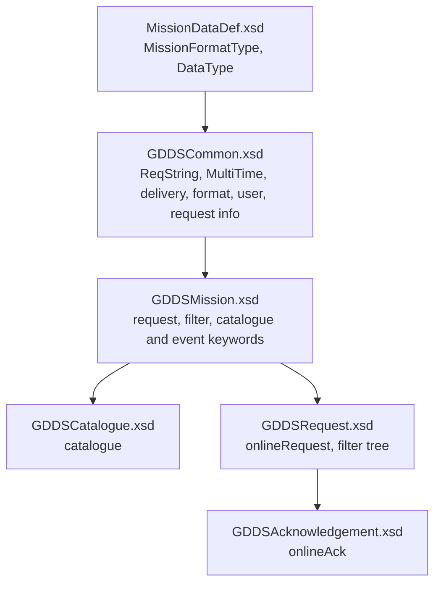
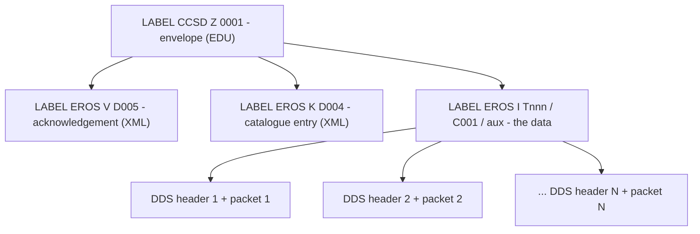

# GDDS and mission data delivery interface documents

A spacecraft's telemetry is useful to many people who must never touch the mission control
system: instrument teams, flight dynamics, science operations centres. ESOC's answer for the
missions launched in the 2000s was the **Generic Data Disposition System (GDDS)**, a reusable
server that took requests from outside the operations network, retrieved data from the
[SCOS-2000](index.md) archives and delivered them by FTP, on the web, or on CD-ROM and DVD.
Each mission configured its own instance, called simply the **DDS**, and documented it in a
**Data Delivery Interface Document (DDID)**.[^sp-dds][^gsaw05]

This page describes the GDDS as documented by the common DDID of Rosetta, Mars Express and Venus
Express, its XML schema appendix, and the mission papers; then it follows the same conventions into
[EDDS](edds.md), whose requirements list GDDS among its predecessors[^srs-pred] and which still
accepts its requests and produces its binary format,
and into the DDID of Solar Orbiter. Request and response formats of EDDS itself are on
[EDDS request and data formats](edds-formats.md).

## Names

| Term | Expansion as printed | Where |
|---|---|---|
| GDDS | Generic Data Disposition System | EDDS glossary; SP-1291; GSAW 2003 and 2005 presentations[^glo][^sp-dds][^peccia][^gsaw05] |
| GDDS | "Generic Data Distribution System" (once, in a remark on SPIDs in the history files) | Database Import ICD issue 5.1[^icd51] |
| DDS | Data Disposition System (the RMCS/MEMCS/VMCS component that supports the interface to the science communities) | Rosetta/MEX/VEX DDID[^ro-purpose] |
| DDS | Data Distribution System | Mars Express and Venus Express data handling papers[^sp-intro][^vex-intro] |
| DDS | Data Dissemination System | Solar Orbiter DDID (an instance of the generic EDDS)[^solo-acr] |
| DDID | Data Delivery Interface Document | EDDS glossary; the DDIDs themselves[^glo][^ro-purpose] |
| GDDID | Generic Data Delivery Interface Document | EDDS glossary[^glo] |
| RDDS, MEDDS, VEDDS | the Rosetta, Mars Express and Venus Express DDS instances (used in the DDID; not expanded) | DDID[^ro-timing][^ro-err-sfdu] |
| VDDS | Venus Express Data Disposition System, "based on the GDDS" | Venus Express paper[^vex-mcs] |

The three words behind "DDS" follow the documents rather than three different systems: the
GDDS-era DDID says "disposition", the Mars Express and Venus Express papers say "distribution"
(while also calling the underlying software the Generic Data Disposition System), and the
EDDS-era Solar Orbiter DDID says "dissemination".[^ro-purpose][^sp-dds][^vex-mcs][^solo-acr]

## The documents

| Document | Issue and date | In the library |
|---|---|---|
| Rosetta/Mars Express/Venus Express MCS Data Delivery Interface Document, RO-ESC-IF-5003 / MEX-ESC-IF-5003 / VEX-ESC-IF-5003 | C2, 2006-02-21 | [ro-esc-if-5003-ddid-c2](../library/ro-esc-if-5003-ddid-c2.md)[^ro-title] |
| The same DDID as a Rosetta/Mars Express document | B5, 2003-03-27 | [mex-esc-if-5003-b5](../library/mex-esc-if-5003-b5.md)[^b5-title] |
| DDID Appendix I, Request Dialogue XML Schema | C3, 2007-08-21 | [ro-esc-if-5003-appendix-i-c3](../library/ro-esc-if-5003-appendix-i-c3.md)[^xsd-title] |
| Zender et al., "Spacecraft and Payload Data Handling", in ESA SP-1291 (Mars Express) | June 2009 | [sp-1291-data-handling](../library/sp-1291-data-handling.md)[^sp-intro] |
| Delhaise et al., "Spacecraft and Payload Data Handling" (Venus Express, SP-1295) | not stated | [vex-delhaise-web](../library/vex-delhaise-web.md)[^vex-intro] |
| Solar Orbiter Data Delivery ICD, SOL-ESC-IF-05011 | 1.2, 2019-06-26 | [solo-ddid-i1r2](../library/solo-ddid-i1r2.md)[^solo-title] |
| EDDS External User ICD (EUICD), EGOS-GEN-EDDS-ICD-1001 | 24.0, 2025-01-10 | [euicd-v25](../library/euicd-v25.md)[^euicd-gdds] |

The generic GDDS documents are referenced but not public: the Generic Data Delivery Interface
Document (EGOS-MCS-GDDS-ICD-1003, issue 1.2 of 2004-08-30; the EUICD cites an issue 1.4 of
2008-04-11), the Data Disposition System Software Requirements Document (EGOS-MCS-GDDS-SRD-5720,
1.4), the GDDS-RDM Image Transfer Control Files ICD (EGOS-MCS-GDDS-ICD-1002, 1.1) and the GDDS
Operator User Manual (DTOS-INFR-UM-1001, 1.1, cited by SP-1291).[^glo-refs][^srs-refs][^euicd-refs][^sp-refs]

The DDID itself records its lineage: it is "broadly based on the Cluster DDID"; drafts A0 to A4
ran from April 1999 to March 2000 (A4 added telemetry delivery by APID); issue B0 (May 2001)
answered the review; from B1 (June 2001) it became a common Rosetta/Mars Express document, a
separate Mars Express draft being discontinued; B5 (March 2003) followed the December 2002 review;
C0 (July 2004) prepared Venus Express; C1 (July 2005) added VMCS throughout; C2 (February 2006)
repaired a document corruption that had replaced characters by quotation marks.[^ro-rel][^ro-log]



Dates from the change records of each document; the launch date from SP-1291.[^ro-log][^xsd-log][^glo-refs][^sp-launch][^solo-title][^euicd-gdds]

## Architecture

Rosetta and Mars Express share a near-identical on-board data management system and on-board
software, so ESOC developed most components of their ground data systems jointly; the Venus Express
data systems are a delta development of the same system.[^vex-mcs] Each mission control system, based on SCOS-2000, kept a mission
archive with two parts: a **packet archive** (historical telemetry, telecommands and derived data)
and a **file archive** (typically flight dynamics and planning files); a SCOS-2000 file generation
process could also produce summaries such as command history reports.[^sp-gdds][^vex-gdds] The
DDID calls the repository the MCS **Data Archive System (DAS)**, which is not the long-term
archive; the DDS reached it from outside the operational LAN.[^ro-gen]



Requests could come from scheduled "standing orders", from the web interface or as request files
sent by FTP. All were expressed in the same recursive XML query language, used internally and
exposed on the FTP interface, so several filters could be combined. The central DDS server
validated the user against its database of authorised users, issued the (relatively low-level)
retrievals through a CORBA interface to the MCS, and collated their results into one delivery per
request. Web responses were also XML, and online retrieval was meant only for previewing small
amounts of data embedded as a byte stream in the XML.[^sp-gdds][^sp-web][^vex-gdds] The DDS
machines sat on ESOC's front-end LAN, reachable from outside, separated by a bridge from the
operational LAN that hosted every other MCS machine.[^ro-sec]

## Service requirements

The DDID quotes the user requirements that shaped the system:[^ro-req][^ro-req2][^ro-off][^ro-timing]

| Requirement | Value |
|---|---|
| Mode | Client-server: the DDS responds to requests; one request command per request file |
| What one request can ask for | A subset of packets of one data source (APID); one auxiliary file; all auxiliary files of a type in a time range; a catalogue |
| Nominal response | Acknowledgement, catalogue entry and data in the same file transfer |
| Latency | Start of data within 15 minutes of the DDS receiving the request (load permitting) |
| Online retention | 3 months after acquisition (Mars Express); the whole mission for Rosetta |
| Queue | At most 12 requested files per user at a time |
| Capacity | At least 1000 MB per day in total, split into per-user quotas set with the Project Scientist |
| Quota overrun | The whole file is refused; further requests are rejected with an error |
| Sampling | Every N-th packet on request; wild cards in catalogue queries |
| Automatic delivery | New versions of selected auxiliary files; periodic TM and TC deliveries |
| Off-line | Random-access raw data media (RDM), CD-ROM for Mars Express and Venus Express, none for Rosetta; an integer number of days per RDM, default 1; at most 4 RDMs per period; delivered within one month (3 weeks nominal for MEDDS) |

The off-line split by day used the on-board generation time of each packet.[^ro-off] Venus Express
recorded science, housekeeping and consolidated auxiliary data on DVDs, one mailed to its science
operations centre and one kept at ESOC.[^vex-diss] Mars Express kept all level 1 data for ten years
after the end of the mission.[^sp-diss]

## Access

Requests went through the web interface or as ASCII (XML) files by FTP, protected by passwords
(different for the web and for FTP requests). To avoid partial transfers, FTP in both directions
used a two-step upload: write the file under a temporary name, then rename it. The DDS retried a
failed delivery a configurable number of times; a user who had neither data nor an error message
after 2 hours had to assume failure and resubmit. Delivery went to a node pre-registered for each
user, changeable only with the PI's permission; all authorised users could access the auxiliary
data, but otherwise users were restricted to their own experiment's data. The DDS had a prime and
a backup node.[^ro-access][^ro-deliv][^ro-sec][^ro-backup] The DDID also lists host names, addresses and
support contacts, which this wiki does not reproduce.

## The request language

The web forms mapped onto the same XML structure as the FTP files, defined by six XML Schema
files in DDID Appendix I.[^ro-req-xml][^xsd-list]



Each arrow is an `include`.[^xsd-common][^xsd-mission][^xsd-cat][^xsd-req][^xsd-ack]

### Request structure

An `onlineRequest` holds one `general` element and one or more `item` elements, and an optional
`userRequestId` attribute echoed in the response. One item only is allowed for web and online
deliveries; several are allowed for RDM requests.[^ro-req-xml][^xsd-req]

| Element | Type | Content |
|---|---|---|
| `general/comment` | string | Free text, not processed |
| `general/userInfo` | `UserInfoType` | `username`, `FTPpassword` |
| `general/destInfo` | `DeliveryType` | Exactly one of `RDM` (attributes `label`, `numCopies` default 1, `maxSpan` default 1), `FTP` (`filename`, `directory` relative to the user's default, optional `target`) or `Online` (`dataResponse` as hexBinary, attribute `displayAsHex`) |
| `general/formatInfo` | `FormatInfoType` | `compression` (`NONE` or `ZIP`), `SFDUrequired` (boolean), optional `missionFormat` (`RMCS_SPECIAL`) |
| `general/dataInfo` | `DataInfoType` | Optional `earliestStart`: do not submit to the DAS before this time |
| `item/dataType` | `DataType` | `TLM`, `CMH`, `EVT`, `AUX` |
| `item/dataSource` | ReqString | An APID, a super-APID, or a source mnemonic |
| `item/catalogueRequest` | boolean | Catalogue instead of data |
| `item/keyword` (0..n) | `RequestKeywordValue` | `SampleRate`, `MaxVolumeSize`, `TimeType`, `Application`, `EventType` (`LOG`, `MIB`, `SOFTWARE`, `SYSTEM`), `Severity` (`INFORMATION`, `WARNING`, `ERROR`, `FATAL ERROR`), `Workstation`, `MessageFilter` |
| `item/onEvent` (0..1) | `EventValue` | `Volume` (not supported) |
| `item/filter` (0..1) | `FilterExpression` | A filter tree |

The table follows the C3 schema.[^xsd-common][^xsd-mission][^xsd-mdd][^xsd-req] Web delivery was
allowed for all three methods, FTP requests for RDM and FTP only, and in practice RDM requests were
not accepted from outside at all: RDMs were produced by ESOC's own scheduler.[^ro-deliv] `ZIP`
compressed the whole response (acknowledgement, catalogue and data) and appended a "Z" to the
target file name. Without `SFDUrequired` the data were delivered "raw", with no acknowledgement
or catalogue.[^ro-format]

!!! note "Schema and document differ"
    The DDID body (issue C2) lists the data types `CAT`, `AUX`, `TLM` and `CMH`, whereas the C3
    schema enumerates `TLM`, `CMH`, `EVT` and `AUX`; catalogues are requested with
    `catalogueRequest` instead. Appendix I C3 added the event keywords (DCR 417).[^ro-apa][^xsd-mdd][^xsd-log]
    The body describes the volume keyword as `VolumeSize` (a byte count, at most 2147483647),
    the schema as `MaxVolumeSize` among the request keywords and `VolumeSize` among the filter
    keywords.[^ro-kw][^xsd-mission]

### Filters

A filter is a tree. A `unary` node (operation `OP_NOT`) negates one subtree; a `bin` node joins a
left and a right `FilterExpression` with `OP_AND` or `OP_OR`; a `leaf` compares one keyword with a
value using `OP_GT`, `OP_LT`, `OP_EQ`, `OP_GTE` or `OP_LTE`.[^ro-filter][^xsd-req] The filterable
keywords are:[^ro-filtkw][^xsd-mission]

| Keyword | Applies to | Meaning |
|---|---|---|
| `SourcePktsGenTime` | TM | Spacecraft packet generation time: OBT converted to UTC |
| `S2KPktsGenTime` | TM | SCOS-2000 packet generation time, i.e. the archiving time at the MCS; not usable for data in archive files split from the main online archive |
| `Type`, `SubType`, `P1Val`, `P2Val` | TM | PUS type, subtype and the two packet identification values (SID); omitted means wildcard |
| `UplinkTime`, `ExecutionTime` | TC | Uplink and execution time (filter on execution time recommended) |
| `CreationTime`, `EventTime` | (schema only) | |
| `Name`, `Release`, `Issue` | AUX | File name; blank release or issue means latest |
| `TimeSpan` | AUX | Validity of flight dynamics attitude files and Mars Express orbit files: all files valid, even for one second, inside the range are returned in a gzipped tar |
| `Validity`, `VolumeSize` | (schema) | |

Times use the `MultiTime` choice of `a_dateTime` (CCSDS ASCII time code A,
`YYYY-MM-DDThh:mm:ssZ`, all sub-fields with leading zeros) or `a_duration` (XML
duration).[^ro-multitime][^xsd-common]

The DDID explains why TC filters on uplink or execution time give results that differ slightly
from the times in the returned headers: a SCOS-2000 telecommand has seven times (specified
release, uplink and execution times; actual uplink and execution times; packet filing time, the
primary key of the TC history; packet creation time, the secondary key initialised to the
specified execution time), and the DDS can only retrieve by the two keys.[^ro-tctimes]

!!! example "A request (illustrative, modelled on the DDID example)"
    ```xml
    <onlineRequest userRequestId="2004-04-27-hk-pull">
      <general>
        <comment>HK of APID 820, ten-fold decimated, zipped, no SFDU</comment>
        <userInfo><username>MEX_EXAMPLE</username><FTPpassword>...</FTPpassword></userInfo>
        <destInfo><FTP><filename>hk820</filename><directory/></FTP></destInfo>
        <formatInfo><compression>ZIP</compression><SFDUrequired>false</SFDUrequired></formatInfo>
        <dataInfo/>
      </general>
      <item>
        <dataType>TLM</dataType><dataSource>820</dataSource>
        <catalogueRequest>false</catalogueRequest>
        <keyword><SampleRate>10</SampleRate></keyword>
        <filter><bin operation="OP_AND">
          <lhs><leaf operation="OP_GTE"><valuePair><SourcePktsGenTime>
            <a_dateTime>2004-04-27T00:00:00Z</a_dateTime></SourcePktsGenTime></valuePair></leaf></lhs>
          <rhs><leaf operation="OP_LT"><valuePair><SourcePktsGenTime>
            <a_dateTime>2004-04-28T00:00:00Z</a_dateTime></SourcePktsGenTime></valuePair></leaf></rhs>
        </bin></filter>
      </item>
    </onlineRequest>
    ```
    The structure follows the C3 schema and the DDID's own example (APID 1966, sample rate 10);
    the values here are this wiki's.[^ro-example][^xsd-req]

With `SampleRate` the DDS took every N-th entry *per history file*: telemetry came from four data
streams (VC 0 and VC 1, real time and playback), so N was applied to each stream and the results
merged.[^ro-kw]

## Data streams and ADIDs

Every delivered data set is identified by a data source and a data type, and every data
description is registered at ESOC under an eight-character **Authority and Description Identifier
(ADID)**: a four-character Control Authority Identifier (`EROS`, `EMEX` or `EVEX`) followed by a
four-character data description identifier.[^ro-adid][^ro-apa]

| Data source | Type | Content | ADID |
|---|---|---|---|
| (DDS internal) | – | RDM directory listing, cumulative index, off-line and on-line catalogues, acknowledgement, volume production information, master and partial catalogues | `xxxxD001` to `xxxxD008` |
| `<APID>` (decimal) | TLM | Telemetry of one APID | `xxxxTnnn` |
| `<SuperAPID>` (negative) | TLM | Telemetry of a predefined list of APIDs (an instrument) | per instrument |
| `CMDH` | CMH | Telecommand history packets | `xxxxC001` |
| `CMDPF`, `CMDPB` | CMH | TC history printout, full and brief | `xxxxC002`, `xxxxC003` |
| auxiliary mnemonic | AUX | One auxiliary file type | `xxxx` + mnemonic |

For an APID, `nnn` is the process ID as two hexadecimal digits followed by the packet category as
one: process ID 51 (0x33) and category 4 give `EROST334`, the ADID of APID 820. Packets
of one APID with different SIDs therefore share an ADID.[^ro-apa-notes]

The **super-APIDs** were defined per mission:[^ro-apa][^ro-apa-r]

| Mission | Super-APID: instrument |
|---|---|
| Rosetta | −1 LCC, −2 RPC, −3 OSIRIS, −4 ALICE, −5 MIRO, −6 ROSINA, −7 COSIMA, −8 CONSERT, −9 VIRTIS, −10 GIADA, −11 to −15 RSOC streams (services 1, 3, 5, 6, 12), −16 to −20 RPC streams (services 1, 3, 5, 6, 12) |
| Mars Express | −1 HRSC, −2 PFS |
| Venus Express | −2 PFS, −3 ASPERA, −9 VIRTIS |

Issue B5 had only −1 to −9 for Rosetta; −10 to −20 came later (DCR 316 and 367).[^b5-apa][^ro-apa-r]

### Auxiliary data per mission

Auxiliary files are delivered unprocessed, exactly as held in the DAS; several files matching one
request are wrapped in a Unix tar file. Appendix E of the DDID distinguishes "span valid" files,
whose records apply until the next record, from "point valid" ones.[^ro-aux] The data sources of
issue C2 are:[^ro-apa-r][^ro-apa-m][^ro-apa-v]

| Group | Rosetta | Mars Express | Venus Express |
|---|---|---|---|
| Radio science from the IFMS (RSI) | AGC1, AGC2, DOP1, DOP2, RANG, MET_ | same | same |
| Tracking for flight dynamics | D1FD, D2FD, RGFD, MTFD, G1FD, G2FD | same | same |
| Light time | – | OWLT | OWLT |
| Spacecraft orbit | ORHR cruise; ORER, ORFR, ORGR Earth swing-bys; ORMR Mars swing-by; OROR, ORSR, ORHO, ORHS Lutetia and Steins; ORWR, ORPR, ORHW comet | ORHM cruise; ORMM, ORMF Mars-centric (ORMF about 800 MB, FTP and RDM only) | ORHV cruise; ORVV, ORVF Venus-centric |
| Attitude | ATNR, ATPR | ATNM | ATNV, ATPV, UCAV |
| Events | EVTR | EVTM, EVTF | EVTV, EVTP, EVTF |
| Target environment | CCHA, CENV, CKIN, PNAV (NAVCAM) | STOM star occultations, VILM lander visibility | STOV star occultations, SAAV sun aspect angles |
| Operations requests | DOR_, ECF_, FDR_, POR_, PORP, PTR_, PTRP, SOR_, MCR_, MDR_, MPR_, MDAF, MSP_, CONF, SPL_, LTVF | DOR_, ECF_, FDR_, POR_, PTR_, SOR_ (OPE and MPS), MCR_, MDR_, MPR_, MDAF | DOR_, ECF_, FDR_, POR_, PTRV, SOR_ (OPE and MPS), MCR_, MDR_, MPR_, MDAF, SPL_ |
| Planning products | – | DMOP, DSOP, RMOP, RSOP, FECS, SECS, FTL_ | DMOP, DSOP, RMOP, RSOP, FECS, FTLV, FSCV, TMSV manoeuvre slots |
| Software | OASW | OASW, FDSW | OASW, FDSW |

MDAF (the MTL detailed agenda file) cannot be forwarded automatically, only requested.[^ro-apa-notes]
The asteroid names tell the history: issue B5 lists Rosetta orbit files for Otawara and Siwa, the
targets before the launch delay, together with RFDE, RPI_ and RTI_ reference files; issue C0
replaced them by Lutetia and Steins (DCR 307), and C2 no longer lists the three reference
files.[^b5-apa][^ro-log]

## Responses

### SFDU packaging

The DDS used the CCSDS **Standard Formatted Data Unit (SFDU)** concept so that each delivery, and
each RDM, describes itself, while users who know the layout can treat the extra headers as spare
bytes.[^ro-sfdu-why] The building block is the **Label-Value-Object (LVO)**: a 20-octet LABEL, a
VALUE of any length and an optional marker.[^ro-lvo]

<div class="bitfield" data-title="SFDU LABEL, version ID 3 (160 bits)" data-width="32"
     data-fields='[{"n":"Control Authority ID (CAID)","b":32,"g":"ADID part 1","d":"e.g. CCSD, EROS, EMEX, EVEX"},{"n":"Version ID","b":8,"v":"ASCII 3 (0x33)"},{"n":"Class ID","b":8,"d":"Z, F, U, R, C, I, S, D, E, K, V"},{"n":"Delimitation ID","b":8,"d":"B: length in the delimitation parameter; F: until end of file"},{"n":"Spare","b":8,"v":"ASCII 0 (0x30)"},{"n":"Data Description ID (DDID)","b":32,"g":"ADID part 2"},{"n":"Delimitation parameter","b":64}]'></div>

| Class | Category | Use in the DDS |
|---|---|---|
| Z | Structure: Exchange Data Unit (EDU) | Outer envelope of every product |
| F | Structure: Description Data Unit (DDU) | Data description registration packages |
| U | Structure: Application Data Unit (ADU) | One data file plus its catalogue entry |
| R | Service: replacement (reference) | Points to files elsewhere on an RDM |
| C | Service: data administration | `ADIDNAME=` statements |
| I | Data: application data object | The requested data |
| S | Data: supplementary | Index and listing files |
| D, E | Data: DDR and DED objects | Syntactic and semantic descriptions |
| K | Data: catalogue attributes | Catalogue entries |
| V | Data: volume production | Acknowledgement, volume information |

The CCSDS ADIDs used are `CCSD0001` (VALUE contains LVOs), `CCSD0002` (ASCII encoded English),
`CCSD0003` (PVL statements referencing external objects), `CCSD0004` (PVL identifying a data
description package), `CCSD0005` (a DDU), `CCSD0006` (PVL) and `CCSD0009` (an ADU). All DDS LVOs
are version 3 with delimitation `B`, the length only known once the VALUE has been
generated.[^ro-lvo][^ro-adids][^ro-resp]

!!! note
    Appendix F of issue C2 still describes the delimitation parameter for "A" (an eight-character
    decimal length), while §7.2.2 and the class table specify "B" (binary length) after DCR 032;
    this page follows §7.2.2.[^ro-resp][^ro-lvo]

A successful response is one file with three LVOs inside an EDU; an error response has only the
first:[^ro-resp][^ro-err-sfdu]



The **acknowledgement** repeats the request (`general`), gives `ackInfo` (actual processing time,
hardware, operating system, DDS version, error message, "NO ERROR" when nominal) and one `ackItem`
per data item with the actual delivered volume; the DDID example reports a Sun Blade 100 running
SunOS 5.8 and "GDDS 1.2.0".[^ro-ack][^xsd-ack] The **catalogue entry** gives data type, source,
ADID and keywords: first and last packet times (by source or SCOS-2000 generation time), sample
rate, number of elements, or file name, creation time and version for auxiliary data.[^ro-catentry][^xsd-cat]
Master catalogues (wildcards in both source and type) and partial catalogues (a wildcard in one)
listed what was available; for performance the master catalogue for telemetry was disabled
(DCR 269), and packet counts in catalogues are empty.[^ro-catdata]

Errors are reported as `ROSETTA DDS ERROR-nn`, `MEX DDS ERROR-nn` or `VEX DDS ERROR-nn`:[^ro-err]

| Group | Codes |
|---|---|
| Request specification | 01 unrecognised data source; 02 unrecognised data type; 03 illegal source/type combination; 04 no access rights; 05 illegal target file name; 06 and 07 illegal start or end time; 08 start after end; 09 illegal sample rate; 10 illegal amount |
| Processing | 50 maximum outstanding files exceeded; 51 no catalogue data; 52 no data packets; 53 timeout; 54 unavailable; 55 resources exceeded; 56 system error; 57 user daily quota; 58 system daily quota; 59 DDS access disabled |

A monitoring process timed out requests after a configurable period (default 120 minutes) and
deleted new requests once a user had 12 queued.[^ro-err-sfdu]

### Telemetry: the DDS packet header

Telemetry is delivered as complete, reassembled, unprocessed source packets in time order, each
preceded by an 18-octet **DDS packet header**, stamped with the Spacecraft Event Time (SCET), the
calibrated generation time of the packet's first bit.[^ro-tm][^ro-tmhdr]

<div class="bitfield" data-title="GDDS DDS packet header for telemetry (144 bits)" data-width="32"
     data-fields='[{"n":"SCET seconds since 1970-01-01","b":32,"g":"SCET"},{"n":"SCET microseconds","b":32,"g":"SCET"},{"n":"Packet length (octets, excluding this header)","b":32},{"n":"Ground station ID","b":16},{"n":"Virtual channel ID","b":16},{"n":"SLE service","b":8},{"n":"Time quality","b":8,"d":"0 good, 1 inaccurate, 2 bad"}]'></div>

| Octets | Field | Values |
|---|---|---|
| 0–7 | SCET | Sun "MJT": 32-bit seconds since 1970-01-01 00:00 and 32-bit microseconds |
| 8–11 | Packet length | Octets of the packet that follows |
| 12–13 | Ground station ID | See below; 0 for time correlation packets (APID 1966, type 190, subtype 40) |
| 14–15 | Virtual channel ID | 0 = VC 0, 1 = VC 1 |
| 16 | SLE service | Service and delivery mode, see below |
| 17 | Time quality | 0 good, 1 inaccurate, 2 bad (algorithm on the [time correlation page](time-correlation.md#time-stamping-telemetry)) |

The ground station identifiers in issue C2 are:[^ro-tmhdr]

| ID | Station | ID | Station |
|---|---|---|---|
| 0x0D | ESA Villafranca 2 | 0x22 / 0x67 | NASA Goldstone (old / new) |
| 0x15 | ESA Kourou | 0x23 / 0x70 | NASA Canberra (old / new) |
| 0x16 | NDIULite (for SVTs) | 0x24 / 0x6C | NASA Madrid (old / new) |
| 0x17 | ESA New Norcia | 0x7F | ESA/ESOC test station |
| 0x18 | ESA Cebreros | 0x82 | NDIU classic (SVTs) |

The NASA identifiers changed in November/December 2003; issue B5 still had "TBD" for Madrid and no
Cebreros.[^ro-tmhdr][^b5-tmhdr] The SLE service octet combines the delivery mode and the frame
selection:[^ro-tmhdr]

| | Real time (RT) | Real time flow control (RTFC) | Off-line |
|---|---|---|---|
| SLC | 0 | 4 | 8 |
| MC | 1 | 5 | 9 |
| VC | 2 | 6 | 10 |
| Bad frames | 3 | 7 | 11 |

!!! warning "Inference"
    The rows correspond to the [SLE return services](../ccsds/sle/return-services.md) through
    which the frames reached the MCS: all frames of the space link channel (SLC, as in RAF), a
    master channel or a virtual channel (as in RCF), and frames that failed decoding; the columns
    to the SLE delivery modes. The DDID gives only the codes.[^ro-tmhdr]

A request is answered in one file sorted by the time keyword used. The DDID example: packets of
four SPIDs on APIDs 10 and 23, requested for APID 10, come back as packets 1, 4, 6, 2, 5, 3, i.e.
interleaved by generation time regardless of SPID. The SPID, the SCOS-2000 packet ID, is internal
to the MCS.[^ro-tmorder]

### Telecommand history

Raw TC history packets are the encoded telecommands as uplinked, each preceded by a DDS command
packet header.[^ro-tc]

<div class="bitfield" data-title="GDDS DDS packet header for telecommands (368 bits)" data-width="32"
     data-fields='[{"n":"Uplink time s","b":32,"g":"Uplink time"},{"n":"Uplink time us","b":32,"g":"Uplink time"},{"n":"Execution time s","b":32,"g":"Execution time"},{"n":"Execution time us","b":32,"g":"Execution time"},{"n":"CUV","b":16},{"n":"CAV VC0","b":16},{"n":"CEV VC0","b":16},{"n":"CAV VC1","b":16},{"n":"CEV VC1","b":16},{"n":"Packet length","b":32},{"n":"Command ID (8 chars)","b":64},{"n":"Parent sequence ID (8 chars)","b":64}]'></div>

| Octets | Field | Meaning |
|---|---|---|
| 0–7 | Uplink time | Release time from the MCS, later replaced by the ground station's radiation time stamp; release failure time if release failed |
| 8–15 | Execution time | The user's time tag for commands embedded in service 11 loads, otherwise uplink time plus the one-way light time |
| 16–17 | CUV | Uplink verification: CLCW-based acceptance of the frame on board |
| 18–21 | CAV, CEV (VC 0) | Acceptance and execution verification from real-time telemetry |
| 22–25 | CAV, CEV (VC 1) | The same from playback telemetry |
| 26–29 | Packet length | Octets of the TC data record |
| 30–37 | Command ID | Command name in the database |
| 38–45 | Parent sequence ID | Name of the parent sequence |

!!! note
    Issue C2 calls this a "30-octet header" and says the data record starts at octet 30, yet the
    table continues with the command and sequence names to octet 45 (DCR 037). The EDDS EUICD's
    description of the GDDS TC header lists all ten fields with their sizes (8, 8, 2, 2, 2, 2, 2,
    4, 8 and 8 octets: 46 in total).[^ro-tc][^euicd-tc]

Each verification word is 16 bits with exactly one bit set (bit 0 the least significant): bit 0
IDLE, 1 PENDING, 2 PASSED, 3 FAILED, 4 UNVERIFIED, 5 UNKNOWN, 6 TIMED-OUT (CUV only), 7 SCC ONLY,
8 ASSUMED (CUV superseded by a successful later stage). Only PASSED, FAILED and UNVERIFIED are
final; an all-zero word means the stage did not apply.[^ro-tcflags] The printouts `CMDPB` and
`CMDPF` reproduce the TC History display: name, description, sequence, release and execution
times, sub-schedule, service type and subtype, process ID, service 11 and service 13 encapsulation,
AD or BD mode, PTV and CEV check states, group, block and interlock flags, source, frame count,
sequence counter and one status letter per verification stage (R release to the NCTRS, G ground
reception, T uplink, O on-board reception, A acceptance, C completion, for VC 0 and VC 1); the
full mode adds one line per editable parameter.[^ro-tcprint]

## Raw data media

Off-line delivery was entirely controlled by ESOC: every CD-ROM held all data streams of all
instruments and all ESOC auxiliary data for its period, plus every data description needed, so
each disc was self-contained. Six days were allowed for orbit and attitude data to be
consolidated before a write-once master was sent for mastering and reproduction.[^ro-offline]

```
ROOT
├── VOLDESC.SFD            root SFDU (logically includes everything)
├── yymmddnv.IDX/.LST/.LSC cumulative index, directory listing, changed files
├── MEX (or VEX)
│   ├── TLM/<APID dirs>    telemetry, one directory per APID
│   ├── CMH                command history
│   └── AUXF               auxiliary files
├── DATADES
│   ├── TLM_DES  AUX_DES  CMH_DES  DDS_DES
└── SOFTWARE               orbit and attitude access routines
```

The tree condenses §7.13.1; empty files are present when a source had no data, so a missing file
means a manufacturing error.[^ro-rdmdir] Data files are named `yyyymmdd-xxxxDDID-nn-i.ccc`: RDM
generation date, file number, the four-character DDID part of the ADID, RDM set number within the
day (hex), index in the set, and `.cat` or `.dat`. For example `20040427-0001T334-01-1.dat` is APID
820 data on the first RDM of 27 April 2004.[^ro-rdmname]

A CD-ROM held about 650 MB; a day with more than 600 MB continued on a second disc from the split
time, and a file could be split anywhere, even inside a record, so it had to be rejoined before
use.[^ro-rdmsplit] Version control relied on a cumulative index file, `yymmddnv.IDX` (date, disc
number in the day 1 to 9, version A to Z), present on every disc, newest first, with fixed
positions: RDM ID (octets 0–7), inclusive start time (9–28), exclusive end time (30–49), disc
number (51), discs that day (53), version (55), status `DELETED` when superseded (57–66), line feed
(67).[^ro-rdmidx] The printed and volume label was, for example, `20041212_2_3A` for the second of
three discs of 12 December 2004, first issue.[^ro-rdmlabel]

In the SFDU view the root file `VOLDESC.SFD` is an EDU containing header LVOs (volume production
information in PVL: mission, producer, earliest and latest packet, total data quantity, computer,
operating system, DDS software version, production time; and class R references to the index,
listing and changes files), one DDU per data description (class F holding a class C
`ADIDNAME=` statement and a class R reference), and one ADU per data file (class U holding a class
K catalogue entry with `RDM_FILENAME` and a class R reference).[^ro-voldesc] ESOC, as Control
Authority, registered descriptions in ASCII encoded English; for science telemetry they only name
the experiment and its contact, the inner packet formats being the PIs' domain.[^ro-desc][^ro-ddu]

## Products of the MCS itself

Appendix K lists packets the MCS assigns or generates on APID 1966, type 190:[^ro-int]

| Packet | APID | Type | Subtype |
|---|---|---|---|
| Telemetry packet, bad | 1966 | 190 | 30 |
| Telemetry packet, idle | (received) | 190 | 0 |
| Telemetry packet, RICE compressed; time packet | (received) | 190 | (received) |
| Telemetry packet undefined in database | 1966 | 190 | 38 |
| Transfer frame bad, good, idle | 1966 | 190 | 20, 21, 29 |
| Time correlation coefficient packet | 1966 | 190 | 40 |
| Telemetry constants packet (TM Spacon values, generated on request) | 1966 | 190 | 0 |

The coefficient packet (gradient, offset and standard deviation as IEEE doubles, generation time in
CUC 4+2) is described on the [time correlation page](time-correlation.md#rosetta-mars-express-and-venus-express-manual-correlation).[^ro-tcp]
Two text products are also delivered: the **Lander Telecommand Verification File (LTVF)**, a
listing of the bit patterns of the commands on a manual stack (row, mnemonic, description, source
sequence count, PUS version, CRC, packet header and data field), created on request and stored in
the directory named by the MISCconfig variable `CMD_BIT_PATTERN_STACK_DIR`; and the **Detailed
Agenda File (DAF)**, the command import format of the Pass, MTL and manual stacks, of which mission
timeline DAFs are available to users for traceability.[^ro-ltvf][^ro-daf]

## From GDDS to EDDS

When ESOC built the EGOS Data Dissemination System, its requirements were derived from three
existing subsystems giving access to SCOS-2000 data: TDRS, WebRM and the GDDS.[^srs-pred] A
technical note analysed the reuse of TDRS, WebRM, GDDS and MUST (EGOS-MDW-EDDS-TN-1001, 2006),
which is not public.[^glo-refs] Backward compatibility was written into EDDS:

* **Requests.** The light-weight Request Submitter must convert GDDS requests (as defined in the
  GDDID) into EDDS requests by XSLT, supporting all requests common to both
  (EDDS-SR-05683).[^srs-xslt] The EUICD documents the mapping (`GDDS2EDDS.xsl`). Only one `item`
  is allowed; the filter must not contain OR nodes inside AND nodes (such subtrees are ignored);
  `MultiTime` values must be absolute, except in schedule requests, where the start is a duration
  relative to execution and the end a duration after the start; a schedule creates ten requests at
  the given interval in days; RDM, online delivery, `SFDUrequired` and `missionFormat` are ignored;
  and mission and domain can be selected by `Mission:` and `Domain:` lines in the
  comment.[^euicd-gdds][^euicd-gddsmap]
* **Request types.** A `TLM` item maps to a TM packet request with the APID as data source and a
  mandatory `SourcePktsGenTime` range (`S2KpktsGenTime` is mapped to the same generation time,
  `Type`, `SubType`, `P1Val`, `P2Val` allow `OP_EQ` and negation only); `CMH`/`CMDH` maps to a TC
  packet request on execution time; `CMDPB`/`CMDPF` to brief and full TC reports.[^euicd-gddsmap]
* **Responses.** "GDDS_BINARY" is an output format for TM and TC packets from the PARC and for TM
  packets from HARC and EGS-CC; the SDD names the formatters (`PktTmGDDS_BINARYFormatter`,
  `PktTcGDDS_BINARYFormatter`, `PktTcSFDUFormatterHandler` "for the backward compatibility with
  the GDDS"); the EDDS stream client can save TM in GDDS binary; and EDDS-SR-05680 (desirable)
  asks for the GDDS binary format for archived files and catalogues.[^euicd-fmt][^sdd-gdds][^srs-compat]

The EUICD expresses the GDDS headers in its own extensible binary format: the GDDS TM header
(SCET 8, packet length 4, ground station 2, virtual channel 2, SLE service 1, time quality 1 octets)
corresponds to EDDS header fields 8, 10, 12, 13, 17 and 18, and the GDDS TC header to fields 9, 10,
23 to 29 and 13. The EDDS TM header field table marks the packet length and the "SleServiceID" as
"added for backward compatibility with the GDDS".[^euicd-tc][^euicd-tmfields] Its worked example
shows two TM packets whose GDDS header reads `4E94 46BE A7B8 D000 | 0000 0050 | 0000 | 0000 | 00 |
00`: generation time 0x4E9446BE seconds plus 0xA7B8D000 microseconds, an 80-octet packet, ground
station 0, VC 0, SLE service 0 and good time quality.[^euicd-tc]

!!! warning "Inference"
    0x4E9446BE is 1318340286 s, i.e. 2011-10-11 13:38 UTC, but the microseconds field 0xA7B8D000
    exceeds 999 999, so the example bytes are not a valid time; they are best read as an
    illustration of the layout only.[^euicd-tc]

## Solar Orbiter: the DDID on EDDS

The Solar Orbiter Data Delivery ICD (SOL-ESC-IF-05011) is the mission-specific complement to the
generic EDDS ICD and user manual, aligned with the BepiColombo DDID in its last
revision.[^solo-obj][^solo-title] Its structure still follows the GDDS-era DDID (assumptions,
interface characteristics, access, detailed specifications, data definition, products), but the
content is EDDS:[^solo-toc]

| Aspect | Rosetta/MEX/VEX (GDDS) | Solar Orbiter (EDDS) |
|---|---|---|
| Name of the system | Data Disposition System (DDS) | Data Dissemination System (DDS), based on EDDS |
| Access | Web interface and FTP request files | EDDS client application (Java), XML requests by SFTP, user-implemented clients; HTTPS web service |
| Request types | Data, catalogue, standing orders | Batch and stream services, saved and scheduled requests, FARC subscriptions, user management |
| Sources | MCS packet and file archives (DAS) | MCS long-term archive: PARC (packets), DARC (parameters), FARC (files) |
| Response formats | SFDU or raw; XML acknowledgement and catalogue | Binary (files or Google Protocol Buffers), EDDS raw binary, **GDDS binary**, XML and XML transform, ASCII |
| Packet header | 18-octet DDS header | SCOS-2000 packet headers (EDDS raw header with no mission fields, or GDDS binary header) |
| Off-line media | CD-ROM, DVD | none; RAPID files pushed by the Generic File Transfer System (GFTS) |
| Time correlation | Coefficient packet type 190/40 | Report, couple and coefficient packets type 164/1 to 3 |
| Quotas | Per-user daily volume | Data type filters (APID, SPID, parameter, file name or type), volume per period, relative time range, access period |

Sources for the right column: the DDID's sections 2, 3, 6, 7, 8, 9 and 10.[^solo-summary][^solo-constr][^solo-gen][^solo-formats][^solo-tco]
Several GDDS conventions survive in detail:

* The **GDDS binary** option is offered as such: a binary header (EUICD §6.1.3) followed by the
  source packet without SCOS-2000 header. The DDID notes that its "SLE service Id" field, which
  identifies the SLE service and channel type over which the data were retrieved, is not
  relevant to end users.[^solo-formats]
* **Time and byte order**: all times are 4-octet seconds since 1970 plus 4-octet microseconds
  (leap seconds not counted), the same Sun-style time as the GDDS SCET, and all data are
  big-endian.[^solo-formats]
* **Ground station IDs** in the SCOS-2000 header are decimal: 21 Kourou, 22 Perth, 23 New Norcia,
  24 Cebreros, 25 Malargüe, 30 Maspalomas, 201 reference test station (ESOC), 202 NDIU Lite, 203
  NDIU IFMS.[^solo-hdr]
* **Time quality** keeps the GDDS values 0 good, 1 inaccurate, 2 bad.[^solo-hdr]
* **Internal packets** stay on APID 1966 (SPIDs 66810 to 66999, including the time correlation
  report, couple and coefficient packets), to be filtered out except for time
  correlation.[^solo-tco]
* **Command history** is still available in binary, XML and an ASCII format matching the MCS TC
  History application, now with Science Kernel custom fields (forced sub-schedule ID, CEV check
  state for playback, a unique command ID, the service 13 file ID and file attribute).[^solo-reports]

!!! warning "Inference"
    The Solar Orbiter decimal station IDs 21, 23 and 24 equal the GDDS-era hexadecimal 0x15
    (Kourou), 0x17 (New Norcia) and 0x18 (Cebreros), so the station numbering appears to have been
    kept across the two generations. No source states this.[^solo-hdr][^ro-tmhdr]

The Solar Orbiter DDID's auxiliary file types and file archive, its TM files reconstructed from the
service 13 downlink and the RAPID files are discussed on
[Mission archives](archives.md); the SCOS-2000 packet header it documents is on
[EDDS request and data formats](edds-formats.md).

## What is not public

* The generic GDDS documents: GDDID, Data Disposition System SRD, GDDS-RDM ITCF ICD and the GDDS
  Operator User Manual.[^glo-refs][^sp-refs]
* DDID Appendix C (PI account details), Appendix H (flight dynamics products), Appendix J
  (mission planning products, in the MEX and VEX operations concept documents) and the Command
  Request Interface Document (RO-ESC-IF-0004) that completes the interface with the science
  communities.[^ro-docs][^ro-toc]
* For Solar Orbiter, the Packetiser ICD (BC-ESC-IF-22002), the Command Source Handler ICD that
  defines the TC packet body, and the password-protected user details annex.[^solo-docs]

## Related pages

* [EDDS](edds.md), [EDDS request and data formats](edds-formats.md) and [TDRS](tdrs.md), the
  other data delivery systems.
* [Mission archives: PARC, DARC and FARC](archives.md) and [Time correlation in SCOS-2000](time-correlation.md).
* [Rosetta, Mars Express and Venus Express](../missions/rosetta-mex-vex.md) and
  [Solar Orbiter](../missions/solar-orbiter/index.md).
* [SLE return services](../ccsds/sle/return-services.md) and
  [Command verification in the MIB](../mib/command-verification.md).

[^icd51]: [SCOS-2000 Database Import ICD issue 5.1](../library/icd-5-1-tos-gci.md), §3.3.2.4.1 pid, remark on SPID allocation, PDF p. 39.
[^glo]: [EDDS Glossary EGOS-GEN-EDDS-GLO-0001, version 7.0](../library/glo.md), §4 Acronyms (DDID, GDDID, GDDS), PDF p. 9.
[^glo-refs]: [EDDS Glossary](../library/glo.md), §2 Applicable Documents (AD-13) and §3 Reference Documents (RD-5, RD-16, RD-18, RD-27, RD-33), PDF pp. 6–8.
[^srs-refs]: [EDDS Software Requirements Specification EGOS-GEN-EDDS-SRS-1001, version 18.0](../library/srs.md), applicable and reference documents (AD-40, RD-2, RD-4, RD-12, RD-19), PDF pp. 8–9.
[^srs-pred]: [EDDS SRS](../library/srs.md), §4.2 Relationship to Predecessor and Successor Projects, PDF p. 13.
[^srs-xslt]: [EDDS SRS](../library/srs.md), requirement EDDS-SR-05683, PDF p. 66.
[^srs-compat]: [EDDS SRS](../library/srs.md), requirement EDDS-SR-05680, PDF p. 65.
[^sdd-gdds]: [EDDS SDD EGOS-GEN-EDDS-SDD-1001, version 15.0](../library/sdd.md), §4.5.4 Request Submitter, §4.5.5 Stream Client and §6.3.9.9 formatter lists, PDF pp. 18 and 98–102.
[^euicd-gdds]: [EDDS EUICD EGOS-GEN-EDDS-ICD-1001, version 24.0](../library/euicd-v25.md), §4.3.5 Request Submitter and §4.3.5.1 GDDS Requests, PDF p. 27.
[^euicd-refs]: [EDDS EUICD](../library/euicd-v25.md), §2.1 AD-2 and §2.2 RD-13, PDF p. 19.
[^euicd-gddsmap]: [EDDS EUICD](../library/euicd-v25.md), §4.3.5.1.1 to §4.3.5.1.4, Tables 6 to 8, PDF pp. 27–31.
[^euicd-fmt]: [EDDS EUICD](../library/euicd-v25.md), §6 Table 13 Data Type Formatting, PDF pp. 38–39.
[^euicd-tmfields]: [EDDS EUICD](../library/euicd-v25.md), §6.1.2 Table 16 TM Packet Raw Header Fields, PDF p. 41.
[^euicd-tc]: [EDDS EUICD](../library/euicd-v25.md), §6.1.3 GDDS Binary File Example, Tables 23 and following, PDF pp. 46–48.
[^peccia]: [Peccia, SCOS-2000, GSAW 2003](../library/gsaw2003-peccia.md), slide "A vision for the future", PDF p. 30.
[^gsaw05]: [Guerrucci et al., GSAW 2005](../library/gsaw2005-guerrucci.md), slides "ESOC Software Infrastructure" and "ESOC Ground Segment Scenario", PDF pp. 5–6.
[^sp-intro]: [Zender et al., ESA SP-1291](../library/sp-1291-data-handling.md), title page and §1 Introduction, PDF pp. 1–4.
[^sp-launch]: [SP-1291](../library/sp-1291-data-handling.md), §2.1 Overview, PDF p. 5.
[^sp-dds]: [SP-1291](../library/sp-1291-data-handling.md), §2.1 Overview (the DDS bullet), PDF p. 6.
[^sp-diss]: [SP-1291](../library/sp-1291-data-handling.md), §2.3 Dissemination of Raw Data, PDF p. 7.
[^sp-gdds]: [SP-1291](../library/sp-1291-data-handling.md), §2.3.1 Dissemination of Mission Raw Data via the Mars Express DDS, PDF pp. 7–8.
[^sp-web]: [SP-1291](../library/sp-1291-data-handling.md), §2.3.1 (continued), PDF p. 9.
[^sp-refs]: [SP-1291](../library/sp-1291-data-handling.md), references (GDDS 2002 Operator User Manual), PDF p. 21.
[^vex-intro]: [Delhaise et al., Venus Express data handling (SP-1295)](../library/vex-delhaise-web.md), §1 Introduction, PDF pp. 1–2.
[^vex-mcs]: [Delhaise et al.](../library/vex-delhaise-web.md), §2.1 Overview, PDF p. 3.
[^vex-diss]: [Delhaise et al.](../library/vex-delhaise-web.md), §2.3 Dissemination of raw data, PDF p. 4.
[^vex-gdds]: [Delhaise et al.](../library/vex-delhaise-web.md), §2.3.1 Dissemination of the mission raw data via the DDS, PDF p. 5.
[^ro-title]: [DDID RO-ESC-IF-5003/MEX-ESC-IF-5003/VEX-ESC-IF-5003 issue C2](../library/ro-esc-if-5003-ddid-c2.md), title and approval pages, PDF pp. 1–3.
[^ro-log]: [DDID issue C2](../library/ro-esc-if-5003-ddid-c2.md), Document Change Records, PDF pp. 9–17.
[^ro-toc]: [DDID issue C2](../library/ro-esc-if-5003-ddid-c2.md), table of contents and notes on separate appendices, PDF pp. 19–23.
[^ro-purpose]: [DDID issue C2](../library/ro-esc-if-5003-ddid-c2.md), §1.1 Purpose to §1.3 Summary, PDF p. 25.
[^ro-docs]: [DDID issue C2](../library/ro-esc-if-5003-ddid-c2.md), §1.6 Applicable Documents and §1.7 Reference Documents, PDF pp. 25–27.
[^ro-req]: [DDID issue C2](../library/ro-esc-if-5003-ddid-c2.md), §3.2 On-line Data Delivery Requirements, PDF pp. 29–30.
[^ro-req2]: [DDID issue C2](../library/ro-esc-if-5003-ddid-c2.md), §5.4 Storage and File Detection Requirements and §6.4 Size and Frequency of Transfers, PDF pp. 36 and 39.
[^ro-off]: [DDID issue C2](../library/ro-esc-if-5003-ddid-c2.md), §3.3 Off-line Data Delivery Requirements, PDF pp. 30–31.
[^ro-sfdu-why]: [DDID issue C2](../library/ro-esc-if-5003-ddid-c2.md), §3.4 Introduction to Standard Formatted Data Units, PDF p. 32.
[^ro-rel]: [DDID issue C2](../library/ro-esc-if-5003-ddid-c2.md), §4.5 Relationships with other Interfaces, PDF p. 34.
[^ro-access]: [DDID issue C2](../library/ro-esc-if-5003-ddid-c2.md), §5.1 Interface Utility Software and §5.2 Failure Protection, Detection and Recovery Procedures, PDF pp. 35–36.
[^ro-sec]: [DDID issue C2](../library/ro-esc-if-5003-ddid-c2.md), §5.5 Security Requirements, PDF p. 36.
[^ro-backup]: [DDID issue C2](../library/ro-esc-if-5003-ddid-c2.md), §5.7 Backup Requirements and §5.8 Error Handling, PDF p. 37.
[^ro-gen]: [DDID issue C2](../library/ro-esc-if-5003-ddid-c2.md), §6.2 Generation Method, PDF pp. 38–39.
[^ro-timing]: [DDID issue C2](../library/ro-esc-if-5003-ddid-c2.md), §6.5 Timing and Synchronisation Requirements, PDF p. 40.
[^ro-req-xml]: [DDID issue C2](../library/ro-esc-if-5003-ddid-c2.md), §7.1.1 to §7.1.3.2, PDF pp. 41–42.
[^ro-deliv]: [DDID issue C2](../library/ro-esc-if-5003-ddid-c2.md), §7.1.3.3 to §7.1.3.7, PDF pp. 43–44.
[^ro-format]: [DDID issue C2](../library/ro-esc-if-5003-ddid-c2.md), §7.1.3.8 FormatInfoType and §7.1.3.9 CompressionType, PDF p. 44.
[^ro-kw]: [DDID issue C2](../library/ro-esc-if-5003-ddid-c2.md), §7.1.3.12 DataItemType and §7.1.3.13 RequestKeywordValue, PDF pp. 45–46.
[^ro-filter]: [DDID issue C2](../library/ro-esc-if-5003-ddid-c2.md), §7.1.3.15 to §7.1.3.18, PDF pp. 47–48.
[^ro-filtkw]: [DDID issue C2](../library/ro-esc-if-5003-ddid-c2.md), §7.1.3.19 FilterKeywordValue group, PDF pp. 48–50.
[^ro-tctimes]: [DDID issue C2](../library/ro-esc-if-5003-ddid-c2.md), §7.1.3.19 note (**) on TC execution and uplink time filter keywords, PDF pp. 50–51.
[^ro-multitime]: [DDID issue C2](../library/ro-esc-if-5003-ddid-c2.md), §7.1.3.20 MultiTime and §7.1.3.21 XML built in types, PDF pp. 51–52.
[^ro-example]: [DDID issue C2](../library/ro-esc-if-5003-ddid-c2.md), §7.1.4 Example, PDF pp. 53–54.
[^ro-resp]: [DDID issue C2](../library/ro-esc-if-5003-ddid-c2.md), §7.2 Response to On-line Data Request, PDF pp. 55–56.
[^ro-ack]: [DDID issue C2](../library/ro-esc-if-5003-ddid-c2.md), §7.3 Acknowledgement, PDF pp. 57–59.
[^ro-catentry]: [DDID issue C2](../library/ro-esc-if-5003-ddid-c2.md), §7.4 Catalogue Entry, PDF pp. 60–62.
[^ro-tm]: [DDID issue C2](../library/ro-esc-if-5003-ddid-c2.md), §7.6.1 Telemetry Data, Data Item Characteristics, PDF p. 64.
[^ro-tmhdr]: [DDID issue C2](../library/ro-esc-if-5003-ddid-c2.md), §7.6.2 Header Records (DDS packet header, ground station IDs, SCET, time quality, SLE type), PDF pp. 64–65.
[^ro-tmorder]: [DDID issue C2](../library/ro-esc-if-5003-ddid-c2.md), §7.6.3 Data Records, PDF p. 66.
[^ro-tc]: [DDID issue C2](../library/ro-esc-if-5003-ddid-c2.md), §7.7.2.1 and §7.7.2.2 TC raw packets header, PDF pp. 68–70.
[^ro-tcflags]: [DDID issue C2](../library/ro-esc-if-5003-ddid-c2.md), §7.7.2.2 Verification Flags, PDF p. 70.
[^ro-tcprint]: [DDID issue C2](../library/ro-esc-if-5003-ddid-c2.md), §7.7.3 TC Printout, Tables 1 and 2, PDF pp. 71–74.
[^ro-aux]: [DDID issue C2](../library/ro-esc-if-5003-ddid-c2.md), §7.8 Auxiliary Data, PDF pp. 79–80.
[^ro-catdata]: [DDID issue C2](../library/ro-esc-if-5003-ddid-c2.md), §7.9 Catalogue Data, PDF pp. 81–82.
[^ro-err-sfdu]: [DDID issue C2](../library/ro-esc-if-5003-ddid-c2.md), §7.10 Error Message, PDF p. 83.
[^ro-offline]: [DDID issue C2](../library/ro-esc-if-5003-ddid-c2.md), §7.11 Off-line Data Delivery, PDF pp. 85–86.
[^ro-voldesc]: [DDID issue C2](../library/ro-esc-if-5003-ddid-c2.md), §7.12 RDM (SFDU View), PDF pp. 87–92.
[^ro-rdmdir]: [DDID issue C2](../library/ro-esc-if-5003-ddid-c2.md), §7.13.1 RDM Directory Structure, PDF pp. 93–94.
[^ro-rdmname]: [DDID issue C2](../library/ro-esc-if-5003-ddid-c2.md), §7.13.2 RDM File Naming Conventions, PDF pp. 94–95.
[^ro-rdmsplit]: [DDID issue C2](../library/ro-esc-if-5003-ddid-c2.md), §7.13.2 (continued), PDF p. 96.
[^ro-rdmidx]: [DDID issue C2](../library/ro-esc-if-5003-ddid-c2.md), §7.13.3 Version Control, PDF pp. 96–99.
[^ro-rdmlabel]: [DDID issue C2](../library/ro-esc-if-5003-ddid-c2.md), §7.13.4 Physical RDM Identification, PDF p. 99.
[^ro-desc]: [DDID issue C2](../library/ro-esc-if-5003-ddid-c2.md), §7.13.5 Data Description Information, PDF pp. 99–100.
[^ro-adid]: [DDID issue C2](../library/ro-esc-if-5003-ddid-c2.md), §7.13.5 (ADID structure), PDF p. 99.
[^ro-apa]: [DDID issue C2](../library/ro-esc-if-5003-ddid-c2.md), §8 Appendix A: Data Streams Available and ADIDs, common entries, PDF pp. 101–102.
[^ro-apa-r]: [DDID issue C2](../library/ro-esc-if-5003-ddid-c2.md), Appendix A, Rosetta entries, PDF pp. 102–104.
[^ro-apa-m]: [DDID issue C2](../library/ro-esc-if-5003-ddid-c2.md), Appendix A, Mars Express entries, PDF pp. 104–105.
[^ro-apa-v]: [DDID issue C2](../library/ro-esc-if-5003-ddid-c2.md), Appendix A, Venus Express entries, PDF pp. 105–106.
[^ro-apa-notes]: [DDID issue C2](../library/ro-esc-if-5003-ddid-c2.md), Appendix A notes 1 to 7, PDF p. 107.
[^ro-err]: [DDID issue C2](../library/ro-esc-if-5003-ddid-c2.md), §9.1 DDS Generated Error Messages, PDF p. 108.
[^ro-lvo]: [DDID issue C2](../library/ro-esc-if-5003-ddid-c2.md), Appendix F §13.1 and §13.2 SFDU building blocks, PDF pp. 120–122.
[^ro-adids]: [DDID issue C2](../library/ro-esc-if-5003-ddid-c2.md), Appendix F §13.3 Overview of CCSDS Defined ADIDs, PDF p. 122.
[^ro-ddu]: [DDID issue C2](../library/ro-esc-if-5003-ddid-c2.md), Appendix F §13.4.2.3 Description Data Unit, PDF pp. 124–125.
[^ro-int]: [DDID issue C2](../library/ro-esc-if-5003-ddid-c2.md), Appendix K §18.1.1 and §18.1.2, PDF pp. 134–135.
[^ro-tcp]: [DDID issue C2](../library/ro-esc-if-5003-ddid-c2.md), Appendix K §18.1.2.1.3 and §18.1.2.2, PDF pp. 136–138.
[^ro-ltvf]: [DDID issue C2](../library/ro-esc-if-5003-ddid-c2.md), Appendix K §18.2 Lander Telecommand Verification File, PDF pp. 138–140.
[^ro-daf]: [DDID issue C2](../library/ro-esc-if-5003-ddid-c2.md), Appendix K §18.3.1 Detailed Agenda File introduction, PDF pp. 141–142.
[^b5-title]: [DDID RO-ESC-IF-5003/MEX-ESC-IF-5003 issue B5](../library/mex-esc-if-5003-b5.md), title and approval pages, PDF pp. 1–3.
[^b5-tmhdr]: [DDID issue B5](../library/mex-esc-if-5003-b5.md), §7.6.2 Header Records, PDF p. 62.
[^b5-apa]: [DDID issue B5](../library/mex-esc-if-5003-b5.md), Appendix A, Rosetta and Mars Express entries, PDF pp. 99–102.
[^xsd-title]: [DDID Appendix I, XML Schema, issue C3](../library/ro-esc-if-5003-appendix-i-c3.md), title page, PDF p. 1.
[^xsd-log]: [Appendix I issue C3](../library/ro-esc-if-5003-appendix-i-c3.md), Document Change Record, PDF p. 5.
[^xsd-list]: [Appendix I issue C3](../library/ro-esc-if-5003-appendix-i-c3.md), §1.2 Scope and table of contents, PDF pp. 7–9.
[^xsd-common]: [Appendix I issue C3](../library/ro-esc-if-5003-appendix-i-c3.md), §2.1 GDDSCommon.xsd, PDF pp. 10–13.
[^xsd-mission]: [Appendix I issue C3](../library/ro-esc-if-5003-appendix-i-c3.md), §2.2 GDDSMission.xsd, PDF pp. 14–16.
[^xsd-mdd]: [Appendix I issue C3](../library/ro-esc-if-5003-appendix-i-c3.md), §2.3 MissionDataDef.xsd, PDF p. 17.
[^xsd-cat]: [Appendix I issue C3](../library/ro-esc-if-5003-appendix-i-c3.md), §2.4 GDDSCatalogue.xsd, PDF pp. 19–20.
[^xsd-req]: [Appendix I issue C3](../library/ro-esc-if-5003-appendix-i-c3.md), §2.5 GDDSRequest.xsd, PDF pp. 21–23.
[^xsd-ack]: [Appendix I issue C3](../library/ro-esc-if-5003-appendix-i-c3.md), §2.6 GDDSAcknowledgement.xsd, PDF pp. 24–25.
[^solo-title]: [Solar Orbiter Data Delivery ICD SOL-ESC-IF-05011, issue 1 revision 2](../library/solo-ddid-i1r2.md), title page and change record, PDF pp. 1–3.
[^solo-toc]: [Solar Orbiter DDID](../library/solo-ddid-i1r2.md), table of contents, PDF pp. 5–6.
[^solo-obj]: [Solar Orbiter DDID](../library/solo-ddid-i1r2.md), §1.1 Objective and §1.2 Scope, PDF p. 7.
[^solo-docs]: [Solar Orbiter DDID](../library/solo-ddid-i1r2.md), §1.3 Applicable and Reference Documents, PDF pp. 7–9.
[^solo-acr]: [Solar Orbiter DDID](../library/solo-ddid-i1r2.md), §1.4 Acronyms, PDF p. 9.
[^solo-summary]: [Solar Orbiter DDID](../library/solo-ddid-i1r2.md), §2 Data Exchange Summary, PDF p. 11.
[^solo-constr]: [Solar Orbiter DDID](../library/solo-ddid-i1r2.md), §3.2 Constraints and §9 DDS User Information, PDF pp. 12 and 32.
[^solo-gen]: [Solar Orbiter DDID](../library/solo-ddid-i1r2.md), §6.1 Generation Method and §6.2 Data passed through the Interface, PDF p. 16.
[^solo-formats]: [Solar Orbiter DDID](../library/solo-ddid-i1r2.md), §7 Data Definition, PDF p. 18.
[^solo-hdr]: [Solar Orbiter DDID](../library/solo-ddid-i1r2.md), §7.1.1 SCOS-2000 Common Packet Header Structure, PDF pp. 20–21.
[^solo-tco]: [Solar Orbiter DDID](../library/solo-ddid-i1r2.md), §8.1 Packetised Data (internal packets on APID 1966) and §8.1.1 to §8.1.3, PDF pp. 26–27.
[^solo-reports]: [Solar Orbiter DDID](../library/solo-ddid-i1r2.md), §8.3.1 Command History Report, PDF p. 28.
