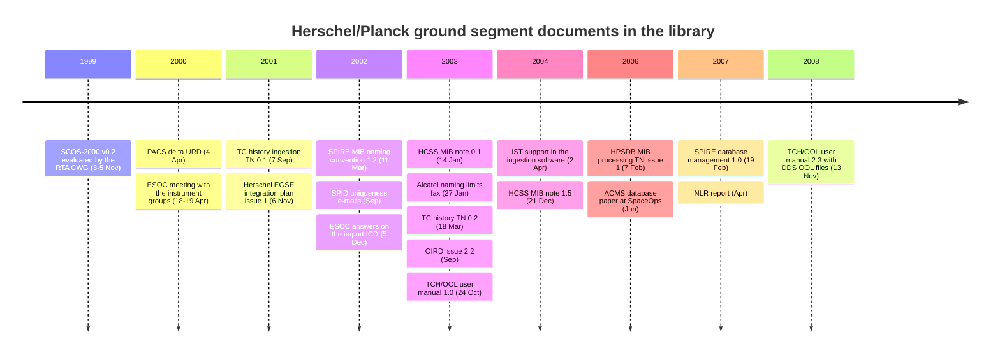
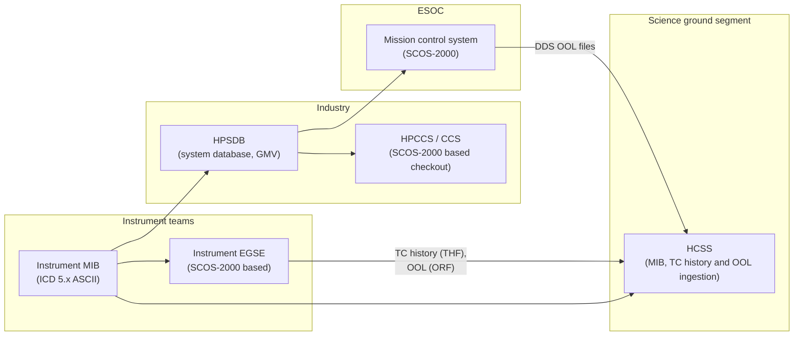
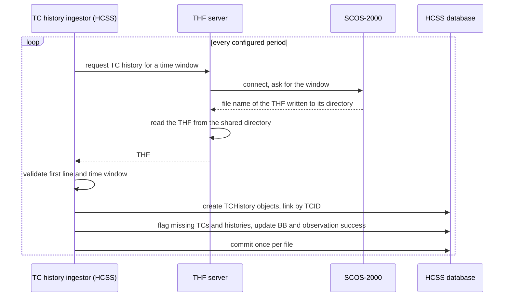

# Herschel/Planck: SCOS-2000 in a science mission ground segment

Herschel (still called FIRST in the documents of 2000) and Planck were two ESA science
satellites developed together, with one industrial prime, shared spacecraft units and a common approach to their
ground segment. They are the best documented case in this wiki's library of
[SCOS-2000](index.md) used across a whole programme: as the core of the instrument
electrical ground support equipment ([EGSE](egse.md)) in the instrument teams' laboratories,
as the base of the spacecraft Central Checkout System in industry, and as the mission control
system at ESOC. The thread that ties these uses together is the SCOS-2000
[Mission Information Base](../mib/index.md). The same ASCII tables had to pass from the
instrument teams to the industrial system database, to the checkout system, to the
operations centre and into the Herschel science system.[^nlr-sum][^nlr-team][^nlr-hpsdb][^oird-concept][^hcss-bg]

This page reconstructs that story from the documents that the Herschel Science Archive kept in
its SPIRE instrument folder, from three Herschel documents on ESA's COSMOS web site (the EGSE
integration plan, the common EGSE document overview and the operations interface
requirements) and from related papers. It covers the decision of April 2000, the
operations interface requirements, the system database and naming rules, the MIB tailoring for
the Herschel Common Science System (HCSS), the ingestion of SCOS-2000 command history and
out-of-limits files, SPIRE's database configuration control, and the experience of the
attitude control subsystem team. The [Herschel and Planck mission page](../missions/herschel-planck.md)
covers the missions themselves.

!!! info "At a glance"
    * **April 2000**: at an ESOC meeting all FIRST/Planck instrument groups state their
      intention to use SCOS-2000 as the basis of their EGSE and real-time analysis; ESA
      offers the software free of charge under licence, with paid support.[^mom-concl][^pres-lic]
    * **2001-2003**: the Herschel EGSE for instrument level tests is assembled from SCOS-2000,
      gateways, a router, test control and a MIB editor; the operations interface requirements
      make the SCOS-2000 Database Import ICD the format of the satellite database.[^iplan-blocks][^oird-sdb]
    * **2002-2006**: a naming convention and the Herschel/Planck System Database (HPSDB)
      constrain what instrument MIBs may contain so that they survive the "smooth transition"
      from instrument to spacecraft level.[^naming-hdr][^fax-req][^tn1060-scope]
    * **2003-2008**: the HCSS ingests MIBs, telecommand history and out-of-limits files from
      SCOS-2000 into its own archive.[^hcss-bg][^tch-overview]
    * **Archive**: the Herschel MIB releases are listed in the ESA Herschel Science Archive,
      but this wiki could not copy them (see [below](#the-herschel-mib-in-the-archive)).



The dates are those printed on the documents.[^pres-eval][^mom-hdr][^tchtn-cr][^iplan-hdr][^naming-hdr][^hcss-spid][^hcss-esoc][^fax-hdr][^hcss-cr][^oird-hdr][^tch-cr][^tn1060-cr][^nlr-sum][^spiredb-hdr]

## Who did what

The documents name the organisations and their products as follows.

| Organisation | Role | Source |
|---|---|---|
| ESA project (ESTEC, SCI-PT) | Programme management; controls the operations interface requirements | [^oird-hdr][^oird-ad][^pres-eval] |
| ESOC (TOS directorate in 2000) | Mission operations centre (MOC); SCOS-2000 product owner | [^mom-intro][^oird-hdr] |
| Herschel Science Centre (HSC) | The HCSS and its MIB interface | [^hcss-bg] |
| Instrument teams | HIFI, PACS, SPIRE (Herschel), HFI, LFI (Planck): instrument MIBs, EGSE, test control | [^tn1060-dist][^iplan-blocks][^fax-req] |
| Alcatel Space Industries (2003), Alcatel Alenia Space France (AAS-F) in 2006 | Prime for both satellites; manages the instrument interfaces; procured the HPSDB | [^fax-hdr][^nlr-team] |
| Alcatel Alenia Space Italia (AAS-I) | Service module | [^nlr-team] |
| Dutch Space with Sener and Analyticon | Attitude Control and Measurement System (ACMS) | [^nlr-team] |
| Terma | ACMS application software; Herschel/Planck Central Checkout System (HPCCS) | [^nlr-team] |
| GMV | Herschel/Planck System Data Base (HPSDB) | [^nlr-team] |



!!! warning "Inference"
    The diagram combines several documents: the HPSDB technical note (ingests instrument and
    CCS MIB files, generates them again), the NLR paper (HPSDB exports SCOS-2000 files for AIT
    and operations), the HCSS MIB note (HCSS ingests ASCII MIB files) and the ingestion user
    manual (files from SCOS-2000, and DDS files from the MOC in routine phase).[^tn1060-scope][^nlr-hpsdb][^hcss-bg][^tch-overview]
    No single source draws this picture, and the exact delivery paths of MIB versions between
    the parties are not stated in the available sources.

## The decision of April 2000

### The meeting

On 18-19 April 2000 ESOC hosted a meeting on "SCOS 2000 and FIRST/PLANCK" with the project
(ESTEC), ESOC and the instrument groups and their partners (TESRE/CNR, OAT, MPE, RAL, LAL, LABEN,
IAS, SRON and KUL).[^mom-hdr] The agenda had eleven items:[^agenda]

| # | Item | Presenter |
|---|---|---|
| 1 | Welcome | C. Mazza |
| 2 | Introduction | P. Estaria |
| 3 | SCOS 2000 status | J-F. Kaufeler |
| 4 | EGSE and supporting elements: router, TPE, Tcl/Tk, WINFOPS/MOIS, database tools | J-F. Kaufeler |
| 5 | Options for SCOS 2000 systems | J-F. Kaufeler |
| 6 | Licence agreement and COTS | J-F. Kaufeler |
| 7 | Service and support | J-F. Kaufeler |
| 8 | SCOS 2000 delta URD: presentation (PACS) and ESOC comments | PACS, ESOC |
| 9 | Practical arrangements | J-F. Kaufeler |
| 10 | Summary and conclusions | P. Estaria, J. Dodsworth |
| 11 | AOB | |

The background came from the project's evaluation slides. SCOS-2000 version 0.2 had been
evaluated on 3-5 November 1999 by the "RTA CWG" as a "framework" for a common real-time
analysis (RTA) system of the FIRST and Planck instruments; the expansion of CWG is not stated
in the available sources. Since then the instrument groups
had considered a wider role, as an EGSE kernel, and PACS had collected the missing RTA
functions and expected EGSE features in a "consolidated" delta URD (user requirements
document) dated 4 April 2000, which "cannot be considered consolidated at present".[^pres-eval][^urd]

### What ESOC presented

The ESOC presentation set out the state of SCOS-2000:[^pres-status][^pres-rel]

* **Use.** Past: SOHO (telemetry only, 1995), Huygens, TeamSat and MTP for Eumetsat (1997).
  Present: Integral and MSG (successful SVTs), Rosetta (architectural design phase), ERS (first
  delivery end 1999, migration from SCOS-1), and PROBA (MCS and EGSE). Future: Smart-1, Envisat
  and XMM (MOC and SOC), both migrating from SCOS-1, Mars Express, the FIRST/Planck MOC and
  Cryosat and GOCE (listed as "Earth Core Explorer"); "First/Planck EGSE + PIs ??" closed the
  list.
* **Name.** SCOS-2 up to release R1.4 (until 1998), SCOS-2000 from R2.0 (1999), with a new
  telecommand chain, architectural consolidation, a user interface fully based on ILOG,
  systematic use of ObjectStore and CORBA for distribution and external interfaces.
* **Releases.** R2.0 in September 1999 (Integral SVTs), R2.1 in March 2000 (MSG SVTs), R2.2 in
  September 2000 as the end of the nominal project. R3.0 (mid-2001) was to port SCOS-2000 to PCs
  and Linux, separate applications from the operating system and replace ObjectStore; R4.0
  (first quarter 2002) was to allow several SCOS-2000 versions on one machine, for
  constellations, and add higher-level monitoring.

The EGSE elements came from PROBA, where SCOS had served both as checkout facility and mission
control system (EMCS). They were a **router** for TM reception, TC transmission and a SCOS
gateway; a **procedure automation tool** based on the free Tcl/Tk; and **database editors**
based on Oracle.[^pres-egse] The router gives location and data transparency, client
management with several clients per connection, and message delivery by asynchronous
call-back or synchronous polling. The router on a Windows NT PC (Pentium III) handled 1 Mbit/s of
TM input with recording (parallel DMA card), 4 kbit/s of TC (RS422 card), at under 15% CPU, with about 2% CPU
per distributed virtual channel. The TCP/IP gateway needed no COTS. The TM/TC front end
extracted CCSDS packets from a data stream and built the TC stream; with the ground-space
protocol it needed a commercial TC encoder shell (about 10 kEUR).[^pres-router] The **Test
Procedure Environment** (TPE) linked a SCOE system to the SCOS kernel through parameter and
command interface servers, with Tcl/Tk procedures able to get parameters, send commands and
read the database.[^pres-tpe]

ESOC's offer had five software items. Option 1 gave all of them "as is"; option 2 added
support and service by TOS-G for items 1-3 and support by TOS-O for items 4-5, with users
treated as external customers:[^pres-offer]

| # | Item | Basis |
|---|---|---|
| 1 | SCOS-2000 | ESOC product |
| 2 | Router | From PROBA |
| 3 | Tcl/Tk procedure automation tool | From PROBA |
| 4 | Database editors | MS Access, from Integral |
| 5 | WINFOPS / MOIS | MS Access, for procedure preparation and simple tabular automation |

### Licence, costs and support

All software was free of charge but needed a formal, non-exclusive licence stating its purpose;
the user had to procure and pay for all hardware and COTS licences.[^pres-lic] The licence text
handed out on 19 April 2000 lists the items (SCOS-2000; the PROBA EGSE with router, automation
tool and Oracle database; the Integral MS Access database; Winfops/MOIS) and four licence types:
documentation only, a time-limited trial, the run-time version, or the source code. ESA keeps
ownership, so the software cannot be sold on, and points the licensee to its COTS suppliers at
preferential conditions.[^lic-app] This matches ESA's general practice for "operational
software": ESA holds the rights and may grant free, non-exclusive licences to Member State bodies
for peaceful use in space research and technology.[^b108-lic]

The indicative prices of April 2000:[^pres-cost]

| Item | Price (2000) |
|---|---|
| SCOS-2000 server (Sun Ultra 80) / client (Sun Ultra 10) / basic Sun software set | 19 / 10 / 4 kEUR |
| Example: 1 server and 2 clients | 51 kEUR |
| Router PC (Windows NT) | 4 kEUR |
| SCOS-2000 COTS (ILOG Views, Ctree+, Orbix, ObjectStore, STL): development licences (STL only) | 400 EUR per server, plus 400 EUR per year |
| SCOS-2000 COTS: run-time licence | 2 200 EUR per client, plus 300 EUR per year |
| Example COTS: 1 server and 3 clients | 7.0 kEUR, plus 1.3 kEUR per year |
| Delphi development environment (router, only if developing) | 1 kEUR per PC |
| TC transmission shell, only if CCSDS COP-1 is used | 10 kEUR per PC |
| SCOS-2000 installation | 10 kEUR per site |
| Developer course (20 hours over 4-5 days, hands-on) | 4 kEUR per course |
| Consultancy for customisation | 14 kEUR per man-month |
| Service (maintenance contract) | 35 kEUR per year per user |

**Support** covered the initial phase (installation, training, consultancy). **Service**
assumed an untouched SCOS-2000 kernel and gave a help desk, registered software problem reports
(SPRs) fixed in later releases, discussion of change requests (CRQs), updates, and membership
of the SCOS-2000 board or user group. Contracts were to be of "Fixed Unit Time" (FUP, for
example labour) or firm fixed price (FFP) nature.[^pres-supp][^lic-supp] The minutes clarify that a "user" for service means a single
point of contact that may represent a community, and that the first-level help desk is included
in the 35 kEUR per year.[^mom-lic]

### The project's position

The project stated its limits clearly. ESA's science directorate expects industry to provide the
EGSE as part of the spacecraft contract, with a "hands-off" approach, while commonality between
flight control and checkout systems is pursued within project constraints (also a goal for
Rosetta and Mars Express). Selecting SCOS-2000 as instrument EGSE kernel was "entirely a PI
decision". The project could give no technical support, no hardware or software, no money for
direct costs (hardware, licences, delta URD developments, support, training) or indirect costs,
and no acceptance of responsibility; its coordination of the evaluation ended with the
termination of the RTA CWG.[^eval-pos][^eval-cost] The benefits of commonality "have not been quantified".[^eval-ben]

### What was agreed

The minutes record the discussion:[^mom-intro][^mom-status][^mom-lic][^mom-concl]

* ESOC called SCOS-2000 stable, mature and reliable, and committed to support it for flight
  operations and EGSE development. SCOS-2000 is the baseline for MOC operations, and the
  invitation to tender (ITT) was to say so for the core of the flight control system.
* The COTS available for Solaris would also be available on Linux (Windows NT under
  investigation), and ObjectStore would probably be replaced by a cheaper object database.
* From PROBA: SCOS-2 was the basis; Oracle served as database, extended to the SCOE equipment;
  the TPE read Oracle at compile time; SCOEs were addressed by APIDs outside the spacecraft
  range. SCOS-2000 concentrates on an interface to a database that can be any product; the
  common project database was to come from the prime, and for ESOC the options were Oracle,
  MS Access (the Integral tool, compatible with SCOS-2000) or custom solutions.
* ESOC keeps "one product only". Changes are either infrastructure enhancements (ESA funded) or
  project-specific add-ons, funded by the customer and built either by the customer or by ESOC.
* The instrument teams worried that no coherent strategy existed for the interface to the
  prime's checkout equipment, and needed a core option by May 2001 for DPU testing. The three
  FIRST instruments had agreed a common EGSE, with requirements frozen around June 2000.
  Interfacing with FINDAS would use the DDS, with the ESOC infrastructure ready between end 2001
  and mid-2002.
* Conclusion: all PI groups "unanimously stated their intention" to use SCOS-2000 as the basis
  for EGSE and RTA, to be reflected in the ITT interface requirements for database and
  telemetry.

!!! note "Two copies of one presentation"
    The archive holds the ESOC presentation twice, as `SCOS2000complete_presentation.pdf` and
    `tos-gc_first_planck -presentation+pis_20000418.pdf`. The two files differ (different
    SHA-256 and size) but their extracted text is identical, page for page; this page cites the
    first.[^pres-twin] Their PDF metadata show the same title, producer, page count (46) and
    creation time (8 May 2000), with modification times two minutes apart on 10 May 2000, so the
    difference lies in non-text content.[^pres-twin] The evaluation slides (PT-07671) and the licence text are also archived
    as separate files.[^eval-pos][^lic-app]

## The Herschel EGSE for instrument level tests

The decision materialised in the Herschel EGSE for instrument level tests (EGSE-ILT). Its
integration plan (SRON-U/HIFI/PL/2001-1, issue 1 of 6 November 2001, identical to draft 4 of
1 July 2001) lists the blocks and who delivered them:[^iplan-hdr][^iplan-blocks]

| Block | Delivered by |
|---|---|
| SCOS-2000 | ESA |
| SCOS gateway | ESTEC |
| Test-equipment interface (TEI) | HIFI |
| TM-TC router | HIFI |
| Test control | PACS |
| CDMS simulator | SPIRE |
| OBSM | ESA |
| MIB editor | ESA |

The router, TEI, CDMS simulator and test control tests all start the same way: connect the
subsystems and import (or load) the test MIB into SCOS-2000. They then check TM packet
reception and content in SCOS-2000 and TC packet transmission to a test client, test equipment
or instrument simulator; the last test checks the link between test control and the HCSS.[^iplan-tests] On-board software maintenance (OBSM)
was still an open item.[^iplan-tests]

## The operations interface requirements

The **Herschel/Planck Operations Interface Requirements Document** (OIRD, SCI-PT-RS-07360, issue
2.2, dated "31 September 2003" on its cover, while its change record dates issue 2.2 to
22 May 2003) lists the requirements on spacecraft and payloads needed for operations, and on
the deliverables needed at the MOC. It was prepared at ESOC, approved by the project (SCI-PT)
and ESOC, and agreed by the prime (ASPI), the project scientists and the instrument
PIs; the ESTEC project office controls it.[^oird-hdr][^oird-cr][^oird-ad] Section 3
derives from the ECSS Packet Utilisation Standard (draft 5.3 of April 2001), and the SCOS-2000
Database Import ICD is an applicable document: it became one in issue 2.0 (July 2001) and was
updated to its issue 5.1 (October 2001) in issue 2.2. Requirements marked "P" apply to spacecraft and payloads, "PO" to the spacecraft
with possible relevance to payloads, unmarked ones to the spacecraft only.[^oird-ad][^oird-cr]

### Operations concept

In routine operations the ground station contact lasts a few hours per day. In that time the
ground checks health, dumps the previous day's stored telemetry, uplinks the next day's
schedule and corrects problems; science runs autonomously from the schedule. Packet telemetry
is expected to ease the ordering of the daily dump, for example status first, then events and
command verification reports, then observation data. Operations would use "the same telemetry and telecommand database used in the
EGSE".[^oird-concept] Every telecommand is a packet addressed by APID and identified by APID and
sequence control, with its function given by PUS type and subtype and its required
acknowledgement in a header field. Telemetry is collected in housekeeping, science, telecommand
report, event and memory dump packets and stored in the solid-state mass memory until erased
by ground.[^oird-concept][^oird-tm]

### PUS services for instruments

The OIRD's table of applicable PUS services for the instruments (see
[PUS](../ecss/pus/index.md)):[^oird-pus]

| Type | Service | Instruments |
|---|---|---|
| 1 | Telecommand verification ([ST\[01\]](../ecss/pus/st01-request-verification.md)) | Mandatory |
| 2 | Device command distribution | Not applicable |
| 3 | Housekeeping and diagnostic data reporting ([ST\[03\]](../ecss/pus/st03-housekeeping.md)) | Mandatory |
| 5 | Event reporting ([ST\[05\]](../ecss/pus/st05-event-reporting.md)) | Mandatory |
| 6 | Memory management ([ST\[06\]](../ecss/pus/st06-memory-management.md)) | Mandatory |
| 8 | Function management ([ST\[08\]](../ecss/pus/st08-function-management.md)) | Optional |
| 9 | Time management ([ST\[09\]](../ecss/pus/st09-time-management.md)) | Mandatory |
| 11 | On-board operations scheduling | Not applicable |
| 12 | On-board monitoring | Not applicable |
| 14 | Packet transmission control | Mandatory |
| 15 | On-board storage and retrieval | Not applicable |
| 16 | On-board traffic management | Not applicable |
| 17 | Test ([ST\[17\]](../ecss/pus/st17-test.md)) | Mandatory |
| 18 | OBCP management | Optional |
| 19 | Event/action | Not applicable |
| 21 | Science data transfer | Mandatory |
| 4, 7, 10, 13, 20, 22 | Not used | Not applicable |

### Packet rules that shape the MIB

Several OIRD requirements decide what the MIB tables can express. APIDs are allocated by the
project in the Packet Structure ICD (PSICD); telemetry from a subsystem uses the same APID as
its telecommands where possible; the location of a housekeeping parameter must follow from
APID, type, subtype and structure ID (SID); SIDs are unique within an APID and few per APID;
housekeeping subcommutation is forbidden and supercommutation allowed only with regular
sampling; a parameter has the same structure in every packet; all packets carry a time field
(except time and idle packets); and Herschel instrument packets carry a common observation
identifier.[^oird-pack] For verification, each telecommand controls its own verification level
through the acknowledgement field, acceptance and execution reports carry the failure reason,
and reports indicate the command source (ground, mission timeline, OBCP).[^oird-tcv] Telemetry
must let the ground assess status without the command history, echo the inputs of autonomous
processes, use contiguous bits for each parameter and keep the contributing parameters of any
synthetic parameter in one packet.[^oird-tmreq]

### The satellite database

The OIRD makes the database a contractual deliverable:[^oird-sdb][^oird-sdbd]

| Requirement | Content |
|---|---|
| SDBC-1 | The prime and the instrument developers deliver a Satellite Database (SDB) with all TM/TC data, command sequences, software parameters and commands; instruments are provided by the PIs |
| SDBC-2 | A single common database for system engineering, AIV and operations |
| SDBC-3 | Ground checkout and in-orbit content clearly identified |
| SDBC-4 | Content complies with the SCOS-2000 Database Import ICD (AD-8) and Annex 2 |
| SDBC-5 to -7 | Internally consistent, and consistent with the flight dynamics database and all on-board software |
| SDBC-8 | All updates recorded automatically in a configuration control record down to field level |
| SDBC-9 | Definitions to write and read parameter values in on-board RAM |
| SDBC-10 to -12 | Validated by the prime at system and subsystem level; no irrelevant data; no duplications |
| SDBD-1 | Version 0 for the instrument AVM delivery; versions 1 (L-36 months), 2 (L-24 months), 3 (one month before SVT 1, complete with flight values), 4 (one month before SVT 2); a pre-launch update at L-1 month |
| SDBD-2 to -4 | Each delivery with a configuration control file down to field level, the spacecraft build standard (EQM or PFM) and the on-board software versions (AOCS, star tracker, CDMS, instruments) |
| SDBD-5 / -6 | Delivered "in a set of ORACLE data files"; digital transfer in an agreed file format possible |

Annex 2 specifies the configuration control file (SDB version, release date, version of every
file, and change tables down to old and new field values, date and initials) and the
spacecraft configuration file (model, build standard, on-board software versions).[^oird-a2]
Annex 4 delegates database naming to the Herschel/Planck naming convention (H-P-1-ASPI-SP-0141)
and fixes procedure names: `FCP_AOC_0001` for flight control procedures, `CRP_AOC_0001` for
contingency recovery procedures (four digits with leading zeros), and `TDoyFfNn` for timelines
(day of year, file number, version).[^oird-a4]

## Naming conventions and the system database

### The SPIRE MIB naming convention

SPIRE's naming note (SPIRE-RAL-NOT-001155, issue 1.2, 11 March 2002) applies the Herschel/Planck
naming convention to the SPIRE MIB, which it calls the "Mission Implementation Base", delivered
to the SCOS-2000 Database Import ICD. Each SCOS-2000 name field gets a pattern:[^naming-tab]

| Item | MIB field(s) | Pattern |
|---|---|---|
| Command packet | `CCF_CNAME`, `CDF_CNAME`, `PTV_CNAME` | `SCiiippp` |
| Command parameter | `CPC_PNAME`, `CDF_PNAME` | `SPiiippp` |
| Command numerical / textual calibration | `CCA_NUMBR`, `CCS_NUMBR` / `PAF_NUMBR`, `PAS_NUMBR` | `tttnnnrrr` (alternative `sss`) |
| Monitor packet | `PID_SPID`, `TPCF_SPID`, `PLF_SPID` | `tttnnnnppp` |
| Monitor parameter | `PCF_NAME`, `OCF_NAME`, `OCP_NAME`, `PLF_NAME`, `PTV_PARNAM` | `SMiiippp` |
| Numerical, textual, polynomial calibration | `CAF_NUMBR`/`CAP_NUMBR`, `TXF_NUMBR`/`TXP_NUMBR`, `MCF_IDENT` | `tttnnnrrr` (alternative `sss`) |
| Numerical / graphical / scrolling display | `DPF_NUMBE`/`DPC_NUMBE`, `GPF_NUMBE`/`GPC_NUMBE`, `SPF_NUMBE`/`SPC_NUMBE` | `SAiiippp` / `SGiiippp` / `SLiiippp` |

Here `iii` is a theoretical parameter identifier (its first character the subsystem ID, its third
the parameter unit ID),
`nnn` a running number, `ttt` the system element number, `rrr` the real element number, `ppp`
the position identifier and `sss` an alternative identifier for calibration curves "if SCOS2000
is incapable of handling 8 character field names". System elements are numbered (OBS 480, DPU
490, DCU 500, MCU 510, SCU 520, EGSE 528, the test facility TFCS 529), real elements count the
configurations per model (AVM 100, QM 300, FM 500, FS 700 and so on), and unit IDs are letters
such as A (current), K (temperature), V (voltage) or W (power).[^naming-ids]

### The Alcatel limits of January 2003

On 27 January 2003 the prime (fax H-P-ASP-LT-2607) required all instrument teams to restrict
their MIBs "in order to support 'smooth transition' from instrument test level to module test
level". User-defined constants (UDCs) are MIB parameters whose values SCOS-2000 stores in
standard TM packets described in `plf`.[^fax-req][^i70-udc]

| Requirement | Reason given |
|---|---|
| Curve identifiers limited to Number(3) | The import ICD allows Number(4), but the naming convention's theoretical curve identifier needs the room |
| Range set identifiers limited to Number(3) | Same reasoning |
| Command verification stage identifiers limited to Number(4) | The ICD allows Number(5) |
| Dynamic user-defined constants in fixed ranges of the unique "constant packet" in `plf`: system 0000-0099, SVM 0100-0199, PLM 0200-0299, HIFI (Herschel) and HFI (Planck) 0300-0399, PACS and LFI 0400-0499, 0500-0599 labelled HIFI again for Herschel and "not used" for Planck (SPIRE is not named in the list as printed), spare 0600-1023 | The constant packet is unique, so allocations must not overlap at integration |
| The SPID of the constant packet supports 1024 octets | All levels produce the same archive format, at the cost of disc space at instrument level |

### HPSDB: MIB files processing (H-P-1-ASP-TN-1060)

The **Herschel/Planck System Database (HPSDB)**, built by GMV for the prime, holds data at
element, subsystem, model and generic level. Instantiation keeps consistency: "theoretical"
boxes carry default data, "real" boxes the measured values, and logical and physical
instantiation build subsystems from elements and multiple real copies of a box. A central site
keeps the final data, with mirror sites.[^nlr-hpsdb] The prime's technical note H-P-1-ASP-TN-1060
(issue 1, 7 February 2006) documents how the HPSDB ingests and regenerates SCOS-2000 MIB files.
In the note, "S2K" means the instrument EGSE "version 2.3eP5 based on SCOS 2000 2.3e" with MIB ICD
5.1, and "CCS" the Central Checkout System with its own MIB ICD.[^tn1060-scope][^tn1060-ad] A
draft had been annexed to the minutes of a Herschel instruments database meeting at ASED in
Munich on 29-30 September 2005 and was finalised to close an ESA action.[^tn1060-cr]

The note lists the constraints that instrument MIBs must respect so that HPSDB returns the same
files it was given. Constraints that HPSDB cannot check are printed in bold and are the user's
responsibility. It warns that even then CCS and instrument EGSE may behave differently, because
CCS has functions without SCOS-2000 equivalent (calibration selection by condition, event
limits, critical commands) and because configuration files such as `MISCconfig` differ.[^tn1060-scope]
The general rules:[^tn1060-g1][^tn1060-g7][^tn1060-g8][^tn1060-g12][^tn1060-g14][^tn1060-g17]

| Rule | Content |
|---|---|
| G1 Object data model | Bridge files are generated from an object plus its generic object, which must be consistent; object identifiers and positions must be supplied |
| G2 Naming convention | Character identifiers start with an item-type letter; at subsystem and model level a subsystem letter is prefixed ("Z" for the pseudo-subsystem) and a three-digit position appended ("999" for system); numeric identifiers use subsystem numbers A=00 to Y=25 ("26" pseudo); generic items use letter "G", number "07", position and element "000" |
| G3-G5 Short S2K identifiers | S2K curve, verification stage and range set identifiers are too short for instantiation: a specific item is coded Number(3) (curves, range sets) or Number(4) (verification stages); a generic one as `1xxx` or `1xxxx`, matching generic HPSDB items such as `G000xxx000` |
| G6 Enumerated fields | Values must be in the ICD set, possibly reduced by the PSICD (allowed type/subtype pairs) or by HPSDB (no octal radix) |
| G7 Commutation | HPSDB models packets as lists of parameters, structures and fixed areas, with offsets, repetition counters and supercommutation; a packet is flagged fixed (PLF only), variable (VPD only) or both |
| G8 Default values | ICD defaults are forced even when irrelevant, and some are replaced by HPSDB defaults (`PID_CHECK`, `CAF_RADIX`/`CCA_RADIX`) |
| G9 Commonality | TM and TC calibration curves can be shared in HPSDB, so the same identifier must not be used for a TM and a TC curve |
| G10 Category flag | Each item has an 8-bit flag, one bit per user type (AIT, operations, software, flight dynamics); MIB loading sets "all except FDD" |
| G11 Common fields | 64-character mnemonic, 256-character long description and configuration data (last action, user, date, reason, area, source, site, validation and archive dates), not supported by S2K or CCS |
| G12 TC packet header | TC headers are generic in HPSDB; `TCP`, `PCPC` and `PCDF` are ignored at loading and must match the generic header referenced by `CCF_PKTID`; at output they are set from the generic data (`PCDF_TCNAME` "GX000000") |
| G13 Reserved characters | No `>`, `<`, quote, double quote or `&` (XML); short descriptions limited to letters, digits, blank, `+`, `-` and `_` |
| G14 Radix | Unsigned values in decimal or hexadecimal, never octal |
| G15 Range allocation | Allocations from the naming convention (PID numbers, UDC locations) must be respected; the note blames a "SCOS limitation" in supporting smooth transition |
| G16 Automatic instantiation | The last character of the short description, the APID, the PID and the UDC and MISC parameter positions are computed from the element's position, so users must take care with them |
| G17 Short description | Mandatory in HPSDB, filled with the identifier if empty |
| G18 Orphan items | Not loaded |
| G19 Sorting | Output sorted by the ICD primary key; inputs must be sorted too |
| G20 Derived parameters | Expression files delivered with the MIB |

The field-by-field part then states for each MIB field how it is loaded, stored and written
back. Some points matter for every MIB user:

* **PID and SPID.** The ICD allows an n-to-n relation between TM packets (type, subtype, APID,
  PI1, PI2) and SCOS packets (SPID), "claiming that at any time, only one relation is valid".
  HPSDB allows only n-to-1 (each TM packet in only one SCOS packet, which several TM packets
  may share), and AIT asked for 1-to-1.
  `PID_VALID` is forced to "Y", `PID_TIME` to "Y", and `PID_DFHSIZE` must be equal for all source
  packets of one SPID.[^tn1060-scope][^tn1060-pid] See [pid](../mib/tables/pid.md).
* **PIC is generic.** The [pic](../mib/tables/pic.md) table must be the same on every SCOS and
  CCS system of the programme, so it is never loaded from bridge files and always generated from
  generic HPSDB data.[^tn1060-pic]
* **PCF_NATUR** is set from the HPSDB parameter type and the naming convention, and
  `PCF_CATEG` must be "T" for all parameters with PTC 8.[^tn1060-pcf]
* **Commands.** `CCF_HIPRI` is computed from the packet header, `CCF_ACK` is split into four
  HPSDB fields, and the note asks ESA to clarify how the MCS uses `CCF_MAPID`, listing the
  values 0 (high priority), 1 (normal computer), 2 (redundant computer), 5 (reset CROME),
  6 (TC only mode) and 32 (TBC).[^tn1060-ccf]
* **Not used.** Print proformas (PPF, PPC) must not be present; command routing (DST) is not
  loaded; command sequences (CSF, CSS, SDF) and parameter sets (PST, PSV, CPS, PVS, PSM) are
  not supported by the CCS ("do not use"), and the CSP section is still "To be written",
  although HPSDB loads sequences "in order to interface with MOIS for operations".[^tn1060-ppf][^tn1060-seq]
* **CCS-only tables.** Conditional calibration (CUR), groups (GRP, GRPA, GRPK), SCOE
  definitions (SCO), TC and TM distribution to SCOEs (TCD, TMD) and logarithmic curves (LGF)
  belong to the CCS MIB.[^tn1060-ccs]

!!! example "A TC packet header as the MIB defines it (real data, Solar Orbiter)"
    Rule G12 and the HCSS rule on [pcdf](../mib/tables/pcdf.md) (below) both concern the
    TC packet header tables. The Solar Orbiter MIB of 2025 shows what such a definition looks
    like: its header `NOM_TC` (described as `NOM_DH_TC_Packet_Header` in [tcp](../mib/tables/tcp.md))
    has 13 `pcdf` rows with bit offsets counted from the
    start of the packet.[^mib25][^i70-pcdf]

    <div class="bitfield" data-title="Solar Orbiter NOM_TC packet header from pcdf (80 bits)" data-width="16"
         data-fields='[{"n":"Version Number","b":3,"v":"000","d":"PCDF_TYPE F, value 0"},{"n":"Type","b":1,"v":"1","d":"F, value 1"},{"n":"DataFieldHeaderFlag","b":1,"v":"1","d":"F, value 1"},{"n":"APID","b":11,"d":"A: taken from CCF_APID (PH_APID)"},{"n":"Sequence Flag","b":2,"v":"11","d":"F, value 3"},{"n":"Sequence Count","b":14,"d":"P: set by SCOS-2000 (PH_SSC)"},{"n":"Packet Length","b":16,"d":"P: set by SCOS-2000 (PH_LEN)"},{"n":"Secondary Header Flag","b":1,"v":"0","d":"F, value 0"},{"n":"PUS Version","b":3,"v":"001","d":"F, value 1"},{"n":"Ack","b":4,"d":"K: from CCF_ACK (DFH_ACK)"},{"n":"Service Type","b":8,"d":"T: from CCF_TYPE (DFH_TYPE)"},{"n":"Service Subtype","b":8,"d":"S: from CCF_STYPE (DFH_STPE)"},{"n":"Source ID","b":8,"d":"Type code O (DFH_SRC)"}]'></div>

    The type codes F, A, T, S, K and P are those of the ICD: fixed value, APID, service type,
    subtype and acknowledgement flags from `ccf`, and parameters set automatically by the
    command subsystem.[^i70-pcdf] The code `O` used for the source ID is not among the codes
    listed in ICD issue 7.0. The second header, `HPC1_TC`, has 7 rows (primary header only,
    data field header flag 0); 5 318 commands use `NOM_TC`, 125 use `HPC1_TC`, 6 `NOS2KHDR`
    and 5 `NO_HDR`.[^mib25]

## The HCSS MIB clarification and tailoring note

### Purpose

The **Herschel Common Science System (HCSS)** is the common software of the Herschel science
ground segment. It uses MIB data to define instrument-related commands and to interpret
downlink data for the Quick Look Assessment and Interactive Analysis subsystems. The MIB is
produced by an external MIB editor as ASCII files, and the HCSS MIB ingestion software reads
and checks them.[^hcss-bg] The **HCSS MIB Clarification and Tailoring Note** (HSC/DOC/0300, issue
1.5, 21 December 2004, approved by the HSC and the PACS, HIFI and SPIRE teams) completes the
interface defined by the Database Import ICD (issue 5.2) and the naming convention (issue 2.1):
it clarifies their ambiguities, adds Herschel constraints and lists the checks.[^hcss-hdr][^hcss-purpose][^hcss-rd]

### Clarifications of the import ICD

| Point | ICD section | Clarification |
|---|---|---|
| 4.1.1 | §2.3 | A line ends with the operating system's terminator (LF on Unix, CR+LF on Windows); one line per record; N fields need N-1 tabs; trailing fields ignored by SCOS-2000 (grey in the ICD) may be omitted, so at least T-G fields |
| 4.1.2 | §2.4 | Mandatory fields must hold a value of the right type; numeric ones must not be null or blank |
| 4.1.3 | §3.3 | Non-mandatory fields without default get 0, 0.0 or an empty string |
| 4.1.4 | §3.3 | The separator is always present, the value may be empty (text from ESOC's DCR-286) |
| 4.1.5 | §3.3.2.3.2 | An out-of-limit is raised only below the low or above the high limit, for soft and hard limits |
| 4.1.6 | §3.3.2.5.1 | `PLF_OFFBY`/`PLF_OFFBI` count from the end of the SCOS-2000 packet header, which equals the start of the TM source packet with the generic packetiser (DCR 309) |
| 4.1.7 | §3.3.2.5.1 | Bit 0 of `PLF_OFFBI` is the most significant bit (DCR 308) |
| 4.1.8 | §2 | Floating point numbers use a decimal point, not a comma |

The table summarises the note's clarification table.[^hcss-clar] See [plf](../mib/tables/plf.md)
and [monitoring checks](../mib/monitoring-checks.md).

The terms used: "short name" means `CCF_CNAME`, `CPC_PNAME` and `PCF_NAME`; "short description"
means `CCF_DESCR`, `CPC_DESCR`, `PCF_DESCR` and `PID_DESCR`; "long description" means
`CCF_DESCR2`.[^hcss-def] Of the naming requirements, only NMCVT-0100-C (identifiers; it forbids
I, O and Q as leading characters) and NMCVT-7600-C (descriptions: English letters, digits, space,
`+`, `-`, `_`; meaningful; understandable abbreviations; short description not empty) affect
ingestion.[^hcss-nmcvt]

### Herschel constraints for the final interface

For the final pre-launch interface the note requires:[^hcss-final][^hcss-final2]

* all tables of the ICD in one directory, plus synthetic parameter definitions in a
  `synthetic` subdirectory; everything else ignored;
* an extra **command durations table** (command short name, duration) for the HCSS Common
  Uplink System (CUS), which computes the duration of command sets;
* [vdf](../mib/tables/vdf.md) ignored; constant parameters (`PCF_NATUR` = "C") ignored;
* the SPID as the only way to locate a parameter in a fixed packet, a packet being identified by
  type, subtype, APID and SID, assuming "a unique SPID for each and every packet type";
* no `PID_PI1_VAL` greater than zero where `PIC_PI1_OFF` is -1 (no SID needed);
* at least 4 [pcdf](../mib/tables/pcdf.md) rows (VERSION, TYPE, DHFLAG, APID) for each
  command's packet header, except pseudo commands whose names begin with "Z", which contradicts
  the ICD's statement that `PCDF_TCNAME` is unique;
* `CDF_CNAME` plus `CDF_PNAME` unique, with repeated groups for repeated values;
* command sequences (CSF, CSS, SDF, CSP) and parameter sets (PST, PSV, CPS, PVS) ignored;
* in [txp](../mib/tables/txp.md), `TXP_FROM` not above `TXP_TO` and no overlapping ranges;
* short descriptions matching `[a-zA-Z0-9_]+`, and the first character of the short name plus
  the short description unique for commands, command parameters and monitoring parameters (the
  APID plus `PID_DESCR` for packets): unique "per instrument".

For release 0.2 of the HCSS the note was stricter: only raw parameters (`PCF_NATUR` = "R")
considered, synthetic ones ignored; `OCF_CODIN` only "R" or "I"; variable packets
([vpd](../mib/tables/vpd.md)) ignored; and a command parameter with `CPC_CATEG` "N" treated as
raw, otherwise as engineering, with engineering parameters not allowed raw defaults. The
semantic checks used the monitoring tables pcf, cap, txp, ocf, ocp, pid, pic and plf, the
commanding tables pcdf, ccf, cpc and cdf, and the calibration tables ccs, paf and pas.[^hcss-v02][^hcss-v02b]

### The checks

The note lists 34 numbered checks, one of which (7.0.6) was removed. Most raise an error:[^hcss-chk1][^hcss-chk2]

| Group | Checks |
|---|---|
| Files and syntax | Expected file names (7.0.1); field count per line (7.0.3, lenient for trailing grey fields); empty numeric fields only an informative message (7.0.4); wrong numeric type a warning with a null value (7.0.5) |
| Uniqueness | ICD unique keys (7.0.2, to be implemented), temporarily `PCF_NAME`, `OCF_NAME`, `CPC_PNAME` and `CCF_CNAME` (7.0.18-7.0.21); descriptions per 5.3.1-5.3.5 (7.0.22-7.0.26) |
| Monitoring | Non-raw `PCF_NATUR` a warning, length -1 (7.0.7); no calibration found a warning (7.0.8); status parameter (`PCF_CATEG` "S") without `PCF_CURTX` (7.0.15); unknown `PCF_CATEG` (7.0.16); `PID_INTER` set for a packet other than (3,25) (7.0.34) |
| Packets | SID rule (7.0.12); SPID in plf missing in pid (7.0.14); synthetic and variable packet validity (7.0.10-7.0.11, to be implemented) |
| Commanding | Compliance with the Common Uplink System (7.0.9); at least 4 pcdf rows (7.0.13); `CPC_INTER` only "R" or "E" (7.0.17); `CPC_RADIX` only D, H or O (7.0.33) |
| Calibration | TXP order and overlap (7.0.27-7.0.28); exactly one cca for a calibrated command parameter, with ccs points (7.0.29-7.0.30); ccs values consistent with format and radix (7.0.31); default engineering values consistent with the decalibration curve (7.0.32) |

Check 7.0.13 asks for "more than 4" pcdf rows, while the rule it refers to (5.2.7) asks for at
least 4; the note does not resolve the difference.[^hcss-chk1][^hcss-final2]

### Comments, answers and the SPID problem

The note also preserves the e-mail exchanges behind it. The HSC asked that the naming
convention allow underscores in short descriptions, because they store readable names such as
`DPU_START_AUT_FUN` for the mnemonic `PC004380`, and because the CUS scripting language cannot
use `+` or `-`. It pointed out that the leading characters I, O and Q were reserved by the
instrument centres for HIFI, PACS and SPIRE EGSE-ILT parameters, while H, P and S lead
instrument-related mnemonics.[^hcss-com] ESOC's SCOS team answered on 5 December 2002 and raised
document change requests: non-mandatory fields without default are implicitly null; separators
are always present (DCR 286); PLF offsets count from the end of the SCOS-2000 packet header (DCR
309); bit 0 is the most significant bit (DCR 308, whose own wording says "most significant byte").
Two odd structures stay: soft and hard limits as separate [ocp](../mib/tables/ocp.md) records,
inherited from previous control systems, and the `PID_VALID` flag that selects which record of a
key is valid; ESOC had no intention to change either.[^hcss-esoc]

The best documented problem is **SPID uniqueness**. In September 2002 PACS reported that all its
telecommand verification packets had SPID 10006, because SCOS-2000 did not allow a range of SPIDs
for packet type 1. That contradicted the ICD rule that the SPID uniquely defines a packet
structure, and SCOS-2000 used `PCF_VALID` to decide which `plf` location applied, which PACS
called an abuse of a field meant for the validity of a value. ESOC replied that the verifier
"listens" only to a predefined list of SPIDs for report-based verification. Rosetta had already
allowed any SPID for service 1 packets and Cryosat a range of SPIDs, and the useful Rosetta and
Cryosat changes to the verifier and the on-board queue model were planned for S2K R3.1: a
function reads all SPIDs of service type 1 from `pid.dat` and adds them to the TM cache
filter.[^hcss-spid] See [command verification in the MIB](../mib/command-verification.md).

### The Herschel rules against a modern MIB

How do the Herschel constraints look against today's public flight MIB? The Solar Orbiter
release of 16 September 2025 answers some of them directly:[^mib25]

| Herschel constraint | Solar Orbiter 2025 |
|---|---|
| Unique SPID per packet type (5.2.5); the PACS case of one SPID for all TC verification packets | 1 809 service 1 packet definitions with 1 809 distinct SPIDs across 31 APIDs; no SPID appears in more than one `pid` row. [pic](../mib/tables/pic.md) makes the failure code part of the identification for TM(1,2) and TM(1,8) (`PIC_PI1_OFF` 20, `PIC_PI1_WID` 16), so each failure code has its own SPID: 29 for (1,1), 274 for (1,2), 29 for (1,7) and 1 477 for (1,8) |
| `PID_INTER` only for (3,25) packets (7.0.34) | `PID_INTER` is empty in all 11 150 `pid` rows |
| Only raw parameters ingested (v0.2) | 125 161 raw, 1 582 dynamic OL and 2 saved synthetic parameters |
| `OCF_CODIN` only R or I (v0.2) | R 1 668, I 2 037, and A 1 633 |
| No octal radix (HPSDB G14; HCSS allows D, H, O) | `CPC_RADIX`: D 3 155, H 2 195, empty 1 805; no O |
| Short descriptions `[a-zA-Z0-9_]+` (5.3.1) | 68 789 of 126 745 `PCF_DESCR` and 4 602 of 5 454 `CCF_DESCR` contain other characters such as spaces |
| "Z" marks pseudo commands (5.2.7) | 5 441 of 5 454 `CCF_CNAME` begin with "Z" |
| Status parameters need `PCF_CURTX` (7.0.15) | 5 of 26 538 parameters with `PCF_CATEG` "S" have none |
| No overlapping TXP ranges (5.2.13) | One overlap: a duplicated row in curve `CYCT0002TM` |
| Unique `CDF_CNAME` + `CDF_PNAME` (5.2.9) | No duplicate pair |

The `PIC_PI1_OFF` offset is counted in bytes from the start of the TM source packet.[^i70-pic]
Each SPID can be opened in the explorer, for example the
[TM(1,1) packet of APID 161](../explorer/index.md#/solo/packet/14181).

!!! warning "Inference"
    The Herschel rules were constraints of one consumer, the HCSS, and of one programme's naming
    convention. The comparison does not mean that Solar Orbiter's MIB is wrong. It shows which
    rules were local (the meaning of "Z", the character set, raw-only ingestion) and that the
    SPID limitation reported in 2002 is absent from a recent MIB.

??? example "SQL used (Herschel rules against Solar Orbiter)"
    ```sql
    -- solo-2025-09-16.sqlite (MIB__20250916M25925PFMS001_SOL)
    SELECT count(*), count(DISTINCT PID_SPID), count(DISTINCT PID_APID)
      FROM pid WHERE PID_TYPE = '1';                          -- 1809 | 1809 | 31
    SELECT PID_STYPE, count(*), count(DISTINCT PID_SPID)
      FROM pid WHERE PID_TYPE = '1' GROUP BY 1;               -- 1:29 2:274 7:29 8:1477
    SELECT count(*) FROM (SELECT PID_SPID FROM pid
      GROUP BY PID_SPID HAVING count(*) > 1);                 -- 0
    SELECT * FROM pic WHERE PIC_TYPE = '1';                    -- (1,2) and (1,8): 20 | 16
    SELECT count(*) FROM pid WHERE trim(coalesce(PID_INTER,'')) <> '';   -- 0
    SELECT PCF_NATUR, count(*) FROM pcf GROUP BY 1;            -- R 125161, D 1582, S 2
    SELECT OCF_CODIN, count(*) FROM ocf GROUP BY 1;            -- A 1633, I 2037, R 1668
    SELECT CPC_RADIX, count(*) FROM cpc GROUP BY 1;            -- '' 1805, D 3155, H 2195
    -- char(94) is the caret, which negates the GLOB character class (any other character)
    SELECT count(*), sum(PCF_DESCR GLOB '*[' || char(94) || 'A-Za-z0-9_]*') FROM pcf;  -- 126745 | 68789
    SELECT count(*), sum(CCF_DESCR GLOB '*[' || char(94) || 'A-Za-z0-9_]*') FROM ccf;  -- 5454 | 4602
    SELECT substr(CCF_CNAME,1,1), count(*) FROM ccf GROUP BY 1;         -- Z 5441, ...
    SELECT PCF_CATEG, count(*),
           sum(PCF_CURTX IS NULL OR PCF_CURTX = '') FROM pcf GROUP BY 1; -- S: 26538 | 5
    SELECT a.TXP_NUMBR FROM txp a JOIN txp b ON a.TXP_NUMBR = b.TXP_NUMBR
       AND a.rowid < b.rowid
       AND CAST(a.TXP_FROM AS REAL) <= CAST(b.TXP_TO AS REAL)
       AND CAST(b.TXP_FROM AS REAL) <= CAST(a.TXP_TO AS REAL);          -- CYCT0002TM
    SELECT count(*) FROM (SELECT CDF_CNAME, CDF_PNAME FROM cdf
      WHERE coalesce(CDF_PNAME,'') <> '' GROUP BY 1,2 HAVING count(*) > 1);  -- 0
    SELECT * FROM pcdf ORDER BY PCDF_TCNAME, CAST(PCDF_BIT AS INT);
    SELECT CCF_PKTID, count(*) FROM ccf GROUP BY 1;
    ```

## Telecommand history and out-of-limits ingestion

### The design (TC History Ingestion TN)

The HCSS needed to know what was actually sent. Requirement HCSS-UR-3.1-1111 asks that the HCSS
associate each telecommand in the TC history with the instrument or spacecraft request in the
observation schedule, and use case UCF-759 asks that failed, missing and additional commands be
flagged.[^tchtn-req] The **TC History Ingestion Technical Note** (SPIRE-ICS-DOC-002314, issue
0.2, 18 March 2003; issue 0.1 of 7 September 2001, updated when the code went into the HCSS)
describes the process for the instrument level test phase, version 0.1.x of the HCSS, over a
TCP/IP interface to SCOS-2000 that a CORBA interface was to replace.[^tchtn-hdr][^tchtn-cr][^tchtn-purp]
Among its references is the SCOS-2000 Command History Data Provision Services ICD
(S2K-MCS-ICD-0008-TOS-GCI, issue 1.2, August 2000).[^tchtn-purp]

The assumptions show how SCOS-2000 data meet the science schedule:[^tchtn-req]

* the TC history file (THF) is an ASCII file produced by SCOS-2000 and contains values only for
  editable command parameters;
* commands in the HCSS schedule carry a 32-bit sequence identifier (TCID); manual commands
  have a null or default TCID;
* the uplinked schedule also sets observation and building block identifiers (OBSID, BBID),
  which relate manual commands to observations;
* TC history times are UT, schedule times TAI, and in instrument level tests only relative times
  are used, so time conversion is needed;
* on-board generated event-driven TCs are out of scope; telecommands are the lowest level of
  command generation and become persistent when the schedule is exported to the MOC.

The process has two components linked by their own TCP/IP connection: a **THF server**, which
asks SCOS-2000 for the history of a time window, receives the file name and fetches the file
from the directory where SCOS-2000 wrote it; and a **TC history ingestor**, which validates the
file (first line, time window), creates one `TCHistory` object per command, links it to its TC
in the database by TCID, flags missing histories and missing TCs, updates the success flags of
observations and block executions, commits, and waits for the next period.[^tchtn-comp]



The design decisions, in short:[^tchtn-dd][^tchtn-dd2][^tchtn-perf]

| Decision | Content |
|---|---|
| Interface | TCP/IP to SCOS-2000 for now, CORBA later; the THF server must run on the SCOS-2000 host or see its directory |
| Availability | On a lost or failed connection, wait and retry, logging each event |
| Missing TCs | A history with a TCID unknown to the database is logged and stored anyway (an error condition, so that no data are lost) |
| Manual commands | TCID 0; the observation and building block are guessed from the time stamp; the history is stored without association |
| Success | A failed TC is logged; a building block is marked uplinked when all its TCs succeeded, an observation executed when all its TCs succeeded |
| Size and rate | A THF holds 0 to many TCs, typically a day; one THF per day is foreseen; one commit per file |

The software lives in the Java package `nl.esa.herschel.tchingest` (api, bin, doc, server, test,
util). The `FileIngestion` interface (`getFile`, `checkFile`, `processFile`, `initStore`,
`commitData`) is shared by the TC history and out-of-limits ingestion, with abstract classes for
file details, ingestion (including roll-back on abort) and the file server.[^tchtn-pkg][^tchtn-pkg2]

### Operating it (TCH/OOL user manual)

The **User Manual for Telecommand History and Out-of-Limits ingestion** (SPIRE-ICS-DOC-001852,
issue 2.3, 13 November 2008) covers both ingestors. Its change record shows the history: a
combined version in October 2003, integrated system test (IST) support in April 2004, a
command-line retrieval mode in May 2004, time-out and delete properties in February 2007, and
support for "DDS OOL files" in November 2008.[^tch-hdr][^tch-cr] Each ingestion has a **file
retriever** that asks SCOS-2000 for a THF or an out-of-limits file (ORF) and receives its name, a
**file server** used during instrument level tests (ILT mode) to serve files periodically over
TCP/IP, and an **ingestor** that works either from the server (ILT mode) or from files named on
the command line (IST mode). The OOL ingestor also reads DDS files from the MOC in the routine
phase.[^tch-overview] Every ingestor validates the file and the time window, creates objects,
skips objects already in the database, makes the others persistent, links them where possible
and commits. The TC history ingestor checks the header line, links histories to TCs, updates
success flags and looks for gaps in TC IDs; the OOL ingestor attaches each `OOLPacket` to the
building block closest in time.[^tch-steps]

The configuration properties and their defaults:[^tch-cfg][^tch-cfg2][^tch-cfg3]

| Property | Meaning | Default |
|---|---|---|
| `hcss.tchool.database` | HCSS database for both ingestors | Site-specific, must be overridden |
| `hcss.tchool.tch.server`, `hcss.tchool.ool.server` | Hosts of the THF and ORF servers | `127.0.0.1` |
| `hcss.tchool.tch.port`, `hcss.tchool.ool.port` | Ports of the THF and ORF servers | 3187, 3188 |
| `hcss.tchool.attemptwaittime` | Wait before reconnecting to a file server | 60000 ms |
| `hcss.tchool.maxattempts` | Reconnection attempts per file | 5 |
| `hcss.tchool.fileperiod` | Interval between file requests | 60000 ms |
| `hcss.tchool.s2kserver`, `hcss.tchool.s2kport` | SCOS-2000 host and port | `127.0.0.1`, 2209 |
| `hcss.tchool.s2kdirectory` | Directory where SCOS-2000 writes files (input only) | `/spired/HPR` |
| `hcss.tchool.s2ktimezone` | Time zone of SCOS-2000 | UTC |
| `hcss.tchool.delete` | Delete extracted files after sending | true |
| `hcss.tchool.timeout` | Connection time-out (SCOS connection) | 2000 ms |
| `hcss.tchool.dateformat` | Format of the start times | `yyyy/MM/dd-HH:mm:ss` (the THF/ORF format is `yyyy.DDD.HH.mm.ss`) |
| `hcss.tchool.tch.starttime`, `hcss.tchool.ool.starttime` | Start of the first request | `2003/10/20-15:00:00` |
| `hcss.tchool.timetolerance` | Two times are equal within this margin | 1000 ms |

In ILT mode the operator starts `thfserver` and `orfserver` on (or with visibility of) the
SCOS-2000 machine and then the ingestors; in IST mode `tchoolretrieve [TC | OL]` (or its GUI)
extracts the files, which are copied to the database machine and passed to `tchingest` or
`oolingest`. The OOL ingestor treats a file whose name ends in `.OOL` or `.TLM` as DDS format,
otherwise as SCOS format.[^tch-run] Appendix A lists 26 error messages, mostly missing or
invalid configuration, connection failures, database exceptions and malformed THF records
(missing header, wrong time format, command data, bit pattern or parameter data records of
wrong length). Appendix B lists warnings such as "already in database", unknown TC, first TC
outside the time tolerance, unassociated histories, unsuccessful TCs and missing
histories.[^tch-err][^tch-warn]

!!! warning "Inference"
    The record names in the error messages (header, command data, bit pattern and parameter
    data records) suggest how the SCOS-2000 THF is structured; its own ICD (TC History ICD,
    SPIRE-ICS-DOC-000900) is not in the library. The format of the THF and ORF files is not
    stated in the available sources.[^tch-err][^tch-overview]

## SPIRE database management and configuration control

SPIRE's note on database management and CUS configuration control (SPIRE-RAL-NOT-002829, issue
1.0, 19 February 2007) shows the HCSS side of a test campaign. It applies to all SPIRE test
environments: ILT, AVM, IST and the HSC.[^spiredb-hdr][^spiredb-scope] The HCSS stored its data in
a Versant object database (version 7.0.1.1 or later) with a Java 1.5 runtime.[^spiredb-req]
Creating a test database takes these steps:[^spiredb-steps][^spiredb-steps2]

| Step | What it does |
|---|---|
| Allocate and initialise | Create the database and its instrument model registries (HIFI, PACS, SPIRE) |
| Public access and index | Allow access; index TM source packets by time |
| First configuration | Create mission configuration `config1`; every later change to definitions or calibration tables needs a new configuration |
| Ingest the MIB | Point `hcss.mib.datadir` at the MIB directory and run the ingestion with a label; semantic problems are written to `mibchecker.log`, serious ones stop the ingestion, minor ones do not (example label `SPIRE_MIB_2.2.G1`) |
| Load into the CUS | Load the labelled MIB into the Common Uplink System GUI |
| Calibration tables and CUS definitions | Upload calibration tables and the building blocks, procedures and modes from CVS |
| Observation identifiers | Set the initial OBSID (in hexadecimal) for the database |
| Instrument model | Bind MIB and CUS definitions to the configuration; list the models (for example SPIRE PFM5) |

The ingestion settings name the files that complement the MIB: the table definitions, a CUS
script, a command list and the command durations file required by the HCSS note.[^spiredb-mib][^hcss-final]
The **configuration control** rationale is to know, later, "which version of which script was
used to produce a particular set of SPIRE telemetry data". Definitions live in the ESA CVS
repository, one folder per campaign (CUS and TestControl for ILT, CUS and CCS templates for
IST); a single FM folder was to replace them because separate folders proved hard to maintain. Verified definitions are committed and tagged
`LABEL_CONFIGN` (for example `AVM_TEST_CONFIG6`). Once a test starts, changes are tracked only
by the database's automatic versions (CVS 1.2 becomes 1.2.1 when ingested) and checked back into
CVS (1.3) after the test, because managing hundreds of definitions by check-in and check-out
"can become highly unstable". A new mission configuration freezes a snapshot. Test control
scripts and CCS templates have no database versioning, so their working folders are themselves
CVS checkouts.[^spiredb-cc][^spiredb-cc2] A calibration table `TestSetup.txt` with keys
`configuration`, `env` (moc, ilt, hsc, ist, par), `test_type` (ft, pr), `instrument` (prime,
redundant), `condition` (warm, cool, cold) and `dbg_level` lets the same CUS definitions run in
every environment.[^spiredb-ts][^spiredb-ts2]

## The ACMS database experience (NLR)

Authors from NLR, Dutch Space, Alcatel Alenia Space (France and Italy) and ESTEC reported the
database experience of the attitude control and measurement system (ACMS), developed under
Dutch Space responsibility, at SpaceOps 2006 (AIAA-2006-590; NLR report NLR-TP-2007-240, April 2007). The ACMS
Test Equipment used the SCOS-2000-based Central Checkout System, ensuring "commonality between
tools and data used during subsystem and system level testing and the operational phase".[^nlr-sum]
The team built its own ACMS operations database in the DOORS requirements tool because the TM
definition document could no longer be kept consistent by hand, the TM/TC interface was more
complex and extensive than for other ACMS subsystems that Dutch Space had developed, SCOS-2000 in the test equipment needed every TM/TC detail including
operational identifiers, and the HPSDB was not mature enough at the time. Dutch Space then
supplied its data to the HPSDB as HPSDB-compatible XML.[^nlr-why][^nlr-hpsdb]

The SCOS-2000 MS Access database "did not fit": it supports one mission only (not the
commonality of two satellites with common data), has no configuration control at object level,
and cannot relate application software TM/TC to the software specification.[^nlr-hpsdb] The
DOORS database has modules that mirror the MIB: command characteristics (`ccf`), TC packet
structures (`cdf`), parameters (`pcf`, `cpc`), conversions (`caf`, `cap`, `cca`, `ccs`, `mcf`),
enumerations (`txf`, `txp`, `paf`, `pas`), packet identification criteria (`pic`), packet
identifiers (`pid`, `tpcf`), TM packet structures (`plf`), alphanumeric displays, HPSDB boxes
and a change log.[^nlr-mod][^nlr-mod2] Operational identifiers are built from HPSDB box numbers:
the ACMS mode parameters are `AESMG002` on Herschel and `AESMG003` on Planck.[^nlr-mod2] Every
object carries its spacecraft (Herschel, Planck or common), software (ASW or BSW) and a
`VersionFrom`/`VersionTo` range, from which specific SCOS-2000 or HPSDB files are generated;
exports, not DOORS baselines, are kept under CVS, and the HPSDB-generated `*.dat` files are
compared with those used in ACMS AIT by a `ccsdiff` script.[^nlr-ver][^nlr-gen]

The paper's recommendations: integrate the database with specifications and ICDs, make test
specifications use database identifiers, keep requirement, software, test and operational
identifiers independent but traceable, version every object, and use inheritance and
instantiation to avoid duplication. It closes with a plea to standardise "a database
design/interface for definition of operations and test related information", for all
programmes.[^nlr-rec] ESA's 2007 Bulletin likewise notes that common tools for checkout and
operations preparation promote a seamless transition from manufacture to operations, as
"exploited recently by Herschel and Planck".[^b130-hp]

## The Herschel MIB in the archive

The Herschel MIB itself is not in this wiki's library. ESA's Herschel Science Archive has a page
for the Herschel-Planck Spacecraft Database and a `data/` folder with fifteen zip files: MOC
issues 2 to 13 (July 2009 to October 2011, issue 7 three times) and an earlier, smaller zip from
May 2009. According to that page the database reached version 13, with changes added as new SID
versions so that version 13 can reprocess all mission telemetry, and its format references are
the Database Import ICD issue 6.6 (2008-08-25) and the HCSS MIB Clarification and Tailoring Note
issue 1.9 (2007-09-14), later than the issue 1.5 described above.[^hsa-sdb]

!!! warning "Not verified by this page"
    This wiki's page plan (`tools/plan.json`) records that the archive currently answers HTTP 403
    when the zip files are requested, so no Herschel release could be copied or analysed, and the
    [MIB explorer](../explorer/index.md#/solo/search/NIA) covers only Solar Orbiter. This page
    did not access the network and could not re-check either the listing or the refusal.

## Lessons

* **One database, many consumers.** The OIRD demanded a single satellite database for
  engineering, AIV and operations. In practice the instrument EGSE, the HPSDB, the CCS, the MOC
  and the HCSS each read the SCOS-2000 tables with their own rules, and each documented them:
  the naming convention, the Alcatel limits, the HPSDB constraints and the HCSS tailoring note.[^oird-sdb][^tn1060-scope][^hcss-purpose]
* **The ICD needed interpreting.** The HCSS questions of 2002 produced ESOC change requests on
  separators, PLF offsets and bit numbering, and exposed the SPID limitation of the
  verifier.[^hcss-esoc][^hcss-spid] The [history of the import ICD](../mib/icd-history.md)
  follows how such points entered later issues.
* **Mission-level conventions are local.** Leading characters, identifier lengths and
  description character sets were set by one programme for its own smooth transition. A modern
  MIB such as Solar Orbiter's follows different conventions (see
  [mission tailoring of the MIB](../mib/tailoring.md)).[^mib25]

## Related pages

* [SCOS-2000](index.md), [SCOS-2000 as EGSE](egse.md) and [ancillary systems and EGS-CC](ancillary-and-egs-cc.md)
* [Herschel and Planck](../missions/herschel-planck.md) and [other missions](../missions/other-missions.md)
* [The MIB](../mib/index.md), [MIB data model](../mib/data-model.md),
  [history of the import ICD](../mib/icd-history.md), [MIB tooling](../mib/tooling.md)
* [GDDS and data delivery interface documents](gdds-and-ddids.md) for the DDS used by the HCSS

## Sources and copies

Each footnote links the library page of its source, which gives the original URL, the SHA-256
of the copy and the time of copy. Most documents come from the SPIRE folder of the ESA Herschel
Science Archive (`archives.esac.esa.int/hsa/legacy/ADP/SPIRE/`). All were copied on 5 November
2026:

| Library page | Document | Copied (UTC) |
|---|---|---|
| [scos2000-meeting-agenda-2000](../library/scos2000-meeting-agenda-2000.md) | Agenda for the SCOS 2000 meeting, 18-19 April 2000 | 2026-11-05 14:09:49 |
| [scos2000-and-first-planck-mom](../library/scos2000-and-first-planck-mom.md) | Minutes, "SCOS 2000 and FIRST/PLANCK", TOS-OF/2000/318/SJD/HS | 2026-11-05 14:09:47 |
| [scos2000-complete-presentation-2000](../library/scos2000-complete-presentation-2000.md) | ESOC presentation FIRST/PLANCK - SCOS-2000, 18 April 2000 | 2026-11-05 14:09:42 |
| [tos-gc-first-planck-presentation-2000](../library/tos-gc-first-planck-presentation-2000.md) | Second file of the same presentation | 2026-11-05 14:09:45 |
| [spire-000397-07671](../library/spire-000397-07671.md) | P. Estaria, SCOS-2000 evaluation, PT-07671 | 2026-11-05 14:09:52 |
| [spire-sw-licence-application](../library/spire-sw-licence-application.md) | FIRST/PLANCK software licence, support and service, draft 1, 19 April 2000 | 2026-11-05 14:09:50 |
| [cosmos-herschel-egse-integration-plan](../library/cosmos-herschel-egse-integration-plan.md) | Herschel EGSE integration plan, SRON-U/HIFI/PL/2001-1 (ESA COSMOS) | 2026-11-05 14:11:39 |
| [cosmos-common-egse-document-overview](../library/cosmos-common-egse-document-overview.md) | Herschel common EGSE document overview (ESA COSMOS) | 2026-11-05 14:11:38 |
| [cosmos-operations-interface-requirements](../library/cosmos-operations-interface-requirements.md) | Herschel/Planck OIRD, SCI-PT-RS-07360 issue 2.2 (ESA COSMOS) | 2026-11-05 14:11:42 |
| [spire-mib-naming-convention-1-2](../library/spire-mib-naming-convention-1-2.md) | SPIRE MIB naming convention, SPIRE-RAL-NOT-001155 issue 1.2 | 2026-11-05 14:09:59 |
| [alc-scos-fax-2003-01-27](../library/alc-scos-fax-2003-01-27.md) | Alcatel fax H-P-ASP-LT-2607, SCOS naming limitations | 2026-11-05 14:06:34 |
| [h-p-1-asp-tn-1060-mib-processing-hpsdb](../library/h-p-1-asp-tn-1060-mib-processing-hpsdb.md) | MIB files processing by HPSDB, H-P-1-ASP-TN-1060 issue 1 | 2026-11-05 14:06:30 |
| [hcss-mib-clarification-tailoring-note](../library/hcss-mib-clarification-tailoring-note.md) | HCSS MIB Clarification and Tailoring Note, HSC/DOC/0300 issue 1.5 | 2026-11-05 14:06:21 |
| [tc-history-ingestion-tn](../library/tc-history-ingestion-tn.md) | TC History Ingestion TN, SPIRE-ICS-DOC-002314 issue 0.2 | 2026-11-05 13:54:37 |
| [tch-ool-user-guide-v2-3](../library/tch-ool-user-guide-v2-3.md) | TC history and OOL ingestion user manual, SPIRE-ICS-DOC-001852 issue 2.3 | 2026-11-05 14:06:42 |
| [spire-db-management-1-0](../library/spire-db-management-1-0.md) | SPIRE database management and CUS configuration control, SPIRE-RAL-NOT-002829 | 2026-11-05 14:06:49 |
| [nlr-report-e0d9e9a5](../library/nlr-report-e0d9e9a5.md) | NLR-TP-2007-240, Herschel/Planck ACMS database experience (reports.nlr.nl) | 2026-11-05 14:11:49 |
| [icd-7-0-final](../library/icd-7-0-final.md) | SCOS-2000 Database Import ICD issue 7.0 | 2026-11-05 13:53:46 |
| [esa-bulletin-108-ch8](../library/esa-bulletin-108-ch8.md), [bul130-merri-happy-families](../library/bul130-merri-happy-families.md) | ESA Bulletins 108 (2001) and 130 (2007) | 2026-11-05 14:10 |
| [mib-20250916m25925pfms001-sol](../library/mib-20250916m25925pfms001-sol.md) | Solar Orbiter MIB release of 16 September 2025 | 2026-11-05 14:24:03 |

[^agenda]: [Agenda for the SCOS 2000 Meeting](../library/scos2000-meeting-agenda-2000.md), ESOC room H1, 18-19 April 2000, PDF p. 1.
[^mom-hdr]: [Minutes "SCOS 2000 and FIRST/PLANCK"](../library/scos2000-and-first-planck-mom.md), header (meeting 19 April 2000, minutes 20 April 2000, ref. TOS-OF/2000/318/SJD/HS) and participants, PDF pp. 1 and 5.
[^mom-intro]: [Minutes](../library/scos2000-and-first-planck-mom.md), items 1 (Welcome) and 2 (Introduction), PDF p. 1.
[^mom-status]: [Minutes](../library/scos2000-and-first-planck-mom.md), items 3 (SCOS 2000 status) and 4 (EGSE and supporting elements), PDF p. 2.
[^mom-lic]: [Minutes](../library/scos2000-and-first-planck-mom.md), licence and service discussion and item 8 (delta URD), PDF p. 3.
[^mom-concl]: [Minutes](../library/scos2000-and-first-planck-mom.md), schedule, practical arrangements and conclusion, PDF p. 4.
[^pres-eval]: [ESOC presentation FIRST/PLANCK - SCOS-2000](../library/scos2000-complete-presentation-2000.md), "SCOS 2000 Evaluation" (P. Estaria), Introduction and History, PDF p. 39; also [PT-07671](../library/spire-000397-07671.md), PDF p. 2.
[^pres-status]: [ESOC presentation](../library/scos2000-complete-presentation-2000.md), slides "Utilisation" and "Name?", PDF pp. 6-8.
[^pres-rel]: [ESOC presentation](../library/scos2000-complete-presentation-2000.md), slides "Status of Releases" and "SCOS-2000 Evolution", PDF pp. 9-11.
[^pres-egse]: [ESOC presentation](../library/scos2000-complete-presentation-2000.md), slides "Commonality", "Main Elements" and "System Level Testing", PDF pp. 13-15.
[^pres-router]: [ESOC presentation](../library/scos2000-complete-presentation-2000.md), slides "EGSE Router", "Performance", "SCOS TCP/IP Gateway" and "TM/TC front end", PDF pp. 16-20.
[^pres-tpe]: [ESOC presentation](../library/scos2000-complete-presentation-2000.md), slides "Test Procedure Environment" and "TCL/TK", PDF pp. 21-23.
[^pres-offer]: [ESOC presentation](../library/scos2000-complete-presentation-2000.md), slides "TOS Offer (SW Only)" and "TOS Support", PDF pp. 26-27.
[^pres-lic]: [ESOC presentation](../library/scos2000-complete-presentation-2000.md), slide "License", PDF p. 29.
[^pres-cost]: [ESOC presentation](../library/scos2000-complete-presentation-2000.md), slides "Cost Core HW", "Cost COTS's" and "SCOS-2000 Support", PDF pp. 30-32 and 36.
[^pres-supp]: [ESOC presentation](../library/scos2000-complete-presentation-2000.md), slides "Approach", "SCOS-2000 Support" and "SCOS-2000 Service", PDF pp. 34-37.
[^pres-twin]: [scos2000-complete-presentation-2000](../library/scos2000-complete-presentation-2000.md) and [tos-gc-first-planck-presentation-2000](../library/tos-gc-first-planck-presentation-2000.md), PDF pp. 1-46 of each; comparison of the extracted texts, registry hashes and PDF document information (title, producer, creation and modification dates) by this wiki on 2026-11-12.
[^eval-pos]: [P. Estaria, SCOS-2000 Evaluation, PT-07671](../library/spire-000397-07671.md), "FIRST/Planck Project Position", PDF pp. 4-5.
[^eval-cost]: [PT-07671](../library/spire-000397-07671.md), costs and responsibility, PDF p. 6.
[^eval-ben]: [PT-07671](../library/spire-000397-07671.md), PDF p. 7.
[^lic-app]: [FIRST/PLANCK Software License, Support and Service, draft 1](../library/spire-sw-licence-application.md), "Software License", PDF p. 1.
[^lic-supp]: [FIRST/PLANCK Software License, Support and Service](../library/spire-sw-licence-application.md), "Support and Service", PDF p. 2.
[^b108-lic]: [ESA Bulletin 108, "Promoting ESA Software as a European Product"](../library/esa-bulletin-108-ch8.md), "Licensing aspects", PDF p. 3.
[^iplan-hdr]: [Herschel EGSE integration plan, SRON-U/HIFI/PL/2001-1](../library/cosmos-herschel-egse-integration-plan.md), title page and change record, PDF pp. 1-2.
[^iplan-blocks]: [Herschel EGSE integration plan](../library/cosmos-herschel-egse-integration-plan.md), §1 and §3 Integration flow, Fig. 3-1, PDF pp. 3-4.
[^iplan-tests]: [Herschel EGSE integration plan](../library/cosmos-herschel-egse-integration-plan.md), §3.1-3.5 and §4, PDF pp. 5-13.
[^oird-hdr]: [Herschel/Planck Operations Interface Requirements Document, SCI-PT-RS-07360 issue 2.2](../library/cosmos-operations-interface-requirements.md), cover and approval page, PDF pp. 1-2.
[^oird-cr]: [OIRD](../library/cosmos-operations-interface-requirements.md), change record, PDF pp. 4-6.
[^oird-ad]: [OIRD](../library/cosmos-operations-interface-requirements.md), §1.1-1.4, PDF p. 10.
[^oird-concept]: [OIRD](../library/cosmos-operations-interface-requirements.md), §1.5 General Operations Concepts and §1.5.1, PDF pp. 11-12.
[^oird-tm]: [OIRD](../library/cosmos-operations-interface-requirements.md), §1.5.2 Telemetry Collection and Storage, PDF p. 12.
[^oird-pus]: [OIRD](../library/cosmos-operations-interface-requirements.md), §3 Packet Functional Requirements, table "Applicable PUS Services", PDF p. 24.
[^oird-pack]: [OIRD](../library/cosmos-operations-interface-requirements.md), §3.1 General, PACK-0 to PACK-15, PDF pp. 25-26.
[^oird-tcv]: [OIRD](../library/cosmos-operations-interface-requirements.md), §3.2 Telecommand Verification (Service 1), PDF p. 26.
[^oird-tmreq]: [OIRD](../library/cosmos-operations-interface-requirements.md), §2.1.3 Telemetry, TM-1 to TM-18, PDF pp. 17-18.
[^oird-sdb]: [OIRD](../library/cosmos-operations-interface-requirements.md), §4.2.1 Satellite Database content requirements, PDF pp. 40-41.
[^oird-sdbd]: [OIRD](../library/cosmos-operations-interface-requirements.md), §4.2.2 delivery requirements, PDF pp. 41-42.
[^oird-a2]: [OIRD](../library/cosmos-operations-interface-requirements.md), Annex A2 Satellite Database Contents, PDF pp. 60-61.
[^oird-a4]: [OIRD](../library/cosmos-operations-interface-requirements.md), Annex A4 Operational Database Naming Conventions, PDF p. 70.
[^naming-hdr]: [SPIRE MIB Naming Convention, SPIRE-RAL-NOT-001155 issue 1.2](../library/spire-mib-naming-convention-1-2.md), header and §1, PDF p. 1.
[^naming-tab]: [SPIRE MIB Naming Convention](../library/spire-mib-naming-convention-1-2.md), §1 and §2 Naming convention, PDF pp. 1-2.
[^naming-ids]: [SPIRE MIB Naming Convention](../library/spire-mib-naming-convention-1-2.md), §2 legend and §3 Identifiers, PDF pp. 2-5.
[^fax-hdr]: [Alcatel Space fax H-P-ASP-LT-2607, 27 January 2003](../library/alc-scos-fax-2003-01-27.md), header, PDF p. 1.
[^fax-req]: [Alcatel fax H-P-ASP-LT-2607](../library/alc-scos-fax-2003-01-27.md), requirements and justification, PDF pp. 1-2.
[^tn1060-cr]: [H-P-1-ASP-TN-1060 issue 1, "MIB files processing by HPSDB"](../library/h-p-1-asp-tn-1060-mib-processing-hpsdb.md), date and change records, PDF pp. 2-3.
[^tn1060-dist]: [H-P-1-ASP-TN-1060](../library/h-p-1-asp-tn-1060-mib-processing-hpsdb.md), distribution record, PDF p. 2.
[^tn1060-scope]: [H-P-1-ASP-TN-1060](../library/h-p-1-asp-tn-1060-mib-processing-hpsdb.md), §1 Scope, PDF p. 7.
[^tn1060-ad]: [H-P-1-ASP-TN-1060](../library/h-p-1-asp-tn-1060-mib-processing-hpsdb.md), §2 Documents and §3 Acronyms, PDF p. 8.
[^tn1060-g1]: [H-P-1-ASP-TN-1060](../library/h-p-1-asp-tn-1060-mib-processing-hpsdb.md), §4.1-4.2.3 (G1-G5), PDF pp. 9-11.
[^tn1060-g7]: [H-P-1-ASP-TN-1060](../library/h-p-1-asp-tn-1060-mib-processing-hpsdb.md), §4.3-4.4 (G6, G7), PDF pp. 11-13.
[^tn1060-g8]: [H-P-1-ASP-TN-1060](../library/h-p-1-asp-tn-1060-mib-processing-hpsdb.md), §4.5-4.7 (G8-G10), PDF pp. 13-14.
[^tn1060-g12]: [H-P-1-ASP-TN-1060](../library/h-p-1-asp-tn-1060-mib-processing-hpsdb.md), §4.8-4.10 (G11-G13), PDF pp. 14-15.
[^tn1060-g14]: [H-P-1-ASP-TN-1060](../library/h-p-1-asp-tn-1060-mib-processing-hpsdb.md), §4.11-4.13 (G14-G16), PDF pp. 15-16.
[^tn1060-g17]: [H-P-1-ASP-TN-1060](../library/h-p-1-asp-tn-1060-mib-processing-hpsdb.md), §4.14-4.17 (G17-G20), PDF p. 16.
[^tn1060-pcf]: [H-P-1-ASP-TN-1060](../library/h-p-1-asp-tn-1060-mib-processing-hpsdb.md), §5.2.1 PCF, PDF pp. 18-21.
[^tn1060-pid]: [H-P-1-ASP-TN-1060](../library/h-p-1-asp-tn-1060-mib-processing-hpsdb.md), §5.2.9 PID, PDF pp. 24-25.
[^tn1060-pic]: [H-P-1-ASP-TN-1060](../library/h-p-1-asp-tn-1060-mib-processing-hpsdb.md), §5.2.10 PIC, PDF p. 26.
[^tn1060-ppf]: [H-P-1-ASP-TN-1060](../library/h-p-1-asp-tn-1060-mib-processing-hpsdb.md), §5.2.20-5.3.3 (PPF, PPC, TCP, PCPC, PCDF), PDF pp. 31-32.
[^tn1060-ccf]: [H-P-1-ASP-TN-1060](../library/h-p-1-asp-tn-1060-mib-processing-hpsdb.md), §5.3.4 CCF and §5.3.5 DST, PDF pp. 32-34.
[^tn1060-seq]: [H-P-1-ASP-TN-1060](../library/h-p-1-asp-tn-1060-mib-processing-hpsdb.md), §5.3.9-5.3.12 and §5.3.16-5.3.20, PDF pp. 36-40.
[^tn1060-ccs]: [H-P-1-ASP-TN-1060](../library/h-p-1-asp-tn-1060-mib-processing-hpsdb.md), §5.4 Specific CCS data, PDF pp. 42-45.
[^hcss-hdr]: [HCSS MIB Clarification and Tailoring Note, HSC/DOC/0300 issue 1.5](../library/hcss-mib-clarification-tailoring-note.md), title page, PDF p. 1.
[^hcss-cr]: [HCSS MIB note](../library/hcss-mib-clarification-tailoring-note.md), document change record, PDF p. 2.
[^hcss-purpose]: [HCSS MIB note](../library/hcss-mib-clarification-tailoring-note.md), §1.1-1.2, PDF p. 4.
[^hcss-bg]: [HCSS MIB note](../library/hcss-mib-clarification-tailoring-note.md), §1.3 Background, PDF pp. 4-5.
[^hcss-rd]: [HCSS MIB note](../library/hcss-mib-clarification-tailoring-note.md), §2 Referenced Documents, PDF p. 6.
[^hcss-def]: [HCSS MIB note](../library/hcss-mib-clarification-tailoring-note.md), §3 Definitions, PDF p. 7.
[^hcss-clar]: [HCSS MIB note](../library/hcss-mib-clarification-tailoring-note.md), §4.1 Clarification of [RD-1], PDF pp. 9-10.
[^hcss-nmcvt]: [HCSS MIB note](../library/hcss-mib-clarification-tailoring-note.md), §4.2 Clarification of [RD-2], PDF pp. 10-11.
[^hcss-final]: [HCSS MIB note](../library/hcss-mib-clarification-tailoring-note.md), §5.1 Required Tables and §5.1.1 Command durations table, PDF p. 12.
[^hcss-final2]: [HCSS MIB note](../library/hcss-mib-clarification-tailoring-note.md), §5.2.3-5.2.13 and §5.3, PDF pp. 13-14.
[^hcss-v02]: [HCSS MIB note](../library/hcss-mib-clarification-tailoring-note.md), §6.1-6.2 (version 0.2 tables and fields), PDF pp. 15-19.
[^hcss-v02b]: [HCSS MIB note](../library/hcss-mib-clarification-tailoring-note.md), §6.3-6.4 (version 0.2 tailoring), PDF p. 19.
[^hcss-chk1]: [HCSS MIB note](../library/hcss-mib-clarification-tailoring-note.md), §7 checks 7.0.1-7.0.23, PDF pp. 20-21.
[^hcss-chk2]: [HCSS MIB note](../library/hcss-mib-clarification-tailoring-note.md), §7 checks 7.0.24-7.0.34, PDF p. 22.
[^hcss-com]: [HCSS MIB note](../library/hcss-mib-clarification-tailoring-note.md), §8 Comments on [RD-2], PDF pp. 23-24.
[^hcss-esoc]: [HCSS MIB note](../library/hcss-mib-clarification-tailoring-note.md), §9 ESOC response to comments by HS (5 December 2002), PDF pp. 25-27.
[^hcss-spid]: [HCSS MIB note](../library/hcss-mib-clarification-tailoring-note.md), §10 Discussions on SPID Uniqueness (e-mail of 23 September 2002), PDF pp. 28-29.
[^tchtn-hdr]: [TC History Ingestion Technical Note, SPIRE-ICS-DOC-002314 issue 0.2](../library/tc-history-ingestion-tn.md), title page, PDF p. 1.
[^tchtn-cr]: [TC History Ingestion TN](../library/tc-history-ingestion-tn.md), change record, PDF p. 2.
[^tchtn-purp]: [TC History Ingestion TN](../library/tc-history-ingestion-tn.md), §1.1-1.2, PDF p. 4.
[^tchtn-req]: [TC History Ingestion TN](../library/tc-history-ingestion-tn.md), §2.1.1-2.1.2 Requirements and Assumptions, PDF p. 5.
[^tchtn-comp]: [TC History Ingestion TN](../library/tc-history-ingestion-tn.md), §2.1.3 Structure, PDF pp. 5-6.
[^tchtn-pkg]: [TC History Ingestion TN](../library/tc-history-ingestion-tn.md), §3 Package structure and §3.1, PDF p. 7.
[^tchtn-pkg2]: [TC History Ingestion TN](../library/tc-history-ingestion-tn.md), §3.1.2.3 AbstractFileServer, PDF p. 8.
[^tchtn-dd]: [TC History Ingestion TN](../library/tc-history-ingestion-tn.md), §4.1-4.3.2, PDF p. 9.
[^tchtn-dd2]: [TC History Ingestion TN](../library/tc-history-ingestion-tn.md), §4.3.3-4.4.3, PDF p. 10.
[^tchtn-perf]: [TC History Ingestion TN](../library/tc-history-ingestion-tn.md), §4.5-4.6, PDF p. 11.
[^tch-hdr]: [User Manual for Telecommand History and Out-of-Limits ingestion, SPIRE-ICS-DOC-001852 issue 2.3](../library/tch-ool-user-guide-v2-3.md), title page, PDF p. 1.
[^tch-cr]: [TCH/OOL user manual](../library/tch-ool-user-guide-v2-3.md), change record, PDF p. 2.
[^tch-overview]: [TCH/OOL user manual](../library/tch-ool-user-guide-v2-3.md), §1.2 and §2 Ingestion overview, PDF pp. 4 and 6.
[^tch-steps]: [TCH/OOL user manual](../library/tch-ool-user-guide-v2-3.md), §2.3 Data ingestion, PDF pp. 6-7.
[^tch-cfg]: [TCH/OOL user manual](../library/tch-ool-user-guide-v2-3.md), §3.1.1-3.1.2, PDF p. 8.
[^tch-cfg2]: [TCH/OOL user manual](../library/tch-ool-user-guide-v2-3.md), §3.1.2-3.1.4, PDF p. 9.
[^tch-cfg3]: [TCH/OOL user manual](../library/tch-ool-user-guide-v2-3.md), §3.1.4, PDF p. 10.
[^tch-run]: [TCH/OOL user manual](../library/tch-ool-user-guide-v2-3.md), §3.2-3.3, PDF pp. 10-11.
[^tch-err]: [TCH/OOL user manual](../library/tch-ool-user-guide-v2-3.md), Appendix A, PDF pp. 12-15.
[^tch-warn]: [TCH/OOL user manual](../library/tch-ool-user-guide-v2-3.md), Appendix B, PDF pp. 16-17.
[^spiredb-hdr]: [SPIRE Database Management and CUS Configuration Control, SPIRE-RAL-NOT-002829 issue 1.0](../library/spire-db-management-1-0.md), title page, PDF p. 1.
[^spiredb-scope]: [SPIRE DB management](../library/spire-db-management-1-0.md), §1.1-1.2, PDF p. 4.
[^spiredb-req]: [SPIRE DB management](../library/spire-db-management-1-0.md), §2.1.1, PDF p. 5.
[^spiredb-steps]: [SPIRE DB management](../library/spire-db-management-1-0.md), §2.1.2.1-2.1.2.5, PDF pp. 6-9.
[^spiredb-mib]: [SPIRE DB management](../library/spire-db-management-1-0.md), §2.1.2.5 MIB ingestion settings, PDF pp. 8-9.
[^spiredb-steps2]: [SPIRE DB management](../library/spire-db-management-1-0.md), §2.1.2.6-2.1.3, PDF pp. 9-12.
[^spiredb-cc]: [SPIRE DB management](../library/spire-db-management-1-0.md), §3.1-3.2.2.3, PDF pp. 15-18.
[^spiredb-cc2]: [SPIRE DB management](../library/spire-db-management-1-0.md), §3.2.2.4-3.2.2.5, PDF pp. 18-20.
[^spiredb-ts]: [SPIRE DB management](../library/spire-db-management-1-0.md), §3.3 TestSetup.txt, PDF pp. 20-22.
[^spiredb-ts2]: [SPIRE DB management](../library/spire-db-management-1-0.md), §3.3.1-3.3.2, PDF pp. 22-23.
[^nlr-sum]: [Timmermans et al., "Turning requirements into operations - Herschel/Planck ACMS Database Experience", NLR-TP-2007-240](../library/nlr-report-e0d9e9a5.md), executive summary, PDF p. 1, and introduction, PDF pp. 7-8.
[^nlr-team]: [NLR-TP-2007-240](../library/nlr-report-e0d9e9a5.md), §II Missions and Industrial team, PDF pp. 8-9.
[^nlr-why]: [NLR-TP-2007-240](../library/nlr-report-e0d9e9a5.md), §III ACMS Operations Database development, PDF p. 11.
[^nlr-hpsdb]: [NLR-TP-2007-240](../library/nlr-report-e0d9e9a5.md), §III Herschel/Planck System Data Base and SCOS-2000 based ACMS Test Equipment, PDF pp. 11-12.
[^nlr-mod]: [NLR-TP-2007-240](../library/nlr-report-e0d9e9a5.md), §III ACMS Operations Database architecture, Fig. 2, PDF pp. 12-13.
[^nlr-mod2]: [NLR-TP-2007-240](../library/nlr-report-e0d9e9a5.md), modules continued and footnote 7, PDF p. 14.
[^nlr-ver]: [NLR-TP-2007-240](../library/nlr-report-e0d9e9a5.md), §IV Versions and baselines, PDF p. 17.
[^nlr-gen]: [NLR-TP-2007-240](../library/nlr-report-e0d9e9a5.md), §IV Generation of HPSDB files, PDF pp. 17-18.
[^nlr-rec]: [NLR-TP-2007-240](../library/nlr-report-e0d9e9a5.md), §V Recommendations and lessons learned, PDF p. 18.
[^b130-hp]: [ESA Bulletin 130, "Happy Families"](../library/bul130-merri-happy-families.md), PDF p. 7.
[^i70-pcdf]: [SCOS-2000 Database Import ICD, issue 7.0](../library/icd-7-0-final.md), §3.3.3.1.3 Packet headers definition: pcdf, PDF pp. 129-131.
[^urd]: The expansion follows the instrument teams' own document titles, for example "Real Time analysis URD" and "EGSE-ILT URD" in the [Common EGSE document overview](../library/cosmos-common-egse-document-overview.md), PDF p. 1, and the "HCSS User Requirements Document" cited in the [TC History Ingestion TN](../library/tc-history-ingestion-tn.md), §1.2, PDF p. 4.
[^i70-udc]: [SCOS-2000 Database Import ICD, issue 7.0](../library/icd-7-0-final.md), §3.1 Relationship between the ASCII tables and the database items (User Defined Constants: definition in pcf, saving in plf), PDF p. 26.
[^i70-pic]: [SCOS-2000 Database Import ICD, issue 7.0](../library/icd-7-0-final.md), §3.3.2.4.2 field `PIC_PI1_OFF`, PDF p. 92.
[^mib25]: [Solar Orbiter MIB release MIB__20250916M25925PFMS001_SOL](../library/mib-20250916m25925pfms001-sol.md), tables `pid`, `pic`, `pcf`, `ocf`, `cpc`, `ccf`, `txp`, `cdf` and `pcdf`, queried by this wiki on 2026-11-12.
[^hsa-sdb]: Web pages not in the library: <https://archives.esac.esa.int/hsa/legacy/operations/moc/sdb/> and <https://archives.esac.esa.int/hsa/legacy/operations/moc/sdb/data/>, as surveyed for this project on 2026-11-05 (project research index); not re-checked on 2026-11-12.
