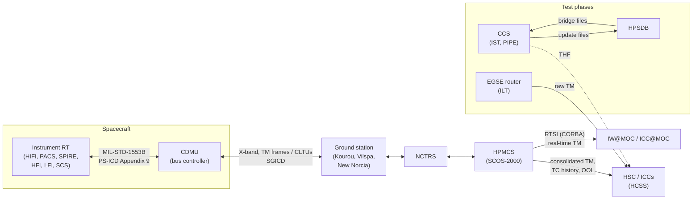
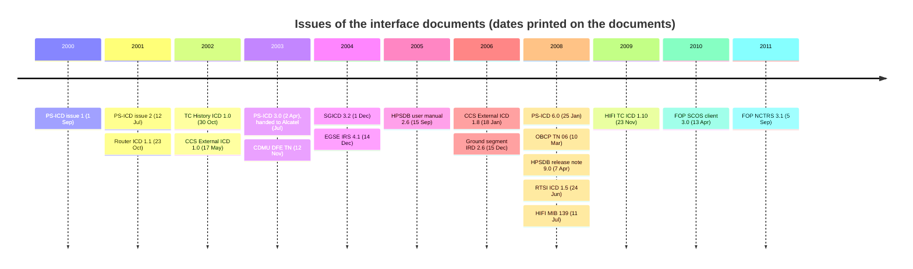
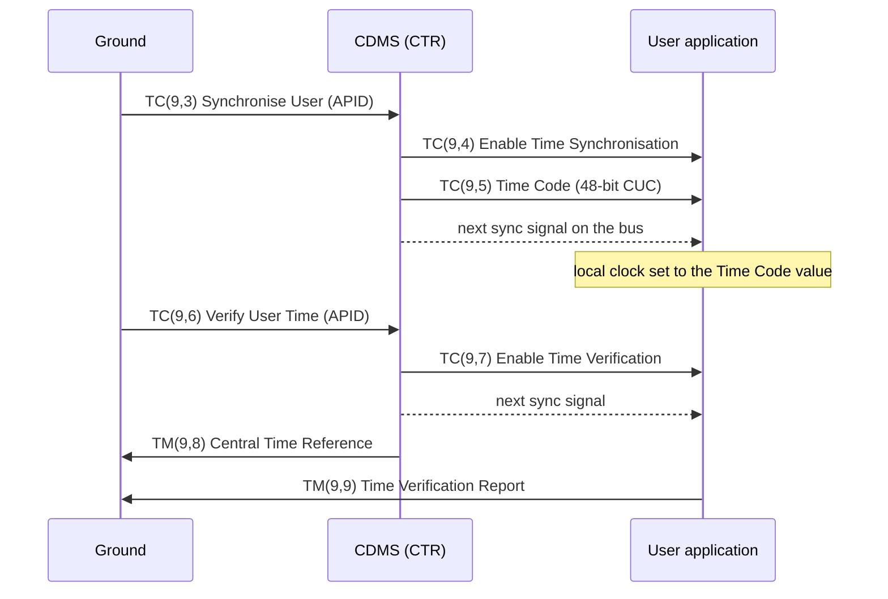
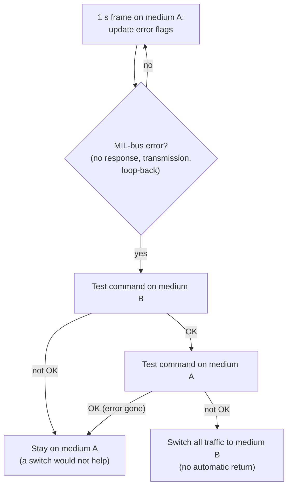
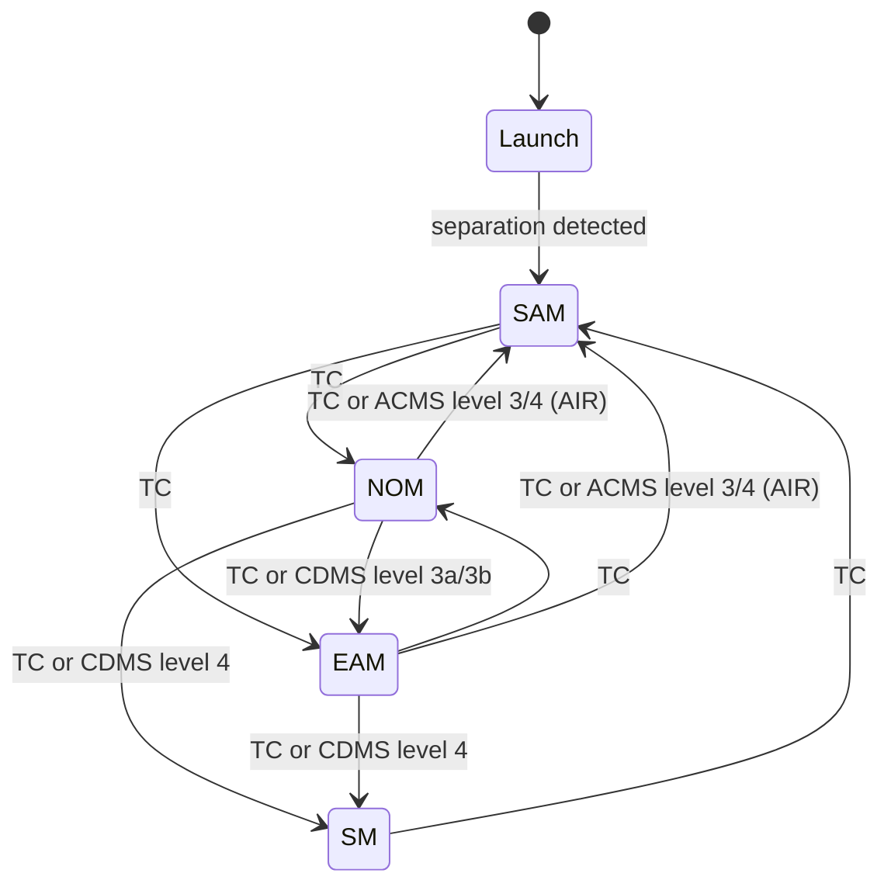
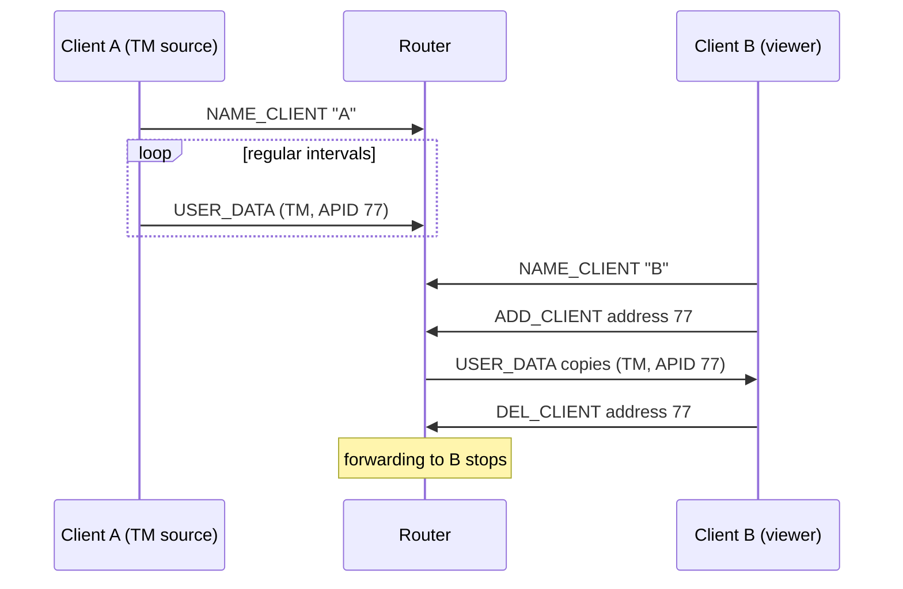
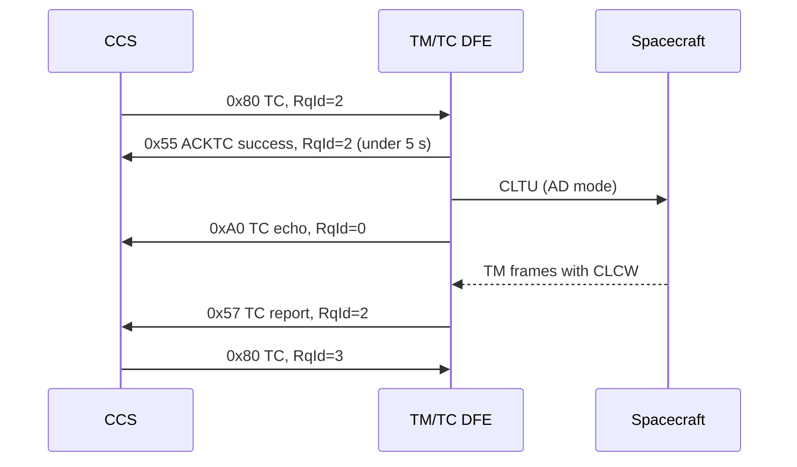
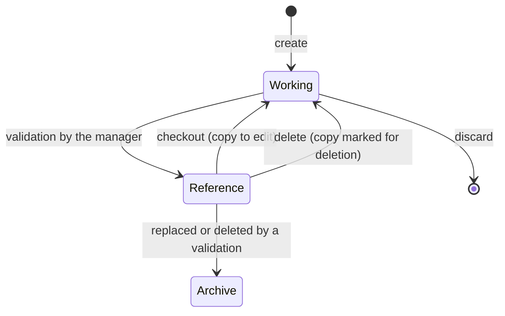

# Herschel/Planck interface documents: packets, ground links and the CCS

Herschel and Planck shared one prime contractor, one set of packet rules for both spacecraft and
their instruments, and one mission operations centre at ESOC.[^ps-scope][^ps-ops] This page reads
the set of Herschel/Planck interface control documents that the library now holds, from the
on-board packet layer to the operator's workstation at ESOC. The central document is the **Packet Structure Interface Control
Document** (PS-ICD, SCI-PT-ICD-07527), which fixes every telemetry and telecommand packet,
service, application process identifier and parameter type of both spacecraft, and also the
MIL-STD-1553B data bus protocol between the central computer and the instruments.[^ps-scope][^ps-a9]
Around it sit the **Space/Ground ICD** for the radio link and the transfer frames, the documents
of the test systems (the instrument teams' EGSE router, the PIPE protocol, the Central Checkout
System and the Herschel/Planck System Database), the HIFI instrument's telecommand and database documents, and
the ground segment interface documents that carried telemetry and command history to the science
centres.[^sg-scope][^irs-scope][^ird-scope]

The programme-level story (the decision of 2000 to build on [SCOS-2000](index.md), the HPSDB
naming convention, the HCSS tailoring of the [MIB](../mib/index.md)) is told on
[Herschel/Planck: SCOS-2000 in a science mission ground segment](herschel-planck-ground.md), and
the missions themselves on [Herschel and Planck](../missions/herschel-planck.md). This page goes
one level down, into the bits, bytes and message flows. Where the documents disagree with each
other, the page says so; a summary of the discrepancies is at the
[end](#consistency-across-the-documents).

!!! info "At a glance"
    * **Packets**: TC packets of at most 248 octets (228 when stored in the mission timeline),
      TM packets of at most 1024 octets, PUS version number 0, a 3-bit command source field inside
      the TC sequence count, and a 16-bit CRC on every packet.[^ps-tc][^ps-tm]
    * **APIDs**: one base APID per user; its four least significant bits separate essential
      housekeeping, routine housekeeping and science, and prime from redundant units.[^ps-a3]
    * **Link**: X-band up and down, 1115-octet transfer frames, Reed-Solomon (255,223) with
      interleave 5 plus convolutional coding, six virtual channels in use, COP-1 with AD and BD.[^sg-tmfr][^sg-coding][^sg-cop]
    * **Bus**: a 1 s frame of 64 subframes of 24 message slots; TM packets are pulled by the bus
      controller with a request/confirmation handshake.[^ps-a9-frame]
    * **Test systems**: a TCP router keyed on APID for instrument tests, the PIPE protocol
      (10-byte header, sync word `0xFADE`) between the CCS and every SCOE, and MIB extensions
      (`cur`, `grp`, `lgf`, delta limits) that later entered the standard SCOS-2000 import ICD.[^rtr-msg][^irs-hdr][^ccs-sum][^i70-hp]



!!! warning "Inference"
    The diagram is this wiki's assembly of the interfaces described in the documents on this
    page; no single document draws it. The ILT router, the CCS, the HPSDB and the MOC chain were
    in use at different times of the programme.[^rtr-purpose][^ccs-over][^rtsi-scope][^ird-scope]

## The document set

| Document | Reference, issue, date | Author organisation | What it fixes |
|---|---|---|---|
| Packet Structure ICD (PS-ICD) | SCI-PT-ICD-07527, issue 6.0, 25 January 2008 | ESA project, then Alcatel Space / Thales Alenia Space | All TM/TC packet structures, services, APIDs, parameter types, CRC, time and idle packets, 1553 bus protocol[^ps-cover][^ps-cr4] |
| Space/Ground ICD (SGICD) | SCI-PT-ICD-07418, issue 3.2, 1 December 2004 | ESA project (controller of the document) | RF, modulation, coding, ground stations, TM transfer frame, TC segment and frame[^sg-cover] |
| CDMU DFE TM/TC services | H-P-1-ASP-TN-0591, issue 1.0, 12 November 2003 | Alcatel Space, Cannes | Services simulated by the CDMU front end during payload module tests[^dfe-cover] |
| Payload Management and OBCP | H-P-1-ASP-TN-1072, issue 06, 10 March 2008 | Thales Alenia Space France | Payload OBCPs and event/action table entries of the CDMS software[^obcp-cover] |
| EGSE Packet Router ICD | SRON-G/HIFI/ICD/2001-001, issue 1.1, 23 October 2001 | SRON (HIFI) | TCP router for instrument level tests[^rtr-cover] |
| EGSE Interface Requirement Specification | H-P-1-ASPI-IS-0121, issue 4.1, 14 December 2004 | Prime contractor's EGSE team (author B. Dubois) | PIPE protocol between CCS, SCOEs, DFE and instrument stations[^irs-cr] |
| CCS External ICD | H-P-4-TE-ID-8020, issue 1.8, 18 January 2006 | Terma | CCS interfaces and its deviations from the SCOS-2000 import ICD 5.1[^ccs-cover] |
| HPSDB Software User Manual | H-P-1-GMV-MA-20487, version 2.6, 15 September 2005 | GMV | Use of the system database, bridge files, verification files[^um-cover] |
| HPSDB Release Note | H-P-2-ASP-LI-1441, issue 9.0, 7 April 2008 | Thales Alenia Space | One CCS database delivery (Herschel FM)[^rn-cover] |
| HIFI Telecommand packet structure ICD | SRON-U/HIFI/SP/2001-001, issue 1.10, 23 November 2009 | SRON | Every HIFI telecommand layout[^htc-cover] |
| HIFI User Manual Annex, MIB 139 (ASPI 11.7) | SRON-U/HIF/UM/2004-001 (Annex), issue 64, 11 July 2008 | SRON | Listing of the HIFI MIB: parameters, calibrations, packets[^hmib-cover] |
| Herschel Ground Segment IRD | FIRST/HSC/DOC/0117, issue 2.6, 15 December 2006 | HGSSE group | Interfaces between MOC, HSC, ICCs, HCSS, RTA, EGSE and CCS[^ird-cover] |
| TC History ICD | SPIRE-ICS-DOC-000900, issue 1.0, 30 October 2002 | SPIRE ICS (prepared by M. J. Graham, agreed by the three instrument teams and the HSC) | The TC history file (THF) ingested by the HCSS[^thf-cover] |
| HPMCS Science Ground Segment Real-Time Telemetry ICD | PT-CMOC-MDS-ICD-3101-OPS-GDS, issue 1.5, 24 June 2008 | HPMCS Development Team (Terma document reference TERMA/SPD/63/HPMCS/TS/ICD/RTSI) | Real-time packet delivery to the instrument workstations at ESOC[^rtsi-cover] |
| FOP procedure C_GSP_MCS_SCOS | PT-HMOC-OPS-FOP-6001-OPS-OAH, FOP issue 3.0, 13 April 2010 | Herschel/Planck MOC (author F. Keck) | Starting and stopping an HPMCS client[^fop-scos-sum] |
| FOP procedure C_GSP_MCS_NCTRS | PT-HMOC-OPS-FOP-6001-OPS-OAH, FOP issue 3.1, 5 September 2011 | Herschel/Planck MOC (author F. Keck) | Starting and stopping the NCTRS of each mission[^fop-nctrs-sum] |

The mission page summarises the PS-ICD for the mission's databases and compares it with the
headers restated by the HIFI test-equipment ICD
([that section](../missions/herschel-planck.md#the-packets-as-seen-by-instrument-test-equipment));
this page reads the full specification.



The dates come from the cover pages and change records cited in the table above.[^ps-cr4][^ccs-cover][^rtr-cover]

## The Packet Structure ICD

### Status and history

The PS-ICD complements the ESA Packet Telemetry and Packet Telecommand standards
([PSS-04-106 and PSS-04-107](../overview/history.md)) with "all the mission specific details" of
the data transfer between ground and on-board applications. Being tailored for Herschel/Planck, it
states that it **supersedes** the Packet Utilisation Standard ECSS-E-70-41A, which it lists only as
a reference document. Requirement 1000-GEN makes it exhaustive: the space and ground segment shall
support all and only the structures and services it defines.[^ps-scope] The document is agreed by the
ESA project manager, the ESOC representative and the prime contractor, and then controlled by the
prime contractor.[^ps-scope] Requirements carry identifiers (for example 3000-TC, 5050-TCV) and
point to their parent requirement in the Operations Interface Requirements Document (OIRD,
SCI-PT-RS-07360) with tags such as `[P:SCI-PT-RS-07360#3.1-PACK-14`.[^ps-scope]

| Issue | Date | Main change |
|---|---|---|
| 1 | 1 September 2000 | New issue[^ps-cr1] |
| 2 | 12 July 2001 | Update after the review with instruments, ESA and industry at the start of phase B, and a CCB decision[^ps-cr1] |
| 3 draft 2 / 3.0 | 12 November 2002 / 2 April 2003 | Requirement identifiers; source identifier extended; usable MTL TC size 228 octets; event sequence counter; OBCP dump; Appendix 6 PTC and PFC widened to 8 bits; essential HK on base APID[^ps-cr1][^ps-cr2] |
| 4 draft 0 | 25 July 2003 | First issue after hand-over to Alcatel Space, limited to the basic software consolidation plan[^ps-cr3] |
| 4 draft 1 | 4 November 2003 | Updates after the PS-ICD review of 11 September 2003; the document becomes the "actual building block" for spacecraft operation[^ps-cr4] |
| 4.0 | 7 November 2003 | Formal release generated from the DOORS requirements database; no text change since draft 1 except a typo fix in 5261-PERP and a deleted sentence in 5180-PERP[^ps-cr40] |
| 5.0 | 20 July 2004 | Open points of issue 4.0 settled between ESA and the prime (minutes H-P-ASP-MN-5160); upward traceability to the OIRD added to every requirement; packet type and subtype in every section title[^ps-cr50] |
| 6.draftA | 17 December 2007 | Clarifications on periods, MTL deletion, OBCP status report, APIDs after Data Management Working Group 23 and PACS NCR 3746[^ps-cr6a][^ps-cr6b] |
| 6.0 | 25 January 2008 | Formal release; MTL release rules for N = 0 and wild-card subschedule; removal of real format (5,3)[^ps-cr60] |

The distribution list shows the reach of the document: the ESA project and ESOC, the Alcatel
Alenia Space France team, the HIFI, PACS, SPIRE, HFI and LFI teams, Alcatel Alenia Space Italia,
Astrium and Terma.[^ps-dist]

### Operations scenario

The PS-ICD's scenario explains why its services look the way they do. Most telecommands are
stored on board and released at a defined time by the on-board scheduling service, from a
**Mission Timeline** (MTL): a linear sequence of time-tagged commands, loaded during each daily
communication period, that controls the satellites for up to 48 hours. Function management and
on-board control procedures (OBCPs) handle longer activities, and OBCPs "shall be kept simple".[^ps-ops][^ps-gloss2]
Every telecommand is verified by a TC verification report at acceptance (1010-GEN); progress
and completion may be reported by verification packets or by housekeeping.[^ps-ops] The Command
and Data Management System (CDMS) routes all packets and is the controller of the on-board serial
data bus.[^ps-ops2]

### Telecommand packet

All telecommand packets follow PSS-04-107 with the following mission rules (3000-TC, 3010-TC):[^ps-tc]

<div class="bitfield" data-title="Herschel/Planck TC packet primary header (48 bits)" data-width="16"
     data-fields='[{"n":"Version","b":3,"v":"000"},{"n":"Type","b":1,"v":"1"},{"n":"DFH flag","b":1,"d":"1 for all commands except the Standard Distribute CPDU command TC(2,3)"},{"n":"APID","b":11,"d":"Destination application process, Appendix 3"},{"n":"Seq. flags","b":2,"v":"11","d":"Stand-alone packet"},{"n":"Source","b":3,"g":"Sequence count","d":"Command source, see table"},{"n":"Sequence part","b":11,"g":"Sequence count","d":"Per source and APID, wraps to 0"},{"n":"Packet length","b":16,"d":"Octets in packet data field minus 1, always odd, at most 241"}]'></div>

<div class="bitfield" data-title="TC data field header (32 bits)" data-width="16"
     data-fields='[{"n":"CCSDS sec. hdr flag","b":1,"v":"0"},{"n":"PUS version","b":3,"v":"000","d":"Only version 0 is permitted"},{"n":"Ack","b":4,"d":"bit 3 acceptance, bit 2 start, bit 1 progress, bit 0 completion"},{"n":"Packet type","b":8},{"n":"Packet subtype","b":8},{"n":"Spare","b":8,"v":"00000000"}]'></div>

The packet ends with a 16-bit Packet Error Control field (see [the CRC](#packet-error-control)).[^ps-tc]

| Field | Bits | Values | Meaning |
|---|---|---|---|
| Version | 3 | `0b000` | Required for all commands |
| Type | 1 | 1 | Telecommand |
| Data field header flag | 1 | 1 | Only TC(2,3), the Standard Distribute CPDU command, has no data field header, so its type and subtype are not in the packet |
| APID | 11 | Appendix 3 | Application or unit addressed |
| Sequence flags | 2 | `0b11` | All telecommands are stand-alone packets |
| Source part | 3 | see below | Generator of the command |
| Sequence part | 11 | 0 to 2047 | Incremented by the source for each command to that APID; wraps to 0; never checked for monotony by the receiver |
| Packet length | 16 | odd, ≤ 241 | Data field length minus one; the data field is a whole number of 16-bit words |
| CCSDS secondary header flag | 1 | 0 | "Non-CCSDS defined" secondary header |
| PUS version | 3 | 0 | Only version 0 allowed |
| Ack | 4 | bit 3 to bit 0 | Requests for success reports; failure reports are always generated |
| Type, subtype | 8 + 8 | Appendix 2 | Unique across all application processes |
| Spare | 8 | 0 | Pads the header to two words |

The 3-bit **source part** is the mission's way to trace who released a command, which matters
because one instrument can receive commands from ground, the timeline, OBCPs and FDIR:[^ps-tc]

| Source | Meaning |
|---|---|
| `000` | Ground, highest priority, all sources |
| `001` | FDIR telecommands of the CDMU |
| `010` | Mission Time Line (maintained by ground, executed by the CDMU) |
| `011` | On-board control procedures (executed by the CDMU) |
| `100` | Ground, low priority, all sources |
| `101` | FDIR telecommands of the ACC |
| `110` | CDMU, other on-board sources |
| `111` | ACMS, other on-board sources |

When an acknowledgement is requested, the verification report must copy the full sequence control
word as the identifier of the command.[^ps-tc] The Ack bits use the CCSDS numbering, so the
acceptance request is the **last** bit of the field (`---1`). Ground sets it nominally; when it is
cleared, the application still performs the acceptance checks but does not send the TM(1,1)
success report.[^ps-tc2]

**Length limits.** The packet data field holds at most 242 octets, so a TC packet is at most 248
octets. Because almost all commands are executed from the MTL, they are wrapped as a variable octet
string inside TC(11,4), which leaves 228 octets for the embedded packet and 216 octets for its
application data.[^ps-tc][^ps-mtl-ins] Commands stored as event/action actions are limited to 232
octets (220 of application data), and an OBCP load segment carries at most 232 octets of code.[^ps-ea][^ps-obcp-load]

### Telemetry packet

Telemetry packets follow PSS-04-106 (4000-TM, 4010-TM); for the version number the PS-ICD
declares itself consistent with CCSDS 102.0-B-4 and superseding PSS-04-106:[^ps-tm][^ps-tm2]

<div class="bitfield" data-title="Herschel/Planck TM packet primary header (48 bits)" data-width="16"
     data-fields='[{"n":"Version","b":3,"v":"000","d":"Ground rejects other values with an alarm"},{"n":"Type","b":1,"v":"0"},{"n":"DFH flag","b":1,"d":"1, except 0 for time and idle packets"},{"n":"APID","b":11,"d":"Base APID plus category offset"},{"n":"Grouping flags","b":2,"d":"11, or 01/00/10 for groups of TM(21,x) science packets"},{"n":"Source sequence count","b":14,"d":"Per APID, incremented for each packet released"},{"n":"Packet length","b":16,"d":"Data field octets minus 1, odd, at most 1017"}]'></div>

<div class="bitfield" data-title="TM data field header (80 bits)" data-width="16"
     data-fields='[{"n":"Spare","b":1,"v":"0"},{"n":"PUS version","b":3,"v":"000"},{"n":"Spare","b":4,"v":"0000"},{"n":"Packet type","b":8},{"n":"Packet subtype","b":8},{"n":"Spare","b":8,"v":"00000000"},{"n":"Coarse time","b":32,"g":"Time (CUC, PTC 9 PFC 17)","d":"Seconds"},{"n":"Fine time","b":16,"g":"Time (CUC, PTC 9 PFC 17)","d":"Binary fraction of a second"}]'></div>

| Field | Bits | Values | Meaning |
|---|---|---|---|
| Grouping flags | 2 | `0b11` | No segmentation; only science packets TM(21,x) may mark groups: `01` first, `00` continuation, `10` last; neither the on-board system nor the ESA ground system supports groups, so users handle them |
| Source sequence count | 14 | 0 to 16383 | One counter per APID, so the ground can detect missing packets |
| Packet length | 16 | odd, ≤ 1017 | Data field at most 1018 octets, packet at most 1024 octets |
| Spare (first bit) | 1 | 0 | Symmetry with the TC header |
| PUS version | 3 | 0 | Only version 0 allowed |
| Time | 48 | CUC | Local on-board time; its relation to data generation is fixed per type and subtype of each application |
| Packet Error Control | 16 | CRC | Present for the whole mission for all applications |

Sources: §4.1.[^ps-tm][^ps-tm2]

!!! note "PUS version 0"
    ECSS-E-70-41A (2003) tells its users to set the TC and TM PUS version number to 1.[^pusa-ver]
    The PS-ICD keeps version 0, the value of the earlier ESA PUS, in both headers.[^ps-tc][^ps-tm2]
    See [PUS-A vs PUS-C](../ecss/pus/pus-a-vs-pus-c.md) and [PUS packet structures](../ecss/pus/packets.md).

### On-board verification of telemetry

Some TM packets are consumed on board, for example by the event/action service, so the CDMU and
the ACC check them before use. Requirement 4020-TM lists the checks with
failure codes that match the TC acceptance codes: 2 for the packet error control, 1 for the
length, 0 for an illegal APID, 3 for the type and 4 for the subtype; science packets of service 21
are exempt. A failed packet produces a type 5 event with the code and at least 4 octets of the
faulty packet, its data are not used on board, and the packet goes to ground on its usual virtual
channel, or on VC4 if its APID, type or subtype cannot be identified.[^ps-tmver]

### Conventions and field alignment

Bit 0 is the first transmitted bit and the most significant bit of an unsigned field; for a
signed field, bit 0 is the sign.[^ps-a1] The alignment rules of Appendix 1 shape every layout on
this page:[^ps-a1]

1. A parameter of 16 bits or more is word aligned (its LSB on a word boundary).
2. A parameter shorter than 16 bits never crosses a word boundary.
3. Short parameters are right-adjusted in their 16-bit word, with padding in the most
   significant bits.
4. Several short parameters in one word are right-adjusted together.

A consequence appears in the housekeeping report: 8-bit parameters are grouped by pairs in a word,
so an odd sequence of them gets a spare octet before its last member.[^ps-hk-rep] Type and subtype
numbers are written as two numbers, TC(1,1) or TM(1,2), and the numbering of types is chosen to
pair TCs with their reports, so it is not contiguous.[^ps-a1b]

### Parameter types

Appendix 6 defines the only parameter types allowed in packets. The parameter code is a pair
(PTC, PFC) of two 8-bit numbers (the 8-bit widths date from issue 3).[^ps-a6][^ps-cr2] Compare
the [PUS parameter types](../ecss/pus/parameter-types.md) and
[MIB parameter types](../mib/parameter-types.md).

| PTC | Type | PFC values and lengths | Notes |
|---|---|---|---|
| 1 | Boolean | PFC 0: 1 bit | 0 false, 1 true |
| 2 | Enumerated | PFC 1-8, 12, 16, 32: that many bits | Discrete, unordered values such as error codes |
| 3 | Unsigned integer | PFC 0-11: 4 to 15 bits; 12: 2 octets; 13: 3 octets; 14: 4 octets | |
| 4 | Signed integer | Same lengths as PTC 3 | |
| 5 | Real | PFC 1: 32-bit IEEE 754 single; PFC 2: 64-bit IEEE double | PFC 1 is also the internal format of the DSP21020; PFC 3 (MIL-STD-1750A) removed in issue 6.0 |
| 6 | Bit string | PFC 1, 2, 4, 8 bits | |
| 7 | Octet string | PFC 0 variable (with length), PFC > 0 fixed | Cannot be edited by the operator; a TC or TM packet carried as a variable octet string uses its own packet length instead of a length field |
| 8 | Character string | PFC 0 variable, PFC > 0 fixed | On board only for the PROM software version identifier; SCOE/EGSE may use it freely |
| 9 | Absolute time | PFC 17: 6 octets, 4 coarse + 2 fine | CUC without P-field, synchronised to TAI |
| 10 | Relative time | – | Not used |
| 11 | Deduced | PFC 0 | Type taken from a preceding field; used for OBCP parameters in TM(18,13), which are 32 bits except 64 bits for double reals |

Sources: Appendix 6 §A6-2 to A6-3.10.[^ps-a6][^ps-a6b][^ps-cr60]

A unit that cannot provide a time synchronised with the Central Time Reference (CTR) sets the most
significant bit of its time field to 1; the rest of the field then has a user-specific meaning.[^ps-a6b]

### Packet error control

The 16-bit packet check sequence is a CRC with generator $G(x) = x^{16} + x^{12} + x^5 + 1$
(CCITT V.41), encoder and decoder preset to all ones, computed over the whole packet except the
last 16 bits. The same algorithm checks memory blocks in service 6. For blocks shorter than
32768 bits it detects all odd numbers of bit errors, all double errors and all single bursts of
up to 16 bits.[^ps-a4] Appendix 4 gives test vectors (hexadecimal, real values from the source):[^ps-a4b]

| Data | Packet check sequence |
|---|---|
| `00 00` | `1D 0F` |
| `00 00 00` | `CC 9C` |
| `AB CD EF 01` | `04 A2` |
| `14 56 F8 9A 00 01` | `7F D5` |

!!! tip "Checked by this wiki"
    A bit-wise implementation of this CRC (polynomial `0x1021`, initial value `0xFFFF`, no
    reflection, no final XOR) reproduces all four vectors. The check is this wiki's, run with
    Python on 2026-11-12; the worked example [further down](#pipe-the-ccs-protocol-for-scoes-and-instrument-stations)
    uses the same implementation.

### APID assignment

Appendix 3 gives every user a **base APID** in the most significant bits and uses the four least
significant bits to tell packet categories and prime or redundant units apart, so part of the
packet identification needs no decoding of the data field header. The project office manages the
allocation, and one range is reserved for test equipment.[^ps-a3]

<div class="bitfield" data-title="Structure of a Herschel/Planck APID (11 bits)" data-width="16"
     data-fields='[{"n":"Base address","b":7,"d":"Identifies the instrument or subsystem"},{"n":"Category / side","b":4,"d":"Offset: essential or routine HK, science, prime or redundant"}]'></div>

| APID (dec) | Hex | TC packets | TM packets |
|---|---|---|---|
| 0 | `0x000` | Standard Distribute CPDU commands | Standard spacecraft time packet |
| 16 (BA) | `0x010` | All CDMS commands | All CDMS TM except routine HK and diagnostic reports |
| 18 (BA+2) | `0x012` | – | CDMS routine (non-essential) HK and diagnostic reports |
| 512 / 514 | `0x200` / `0x202` | All ACMS commands (512) | As for the CDMS |
| 1024 / 1025 | `0x400` / `0x401` | All HIFI commands (1024) | HIFI prime / redundant, except routine HK, diagnostics and science |
| 1026 / 1027 | `0x402` / `0x403` | – | HIFI prime / redundant routine HK and diagnostics |
| 1028-1031 | `0x404`-`0x407` | – | HIFI science TM(21,x), prime and redundant |
| 1152-1155 | `0x480`-`0x483` | All PACS commands (1152) | As for HIFI (prime, redundant, HK, HK) |
| 1158 / 1159 | `0x486` / `0x487` | – | PACS diagnostic science TM(21,3), prime / redundant |
| 1160, 1162 / 1161, 1163 | `0x488`, `0x48A` / `0x489`, `0x48B` | – | PACS science, prime / redundant |
| 1280-1283 | `0x500`-`0x503` | All SPIRE commands (1280) | As for HIFI |
| 1284, 1286, 1288 / 1285, 1287, 1289 | `0x504`... / `0x505`... | – | SPIRE science, prime / redundant |
| 1408-1411 | `0x580`-`0x583` | All HFI commands (1408) | As for HIFI |
| 1412, 1414 / 1413, 1415 | `0x584`, `0x586` / `0x585`, `0x587` | – | HFI science, prime / redundant |
| 1536 / 1538 / 1540 | `0x600` / `0x602` / `0x604` | All LFI commands (1536) | LFI (prime and redundant share APIDs): other TM / routine HK / science |
| 1664-1667 | `0x680`-`0x683` | All SCS commands (1664) | Sorption cooler prime, redundant, HK, HK |
| 2016-2046 | `0x7E0`-`0x7FE` | SCOE / EGSE reserved | SCOE / EGSE reserved |
| 2047 | `0x7FF` | – | Idle packets |

Source: Table A-3.1.[^ps-a3b]

Table A-3.2 then maps each TM packet type to an APID offset and a **real-time virtual channel**:
time packets on VC0 from APID 0; all service reports, events and the *essential* housekeeping
report TM(3,25) on the base APID and VC0 (base + 1 for a redundant instrument); the *routine*
TM(3,25) and the diagnostic report TM(3,26) on base + 2 and VC4 (base + 3 when redundant);
science TM(21,1) to TM(21,4) on the APIDs of Table A-3.1 and VC1. Stored packets are dumped on the
VC of their packet store, with VC3 recommended for science stores and VC2 for the others; idle and
time packets are never stored.[^ps-a3c] Issue 3 introduced the rule that essential housekeeping
gets "Base-APID + 0" and the highest priority.[^ps-cr2]

!!! example "Cross-check in other documents (real values)"
    The HIFI telecommand ICD states that the HIFI on-board software can only have APID 1024.[^htc-hdr]
    The HPMCS template client filters on APID `0x604`, commented as "LFI scientific packets",
    which is the LFI science APID of Table A-3.1.[^rtsi-filter] The 2008 HPSDB release note
    lists a calibration curve that maps the APIDs 16, 512, 1024/1025, 1152/1153 and 1280/1281 to
    CDMS, ACMS and the nominal and redundant sides of HIFI, PACS and SPIRE.[^rn-ncr]

### Time packet and idle packet

The **Standard Spacecraft Time Source Packet** carries spacecraft elapsed time to ground for
correlation with UTC. It has no data field header, APID 0 and an 8-octet data field (packet length
field 7). Its time refers to the leading edge of the first bit of the attached sync marker of the
VC0 transfer frame whose VC frame count is 0 modulo 64. Its sequence count wraps from $2^{14}-1$ to
0 and must never "short-cycle".[^ps-a7]

<div class="bitfield" data-title="Standard spacecraft time packet data field (64 bits)" data-width="32"
     data-fields='[{"n":"S-field spare","b":4,"v":"0000"},{"n":"S-field rate","b":4,"d":"Generation frequency of the time packet"},{"n":"P-field","b":8,"v":"00101110","d":"4 coarse and 2 fine octets"},{"n":"T-field coarse time","b":32,"d":"Seconds, unsegmented binary count"},{"n":"T-field fine time","b":16,"d":"Binary fraction of a second"}]'></div>

The P-field value `0b00101110` reads, in the CCSDS rules, as no extension, time code identification
`010` (agency-defined epoch, level 2), $3 + 1 = 4$ octets of seconds and 2 octets of fraction.[^ps-a7][^c301-p]
The same P-field byte reappears in the time broadcast on the on-board bus (see
[below](#the-satellite-data-bus-appendix-9)), and the EGSE interface specification gives the
EGSE CUC time a TAI epoch of 1958 January 1.[^ps-a9-time][^irs-rm] See
[Time code formats](../ccsds/time-codes.md) and [Time correlation in SCOS-2000](time-correlation.md).

The **idle packet** fills a frame when not enough source packets are available: APID `0x7FF`,
no data field header, sequence flags `11`, sequence count fixed at `0x0000`, free length and a
pseudo-random data field.[^ps-a8]

### The services

Table 2-1 lists the services and where they are implemented. No other services are foreseen for
the missions, and each unit implements only an agreed subset, recorded in its user manual and in
Table A-2.1.[^ps-svc]

| Service | Name in the PS-ICD | CDMS | ACMS | Instruments | Page |
|---|---|---|---|---|---|
| 1 | Telecommand Verification | Yes | Yes | Yes | [ST[01]](../ecss/pus/st01-request-verification.md) |
| 2 | Device Command Distribution | Yes | Yes | No | [ST[02]](../ecss/pus/st02-device-access.md) |
| 3 | Housekeeping and Diagnostic Data Reporting | Yes | Yes | Yes | [ST[03]](../ecss/pus/st03-housekeeping.md) |
| 5 | Event Reporting | Yes | Yes | Yes | [ST[05]](../ecss/pus/st05-event-reporting.md) |
| 6 | Memory Management | Yes | Yes | Yes | [ST[06]](../ecss/pus/st06-memory-management.md) |
| 8 | Function Management | Yes | Yes | Optional | [ST[08]](../ecss/pus/st08-function-management.md) |
| 9 | Time Management | Yes | Yes | Yes | [ST[09]](../ecss/pus/st09-time-management.md) |
| 11 | On-board Operations Scheduling | Yes | No | No | [ST[11]](../ecss/pus/st11-time-based-scheduling.md) |
| 12 | On-board Monitoring | Yes | Optional | Optional | [ST[12]](../ecss/pus/st12-onboard-monitoring.md) |
| 14 | Packet Transmission Control | Yes | Yes | Yes | [ST[14]](../ecss/pus/st14-real-time-forwarding-control.md) |
| 15 | On-board Storage and Retrieval | Yes | No | No | [ST[15]](../ecss/pus/st15-onboard-storage-retrieval.md) |
| 16 | On-board Traffic Management | Yes | No | No | – |
| 17 | Test | Yes | Yes | Yes | [ST[17]](../ecss/pus/st17-test.md) |
| 18 | On-board Control Procedure | Yes | No | Optional | [ST[18]](../ecss/pus/st18-onboard-operations-procedure.md) |
| 19 | Event/Action | Yes | Optional | No | [ST[19]](../ecss/pus/st19-event-action.md) |
| 21 | Science Data Transfer | No | No | Yes | – |
| 4, 7, 10, 13, 20, 22 | Not used | – | – | – | – |

Services 20 (information distribution) and 22 (context saving) are kept as headings marked "not
used": the requirements of service 20 are all deleted, and context saving was deleted as a
service in issue 3.[^ps-svc][^ps-s20][^ps-cr2] The rest of this section lists, service by service,
the rules that are specific to Herschel/Planck.

#### Service 1: telecommand verification

* The report carries the APID of the application that generates it (5020-TCV).[^ps-s1]
* An acceptance success report TM(1,1) is sent within 2 seconds of reception (5050-TCV).[^ps-s1]
* TM(1,1), TM(1,3) and TM(1,7) carry the TC packet ID (2 octets) and sequence control
  (2 octets); TM(1,5) adds a 2-octet step number; TM(1,2) and TM(1,8) add a 2-octet failure code and
  optional parameters.[^ps-s1b][^ps-s1c]
* Standard acceptance failure codes: 0 illegal APID, 1 incomplete or invalid length, 2 incorrect
  checksum, 3 illegal type, 4 illegal subtype, 5 illegal or inconsistent application data; 16 to
  65535 are application-specific and need ESA and prime approval. The parameter field is a whole
  number of words, at least 4 octets; for a header error the complete header, for a CRC error the
  complete CRC is reported.[^ps-s1c]
* **TM(1,9) Telecommand Contents Report** is mandatory for the CDMU and ACC: every command
  released by an on-board source (timeline, OBCP, FDIR) is copied into a TM(1,9) and stored in the
  solid state mass memory, because the ground cannot otherwise know what was executed.[^ps-s1][^ps-s1d]

#### Service 2: device commands

TC(2,1) carries 1 to 8 pulse command addresses, TC(2,2) 1 to 8 register address/data pairs.[^ps-s2]
The CPDU command TC(2,3) carries pairs of an 8-bit output line identifier and an octet with 5 spare
bits and a 3-bit duration $D$; the pulse lasts $13\ \text{ms} \times 2^{D}$, from 13 ms ($D=0$) to
1664 ms ($D=7$). The "Standard" version, without data field header, is executed directly by the TC
decoder with 1 to 120 pulse instructions; the "Mission specific" version goes through the
on-board software and carries 1 to 8.[^ps-s2b]

#### Service 3: housekeeping and diagnostics

Each unit sends one nominal HK packet at a default period, plus **essential HK packets** on the
base APID sized for the worst link conditions.[^ps-s3] All periods are powers of two of the unit's
**basic sampling period**: the packet period is $2^{n}$ times it ($n \ge 0$), and a
**super-commutated** parameter appears $2^{k}$ times consecutively at the end of the report and is
sampled correspondingly faster, which gives it a reporting period shorter than the basic sampling
period.[^ps-s3] A Structure Identifier (SID) implicitly defines all sampling
and structure of a packet.[^ps-s3]

TC(3,1) and TC(3,2) define a report with an HK packet ID (16 bits), SID (16), sampling interval
(16), segment ID (8), N (8) and N parameter IDs (16 bits each). Long definitions are split into
segments 1 to K (at most 254) and closed by a segment `0xFF` with N = 0; a single-packet definition
uses segment 0. One TC carries at most 114 parameter IDs. For the CDMS and ACMS a dedicated
**USD-ID** turns a "parameter" into a RAM area (start address MSB, LSB, length), at most 28 per
TC.[^ps-s3b][^ps-s3c] Redefinition requires the old entry to be cleared, keeps the APID and real-time
VC implied by the HK packet ID, and disables the packet meanwhile; TC(3,3) and TC(3,4) clear
definitions and disable generation as TC(14,2) would; TC(3,9) and TC(3,11) ask for TM(3,10) and
TM(3,12).[^ps-s3][^ps-s3c] The reports TM(3,25) and TM(3,26) contain a 16-bit SID, the parameters and
an optional spare octet for word alignment.[^ps-hk-rep]

#### Service 5: event reporting

Three subtypes route events by severity: TM(5,1) for information and warnings, TM(5,2)
**exception reports** when an on-board recovery procedure exists (the CDMS may modify the MTL or
start an OBCP), and TM(5,4) **error/alarm reports** when only ground can intervene.[^ps-s5]

<div class="bitfield" data-title="TM(5,1), (5,2), (5,4) source data (fixed part, 112 bits)" data-width="16"
     data-fields='[{"n":"Event ID","b":16},{"n":"SID","b":16,"d":"May be declared spare or do not care"},{"n":"Parameters A","b":64,"d":"Fixed 8 octets, defined in the unit user manual"},{"n":"Event sequence counter","b":16,"d":"Per application and per subtype"}]'></div>

An optional variable Parameters B field follows. The design goal is that the event ID alone
determines the layout.[^ps-s5b] Routine, especially cyclic, software functions shall not need TC
verification reports, and events that only show normal software progress need ESA and prime
approval.[^ps-s5]

#### Service 6: memory management

The service is a last resort, used only when a memory location cannot be reached by nominal means.
Addresses count in **Smallest Addressable Units** (SAU) of 8, 16, 32 or 48 bits, defined per unit;
the memory ID and start address together give the absolute address, and their combination may
extend the 16-bit address for the CDMS and ACMS.[^ps-s6] TC(6,2) loads (memory ID 16, start address
16, spare 8, N 8, data, optional pad octet, CRC 16 over the unpadded data), with at most 228 octets
of data; the unit writes, reads back and compares before reporting TM(1,7) or TM(1,8). TC(6,5) and
TC(6,9) dump and check (memory ID, start, N), TC(6,11) aborts a dump, and TM(6,6) and TM(6,10)
return data (at most 1016 octets per packet) or a CRC; a star-tracker dump has its own data
layout.[^ps-s6b][^ps-s6c]

#### Service 8: function management

TC(8,1) starts a function (FID 8 bits, spare 8, SID 16, parameters), TC(8,2) stops it, TC(8,4)
performs an activity (FID, activity ID, SID, parameters), TC(8,5) asks for the TM(8,6) status
report.[^ps-s8] Starting an active function or stopping a stopped one is rejected with TM(1,2), and
an activity on a stopped function is rejected too. The split between TC(8,1) and TC(8,4) supports an
"Arm-Fire" pattern, and critical functions should terminate by themselves.[^ps-s8][^ps-s8b] The
design goal again is one fixed parameter set per FID and activity, so the SID can be "don't care".[^ps-s8b]
Table A-2.1 also lists TM(8,7) SREM data, TM(8,8) VMC data and TM(8,9) mass memory dump
reports, each for a single user.[^ps-a2b]

#### Service 9: time management

The CDMS holds the Central Time Reference (CTR). It synchronises a user by sending it TC(9,4)
Enable Time Synchronisation and TC(9,5) Time Code (48 bits); the user sets its clock at the next
synchronisation signal on the bus. Ground triggers the procedure with TC(9,3) Synchronise User
(5 spare bits and the user's 11-bit APID). It verifies a user with TC(9,6), on which the CDMS sends
TC(9,7) to the user; at the next sync signal the CDMS reports TM(9,8) (the CTR) and the user
TM(9,9) (its own clock). Ground resets the CTR itself
with TC(9,10), which carries the old time at which to switch and the new time.[^ps-s9][^ps-s9b]
Neither the clocks nor the time-tagging may ever stop (5490-OBTM).[^ps-s9]



The diagram follows §5.9. Table A-2.1 sets the procedure per user: TC(9,4) alone for the ACMS and
HFI, TC(9,4) and TC(9,5) for LFI and the sorption cooler (SCS), and neither for HIFI, PACS and
SPIRE, for which §5.9.1.1 says that TC(9,3) is rejected. All except the CDMS answer TC(9,7) with
TM(9,9).[^ps-s9][^ps-s9b][^ps-a2b]

#### Service 11: the mission timeline

The MTL supports **subschedules**: groups of commands for one activity (an attitude manoeuvre,
an instrument observation) that can be enabled, disabled or deleted without touching the rest.
Subschedule ID 0 addresses the whole timeline in every service 11 command except TC(11,4), so real
subschedules use 1 to 4095; IDs up to a compile-time `PermSubSchMaxId` are **permanent**, higher
ones **transient**. An error on one release does not stop the timeline.[^ps-s11]

* TC(11,1) and TC(11,2) enable or disable release by N subschedule IDs and M APIDs; N = 0 means "not
  by subschedule", N = 1 with ID 0 means all subschedules. Each change is reported with a TM(5,1).[^ps-s11b][^ps-cr60]
* TC(11,3) resets the schedule.[^ps-s11b]
* TC(11,4) inserts one command: a 48-bit absolute time tag, a 16-bit subschedule ID and the TC
  packet as a variable octet string, whose source field must be `010`.[^ps-mtl-ins]
* TC(11,5) deletes a sequence identified by subschedule, APID, time tag and sequence control,
  plus a count; TC(11,6) deletes between two time tags.[^ps-s11c]
* TC(11,9)/(11,11) give the detailed report TM(11,10), TC(11,12)/(11,14) the summary TM(11,13), and
  TC(11,18) the status report TM(11,19).[^ps-a2c]

The OBCP note shows the subschedules in use: its datapool list gives every instrument a command
subschedule, and SPIRE, LFI and the sorption cooler electronics also a "meta" subschedule (SPIRE
defaults 370 and 100). A SPIRE recovery OBCP disables both SPIRE subschedules with TC(11,2)
(N = 2, M = 0).[^obcp-spire1][^obcp-dp]

#### Service 12: on-board monitoring

The CDMS keeps a monitoring list of check definitions per parameter, and reports every checking
status transition, both out of and back into range. The default number of consecutive samples for
a transition is 3, and the basic monitoring period is a negative power of two of the basic sampling
period.[^ps-s12] TC(12,5) adds or modifies entries with, for each one: parameter ID, monitoring ID,
monitoring status, monitoring interval (1 to 65535), repetition number, a 16-bit check value, a
16-bit mask, a check type and two event IDs.[^ps-s12b] The parameter is right-aligned and ANDed with
the mask before comparison. The check types are bit values: 1 equal, 2 greater, 4 less, 8 not
equal, 16 greater or equal, 32 less or equal, each with an expected result of FALSE. A transition to
OUT_OF_RANGE generates TM(5,2) with Event-ID-1, the return generates TM(5,1) with Event-ID-2, and
monitoring event IDs are above 32767.[^ps-s12c][^ps-s12d] Compare the ground-side
[monitoring checks in the MIB](../mib/monitoring-checks.md).

#### Services 14 to 17

* **Service 14** enables and disables TM packets by type, subtype and packet ID (TC(14,1)/(14,2),
  report TM(14,4)). It is for contingencies only, since packets start and stop with their modes; the
  CDMS also uses it to choose real-time downlink or mass-memory storage (TC(14,5), TC(14,6), TM(14,7)),
  also autonomously when a mode change reduces the bandwidth.[^ps-s14]
* **Service 15** controls packet stores in the solid state mass memory (SSMM): enable or disable
  storage, edit the storage selection by APID, type and subtype, dump by packet or by time, delete
  up to a time, and report catalogues with pointers and coarse times. Stores and their virtual
  channels are allocated with a CDMS service 8 function.[^ps-s15][^ps-s15b][^ps-a3c]
* **Service 16** has no packets; the CDMS reports routing anomalies with events.[^ps-s16]
* **Service 17**: TC(17,1) without data, answered by TM(1,1) and the empty TM(17,2).[^ps-s16]

#### Service 18: on-board control procedures

OBCPs run in the CDMS, the ACC and possibly instrument computers; each has a procedure ID from 1 to
65535 (0 in TC(18,4) stops all). TC(18,1) loads code in segments (ID, segment 1 to 254 then `0xFF`,
N ≤ 232, code); the loaded procedure is "stopped". Further commands delete, start, stop, suspend,
resume, pass parameters, list, report status (TM(18,13), with procedure status 0 stopped,
1 running, 2 suspended) and dump (TC(18,14), TM(18,15)). Commands released by an OBCP get a fresh
sequence count and CRC at release, and TM(1,9) reports these final values.[^ps-s18][^ps-obcp-load][^ps-s18b]
See [ECSS-E-ST-70-01C on-board control procedures](../ecss/e-st-70-01c.md).

#### Service 19: event/action

The CDMS (optionally the ACMS) holds a detection list of {APID, event ID, action TC, enabled}.
When a TM(5,1), (5,2) or (5,4) matches an enabled entry, the stored TC is sent. TC(19,1) adds an
entry with its action disabled; replacing an entry needs its action to be disabled first. TC(19,4)
and TC(19,5) enable and disable actions, TC(19,6) asks for TM(19,7) with one TC per packet.
Editing the list is classified as hazardous.[^ps-ea][^ps-ea2]

#### Service 21: science data

TM(21,1) nominal science, (21,2) science type B, (21,3) diagnostic science and (21,4) auxiliary
science share one layout: a 16-bit SID and the parameters, whose structure follows from APID,
subtype and SID in the instrument user manual. Several subtypes avoid giving an instrument too
many APIDs.[^ps-s21]

### Who implements what

Table A-2.1 crosses every TC and TM with its users (CDMS, ACMS, HIFI, PACS, SPIRE, HFI, LFI, SCS).
All eight implement TM(1,1), (1,2), (1,7), (1,8), the essential and routine TM(3,25), the three
event reports, memory load, dump and check, TC(14,1) to TC(14,3) with TM(14,4), and the connection
test.[^ps-a2][^ps-a2b][^ps-a2d] The other columns read as follows:[^ps-a2][^ps-a2b][^ps-a2c][^ps-a2d]

* **CDMS only**: the Standard Distribute CPDU command, TM(8,7) to TM(8,9), TC(9,3), TC(9,6),
  TC(9,10) and TM(9,8), TC(14,5), TC(14,6) and TM(14,7), all of services 11, 12, 15 and 19, and the
  OBCP dump TC(18,14) and TM(18,15).
* **CDMS and ACMS**: TM(1,9), service 2 (except the Standard CPDU command), the definition and
  report packets TC(3,1) to TM(3,12), and TC(6,11).
* **Execution reports**: TM(1,3) by the CDMS, ACMS, PACS and SPIRE; TM(1,5) by the CDMS, ACMS and
  SPIRE.
* **Function management**: TC(8,4) by all except the SCS; TC(8,1) and TC(8,2) by the CDMS, ACMS,
  HIFI, SPIRE, LFI and SCS; TC(8,5) by the CDMS, ACMS, SPIRE and LFI; TM(8,6) by the CDMS, ACMS,
  HIFI, SPIRE and LFI.
* **OBCPs**: the CDMS and PACS implement TC(18,1) to TM(18,13).
* **Science**: TM(21,1) and TM(21,3) by HIFI, PACS, SPIRE, HFI and LFI; TM(21,2) by PACS, SPIRE,
  HFI and LFI; TM(21,4) by SPIRE and HFI.

The column assignment was read on the PDF pages, since the text extraction of Table A-2.1 loses
the column positions.

### The satellite data bus (Appendix 9)

Appendix 9 is a self-contained specification of the physical, data link and transfer layers of the
MIL-STD-1553B bus between the CDMS and its remote terminals (RTs), with its own numbering.[^ps-a9]
Transformer-coupled stubs and a 75 Ω TSP cable are used; the CDMS, a redundant unit, is the bus
controller (BC); RT-to-RT transfers are not foreseen; broadcast is allowed; message repetition on
error is allowed.[^ps-a9-phl][^ps-a9-dll]

**Timing.** The Satellite Data Bus Protocol is cyclic and synchronised with the central on-board
time: a 1-second **frame** of 64 **subframes**, each of 24 **message slots**. Subframes 1, 17, 33
and 49 are reserved for telecommands (33 also carries the time), the other 60 for telemetry; a TM
packet must fit in one subframe. Slot 1 (150 µs) carries the synchronisation mode command (without
data word in subframe 1, with data word elsewhere), slots 2 to 4 command and acquisition, slots 5
to 20 (750 µs each) data transfer, 21 to 23 packet control such as polling, and slot 24 is a
regulation slot.[^ps-a9-frame][^ps-a9-slots] The performance requirements are: at least 350 kbps of
packet throughput for all users, 50 TM and 12 TC packets per second, one time synchronisation per
second, timing accuracy better than 100 µs and every user served at least twice a second.[^ps-a9-perf]
The BC switches between predefined **bus profiles** on ground command without interrupting service.[^ps-a9-slots]

| Subaddress | Transmit (RT to BC) | Receive (BC to RT) |
|---|---|---|
| 0, 31 | Mode commands | Mode commands |
| 1 | Unit status data | Unit control (low-level commands) |
| 8 | Internal time | Time messages (broadcast) |
| 10 | TM packet transfer request | TM packet transfer confirmation |
| 11 to 26 | TM data (11 carries the most significant bytes) | 11 to 14: TC data |
| 27 | TC packet transfer confirmation | TC packet transfer descriptor |
| 28 | Low-level command status | Low-level command |
| 30 | Data wrap read (test, mandatory) | Data wrap write (test, mandatory) |

Source: Table 3.2.3-1, abridged (SA 2 to 7, 9, 15 to 26 receive and 29 are generic data or
unused).[^ps-a9-sa]

!!! warning "Inference"
    Sixteen transmit subaddresses (11 to 26) of 32 16-bit words each hold $16 \times 64 = 1024$
    octets, exactly the maximum TM packet, and four receive subaddresses (11 to 14) hold 256
    octets, enough for a 248-octet TC packet. The PS-ICD does not state this reasoning; it is this
    wiki's arithmetic from the subaddress table and the packet limits.[^ps-a9-sa][^ps-a9-perf]

**Telecommand delivery.** In one subframe the BC writes the packet from SA 11R onwards and then a
two-word **Packet Transfer Descriptor** to SA 27R; at the next sync the RT checks the reserved bits
and the 8-bit packet count, stores a new packet, and copies the descriptor to SA 27T as its
confirmation, which the BC reads no earlier than three subframes later.[^ps-a9-tc]

<div class="bitfield" data-title="TC Packet Transfer Descriptor (BC to RT, SA 27R, 32 bits)" data-width="16"
     data-fields='[{"n":"Reserved","b":3,"v":"000"},{"n":"No. of messages","b":5,"d":"Messages needed for the packet"},{"n":"Reserved","b":3,"v":"000"},{"n":"Words in last message","b":5,"d":"00000 means 32 words"},{"n":"Reserved","b":6,"v":"000000"},{"n":"Fixed","b":2,"v":"01"},{"n":"Packet count","b":8,"d":"BC starts at 1 and wraps from 255 to 2; RT starts at 0"}]'></div>

**Telemetry retrieval.** The RT announces a packet in its two-word **TM Packet Transfer Request**
at SA 10T; the BC polls it at least one subframe ahead, reads the packet from SA 11T to 26T and
returns a **TM Packet Transfer Confirmation** to SA 10R in the same subframe, with the flow control
set to `11`. A transmission error discards the packet and leads to one retry. In **burst mode**
one RT sends fixed 1024-octet science packets in consecutive subframes, without retry.[^ps-a9-tm][^ps-a9-tm2][^ps-a9-burst]

<div class="bitfield" data-title="TM Packet Transfer Request (RT, SA 10T, 32 bits)" data-width="16"
     data-fields='[{"n":"Reserved","b":3,"v":"000"},{"n":"No. of messages","b":5},{"n":"Reserved","b":3,"v":"000"},{"n":"Words in last message","b":5,"d":"00000 means 32 words"},{"n":"Reserved","b":2,"v":"00"},{"n":"Burst mode","b":1,"d":"0 nominal, 1 burst"},{"n":"Flow control","b":2,"d":"00 none pending, 01 pending, 11 finished (BC only)"},{"n":"Reserved","b":3,"v":"000"},{"n":"Packet count","b":8,"d":"1 to 255 in operation, 0 after reset"}]'></div>

**Time distribution.** In subframe 33 the BC broadcasts (RT address 31, SA 8, 4 data words) the time
valid at the start of the next frame: a reserved octet, the P-field `0b00101110`, 4 octets of
coarse and 2 of fine time; RTs copy it to SA 8T at the next frame sync.[^ps-a9-time]

**Bus FDIR.** The BC collects the message error, busy, subsystem and terminal flags of RT status
words, transmission errors, no-response time-outs and loop-back failures. Bus medium A is the
default; on a no-response, transmission or loop-back error the BC tests medium B with dedicated
messages and switches all traffic to B only if B works; it never switches back automatically.
Ground commands select the medium and enable or disable the automatic reconfiguration.[^ps-a9-fdir][^ps-a9-fdir2]



The flowchart redraws Figure 3.5.2.4-1.[^ps-a9-fdir2] The OBCP note names three levels of this FDIR
(DLL, TFL TC and TFL TM) whose events start instrument OBCPs (see [below](#payload-management-and-obcps)).[^obcp-1553]

## The Space/Ground ICD

The SGICD defines the interface between the spacecraft and the ground stations and is the source
for all link budget data. It is controlled by the ESA project manager.[^sg-scope]

### Radio frequency and modulation

| Item | Herschel | Planck |
|---|---|---|
| Downlink frequency (X-band, 8450-8500 MHz) | 8468.5 MHz | 8455.0 MHz |
| Uplink frequency (X-band, 7190-7235 MHz) | 7207.8483 MHz | 7196.3580 MHz |
| Uplink/downlink frequency ratio | 749/880 | 749/880 |
| Spacecraft ID (TM and TC) | `0x1E6` (486) | `0x1E9` (489) |

The avionics model has spacecraft ID `0x1EA` (490).[^sg-freq][^sg-scid] Both links are right-hand
circular.[^sg-freq] The telemetry modes are:[^sg-mod][^sg-rates]

| Mode | Information rate | Modulation | Subcarrier | Transmitted symbol rate |
|---|---|---|---|---|
| Low-1 | 500 bps (500.0065) | PCM(NRZ-L)/PSK/PM | 45 884 Hz sine | 1147.1 sps |
| Low-2 | 5 kbps (5000.0645) | PCM(NRZ-L)/PSK/PM | 45 884 Hz sine | 11 471 sps |
| Medium | 150 kbps (150 001.95) | PCM(SP-L)/PM | – | 344 130 sps |
| High | 1.5 Mbps (1 500 019.35) | GMSK, BT = 0.25 | – | 3 441 300 sps |

Telecommands use PCM(NRZ-L)/PSK/PM on a 16 kHz sine subcarrier at 125 bps or 4 kbps; the ranging
tone is 698 260 Hz.[^sg-tc] Ranging cannot run together with high-rate telemetry; during high-rate passes only Doppler tracking
is used.[^sg-mod]
The concatenated code is Reed-Solomon (255,223) with interleave depth 5 and a rate 1/2, constraint
length 7 convolutional code; the sync marker `0x1ACFFC1D` starts each code block, and a pseudo
randomiser is used.[^sg-coding][^sg-asm] After XMM's in-orbit TC rejections, the document adds a
requirement on the selection of the active decoder input (probability of rejection below
$10^{-3}$) and on commands with a transition density of only 3 %.[^sg-xmm] The uplink sweep covers
±130 kHz at 500 Hz/s.[^sg-sweep] COP-1 is supported with the AD and BD services in parallel.[^sg-cop]
See [Radio frequency, modulation and ranging](../ccsds/rf-and-ranging.md),
[TM synchronization and channel coding](../ccsds/tm-coding.md) and [COP-1](../ccsds/cop-1.md).

!!! tip "Checked by this wiki"
    The odd information rates follow from the code. An RS codeblock of interleave 5 holds
    $5 \times 223 = 1115$ data octets (the frame length below) in $5 \times 255 = 1275$ octets, plus
    the 4-octet sync marker: $573.55 \times 1115 / 1279 = 500.0065$ bps, and the subcarrier is 40
    times the Low-1 symbol rate ($45\,884 / 1147.1 = 40$). This is this wiki's arithmetic on the
    values of §2.1.5.[^sg-rates]

### Ground stations

| Station | Location | Uplink EIRP (nominal) | G/T at 10° | Phases |
|---|---|---|---|---|
| Kourou 15 m | 5.25° N, 52.80° W | 81 dBW (300 W) | 38.0 dB/K | LEOP, transfer to L2, commissioning |
| Vilspa 15 m | 40° 26′ 48″ N, 3° 57′ 05″ W | 81 dBW (300 W) | 35.7 dB/K | LEOP |
| New Norcia 35 m | 30.97° S, 116.21° E | 97 dBW (2 kW), 107 dBW (20 kW for emergencies) | 50.1 dB/K | All phases including routine science |

Sources: §4.2 and §4.3.2.[^sg-gs][^sg-net] All three use IFMS receivers and the TMTCS, a TCDS
decoder and a 5 µs UTC synchronisation. Link budgets need a nominal margin above 3 dB and
worst-case RSS and mean minus 3σ margins above 0 dB; 2.7 dB Eb/N0 gives a frame loss probability
of $10^{-5}$.[^sg-gs][^sg-net] New Norcia passes start at medium rate, range for some minutes,
switch to high rate and end the same way in reverse.[^sg-links]

### Telemetry transfer frame

Frames follow PSS-04-106 with a single length of **1115 octets** (8920 bits): a 6-octet primary
header, a 4-octet secondary header, 1099 octets of data, a 4-octet operational control field and
a 2-octet frame error control field.[^sg-tmfr][^sg-len]

<div class="bitfield" data-title="TM transfer frame primary header (48 bits)" data-width="16"
     data-fields='[{"n":"Version","b":2,"v":"00"},{"n":"Spacecraft ID","b":10,"d":"0x1E6 Herschel, 0x1E9 Planck, 0x1EA avionics model"},{"n":"VC ID","b":3},{"n":"OCF flag","b":1,"v":"1"},{"n":"Master channel frame count","b":8},{"n":"VC frame count","b":8},{"n":"Sec. hdr flag","b":1,"v":"1"},{"n":"Sync flag","b":1,"v":"0"},{"n":"Packet order","b":1,"v":"0"},{"n":"Segment length ID","b":2,"v":"11"},{"n":"First header pointer","b":11,"d":"11111111111 no packet header; 11111111110 idle frame"}]'></div>

<div class="bitfield" data-title="TM frame secondary header (32 bits)" data-width="32"
     data-fields='[{"n":"Secondary header ID","b":8,"v":"00000011","d":"Version and header length"},{"n":"VC frame count extension","b":24,"d":"24 more bits of the VC frame count"}]'></div>

| VC | Content | Downlink priority |
|---|---|---|
| 0 | Real-time essential spacecraft HK and critical instrument HK | 1 (also when a time packet is due) |
| 4 | Real-time routine spacecraft and instrument HK | 2 |
| 2 | Stored spacecraft and instrument HK | 3 |
| 1 | Real-time science | 4 |
| 3 | Stored science | 5 |
| 7 | Idle frames | 6, only when nothing else is ready |
| 5, 6 | Not required | – |

Sources: HP-SGICD-STR-TM-030 to -050.[^sg-vc] Any combination of VCs can be sent at any rate,
partial frames are completed with idle packets before VC7 starts, and both frame counters must not
be reset before 255 unless unavoidable (and then documented).[^sg-vc][^sg-fc] This is the
ground-side picture of the APID categories of the PS-ICD: essential HK on the base APID goes to
VC0, routine HK on base + 2 to VC4.[^ps-a3c]

Every frame carries a CLCW in the operational control field:[^sg-clcw]

<div class="bitfield" data-title="Herschel/Planck CLCW (32 bits)" data-width="16"
     data-fields='[{"n":"Type","b":1,"v":"0"},{"n":"Version","b":2,"v":"00"},{"n":"Status","b":3,"v":"000"},{"n":"COP in effect","b":2,"v":"01"},{"n":"VC ID","b":6,"d":"0 decoder A, 1 decoder B"},{"n":"Spare","b":2,"v":"00"},{"n":"No RF","b":1},{"n":"No bit lock","b":1},{"n":"Lockout","b":1},{"n":"Wait","b":1},{"n":"Retransmit","b":1},{"n":"FARM-B counter","b":2},{"n":"Report type","b":1,"v":"0"},{"n":"Report value","b":8}]'></div>

The CLCW insertion scheme 2 of PSS-04-107 is used: the nominal decoder's CLCW goes in frames with
even master channel frame count, the redundant decoder's in odd ones.[^sg-clcw]

### Telecommand segment and frame

Telecommand packets (except the CPDU commands) go into **segments** of PSS-04-107 with a 1-octet
header: sequence flags `11` (no segmentation) and a 6-bit MAP identifier. Several complete packets
may be **aggregated** in one segment; the next packet starts at the previous start plus its packet
length field plus 7.[^sg-seg][^sg-agg]

| MAP ID | Destination |
|---|---|
| 0 | The CPDU connected to the current decoder |
| 1 | The active processor |
| 2 | The non-active processor |
| 5 | CROME reinitialise |
| 6 | Set TC-only mode in the reconfiguration module of the current decoder |

Source: HP-SGICD-STR-TC-025.[^sg-agg]

<div class="bitfield" data-title="Herschel/Planck TC frame header (40 bits) and segment header (8 bits)" data-width="16"
     data-fields='[{"n":"Version","b":2,"v":"00"},{"n":"Bypass","b":1},{"n":"Control cmd","b":1},{"n":"Spare","b":2,"v":"00"},{"n":"Spacecraft ID","b":10},{"n":"VC ID","b":6,"d":"0 decoder A, 1 decoder B"},{"n":"Reserved field B","b":2,"v":"00"},{"n":"Frame length","b":8,"d":"Total octets minus 1, frames of at most 256 octets"},{"n":"Frame sequence number","b":8},{"n":"Seq. flags","b":2,"v":"11","g":"Segment header"},{"n":"MAP ID","b":6,"g":"Segment header"}]'></div>

The two VC IDs address the two on-board decoders and must match the CLCWs. Because frames are at
most 256 octets, the two upper bits of the 10-bit length are always `00`.[^sg-tcfr][^sg-tclen]
A 256-octet frame leaves 249 octets after the 5-octet header and 2-octet error control: one segment
header plus one 248-octet packet. This is this wiki's arithmetic on the values of §6.2 and §6.3.[^sg-tclen][^ps-tc]
See [TC Space Data Link Protocol](../ccsds/tc-sdlp.md) and
[Space link identifiers](../ccsds/space-link-identifiers.md).

## Payload management and OBCPs

Technical note H-P-1-ASP-TN-1072 specifies the OBCPs that the CDMS software runs for the
instruments, and the **Event/Action Table** (EAT) entries that link instrument events to them.
OBCPs that ground may need for nominal operations are outside its scope.[^obcp-purpose]

Each EAT entry has three configuration fields beyond the service 19 content:[^obcp-fdir]

| Field | Value for instrument internal FDIR | Value for spacecraft 1553 bus FDIR |
|---|---|---|
| Action Handling ID | `01b`: disabled in Autonomous Fail Safe (AFS), enabled in Autonomous Fail Operational (AFO) | `11b`: enabled in AFS and AFO |
| Parameter Passing Status | 1 when Parameters A of the event is passed to the started TC, usually 0 | Same |
| Action Status | 1, enabled by default | Same |

Because a redundant instrument side reports on its own APID, each failure case needs two EAT
entries.[^obcp-fdir] The spacecraft-level FDIR that affects instruments covers the 1553 bus
(events from the CDMU basic software; the OBCP to start is defined in the EAT and is therefore
configurable in the HPSDB and in flight), the science data monitoring and the class B heater
loops.[^obcp-1553] The bus TFL TM FDIR is configured by
`SDB_FDIR_TFL_TM_PERIOD_<Instrument>_VALUE` = 90 s and `SDB_FDIR_TFL_TM_MIN_<Instrument>_VALUE` = 1,
so it triggers when no more than one TM packet arrived from an instrument in 90 seconds; the
alternative science data monitoring uses the service 12 monitoring table (MOT) and can be retuned
in flight.[^obcp-1553]

### Spacecraft modes

There are five spacecraft modes. Transitions are commanded by ground (directly, by MTL or, unlikely,
by OBCP) or taken autonomously on separation or after level 3 or 4 alarms of the CDMS or ACMS.[^obcp-modes]



The diagram is a reading of Table 3.1.2-1 of the note, which also lists re-entries into SAM and EAM
after CDMS level 3a/3b alarms; abbreviations: SAM Sun Acquisition Mode, EAM Earth Acquisition Mode,
NOM Nominal Mode, SM Survival Mode. The table marks a transition from SAM to SM as illegal, while
the text speaks of transitions to SM "from any mode".[^obcp-modes][^obcp-modetab][^obcp-simpl]
Since the instruments need the same reaction to every transition into SAM or EAM, one "mother"
OBCP per spacecraft is enough, `DB_H_PL_SC_MODE_OBCP` or `DB_P_PL_SC_MODE_OBCP` (ID `0x0001`,
time-out 30 s, to be confirmed). On Herschel it starts the SPIRE and HIFI standby OBCPs and the PACS safe OBCP with
TC(18,3) and no parameters; on Planck it does nothing, because HFI, LFI and the sorption cooler
electronics (SCE) ask for no action. A survival mode OBCP stays a placeholder, since autonomous survival mode switches
the instruments off and stops the MTL.[^obcp-simpl][^obcp-hmode][^obcp-pmode]

### An instrument OBCP in detail

SPIRE's internal FDIR raises four TM(5,2) events: `0xC000` (DRCU power or temperature anomaly),
`0xC010` (DPU power anomaly, switch SPIRE off), `0xC100` (operations anomaly, disable SPIRE
commands) and `0xC110` (resume at the next subschedule), on APID `0x0500` or `0x0501`.[^obcp-spire0]
The OBCP `DB_OBCP_H_SPIRE_DRCU_OFF` (ID `0x1102`, time-out 600 s, to be confirmed) shows the
pattern that the note applies everywhere:[^obcp-spire1][^obcp-spire2]

1. Stop any conflicting OBCP (here the resume OBCP `0x1107`) with TC(18,4).
2. Disable, with TC(19,5), the EAT entries of the triggering event and of the event that would
   undo the recovery (`0xC000` and `0xC110` on both APIDs).
3. Disable the SPIRE command and meta subschedules with TC(11,2).
4. Switch off the nominal and redundant power lines with the PCDU function TC(8,4,112,3)
   (unit codes `0x0033` and `0x0034`, LCL 51 and 52).
5. Report a TM(5,4) with event ID `0x1000` "SPIRE DRCU Switched OFF".
6. Re-enable the EAT entries that triggered it with TC(19,4).

OBCP parameters such as the subschedule IDs live in CDMS datapool words
`DID_OBCP_32_OFFSET_nnn`; the same identifier carries different parameters on the two spacecraft,
for example offset 000 is `SPIRE_SUBS_ID_CMD` on Herschel and `HFI_SUBS_ID_CMD` on Planck.[^obcp-dp] The note leaves open
which acknowledgements OBCP-generated commands should request, whether TM(1,9) is wanted for each,
and suggests at most one TC per second per OBCP.[^obcp-open]

## Test equipment interfaces

### The CDMU front end during payload module tests

For the payload module tests the chain was instrument EGSE, CCS, PLM SCOE / CDMU DFE, warm units.
Because the CDMU DFE does not simulate the CDMU completely, TN-0591 lists what it does.[^dfe-intro]

| Service | TC | TM | Comment |
|---|---|---|---|
| 1 | n/a | Yes (1,1), (1,2) | |
| 6 | No | Like service 1 | The CCS receives memory TM and routes it to the instrument EGSE |
| 9 | Yes (9,3), (9,4), (9,5) | No | TC(9,6), (9,7), (9,9) not supplied |
| 17 | Yes | Yes | |
| 11, 18, 19 | No | No | Covered by CCS TCL test sequences (time-tagged TCs come from a CCS sequence) |
| 5, 20, 21 | No | No | The CCS receives the TM (and, for 20 and 21, routes it to the instrument EGSE) |
| Others | No | No | Service 3 TCs may be sent for instrument packets, not for the DFE's own |

Source: §3.1 and §3.2.[^dfe-tab][^dfe-cov] Every TM received by the DFE is wrapped in a PIPE message
and sent to the CCS and to the instrument EGSEs on the CCS LAN.[^dfe-cov]

### The EGSE packet router (instrument level tests)

During instrument level tests (ILT) a SCOS-2000 system, the test equipment interface computers,
the HCSS telemetry ingester and a CDMS simulator exchanged PS-ICD packets through a **router**,
a software package that runs on any platform supporting Java. Every client opens one TCP connection; forwarding is based on the **packet
address**, and the same interface later served the HCSS ingestion of raw telemetry.[^rtr-purpose][^rtr-ops]

<div class="bitfield" data-title="Router message header (40 bits)" data-width="8"
     data-fields='[{"n":"messageType","b":8,"d":"1 to 12"},{"n":"contentLength","b":32,"d":"Octets of messageContent, at most 1100 (TBC)"}]'></div>

Integers are most significant octet first; a message is 5 octets longer than its content.[^rtr-msg]
For a USER_DATA message, contentLength is the packet length field plus 7. The packet address is the
APID for telemetry and $4096 +$ APID for telecommands, which is the packet ID with version and
header flag masked out. Address 8192 is reserved as a special value: it acts as a wild card in
block entries and marks empty replies.[^rtr-data][^rtr-gen][^rtr-gen2]

| Type | Mnemonic | Sent by | Purpose |
|---|---|---|---|
| 1 | USER_DATA | Client or router | A PS-ICD packet |
| 2 / 3 | ADD_CLIENT / DEL_CLIENT | Client | Subscribe to / unsubscribe from a packet address |
| 4 / 5 | ASK_CLIENT / SHOW_CLIENT | Client / router | List subscriptions (with IP address and port for debugging) |
| 6 | NAME_CLIENT | Client | First message; unique client name |
| 7 / 8 | ADD_BLOCK / DEL_BLOCK | Client | Block a route (source name, destination name, address) |
| 9 / 10 | ASK_BLOCK / SHOW_BLOCK | Client / router | List blocks |
| 11 / 12 | ASK_TRAFFIC / SHOW_TRAFFIC | Client / router | Packet counts per address, source and destination |

Source: Table 2.[^rtr-msg] The router forwards a USER_DATA copy to every client that subscribed to
the address unless an ADD_BLOCK matches; a block entry matches when each of source name,
destination name and address equals the message or is empty (or 8192). List replies count down
with messageSequenceNumber to 0.[^rtr-gen][^rtr-gen2] There is no handshake, flow control or security:
TCP provides integrity, and the network must be isolated. After any crash clients simply reconnect
with the same name and repeat their requests; packets in transit are lost. The LAN should have
5 Mbit/s free (TBC), and each client is limited to 500 kbit/s averaged over a second (TBC). The
router ICD cites the ground segment IRD in its issue 1 revision 3 of November 2000 and warns that
its performance requirements FSG-IR-4.2-40 and -50 may not be met when platform and network lack
free capacity; in IRD issue 2.6 the requirements with these numbers are the 5-second latency and
the 700 kbps data rate of the ILT telemetry interface.[^rtr-req][^rtr-fail][^rtr-rate][^rtr-purpose][^ird-ilt]



The sequence redraws the example of Appendix A.[^rtr-app]

### PIPE: the CCS protocol for SCOEs and instrument stations

The EGSE Interface Requirement Specification defines how the Central Checkout System (CCS), the
special check-out equipment (SCOEs), the TM/TC front end (DFE) and the instrument stations (IS)
exchange data on 100 Mbit/s Ethernet with TCP/IP, on separate SCOE/DFE and IS LANs.[^irs-scope][^irs-lan]
The **PIPE** protocol carries packets unchanged behind a header and adds remote commanding (RC) and
remote monitoring (RM) of the test equipment itself, with acknowledgements, TC echo and a keep-alive.[^irs-gen]
The CCS is the client and every SCOE, DFE or IS a server that accepts connections automatically,
one socket per connection. The CCS expects a message at least every 60 seconds; an inconsistent length or synchronisation
word in the header, or a message that cannot be read in 5 seconds, drops the connection with an
alarm, while an unknown message ID or illegal VCID only raises an alarm.[^irs-link]

<div class="bitfield" data-title="PIPE message header (80 bits)" data-width="16"
     data-fields='[{"n":"Message ID","b":8},{"n":"VCID","b":8,"d":"VC of the frame for TM, 0x00 otherwise"},{"n":"Remaining length","b":16,"d":"Body length plus 6"},{"n":"Request ID","b":32,"d":"TC or RC identifier echoed in ACK and TC report; 0 for TM and TC echo"},{"n":"Synchronisation word","b":16,"v":"1111101011011110","d":"0xFADE"}]'></div>

Bytes are big-endian. The body is a TM or TC source packet of at most 1024 or 248 bytes.[^irs-hdr][^irs-msg]

| Message ID | Kind | (Type, subtype) | Direction |
|---|---|---|---|
| `0x80` | TC: spacecraft telecommand | – | CCS → DFE |
| `0x44` | RC: SCOE remote command | (8,4) | CCS → SCOE/DFE/IS |
| `0x20` | TM: on-board telemetry, and its distribution | – | DFE → CCS, CCS → SCOE/DFE/IS |
| `0x10` | RM: SCOE periodic / asynchronous telemetry | (3,25) / (5,1) | SCOE/DFE/IS → CCS |
| `0x11` | RM: alive packet | (0,0) | SCOE/DFE/IS → CCS |
| `0x50` / `0x51` | ACKRC: RC acceptance success / failure | (1,1) / (1,2) | SCOE/DFE/IS → CCS |
| `0x55` / `0x56` | ACKTC: TC acceptance success / failure | (1,1) / (1,2) | DFE → CCS |
| `0xA0` | TC echo | – | DFE → CCS, CCS → IS |
| `0x57` | TC report: success / transmission failure | (5,1) / (5,4) | DFE → CCS |

Source: Table 11.[^irs-ids] RM packets are TM source packets in PS-ICD format whose APID identifies
the SCOE, with a CUC time and an unused error control field; RC packets are TC(8,4) packets with Ack
`0001`, a function ID, activity ID, SID and parameters, and an error control field forced to 0
and not used.[^irs-rm][^irs-rc]

**Telecommand flow.** The CCS sends one TC (`0x80`) and waits up to 5 seconds for the DFE's ACKTC.
The DFE checks the length and CRC, its own on-line and remote state, the dangerous command list,
its buffer and whether the NDIU is in charge, and answers `0x55` (queued) or `0x56`; while its
buffer is full it withholds the ACKTC, which throttles the CCS. It then encodes a CLTU, decodes it
back and sends the result as a **TC echo**, and finally a **TC report** (`0x57`): in AD mode after
the CLCW check (on-board acceptance), in BD mode after its own acceptance. The TC report is a
guaranteed one-to-one final confirmation for every TC, even after a failed ACKTC.[^irs-flow][^irs-acktc][^irs-echo]



The diagram condenses Figure 9; the TC report is asynchronous to the echo.[^irs-flow]

| ACKTC failure code | Meaning | ACKRC failure code | Meaning |
|---|---|---|---|
| 0 | Not authorised, local mode | 0 | Not authorised, local mode |
| 1 | Not authorised, NDIU in charge | 1 | Not authorised, off-line |
| 2 | Not authorised, off-line | 2 | TC input buffer full |
| 3 | TC in the dangerous list | 3 | Illegal APID |
| 4 | TC input buffer full | 4 | Illegal data field header |
| 5 | Illegal or inconsistent length | 5 | Illegal packet length |
| 6 | Time-out on reception | 6 | Time-out on reception |
| 7 | Port disconnected while reading | 7 | Port disconnected while reading |
| 8 | Incorrect checksum | 8 | RC unknown |
| 9 | TC encoder not ready | | |

Sources: §4.7.2 and §4.8.2.[^irs-ackrc][^irs-acktc]

The TC report's source data is an event layout (event ID, SID, 8 octets of Parameters A and event
counter, all but the ID forced to 0) followed by the request ID (4 octets), result code, priority,
protocol (AD or BD), VCID, MAP ID, number of retransmissions (1 octet each), an 8-octet CUC time
of final confirmation and the 6-octet header of the original TC.[^irs-report] Periodic RM packets
(1 per second for the power and PLM SCOEs, 1 per 10 s otherwise) begin with a SID and common
parameters: SCOE mode (local or remote), software activity, configuration, on-line status, self-test
status and SCOE set (AVM, Herschel or Planck).[^irs-rmper] The alive packet is a TM(0,0) with no
data, never archived.[^irs-alive] Time on all EGSE items is synchronised by NTP, with the CCS as
server.[^irs-ntp] The DFE to CCS TM interface must support 150 kbps and the TC interface 4 kbps,
plus overhead.[^irs-perf]

The EGSE items have their own APIDs inside the PS-ICD's reserved range, and their own
**positions** in the naming convention, with subsystem letter `Y` (number 25):[^irs-apid][^irs-names]

| EGSE item | APID | Naming position |
|---|---|---|
| CCS (master test processor) | 2016 (`0x7E0`) | 940-941 |
| CDMU SCOE | 2017 (`0x7E1`) | 948-949 |
| ACMS SCOE | 2018 (`0x7E2`) | 920-939 |
| TT&C SCOE | 2019 (`0x7E3`) | 950-951 |
| TM/TC DFE | 2020 (`0x7E4`) | 946-947 |
| BATSIM / LPS-SAS | 2023 / 2024 | 956-957 / 952-955 |
| PLM SCOE | 2025 (`0x7E9`) | 942-943 |
| Herschel cryo SCOE / cryo COTE | 2026 (`0x7EA`) | 958-961 |
| CDMU DFE / 1553 bus monitor | 2028 / 2029 | 944-945 / – |
| HFI, LFI EGSE | 2040, 2041 (`0x7F8`, `0x7F9`) | 968-971 |
| HIFI, PACS, SPIRE EGSE | 2042, 2043, 2044 (`0x7FA`-`0x7FC`) | 962-967 |

Identifiers may use only digits, the upper-case letters except I, O and Q, and the underscore.[^irs-names]

!!! example "Worked example (illustrative values, real layouts): one HIFI command on three interfaces"
    The HIFI command `HIFI_Set_OBS_ID` is TC(8,4) with function ID 1, activity ID 0, SID 0, a
    32-bit `HIFI_BB_ID` and a 32-bit `HIFI_OBS_ID`, 24 octets in total.[^htc-list][^htc-obsid]
    With the values `BB_ID = 1`, `OBS_ID = 0x12345678`, sequence count 5 from ground and
    acknowledgement of acceptance and completion (all chosen for illustration), the packet is:

    ```text
    1C 00   version 000, type 1, DFH 1, APID 0x400 (1024)
    C0 05   sequence flags 11, source 000 (ground), count 5
    00 11   packet length 17 (24 octets - 7)
    09      sec. hdr flag 0, PUS version 0, Ack 1001 (completion + acceptance)
    08 04   type 8, subtype 4
    00      spare
    01 00   function ID 1, activity ID 0
    00 00   SID 0
    00 00 00 01   HIFI_BB_ID
    12 34 56 78   HIFI_OBS_ID
    EA 2C   CRC-16 (computed by this wiki with the Appendix 4 algorithm)
    ```

    In the ILT router it travels as a USER_DATA message `01 00 00 00 18` + packet, to packet address
    $4096 + 1024 = 5120$.[^rtr-msg][^rtr-data] Sent by the CCS to the DFE it is a PIPE message
    `80 00 00 1E <request ID> FA DE` + packet, since the remaining length is $24 + 6 = 30$.[^irs-hdr]

### The CCS external interfaces and its MIB

The Terma CCS External ICD names four external interfaces: the SCOE/DFE LAN and the instrument
station LAN (both PIPE), a World Wide Web station, and two HPSDB file interfaces, **bridge files**
(the MIB, HPSDB to CCS) and **update files** (CCS to HPSDB). TM dumps from the DFE are handled
through a separate packet analysis tools note.[^ccs-over]

An **update file** is tab-separated ASCII, one line per object validated by a test sequence:
`<datetime> <type> <name> <test sequence name> <issue> <host>`, with the SCOS time format
YYYY.DDD.HH.MM.SS.mmm and type `c` (telecommand) or `p` (parameter). The MIB issue comes from
`vdf.dat`.[^ccs-upd] The HPSDB manual's **data verification file** has the same six columns (with a
site instead of a host) and records the test that verified each item.[^um-ver]

The bridge files follow the SCOS-2000 Database Import ICD issue 5.1 with explicit exceptions:[^ccs-scope][^ccs-sum]

| Change | Tables | Content |
|---|---|---|
| Danger actions | – | No MIB change; a parameter beyond its danger limits starts the test sequence `danger_<parname>` |
| Delta limits | `ocp` | New `OCP_TYPE` 'D' with the delta in `OCP_LVALU`; the type list is S soft, H hard, D delta, C status consistency (needs `PCF_USCON` = 'Y'), E event only |
| Calibration selection | `pcf`, new `cur` | `PCF_CURTX` null when a selection exists; `cur` lists, per parameter and position, an integer selector parameter, its raw value and the calibration to apply; the first match wins |
| Groups | new `grp`, `grpa`, `grpk` | Groups of parameters ('PA') or packets ('PK', by SPID) |
| System parameters | `pcf`, `pid` | Names starting `YZ` reserved (Y = EGSE subsystem, Z = system parameters); SPIDs 100 to 999 reserved for EGSE use |
| Equipment and routing | new `sco`, `tcd`, `tmd` | Equipment name, host and port; TC distribution by APID; TM distribution by SPID |
| Extrapolation | `caf` | `CAF_INTER` 'P' extrapolate or 'F' invalid; `PCF_INTER` ignored by the HPCCS |
| ECP 1 | calibration and range tables | Curve and range set IDs from Number(4) to Char(10); `CVS_ID` from Number(5) to Number(10) |
| ECP 3 | new `lgf` | Logarithmic calibration $Y = 1/(A_0 + A_1 \ln X + \dots + A_4 \ln^4 X)$ |
| ECP 9-12 | `ccf`, `csf` | Default on-board subschedule ID per command and per sequence |

Sources: §8 to §9.13.[^ccs-danger][^ccs-cur][^ccs-grp][^ccs-sys][^ccs-sco][^ccs-ecp1][^ccs-lgf][^ccs-subs]
These are the functions that ESA later "repatriated" into SCOS-2000; the
[history of the import ICD](../mib/icd-history.md) records them for issue 6.0, and the standard
tables [`cur`](../mib/tables/cur.md), [`grp`](../mib/tables/grp.md),
[`grpa`](../mib/tables/grpa.md), [`grpk`](../mib/tables/grpk.md) and [`lgf`](../mib/tables/lgf.md)
descend from them.[^i70-hp]

!!! note "Two small differences from the standard ICD"
    ICD 7.0 attributes the default sub-schedule ID in `ccf` and `csf` to functions repatriated from
    Cryosat, while the CCS ICD already shows `CCF_SUBSCHEDID` and `CSF_SUBSCHEDID` for the
    Herschel/Planck CCS in January 2006; ICD 7.0 also puts minimum and maximum delta limits in
    `OCP_LVALU` and `OCP_HVALU`, where the CCS ICD used a single value.[^i70-cryo][^ccs-subs][^i70-ocp][^ccs-cur]

!!! example "The same features in the Solar Orbiter MIB (real data)"
    The Solar Orbiter release of 16 September 2025 uses most of them (queries below). Its `ocp`
    has 105 delta checks ('D') and 15 status consistency checks ('C'), the latter on parameters such
    as `NCDT02A0` whose `PCF_USCON` is 'Y'. Its `cur` has 1974 rows for 907 parameters, none of
    which has a `PCF_CURTX`, as the CCS ICD required. A typical case is
    [`NCAB0EP0`](../explorer/index.md#/solo/param/NCAB0EP0) ("CPS A TLV LCL Cur"): when the
    PCDU model parameter [`NPWZ0000`](../explorer/index.md#/solo/param/NPWZ0000) is 10 ("EM" in
    textual calibration [`AYMODELE`](../explorer/index.md#/solo/calib/txt/AYMODELE)) the curve
    [`CPWP3005TM`](../explorer/index.md#/solo/calib/num/CPWP3005TM) applies, when it is 11 ("FM")
    [`CPWP8005TM`](../explorer/index.md#/solo/calib/num/CPWP8005TM). `grp` holds two groups:
    `GRPPAR` ("Example for Parameters") has no members because `grpa` is empty, and `GRPHK`
    groups four SWA housekeeping SPIDs (58200 to 58202 on APID 1540 and 58907 on APID 1525). `CCF_SUBSCHEDID` is filled for 5304 of
    5454 commands, with 17 values from 1 to 110. `lgf` is empty, all `CAF_INTER` values are empty,
    and only three SPIDs fall in 100-999: 101 to 103, `MATIS` packets of type 166 on
    [APID 1966](../explorer/index.md#/solo/apid/1966).[^mib25]

!!! warning "Inference"
    That Solar Orbiter's low SPIDs 101-103 for MATIS packets echo the Herschel/Planck rule that
    reserved SPIDs 100-999 for EGSE use is a reading by this wiki; the Solar Orbiter MIB does not
    say why these SPIDs were chosen.[^ccs-sys][^mib25]

### The HPSDB: user manual and a real delivery

The Herschel/Planck System Database (HPSDB), built by GMV on Oracle 9i under Windows 2000, is a
web application with a **central site** and several **mirror sites**. Only real objects may be
modified at a mirror site, and changes travel as XML transfer and log files that the managers copy
by hand, because the sites do not talk to each other.[^um-hw][^um-sites]

Objects are **boxes** (elements, subsystems, models and one generic box) that contain **items**
(TM packets, TC packets, parameters, curves and so on). Boxes and items are either **theoretical**
or **real** (instantiated), and items defined in an element are visible through the subsystem and
model that contain it.[^um-obj] Data live in three areas:[^um-areas]



The diagram follows §3.1.1; only the manager validates, and validation refuses an object whose
referenced objects are neither in the reference area nor selected for the same validation, or are
deleted by it.[^um-areas][^um-val] **Bridge file loading** imports
SCOS-2000 or CCS MIB files from a zip file together with configuration files that map them to the
naming convention:[^um-bridge][^um-cfg]

| Configuration file | Content |
|---|---|
| `S2K_EL.txt` | Real element identifier, theoretical element number, SW or HW, description, product tree identifier |
| `S2K_SUB.txt` | Subsystem identifier, pseudo position and element number; then one line per position with ACC and CDMU bus controller flags, element, SCOE host and port |
| `S2K_TM.txt` | A copy of `pid.dat` with a naming convention identifier prepended |
| `S2K_CUR.txt`, `S2K_CVS.txt`, `S2K_PRF.txt` | Mapping of SCOS curve, verification stage and range set numbers to HPSDB generic items |

The manual's example uses the HIFI positions: `ICU________001` at position 190, `FCU________002` at
191, `LCU________005` at 194, in subsystem `H001001`, and `S2K_TM.txt` lines with identifiers `289TMPKA000289` to
`289TMPKA002289` for packets of APIDs 1024 and 1026.[^um-ex] Bridge files can be generated for the
SCOS or CCS format from any box; verification data and real-element ON/OFF periods are written
directly into the reference area.[^um-gen][^um-ver][^um-onoff]

The **release note** H-P-2-ASP-LI-1441 issue 9.0 documents one such generation: theoretical model
`HERSCH_FM9` from central site HPSDB 3.3.1.30 to ASED in Friedrichshafen, in CCS format with the
AIT user filter, for the Herschel IRR, as `R_TM_HERSCH_FM9_C_804071709.zip` with an MD5 checksum.
The file name encodes area (`R` reference, `A` archive, `W` working), box type (`TM` theoretical
model), object, MIB type (`C` CCS, `S` S2K, `M` MCS) and the generation date as YMMDDHHMN, here
2008-04-07 17:09.[^rn-intro][^rn-files]

| Position | Subsystem | Element positions (examples) |
|---|---|---|
| 109 | A105 ACMS 3.7 | 001-100: ACC, gyros, star trackers, reaction wheels |
| 159 | D108 CDMS 3.4 | 160-171 CDMU sides, 185 OBCP_H v11.0, 189 H_DEF_BPRO6 v6.0 |
| 289 | H004 HIFI FM v11_6 | 190 ICU, 191 FCU, 192 HRS, 193 WBS, 194 LCU, 197 OBS |
| 319 | K002 Cryostat | 300-303 |
| 429 | P002 PACS FM 8.17 | 380 DPU, 390, 400, 410, 420 |
| 479 | R101 TTC_HER | 436 RFDN, 439 TWTA, 442 transponder |
| 559 | S002 SPIRE FM 2.2.H1 PR | 500 OBS, 505 DPU, 510-525 |
| 584 / 899 | W101 EPS_H / T101 TCS_HER | 565-569 / 601 |
| 989 | Y104 EGSE | 940 CCS, 946 TMTCDFE, 948 CDMU SCOE, 962/964/966 instrument EGSEs |

Sources: Figures 1 to 11.[^rn-model][^rn-sub] The note also lists the `tcd.dat` routing (APIDs 0,
16, 512, 1024, 1152 and 1280 to the TMTCDFE, the EGSE APIDs 2017 to 2044 to their own equipment) and
the `tmd.dat` distribution of HIFI, PACS and SPIRE monitoring to their own EGSE and of CCU and cryo
SCOE monitoring to all three instrument EGSEs,
and open NCRs such as "extra spaces on cpc.dat" in the instrument EGSE delivery.[^rn-route][^rn-ncrin]

### HIFI: telecommand ICD and MIB annex

The HIFI Telecommand packet structure ICD (issue 1.10) specifies every command to the HIFI
on-board software, with the PS-ICD as applicable document. Its header tables fix APID 1024,
sequence flags `11` and a 3-bit source; the Ack bits are numbered as in the PS-ICD.[^htc-hdr][^htc-dfh]
The command list covers:[^htc-list]

* memory management TC(6,2), (6,5), (6,9), where 8 bits of the memory ID field hold the memory ID
  and the other 24 extend the start address;[^htc-mem]
* function management TC(8,2) and TC(8,4), organised by function ID: 1 observation ID, 2 PDU status,
  3 housekeeping, 4 autonomous checks, 7 scans, 8 local oscillator, 9 tuning, 10 WBS, 11
  spectroscopy, 12 subsystem configuration (dozens of `HIFI_Conf_*` commands, up to 176 octets), 13
  peak-up, 15 LCU I-V measurement, 16 and 112 boot and memory functions, 17 go to safe, 18 no-op
  and 19 LCU communication lock;
* TC(9,7), TC(14,1) to (14,3) and TC(17,1).

The length column counts the whole packet including header and CRC.[^htc-list] The **MIB annex**
(MIB issue 139, HIFI_ASPI 11.7) prints the same commands with bit offsets and MIB parameter names,
for example `HIFI_Set_OBS_ID` with `HP001197` (`HIFI_BB_ID`) and `HP000197` (`HIFI_OBS_ID`), and the
packet layouts, for example `HIFI_HK_rev_7` and `HIFI_essential_HK` with monitoring parameters named
`HMnnn190` to `HMnnn194`.[^hmib-cmd][^hmib-hk]

!!! warning "Inference"
    The last three digits of the HIFI MIB names (`190`, `191`, `192`, `193`, `194`, `197`) match the
    HPSDB positions of the HIFI ICU, FCU, HRS, WBS, LCU and OBS elements in the release note and the
    HPSDB manual example, so the names appear to follow the `<subsystem><type><number><position>`
    pattern of the naming convention described on the [mission page](../missions/herschel-planck.md).
    Neither HIFI document explains its names.[^rn-sub][^um-ex][^hmib-hk]

## Ground segment interfaces

### The Herschel Ground Segment IRD

The IRD (FIRST/HSC/DOC/0117, issue 2.6) defines the interfaces between the Herschel Mission
Operations Centre (MOC), the Herschel Science Centre (HSC) and the three Instrument Control Centres
(ICCs, at their institutes or at the MOC), and between the systems: the Herschel Common Science
System (HCSS) with its real-time assessment (RTA) and on-board software maintenance (OBSM), the ILT
EGSE, the CCS with the IST EGSE, and the mission control system (MCS). It places no formal
requirements on the CCS, whose supplier is not bound by it.[^ird-scope][^ird-scope2] Real-time
commanding is possible only from the MOC, and the MOC-HSC interface is not real time.[^ird-assume]

| Flow (MOC to HSC unless stated) | Key requirements |
|---|---|
| Consolidated telemetry | All TM, as extractable source packets, by category (events, TC verification, HK and science per APID, spacecraft); lost packets are not recovered; available within 10 minutes of the last bit of a dump; the MOC pushes it |
| Mission timeline summary | Before uplink; the HSC polls and pulls |
| Telecommand history | Uplink and execution status of all TCs of a period, with the link to the observation schedule; pushed with the consolidated HK |
| Orbit, attitude, time correlation | Predicted orbit to 72.5 km and 1 m/s, reconstituted to 36.3 km; attitude history within 8 hours; time correlation better than 500 ms |
| Out-of-limits information | Soft and hard OOL of instrument HK, delivered as separate packets with the consolidated TM |
| Instrument memory image | Within one hour of the dump |
| Databases | The MOC maintains the spacecraft and instrument reference databases; ICC updates pass through the HSC |
| MOC to ICC@MOC | During commissioning and for instrument emergencies: near-real-time instrument TM within one minute, up to 300 kbps, with a fall-back fetch from the DDS |

Sources: §3.1 to §3.3.[^ird-tm][^ird-mtl][^ird-tch][^ird-orb][^ird-ool][^ird-db][^ird-iccmoc]
For the test phases, the HCSS exports command mnemonic sequences generated from observing modes
within 5 seconds; the ILT EGSE delivers instrument and test equipment telemetry as one stream within
5 seconds at up to 300 kbps (instrument) plus 400 kbps (test equipment); RTA events reach the ILT EGSE
within 0.5 s; and the TC history from the RTA is expected to have the same format as in operations.[^ird-ilt][^ird-ilt2][^ird-rta]
Instrument databases are exchanged with the MIB editor in a SCOS-2000 compatible format.[^ird-mib]
See [GDDS and mission data delivery interface documents](gdds-and-ddids.md) for the MOC side.

### The TC history file

The TC History ICD (SPIRE-ICS-DOC-000900, ICD #5 of the Herschel ground segment list) fixes the
format of the **TC History File** (THF) that the HCSS ingests in ILT (from SCOS-2000), IST (from the
CCS) and operations (from the MOC, through the DDID). It quotes as its own requirements the
TC history requirements of the IRD issue 2.0 of December 2001 (its text points to AD2, the design
description, but the requirement numbers and the applicable document AD3 are the IRD's). There the
HSC pulls the TC history from the MOC; IRD issue 2.6 (above) has the MOC push it.[^thf-scope][^thf-req][^ird-tch] Files are named `THF_yymmdd_cccc.DAT` (start date and a daily cyclic
counter); about one file a day is expected.[^thf-name][^thf-size] The file is ASCII, with a header and
fixed-length records, each ended by a new-line, fields left-justified and blank-padded, and no
delimiters.[^thf-file]

| Record | Field (offset, length) |
|---|---|
| Header (93) | File name (0, 40); first TC time (40, 21); last TC time (61, 21); time window HHHHH:MM:SS (82, 11) |
| Command `C` (187) | Type (0, 1); HCSS TC ID (1, 32); name (33, 11); description (44, 25); parent sequence (69, 9); release time (78, 21); execution time (99, 22); static PTV (121, 2); dynamic PTV (123, 2); CEV (125, 2); group flag (127, 2); block flag (129, 2); interlock (131, 3); source type (134, 3); source (137, 9); update time (146, 22); verification status (168, 19) |
| Bit pattern `B` (513) | Type (0, 1); hex encoding of the 256-octet TC bit pattern (1, 512); not used in ILT |
| Parameter `P` (153) | Type (0, 1); name (1, 11); description (12, 25); representation Eng/Raw (37, 9); radix Dec/Hex/Oct (46, 19); value (65, 88) |

Sources: §7.1 to §7.3.3, Tables 1 to 4.[^thf-hdr][^thf-cmd][^thf-bp]

The **verification status** field gives one character per stage, for up to 17 stages: release from
SCOS-2000, ground station reception, uplink, on-board reception, application acceptance, start of
execution, execution steps 0 to 9 and completion; each is F fail, S success, P pending, I idle,
T time-out, U unverified, X unknown or blank. The interlock field combines a type (L local, G global,
S subsystem local) with a stage letter, and the source type is MS manual stack, AS auto stack or EX
external source.[^thf-cmd] These are the SCOS-2000 command history concepts described on
[Command verification in the MIB](../mib/command-verification.md); the ingestion software that
reads the THF is described on [the ground segment page](herschel-planck-ground.md).

### The real-time science interface (RTSI)

The HPMCS Science Ground Segment Real-Time Telemetry ICD describes how real-time telemetry (VC0,
VC4 and VC1 of normal passes) reached the instrument workstations at ESOC, IW@MOC for Planck and
ICC@MOC for Herschel. The **HP MCS RTSI** ran on the HP Security Data Server (HPSDS) outside the ESOC
operations firewall; the MCS TM packetiser connected to it as a client, and the PI applications
connected to it as clients in turn, through CORBA over TCP/IP.[^rtsi-scope][^rtsi-loc] The RTSI
performs no time or quality checks, provides no time correlation, replay or archive; clients detect
gaps with the source sequence counter and must reconnect themselves after a link failure.[^rtsi-assume][^rtsi-fail]

The interface is the SCOS-2000 External Interface (EXIF) TM packet provision service (`TMP_PRO_002`
in the CORBA naming service). Clients register with `registerTMpackets()` and a filter by APID or,
from SCOS-2000 3.1, by SPID; each packet arrives in a `TMpacketNotifyData` callback whose
`m_pktBodyRawData` holds the source packet.[^rtsi-data][^rtsi-filter] Up to 10 clients are supported.[^rtsi-loc]

| Data item | Mean source packet size | Maximum rate |
|---|---|---|
| VC0 TM | 22 octets | < 28 per second |
| VC4 TM | 300 octets | < 10 per second |
| VC1 TM | 800 octets | < 49 per second |

The ICD pessimistically assumes up to 1000 octets of overhead per transfer and sizes every transfer
at 1800 octets; at 87 transfers a second one unfiltered client then needs about 1.2 Mbit/s and ten
clients 12 Mbit/s, on one of two instances (Herschel and Planck).[^rtsi-size]
A template client in C++ with omniORB is part of the HPMCS deliveries.[^rtsi-tmpl] See
[SCOS-2000 architecture](architecture.md) for EXIF.

### Two flight operations procedures

The library holds two procedures of the Herschel/Planck flight operations plan
(PT-HMOC-OPS-FOP-6001-OPS-OAH), both written by F. Keck and both in the FOP's spreadsheet layout
with objectives, constraints, referenced displays, configuration control and numbered steps with
branches.[^fop-scos-sum][^fop-nctrs-sum]

* **C_GSP_MCS_SCOS** (version 4 of April 2009, FOP issue 3.0) logs into a Herschel or Planck
  workstation, starts or stops an HPMCS client, connects the client to MCS chain A, B or C, and
  switches the workstation between missions by logging in again. Users log into the client with
  one of nine operational accounts, for example `FCT` or `OBSM`.[^fop-scos-sum][^fop-scos-steps]
* **C_GSP_MCS_NCTRS** (version 1 of August 2011, FOP issue 3.1) starts and stops the
  [NCTRS](nctrs-nis.md) A and B. Its constraint is that only one NCTRS instance per mission runs
  on each MCS chain. The operator first stops the mission's NCTRS (running the command three times,
  because cleanup is sometimes incomplete), never starts the "OVERVIEW" task, because it would allow a
  second instance to be started on a machine of the other mission, then starts the NCTRS for
  Herschel or Planck and logs into its MMI.[^fop-nctrs-sum][^fop-nctrs-steps]

!!! danger "Credentials not reproduced"
    Both procedures print workstation and NCTRS account names with their passwords. This wiki does
    not reproduce them.

## Consistency across the documents

| Topic | What differs | Sources |
|---|---|---|
| TC source field | PS-ICD: `000` ground high priority, `001` CDMU FDIR, `010` MTL, `011` OBCP, `100` ground low priority, up to `111`. HIFI TC ICD (2009): `000` ground, `001` mission timeline, `010` CDMS, `011` AOCS. EGSE IRS: RC source "forced to 000" in Table 8 but described as `111` in the text | [^ps-tc][^htc-hdr][^irs-rc][^irs-rc2] |
| Ground TC priority | The 2007 HPSDB delivery switched all TCs from "ground high priority" to "ground low priority" by default | [^rn-cr] |
| PUS version | PS-ICD and RM/RC packets: 0; ECSS-E-70-41A: 1 | [^ps-tc][^irs-rm][^pusa-ver] |
| `CVS_ID` width | CCS ICD: Number(10); ICD 7.0 annex: Number(8) | [^ccs-ecp1][^i70-hp] |
| Default subschedule ID | CCS ICD 1.8 (2006): a Herschel/Planck CCS change (ECP 9 to 12); ICD 7.0: repatriated from Cryosat | [^ccs-subs][^i70-cryo] |
| Transition SAM to SM | OBCP note text: survival mode can be entered from any mode; its Table 3.1.2-1: illegal from SAM | [^obcp-modetab][^obcp-simpl] |
| TC history transfer | TC History ICD (2002), quoting IRD issue 2.0: the HSC pulls the TC history from the MOC; IRD issue 2.6 (FGS-IR-3.1-330): the MOC pushes it | [^thf-req][^ird-tch] |
| Monitoring unit status | TM(12,9): "Unit Status = 2 (ON)" is described as performing the check when the unit is in OFF state, apparently a typing error | [^ps-s12e] |

!!! warning "Inference"
    The HIFI source coding probably reflects an early draft of the PS-ICD that HIFI never updated,
    since the 2003 change record says the source identifier definition was extended in issue 3.0;
    this is not stated in the available sources.[^ps-cr1][^htc-hdr]

## Related pages

* [Herschel/Planck: SCOS-2000 in a science mission ground segment](herschel-planck-ground.md),
  [Herschel and Planck](../missions/herschel-planck.md), [SCOS-2000 as EGSE](egse.md)
* [Space Packet Protocol](../ccsds/space-packet.md), [TM Space Data Link Protocol](../ccsds/tm-sdlp.md),
  [TC Space Data Link Protocol](../ccsds/tc-sdlp.md), [COP-1](../ccsds/cop-1.md),
  [the CLTU](../ccsds/tc-coding-cltu.md)
* [PUS packet structures](../ecss/pus/packets.md), [PUS message types](../ecss/pus/message-types.md),
  [From ESA PSS to CCSDS and ECSS](../overview/history.md)
* [MIB data model](../mib/data-model.md), [Calibration in the MIB](../mib/calibration.md),
  [Mission tailoring of the MIB](../mib/tailoring.md), [MIB tooling](../mib/tooling.md),
  [Operations preparation](operations-preparation.md)
* [NCTRS, NIS and the ground station interface](nctrs-nis.md), [glossary](../glossary.md),
  [reference catalogue](../references/index.md)

??? example "SQL used"
    All queries run with `sqlite3 -readonly` on `solo-2025-09-16.sqlite` on 2026-11-12.

    ```sql
    -- Monitoring check types, including delta (D) and status consistency (C)
    SELECT OCP_TYPE, count(*), count(DISTINCT OCP_NAME) FROM ocp GROUP BY 1;
    SELECT o.OCP_NAME, p.PCF_DESCR, p.PCF_USCON
      FROM ocp o JOIN pcf p ON p.PCF_NAME = o.OCP_NAME WHERE o.OCP_TYPE = 'C';
    -- Calibration selection: rows, parameters, and PCF_CURTX of the selected parameters
    SELECT count(*), count(DISTINCT CUR_PNAME) FROM cur;
    SELECT count(*), sum(coalesce(p.PCF_CURTX,'') <> '')
      FROM (SELECT DISTINCT CUR_PNAME FROM cur) c JOIN pcf p ON p.PCF_NAME = c.CUR_PNAME;
    SELECT * FROM cur WHERE CUR_PNAME = 'NCAB0EP0';
    SELECT * FROM txp WHERE TXP_NUMBR = 'AYMODELE';
    -- Groups
    SELECT * FROM grp;  SELECT * FROM grpk;  SELECT count(*) FROM grpa;
    SELECT PID_SPID, PID_APID, PID_TYPE, PID_STYPE, PID_DESCR FROM pid
     WHERE PID_SPID IN ('58200','58201','58202','58907');
    -- Default subschedule IDs
    SELECT count(*) FROM ccf WHERE CCF_SUBSCHEDID <> '';
    SELECT min(cast(CCF_SUBSCHEDID AS integer)), max(cast(CCF_SUBSCHEDID AS integer)),
           count(DISTINCT CCF_SUBSCHEDID) FROM ccf WHERE CCF_SUBSCHEDID <> '';
    -- Logarithmic curves, extrapolation flags, SPIDs in the old EGSE range
    SELECT count(*) FROM lgf;
    SELECT CAF_INTER, count(*) FROM caf GROUP BY 1;
    SELECT PID_SPID, PID_APID, PID_TYPE, PID_STYPE, PID_DESCR FROM pid
     WHERE cast(PID_SPID AS integer) BETWEEN 100 AND 999;
    ```

[^ps-cover]: [PS-ICD SCI-PT-ICD-07527 issue 6.0](../library/ad05-sci-pt-icd-07527-6-0-psicd-herschel-planck-packet-structure-interface-control-d.md), cover and distribution record, PDF p. 2.
[^ps-dist]: [PS-ICD issue 6.0](../library/ad05-sci-pt-icd-07527-6-0-psicd-herschel-planck-packet-structure-interface-control-d.md), distribution record, PDF pp. 2-3.
[^ps-cr1]: [PS-ICD issue 6.0](../library/ad05-sci-pt-icd-07527-6-0-psicd-herschel-planck-packet-structure-interface-control-d.md), change record, issues 1 to 3.0, PDF p. 4.
[^ps-cr2]: [PS-ICD issue 6.0](../library/ad05-sci-pt-icd-07527-6-0-psicd-herschel-planck-packet-structure-interface-control-d.md), change record, issue 3.0 (paragraphs 5.6 to Appendix 9), PDF pp. 5-6.
[^ps-cr3]: [PS-ICD issue 6.0](../library/ad05-sci-pt-icd-07527-6-0-psicd-herschel-planck-packet-structure-interface-control-d.md), change record, issue 4 draft 0, PDF p. 7.
[^ps-cr4]: [PS-ICD issue 6.0](../library/ad05-sci-pt-icd-07527-6-0-psicd-herschel-planck-packet-structure-interface-control-d.md), change record, issue 4 draft 1, PDF p. 10.
[^ps-cr40]: [PS-ICD issue 6.0](../library/ad05-sci-pt-icd-07527-6-0-psicd-herschel-planck-packet-structure-interface-control-d.md), change record, issue 4.0, PDF p. 19.
[^ps-cr50]: [PS-ICD issue 6.0](../library/ad05-sci-pt-icd-07527-6-0-psicd-herschel-planck-packet-structure-interface-control-d.md), change record, issue 5.0, PDF p. 21.
[^ps-cr6a]: [PS-ICD issue 6.0](../library/ad05-sci-pt-icd-07527-6-0-psicd-herschel-planck-packet-structure-interface-control-d.md), change record, issue 6.draftA, PDF pp. 26-27.
[^ps-cr6b]: [PS-ICD issue 6.0](../library/ad05-sci-pt-icd-07527-6-0-psicd-herschel-planck-packet-structure-interface-control-d.md), list of requirements modified in issue 6.draftA (Appendix 3 entries), PDF p. 31.
[^ps-cr60]: [PS-ICD issue 6.0](../library/ad05-sci-pt-icd-07527-6-0-psicd-herschel-planck-packet-structure-interface-control-d.md), change record, issue 6.0, PDF p. 32.
[^ps-scope]: [PS-ICD issue 6.0](../library/ad05-sci-pt-icd-07527-6-0-psicd-herschel-planck-packet-structure-interface-control-d.md), §1.1 Scope and requirement 1000-GEN, PDF p. 39; §1.3-1.4, PDF pp. 42-43.
[^ps-ops]: [PS-ICD issue 6.0](../library/ad05-sci-pt-icd-07527-6-0-psicd-herschel-planck-packet-structure-interface-control-d.md), §1.2.1 Nominal Mission Operations and 1010-GEN, PDF pp. 40-41.
[^ps-ops2]: [PS-ICD issue 6.0](../library/ad05-sci-pt-icd-07527-6-0-psicd-herschel-planck-packet-structure-interface-control-d.md), §1.2.3 Packet Distribution, PDF p. 41.
[^ps-gloss2]: [PS-ICD issue 6.0](../library/ad05-sci-pt-icd-07527-6-0-psicd-herschel-planck-packet-structure-interface-control-d.md), Appendix 5 §A5-2 Glossary, "Mission Timeline", PDF p. 171.
[^ps-svc]: [PS-ICD issue 6.0](../library/ad05-sci-pt-icd-07527-6-0-psicd-herschel-planck-packet-structure-interface-control-d.md), §2 Packet Services and Table 2-1, PDF pp. 44-45.
[^ps-tc]: [PS-ICD issue 6.0](../library/ad05-sci-pt-icd-07527-6-0-psicd-herschel-planck-packet-structure-interface-control-d.md), §3.1, requirements 3000-TC and 3010-TC, Figure 3.1-1, PDF pp. 46-49.
[^ps-tc2]: [PS-ICD issue 6.0](../library/ad05-sci-pt-icd-07527-6-0-psicd-herschel-planck-packet-structure-interface-control-d.md), §3.1, requirement 3010-TC, Ack field, PDF p. 48.
[^ps-tm]: [PS-ICD issue 6.0](../library/ad05-sci-pt-icd-07527-6-0-psicd-herschel-planck-packet-structure-interface-control-d.md), §4.1, requirement 4000-TM, Figure 4.1-1, PDF pp. 50-51.
[^ps-tm2]: [PS-ICD issue 6.0](../library/ad05-sci-pt-icd-07527-6-0-psicd-herschel-planck-packet-structure-interface-control-d.md), §4.1, requirement 4010-TM, data field header, PDF p. 52.
[^ps-tmver]: [PS-ICD issue 6.0](../library/ad05-sci-pt-icd-07527-6-0-psicd-herschel-planck-packet-structure-interface-control-d.md), §4.2.1-4.2.2, requirements 4020-TM and 4030-TM, PDF p. 53.
[^ps-s1]: [PS-ICD issue 6.0](../library/ad05-sci-pt-icd-07527-6-0-psicd-herschel-planck-packet-structure-interface-control-d.md), §5.1, requirements 5010-TCV to 5050-TCV, PDF pp. 54-55.
[^ps-s1b]: [PS-ICD issue 6.0](../library/ad05-sci-pt-icd-07527-6-0-psicd-herschel-planck-packet-structure-interface-control-d.md), §5.1.2.1-5.1.2.4, TM(1,1), (1,3), (1,5), (1,7), PDF pp. 55-58.
[^ps-s1c]: [PS-ICD issue 6.0](../library/ad05-sci-pt-icd-07527-6-0-psicd-herschel-planck-packet-structure-interface-control-d.md), §5.1.2.1 requirement 5070-TCV and §5.1.2.5, PDF pp. 55-56 and 58.
[^ps-s1d]: [PS-ICD issue 6.0](../library/ad05-sci-pt-icd-07527-6-0-psicd-herschel-planck-packet-structure-interface-control-d.md), §5.1.2.6 TM(1,9), requirement 5120-TCV, PDF pp. 58-59.
[^ps-s2]: [PS-ICD issue 6.0](../library/ad05-sci-pt-icd-07527-6-0-psicd-herschel-planck-packet-structure-interface-control-d.md), §5.2.1.1-5.2.1.2, PDF pp. 59-60.
[^ps-s2b]: [PS-ICD issue 6.0](../library/ad05-sci-pt-icd-07527-6-0-psicd-herschel-planck-packet-structure-interface-control-d.md), §5.2.1.3, requirements 5150-DVC and 5155-DVC, PDF pp. 60-61.
[^ps-s3]: [PS-ICD issue 6.0](../library/ad05-sci-pt-icd-07527-6-0-psicd-herschel-planck-packet-structure-interface-control-d.md), §5.3, requirements 5160-PERP to 5180-PERP, PDF pp. 61-63.
[^ps-s3b]: [PS-ICD issue 6.0](../library/ad05-sci-pt-icd-07527-6-0-psicd-herschel-planck-packet-structure-interface-control-d.md), §5.3.1.1 TC(3,1) and TC(3,2), PDF pp. 63-65.
[^ps-s3c]: [PS-ICD issue 6.0](../library/ad05-sci-pt-icd-07527-6-0-psicd-herschel-planck-packet-structure-interface-control-d.md), §5.3.1.1-5.3.2.1, requirements 5220-PERP to 5310-PERP, PDF pp. 65-68.
[^ps-hk-rep]: [PS-ICD issue 6.0](../library/ad05-sci-pt-icd-07527-6-0-psicd-herschel-planck-packet-structure-interface-control-d.md), §5.3.2.2 TM(3,25) and TM(3,26), PDF p. 69.
[^ps-s5]: [PS-ICD issue 6.0](../library/ad05-sci-pt-icd-07527-6-0-psicd-herschel-planck-packet-structure-interface-control-d.md), §5.5, requirements 5350-EVRP to 5370-EVRP, PDF pp. 70-71.
[^ps-s5b]: [PS-ICD issue 6.0](../library/ad05-sci-pt-icd-07527-6-0-psicd-herschel-planck-packet-structure-interface-control-d.md), §5.5.2, data field structure of TM(5,1), (5,2), (5,4), PDF p. 71.
[^ps-s6]: [PS-ICD issue 6.0](../library/ad05-sci-pt-icd-07527-6-0-psicd-herschel-planck-packet-structure-interface-control-d.md), §5.6, requirements 5380-MM to 5395-MM, PDF p. 72.
[^ps-s6b]: [PS-ICD issue 6.0](../library/ad05-sci-pt-icd-07527-6-0-psicd-herschel-planck-packet-structure-interface-control-d.md), §5.6.1.2-5.6.1.6, PDF pp. 72-76.
[^ps-s6c]: [PS-ICD issue 6.0](../library/ad05-sci-pt-icd-07527-6-0-psicd-herschel-planck-packet-structure-interface-control-d.md), §5.6.2 TM(6,6) and TM(6,10), PDF pp. 76-78.
[^ps-s8]: [PS-ICD issue 6.0](../library/ad05-sci-pt-icd-07527-6-0-psicd-herschel-planck-packet-structure-interface-control-d.md), §5.8-5.8.1.2, requirements 5480-a-FNM to 5535-FNM, PDF pp. 78-81.
[^ps-s8b]: [PS-ICD issue 6.0](../library/ad05-sci-pt-icd-07527-6-0-psicd-herschel-planck-packet-structure-interface-control-d.md), §5.8.1.4-5.8.2.1, PDF pp. 81-84.
[^ps-s9]: [PS-ICD issue 6.0](../library/ad05-sci-pt-icd-07527-6-0-psicd-herschel-planck-packet-structure-interface-control-d.md), §5.9-5.9.1.3, requirements 5490-OBTM to 5520-OBTM, PDF pp. 84-86.
[^ps-s9b]: [PS-ICD issue 6.0](../library/ad05-sci-pt-icd-07527-6-0-psicd-herschel-planck-packet-structure-interface-control-d.md), §5.9.1.4-5.9.2.2, PDF pp. 86-88.
[^ps-s11]: [PS-ICD issue 6.0](../library/ad05-sci-pt-icd-07527-6-0-psicd-herschel-planck-packet-structure-interface-control-d.md), §5.11, requirements 5570-OBTM to 5580-MTL, PDF pp. 88-89.
[^ps-s11b]: [PS-ICD issue 6.0](../library/ad05-sci-pt-icd-07527-6-0-psicd-herschel-planck-packet-structure-interface-control-d.md), §5.11.1.1-5.11.1.2, requirements 5585-MTL to 5605-MTL, PDF pp. 89-91.
[^ps-mtl-ins]: [PS-ICD issue 6.0](../library/ad05-sci-pt-icd-07527-6-0-psicd-herschel-planck-packet-structure-interface-control-d.md), §5.11.1.3 TC(11,4), requirements 5610-MTL to 5625-MTL, PDF p. 92.
[^ps-s11c]: [PS-ICD issue 6.0](../library/ad05-sci-pt-icd-07527-6-0-psicd-herschel-planck-packet-structure-interface-control-d.md), §5.11.1.4 TC(11,5) and TC(11,6), PDF pp. 93-95.
[^ps-s12]: [PS-ICD issue 6.0](../library/ad05-sci-pt-icd-07527-6-0-psicd-herschel-planck-packet-structure-interface-control-d.md), §5.12, requirements 5740-OBMF to 5810-OBMF, PDF pp. 101-103.
[^ps-s12b]: [PS-ICD issue 6.0](../library/ad05-sci-pt-icd-07527-6-0-psicd-herschel-planck-packet-structure-interface-control-d.md), §5.12.1.3 TC(12,5), requirement 5850-OBMF a, PDF pp. 104-105.
[^ps-s12c]: [PS-ICD issue 6.0](../library/ad05-sci-pt-icd-07527-6-0-psicd-herschel-planck-packet-structure-interface-control-d.md), §5.12.1.3, check mask, check types and event IDs, requirement 5856-OBMF, PDF pp. 105-107.
[^ps-s12d]: [PS-ICD issue 6.0](../library/ad05-sci-pt-icd-07527-6-0-psicd-herschel-planck-packet-structure-interface-control-d.md), §5.12.3, requirements 5886-OBMF and 5887-OBMF, PDF p. 110.
[^ps-s12e]: [PS-ICD issue 6.0](../library/ad05-sci-pt-icd-07527-6-0-psicd-herschel-planck-packet-structure-interface-control-d.md), §5.12.2.1 TM(12,9), unit status, PDF p. 110.
[^ps-s14]: [PS-ICD issue 6.0](../library/ad05-sci-pt-icd-07527-6-0-psicd-herschel-planck-packet-structure-interface-control-d.md), §5.14-5.14.1.1, requirements 5890-PTXC to 5930-PTXC, PDF pp. 111-113; change record issue 4 draft 0, PDF pp. 8-9.
[^ps-s15]: [PS-ICD issue 6.0](../library/ad05-sci-pt-icd-07527-6-0-psicd-herschel-planck-packet-structure-interface-control-d.md), §5.15.1.1-5.15.1.2, PDF pp. 118-119.
[^ps-s15b]: [PS-ICD issue 6.0](../library/ad05-sci-pt-icd-07527-6-0-psicd-herschel-planck-packet-structure-interface-control-d.md), §5.15.2.2 TM(15,13), PDF pp. 126-128.
[^ps-s16]: [PS-ICD issue 6.0](../library/ad05-sci-pt-icd-07527-6-0-psicd-herschel-planck-packet-structure-interface-control-d.md), §5.16-5.17, requirements 6095-OBTM to 6130-FTS, PDF pp. 128-129.
[^ps-s18]: [PS-ICD issue 6.0](../library/ad05-sci-pt-icd-07527-6-0-psicd-herschel-planck-packet-structure-interface-control-d.md), §5.18, requirements 6135-CPM a to 6145-CPM, PDF pp. 129-130.
[^ps-obcp-load]: [PS-ICD issue 6.0](../library/ad05-sci-pt-icd-07527-6-0-psicd-herschel-planck-packet-structure-interface-control-d.md), §5.18.1.1 TC(18,1), requirements 6150-CPM a and 6155-CPM a, PDF pp. 130-131.
[^ps-s18b]: [PS-ICD issue 6.0](../library/ad05-sci-pt-icd-07527-6-0-psicd-herschel-planck-packet-structure-interface-control-d.md), §5.18.1.2-5.18.2.4, TM(18,13) procedure status, PDF pp. 131-141.
[^ps-ea]: [PS-ICD issue 6.0](../library/ad05-sci-pt-icd-07527-6-0-psicd-herschel-planck-packet-structure-interface-control-d.md), §5.19-5.19.1.1, requirements 6380-EVNT to 6430-EVNT, PDF pp. 142-143.
[^ps-ea2]: [PS-ICD issue 6.0](../library/ad05-sci-pt-icd-07527-6-0-psicd-herschel-planck-packet-structure-interface-control-d.md), §5.19.1.4-5.19.2.1, requirement 6495-EVNT, PDF pp. 145-148.
[^ps-s20]: [PS-ICD issue 6.0](../library/ad05-sci-pt-icd-07527-6-0-psicd-herschel-planck-packet-structure-interface-control-d.md), §5.20 and §5.22, PDF pp. 148-150.
[^ps-s21]: [PS-ICD issue 6.0](../library/ad05-sci-pt-icd-07527-6-0-psicd-herschel-planck-packet-structure-interface-control-d.md), §5.21, requirements 6600-INFO to 6660-INFO, PDF pp. 149-150.
[^ps-a1]: [PS-ICD issue 6.0](../library/ad05-sci-pt-icd-07527-6-0-psicd-herschel-planck-packet-structure-interface-control-d.md), Appendix 1 §A1-1 and §A1-2, requirements 1000-A1 and 1020-A1, PDF p. 151.
[^ps-a1b]: [PS-ICD issue 6.0](../library/ad05-sci-pt-icd-07527-6-0-psicd-herschel-planck-packet-structure-interface-control-d.md), Appendix 1 §A1-3, requirement 1040-A1, PDF p. 152.
[^ps-a2]: [PS-ICD issue 6.0](../library/ad05-sci-pt-icd-07527-6-0-psicd-herschel-planck-packet-structure-interface-control-d.md), Appendix 2, Table A-2.1 (services 1 to 5), PDF p. 153.
[^ps-a2b]: [PS-ICD issue 6.0](../library/ad05-sci-pt-icd-07527-6-0-psicd-herschel-planck-packet-structure-interface-control-d.md), Appendix 2, Table A-2.1 (services 6 to 9), PDF p. 154.
[^ps-a2c]: [PS-ICD issue 6.0](../library/ad05-sci-pt-icd-07527-6-0-psicd-herschel-planck-packet-structure-interface-control-d.md), Appendix 2, Table A-2.1 (services 11 and 12), PDF p. 155.
[^ps-a2d]: [PS-ICD issue 6.0](../library/ad05-sci-pt-icd-07527-6-0-psicd-herschel-planck-packet-structure-interface-control-d.md), Appendix 2, Table A-2.1 (services 14 to 21), PDF pp. 156-157.
[^ps-a3]: [PS-ICD issue 6.0](../library/ad05-sci-pt-icd-07527-6-0-psicd-herschel-planck-packet-structure-interface-control-d.md), Appendix 3 introduction, requirement 1140-A3 c, PDF p. 158.
[^ps-a3b]: [PS-ICD issue 6.0](../library/ad05-sci-pt-icd-07527-6-0-psicd-herschel-planck-packet-structure-interface-control-d.md), Appendix 3, Table A-3.1 Application Process ID Assignment, PDF pp. 159-163.
[^ps-a3c]: [PS-ICD issue 6.0](../library/ad05-sci-pt-icd-07527-6-0-psicd-herschel-planck-packet-structure-interface-control-d.md), Appendix 3, requirement 1180-A3 c and Table A-3.2 Packet Category Assignment, PDF pp. 163-165.
[^ps-a4]: [PS-ICD issue 6.0](../library/ad05-sci-pt-icd-07527-6-0-psicd-herschel-planck-packet-structure-interface-control-d.md), Appendix 4 §A4.1-A4.3, requirement 1180-A4, PDF pp. 166-167.
[^ps-a4b]: [PS-ICD issue 6.0](../library/ad05-sci-pt-icd-07527-6-0-psicd-herschel-planck-packet-structure-interface-control-d.md), Appendix 4 §A4.4 Verification of Compliance, PDF p. 167.
[^ps-a6]: [PS-ICD issue 6.0](../library/ad05-sci-pt-icd-07527-6-0-psicd-herschel-planck-packet-structure-interface-control-d.md), Appendix 6 §A6-1 to A6-3.5, requirement 1200-A6, PDF pp. 172-176.
[^ps-a6b]: [PS-ICD issue 6.0](../library/ad05-sci-pt-icd-07527-6-0-psicd-herschel-planck-packet-structure-interface-control-d.md), Appendix 6 §A6-3.6 to A6-3.10, PDF pp. 176-179.
[^ps-a7]: [PS-ICD issue 6.0](../library/ad05-sci-pt-icd-07527-6-0-psicd-herschel-planck-packet-structure-interface-control-d.md), Appendix 7, requirement 1300-A7 a, Figure A7-1, PDF pp. 180-181.
[^ps-a8]: [PS-ICD issue 6.0](../library/ad05-sci-pt-icd-07527-6-0-psicd-herschel-planck-packet-structure-interface-control-d.md), Appendix 8, requirement 1400-A8, PDF pp. 182-183.
[^ps-a9]: [PS-ICD issue 6.0](../library/ad05-sci-pt-icd-07527-6-0-psicd-herschel-planck-packet-structure-interface-control-d.md), Appendix 9 introduction, PDF p. 184; §1.1 of Appendix 9 (scope), PDF p. 192.
[^ps-a9-phl]: [PS-ICD issue 6.0](../library/ad05-sci-pt-icd-07527-6-0-psicd-herschel-planck-packet-structure-interface-control-d.md), Appendix 9 §2.1-2.4, requirements 2005-PHL to 2045-PHL, PDF pp. 196-197.
[^ps-a9-dll]: [PS-ICD issue 6.0](../library/ad05-sci-pt-icd-07527-6-0-psicd-herschel-planck-packet-structure-interface-control-d.md), Appendix 9 §3.1.1, requirements 3005-DLL to 3035-DLL, PDF p. 198.
[^ps-a9-sa]: [PS-ICD issue 6.0](../library/ad05-sci-pt-icd-07527-6-0-psicd-herschel-planck-packet-structure-interface-control-d.md), Appendix 9 §3.2.3, Table 3.2.3-1 SA Utilization Table, PDF pp. 204-207.
[^ps-a9-fdir]: [PS-ICD issue 6.0](../library/ad05-sci-pt-icd-07527-6-0-psicd-herschel-planck-packet-structure-interface-control-d.md), Appendix 9 §3.5.2.1-3.5.2.3, requirements 3300-DLL to 3340-DLL, PDF pp. 210-211.
[^ps-a9-fdir2]: [PS-ICD issue 6.0](../library/ad05-sci-pt-icd-07527-6-0-psicd-herschel-planck-packet-structure-interface-control-d.md), Appendix 9 §3.5.2.4-3.5.2.5, requirements 3345-DLL to 3395-DLL, Figure 3.5.2.4-1, PDF pp. 211-214.
[^ps-a9-perf]: [PS-ICD issue 6.0](../library/ad05-sci-pt-icd-07527-6-0-psicd-herschel-planck-packet-structure-interface-control-d.md), Appendix 9 §4.1.1, requirements 4005-TFL to 4085-TFL, PDF pp. 215-216.
[^ps-a9-frame]: [PS-ICD issue 6.0](../library/ad05-sci-pt-icd-07527-6-0-psicd-herschel-planck-packet-structure-interface-control-d.md), Appendix 9 §4.1.2-4.1.3, requirements 4100-TFL to 4155-TFL, Table 4.1.3-1, PDF pp. 216-219.
[^ps-a9-slots]: [PS-ICD issue 6.0](../library/ad05-sci-pt-icd-07527-6-0-psicd-herschel-planck-packet-structure-interface-control-d.md), Appendix 9 §4.1.3.1-4.1.4.2, Table 4.1.3.1-1, requirements 4160-TFL to 4250-TFL, PDF pp. 220-223.
[^ps-a9-time]: [PS-ICD issue 6.0](../library/ad05-sci-pt-icd-07527-6-0-psicd-herschel-planck-packet-structure-interface-control-d.md), Appendix 9 §4.3, requirements 4305-TFL to 4345-TFL, Figure 4.3-1, PDF pp. 224-225.
[^ps-a9-tc]: [PS-ICD issue 6.0](../library/ad05-sci-pt-icd-07527-6-0-psicd-herschel-planck-packet-structure-interface-control-d.md), Appendix 9 §4.5.1, requirements 4400-TFL to 4440-TFL, Tables 4.5.1-1 and 4.5.1-2, PDF pp. 227-230.
[^ps-a9-tm]: [PS-ICD issue 6.0](../library/ad05-sci-pt-icd-07527-6-0-psicd-herschel-planck-packet-structure-interface-control-d.md), Appendix 9 §4.6.1.1, Table 4.6.1.1-1, requirements 4500-TFL to 4610-TFL, PDF pp. 232-235.
[^ps-a9-tm2]: [PS-ICD issue 6.0](../library/ad05-sci-pt-icd-07527-6-0-psicd-herschel-planck-packet-structure-interface-control-d.md), Appendix 9 §4.6.1.2-4.6.1.4, requirements 4625-TFL to 4695-TFL, PDF pp. 235-239.
[^ps-a9-burst]: [PS-ICD issue 6.0](../library/ad05-sci-pt-icd-07527-6-0-psicd-herschel-planck-packet-structure-interface-control-d.md), Appendix 9 §4.6.1.4.1 Burst Data Bus Mode, requirements 4700-TFL to 4740-TFL, PDF pp. 240-241.
[^sg-cover]: [Herschel/Planck SGICD SCI-PT-ICD-07418 issue 3.2](../library/herschel-planck-space-ground-interface-control-document-sgicd.md), header and change record, PDF pp. 2-4.
[^sg-scope]: [SGICD issue 3.2](../library/herschel-planck-space-ground-interface-control-document-sgicd.md), §1.1 Scope, PDF p. 8.
[^sg-freq]: [SGICD issue 3.2](../library/herschel-planck-space-ground-interface-control-document-sgicd.md), §2.1.1 and §2.2.1, requirements HP-SGICD-COM-TM-005 to -010, HP-SGICD-COM-TC-005 to -015, PDF pp. 11, 14-15.
[^sg-mod]: [SGICD issue 3.2](../library/herschel-planck-space-ground-interface-control-document-sgicd.md), §2.1.2-2.1.4, requirements HP-SGICD-COM-TM-015 and -020, PDF p. 12.
[^sg-rates]: [SGICD issue 3.2](../library/herschel-planck-space-ground-interface-control-document-sgicd.md), §2.1.5, requirement HP-SGICD-COM-TM-025, PDF p. 13.
[^sg-coding]: [SGICD issue 3.2](../library/herschel-planck-space-ground-interface-control-document-sgicd.md), §2.1.6, requirement HP-SGICD-COM-TM-030, PDF p. 13.
[^sg-asm]: [SGICD issue 3.2](../library/herschel-planck-space-ground-interface-control-document-sgicd.md), §2.1.7-2.1.8, requirements HP-SGICD-COM-TM-035 and -040, PDF p. 14.
[^sg-tc]: [SGICD issue 3.2](../library/herschel-planck-space-ground-interface-control-document-sgicd.md), §2.2.2-2.2.5, requirements HP-SGICD-COM-TC-020 to -035, PDF p. 15.
[^sg-sweep]: [SGICD issue 3.2](../library/herschel-planck-space-ground-interface-control-document-sgicd.md), §2.2.6, requirement HP-SGICD-COM-TC-040, PDF p. 16.
[^sg-xmm]: [SGICD issue 3.2](../library/herschel-planck-space-ground-interface-control-document-sgicd.md), §2.2.7, requirements HP-SGICD-COM-TC-045 and -050, PDF p. 16.
[^sg-cop]: [SGICD issue 3.2](../library/herschel-planck-space-ground-interface-control-document-sgicd.md), §3.2, requirement HP-SGICD-COM-OPS-020, PDF p. 18.
[^sg-gs]: [SGICD issue 3.2](../library/herschel-planck-space-ground-interface-control-document-sgicd.md), §4.2.1-4.2.3, ground station parameter tables, PDF pp. 24-26.
[^sg-net]: [SGICD issue 3.2](../library/herschel-planck-space-ground-interface-control-document-sgicd.md), §4.3.1-4.3.2, requirement HP-SGICD-COM-PER-040 and station table, PDF p. 27.
[^sg-links]: [SGICD issue 3.2](../library/herschel-planck-space-ground-interface-control-document-sgicd.md), §4.3.3, requirement HP-SGICD-COM-PER-015 and note, PDF pp. 28-29.
[^sg-tmfr]: [SGICD issue 3.2](../library/herschel-planck-space-ground-interface-control-document-sgicd.md), §5.1-5.2, requirements HP-SGICD-STR-TM-005 and -010 and frame figure, PDF p. 30.
[^sg-len]: [SGICD issue 3.2](../library/herschel-planck-space-ground-interface-control-document-sgicd.md), §5.2.1.1-5.2.1.2, requirements HP-SGICD-STR-TM-015 and -020, PDF p. 31.
[^sg-scid]: [SGICD issue 3.2](../library/herschel-planck-space-ground-interface-control-document-sgicd.md), §5.2.1.3 and §6.3.1, requirements HP-SGICD-STR-TM-025 and HP-SGICD-STR-TC-045, PDF pp. 31 and 39.
[^sg-vc]: [SGICD issue 3.2](../library/herschel-planck-space-ground-interface-control-document-sgicd.md), §5.2.1.4, requirements HP-SGICD-STR-TM-030 to -050, PDF pp. 31-32.
[^sg-fc]: [SGICD issue 3.2](../library/herschel-planck-space-ground-interface-control-document-sgicd.md), §5.2.1.5-5.2.1.13, requirements HP-SGICD-STR-TM-055 to -120, PDF pp. 32-35.
[^sg-clcw]: [SGICD issue 3.2](../library/herschel-planck-space-ground-interface-control-document-sgicd.md), §5.2.1.14-5.2.1.15, requirements HP-SGICD-STR-TM-125 to -140, PDF pp. 35-36.
[^sg-seg]: [SGICD issue 3.2](../library/herschel-planck-space-ground-interface-control-document-sgicd.md), §6.1-6.2.1, requirements HP-SGICD-STR-TC-005 to -020, PDF p. 37.
[^sg-agg]: [SGICD issue 3.2](../library/herschel-planck-space-ground-interface-control-document-sgicd.md), §6.2.2-6.2.3, requirements HP-SGICD-STR-TC-025 to -035, PDF p. 38.
[^sg-tcfr]: [SGICD issue 3.2](../library/herschel-planck-space-ground-interface-control-document-sgicd.md), §6.3-6.3.2, requirements HP-SGICD-STR-TC-040 to -050, PDF pp. 38-39.
[^sg-tclen]: [SGICD issue 3.2](../library/herschel-planck-space-ground-interface-control-document-sgicd.md), §6.3.3, requirements HP-SGICD-STR-TC-055 and -060, PDF pp. 39-40.
[^dfe-cover]: [CDMU DFE TM/TC Services, H-P-1-ASP-TN-0591 issue 1.0](../library/h-p-1-asp-tn-0591-1-0-signed.md), cover and change record, PDF pp. 1-3.
[^dfe-intro]: [H-P-1-ASP-TN-0591](../library/h-p-1-asp-tn-0591-1-0-signed.md), §1 Introduction, PDF p. 5.
[^dfe-tab]: [H-P-1-ASP-TN-0591](../library/h-p-1-asp-tn-0591-1-0-signed.md), §3.1 TM/TC Services Table, PDF p. 6.
[^dfe-cov]: [H-P-1-ASP-TN-0591](../library/h-p-1-asp-tn-0591-1-0-signed.md), §3.2 TM/TC Services covered by the CDMU DFE, PDF p. 7.
[^obcp-cover]: [Payload Management and OBCP, H-P-1-ASP-TN-1072 issue 06](../library/ad19-h-p-1-asp-tn-1072-06-payload-management-and-obcp.md), cover page, PDF p. 1.
[^obcp-purpose]: [H-P-1-ASP-TN-1072](../library/ad19-h-p-1-asp-tn-1072-06-payload-management-and-obcp.md), §1.1-1.2, PDF p. 10; §2.3 glossary, PDF p. 11.
[^obcp-fdir]: [H-P-1-ASP-TN-1072](../library/ad19-h-p-1-asp-tn-1072-06-payload-management-and-obcp.md), §3.1.1 Payload internal FDIR, PDF p. 12; §3.1.2.1, PDF p. 13.
[^obcp-1553]: [H-P-1-ASP-TN-1072](../library/ad19-h-p-1-asp-tn-1072-06-payload-management-and-obcp.md), §3.1.2-3.1.2.2, PDF pp. 12-13.
[^obcp-modes]: [H-P-1-ASP-TN-1072](../library/ad19-h-p-1-asp-tn-1072-06-payload-management-and-obcp.md), §3.2 S/C Mode Transition and Figure 3.1.2-1, PDF pp. 14-15.
[^obcp-modetab]: [H-P-1-ASP-TN-1072](../library/ad19-h-p-1-asp-tn-1072-06-payload-management-and-obcp.md), Table 3.1.2-1 OBCP vs. S/C Mode transition, PDF pp. 16-17.
[^obcp-simpl]: [H-P-1-ASP-TN-1072](../library/ad19-h-p-1-asp-tn-1072-06-payload-management-and-obcp.md), §3.2, simplification and Table 3.1.2-2, PDF pp. 18-20.
[^obcp-hmode]: [H-P-1-ASP-TN-1072](../library/ad19-h-p-1-asp-tn-1072-06-payload-management-and-obcp.md), §4.4.1 DB_H_PL_SC_MODE_OBCP, PDF p. 81.
[^obcp-pmode]: [H-P-1-ASP-TN-1072](../library/ad19-h-p-1-asp-tn-1072-06-payload-management-and-obcp.md), §5.4.1 DB_P_PL_SC_MODE_OBCP, PDF p. 122.
[^obcp-spire0]: [H-P-1-ASP-TN-1072](../library/ad19-h-p-1-asp-tn-1072-06-payload-management-and-obcp.md), §4.1.1.1 SPIRE internal FDIR, Table 4.1.1-1, PDF p. 21.
[^obcp-spire1]: [H-P-1-ASP-TN-1072](../library/ad19-h-p-1-asp-tn-1072-06-payload-management-and-obcp.md), §4.1.3.2.1 DB_OBCP_H_SPIRE_DRCU_OFF, PDF p. 27.
[^obcp-spire2]: [H-P-1-ASP-TN-1072](../library/ad19-h-p-1-asp-tn-1072-06-payload-management-and-obcp.md), §4.1.3.2.1 (continued), PDF p. 28; Table 4.1.3-1, PDF pp. 25-26.
[^obcp-dp]: [H-P-1-ASP-TN-1072](../library/ad19-h-p-1-asp-tn-1072-06-payload-management-and-obcp.md), §6 List of ID of the datapool, PDF p. 123.
[^obcp-open]: [H-P-1-ASP-TN-1072](../library/ad19-h-p-1-asp-tn-1072-06-payload-management-and-obcp.md), §7.1-7.3, PDF pp. 123-124.
[^rtr-cover]: [Herschel EGSE Packet Router ICD, SRON-G/HIFI/ICD/2001-001 issue 1.1](../library/herschel-egse-packet-router-icd.md), title page and change record, PDF pp. 1-3.
[^rtr-purpose]: [Router ICD](../library/herschel-egse-packet-router-icd.md), §1.1-1.2, PDF p. 6.
[^rtr-ops]: [Router ICD](../library/herschel-egse-packet-router-icd.md), §2-2.5, PDF pp. 6-7.
[^rtr-req]: [Router ICD](../library/herschel-egse-packet-router-icd.md), §3.1 and §4.1-4.2, PDF pp. 7-8.
[^rtr-fail]: [Router ICD](../library/herschel-egse-packet-router-icd.md), §5.2 and §5.5-5.6, PDF pp. 8-9.
[^rtr-msg]: [Router ICD](../library/herschel-egse-packet-router-icd.md), §6.1.1, Tables 1 and 2, PDF pp. 9-10.
[^rtr-data]: [Router ICD](../library/herschel-egse-packet-router-icd.md), §6.1.2 Data-packet structure, PDF p. 10.
[^rtr-gen]: [Router ICD](../library/herschel-egse-packet-router-icd.md), §6.1.3-6.2.3, PDF pp. 10-11.
[^rtr-gen2]: [Router ICD](../library/herschel-egse-packet-router-icd.md), §6.2.4-6.2.12, PDF pp. 12-13.
[^rtr-rate]: [Router ICD](../library/herschel-egse-packet-router-icd.md), §6.4 Size and Frequency of Transfers, PDF p. 13.
[^rtr-app]: [Router ICD](../library/herschel-egse-packet-router-icd.md), Appendix A Example call sequence, PDF p. 14.
[^irs-cr]: [EGSE Interface Requirement Specification, H-P-1-ASPI-IS-0121 issue 4.1](../library/rd03-h-p-1-aspi-is-0121-4-1-egse-interface-requirement-specification.md), change record, PDF pp. 3-4.
[^irs-scope]: [EGSE IRS issue 4.1](../library/rd03-h-p-1-aspi-is-0121-4-1-egse-interface-requirement-specification.md), §1 Scope, PDF p. 9.
[^irs-gen]: [EGSE IRS issue 4.1](../library/rd03-h-p-1-aspi-is-0121-4-1-egse-interface-requirement-specification.md), §4.1.1 General and IFRQT-0030, PDF pp. 24-25.
[^irs-lan]: [EGSE IRS issue 4.1](../library/rd03-h-p-1-aspi-is-0121-4-1-egse-interface-requirement-specification.md), IFRQT-0010 and IFRQT-0040, PDF p. 25.
[^irs-link]: [EGSE IRS issue 4.1](../library/rd03-h-p-1-aspi-is-0121-4-1-egse-interface-requirement-specification.md), §4.1.2, IFRQT-0045 to IFRQT-0110, PDF pp. 27-28.
[^irs-hdr]: [EGSE IRS issue 4.1](../library/rd03-h-p-1-aspi-is-0121-4-1-egse-interface-requirement-specification.md), §4.1.3-4.1.5, Tables 1 to 4, PDF pp. 28-30.
[^irs-msg]: [EGSE IRS issue 4.1](../library/rd03-h-p-1-aspi-is-0121-4-1-egse-interface-requirement-specification.md), §4.1.1 (packet sizes) and §4.1.6, PDF pp. 24 and 31.
[^irs-rm]: [EGSE IRS issue 4.1](../library/rd03-h-p-1-aspi-is-0121-4-1-egse-interface-requirement-specification.md), §4.1.6.1, IFRQT-0130 and IFRQT-0140, Tables 5 to 7, PDF pp. 31-33.
[^irs-rc]: [EGSE IRS issue 4.1](../library/rd03-h-p-1-aspi-is-0121-4-1-egse-interface-requirement-specification.md), §4.1.6.2, IFRQT-0150 and IFRQT-0160, Tables 8 to 10, PDF pp. 34-35.
[^irs-rc2]: [EGSE IRS issue 4.1](../library/rd03-h-p-1-aspi-is-0121-4-1-egse-interface-requirement-specification.md), §4.1.6.2, RC sequence count description, PDF p. 36.
[^irs-ids]: [EGSE IRS issue 4.1](../library/rd03-h-p-1-aspi-is-0121-4-1-egse-interface-requirement-specification.md), §4.1.7 Message ID List, Table 11, PDF p. 37.
[^irs-flow]: [EGSE IRS issue 4.1](../library/rd03-h-p-1-aspi-is-0121-4-1-egse-interface-requirement-specification.md), §4.1.8, Figure 9 and IFRQT-0161 to IFRQT-0166, PDF pp. 38-39.
[^irs-rmper]: [EGSE IRS issue 4.1](../library/rd03-h-p-1-aspi-is-0121-4-1-egse-interface-requirement-specification.md), §4.6.1, IFRQT-0562 and Table 13, PDF pp. 52-53.
[^irs-ackrc]: [EGSE IRS issue 4.1](../library/rd03-h-p-1-aspi-is-0121-4-1-egse-interface-requirement-specification.md), §4.7-4.7.2, IFRQT-0801 to IFRQT-0804, PDF pp. 67-69.
[^irs-acktc]: [EGSE IRS issue 4.1](../library/rd03-h-p-1-aspi-is-0121-4-1-egse-interface-requirement-specification.md), §4.8-4.8.2, IFRQT-0808-1 to IFRQT-0808-3, PDF pp. 71-73.
[^irs-echo]: [EGSE IRS issue 4.1](../library/rd03-h-p-1-aspi-is-0121-4-1-egse-interface-requirement-specification.md), §4.9 TC Echo and §4.10 TC Report, IFRQT-0809 and IFRQT-0809-1, PDF pp. 74-75.
[^irs-report]: [EGSE IRS issue 4.1](../library/rd03-h-p-1-aspi-is-0121-4-1-egse-interface-requirement-specification.md), §4.10 TC Report source data, PDF p. 75.
[^irs-alive]: [EGSE IRS issue 4.1](../library/rd03-h-p-1-aspi-is-0121-4-1-egse-interface-requirement-specification.md), §4.11 RM Alive Packet, IFRQT-0809-2, PDF p. 76.
[^irs-apid]: [EGSE IRS issue 4.1](../library/rd03-h-p-1-aspi-is-0121-4-1-egse-interface-requirement-specification.md), §4.12.1, Table 15 Generic Interface Name, PDF p. 78.
[^irs-ntp]: [EGSE IRS issue 4.1](../library/rd03-h-p-1-aspi-is-0121-4-1-egse-interface-requirement-specification.md), §4.12.3, IFRQT-0830 and IFRQT-0840, PDF p. 82.
[^irs-perf]: [EGSE IRS issue 4.1](../library/rd03-h-p-1-aspi-is-0121-4-1-egse-interface-requirement-specification.md), §4.12.8, IFRQT-0882 to IFRQT-0886, PDF pp. 82-83.
[^irs-names]: [EGSE IRS issue 4.1](../library/rd03-h-p-1-aspi-is-0121-4-1-egse-interface-requirement-specification.md), §4.12.10, IFRQT-0888-1 to IFRQT-0888-4, PDF p. 84.
[^ccs-cover]: [Herschel/Planck CCS External ICD, H-P-4-TE-ID-8020 issue 1.8](../library/rd19-h-p-4-te-id-8020-1-8-herschel-planck-ccs-external-icd.md), cover and document change record, PDF pp. 1-2.
[^ccs-scope]: [CCS External ICD](../library/rd19-h-p-4-te-id-8020-1-8-herschel-planck-ccs-external-icd.md), §1-2, PDF p. 7.
[^ccs-over]: [CCS External ICD](../library/rd19-h-p-4-te-id-8020-1-8-herschel-planck-ccs-external-icd.md), §4-7, Figure 3.2-1, PDF pp. 8-9.
[^ccs-upd]: [CCS External ICD](../library/rd19-h-p-4-te-id-8020-1-8-herschel-planck-ccs-external-icd.md), §8 Update files, PDF p. 9.
[^ccs-danger]: [CCS External ICD](../library/rd19-h-p-4-te-id-8020-1-8-herschel-planck-ccs-external-icd.md), §9.1 Danger Actions, PDF pp. 9-10.
[^ccs-cur]: [CCS External ICD](../library/rd19-h-p-4-te-id-8020-1-8-herschel-planck-ccs-external-icd.md), §9.2-9.3.2, Tables 9.2-1, 9.3-1 and 9.3-2, PDF pp. 10-12.
[^ccs-grp]: [CCS External ICD](../library/rd19-h-p-4-te-id-8020-1-8-herschel-planck-ccs-external-icd.md), §9.4, Tables 9.4-1 to 9.4-3, PDF pp. 12-13.
[^ccs-sys]: [CCS External ICD](../library/rd19-h-p-4-te-id-8020-1-8-herschel-planck-ccs-external-icd.md), §9.5, Tables 9.5-1 and 9.5-2, PDF pp. 13-14.
[^ccs-sco]: [CCS External ICD](../library/rd19-h-p-4-te-id-8020-1-8-herschel-planck-ccs-external-icd.md), §9.6-9.9, Tables 9.6-1 to 9.8-1 and field CAF_INTER, PDF pp. 14-15.
[^ccs-ecp1]: [CCS External ICD](../library/rd19-h-p-4-te-id-8020-1-8-herschel-planck-ccs-external-icd.md), §9.10-9.10.18, PDF pp. 15-19.
[^ccs-lgf]: [CCS External ICD](../library/rd19-h-p-4-te-id-8020-1-8-herschel-planck-ccs-external-icd.md), §9.10 (ECP 3) and §9.10.19 New ASCII Table LGF, PDF pp. 16 and 19.
[^ccs-subs]: [CCS External ICD](../library/rd19-h-p-4-te-id-8020-1-8-herschel-planck-ccs-external-icd.md), §9.11, fields CCF_SUBSCHEDID and CSF_SUBSCHEDID, PDF p. 19.
[^ccs-sum]: [CCS External ICD](../library/rd19-h-p-4-te-id-8020-1-8-herschel-planck-ccs-external-icd.md), §9.12-9.13, Figures 9.12-1 and 9.12-2, Table 9.13-1, PDF pp. 21-23.
[^um-cover]: [HPSDB Software User Manual, H-P-1-GMV-MA-20487 version 2.6](../library/h-p-1-gmv-ma-20487-2-6-hpsdb-user-manual.md), cover and document status sheet, PDF pp. 1-2.
[^um-hw]: [HPSDB user manual](../library/h-p-1-gmv-ma-20487-2-6-hpsdb-user-manual.md), §1.5 and §2.1, PDF pp. 11-13.
[^um-areas]: [HPSDB user manual](../library/h-p-1-gmv-ma-20487-2-6-hpsdb-user-manual.md), §3.1.1 HPSDB Areas, PDF pp. 29-30.
[^um-obj]: [HPSDB user manual](../library/h-p-1-gmv-ma-20487-2-6-hpsdb-user-manual.md), §3.1.2 HPSDB objects classification, PDF pp. 30-31.
[^um-sites]: [HPSDB user manual](../library/h-p-1-gmv-ma-20487-2-6-hpsdb-user-manual.md), §3.1.3 Central/Mirror Sites, PDF pp. 32-33.
[^um-bridge]: [HPSDB user manual](../library/h-p-1-gmv-ma-20487-2-6-hpsdb-user-manual.md), §3.4.5.1.1 and §3.4.5.1.4, PDF pp. 69 and 75.
[^um-cfg]: [HPSDB user manual](../library/h-p-1-gmv-ma-20487-2-6-hpsdb-user-manual.md), §3.4.5.1.2 Configuration files description, PDF pp. 69-73.
[^um-ex]: [HPSDB user manual](../library/h-p-1-gmv-ma-20487-2-6-hpsdb-user-manual.md), §3.4.5.1.3 Example, PDF pp. 73-75.
[^um-gen]: [HPSDB user manual](../library/h-p-1-gmv-ma-20487-2-6-hpsdb-user-manual.md), §3.4.5.2 Generate bridge files, PDF pp. 76-78.
[^um-val]: [HPSDB user manual](../library/h-p-1-gmv-ma-20487-2-6-hpsdb-user-manual.md), §3.4.8 Validation, PDF pp. 86-88.
[^um-ver]: [HPSDB user manual](../library/h-p-1-gmv-ma-20487-2-6-hpsdb-user-manual.md), §3.5.7 TM parameter and TC items verification, PDF pp. 129-131; Annex F, PDF p. 201.
[^um-onoff]: [HPSDB user manual](../library/h-p-1-gmv-ma-20487-2-6-hpsdb-user-manual.md), §3.5.8 Real element ON/OFF status, PDF pp. 131-135; Annex G, PDF p. 202.
[^rn-cover]: [Herschel HPSDB Release Note, H-P-2-ASP-LI-1441 issue 9.0](../library/h-p-2-asp-li-1441-09-herschel-hpsdb-release-note.md), cover page, PDF p. 1.
[^rn-cr]: [HPSDB release note](../library/h-p-2-asp-li-1441-09-herschel-hpsdb-release-note.md), change record, issue 6.0 (DBAMN-H-230), PDF p. 3.
[^rn-intro]: [HPSDB release note](../library/h-p-2-asp-li-1441-09-herschel-hpsdb-release-note.md), §1-5, PDF p. 8.
[^rn-ncrin]: [HPSDB release note](../library/h-p-2-asp-li-1441-09-herschel-hpsdb-release-note.md), §5.2.2 HIEGSE, PDF p. 9.
[^rn-route]: [HPSDB release note](../library/h-p-2-asp-li-1441-09-herschel-hpsdb-release-note.md), §5.2.11-5.2.12 TM and TC packet routing, PDF p. 10.
[^rn-model]: [HPSDB release note](../library/h-p-2-asp-li-1441-09-herschel-hpsdb-release-note.md), §7.1.1, Figure 1 Model HERSCH_FM9, PDF p. 11.
[^rn-sub]: [HPSDB release note](../library/h-p-2-asp-li-1441-09-herschel-hpsdb-release-note.md), Figures 2 to 11, PDF pp. 12-16.
[^rn-files]: [HPSDB release note](../library/h-p-2-asp-li-1441-09-herschel-hpsdb-release-note.md), §7.2-7.7, PDF pp. 17-18.
[^rn-ncr]: [HPSDB release note](../library/h-p-2-asp-li-1441-09-herschel-hpsdb-release-note.md), §12.1.5 NCR-3998, curve 170016, PDF p. 21.
[^htc-cover]: [HIFI Telecommand packet structure ICD, SRON-U/HIFI/SP/2001-001 issue 1.10](../library/hifi-telecommand-packet-structure-icd.md), cover page, PDF p. 1.
[^htc-list]: [HIFI TC ICD](../library/hifi-telecommand-packet-structure-icd.md), §1 Introduction, command tables, PDF pp. 10-14.
[^htc-hdr]: [HIFI TC ICD](../library/hifi-telecommand-packet-structure-icd.md), §3.1, Tables 3.1-1 and 3.1-2, PDF pp. 15-16.
[^htc-dfh]: [HIFI TC ICD](../library/hifi-telecommand-packet-structure-icd.md), §3.2-3.3, Tables 3.2-1 and 3.2-2, PDF p. 16.
[^htc-mem]: [HIFI TC ICD](../library/hifi-telecommand-packet-structure-icd.md), §4.1 Memory management, PDF pp. 17-18.
[^htc-obsid]: [HIFI TC ICD](../library/hifi-telecommand-packet-structure-icd.md), §4.3.1 HIFI_Set_OBS_ID, PDF p. 21.
[^hmib-cover]: [HIFI User Manual Annex, MIB 139 (ASPI 11.7) overview](../library/hifi-user-manual-annex-3-mib-139-aspi-11-7-overview.md), cover page and §1, PDF pp. 1 and 4.
[^hmib-cmd]: [HIFI MIB annex](../library/hifi-user-manual-annex-3-mib-139-aspi-11-7-overview.md), §1.7.15 HIFI_Set_OBS_ID, PDF p. 358.
[^hmib-hk]: [HIFI MIB annex](../library/hifi-user-manual-annex-3-mib-139-aspi-11-7-overview.md), §1.8.1 HIFI_HK_rev_7 and §1.8.2 HIFI_essential_HK, PDF pp. 456-457 and 472.
[^ird-cover]: [Herschel Ground Segment IRD, FIRST/HSC/DOC/0117 issue 2.6](../library/herschel-ground-segment-interface-requirements-document.md), cover and approval, PDF pp. 1-3.
[^ird-scope]: [Herschel GS IRD](../library/herschel-ground-segment-interface-requirements-document.md), §1.1-1.2, PDF pp. 14-15.
[^ird-scope2]: [Herschel GS IRD](../library/herschel-ground-segment-interface-requirements-document.md), §1.2 note on the CCS and phases, PDF p. 15.
[^ird-assume]: [Herschel GS IRD](../library/herschel-ground-segment-interface-requirements-document.md), §2.1 Assumptions, PDF p. 20.
[^ird-tm]: [Herschel GS IRD](../library/herschel-ground-segment-interface-requirements-document.md), §3.1.1, FGS-IR-3.1-10 to FGS-IR-3.1-110, PDF pp. 24-26.
[^ird-mtl]: [Herschel GS IRD](../library/herschel-ground-segment-interface-requirements-document.md), §3.1.7, FGS-IR-3.1-270 to FGS-IR-3.1-295, PDF pp. 29-30.
[^ird-tch]: [Herschel GS IRD](../library/herschel-ground-segment-interface-requirements-document.md), §3.1.8, FGS-IR-3.1-300 to FGS-IR-3.1-340, PDF pp. 30-31.
[^ird-orb]: [Herschel GS IRD](../library/herschel-ground-segment-interface-requirements-document.md), §3.1.2, §3.1.9-3.1.11, FGS-IR-3.1-145, -375, -410 and -430, PDF pp. 26 and 31-33.
[^ird-ool]: [Herschel GS IRD](../library/herschel-ground-segment-interface-requirements-document.md), §3.1.13, FGS-IR-3.1-470 to FGS-IR-3.1-480, PDF pp. 33-34.
[^ird-db]: [Herschel GS IRD](../library/herschel-ground-segment-interface-requirements-document.md), §3.1.14-3.1.15, FGS-IR-3.1-490 to FGS-IR-3.1-506, PDF pp. 34-35.
[^ird-iccmoc]: [Herschel GS IRD](../library/herschel-ground-segment-interface-requirements-document.md), §3.3.1, FGS-IR-3.3-10 to FGS-IR-3.3-50, PDF p. 40.
[^ird-ilt]: [Herschel GS IRD](../library/herschel-ground-segment-interface-requirements-document.md), §4.2.1, FGS-IR-4.2-10 to FGS-IR-4.2-50, PDF pp. 64-65.
[^ird-ilt2]: [Herschel GS IRD](../library/herschel-ground-segment-interface-requirements-document.md), §4.1.1 and §4.4.1, FGS-IR-4.1-10 to -40 and FGS-IR-4.4-10 to -30, PDF pp. 62-63 and 67-68.
[^ird-rta]: [Herschel GS IRD](../library/herschel-ground-segment-interface-requirements-document.md), §4.7.1, FGS-IR-4.7-10 to FGS-IR-4.7-40, PDF pp. 69-70.
[^ird-mib]: [Herschel GS IRD](../library/herschel-ground-segment-interface-requirements-document.md), §4.10.1, FGS-IR-4.10-10 and -15, PDF p. 71.
[^thf-cover]: [TC History ICD, SPIRE-ICS-DOC-000900 issue 1.0](../library/tc-history-icd.md), cover and change record, PDF pp. 1 and 4.
[^thf-scope]: [TC History ICD](../library/tc-history-icd.md), §1.1-1.2, PDF p. 7.
[^thf-req]: [TC History ICD](../library/tc-history-icd.md), §3.1-3.2 and §4.3, PDF pp. 10-11.
[^thf-name]: [TC History ICD](../library/tc-history-icd.md), §5.3 File Naming Conventions, PDF p. 12.
[^thf-size]: [TC History ICD](../library/tc-history-icd.md), §6.2-6.4, PDF p. 14.
[^thf-file]: [TC History ICD](../library/tc-history-icd.md), §7.1 File characteristics, PDF p. 15.
[^thf-hdr]: [TC History ICD](../library/tc-history-icd.md), §7.2 Header Record, Table 1, and §7.3, PDF pp. 15-16.
[^thf-cmd]: [TC History ICD](../library/tc-history-icd.md), §7.3.1 Command Data Record, Table 2, PDF pp. 16-17.
[^thf-bp]: [TC History ICD](../library/tc-history-icd.md), §7.3.2-7.3.3, Tables 3 and 4, PDF p. 18.
[^rtsi-cover]: [HPMCS Science Ground Segment Real-Time Telemetry ICD, PT-CMOC-MDS-ICD-3101-OPS-GDS issue 1.5](../library/hpmcs-science-ground-segment-real-time-telemetry-icd.md), cover and change log, PDF pp. 1-4.
[^rtsi-scope]: [RTSI ICD](../library/hpmcs-science-ground-segment-real-time-telemetry-icd.md), §1.1-1.3, PDF p. 9.
[^rtsi-assume]: [RTSI ICD](../library/hpmcs-science-ground-segment-real-time-telemetry-icd.md), §2.1-2.2, PDF pp. 11-12.
[^rtsi-loc]: [RTSI ICD](../library/hpmcs-science-ground-segment-real-time-telemetry-icd.md), §4.1-4.4, PDF pp. 14-15.
[^rtsi-fail]: [RTSI ICD](../library/hpmcs-science-ground-segment-real-time-telemetry-icd.md), §5.2, §5.6 and §5.8, PDF pp. 17-18.
[^rtsi-data]: [RTSI ICD](../library/hpmcs-science-ground-segment-real-time-telemetry-icd.md), §4.5 and §6.2.1-6.2.3, PDF pp. 16 and 19.
[^rtsi-size]: [RTSI ICD](../library/hpmcs-science-ground-segment-real-time-telemetry-icd.md), §6.2.4 Size and Frequency of Transfers, PDF p. 20.
[^rtsi-filter]: [RTSI ICD](../library/hpmcs-science-ground-segment-real-time-telemetry-icd.md), §7.1.1-7.1.2, PDF pp. 21-22.
[^rtsi-tmpl]: [RTSI ICD](../library/hpmcs-science-ground-segment-real-time-telemetry-icd.md), §8.1-8.3, PDF pp. 23-25.
[^fop-scos-sum]: [FOP procedure C_GSP_MCS_SCOS, Herschel/Planck SCOS Client Setup](../library/c-gsp-mcs-scos.md), procedure summary and configuration control, PDF p. 1.
[^fop-scos-steps]: [C_GSP_MCS_SCOS](../library/c-gsp-mcs-scos.md), steps 1 to 10, PDF pp. 3-4.
[^fop-nctrs-sum]: [FOP procedure C_GSP_MCS_NCTRS, Herschel/Planck NCTRS Setup](../library/c-gsp-mcs-nctrs.md), procedure summary and configuration control, PDF p. 1.
[^fop-nctrs-steps]: [C_GSP_MCS_NCTRS](../library/c-gsp-mcs-nctrs.md), steps 1 to 6, PDF pp. 3-4.
[^pusa-ver]: [ECSS-E-70-41A](../library/ecss-e-70-41a-30jan2003-pus.md), §5.3.1 TC packet PUS version number, PDF p. 44, and §5.4.1 TM source packet PUS version number, PDF p. 48.
[^c301-p]: [CCSDS 301.0-B-4, Time Code Formats](../library/ccsds-301-0-301x0b4e1.md), §3.2.2 P-field description, PDF p. 15.
[^i70-hp]: [SCOS-2000 Database Import ICD issue 7.0](../library/icd-7-0-final.md), Annex 1, Herschel & Planck check-out system functions repatriated in issue 6.0, PDF pp. 246-248.
[^i70-cryo]: [ICD issue 7.0](../library/icd-7-0-final.md), Annex 1, "Cryosat special command/sequence parameter types repatriation", sub-schedule ID of execution time-tagged commands, PDF p. 249.
[^i70-ocp]: [ICD issue 7.0](../library/icd-7-0-final.md), §3.3.2.3.2 Monitoring checks definition: ocp, fields OCP_LVALU and OCP_HVALU, PDF pp. 79-80.
[^mib25]: [Solar Orbiter MIB release MIB__20250916M25925PFMS001_SOL](../library/mib-20250916m25925pfms001-sol.md), tables `ocp`, `pcf`, `cur`, `txp`, `caf`, `grp`, `grpk`, `pid`, `ccf` and `lgf`, queried by this wiki on 2026-11-12 (see "SQL used").
