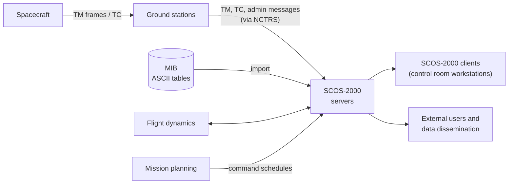
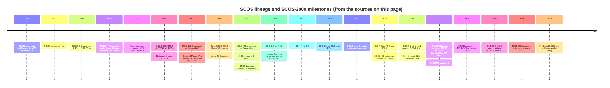
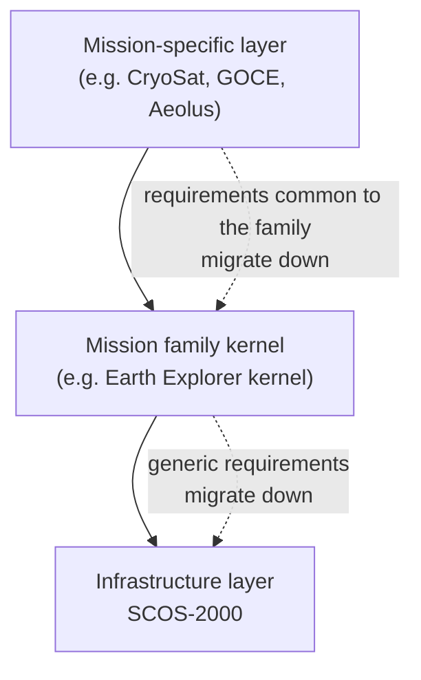

# SCOS-2000: ESA's mission control system

**SCOS-2000** (often shortened to **S2K**) is the generic mission control system (MCS)
developed by ESA's European Space Operations Centre (ESOC) in Darmstadt. It receives,
processes, displays and archives spacecraft telemetry, and it prepares, releases and
verifies telecommands. For more than two decades it has been the kernel on which ESOC builds
the dedicated control system of each mission,[^b115-what][^b130-egos][^so25-abs] and it has also served as the core of
instrument and spacecraft checkout systems.[^gsaw03-arch][^b108-comm] A mission does not
program SCOS-2000. It configures it, mainly with a database that describes its telemetry,
telecommands and displays: the [Mission Information Base (MIB)](../mib/index.md).[^b115-what][^lfi-31]

This page tells the history of SCOS-2000 and puts it in context: its ancestors, its
releases, the missions and organisations that used it, its licensing and user community,
its independent quality certification, the "mission family" strategy that made it cheaper,
ESOC's own comparison of its four control-system generations, and the planned replacement
by the European Ground Systems Common Core (EGS-CC). The companion pages explain the
internals:

* [SCOS-2000 architecture](architecture.md): servers, client applications, the telemetry
  and telecommand chains, archives, events, external interfaces and configuration.
* [SCOS-2000 as EGSE and central checkout](egse.md): the EGSE variant, the TOPE test
  language and the Herschel/Planck checkout systems.
* [Operations preparation](operations-preparation.md): the databases, procedures and tools
  that prepare a SCOS-2000 mission, with the INTEGRAL and CHEOPS practice.
* [Ancillary systems, MICONYS and the move to EGS-CC](ancillary-and-egs-cc.md), and the
  pages on [EDDS](edds.md), [TDRS](tdrs.md), [archives](archives.md),
  [NCTRS and NIS](nctrs-nis.md) and [time correlation](time-correlation.md).

The packet standards that SCOS-2000 implements have their own history, from the ESA PSS
standards to CCSDS and ECSS; it is told on
[From ESA PSS to CCSDS and ECSS](../overview/history.md).

## At a glance

| Aspect | Summary | Source |
|---|---|---|
| Owner and developer | ESA/ESOC, with European industry as contractors. ESA holds the intellectual property rights as "operational software". | [^b108-lic][^gsaw03-pl] |
| Lineage | MSSS (1970s), SCOS-I (1989), SCOS-II (mid-1990s), renamed SCOS-2000 from release R2.0 in 1999 | [^ntrs2-abs][^p2000-name] |
| First operational missions | Huygens, the Meteosat (MTP) LEOP and Teamsat, in 1997. SOHO used it for telemetry only from 1995. | [^b108-hist][^p2000-util] |
| Architecture | Distributed client-server system on networked workstations. It scales down to a single-workstation "SCOS-2000 in-a-box". | [^b115-what][^gsaw03-cs] |
| Technology | C++ with the STL on Unix. Solaris first, then Linux. COTS libraries for GUI, archive and middleware (ILOG Views, C-Tree+, ObjectStore or POST++, Orbix or omniORB). By 2014 the Java/Eclipse-based EGOS User Desktop (EUD) was used as a replacement GUI for SCOS-2000. | [^gsaw03-tech][^eud-stat] |
| Standards | CCSDS packet telemetry and telecommand, the ECSS Packet Utilisation Standard (PUS) and the CCSDS Space Link Extension (SLE) | [^gsaw03-tech][^lfi-31] |
| Configuration | ASCII database tables (the MIB) defined by the Database Import ICD, plus system configuration files | [^b115-what][^lfi-31] |
| Performance (2019) | The SCOS-2000-based Gaia MCS sustains more than 10 Mbps of incoming data and about 1 Mbps of full TM processing; more than 50 users on one MCS is common in a LEOP | [^ical-perf] |
| Licence | Free of charge and non-exclusive for bodies in ESA member states, for peaceful purposes | [^b108-lic][^gsaw03-pl] |
| Successor | EGS-CC, which ESOC reconfirmed in April 2024 as the basis of its next MCS; ESOC's EGS-CC-based mission control core is called M4C. SCOS end of life is predicted no earlier than 2033. | [^so25-intro][^so25-ms][^ical-gen] |

## What a mission control system does

ESA's Bulletin describes the MCS as the software that lets the operators on the ground
interact with a satellite. It receives, interprets, analyses and archives the telemetry, and
it generates, verifies and uplinks the commands that control the satellite's operations.
Through it the Flight Control Team assesses the health of the satellite and commands it to
meet the mission goals. The MCS is critical, so it goes through comprehensive verification
and validation, and so does the operational data that configures it, such as the database
of the spacecraft's telemetry and command data. An MCS usually also supports mission
planning, data analysis and distribution, database management and on-board software
management.[^b130-mcs]

In 2003 ESA listed the functions that SCOS-2000 covers: telemetry processing,
telecommanding, an online database, an online archive, general services and utilities, an
operations language (OL), roles and privileges, events and actions, and on-board software
maintenance (OBSM).[^b115-what] A mission configures these functions to its own needs
through the database (telemetry, telecommand and display characteristics) and through the
system configuration files.[^b115-what] The [architecture page](architecture.md) describes
how these functions are split into server processes and client applications.



The diagram condenses the ESOC system overview presented at GSAW 2003: ground stations
connect through NCTRS (named "Network Controller & TM Router System" on the INTEGRAL
slide) to the SCOS-2000 server, which serves the client workstations and exchanges data with flight dynamics,
mission planning and simulators.[^gsaw03-ctx]

## Lineage: from MSSS to SCOS-2000

ESOC has built its mission control systems on reusable infrastructure since the 1970s. Its
stated objective is reusable infrastructure for any class of orbit and mission, with the same
system reused wherever possible for the MCS, the EGSE and station control.[^gsaw03-obj] In
1974 ESOC decided to develop a reusable MCS infrastructure for the missions it operated.
This started a product line whose first member, the Multi Mission Support System (MSSS),
entered service in 1977.[^ntrs2-abs] The Bulletin article of 2007 calls MSSS the
"Multi-Satellite Support System", developed in the 1970s and used for over 20 years. It
dates the first generation of the Spacecraft Control and Operations System (SCOS) to the
mid-1980s and its replacement by SCOS-2000 to the late 1990s.[^b130-p3] In 2019 ESOC counted
"more than 40 years" of this infrastructure-based approach and four generations: MSSS,
SCOS 1, SCOS II (renamed SCOS-2000) and the EGS-CC-based M4C, compared in
[Four generations compared](#four-generations-compared-2019) below.[^ical-gen]

| Generation | Period | Architecture | Telemetry | Telecommand | Technology | Missions named in the sources |
|---|---|---|---|---|---|---|
| MSSS | entered service 1977 | Centralised processing; monolithic applications serving many spacecraft of different types | Frame-based TM/TC processing | Frame-based | FORTRAN, assembler | MARECS, ECS (still in use in 1994) |
| SCOS-I | since 1989 | Centralised, derived from MSSS, but one spacecraft per system | Packet telemetry | No generic TC chain | FORTRAN on VMS | Hipparcos, ERS-1, EURECA |
| SCOS-II | 1995–1999 | Distributed client-server on Unix workstations | Packet telemetry | Generic TC chain | C++ on Unix | Huygens, Artemis, Envisat (planned first clients) |
| SCOS-2000 | from 1999 (R2.0) | Distributed client-server, CORBA-based distribution | Packet telemetry | Re-engineered TC chain | C++ on Solaris, then Linux | see [Missions](#missions-and-users) |

The architecture, TM/TC and technology columns of the first three rows follow the GSAW 2003
history slide.[^gsaw03-hist] The MSSS and SCOS-I missions come from the SCOS-II paper,[^ntrs2-abs]
the SCOS-II client missions from the same paper,[^ntrs2-rel] and the SCOS-2000 row from the
ESOC presentation of April 2000 and Bulletin 108.[^p2000-name][^b108-hist][^b108-plat]

!!! note "Dates differ between sources"
    The GSAW 2003 slide gives "MSSS - 1984-1996", while the SCOS-II paper says MSSS entered
    service in 1977 and Bulletin 130 says it was developed in the 1970s.[^gsaw03-hist][^ntrs2-abs][^b130-p3]
    The 1984–1996 range may describe a later MSSS period, but the sources do not explain the
    difference. This wiki uses 1977 as the entry into service. ESOC's ICALEPCS paper of 2019
    gives coarser periods: MSSS in operational use from the 1970s to the end of the 1990s,
    SCOS 1 from the beginning of the 1990s (the SCOS-II paper dates SCOS-I to 1989) and still in
    use in "some legacy missions" in 2019, and SCOS II, later renamed SCOS-2000, from the
    beginning of the 2000s, later than the first operational missions of 1997 named by
    Bulletin 108.[^ical-gen][^ntrs2-abs][^b108-hist] The expansion of MSSS also
    varies: "Multi Mission Support System" in the SCOS-II paper, "Multi-Spacecraft Support
    System" in the OL paper, and "Multi-Satellite Support System" in Bulletins 108 and 130
    and in the 2019 paper.[^ntrs2-abs][^ol-bg][^b108-lic][^b130-p3][^ical-acr]

### SCOS-II: the new generation (1994)

The SCOS-II paper, written by ESOC's Mission Operations Department, explains why ESOC
replaced SCOS-I. Its reference list, and that of the OL paper below, place both papers in the
SpaceOps 94 proceedings.[^ntrs2-rel][^ol-concl] The concepts of MSSS and SCOS-I came from
the mission control needs of the 1970s, when spacecraft were hard-wired. Spacecraft such as
EURECA and ERS-1 carried much more on-board software and autonomy, and the old systems
reached their limits.[^ntrs2-abs] The new system had to reduce mission adaptation and
maintenance costs, make mission preparation, execution and evaluation more efficient,
increase operational quality and reliability, last at least 10 years, and serve missions of
any type, size and complexity.[^ntrs2-abs] It also had to be compatible with the CCSDS and
ESA packet standards and with the guidelines of ESA's Committee for Operations and EGSE
Standards (COES).[^ntrs2-abs]

The design choices made for SCOS-II still shape SCOS-2000:

* **Client-server distribution.** A network of Unix workstations, with a dedicated
  workstation for each operational user and central servers for system-level services
  such as the ground station interface. One SCOS-II instance controls several satellites
  of the same family rather than several unrelated missions.[^ntrs2-arch]
* **Scalability and roles.** The same system can be the prime MCS, a "mini-backup" at a
  TT&C station, or (because it follows COES) a checkout system. For a simple mission it can
  be descoped to a single Sun workstation or even a PC.[^ntrs2-roles]
* **Database-driven configuration.** Not only TM/TC processing but display layouts,
  default behaviours and user privilege sets come from the mission database.[^ntrs2-roles]
* **Ambitious performance goals.** Concurrent real-time rates of 2 Mbps telemetry and
  4 kbps telecommand, display updates faster than 10 per second, retrievals within 5 s for
  data a few weeks old and 30 s for data several years old, with up to 50 workstations
  in use.[^ntrs2-roles]
* **Parameter validity.** Each parameter's validity combines power status, the quality of
  the data unit that carried it, the data route, the age of the value, stability after
  commanding, and user-defined criteria. Invalidity propagates, for example to synthetic
  parameters that use an invalid input.[^ntrs2-mon]
* **Three kinds of checks.** Operational status checks, operational constraint checks
  (rules that must never be violated) and behaviour checks against the predicted on-board
  state.[^ntrs2-mon]
* **Uniform "activities".** A procedure, a command sequence and a single command are all
  activities with pre-requisites, execution monitoring and verification. Pre-execution
  validation combines feasibility, safety and dynamic checks. Activities are released by a
  scheduler, a manual stack or an event-driven commander.[^ntrs2-cmd]
* **Online history.** Replay "as live" or as "video replay", data access strategies, data
  analysis and report generation were to become part of the MCS itself.[^ntrs2-eval]

SCOS-II also planned a mission model of "system elements" with operational modes and roles,
a library of reusable elements and a prediction function.[^ntrs2-model] Release 1 was due
as a preliminary delivery in November 1994, with releases 2 (1995–6) and 3 (1996–7) adding
modelling, mission planning and data distribution. The first client missions were to be
Huygens, Artemis and Envisat, launched in 1997–1998.[^ntrs2-rel]

!!! warning "Inference"
    Several SCOS-II ambitions, such as the system-element mission model and the
    event-driven commander, do not appear as such in SCOS-2000's database interface
    (the [MIB tables](../mib/index.md) describe parameters, packets, commands and displays,
    not a model of system elements). The idea of operating through a model of the space
    system returns with the Monitoring and Control Model of EGS-CC.[^pecc-ops] This
    reading is the wiki's own; the sources do not draw the connection.

### The SCOS-II Operations Language (OL)

A companion SpaceOps 94 paper by ESOC and Computer Resources International (CRI) introduced
the **SCOS-II Operations Language (OL)**.[^ol-abs] Its motivation was the slow turnaround of
derived parameters in earlier systems. In MSSS an operations engineer wrote an algorithm on
paper and a software engineer coded it. In SCOS-I the engineer wrote FORTRAN with a few
extra constructs, which was compiled and linked into the control system, so an error only
showed up as a run-time crash. Neither system supported version and configuration control
of these algorithms.[^ol-bg] The OL let operations engineers edit, test, validate and
install expressions and procedures themselves, without software support engineers.[^ol-abs]

The paper divides mission knowledge into four kinds: **declarative** (for example
calibration curves, entered through forms), **expressive** (derived parameters, command
validation conditions, written in the OL), **procedural** (operations procedures, also in
the OL) and **special** knowledge that still needs software extensions.[^ol-concepts] The
implementation has three layers: an interaction layer (the user interface), a logical layer
centred on the OL, and a physical layer with the control system's services. An explicit
object-oriented data model is the "contract" between the logical and physical layers.[^ol-concepts][^ol-model]

| Property | SCOS-II OL design | Source |
|---|---|---|
| Typing | Strongly typed, so wrong use of data-model objects is caught at preparation time | [^ol-model] |
| Execution | Interpreted; the parse tree is built when the database is configured and reused at run time | [^ol-model][^ol-impl] |
| Unit | An OL script: a declaration part (local variables, functions) and an executable part (statements) | [^ol-model] |
| Objects | Parameters with name, description, limit, raw and engineering values; a default attribute, so `P112` means the engineering value | [^ol-example] |
| Validity | Every value carries a validity status; a value computed from invalid inputs is itself invalid | [^ol-impl] |
| Constructs | Assignment, wait, function call, goto, if-then-else, select-case, while, repeat-until, two kinds of for loop; numeric, boolean, string, time, list, set, vector, matrix and map expressions; mathematical, statistical, bit-manipulation and time functions | [^ol-example] |
| Concurrency | No language constructs for parallelism; the physical layer handles interlocks between procedure executions | [^ol-status] |
| Implementation | Designed with OMT, written in C++, scanner and parser generated with lex and yacc | [^ol-example] |

The paper's example derives parameter `P117` from `P112`: if the limit status of `P112` is
above limits, `P117` takes the upper limit value, otherwise it takes the engineering value
of `P112` ("`if (P112.limit == ABOVE_LIMITS) then P117 := P112.limit.upper; else P117 := P112; endif;`").[^ol-example]
The authors called the language deliberately "kept simple and stupid", with the intelligence
in the physical-layer objects. They noted that OL scripts are hard to port between missions
whose data models differ.[^ol-concl] SCOS-2000 kept the OL for synthetic parameters: the
[MIB](../mib/index.md) delivers one OL expression file per dynamic synthetic parameter, and
the Solar Orbiter MIB of September 2025 contains 1,582 of them (see the
[architecture page](architecture.md#synthetic-parameters-and-the-ol) and
[synthetic parameters and the OL language](../mib/synthetic-parameters.md)).[^i70-synth][^mib-solo]

### From SCOS-2 to SCOS-2000

An ESOC presentation of April 2000 explains the name. The system was called "SCOS-2" up to
release R1.4 (until 1998) and "SCOS-2000" from release R2.0 (from 1999). SCOS-2000 is an
evolution of SCOS-2 based on operational experience. Its differences are a new
telecommand chain, architectural consolidation, a user interface fully based on ILOG,
systematic use of the ObjectStore object database, and CORBA for better distribution and
for new external interfaces.[^p2000-name] ESA's Bulletin of November 2001 gives the same
history from another angle. Work on SCOS started in about 1992, the first ESA missions were
supported in 1997, and the telecommanding chain was re-engineered in 1998–2000. The total
investment, including ESA's internal effort, was about 15 MEuro.[^b108-hist]

## Releases

No single source lists all SCOS-2000 releases. The table combines the release plans and
status slides of 2000 and 2003, the change log of the Database Import ICD, and later
documents that mention release numbers.

| Release | Date | Content or context | Source |
|---|---|---|---|
| R1.4 (SCOS-2) | up to 1998 | Last release under the SCOS-2 name; basis of the PROBA EGSE and MCS | [^p2000-name][^p2000-proba] |
| R2.0 | Sep 1999 | First SCOS-2000 release; INTEGRAL system validation tests (SVTs) | [^p2000-rel] |
| R2.1 | Mar 2000 | MSG SVTs | [^p2000-rel] |
| R2.2 | Sep 2000 (planned, as of April 2000) | "End of nominal project"; ICD issue 4.2 (Dec 2000) describes the changes introduced in R2.2 | [^p2000-rel][^i70-log] |
| R2.2e | 2001 | Added the SCOS-2000 Packetiser (ICD issue 5.0) | [^i70-log] |
| R2.3 / evolution line (2.1e, 2.3e) | accepted by 2001; EGSE deliveries to 2004 | PC hardware, Linux (SuSE 7.3) or Solaris 2.6, open-source COTS (POST++, omniORB). ICD issue 5.1 (Oct 2001) covers R2.3 and the evolution-version additions for EGSE. R2.3e with ESOC patches was the base of the Herschel/Planck instrument EGSE. | [^gsaw03-ver][^b108-hist][^i70-log][^emcs-log] |
| Classic line, up to 2.4.1 | until the lines merged in R3.0 | Sun hardware, Solaris 2.6, commercial COTS (ObjectStore, Orbix) | [^gsaw03-ver] |
| R3.0 | Jan 2003 | Classic and evolution lines merged; Solaris 8; archive upgrades | [^gsaw03-ver] |
| R3.1 | Sep 2003 | Linux SuSE 8.1 Professional; ILOG Views 5.0; integration of upgrades from missions. Basis of the Venus Express MCS. | [^gsaw03-ver][^b130-cost] |
| R4.0 | planned Jun 2004; ICD issue 6.0 of Jan 2005 | Multi-mission (constellations, formation flying; LEO, GEO, deep space); "full EGSE compliant" | [^gsaw03-ver][^i70-log] |
| R4.1, R4.2, R4.5 | 2006–2010 | ICD issues 6.2 (Aug 2006), 6.5 (Dec 2007) and 6.7 (2009–2010) | [^i70-log] |
| R5.0 | ICD issue 6.4 of Mar 2007 | Packets stored in a database; sequence and display definitions moved to the file archive (FARC) as XML; SLE throw-event command type | [^i70-log][^i70-r5] |
| R5.2, R5.3, R5.3.1, R5.4 | 2009–2010 | ICD issues 6.7 and 6.9; generic time correlation and on-board schedule reconstruction from R5.2 | [^i70-log][^i70-c9] |
| 5.4.2 | in operation in 2025 | Basis of the CHEOPS MCS at the consortium-run mission operations centre at INTA (CHEOPS launched in December 2019) | [^ch-mcs][^ch-intro] |
| R5.5.x and R6.0.x | to 2017 | Targets of the change requests in ICD issue 7.0 (Aug 2017) | [^i70-a2] |
| S2K 6.0.1, 6.2.x and 6.3.x | by Feb 2018 | EDDS release 14.0 (16 Feb 2018) was tested against SCOS 6.0.1 and adapted to S2K 6.X, 6.2.0+, 6.2.x and 6.3.x; the EDDS configuration guide (version 25.0, 2025) still distinguishes S2K before and from 6.2.0 | [^srn-dep][^srn][^cig] |

The plans changed over time. In April 2000, ESOC planned R3.0 for mid-2001 (port to PC and
Linux, an operating-system shell, replacement of ObjectStore) and R4.0 for early 2002
(several SCOS-2000 versions on one machine, constellation support, higher-level monitoring
functions).[^p2000-evol] The GSAW 2003 status shows R3.0 delivered in January 2003 and R4.0
planned for June 2004.[^gsaw03-ver]

!!! note "Release 5 and later"
    The available sources do not give the release date of R5.0, and no ESOC document in
    the library describes R5 as a whole. What the [Database Import ICD](../mib/icd-history.md)
    shows is that R5.0 stored telemetry packets "in a database" (so there was no longer any
    gain in letting several packets share one SPID), moved command sequences and displays out
    of the run-time database into the FARC, and added SLE and NIS throw-event commands.[^i70-r5][^i70-ccf]
    The year of R6.0 is also not stated in the available sources; the earliest dated mention
    found is the EDDS release note of February 2018, which lists SCOS 6.0.1 as a tested
    dependency.[^srn-dep]



The timeline uses the sources cited in the sections of this page.[^ntrs2-abs][^ntrs2-rel][^b108-hist][^p2000-rel][^mom-concl][^b108-comm][^gsaw03-pl][^b115-eval][^i70-log][^b130-cost][^i70-a2][^airb-prog][^srn][^so25-ms][^so25-intro][^eud-what][^ical-gen][^ch-intro][^ch-mcs]

## Missions and users

### ESA missions

The sources list SCOS-2000 users at several points in time.

| Snapshot | Missions | Source |
|---|---|---|
| April 2000, past | SOHO (1995, telemetry only); Huygens, Teamsat and MTP (Eumetsat) in 1997 | [^p2000-util] |
| April 2000, present | INTEGRAL and MSG (successful SVTs), Rosetta ("AD phase"), ERS (first delivery end of 1999, migration from SCOS-I), PROBA (MCS and EGSE) | [^p2000-util] |
| April 2000, future | SMART-1, Envisat and XMM (migrations from SCOS-I), Mars Express, FIRST/Planck MOC, CryoSat, GOCE | [^p2000-util] |
| March 2003, done | SOHO (NASA Goddard), Teamsat, MTP, Huygens (via the NASA system at JPL), PROBA, MSG LEOP, INTEGRAL | [^gsaw03-clients] |
| March 2003, in development | Rosetta, Mars Express, SMART-1, Venus Express, CryoSat, GOCE, ADM, Herschel/Planck MCS and central checkout (EGSE), Vega launcher EGSE and Galileo MCS (both under evaluation) | [^gsaw03-clients] |
| May 2007, mission families | Interplanetary: Rosetta, Mars Express, Venus Express, then BepiColombo and Solar Orbiter. Earth observation: CryoSat, GOCE, Aeolus, then CryoSat-2, Swarm, EarthCARE and Sentinels. | [^b130-fam] |
| 2019 | SCOS-2000 is the basis of "the vast majority" of ESOC control systems, for operational missions and for those to be launched next; the Gaia MCS is the paper's performance example | [^ical-gen][^ical-perf] |
| 2025 | More than 40 missions at ESOC; Swarm chosen as the pilot for migration to EGS-CC | [^so25-intro][^so25-swarm] |
| 2025, outside ESOC | CHEOPS, an ESA mission operated by its consortium, with an MCS on SCOS-2000 5.4.2 at INTA's Torrejón centre (CEIT) in Spain | [^ch-intro][^ch-mcs] |

GSAW 2003 shows how a SCOS-2000-based MCS fits in a ground segment, using INTEGRAL as the
example: the MCS imports the satellite database, connects to the stations through NCTRS,
exchanges data with flight dynamics, mission planning and the simulator, and feeds an
operations archive and the science centres.[^gsaw03-ctx] A launch and early orbit phase
(LEOP) configuration of that time had a prime and a backup SCOS-2000 server and a prime and
a backup NCTRS, with SCOS-2000 client workstations spread over the Main Control Room (15),
the Project Control Room (6), the Dedicated Control Room (6), the Software Support Room (4),
the Simulation Room (2) and the PI Support Area (2).[^gsaw03-leop]

A current example is [Solar Orbiter](../missions/solar-orbiter/index.md), whose MIB is
public. The release of 16 September 2025 defines 126,745 monitoring parameters, 11,150
telemetry packet definitions on 293 APIDs, 5,454 commands and 3,404 command sequences.
Five and a half years earlier, the release of 16 April 2020 had 102,104 parameters, 9,027
packet definitions, 5,238 commands and 2,701 sequences.[^mib-solo][^mib-solo2020]

??? example "SQL used"
    ```sql
    -- solo-2025-09-16.sqlite and solo-2020-04-16.sqlite
    SELECT (SELECT count(*) FROM pcf), (SELECT count(*) FROM pid),
           (SELECT count(*) FROM ccf), (SELECT count(*) FROM csf),
           (SELECT count(DISTINCT PID_APID) FROM pid);
    -- 2025: 126745 | 11150 | 5454 | 3404 | 293
    -- 2020: 102104 |  9027 | 5238 | 2701 | 268
    SELECT * FROM vdf;   -- 25925PFM | 20250916-CSW3.1.2_MAS7.33 | 0 | 25925 | 733
    ```

### INTEGRAL and CHEOPS: two operator views

Two operations documents in the library show a SCOS-2000-era control system from the
operator's side, twenty-two years apart. INTEGRAL's Flight Operations Plan (FOP), Volume 1,
issue 2 of 21 February 2003 (compared with the mission operations plan of the standard on
[ECSS-E-ST-70C](../ecss/e-st-70c.md#a-real-flight-operations-plan-integral)), describes the mission four months after its launch of 17 October
2002. It never uses the name SCOS-2000: it speaks of the **INTEGRAL Monitoring and Control
System (IMCS)**, which includes the mission planning (timeline generation) system and the
mission archive and data distribution system (MADDS).[^int-title][^int-sum][^int-gs] The link to
SCOS-2000 comes from ESOC's own material: R2.0 was the release of the INTEGRAL system
validation tests, and the GSAW 2003 slide of an "S2K based MCS" uses INTEGRAL as its
example.[^p2000-rel][^gsaw03-ctx] The 2025 CHEOPS paper describes an ESA small-class mission whose
operations are run by the mission consortium rather than by ESA, with a mission operations
centre (MOC) at INTA's Torrejón centre near Madrid and a science operations centre (SOC) in
Geneva; its MCS "is based on ESA's SCOS-2000 (version 5.4.2.)".[^ch-intro][^ch-concl][^ch-mcs]

| Aspect | INTEGRAL (FOP Vol. 1, February 2003) | CHEOPS (paper of May 2025) |
|---|---|---|
| Operator | ESA; MOC at ESOC, Darmstadt[^int-gs] | CHEOPS consortium; MOC at INTA CEIT, SOC at the University of Geneva[^ch-intro] |
| Orbit and passes | Highly eccentric orbit, 72 h period; Redu, Goldstone and Villafranca (backup), Perth for LEOP[^int-sum][^int-gs] | Sun-synchronous orbit at 690 km, 98.7 min period; 4 to 6 passes per day[^ch-intro] |
| Control system | IMCS, including the timeline generation system (MPS) and MADDS[^int-gs] | SCOS-2000 5.4.2, configured through environment variables and the MIB[^ch-mcs] |
| Other MOC elements | Flight Dynamics System, Offline Performance Analysis System (PAS), On-Board Software Maintenance System (OBSMS), INTEGRAL Overall Simulator (IOS), INTEGRAL Security Distribution System (ISDS)[^int-gs] | GMV's Flyplan for automation, GMV's Focus suite with Autofocus for flight dynamics, the Generic File Transfer System (GFTS), a Python module library for the MCS[^ch-auto][^ch-fds][^ch-mcs] |
| Operational database | ODB derived from the manufacturer's satellite database (SDB), which is no longer maintained; S/C analysts update IMCS, the FOP generation tool and OBSMS after each approved change[^int-odb] | The MIB defines "every TC and TM packet"[^ch-mcs] |
| Hardware | Only generic items: control-room workstations, displays and printers, and office PCs, all under configuration control[^int-cc] | Two servers, three clients and a RAID-5 disk array; a reference platform for training and validation, virtualised in 2022[^ch-hw] |
| Staff | Spacecraft Operations Manager (SOM), 5 engineers, 2 analysts (who maintain the database), a controller team of 6 SPACONs on shift, and 1 mission planning engineer[^int-team] | 5 at the MOC (3 to 4 at the SOC), with no presence outside working hours for routine tasks[^ch-concl][^ch-auto] |

INTEGRAL's mission rules show what the MCS meant to the mission. The ground segment counted as
"not operational", and the launch countdown was to stop, unless the IMCS (in particular TM
reception and processing and TC generation and release), flight dynamics and communications were
available in hot redundancy and the MOC could send TCs to, and receive data from, Redu or
Villafranca.[^int-rule] The IMCS, the FDS and the [NCTRS](nctrs-nis.md) were under ESOC's
standard configuration control, with every modification approved by the SOM; the IMCS had been
developed under the responsibility of the ESOC unit TOS-GMC, accepted by the
flight control team, and kept under a maintenance contract with its developer.[^int-cc][^int-tools]
Flight procedures were generated with a tool, FOPGEN, that reads the actual database, which gave
an implicit check of the parameters they use.[^int-odb]

CHEOPS shows SCOS-2000 inside a heavily automated small ground segment. Its own Python layer
drives the kernel: the **CommandBuilder** turns the weekly activity plan into telecommands
through a rule file and writes them to an "SSF file", an ASCII file "that can be read by any
standard SCOS-2000 using the MIB"; Auto Stack instances uplink pre-generated stacks; SMON reads parameter
values from the packet archive; MISC variables are read and set to check the ground commanding
capability and to switch to AD mode; after each pass the TM Processor and TM Replayer split and
ingest the recorded telemetry.[^ch-mcs][^ch-during][^ch-post] For trend analysis the team uses
ESA's MUST and WebMUST "as alternatives to SCOS-2000, which is limited in certain
functionalities".[^ch-tools] The [operations preparation page](operations-preparation.md#operations-preparation-in-practice-cheops)
follows the CHEOPS chain step by step, and
[the INTEGRAL model](operations-preparation.md#configuration-control-the-integral-model) covers
INTEGRAL's configuration control boards and database items.

### Users outside ESA

In 2003 ESOC listed external users: Canada (Radarsat 2), DLR's German Space Operations
Centre (GRACE, BIRD), Eutelsat (a new MCS called NEO), the Italian Space Agency ("Cosmos Skynet", as printed),
the Italian Aeronautical Research Centre (an unmanned space vehicle), 20
European scientific institutes, and the Herschel/Planck instrument EGSE. Uses for
telecommunication satellites in Canada and Japan were listed as "under evaluation".[^gsaw03-clients] DLR's decision
to base its control centre infrastructure on SCOS-2000 was already reported in 2001.[^b108-comm]
DLR's system, GECCOS (GSOC Enhanced Command and Control System for Operating Spacecraft),
branched off from SCOS-2000. It reads telemetry and sends telecommands through the NCTRS
interface, or ingests telemetry from files.[^dlr21] In 2024 DLR still described GECCOS as
the SCOS-2000-based heart of its multi-mission environment, and noted that spacecraft
manufacturers are now expected, as an "industry standard", to deliver a MIB so that
SCOS-2000-based systems can operate the spacecraft.[^4s24] ESOC's 2019 overview adds that the
generation in operation had served "all categories of missions, including many commercial ones
operated outside ESOC", without naming them.[^ical-abs] CHEOPS is a documented case of a
SCOS-2000 MCS run outside ESOC for an ESA mission: by the mission consortium, at INTA's
Torrejón centre, with the Spanish MOC funded through Spain's CDTI under the GSTP and PRODEX
programmes.[^ch-intro][^ch-mcs][^ch-ack]

Herschel/Planck instrument teams used SCOS-2000 for their ground test equipment. The Planck
LFI team, for example, built its real-time assessment system on SCOS-2000 and used it as an
EGSE during ground tests and for housekeeping monitoring in flight.[^lfi-31] See
[SCOS-2000 as EGSE](egse.md) and [Herschel/Planck ground segment](herschel-planck-ground.md).

## Licensing: ESA software as a European product

### Operational software and its licences

ESA's rules normally give the intellectual property rights (IPR) of software developed under
ESA contract to the contractor, with ESA free to use it. A category called **operational
software** is an exception. ESA may claim full IPR for it, which guarantees inspection of the
source code, the possibility to move the software between contractors (for example from
development to maintenance), and ESA's independence from the original author. For software
that ESA owns, ESA may grant a **non-exclusive licence** to a body in a Member State, for
peaceful purposes in space research and technology, normally free of charge.[^b108-lic]
ESA had tried a different approach with MSSS, letting licensees gain IPR on changed code,
and found that it led to "forking" and little feedback to the original product.[^b108-lic]

In the absence of detailed ESA rules for licensing agreements, ESOC used three types of licence
for its software in practice:[^b108-types]

| Licence type | Purpose | Source code |
|---|---|---|
| Run-time licence | Temporary use and trial | No right to change or inspect the source |
| Development licence | Upgrades of operational software for ESOC's own use, under ESA contract | Work on the source code allowed |
| Full licence | Developments based on the software, for example a product | Changes allowed |

The licence offer made to the Herschel/Planck instrument teams in April 2000 used different
categories: documentation only (with access to an FTP server), a trial version for a limited
time, the run-time system, or the source code. Under ESA's convention for operational
software, any Member State body could apply free of charge. The licence was non-exclusive,
ESA kept ownership (it could not be sold on), and the licensee had to buy the hardware and
any commercial off-the-shelf (COTS) licences itself.[^p2000-licdoc][^p2000-lic]

In 2003 ESOC presented the arrangement as close to open source, but restricted to Europe.
ESA acted as the "gatekeeper" of the software and kept the IPR. Companies could use
SCOS-2000 in any offer, including outside Europe, and were encouraged to hand improvements
back for inclusion in the product. Business was to be made with services, not with the
software itself.[^gsaw03-pl] The Bulletin of 2001 discussed an "open-source-type" model in
which licensees return improvements to the SCOS-2000 kernel, while industry stays free to
sell add-on products that use the defined interfaces.[^b108-types] The Planck LFI paper of
2010 describes SCOS-2000 as available "under an open-source licensing scheme".[^lfi-31]

!!! note "ESA Software Community Licence"
    A 2019 ESOC paper states that the EGS-CC preparation environment OPEN and its
    mission and ground-station extensions (OPEN-M and OPEN-S) would be made available to the
    EGS-CC community under the **ESA Software Community License**.[^airb-open] Whether
    SCOS-2000 itself, or the MICONYS suite around it, is distributed under that licence is
    not stated in the available sources.

### How many licences

| Date | Licences | Source |
|---|---|---|
| Nov 2001 | About 30 licences in a little over two years; SCOS-2000 was already the "best-selling" product of ESOC's Contracts Service | [^b108-comm] |
| Mar 2003 | 54 licences in 3 years | [^gsaw03-pl] |
| Aug 2003 | More than 40 customer licences | [^b115-intro] |

For scale, ESOC as a whole had licensed 93 software products to 94 Member State bodies by
2001, with more than 220 licences in total.[^b108-concl] The two 2003 figures do not
conflict (54 is more than 40), but the sources do not say how licences or customers were
counted.

### Support, services and costs (2000)

ESOC offered chargeable **support** for the start-up phase (installation, training,
consultancy on customisation) and **service** for maintenance (help desk, registered
software problem reports, discussion of change requests, regular updates, membership of the
user group or "SCOS-2000 Board"). Service assumed that the customer did not modify the
kernel.[^p2000-licdoc][^p2000-support] The indicative prices presented in April 2000 were:[^p2000-support][^p2000-cost]

| Item (April 2000, indicative) | Price |
|---|---|
| Installation | 10 kEUR per site |
| Developer course (20 hours over 4–5 days, with hands-on training) | 4 kEUR per course |
| Consultancy on customisation | 14 kEUR per man-month |
| Service contract (maintenance, updates, help desk, board membership) | 35 kEUR per year per user |
| Example hardware: one Sun Ultra 80 server and two Ultra 10 clients with basic Sun software | 51 kEUR |
| COTS run-time licences (ILOG Views, C-Tree+, Orbix, ObjectStore) | 2,200 EUR per client to buy, 300 EUR per client per year to maintain |

Bulletin 108 adds that a help desk was set up as part of SCOS-2000 maintenance, with users
subscribing for a fee, and that training, installation help, consultancy and customer
developments were foreseen.[^b108-comm]

## Community

ESOC treated product promotion as a commitment with real costs. It set up a user
organisation, gave access to documentation through an FTP server, and started the help desk.
In November 2001 a web site with documentation, FAQs, user registration, a problem-report
database, release plans and an online demonstration was under construction, due before the
end of that year.[^b108-comm] Nearly 100 people from outside
ESA attended the first **SCOS-2000 Users Workshop** in April 2001. The workshop presented the
product and its evolution, proposed a SCOS-2000 User Community, and heard users' own
experience reports. The proposed open-source approach was received positively.[^b108-comm]

ESOC and the users were to be partners. ESOC is the custodian of the product: it maintains
it, fixes faults, follows platform changes, integrates features developed by user missions
and performs the research that keeps it up to date. Users propose requirements from
operational experience and contribute code.[^b108-comm] At the April 2000 meeting with the
Herschel/Planck instrument teams, ESOC stated that it guards the integrity of the product
line ("one product only"). Changes are classified as infrastructure enhancements (ESA
funded) or project-specific (customer funded), and project-specific changes are implemented
as add-ons to the kernel.[^mom-urd]

## Quality: the SPEC certification

To support the promotion of SCOS-2000, ESA started an evaluation and certification of the
product by an independent organisation.[^b108-cert][^b115-intro] The method, **SPEC** (Software Product Evaluation and
Certification), was developed under ESA contract and based on several international
standards; Bulletin 108 names ISO 9126 among them. SCOS-2000 was the largest product
evaluated with SPEC up to 2003.[^b108-cert][^b115-intro]

SPEC's quality model breaks **goal properties** into **properties**, measures each property
with **metrics**, and computes each metric with an **evaluation method**.[^b115-intro][^b115-model]
It includes properties of the development process as well as of the product, and covers
space-specific practices from ECSS-E-40 and ECSS-Q-80:[^b115-model]

| Product-related goal properties | Process-related goal properties |
|---|---|
| Functionality, Reliability, Maintainability, Re-usability, Operability, Documentation Quality | Suitability for Safety, Software Development Effectiveness, System Engineering Effectiveness |

The evaluation had two phases: a **baseline evaluation** of SCOS-2000 version 2.1e, then a
**delta evaluation and certification** of an improved version. A Software Criticality
Analysis based on a software FMECA preceded the first phase but was not part of SPEC.[^b115-eval]
Of the 85 SPEC metrics, 10 were not applicable and 3 were replaced by similar metrics for
lack of a tool or method. Of the remaining 72, 5 missed their target value. SCOS-2000 met
most targets but needed improvement before it could be certified as Class-B (mission
critical) software. The recommendations asked for homogeneous documentation quality, better
traceability from requirements to design, code and tests, architectural changes to reduce
the complexity of some modules, and better coding standards.[^b115-eval] New coding
standards covering C++ and Java and model-driven architecture were planned.[^b115-eval]

The evaluator and certifier was TÜV InterTraffic. Critical Software (Portugal) performed the
criticality analysis, ESOC's Ground Segment Engineering Department requested the
certification, and ESTEC's Software Product Assurance Section supervised the method.[^b115-eval]
Bulletin 108 had named TÜV Cologne as the certifier two years earlier.[^b108-cert]

## Cutting costs: products, families and the delta approach

### SCOS-2000 as a product

SCOS-2000 had four strategic aims: easy configuration and customisation, functional
richness (less mission-specific code), scalability (add workstations as needed) and vendor
independence (no forced ports when platforms or COTS become obsolete). ESA reported in 2001
that all four were achieved and that the cost of ESOC control systems fell by a factor of
two to three.[^b108-hist] Vendor independence came with the "evolution version": Linux
instead of Solaris, and open-source POST++ and omniORB instead of ObjectStore and Orbix. ILOG
Views remained for the user interface.[^b108-plat][^gsaw03-tech] A study found a Windows
port feasible, but ESA had not decided to proceed.[^b108-cert]

ESOC listed the characteristics of a good generic MCS: generic, customisable, open with
well-defined interfaces, well documented, easy to install, portable across popular
platforms, minimally dependent on COTS, supported long-term, with expertise available on a
competitive market, and free of IPR obstacles to distribution.[^gsaw03-good] The 2001
Bulletin saw the commercial competition in US suppliers such as Integral Systems, Storm and
Braxton Technologies, whose products were closed, carried licence fees and were expensive to
customise for new mission classes.[^b108-types]

### Mission families and the delta approach

ESOC then reused software at a second level. A **mission family** is a set of missions with
a high degree of commonality in platform or operational profile. ESOC's families were
interplanetary, Earth observation, observatory and navigation missions.[^b130-fam] In the
**delta approach**, software is organised in three layers, each defined only by its
differences from the layer below:[^b130-delta][^gsaw05-delta]



Requirements documents become "delta" documents that list only mission-specific
requirements. Design keeps interfaces unchanged where possible, testing focuses on mission
features, and the SCOS-2000 kernel is maintained separately.[^b130-delta][^gsaw05-delta]
A configuration control board decides when requirements move down a layer. A successful
family kernel eventually shrinks to nothing, as its features migrate into SCOS-2000.[^b130-delta][^b130-cost]

The two families used the approach differently. For Rosetta, Mars Express and Venus Express
a two-layer approach gave a single system that served all three missions by
reconfiguration.[^b130-practice] For CryoSat, GOCE and Aeolus a three-layer approach with
an Earth Observation Mission Kernel absorbed the differences in spacecraft platform.[^b130-practice]
CryoSat was the first mission defined as a delta against SCOS-2000, GOCE as a delta against
CryoSat, and Aeolus as a delta against the Earth Explorer kernel.[^gsaw05-ee] The
requirement counts at definition phase show the effect:[^gsaw05-req]

| Mission | Document | Kernel requirements | Mission-specific requirements | Total |
|---|---|---|---|---|
| CryoSat | SRD | 406 | 35 | 441 |
| GOCE | SRD | 129 | 62 | 191 |
| Aeolus | SRS | 57 | 115 | 172 |

The family approach also lowered the barrier to upgrading. Missions in routine operations
are usually reluctant to take a new infrastructure version. When Venus Express prepared for
launch, its MCS used the newest SCOS-2000 (then 3.1), while Rosetta and Mars Express kept the
previous version. After Venus Express completed its operational validation, Rosetta moved to
the new interplanetary kernel in a few months and Mars Express in a few weeks.[^b130-cost]
A data delivery interface document of February 2006 confirms the state of that time: one
field applied to S2K 3.1-based systems, so to Venus Express at once and to Rosetta and Mars
Express only after their upgrade.[^rddid]

### EGOS

ESOC grouped its reusable ground software under the name **EGOS** (ESA Ground Operations
Software system), a family of products following the SCOS-2000 approach.[^gsaw03-ll] The
2003 vision listed, among others, ground systems test and validation, a multi-mission
configuration control manager, ground systems monitoring and control, NCTRS/SLE, the SIMSAT
simulator infrastructure, generic file transfer and data disposition systems, operations
preparation, data analysis, automated procedure execution, an archive, EGSE, mission
planning, a TM/TC baseband system and flight dynamics.[^gsaw03-egos] By 2007 the Bulletin
called SCOS-2000 and SIMSAT the cornerstones of EGOS.[^b130-p3] By 2014 most EGOS user
interfaces, SCOS-2000's included, were built on one Java and Eclipse-based framework, the EGOS
User Desktop, described with the other products on
[ancillary systems](ancillary-and-egs-cc.md#eud-the-common-user-interface-2014).[^eud-stat]

## Four generations compared (2019)

At the ICALEPCS conference of 2019 (New York), M. Pecchioli of ESOC gave a technical comparison of
the mission control infrastructure generations developed at ESOC. The paper starts from an
observation: the basic needs of mission operators have not radically changed since the first
spacecraft operations, but the implementation of the infrastructure has. Five factors drove that
evolution: spacecraft orbits (from long or continuous visibility with short delays to short
passes in polar orbits or long delays in deep space), space asset design (the TM/TC protocol, the
on-board monitoring and control services, data volumes and rates, and on-board autonomy),
operations concepts (from manual commanding to procedures, ground automation and on-board
autonomy, to cut the cost of long routine phases), software technologies and IT
infrastructure.[^ical-bg]

### Why an infrastructure at all

Most space organisations, the paper notes, develop each MCS on a fully mission-specific life cycle.
ESA instead built its operational ground segment on infrastructure that is specific to a domain
but not to a mission, for strategic and programmatic rather than technical reasons: costs shared
across missions are stable, predictable and low; a "nearly ready" solution shortens the
preparation of a new mission; a proven common infrastructure reduces risk; and staff who move
between missions need less familiarisation.[^ical-design] These benefits only materialise with a
careful design, and the paper lists the drivers that a mission-specific system would weigh less:[^ical-drivers]

| Design driver | What the paper means by it |
|---|---|
| Support of heterogeneous space systems | Standard TM/TC protocols reduced the number of protocols to support, and PUS standardised access to on-board functions, so that common ground solutions became possible |
| Support of multiple mission types | The orbit sets the type: long passes and short delays (geostationary), short passes and short delays (polar Earth observation), long passes and long delays (deep space) |
| Standardised interfaces | Generic file-based and programmatic interfaces to preparation, planning, execution and evaluation systems; international (CCSDS) standards between facilities of different organisations, such as control centres and ground stations |
| Modular architecture | Hierarchical decomposition with separation of concerns, so that generic and mission-specific parts can be developed in parallel |
| Generic and extensible functionality | Extensibility means integrating application-specific features without changing the infrastructure source code |
| Capability to tailor | A data-driven design: the TM/TC characteristics are defined in a database that converts human-readable definitions into data units |
| Functional richness | More functions than the specified needs, for safe and "comfortable" operations |
| Layered design | Strict separation of reusable parts from mission extensions, through interfaces and services; ideally no infrastructure change is needed to build a full MCS |
| Operations abstraction | Operators concentrate on "what" has to be done, not on low-level details |
| Support of automation | Automation at all levels, from deployment to the execution of planned operations, to control routine costs |
| High performance | Storage, distribution and processing rates, data volumes and parallel users, without dependence on expensive hardware |
| Longevity and long-term maintainability | Decades of use without explosive costs, with the expertise continuously created and sustained |
| Portability and technology isolation | Business logic isolated from the reused off-the-shelf technologies |
| Scalability | From large constellations to small low-cost satellites, on scalable computing and storage |

Several of these drivers were already goals of the
[SCOS-II design](#scos-ii-the-new-generation-1994) a quarter of a century earlier: scalability down
to a single workstation, database-driven configuration and support for a wide range of mission
types, sizes and complexities.[^ntrs2-abs][^ntrs2-roles][^ical-drivers]

### The generations

| Generation | Operational use, as stated in 2019 |
|---|---|
| MSSS (Multi-Satellite Support System) | From the 1970s to the end of the 1990s |
| SCOS 1 | From the beginning of the 1990s; still in use by some legacy missions |
| SCOS II, later renamed SCOS-2000 | From the beginning of the 2000s; the basis of the vast majority of ESOC control systems, for operational missions and for those to be launched next |
| M4C (Mission Control Core based on Common Core) | Equivalent features to SCOS-2000 and its complementary systems, built on EGS-CC |

[^ical-gen][^ical-acr]

Which legacy missions still ran SCOS 1 in 2019 is not stated in the available sources.

### The MCS across the operations phases

The role of the MCS as the only ground system that manages all interactions with the space assets
(through the ground station network) did not change. Its interactions with other systems grew,
with open architectures and both file-based and API-based interfaces:[^ical-ctx]

| Phase | How the support evolved |
|---|---|
| Preparation | From basic text editors, through heterogeneous stand-alone Windows tools, to OPEN, an expandable Eclipse-based framework for editors of each data type, used in a distributed but centrally managed environment (see [operations preparation](operations-preparation.md)) |
| Planning and scheduling | From manual work by mission engineers with ad hoc tools to a generic infrastructure that processes requests from mission exploitation centres (for example science operations centres) against on-board resources, visibility passes and flight dynamics needs. The MCS receives the resulting commanding artefacts and reports their upload and execution status |
| Critical operations (for example LEOP) | Little conceptual change. Snapshot displays (alphanumeric, non-nominal summaries, synoptics), log displays, trend displays, operations stack displays and object detail displays existed from the start; what changed is how many displays a user can open (MSSS allowed only full-screen displays, "up to three!") and how rich the interaction is |
| Routine operations | MSSS could only pre-authorise a series of commands separated by given time intervals. M4C natively executes any control action ("activity") from ground or on-board triggers based on delta or absolute times, events or procedures. Both SCOS-2000 and M4C support file based operations, for example whole schedule increments uploaded and activated with few operations |
| Evaluation | Management, dissemination and analysis of data for increasingly distributed teams, now including big data capabilities |

### System design, generation by generation

The paper compares the generations aspect by aspect. The table collects what it says about each;
where a cell is empty the paper does not characterise that generation.[^ical-sys][^ical-perf]

!!! warning "Inference"
    For modularity and for adaptability and extensibility the paper describes a progression
    ("from a completely monolithic implementation", "the early generation", "the recent
    generations") without naming MSSS or SCOS-2000. Placing the monolithic and common-solution
    end under MSSS, and software-level customisation under SCOS-2000, is this wiki's reading.
    User-defined scripts, routines and displays are credited to "the recent generations", not to
    M4C alone.[^ical-sys][^ical-perf]

| Aspect | MSSS | SCOS-2000 | M4C |
|---|---|---|---|
| Modularity | A completely monolithic implementation | | A truly component-based system: each component carries its design model, external interfaces, test environment and procedures, configuration data and tailoring data |
| Deployment | Completely centralised: two redundant instances on mainframe infrastructure served all missions, with remote access from hardwired workstations | Fully distributed client-server; first "very fat" clients, then re-engineered for remote access from dumb terminals and a clearer split between user interaction and business logic | "Conceptually centralised": only the user interaction layer runs in installation-free thin clients; central functions run on scalable tiers (software-defined networks, cloud computing, cluster storage); several missions can share most functions ("multi-mission" deployments) |
| Scalability | "Wasn't really scalable": one resource-bound platform for all missions | Each MCS on dedicated physical machines, bound by their limits | From dedicated machines with local storage to fully shared multi-mission virtual data centres |
| Tailoring | All generations let the user define the exact structure of the TM and TC data units; little conceptual change, but growing complexity of the definitions | (same) | (same) |
| Adaptability and extensibility | Common solutions for all missions, with configurability ensuring compatibility | Customisation and extension at software level | Mission-specific functions and behaviour changes without source-code changes to the infrastructure, the design focus of M4C; user-defined customisations such as scripts, processing routines and displays |
| Interoperability | All generations adopted the standards that their interfacing systems supported, such as SLE for the TM/TC exchange between control centres and ground stations | Native support of PUS "service level" operations | (same as SCOS-2000) |
| Performance | TM reception and processing of a few kbit/s; up to 20 user workstations "in the full centre (!)" for all missions | The Gaia MCS: more than 10 Mbit/s incoming, about 1 Mbit/s of full TM processing | |
| Maintainability | | | Portable technologies with few direct COTS dependencies; widely used, mature languages; modules visible only through service interfaces; extension and customisation hooks; automated production, deployment and validation |

Today's LEOPs, the paper adds, commonly have more than 50 users connected to a single MCS.[^ical-perf]
The technology stacks changed completely across the generations: languages (Fortran, C, C++,
Java, Groovy, XML, XMI), middleware (broker-based, component frameworks, plug-ins, message buses),
user interfaces (fat, rich, smart and thin clients), storage (binary files, relational databases,
NoSQL, big data) and operating systems (Unix, Linux, Windows). The paper singles out the last
three maintainability measures (modules behind service interfaces, extension hooks, and automated
production, deployment and validation) as a significant improvement of M4C over
SCOS-2000.[^ical-perf]

For scale: the 1994 SCOS-II targets were 2 Mbit/s of telemetry and up to 50 workstations, and
the 2003 LEOP configuration had 35 SCOS-2000 client workstations in six rooms.[^ntrs2-roles][^gsaw03-leop]
The paper's PUS reference is ECSS-E-70-41A, the "PUS-A" issue (see
[PUS-A vs PUS-C](../ecss/pus/pus-a-vs-pus-c.md)).[^ical-ref]

The conclusion describes the evolution as "continuous" within generations and "step-wise"
across them, each step capitalising on operational and engineering experience and on newer
off-the-shelf technology.[^ical-concl]

## Towards EGS-CC

By the 2010s ESOC expected the SCOS-2000 generation to face significant obsolescence, with
rising maintenance and evolution costs.[^pecc-intro][^airb-intro] An industrial view from
2010 is blunt. Terma, which had delivered several SCOS-2000-based checkout systems, found
any system based on SCOS-2000 complex to develop, configure and use. Its telecommand chain
handled about 2 packets per second with checking and 20 without, and keeping it on modern
platforms was becoming more expensive, not less.[^arm-motiv]

ESA's answer is the **European Ground Systems Common Core (EGS-CC)**, a European initiative
for a common monitoring and control kernel. ESOC's adoption project is called **EGOS-CC**.[^pecc-intro][^pecc-egoscc]
ESOC's papers stress what changes. SCOS-2000 assumes a spacecraft that exchanges PUS
TM/TC packets, while EGS-CC abstracts any controlled system, including ground stations.[^pecc-obj]
Teams familiar with the "SCOS-2000 MIB ICD" must learn the EGS-CC Conceptual Data Model, and
the technology moves away from C++, CORBA and SQL.[^pecc-ops] EGS-CC is to be used as a
third-party "black box" product, unlike SCOS-2000, which missions were free to modify.[^pecc-ops]

| Date | Milestone | Source |
|---|---|---|
| 2017 | Development of OPEN and the EGOS-CC extension and adapter components starts | [^airb-prog][^pecc-prog] |
| 2019 | A pilot Juice MCS on EGOS-CC is built to support a decision in September 2019 | [^airb-prog] |
| Apr 2024 | ESOC reconfirms that its next-generation MCS will be based on EGS-CC; Swarm becomes the first mission to migrate | [^so25-ms][^so25-swarm] |
| 2026 | EGS-CC first enters operations at ESOC (prediction) | [^so25-intro] |
| 2027 / 2029 | Ariel, the first mission to launch on EGS-CC: first SVTs in 2027, launch in 2029 | [^so25-swarm] |
| early 2030s | Operational roll-out to selected missions completed | [^so25-swarm] |
| ≥ 2033 | Predicted end of life of SCOS, at least 7 years after EGS-CC enters operations, driven by more than 40 missions | [^so25-intro] |

SCOS-2000 and the complementary systems around it form **MICONYS** (MIssion COntrol
sYStem), ESOC's suite of generic mission control products. Their EGS-CC-based successor is called MICONYS-CC in an
undated ESOC paper (it plans development to start in the second quarter of 2017) and M4C
(Mission Control Core based on Common Core) in a 2019 paper, with a functional scope "very
similar" to SCOS-2000.[^so25-abs][^pecc-egoscc][^airb-m4c] ESOC's ICALEPCS paper of the same
year says M4C provides features equivalent to "SCOS-2000 and its complementary systems" and
compares it with its predecessors (see [above](#four-generations-compared-2019)).[^ical-gen] The MIB
remains central during the transition. ESOC sorts missions into three categories: missions
that keep a SCOS-2000 MIB and its tools (DABYS, MOIS, ProToS, MATIS, FOPPER) and use a MIB to
EGS-CC converter (Swarm); missions that convert all tailoring data once to the EGS-CC formats
(expected for Ariel); and missions that receive EGS-CC tailoring data directly from
industry.[^so25-cat] See [ancillary systems, MICONYS and EGS-CC](ancillary-and-egs-cc.md)
and [mission tailoring of the MIB](../mib/tailoring.md).

## What "SCOS" stands for

The sources expand the acronym in several ways:

| Expansion | Sources |
|---|---|
| Spacecraft Control and Operations System | SCOS-II OL paper (1994, as "Spacecraft Control and Operations System II"); ESA Bulletin 108 (2001); Bulletin 130 (2007); the Planck LFI paper (2010, written with "&") |
| Spacecraft Control & Operating Systems | Herschel PACS user guide (2004) |
| Satellite Control System | EMCS software user manual (2004) |
| Spacecraft Control System | ESOC EGOS-CC paper (undated; it plans development to start in Q2 2017) |
| Spacecraft Control Operations System | ESOC ICALEPCS 2019 paper (body text and acronym list) |
| Satellite Control and Operation System | DLR SpaceOps 2021 paper; ESOC SpaceOps 2025 paper |

The first expansion is the one ESA itself used when presenting SCOS-2000 as a
product.[^ol-abs][^b108-hist][^b130-p3][^lfi-hk][^guide-acr][^emcs-acr][^pecc-acr][^pecc-prog][^ical-acr][^dlr21-acr][^so25-abs]

## Related pages

* [SCOS-2000 architecture](architecture.md) and [SCOS-2000 as EGSE](egse.md)
* [Operations preparation](operations-preparation.md) and
  [ancillary systems, MICONYS and EGS-CC](ancillary-and-egs-cc.md)
* [From ESA PSS to CCSDS and ECSS](../overview/history.md): the standards history next to
  this control-system history
* [The MIB](../mib/index.md), [MIB data model](../mib/data-model.md) and
  [history of the Database Import ICD](../mib/icd-history.md)
* [Missions](../missions/index.md), [Herschel and Planck](../missions/herschel-planck.md),
  [Rosetta, Mars Express and Venus Express](../missions/rosetta-mex-vex.md) and
  [other missions and SCOS-2000 users](../missions/other-missions.md)
* [PUS: the Packet Utilization Standard](../ecss/pus/index.md) and
  [SLE](../ccsds/sle/index.md)
* The ECSS ground segment standards: [ECSS-E-ST-70C](../ecss/e-st-70c.md) (ground systems and
  operations), [ECSS-E-ST-70-31C](../ecss/e-st-70-31c.md) (monitoring and control data),
  [ECSS-E-ST-70-32C](../ecss/e-st-70-32c.md) (PLUTO) and
  [ECSS-E-ST-70-01C](../ecss/e-st-70-01c.md) (on-board control procedures)
* The [glossary](../glossary.md) and the [reference catalogue](../references/index.md)

## Sources and copies

Each footnote links the library page of its source. Each library page gives the original
URL, the SHA-256 of the copy and the time of copy. The main sources of this page were copied
on 5 November 2026, and the second-round additions on 12 November 2026:

| Library page | Document | Copied (UTC) |
|---|---|---|
| [gsaw2003-peccia](../library/gsaw2003-peccia.md) | N. Peccia, "SCOS-2000, ESA's Spacecraft Control for the 21st Century", GSAW 2003 | 2026-11-05 13:54 |
| [esa-bulletin-108-ch8](../library/esa-bulletin-108-ch8.md) | "Promoting ESA Software as a European Product: The SCOS-2000 Example", ESA Bulletin 108 (2001) | 2026-11-05 14:10 |
| [esa-bulletin-115-ch8](../library/esa-bulletin-115-ch8.md) | "Checking Whether SCOS is up to SPEC", ESA Bulletin 115 (2003) | 2026-11-05 14:10 |
| [bul130-merri-happy-families](../library/bul130-merri-happy-families.md) | "Happy Families: Cutting the Cost of ESA Mission Ground Software", ESA Bulletin 130 (2007) | 2026-11-05 14:10 |
| [ntrs-scos2-new-generation](../library/ntrs-scos2-new-generation.md) | "SCOSII: ESA's New Generation of Mission Control Systems: the User's Perspective" (1994) | 2026-11-05 14:07 |
| [ntrs-scosii-ol](../library/ntrs-scosii-ol.md) | "SCOSII OL: A Dedicated Language for Mission Operations" (1994) | 2026-11-05 14:07 |
| [scos2000-complete-presentation-2000](../library/scos2000-complete-presentation-2000.md) | ESOC presentation to the FIRST/Planck instrument teams, 18–19 April 2000 | 2026-11-05 14:09 |
| [spaceops2025-egs-cc](../library/spaceops2025-egs-cc.md) | "Towards EGS-CC at ESOC", SpaceOps 2025 | 2026-11-05 14:12 |
| [mib-20250916m25925pfms001-sol](../library/mib-20250916m25925pfms001-sol.md) | Solar Orbiter MIB release of 16 September 2025 | 2026-11-05 14:24 |
| [icalepcs2019-weapp01-esa-control-systems](../library/icalepcs2019-weapp01-esa-control-systems.md) | M. Pecchioli, "Old and New Generation Control Systems at ESA", ICALEPCS 2019, paper WEAPP01 | 2026-11-12 17:48 |
| [fop-vol01](../library/fop-vol01.md) | INTEGRAL Flight Operations Plan, Volume 1 Mission Management, issue 2.0 (21 February 2003) | 2026-11-12 17:52 |
| [cheops-ground-segment-systems-and-automation-for-mission-and-science-o](../library/cheops-ground-segment-systems-and-automation-for-mission-and-science-o.md) | Heitzmann et al., "CHEOPS Ground Segment: Systems and Automation for Mission and Science Operations" (arXiv:2505.08352, May 2025) | 2026-11-12 17:52 |
| [2014s12b-schutz](../library/2014s12b-schutz.md) | J. Schütz, "EGOS User Desktop", GSAW 2014 | 2026-11-12 17:52 |

[^b115-what]: [ESA Bulletin 115, "Checking Whether SCOS is up to SPEC"](../library/esa-bulletin-115-ch8.md), section "What exactly is SCOS-2000?", PDF p. 2.
[^b115-intro]: [ESA Bulletin 115](../library/esa-bulletin-115-ch8.md), introduction and "What exactly is SPEC?", PDF p. 1.
[^b115-model]: [ESA Bulletin 115](../library/esa-bulletin-115-ch8.md), SPEC quality model and goal properties, PDF p. 2.
[^b115-eval]: [ESA Bulletin 115](../library/esa-bulletin-115-ch8.md), "Evaluating SCOS-2000 with SPEC", "The Next Steps" and acknowledgement, PDF p. 3.
[^b130-p3]: [ESA Bulletin 130, "Happy Families"](../library/bul130-merri-happy-families.md), introduction, PDF p. 3.
[^b130-egos]: [ESA Bulletin 130](../library/bul130-merri-happy-families.md), "The ESOC Infrastructure Software" (SCOS-2000 as the basis for mission-specific MCSs), PDF p. 4.
[^b130-mcs]: [ESA Bulletin 130](../library/bul130-merri-happy-families.md), "The Mission Control System (MCS)", PDF pp. 3–4.
[^b130-fam]: [ESA Bulletin 130](../library/bul130-merri-happy-families.md), "Mission Families", "The interplanetary mission family" and "The Earth observation mission family", PDF pp. 4–5.
[^b130-delta]: [ESA Bulletin 130](../library/bul130-merri-happy-families.md), "The Delta Approach" and "The rest of the lifecycle", PDF p. 6.
[^b130-practice]: [ESA Bulletin 130](../library/bul130-merri-happy-families.md), "The delta approach in practice", PDF p. 7.
[^b130-cost]: [ESA Bulletin 130](../library/bul130-merri-happy-families.md), "Benefits for the infrastructure software" and "Cost, schedule, quality and risk", PDF pp. 7–8.
[^gsaw03-obj]: [GSAW 2003, Peccia](../library/gsaw2003-peccia.md), slide "ESA Objectives", PDF p. 3.
[^gsaw03-arch]: [GSAW 2003, Peccia](../library/gsaw2003-peccia.md), slide "SCOS-2000 Architecture concepts" (kernel with commonality for spacecraft check-out systems), PDF p. 17.
[^gsaw03-pl]: [GSAW 2003, Peccia](../library/gsaw2003-peccia.md), slides "Product Line", PDF pp. 6–7.
[^gsaw03-hist]: [GSAW 2003, Peccia](../library/gsaw2003-peccia.md), slide "History of ESA control systems", PDF p. 9.
[^gsaw03-good]: [GSAW 2003, Peccia](../library/gsaw2003-peccia.md), slide "Characteristics of a good MCS: ESA's view", PDF p. 10.
[^gsaw03-ctx]: [GSAW 2003, Peccia](../library/gsaw2003-peccia.md), slides "Complete system overview" and "An S2K based MCS in a GS Context", PDF pp. 11 and 13.
[^gsaw03-leop]: [GSAW 2003, Peccia](../library/gsaw2003-peccia.md), slide "Spacecraft control systems - LEOP system", PDF p. 12.
[^gsaw03-clients]: [GSAW 2003, Peccia](../library/gsaw2003-peccia.md), slides "S2K Client missions", PDF pp. 14–15.
[^gsaw03-ver]: [GSAW 2003, Peccia](../library/gsaw2003-peccia.md), slide "SCOS-2000 Versions", PDF p. 16.
[^gsaw03-tech]: [GSAW 2003, Peccia](../library/gsaw2003-peccia.md), slide "SCOS-2000 Enabling Technology", PDF p. 18.
[^gsaw03-cs]: [GSAW 2003, Peccia](../library/gsaw2003-peccia.md), slide "SCOS-2000 Client / Server", PDF p. 19.
[^gsaw03-ll]: [GSAW 2003, Peccia](../library/gsaw2003-peccia.md), slide "Lessons learned", PDF p. 29.
[^gsaw03-egos]: [GSAW 2003, Peccia](../library/gsaw2003-peccia.md), slide "A vision for the future", PDF p. 30.
[^ntrs2-abs]: [SCOSII: the user's perspective (NTRS 19950011122)](../library/ntrs-scos2-new-generation.md), abstract and §1 Introduction, PDF p. 1.
[^ntrs2-arch]: [SCOSII: the user's perspective](../library/ntrs-scos2-new-generation.md), §2 and §2.1 Architecture, PDF p. 1.
[^ntrs2-roles]: [SCOSII: the user's perspective](../library/ntrs-scos2-new-generation.md), §2.2 to §2.4 (roles, user scenarios, configurability, performance), PDF p. 2.
[^ntrs2-model]: [SCOSII: the user's perspective](../library/ntrs-scos2-new-generation.md), §2.5.1 Modelling Tool, PDF pp. 2–3.
[^ntrs2-mon]: [SCOSII: the user's perspective](../library/ntrs-scos2-new-generation.md), §4.2 Parameter Validity and §4.3 Parameter Checking, PDF p. 5.
[^ntrs2-cmd]: [SCOSII: the user's perspective](../library/ntrs-scos2-new-generation.md), §5 Commanding, PDF pp. 5–6.
[^ntrs2-eval]: [SCOSII: the user's perspective](../library/ntrs-scos2-new-generation.md), §7 Mission Evaluation, PDF pp. 6–7.
[^ntrs2-rel]: [SCOSII: the user's perspective](../library/ntrs-scos2-new-generation.md), §8 Conclusion, PDF p. 7.
[^ol-abs]: [SCOSII OL: A Dedicated Language for Mission Operations (NTRS 19950011118)](../library/ntrs-scosii-ol.md), abstract and introduction, PDF p. 1.
[^ol-bg]: [SCOSII OL](../library/ntrs-scosii-ol.md), "Background and Context", PDF p. 2.
[^ol-concepts]: [SCOSII OL](../library/ntrs-scosii-ol.md), "Concepts" (knowledge categories, layered model), PDF p. 3.
[^ol-model]: [SCOSII OL](../library/ntrs-scosii-ol.md), data model and "Language Facilities", PDF p. 4.
[^ol-example]: [SCOSII OL](../library/ntrs-scosii-ol.md), Figures 2 to 4, Table 1 and "Implementation", PDF p. 5.
[^ol-impl]: [SCOSII OL](../library/ntrs-scosii-ol.md), "Implementation" (parse tree, Value validity), PDF p. 6.
[^ol-status]: [SCOSII OL](../library/ntrs-scosii-ol.md), Script class model and "Status", PDF p. 7.
[^ol-concl]: [SCOSII OL](../library/ntrs-scosii-ol.md), "Conclusions", PDF p. 8.
[^p2000-util]: [ESOC SCOS-2000 presentation, 18–19 April 2000](../library/scos2000-complete-presentation-2000.md), slides "Utilisation", PDF pp. 6–7.
[^p2000-name]: [ESOC SCOS-2000 presentation, April 2000](../library/scos2000-complete-presentation-2000.md), slide "Name?", PDF p. 8.
[^p2000-rel]: [ESOC SCOS-2000 presentation, April 2000](../library/scos2000-complete-presentation-2000.md), slide "Status of Releases", PDF p. 9.
[^p2000-evol]: [ESOC SCOS-2000 presentation, April 2000](../library/scos2000-complete-presentation-2000.md), slides "SCOS Evolution", PDF pp. 10–11.
[^p2000-proba]: [ESOC SCOS-2000 presentation, April 2000](../library/scos2000-complete-presentation-2000.md), slide "PROBA Status & Plan", PDF p. 24.
[^p2000-lic]: [ESOC SCOS-2000 presentation, April 2000](../library/scos2000-complete-presentation-2000.md), slide "License", PDF p. 29.
[^p2000-cost]: [ESOC SCOS-2000 presentation, April 2000](../library/scos2000-complete-presentation-2000.md), slides "Cost Core HW" and "Cost COTS's", PDF pp. 30–31.
[^p2000-support]: [ESOC SCOS-2000 presentation, April 2000](../library/scos2000-complete-presentation-2000.md), slides "SCOS Support" and "SCOS Service", PDF pp. 36–37.
[^p2000-licdoc]: [ESOC SCOS-2000 presentation, April 2000](../library/scos2000-complete-presentation-2000.md), annexed note "Software License, Support and Service" (draft 1, 19 April 2000), PDF pp. 45–46.
[^mom-urd]: [Minutes, "SCOS 2000 and FIRST/PLANCK", 19 April 2000](../library/scos2000-and-first-planck-mom.md), item 8, PDF p. 3.
[^mom-concl]: [Minutes, "SCOS 2000 and FIRST/PLANCK"](../library/scos2000-and-first-planck-mom.md), conclusion, PDF p. 4.
[^b108-lic]: [ESA Bulletin 108, "Promoting ESA Software as a European Product"](../library/esa-bulletin-108-ch8.md), "Licensing aspects: the current ESA licensing scheme", PDF p. 3.
[^b108-hist]: [ESA Bulletin 108](../library/esa-bulletin-108-ch8.md), "SCOS-2000 as a software product", PDF pp. 1–2.
[^b108-plat]: [ESA Bulletin 108](../library/esa-bulletin-108-ch8.md), platforms and COTS, PDF pp. 2–3.
[^b108-types]: [ESA Bulletin 108](../library/esa-bulletin-108-ch8.md), licence types, "Open-source licensing" and "Market aspects", PDF p. 4.
[^b108-comm]: [ESA Bulletin 108](../library/esa-bulletin-108-ch8.md), "Support requirements" and "Experience so far", PDF p. 5.
[^b108-cert]: [ESA Bulletin 108](../library/esa-bulletin-108-ch8.md), certification and porting, PDF p. 6.
[^b108-concl]: [ESA Bulletin 108](../library/esa-bulletin-108-ch8.md), "Conclusion", PDF p. 6.
[^i70-log]: [SCOS-2000 Database Import ICD issue 7.0](../library/icd-7-0-final.md), document change log (issues 3.2 to 7.0), PDF pp. 3–6.
[^i70-r5]: [ICD 7.0](../library/icd-7-0-final.md), §2.5 Import options (R5.0 run-time management of sequences and displays), PDF p. 24, and Annex 1, changes for R5.0 in ICD 6.5 (packets stored in a database), PDF p. 256.
[^i70-ccf]: [ICD 7.0](../library/icd-7-0-final.md), §3.3.3.2.1 ccf (throw events from R5.0) and field `CCF_CTYPE`, PDF pp. 132 and 134–135.
[^i70-c9]: [ICD 7.0](../library/icd-7-0-final.md), Appendix C §3.8 and §3.9 (services 9 and 11), PDF pp. 240–241.
[^i70-a2]: [ICD 7.0](../library/icd-7-0-final.md), Annex 2 (change requests with target versions 5.5.2 to 5.5.4 and 6.0.0), PDF p. 261.
[^i70-synth]: [ICD 7.0](../library/icd-7-0-final.md), §3.3.2.1.2 Synthetic parameters, PDF p. 55.
[^srn]: [EDDS Software Release Note 14.0 (2018-02-16)](../library/srn.md), list of changes (EDDS-954, EDDS-970, EDDS-995), PDF pp. 7–8.
[^srn-dep]: [EDDS Software Release Note 14.0 (2018-02-16)](../library/srn.md), §2.2 Software Dependencies (tested against SCOS 6.0.1), PDF p. 7.
[^cig]: [EDDS Configuration and Installation Guide, EGOS-GEN-EDDS-CIG-1001 (the copy is version 25.0 of 2025-03-07, although its file name says v24)](../library/cig-v24.md), `TC_PKT_CMD_LEN_PAR_INFO` (3 for S2K 6.2.0 and later), PDF pp. 64 and 87.
[^emcs-log]: [EGSE based on SCOS 2000: the EMCS, SUM issue 4.0](../library/emcs-sum-4-0.md), change log and §1.1 Scope, PDF pp. 2 and 7.
[^emcs-acr]: [EMCS SUM issue 4.0](../library/emcs-sum-4-0.md), §1.3 List of Acronyms, PDF p. 8.
[^guide-acr]: [SCOS 2000 User Guide for the impatient](../library/s2k-guide-for-the-impatient.md), §1.2 Acronyms, PDF p. 3.
[^lfi-31]: [Zacchei et al., "Level 1 on-ground telemetry handling in Planck LFI" (arXiv:1001.4730)](../library/arxiv-1001-4730-planck-lfi-tm.md), §3.1 SCOS in the LFI Level 1, PDF pp. 11–12.
[^lfi-hk]: [Planck LFI Level 1 paper](../library/arxiv-1001-4730-planck-lfi-tm.md), §3 Level 1 software system overview, PDF p. 10.
[^arm-motiv]: [Armitage, "Right-Sizing Test Tools", SESP 2010](../library/indico-109-armitage-2011926.md), "Motivations", PDF p. 1.
[^dlr21]: [Gärtner et al., "A Mobile and Compact Control Center", SpaceOps 2021](../library/spaceops2021-dlr-mobile-mcs.md), §2.2.1 GECCOS, PDF p. 6.
[^dlr21-acr]: [DLR SpaceOps 2021 paper](../library/spaceops2021-dlr-mobile-mcs.md), acronym list, PDF p. 2.
[^4s24]: [Brügge et al., integrating small-satellite missions with EGS-CC, 4S 2024](../library/4s-2024-egscc-bruegge.md), GSOC multi-mission environment, PDF pp. 3–4.
[^gsaw05-delta]: [Guerrucci, GSAW 2005](../library/gsaw2005-guerrucci.md), slides "ESOC Software Infrastructure" and "The Delta Approach", PDF pp. 5 and 7.
[^gsaw05-ee]: [Guerrucci, GSAW 2005](../library/gsaw2005-guerrucci.md), slides "Delta Approach applied to Mission Families" to "The Earth Explorer Mission Family Evolution", PDF pp. 9–11.
[^gsaw05-req]: [Guerrucci, GSAW 2005](../library/gsaw2005-guerrucci.md), slides "The EE Mission Family Requirements Sets" and "Requirements Definition", PDF pp. 12–13.
[^rddid]: [Rosetta/Mars Express/Venus Express MCS DDID, issue C2 (21/02/2006)](../library/ro-esc-if-5003-ddid-c2.md), note on the TC REQUEST ID field, PDF p. 149.
[^so25-abs]: [Reggestad and Widegård, "Towards EGS-CC at ESOC", SpaceOps 2025](../library/spaceops2025-egs-cc.md), abstract and acronym list, PDF p. 1.
[^so25-intro]: [SpaceOps 2025, Towards EGS-CC at ESOC](../library/spaceops2025-egs-cc.md), §1 Introduction, "The Need for Transition", PDF p. 2.
[^so25-ms]: [SpaceOps 2025, Towards EGS-CC at ESOC](../library/spaceops2025-egs-cc.md), "Major Milestone: Confirmation of EGS-CC", PDF p. 3.
[^so25-swarm]: [SpaceOps 2025, Towards EGS-CC at ESOC](../library/spaceops2025-egs-cc.md), "Focus on SWARM Mission" and §2 Adoption at ESOC, PDF p. 4.
[^so25-cat]: [SpaceOps 2025, Towards EGS-CC at ESOC](../library/spaceops2025-egs-cc.md), "Path towards an EGS-CC TDM based operations" (categories 1 to 3), PDF pp. 4–5.
[^pecc-intro]: [Pecchioli and Walsh, "The EGS-CC based Mission Control Infrastructure at ESOC"](../library/pecchioli-egs-cc-esoc.md), Introduction, PDF p. 1.
[^pecc-obj]: [Pecchioli and Walsh](../library/pecchioli-egs-cc-esoc.md), expected benefits (heterogeneous controlled systems), PDF p. 2.
[^pecc-ops]: [Pecchioli and Walsh](../library/pecchioli-egs-cc-esoc.md), "A Disruptive Change" (engineering culture, technology, data model, approach to operations), PDF pp. 3–4.
[^pecc-egoscc]: [Pecchioli and Walsh](../library/pecchioli-egs-cc-esoc.md), "EGOS-CC Products" (MICONYS-CC), PDF pp. 7–8.
[^pecc-prog]: [Pecchioli and Walsh](../library/pecchioli-egs-cc-esoc.md), "Programmatics", PDF p. 10.
[^pecc-acr]: [Pecchioli and Walsh](../library/pecchioli-egs-cc-esoc.md), acronym list, PDF p. 12.
[^airb-intro]: [Walsh et al., "Developing EGS-CC based applications; the EGOS-CC experience", SESP 2019](../library/airdrive-b8b986f.md), introduction, PDF p. 1.
[^airb-m4c]: [Walsh et al., SESP 2019](../library/airdrive-b8b986f.md), "EGOS-CC Products" (M4C and GSMC-CC), PDF p. 4.
[^airb-open]: [Walsh et al., SESP 2019](../library/airdrive-b8b986f.md), OPEN, OPEN-M and OPEN-S, PDF pp. 4–5.
[^airb-prog]: [Walsh et al., SESP 2019](../library/airdrive-b8b986f.md), "Programmatics", PDF p. 7.
[^mib-solo]: [Solar Orbiter MIB release 20250916 (MIB__20250916M25925PFMS001_SOL)](../library/mib-20250916m25925pfms001-sol.md), tables `pcf`, `pid`, `ccf`, `csf`, `vdf` and the synthetic parameter files, queried by this wiki.
[^mib-solo2020]: [Solar Orbiter MIB release 20200416 (MIB__20200416M10720PFMS001_SOL)](../library/mib-20200416m10720pfms001-sol.md), tables `pcf`, `pid`, `ccf` and `csf`, queried by this wiki.
[^ical-abs]: [M. Pecchioli, "Old and New Generation Control Systems at ESA", ICALEPCS 2019, paper WEAPP01](../library/icalepcs2019-weapp01-esa-control-systems.md), Abstract, PDF p. 1.
[^ical-bg]: [Pecchioli, ICALEPCS 2019](../library/icalepcs2019-weapp01-esa-control-systems.md), Introduction, "Background" (factors driving the evolution), PDF pp. 1–2.
[^ical-design]: [Pecchioli, ICALEPCS 2019](../library/icalepcs2019-weapp01-esa-control-systems.md), "Mission Control Systems Infrastructure Design" (strategic and programmatic considerations), PDF p. 2.
[^ical-drivers]: [Pecchioli, ICALEPCS 2019](../library/icalepcs2019-weapp01-esa-control-systems.md), "Mission Control Systems Infrastructure Design" (list of design drivers), PDF pp. 2–3.
[^ical-gen]: [Pecchioli, ICALEPCS 2019](../library/icalepcs2019-weapp01-esa-control-systems.md), "Infrastructure Evolution" (the four generations), PDF p. 3.
[^ical-ctx]: [Pecchioli, ICALEPCS 2019](../library/icalepcs2019-weapp01-esa-control-systems.md), "System Context" (preparation, planning and scheduling, critical operations, routine operations, evaluation), PDF pp. 3–5.
[^ical-sys]: [Pecchioli, ICALEPCS 2019](../library/icalepcs2019-weapp01-esa-control-systems.md), "System Design" (modularity, deployment, scalability, tailoring, adaptability/extensibility), PDF pp. 5–6.
[^ical-perf]: [Pecchioli, ICALEPCS 2019](../library/icalepcs2019-weapp01-esa-control-systems.md), "System Design" (inter-operability, performance, technology, maintainability), PDF pp. 6–7.
[^ical-concl]: [Pecchioli, ICALEPCS 2019](../library/icalepcs2019-weapp01-esa-control-systems.md), "Conclusion", PDF p. 7.
[^ical-ref]: [Pecchioli, ICALEPCS 2019](../library/icalepcs2019-weapp01-esa-control-systems.md), References [1] to [4], PDF p. 7.
[^ical-acr]: [Pecchioli, ICALEPCS 2019](../library/icalepcs2019-weapp01-esa-control-systems.md), "Infrastructure Evolution" and Acronyms List (MSSS, M4C, SCOS), PDF pp. 3 and 7.
[^int-title]: [INTEGRAL Flight Operations Plan, Vol. 1 Mission Management, INT-MOC-FOP-FOP-1001-TOS-OGI, issue 2 revision 0 (21 February 2003)](../library/fop-vol01.md), title page and change record sheet, PDF pp. 1–2.
[^int-sum]: [INTEGRAL FOP Vol. 1](../library/fop-vol01.md), Book 1 §1.1.1 Mission Characteristics, Table 1, PDF p. 8.
[^int-gs]: [INTEGRAL FOP Vol. 1](../library/fop-vol01.md), Book 1 §1.1.4 Ground Segment Set-Up (OGS, SGS and the MOC elements), PDF pp. 10–11.
[^int-team]: [INTEGRAL FOP Vol. 1](../library/fop-vol01.md), Book 2 §1.2.3 MOC Team Structure, Figure 2 FCT Organisation, PDF p. 19.
[^int-rule]: [INTEGRAL FOP Vol. 1](../library/fop-vol01.md), Book 3 §1.3.2 Launch Hold Criteria, Mission Rules 2.1 and 2.2, PDF p. 25.
[^int-cc]: [INTEGRAL FOP Vol. 1](../library/fop-vol01.md), Book 4 §1.4.3.1.1 MOC, PDF p. 33.
[^int-odb]: [INTEGRAL FOP Vol. 1](../library/fop-vol01.md), Book 4 §1.4.3.2.1 Flight Operations Plan (procedure validation step 3, FOPGEN) and §1.4.3.2.2 Operational Database, PDF p. 35.
[^int-tools]: [INTEGRAL FOP Vol. 1](../library/fop-vol01.md), Book 4 §1.4.3.2.5 Mission Control System, PDF p. 36.
[^ch-intro]: [Heitzmann et al., "CHEOPS Ground Segment: Systems and Automation for Mission and Science Operations", arXiv:2505.08352 (13 May 2025)](../library/cheops-ground-segment-systems-and-automation-for-mission-and-science-o.md), Abstract and §1 Introduction, PDF p. 1.
[^ch-fds]: [CHEOPS ground segment paper](../library/cheops-ground-segment-systems-and-automation-for-mission-and-science-o.md), §2.2 Predicted orbit and G/S contacts from MOC (Focus, Autofocus, CEIT G/S Planner), PDF pp. 3–4.
[^ch-auto]: [CHEOPS ground segment paper](../library/cheops-ground-segment-systems-and-automation-for-mission-and-science-o.md), §3 Activity Plan processing (GFTS, Flyplan, monitorCHEOPS) and Figure 3, PDF p. 5.
[^ch-mcs]: [CHEOPS ground segment paper](../library/cheops-ground-segment-systems-and-automation-for-mission-and-science-o.md), §3.2 TC Conversion and Pass Assignment (SCOS-2000 version 5.4.2, MIB, CommandBuilder, SSF file, Python module library), PDF p. 6.
[^ch-during]: [CHEOPS ground segment paper](../library/cheops-ground-segment-systems-and-automation-for-mission-and-science-o.md), §4.2 Pass activities (Auto Stack, SMON, MISC variables, AD mode), PDF p. 7.
[^ch-post]: [CHEOPS ground segment paper](../library/cheops-ground-segment-systems-and-automation-for-mission-and-science-o.md), §4.3 Post-pass activities (TM Processor, TM Replayer, RGTgenerator, HKTMreporter), PDF p. 8.
[^ch-tools]: [CHEOPS ground segment paper](../library/cheops-ground-segment-systems-and-automation-for-mission-and-science-o.md), §6.1 Parameter Archive and Plotting tool and §6.2 CHEOPS Spacecraft Simulator, PDF p. 12.
[^ch-concl]: [CHEOPS ground segment paper](../library/cheops-ground-segment-systems-and-automation-for-mission-and-science-o.md), §7 Conclusions, PDF p. 12.
[^ch-hw]: [CHEOPS ground segment paper](../library/cheops-ground-segment-systems-and-automation-for-mission-and-science-o.md), Appendix A.1 Mission Operations Center, Figures 8 and 9, PDF p. 13.
[^ch-ack]: [CHEOPS ground segment paper](../library/cheops-ground-segment-systems-and-automation-for-mission-and-science-o.md), Acknowledgments (funding of the Spanish MOC), PDF p. 14.
[^eud-what]: [J. Schütz, "EGOS User Desktop: A Generic User Interface Framework for Ground Segment Software", GSAW 2014 (26 February 2014)](../library/2014s12b-schutz.md), slide 2 "What is EGOS User Desktop (EUD)", PDF p. 2.
[^eud-stat]: [Schütz, GSAW 2014](../library/2014s12b-schutz.md), slide 4 "EUD Overview" (Java, Eclipse RCP) and slide 11 "Current Status" (majority of ground-system GUIs EUD-based; replacement GUI for SCOS-2000, SIMSAT, NIS and FARC), PDF pp. 4 and 11.
